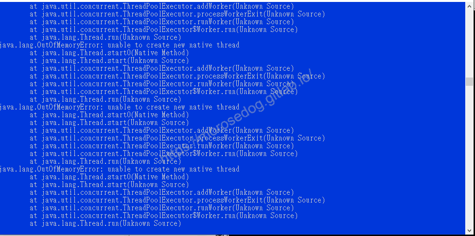

# Java 是什麼？

# 天堂私服 | Java 是什麼？

    
    
      📑 目錄
      

1. [先說](#先說)
2. [Java 是什麼？](#Java-是什麼？)
3. [為何選 Java？](#為何選-Java？)
4. [Java 的優點有哪些？](#Java-的優點有哪些？)
5. [Java 的缺點有哪些？](#Java-的缺點有哪些？)
6. [額外延伸](#額外延伸)
7. [結語](#結語)
8. [免責聲明](#免責聲明)

    
    
    

## 先說

本篇文章將會講述關於 Java 的一些歷史、特性、用途、評比…等等，會有些枯燥乏味，如果看不下去或不想看，我建議先行跳過，避免造成抗拒學習的心態；
對於剛剛入門的來說，我覺得其實先不看也沒關係的。

> 註：了解一套語言的歷史、特性，其實是滿重要的，但多數學習者常常因為這些內容無趣枯燥乏味而退之。建議在未來學習過程中，有問題或是產生興趣再回頭看也不遲。

## Java 是什麼？

**此處只是大概提及一些 Java 的相關知識，至少不會對 Java 這麼陌生。如果想要更深入了解。可以參考 [維基百科 - Java](https://zh.wikipedia.org/wiki/Java)。**​‌‌‌​​​​​‌‌‌​​‌​​‌‌​‌​​‌​‌‌‌​‌‌​​‌‌​​​​‌​‌‌‌​‌​​​‌‌​​‌​‌​​‌​‌‌​‌​‌‌​‌‌​​​‌‌​‌​​‌​‌‌​‌‌‌​​‌‌​​‌​‌​‌‌​​​​‌​‌‌​​‌‌‌​‌‌​​‌​‌​​‌​‌‌​‌​​‌‌​​‌​​​‌‌​​​​​​‌‌​​‌​​​‌‌​​​‌​​‌‌​​​​​​‌‌​‌‌‌​​‌‌​​​‌​​‌‌​‌​​​​‌​‌‌​‌​‌‌‌​​​​​‌‌‌​​‌​​‌‌​‌​​‌​‌‌‌​‌‌​​‌‌​​​​‌​‌‌‌​‌​​​‌‌​​‌​‌​​‌​‌‌​‌​‌‌​‌‌​​​‌‌​‌​​‌​‌‌​‌‌‌​​‌‌​​‌​‌​‌‌​​​​‌​‌‌​​‌‌‌​‌‌​​‌​‌​​‌​‌‌​‌​​‌‌​​‌​

---

Java 是一種廣泛使用的電腦程式設計語言，擁有 -

* [跨平台](https://zh.wikipedia.org/wiki/%E8%B7%A8%E5%B9%B3%E8%87%BA)

* [物件導向](https://zh.wikipedia.org/wiki/%E9%9D%A2%E5%90%91%E5%AF%B9%E8%B1%A1%E7%A8%8B%E5%BA%8F%E8%AE%BE%E8%AE%A1)

* [泛型程式設計](https://zh.wikipedia.org/wiki/%E6%B3%9B%E5%9E%8B%E7%BC%96%E7%A8%8B)

的特性，廣泛應用於企業級Web應用開發和行動應用開發。

> 註：三個特性看不懂？沒關係，先知道有這三個主要的特性，嘗試用自己能理解的方式去理解；還是不理解？先不要鑽牛角尖，建議先跳過唷。​‌‌‌​​​​​‌‌‌​​‌​​‌‌​‌​​‌​‌‌‌​‌‌​​‌‌​​​​‌​‌‌‌​‌​​​‌‌​​‌​‌​​‌​‌‌​‌​‌‌​‌‌​​​‌‌​‌​​‌​‌‌​‌‌‌​​‌‌​​‌​‌​‌‌​​​​‌​‌‌​​‌‌‌​‌‌​​‌​‌​​‌​‌‌​‌​​‌‌​​‌​​​‌‌​​​​​​‌‌​​‌​​​‌‌​​​‌​​‌‌​​​​​​‌‌​‌‌‌​​‌‌​​​‌​​‌‌​‌​​​​‌​‌‌​‌​‌‌‌​​​​​‌‌‌​​‌​​‌‌​‌​​‌​‌‌‌​‌‌​​‌‌​​​​‌​‌‌‌​‌​​​‌‌​​‌​‌​​‌​‌‌​‌​‌‌​‌‌​​​‌‌​‌​​‌​‌‌​‌‌‌​​‌‌​​‌​‌​‌‌​​​​‌​‌‌​​‌‌‌​‌‌​​‌​‌​​‌​‌‌​‌​​‌‌​​‌​

Java 是 Sun Microsystems 於 1995 年率先發表的程式設計語言與運算平台。許多應用程式和網站均需要安裝 Java 才能夠執行，且數量日漸增長。Java 既快速、安全又可靠。從膝上型電腦到資料中心、從遊戲機到科學用超級電腦、從行動電話到網際網路，Java 均無所不在！

Java 是一種用於開發應用程式的技術，能夠讓網路世界更加有趣與更好用。 Java 與 Javascript 並不相同，Javascript 是一種用來建立網頁的簡單技術，而且只能在瀏覽器中執行。

> 註：剛開始很多人會將「Java」、「JavaScript」這兩個混為一談，其實他們不過就是名字取的像了點，並不表示他們是一樣的東西唷。​‌‌‌​​​​​‌‌‌​​‌​​‌‌​‌​​‌​‌‌‌​‌‌​​‌‌​​​​‌​‌‌‌​‌​​​‌‌​​‌​‌​​‌​‌‌​‌​‌‌​‌‌​​​‌‌​‌​​‌​‌‌​‌‌‌​​‌‌​​‌​‌​‌‌​​​​‌​‌‌​​‌‌‌​‌‌​​‌​‌​​‌​‌‌​‌​​‌‌​​‌​​​‌‌​​​​​​‌‌​​‌​​​‌‌​​​‌​​‌‌​​​​​​‌‌​‌‌‌​​‌‌​​​‌​​‌‌​‌​​​​‌​‌‌​‌​‌‌‌​​​​​‌‌‌​​‌​​‌‌​‌​​‌​‌‌‌​‌‌​​‌‌​​​​‌​‌‌‌​‌​​​‌‌​​‌​‌​​‌​‌‌​‌​‌‌​‌‌​​​‌‌​‌​​‌​‌‌​‌‌‌​​‌‌​​‌​‌​‌‌​​​​‌​‌‌​​‌‌‌​‌‌​​‌​‌​​‌​‌‌​‌​​‌‌​​‌​

## 為何選 Java？

Java 至今仍然是 [TIOBE](https://www.tiobe.com/tiobe-index/) 熱門排行榜前幾名，所以非常值得新手學習投入。

其次最重要的就是，**最早期的天堂模擬器是由日本團隊使用 Java 做開發**，所以至今多數常見的天堂模擬器都是由 Java 撰寫開發編修的。

---

* 是否會有疑問~可以透過其他程式語言開發模擬器？！答案是 -

  * **絕對可以的。只要有心有興趣是絕對可以使用其他程式語言進行模擬器的開發。**

> 註：基本上一套專案是需要大量的時間分析、設計、開發、測試，所以基本上多數的專案都是參考現有的專案進行修改重構的。​‌‌‌​​​​​‌‌‌​​‌​​‌‌​‌​​‌​‌‌‌​‌‌​​‌‌​​​​‌​‌‌‌​‌​​​‌‌​​‌​‌​​‌​‌‌​‌​‌‌​‌‌​​​‌‌​‌​​‌​‌‌​‌‌‌​​‌‌​​‌​‌​‌‌​​​​‌​‌‌​​‌‌‌​‌‌​​‌​‌​​‌​‌‌​‌​​‌‌​​‌​​​‌‌​​​​​​‌‌​​‌​​​‌‌​​​‌​​‌‌​​​​​​‌‌​‌‌‌​​‌‌​​​‌​​‌‌​‌​​​​‌​‌‌​‌​‌‌‌​​​​​‌‌‌​​‌​​‌‌​‌​​‌​‌‌‌​‌‌​​‌‌​​​​‌​‌‌‌​‌​​​‌‌​​‌​‌​​‌​‌‌​‌​‌‌​‌‌​​​‌‌​‌​​‌​‌‌​‌‌‌​​‌‌​​‌​‌​‌‌​​​​‌​‌‌​​‌‌‌​‌‌​​‌​‌​​‌​‌‌​‌​​‌‌​​‌​

## Java 的優點有哪些？

* 跨平台、相容性高

Java 最大的特色「一次編寫，隨處運行」。
對於一個工程師而言，寫出來的程式如果不需修改，就能夠同時在 Windows、MacOS、Linux 等平台上執行，簡直就是美夢成真的好事，而 Java 就讓這個原本遙不可及的事離我們越來越近。
使用 Java 編寫的程式，只要做較少的修改，甚至有時根本不需修改就可以在不同平台上執行了，Java 絕對是跨平台的一門程式語言。

* 可以做各式各樣的應用

上面有提到 Java 的應用範圍，其實非常廣泛，沒有侷限在特定領域。
不論是網站、應用程式、GUI、伺服器，都可以透過 Java 撰寫而成。

* 市場需求高

根據  [TIOBE](https://www.tiobe.com/tiobe-index/) 程式語言排名，Java 在 2021 仍然是非常熱門的程式語言。
所以熟練 Java 在短時間內絕對不會找不到工作，市場需求非常高。​‌‌‌​​​​​‌‌‌​​‌​​‌‌​‌​​‌​‌‌‌​‌‌​​‌‌​​​​‌​‌‌‌​‌​​​‌‌​​‌​‌​​‌​‌‌​‌​‌‌​‌‌​​​‌‌​‌​​‌​‌‌​‌‌‌​​‌‌​​‌​‌​‌‌​​​​‌​‌‌​​‌‌‌​‌‌​​‌​‌​​‌​‌‌​‌​​‌‌​​‌​​​‌‌​​​​​​‌‌​​‌​​​‌‌​​​‌​​‌‌​​​​​​‌‌​‌‌‌​​‌‌​​​‌​​‌‌​‌​​​​‌​‌‌​‌​‌‌‌​​​​​‌‌‌​​‌​​‌‌​‌​​‌​‌‌‌​‌‌​​‌‌​​​​‌​‌‌‌​‌​​​‌‌​​‌​‌​​‌​‌‌​‌​‌‌​‌‌​​​‌‌​‌​​‌​‌‌​‌‌‌​​‌‌​​‌​‌​‌‌​​​​‌​‌‌​​‌‌‌​‌‌​​‌​‌​​‌​‌‌​‌​​‌‌​​‌​

## Java 的缺點有哪些？

其實缺點的定義部分有些會因人而異，所以此處僅提及幾項：

* Java 因為功能強大，在一些記憶體處理、資源清理的部分並沒有做的比 C、C++ 來的好，所以相較之下速度比較緩慢。

* Java 占用的系統記憶體是遠遠高於C的，稍微大一點的項目，他啟動起來並不是那麼的迅速，且在執行一段時間後，可能會發生[OOM(Out of memory)](https://en.wikipedia.org/wiki/Out_of_memory)的情況。

> 註：OOM的發生，發生的可能性很多，記憶體配置太少、程式開發上的Bug…等等。

## 額外延伸

在一些論壇或是文章中，最常看見的問題就是「黑盒子運行一段期間會跳出這樣的錯誤」。​‌‌‌​​​​​‌‌‌​​‌​​‌‌​‌​​‌​‌‌‌​‌‌​​‌‌​​​​‌​‌‌‌​‌​​​‌‌​​‌​‌​​‌​‌‌​‌​‌‌​‌‌​​​‌‌​‌​​‌​‌‌​‌‌‌​​‌‌​​‌​‌​‌‌​​​​‌​‌‌​​‌‌‌​‌‌​​‌​‌​​‌​‌‌​‌​​‌‌​​‌​​​‌‌​​​​​​‌‌​​‌​​​‌‌​​​‌​​‌‌​​​​​​‌‌​‌‌‌​​‌‌​​​‌​​‌‌​‌​​​​‌​‌‌​‌​‌‌‌​​​​​‌‌‌​​‌​​‌‌​‌​​‌​‌‌‌​‌‌​​‌‌​​​​‌​‌‌‌​‌​​​‌‌​​‌​‌​​‌​‌‌​‌​‌‌​‌‌​​​‌‌​‌​​‌​‌‌​‌‌‌​​‌‌​​‌​‌​‌‌​​​​‌​‌‌​​‌‌‌​‌‌​​‌​‌​​‌​‌‌​‌​​‌‌​​‌​

天堂私服，通常都會有固定時間的維護重啟，多數是為了要釋放記憶體，如果長時間不重啟，最常見的就是OOM的發生。

## 結語

想要針對之後的天堂私服模擬器核心上的修改，勢必是需要對 Java 有一個基礎的學習與了解；但也不要給自己太大壓力或是要求，基本上先從興趣開始模起，我相信這樣的學習會比直接去看類似的 Java 菜鳥教學，然後一系列的章節目錄去做學習來的輕鬆，也比較能保持著學習熱忱。
最後建議回顧一下首章[天堂私服 | 天堂私服架設教學](/private-lineage-20210712-private-lineage-0/#教學章節)，了解其章節目錄。​‌‌‌​​​​​‌‌‌​​‌​​‌‌​‌​​‌​‌‌‌​‌‌​​‌‌​​​​‌​‌‌‌​‌​​​‌‌​​‌​‌​​‌​‌‌​‌​‌‌​‌‌​​​‌‌​‌​​‌​‌‌​‌‌‌​​‌‌​​‌​‌​‌‌​​​​‌​‌‌​​‌‌‌​‌‌​​‌​‌​​‌​‌‌​‌​​‌‌​​‌​​​‌‌​​​​​​‌‌​​‌​​​‌‌​​​‌​​‌‌​​​​​​‌‌​‌‌‌​​‌‌​​​‌​​‌‌​‌​​​​‌​‌‌​‌​‌‌‌​​​​​‌‌‌​​‌​​‌‌​‌​​‌​‌‌‌​‌‌​​‌‌​​​​‌​‌‌‌​‌​​​‌‌​​‌​‌​​‌​‌‌​‌​‌‌​‌‌​​​‌‌​‌​​‌​‌‌​‌‌‌​​‌‌​​‌​‌​‌‌​​​​‌​‌‌​​‌‌‌​‌‌​​‌​‌​​‌​‌‌​‌​​‌‌​​‌​

## 免責聲明

* 本部落格文章中皆<u>**不提供**</u>任何所謂的遊戲「主程式」、「模擬器」、「登入器」…等等相關程式的下載點。

* 本部落格文章中所見之遊戲主程式和服務器端程序均來自網路發佈，<u>版本歸**原作者**</u>所有。

* 本部落格文章為研究SQL資料庫與修改JAVA語法使用，並<u>**非商業用途**</u>，亦<u>**無做營運事實等任何一切商業行為**</u>。

* 本部落格文章內容是為研究學習設計思想和原理為目的，<u>**絕沒有故意侵權或惡意抄襲、篡改其他遊戲內容**</u>！

> 註：以上參考了
> [維基百科 - Java伺服器](https://zh.wikipedia.org/zh-tw/Java)
> [維基百科 - 跨平台](https://zh.wikipedia.org/wiki/%E8%B7%A8%E5%B9%B3%E8%87%BA)
> [維基百科 - 物件導向](https://zh.wikipedia.org/wiki/%E9%9D%A2%E5%90%91%E5%AF%B9%E8%B1%A1%E7%A8%8B%E5%BA%8F%E8%AE%BE%E8%AE%A1)
> [維基百科 - 泛型程式設計](https://zh.wikipedia.org/wiki/%E6%B3%9B%E5%9E%8B%E7%BC%96%E7%A8%8B)
> [TIOBE](https://www.tiobe.com/tiobe-index/)

---

- **原文連結**：[J.J.'s Blogs - Java 是什麼？](https://morosedog.gitlab.io/private-lineage-20210714-private-lineage-2/)
