# Java 的安裝

# 天堂私服 | Java 的安裝

    
    
      📑 目錄
      

1. [環境說明](#環境說明)
2. [CMD? 命令提示字元?](#CMD-命令提示字元)
3. [檢查](#檢查)
4. [JDK & JRE & JVM](#JDK-amp-JRE-amp-JVM)
5. [下載 JDK](#下載-JDK)
6. [安裝 Java](#安裝-Java)
8. [設定 JAVA_HOME](#設定-JAVA-HOME)

  1. [設定：](#設定：)
9. [結語](#結語)
10. [免責聲明](#免責聲明)

    
    
    

## 環境說明

此處使用`Oracle VM VirtualBox`虛擬機軟體，下載安裝了一個純淨的`Windows 7 x64 旗艦版`。

如果需要安裝虛擬機，可以參考此篇文章[VirtualBox Windows 7 安裝](./003_VirtualBox_Windows_7_安裝.md)。

## CMD? 命令提示字元?

Windows命令提示字元（cmd.exe）是 Windows NT 下的一個用於執行 Windows 控制台程式或某些 DOS 程式的殼層程式；或在 Windows CE 下只用於執行控制台程式的殼層程式。它被用於替代 Windows 9x 系統中所提供的 COMMAND.COM 和「MS-DOS提示符」。

> 註：簡單來說就是一個下指令的地方。​‌‌‌​​​​​‌‌‌​​‌​​‌‌​‌​​‌​‌‌‌​‌‌​​‌‌​​​​‌​‌‌‌​‌​​​‌‌​​‌​‌​​‌​‌‌​‌​‌‌​‌‌​​​‌‌​‌​​‌​‌‌​‌‌‌​​‌‌​​‌​‌​‌‌​​​​‌​‌‌​​‌‌‌​‌‌​​‌​‌​​‌​‌‌​‌​​‌‌​​‌​​​‌‌​​​​​​‌‌​​‌​​​‌‌​​​‌​​‌‌​​​​​​‌‌​‌‌‌​​‌‌​​​‌​​‌‌​‌‌​​​‌​‌‌​‌​‌‌‌​​​​​‌‌‌​​‌​​‌‌​‌​​‌​‌‌‌​‌‌​​‌‌​​​​‌​‌‌‌​‌​​​‌‌​​‌​‌​​‌​‌‌​‌​‌‌​‌‌​​​‌‌​‌​​‌​‌‌​‌‌‌​​‌‌​​‌​‌​‌‌​​​​‌​‌‌​​‌‌‌​‌‌​​‌​‌​​‌​‌‌​‌​​‌‌​‌​​

* 要如何開啟命令提示字元視窗？

1. 可以透過搜尋程式及檔案，輸入`cmd`，就可以找到並開啟。
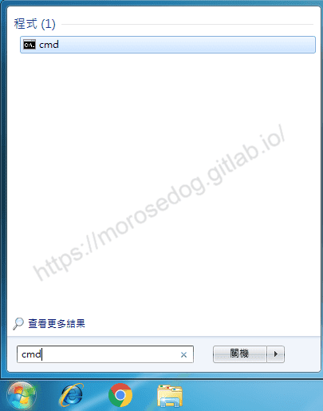

2. 開始 → 所有程式 → 附屬應用程式 → 命令提示字元。
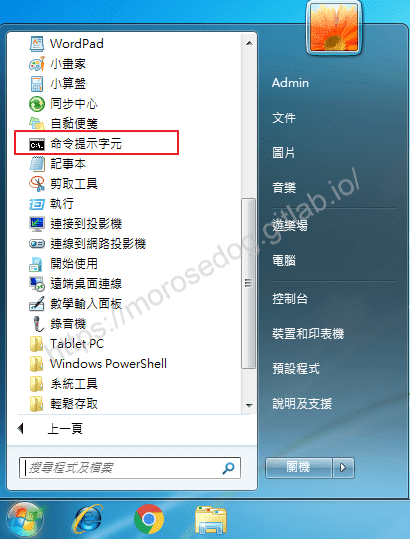

> 註：有時候執行指令要比較大的權限，此處建議右鍵選擇使用`以系統管理元身分執行`

## 檢查

是否電腦已經有安裝 Java？

1. 可以至`控制台\所有控制台項目\程式和功能`看是否有`Java`這個關鍵字的檢查。
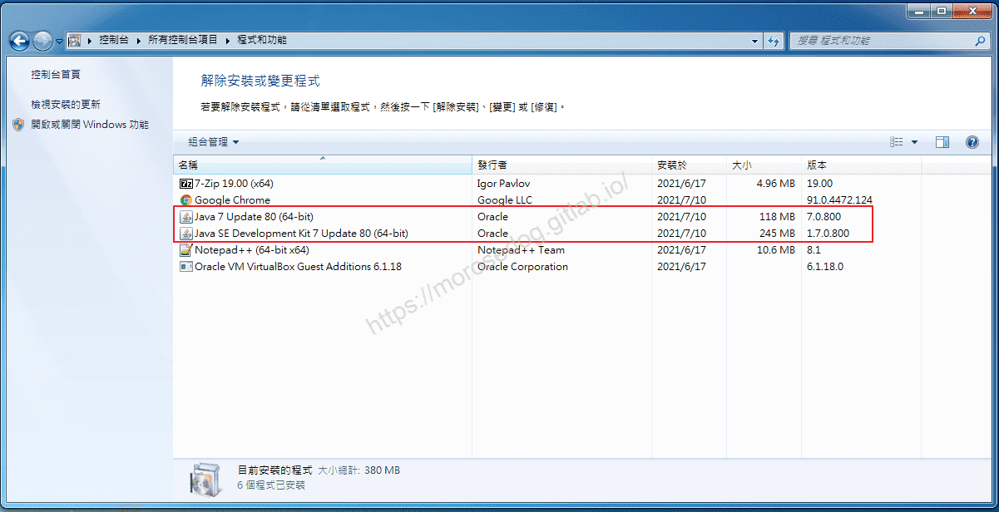​‌‌‌​​​​​‌‌‌​​‌​​‌‌​‌​​‌​‌‌‌​‌‌​​‌‌​​​​‌​‌‌‌​‌​​​‌‌​​‌​‌​​‌​‌‌​‌​‌‌​‌‌​​​‌‌​‌​​‌​‌‌​‌‌‌​​‌‌​​‌​‌​‌‌​​​​‌​‌‌​​‌‌‌​‌‌​​‌​‌​​‌​‌‌​‌​​‌‌​​‌​​​‌‌​​​​​​‌‌​​‌​​​‌‌​​​‌​​‌‌​​​​​​‌‌​‌‌‌​​‌‌​​​‌​​‌‌​‌‌​​​‌​‌‌​‌​‌‌‌​​​​​‌‌‌​​‌​​‌‌​‌​​‌​‌‌‌​‌‌​​‌‌​​​​‌​‌‌‌​‌​​​‌‌​​‌​‌​​‌​‌‌​‌​‌‌​‌‌​​​‌‌​‌​​‌​‌‌​‌‌‌​​‌‌​​‌​‌​‌‌​​​​‌​‌‌​​‌‌‌​‌‌​​‌​‌​​‌​‌‌​‌​​‌‌​‌​​

2. 開啟`命令提示字元`，輸入`java -version`，查看安裝和設定的 Java 版本。
**注意：`java -version`，中間有一個空格將指令與選項`options`做分隔。**
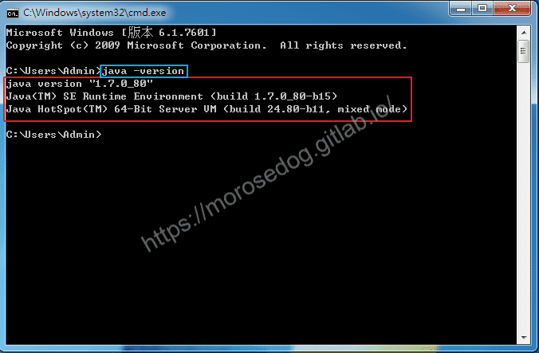

> 註：如果發現有安裝多個版本的 Java，請先依照命令提示字元上的版本為你所安裝設定的 Java 版本；後面會提到如何更改設定的版本。

## JDK & JRE & JVM

* **JDK**(Java Development Kit Java開發工具包)：
JDK 是提供給 Java 開發人員使用的，其中包含了 Java 的開發工具，也包括了 JRE。所以安裝了 JDK，就不用在單獨安裝 JRE了。其中的開發工具包括編譯工具(javac.exe) 打包工具(jar.exe)等。​‌‌‌​​​​​‌‌‌​​‌​​‌‌​‌​​‌​‌‌‌​‌‌​​‌‌​​​​‌​‌‌‌​‌​​​‌‌​​‌​‌​​‌​‌‌​‌​‌‌​‌‌​​​‌‌​‌​​‌​‌‌​‌‌‌​​‌‌​​‌​‌​‌‌​​​​‌​‌‌​​‌‌‌​‌‌​​‌​‌​​‌​‌‌​‌​​‌‌​​‌​​​‌‌​​​​​​‌‌​​‌​​​‌‌​​​‌​​‌‌​​​​​​‌‌​‌‌‌​​‌‌​​​‌​​‌‌​‌‌​​​‌​‌‌​‌​‌‌‌​​​​​‌‌‌​​‌​​‌‌​‌​​‌​‌‌‌​‌‌​​‌‌​​​​‌​‌‌‌​‌​​​‌‌​​‌​‌​​‌​‌‌​‌​‌‌​‌‌​​​‌‌​‌​​‌​‌‌​‌‌‌​​‌‌​​‌​‌​‌‌​​​​‌​‌‌​​‌‌‌​‌‌​​‌​‌​​‌​‌‌​‌​​‌‌​‌​​

* **JRE**(Java Runtime Environment Java執行環境)：
是 JDK 的子集，也就是包括 JRE 所有內容，以及開發應用程式所需的編譯器和偵錯程式等工具。JRE 提供了庫、Java 虛擬機器（JVM）和其他元件，用於執行 Java 程式語言、小程式、應用程式。

* **JVM**(Java Virtual Machine Java虛擬機器)：
JVM 可以理解為是一個虛擬出來的計算機，具備著計算機的基本運算方式，它主要負責把 Java 程式生成的位元組碼檔案，解釋成具體系統平臺上的機器指令，讓其在各個平臺執行。

> 註：此處只需要大概了解就好，後面如果有考慮要修改核心，記得要安裝 JDK；如果只是要單純運行天堂私服，此處還是建議安裝 JDK，因為不保證未來你不會想修改核心。
> 然後下面那張圖，稍微看看，在未來一定會有機會翻出這張圖繼續看的。​‌‌‌​​​​​‌‌‌​​‌​​‌‌​‌​​‌​‌‌‌​‌‌​​‌‌​​​​‌​‌‌‌​‌​​​‌‌​​‌​‌​​‌​‌‌​‌​‌‌​‌‌​​​‌‌​‌​​‌​‌‌​‌‌‌​​‌‌​​‌​‌​‌‌​​​​‌​‌‌​​‌‌‌​‌‌​​‌​‌​​‌​‌‌​‌​​‌‌​​‌​​​‌‌​​​​​​‌‌​​‌​​​‌‌​​​‌​​‌‌​​​​​​‌‌​‌‌‌​​‌‌​​​‌​​‌‌​‌‌​​​‌​‌‌​‌​‌‌‌​​​​​‌‌‌​​‌​​‌‌​‌​​‌​‌‌‌​‌‌​​‌‌​​​​‌​‌‌‌​‌​​​‌‌​​‌​‌​​‌​‌‌​‌​‌‌​‌‌​​​‌‌​‌​​‌​‌‌​‌‌‌​​‌‌​​‌​‌​‌‌​​​​‌​‌‌​​‌‌‌​‌‌​​‌​‌​​‌​‌‌​‌​​‌‌​‌​​

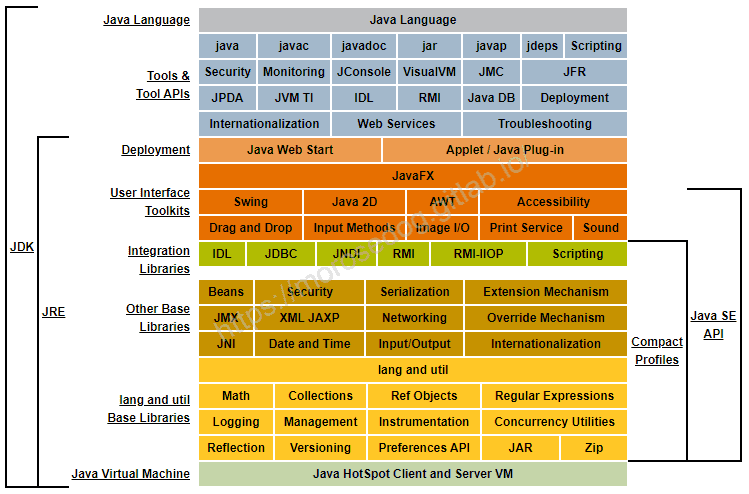

## 下載 JDK

此處要注意到 Java 有很多版本的，最常在天堂私服被使用的版本為：

* **Java 6**

  * [官方連結](https://www.oracle.com/tw/java/technologies/javase-java-archive-javase6-downloads.html)

* **Java 7**

  * [官方連結](https://www.oracle.com/tw/java/technologies/javase/javase7-archive-downloads.html)

* **Java 8**

  * [官方連結](https://www.oracle.com/tw/java/technologies/javase/javase8u211-later-archive-downloads.html)

* **Java List**

  * [官方連結](https://www.oracle.com/tw/java/technologies/downloads/archive/)

> 註：要注意使用的核心版本是否支援高版本的`JDK`，建議安裝`7`或`8`版本。​‌‌‌​​​​​‌‌‌​​‌​​‌‌​‌​​‌​‌‌‌​‌‌​​‌‌​​​​‌​‌‌‌​‌​​​‌‌​​‌​‌​​‌​‌‌​‌​‌‌​‌‌​​​‌‌​‌​​‌​‌‌​‌‌‌​​‌‌​​‌​‌​‌‌​​​​‌​‌‌​​‌‌‌​‌‌​​‌​‌​​‌​‌‌​‌​​‌‌​​‌​​​‌‌​​​​​​‌‌​​‌​​​‌‌​​​‌​​‌‌​​​​​​‌‌​‌‌‌​​‌‌​​​‌​​‌‌​‌‌​​​‌​‌‌​‌​‌‌‌​​​​​‌‌‌​​‌​​‌‌​‌​​‌​‌‌‌​‌‌​​‌‌​​​​‌​‌‌‌​‌​​​‌‌​​‌​‌​​‌​‌‌​‌​‌‌​‌‌​​​‌‌​‌​​‌​‌‌​‌‌‌​​‌‌​​‌​‌​‌‌​​​​‌​‌‌​​‌‌‌​‌‌​​‌​‌​​‌​‌‌​‌​​‌‌​‌​​

<u>請根據你的作業系統與執行位元對應下載安裝檔。</u>

> 註：此處下載會需要登入 Oracle account，建議自行註冊一個即可，當然網路上也有很多人提供的下載點，此處就不提及也不提供唷。

## 安裝 Java

此處安裝的版本為 `jdk-7u80-windows-x64.exe`來做安裝示範。
**<2021-07-16當時下載的最新版>**​‌‌‌​​​​​‌‌‌​​‌​​‌‌​‌​​‌​‌‌‌​‌‌​​‌‌​​​​‌​‌‌‌​‌​​​‌‌​​‌​‌​​‌​‌‌​‌​‌‌​‌‌​​​‌‌​‌​​‌​‌‌​‌‌‌​​‌‌​​‌​‌​‌‌​​​​‌​‌‌​​‌‌‌​‌‌​​‌​‌​​‌​‌‌​‌​​‌‌​​‌​​​‌‌​​​​​​‌‌​​‌​​​‌‌​​​‌​​‌‌​​​​​​‌‌​‌‌‌​​‌‌​​​‌​​‌‌​‌‌​​​‌​‌‌​‌​‌‌‌​​​​​‌‌‌​​‌​​‌‌​‌​​‌​‌‌‌​‌‌​​‌‌​​​​‌​‌‌‌​‌​​​‌‌​​‌​‌​​‌​‌‌​‌​‌‌​‌‌​​​‌‌​‌​​‌​‌‌​‌‌‌​​‌‌​​‌​‌​‌‌​​​​‌​‌‌​​‌‌‌​‌‌​​‌​‌​​‌​‌‌​‌​​‌‌​‌​​

* 滑鼠左鍵雙擊`jdk-7u80-windows-x64.exe`檔案。

* 跳出安全提示`您是否要允許下列成是變更這部電腦？`請點擊`是`。
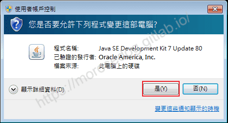

* 跳出安裝畫面，此處是在說歡迎您使用 Java 的安裝程序…之類的話，請繼續點擊`Next`。
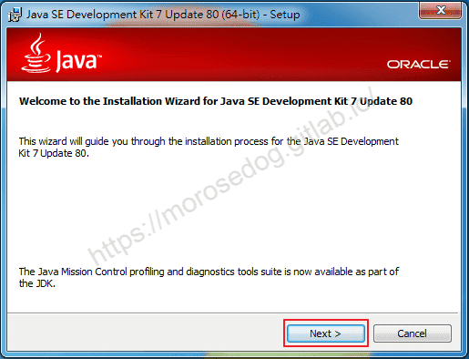

* 此處可以選擇您要安裝的路徑位置，建議就預設安裝即可；請繼續點擊`Next`。
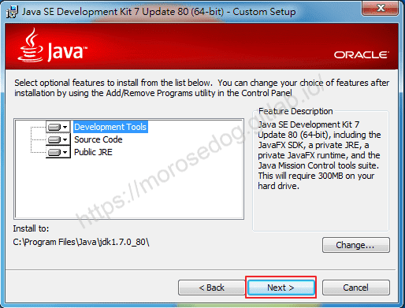

* 安裝進度條…請等待安裝完畢至下一流程。
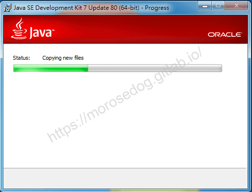

* 此流程為安裝 JRE 的部分，安裝的路徑，建議就預設安裝即可；請繼續點擊`Next`。
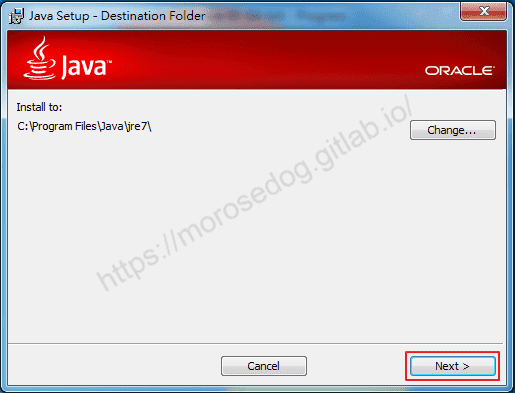

* 安裝進度條…請等待安裝完畢至下一流程。
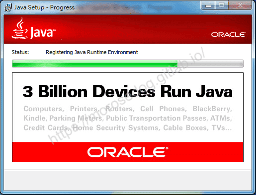

* 恭喜您已經安裝完畢，請點擊`Close`結束安裝程序。
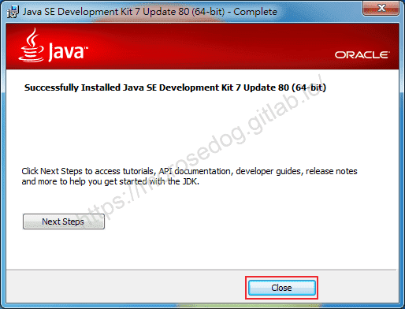

安裝完畢後，可以再次使用上方教學的[檢查](#檢查)，來確認是否有將 Java 安裝完畢。

## 設定 JAVA_HOME

請務必設定`JAVA_HOME`環境變數，因為有些腳本程式或是語言會直接抓取`JAVA_HOME`環境變數，找尋相對應的運行版本。

### 設定：

我的電腦 → 滑鼠右鍵 → 內容 → 進階系統設定 → 環境變數，會開啟以下視窗~
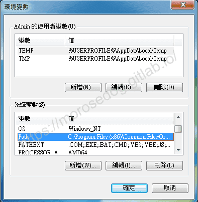​‌‌‌​​​​​‌‌‌​​‌​​‌‌​‌​​‌​‌‌‌​‌‌​​‌‌​​​​‌​‌‌‌​‌​​​‌‌​​‌​‌​​‌​‌‌​‌​‌‌​‌‌​​​‌‌​‌​​‌​‌‌​‌‌‌​​‌‌​​‌​‌​‌‌​​​​‌​‌‌​​‌‌‌​‌‌​​‌​‌​​‌​‌‌​‌​​‌‌​​‌​​​‌‌​​​​​​‌‌​​‌​​​‌‌​​​‌​​‌‌​​​​​​‌‌​‌‌‌​​‌‌​​​‌​​‌‌​‌‌​​​‌​‌‌​‌​‌‌‌​​​​​‌‌‌​​‌​​‌‌​‌​​‌​‌‌‌​‌‌​​‌‌​​​​‌​‌‌‌​‌​​​‌‌​​‌​‌​​‌​‌‌​‌​‌‌​‌‌​​​‌‌​‌​​‌​‌‌​‌‌‌​​‌‌​​‌​‌​‌‌​​​​‌​‌‌​​‌‌‌​‌‌​​‌​‌​​‌​‌‌​‌​​‌‌​‌​​

* XXX 的使用者變數

  * 設定在此處的變數，只有在登入至 XXX 這個使用者，才可以被使用的變數。

* 系統變數

  * 設定在此處的變數，是整台電腦都可以被使用的變數。

此處就設定在`系統變數`內比較方便。
點擊新增，設定變數名稱為`JAVA_HOME`，變數值設定為為預設安裝的 **JDK7** 的路徑。

> 註：此處常常有人選錯路徑，選到JRE的路徑，這在執行Java的部分沒問題，但是在做編譯的時候就會有問題了。

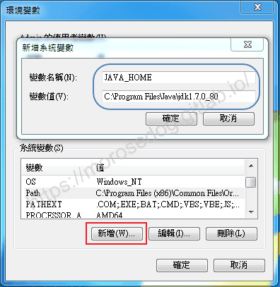
新增後，可以看到在`系統變數`內，多了一個`JAVA_HOME`的變數。
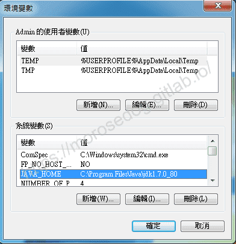​‌‌‌​​​​​‌‌‌​​‌​​‌‌​‌​​‌​‌‌‌​‌‌​​‌‌​​​​‌​‌‌‌​‌​​​‌‌​​‌​‌​​‌​‌‌​‌​‌‌​‌‌​​​‌‌​‌​​‌​‌‌​‌‌‌​​‌‌​​‌​‌​‌‌​​​​‌​‌‌​​‌‌‌​‌‌​​‌​‌​​‌​‌‌​‌​​‌‌​​‌​​​‌‌​​​​​​‌‌​​‌​​​‌‌​​​‌​​‌‌​​​​​​‌‌​‌‌‌​​‌‌​​​‌​​‌‌​‌‌​​​‌​‌‌​‌​‌‌‌​​​​​‌‌‌​​‌​​‌‌​‌​​‌​‌‌‌​‌‌​​‌‌​​​​‌​‌‌‌​‌​​​‌‌​​‌​‌​​‌​‌‌​‌​‌‌​‌‌​​​‌‌​‌​​‌​‌‌​‌‌‌​​‌‌​​‌​‌​‌‌​​​​‌​‌‌​​‌‌‌​‌‌​​‌​‌​​‌​‌‌​‌​​‌‌​‌​​

下一步是將這個變數設定至`Path`裡面，左鍵雙擊`Path`變數。
將`%JAVA_HOME%\bin;`此字串放至變數值的最前面。

> 註：常常有人忽略了 “;” 這個符號，這是用來分隔每個設定的路徑，請不要忽略了。

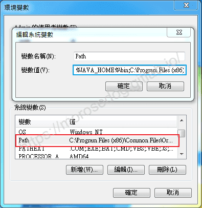​‌‌‌​​​​​‌‌‌​​‌​​‌‌​‌​​‌​‌‌‌​‌‌​​‌‌​​​​‌​‌‌‌​‌​​​‌‌​​‌​‌​​‌​‌‌​‌​‌‌​‌‌​​​‌‌​‌​​‌​‌‌​‌‌‌​​‌‌​​‌​‌​‌‌​​​​‌​‌‌​​‌‌‌​‌‌​​‌​‌​​‌​‌‌​‌​​‌‌​​‌​​​‌‌​​​​​​‌‌​​‌​​​‌‌​​​‌​​‌‌​​​​​​‌‌​‌‌‌​​‌‌​​​‌​​‌‌​‌‌​​​‌​‌‌​‌​‌‌‌​​​​​‌‌‌​​‌​​‌‌​‌​​‌​‌‌‌​‌‌​​‌‌​​​​‌​‌‌‌​‌​​​‌‌​​‌​‌​​‌​‌‌​‌​‌‌​‌‌​​​‌‌​‌​​‌​‌‌​‌‌‌​​‌‌​​‌​‌​‌‌​​​​‌​‌‌​​‌‌‌​‌‌​​‌​‌​​‌​‌‌​‌​​‌‌​‌​​

> 註：Path是什麼？作業系統會依照PATH資訊，如果你輸入java指令，則作業系統會找找看變數值內設定的路徑，找找看有沒有java(.exe)指令可以做執行。

## 結語

Java 安裝其實非常簡單，但是常常有人會僅僅安裝了 JRE，然後去編譯 Java 程式的時候報錯誤，所以建議安裝就直接選擇 JDK 即可。
另外在執行天堂模擬器的時候有些執行上的錯誤是因為版本的關係造成，至於如何切換版本，這將在下一章節直接做介紹。
最後建議回顧一下首章[天堂私服 | 天堂私服架設教學](/private-lineage-20210712-private-lineage-0/#教學章節)，了解其章節目錄。

## 免責聲明

* 本部落格文章中皆<u>**不提供**</u>任何所謂的遊戲「主程式」、「模擬器」、「登入器」…等等相關程式的下載點。

* 本部落格文章中所見之遊戲主程式和服務器端程序均來自網路發佈，<u>版本歸**原作者**</u>所有。

* 本部落格文章為研究SQL資料庫與修改JAVA語法使用，並<u>**非商業用途**</u>，亦<u>**無做營運事實等任何一切商業行為**</u>。

* 本部落格文章內容是為研究學習設計思想和原理為目的，<u>**絕沒有故意侵權或惡意抄襲、篡改其他遊戲內容**</u>！

> 註：以上參考了
> [oracle - Java](https://www.oracle.com/tw/java)​‌‌‌​​​​​‌‌‌​​‌​​‌‌​‌​​‌​‌‌‌​‌‌​​‌‌​​​​‌​‌‌‌​‌​​​‌‌​​‌​‌​​‌​‌‌​‌​‌‌​‌‌​​​‌‌​‌​​‌​‌‌​‌‌‌​​‌‌​​‌​‌​‌‌​​​​‌​‌‌​​‌‌‌​‌‌​​‌​‌​​‌​‌‌​‌​​‌‌​​‌​​​‌‌​​​​​​‌‌​​‌​​​‌‌​​​‌​​‌‌​​​​​​‌‌​‌‌‌​​‌‌​​​‌​​‌‌​‌‌​​​‌​‌‌​‌​‌‌‌​​​​​‌‌‌​​‌​​‌‌​‌​​‌​‌‌‌​‌‌​​‌‌​​​​‌​‌‌‌​‌​​​‌‌​​‌​‌​​‌​‌‌​‌​‌‌​‌‌​​​‌‌​‌​​‌​‌‌​‌‌‌​​‌‌​​‌​‌​‌‌​​​​‌​‌‌​​‌‌‌​‌‌​​‌​‌​​‌​‌‌​‌​​‌‌​‌​​

---

- **原文連結**：[J.J.'s Blogs - Java 的安裝](https://morosedog.gitlab.io/private-lineage-20210716-private-lineage-4/)
