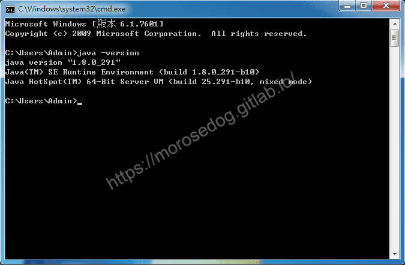
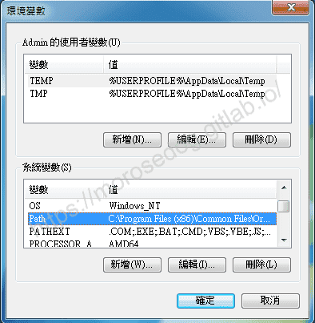
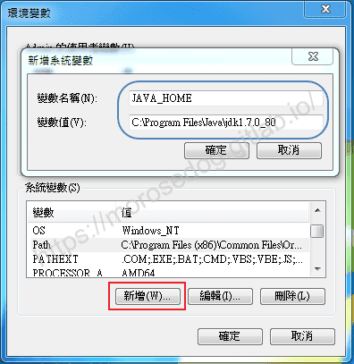
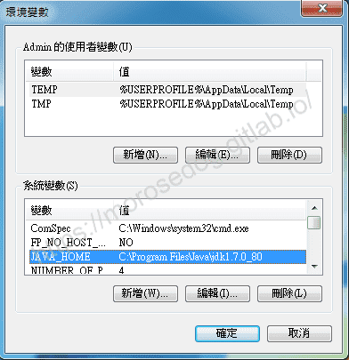
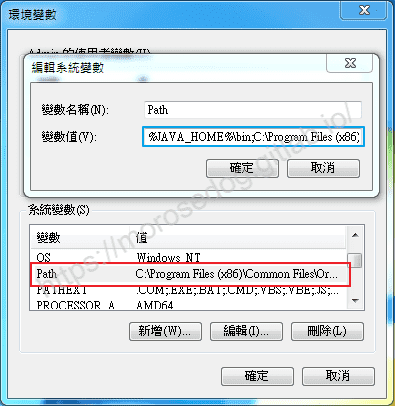
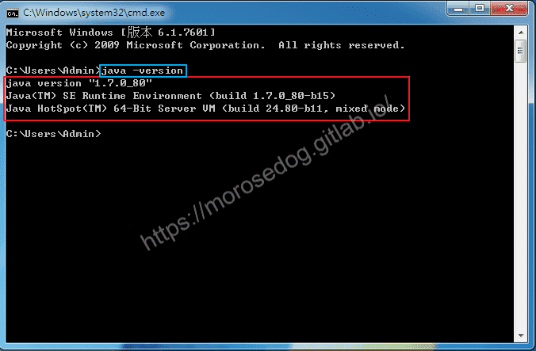

# Java 的版本切換

# 天堂私服 | Java 的版本切換

    
    
      📑 目錄
      

1. [建議](#建議)
2. [版本切換](#版本切換)
3. [檢查版本](#檢查版本)
4. [結語](#結語)
5. [免責聲明](#免責聲明)

    
    
    

## 建議

在做版本切換的時候，會使用到`命令提示字元`，用於檢查指定運行的 Java 版本確認。
如果不知道 `命令提示字元`，建議請先將上一章[天堂私服 | Java 的安裝](./003_VirtualBox_Windows_7_安裝.md)閱畢。

## 版本切換

當電腦內安裝了多個 Java 版本，往往會依照最新的版本或是最後安裝的版本為主要的運行版本。
像是安裝了 JDK7 在安裝 JDK8，此時在`命令提示字元`，輸入`java -version`，查看安裝 Java 版本，會看到是 JDK8 的版本。

​‌‌‌​​​​​‌‌‌​​‌​​‌‌​‌​​‌​‌‌‌​‌‌​​‌‌​​​​‌​‌‌‌​‌​​​‌‌​​‌​‌​​‌​‌‌​‌​‌‌​‌‌​​​‌‌​‌​​‌​‌‌​‌‌‌​​‌‌​​‌​‌​‌‌​​​​‌​‌‌​​‌‌‌​‌‌​​‌​‌​​‌​‌‌​‌​​‌‌​​‌​​​‌‌​​​​​​‌‌​​‌​​​‌‌​​​‌​​‌‌​​​​​​‌‌​‌‌‌​​‌‌​​​‌​​‌‌​‌‌‌​​‌​‌‌​‌​‌‌‌​​​​​‌‌‌​​‌​​‌‌​‌​​‌​‌‌‌​‌‌​​‌‌​​​​‌​‌‌‌​‌​​​‌‌​​‌​‌​​‌​‌‌​‌​‌‌​‌‌​​​‌‌​‌​​‌​‌‌​‌‌‌​​‌‌​​‌​‌​‌‌​​​​‌​‌‌​​‌‌‌​‌‌​​‌​‌​​‌​‌‌​‌​​‌‌​‌​‌

此時要切換，可以透過設定`環境變數`設定`JAVA_HOME`至`Path`內方可解決。

---

我的電腦 → 滑鼠右鍵 → 內容 → 進階系統設定 → 環境變數，會開啟以下視窗~

* XXX 的使用者變數

  * 設定在此處的變數，只有在登入至 XXX 這個使用者，才可以被使用的變數。

* 系統變數

  * 設定在此處的變數，是整台電腦都可以被使用的變數。

此處就設定在`系統變數`內比較方便。
點擊新增，設定變數名稱為`JAVA_HOME`，變數值設定為為預設安裝的**JDK7**的路徑。​‌‌‌​​​​​‌‌‌​​‌​​‌‌​‌​​‌​‌‌‌​‌‌​​‌‌​​​​‌​‌‌‌​‌​​​‌‌​​‌​‌​​‌​‌‌​‌​‌‌​‌‌​​​‌‌​‌​​‌​‌‌​‌‌‌​​‌‌​​‌​‌​‌‌​​​​‌​‌‌​​‌‌‌​‌‌​​‌​‌​​‌​‌‌​‌​​‌‌​​‌​​​‌‌​​​​​​‌‌​​‌​​​‌‌​​​‌​​‌‌​​​​​​‌‌​‌‌‌​​‌‌​​​‌​​‌‌​‌‌‌​​‌​‌‌​‌​‌‌‌​​​​​‌‌‌​​‌​​‌‌​‌​​‌​‌‌‌​‌‌​​‌‌​​​​‌​‌‌‌​‌​​​‌‌​​‌​‌​​‌​‌‌​‌​‌‌​‌‌​​​‌‌​‌​​‌​‌‌​‌‌‌​​‌‌​​‌​‌​‌‌​​​​‌​‌‌​​‌‌‌​‌‌​​‌​‌​​‌​‌‌​‌​​‌‌​‌​‌

> 註：此處常常有人選錯路徑，選到JRE的路徑，這在執行Java的部分沒問題，但是在做編譯的時候就會有問題了。

新增後，可以看到在`系統變數`內，多了一個`JAVA_HOME`的變數。

下一步是將這個變數設定至`Path`裡面，左鍵雙擊`Path`變數。
將`%JAVA_HOME%\bin;`此字串放至變數值的最前面。​‌‌‌​​​​​‌‌‌​​‌​​‌‌​‌​​‌​‌‌‌​‌‌​​‌‌​​​​‌​‌‌‌​‌​​​‌‌​​‌​‌​​‌​‌‌​‌​‌‌​‌‌​​​‌‌​‌​​‌​‌‌​‌‌‌​​‌‌​​‌​‌​‌‌​​​​‌​‌‌​​‌‌‌​‌‌​​‌​‌​​‌​‌‌​‌​​‌‌​​‌​​​‌‌​​​​​​‌‌​​‌​​​‌‌​​​‌​​‌‌​​​​​​‌‌​‌‌‌​​‌‌​​​‌​​‌‌​‌‌‌​​‌​‌‌​‌​‌‌‌​​​​​‌‌‌​​‌​​‌‌​‌​​‌​‌‌‌​‌‌​​‌‌​​​​‌​‌‌‌​‌​​​‌‌​​‌​‌​​‌​‌‌​‌​‌‌​‌‌​​​‌‌​‌​​‌​‌‌​‌‌‌​​‌‌​​‌​‌​‌‌​​​​‌​‌‌​​‌‌‌​‌‌​​‌​‌​​‌​‌‌​‌​​‌‌​‌​‌

> 註：常常有人忽略了 “;” 這個符號，這是用來分隔每個設定的路徑，請不要忽略了。

> 註：Path是什麼？作業系統會依照PATH資訊，如果你輸入java指令，則作業系統會找找看變數值內設定的路徑，找找看有沒有java(.exe)指令可以做執行。​‌‌‌​​​​​‌‌‌​​‌​​‌‌​‌​​‌​‌‌‌​‌‌​​‌‌​​​​‌​‌‌‌​‌​​​‌‌​​‌​‌​​‌​‌‌​‌​‌‌​‌‌​​​‌‌​‌​​‌​‌‌​‌‌‌​​‌‌​​‌​‌​‌‌​​​​‌​‌‌​​‌‌‌​‌‌​​‌​‌​​‌​‌‌​‌​​‌‌​​‌​​​‌‌​​​​​​‌‌​​‌​​​‌‌​​​‌​​‌‌​​​​​​‌‌​‌‌‌​​‌‌​​​‌​​‌‌​‌‌‌​​‌​‌‌​‌​‌‌‌​​​​​‌‌‌​​‌​​‌‌​‌​​‌​‌‌‌​‌‌​​‌‌​​​​‌​‌‌‌​‌​​​‌‌​​‌​‌​​‌​‌‌​‌​‌‌​‌‌​​​‌‌​‌​​‌​‌‌​‌‌‌​​‌‌​​‌​‌​‌‌​​​​‌​‌‌​​‌‌‌​‌‌​​‌​‌​​‌​‌‌​‌​​‌‌​‌​‌

## 檢查版本

此時請開啟一個**新**的`命令提示字元`，輸入`java -version`，查看安裝 Java 版本。
應該會看到是設定的 JDK7的版本了。

## 結語

Java 的版本切換，這篇只是針對作業系統中執行的時候所設定的版本，並不表示就一定是在使用 IDE(整合開發環境) 工具執行專案編譯的時候的版本。
多數 IDE(整合開發環境) 是可以針對專案指定 JDK 的版本的。​‌‌‌​​​​​‌‌‌​​‌​​‌‌​‌​​‌​‌‌‌​‌‌​​‌‌​​​​‌​‌‌‌​‌​​​‌‌​​‌​‌​​‌​‌‌​‌​‌‌​‌‌​​​‌‌​‌​​‌​‌‌​‌‌‌​​‌‌​​‌​‌​‌‌​​​​‌​‌‌​​‌‌‌​‌‌​​‌​‌​​‌​‌‌​‌​​‌‌​​‌​​​‌‌​​​​​​‌‌​​‌​​​‌‌​​​‌​​‌‌​​​​​​‌‌​‌‌‌​​‌‌​​​‌​​‌‌​‌‌‌​​‌​‌‌​‌​‌‌‌​​​​​‌‌‌​​‌​​‌‌​‌​​‌​‌‌‌​‌‌​​‌‌​​​​‌​‌‌‌​‌​​​‌‌​​‌​‌​​‌​‌‌​‌​‌‌​‌‌​​​‌‌​‌​​‌​‌‌​‌‌‌​​‌‌​​‌​‌​‌‌​​​​‌​‌‌​​‌‌‌​‌‌​​‌​‌​​‌​‌‌​‌​​‌‌​‌​‌

IDE 是什麼？別急…後面的章節文章會慢慢提到的。
最後建議回顧一下首章[天堂私服 | 天堂私服架設教學](/private-lineage-20210712-private-lineage-0/#教學章節)，了解其章節目錄。

## 免責聲明

* 本部落格文章中皆<u>**不提供**</u>任何所謂的遊戲「主程式」、「模擬器」、「登入器」…等等相關程式的下載點。

* 本部落格文章中所見之遊戲主程式和服務器端程序均來自網路發佈，<u>版本歸**原作者**</u>所有。

* 本部落格文章為研究SQL資料庫與修改JAVA語法使用，並<u>**非商業用途**</u>，亦<u>**無做營運事實等任何一切商業行為**</u>。

* 本部落格文章內容是為研究學習設計思想和原理為目的，<u>**絕沒有故意侵權或惡意抄襲、篡改其他遊戲內容**</u>！

> 註：以上參考了
> [維基百科 - PATH (變數)](https://zh.wikipedia.org/wiki/PATH_(%E5%8F%98%E9%87%8F))
> [語言技術：Java Essence - PATH 是什麼？](https://openhome.cc/Gossip/JavaEssence/WhatPath.html)

---

- **原文連結**：[J.J.'s Blogs - Java 的版本切換](https://morosedog.gitlab.io/private-lineage-20210717-private-lineage-5/)
