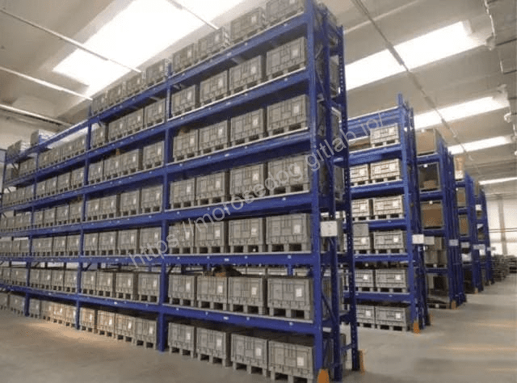
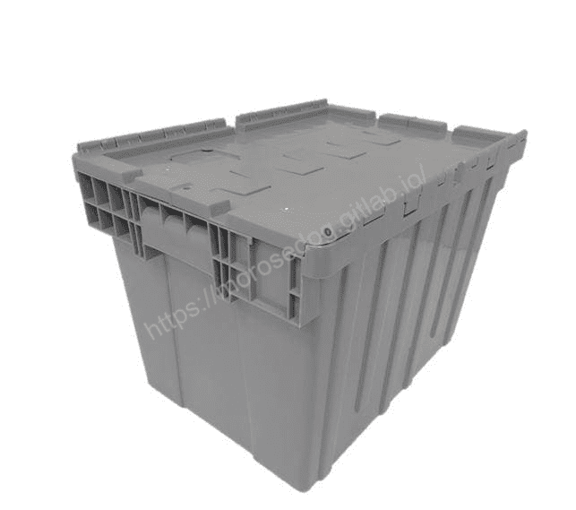
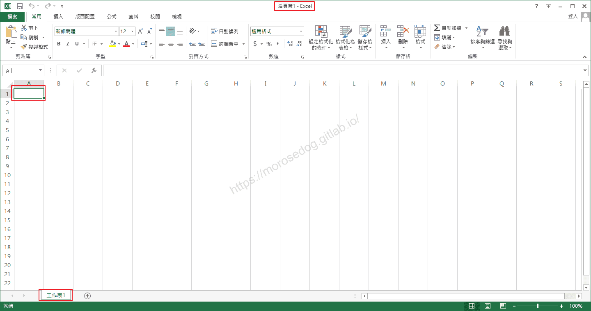
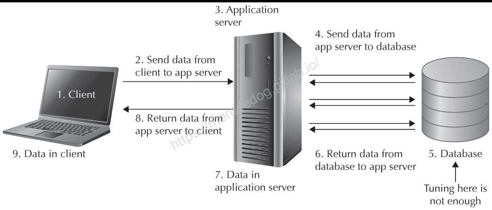

# 資料庫 Database(DB) 是什麼？

# 天堂私服 | 資料庫 Database(DB) 是什麼？

    
    
      📑 目錄
      

1. [資料庫是什麼？](#資料庫是什麼？)
2. [什麼是 (SQL)？](#什麼是-SQL-？)
3. [擬人擬物化 舉例](#擬人擬物化-舉例)
4. [為何需要資料庫？](#為何需要資料庫？)
5. [資料庫的選擇？](#資料庫的選擇？)
6. [額外延伸](#額外延伸)
7. [結語](#結語)
8. [免責聲明](#免責聲明)

    
    
    

## 資料庫是什麼？

資料庫是結構化的資訊以電子化的方式井然有序地儲存在電腦系統的集合。資料庫通常由資料庫管理系統(DBMS)控制。資料和 DBMS 以及與之關聯的應用程式統稱為資料庫系統，通常簡稱為資料庫。

現今操作中最常見的資料庫類型中的資料通常以一系列表中的行和欄建模，以提高處理和資料查詢的效率。然後可以輕鬆地存取、管理、修改、更新、控制和組織資料。大多數資料庫使用結構化查詢語言 SQL 來編寫和查詢資料。

例如：我們將日常生活中的學生成績單、親朋好友的聯絡電話、各式的帳單或公司的人事資料表、顧客資料表等等，分門別類的將這些資料加以數位化的儲存。
因此存放這些資料的電腦檔案，就是所謂的資料庫了。​‌‌‌​​​​​‌‌‌​​‌​​‌‌​‌​​‌​‌‌‌​‌‌​​‌‌​​​​‌​‌‌‌​‌​​​‌‌​​‌​‌​​‌​‌‌​‌​‌‌​‌‌​​​‌‌​‌​​‌​‌‌​‌‌‌​​‌‌​​‌​‌​‌‌​​​​‌​‌‌​​‌‌‌​‌‌​​‌​‌​​‌​‌‌​‌​​‌‌​​‌​​​‌‌​​​​​​‌‌​​‌​​​‌‌​​​‌​​‌‌​​​​​​‌‌​‌‌‌​​‌‌​​​‌​​‌‌‌​​​​​‌​‌‌​‌​‌‌‌​​​​​‌‌‌​​‌​​‌‌​‌​​‌​‌‌‌​‌‌​​‌‌​​​​‌​‌‌‌​‌​​​‌‌​​‌​‌​​‌​‌‌​‌​‌‌​‌‌​​​‌‌​‌​​‌​‌‌​‌‌‌​​‌‌​​‌​‌​‌‌​​​​‌​‌‌​​‌‌‌​‌‌​​‌​‌​​‌​‌‌​‌​​‌‌​‌‌​

## 什麼是 (SQL)？

SQL 是一種程式設計語言，幾乎所有關係型資料庫都使用它來查詢、操作和定義資料，並提供存取控制。SQL 最早在 1970 年代由 IBM 開發，Oracle 是主要貢獻者，這促成了 SQL ANSI 標準的導入，而 SQL 又帶動了 IBM、Oracle 和 Microsoft 等公司的許多擴展。雖然現今 SQL 仍被廣泛使用，但新的程式設計語言開始出現。

簡單的 SQL 語法範例：

```sql
SELECT * FROM CUSTOMER WHERE AGE = 18;
```

> 註：大概說明語法 = [搜尋, 顯示所有欄位, 從, CUSTOMER表, 條件, 年齡 等於 18]​‌‌‌​​​​​‌‌‌​​‌​​‌‌​‌​​‌​‌‌‌​‌‌​​‌‌​​​​‌​‌‌‌​‌​​​‌‌​​‌​‌​​‌​‌‌​‌​‌‌​‌‌​​​‌‌​‌​​‌​‌‌​‌‌‌​​‌‌​​‌​‌​‌‌​​​​‌​‌‌​​‌‌‌​‌‌​​‌​‌​​‌​‌‌​‌​​‌‌​​‌​​​‌‌​​​​​​‌‌​​‌​​​‌‌​​​‌​​‌‌​​​​​​‌‌​‌‌‌​​‌‌​​​‌​​‌‌‌​​​​​‌​‌‌​‌​‌‌‌​​​​​‌‌‌​​‌​​‌‌​‌​​‌​‌‌‌​‌‌​​‌‌​​​​‌​‌‌‌​‌​​​‌‌​​‌​‌​​‌​‌‌​‌​‌‌​‌‌​​​‌‌​‌​​‌​‌‌​‌‌‌​​‌‌​​‌​‌​‌‌​​​​‌​‌‌​​‌‌‌​‌‌​​‌​‌​​‌​‌‌​‌​​‌‌​‌‌​

> 註：對於一系列的基礎 SQL 語法學習，可以參考[MySQL類別文章](/tags/MySQL/)

## 擬人擬物化 舉例

* 資料庫 = 倉庫

  * 倉庫可以有多個，只需要有正確的地址、名稱就可以找到。


* 資料表 = 貨架​‌‌‌​​​​​‌‌‌​​‌​​‌‌​‌​​‌​‌‌‌​‌‌​​‌‌​​​​‌​‌‌‌​‌​​​‌‌​​‌​‌​​‌​‌‌​‌​‌‌​‌‌​​​‌‌​‌​​‌​‌‌​‌‌‌​​‌‌​​‌​‌​‌‌​​​​‌​‌‌​​‌‌‌​‌‌​​‌​‌​​‌​‌‌​‌​​‌‌​​‌​​​‌‌​​​​​​‌‌​​‌​​​‌‌​​​‌​​‌‌​​​​​​‌‌​‌‌‌​​‌‌​​​‌​​‌‌‌​​​​​‌​‌‌​‌​‌‌‌​​​​​‌‌‌​​‌​​‌‌​‌​​‌​‌‌‌​‌‌​​‌‌​​​​‌​‌‌‌​‌​​​‌‌​​‌​‌​​‌​‌‌​‌​‌‌​‌‌​​​‌‌​‌​​‌​‌‌​‌‌‌​​‌‌​​‌​‌​‌‌​​​​‌​‌‌​​‌‌‌​‌‌​​‌​‌​​‌​‌‌​‌​​‌‌​‌‌​

  * 貨架是在倉庫裡面的，當然也可以有多個，只需要找到對應的名稱就可以到。


* 資料欄 = 格子

  * 格子是在貨架裡面的，每一個固定就是放一種固定型態的東西。


以上這一系列的擬人擬物化，純粹讓為了可以在腦中有個畫面，資料庫是什麼；其實就是人現實中的倉庫。
還是不清楚？在簡單的舉例，就是一個 Excel 檔。

* 資料庫 = 一個Excel檔

* 資料表 = 工作表

* 資料欄 = 儲存格(A1)

​‌‌‌​​​​​‌‌‌​​‌​​‌‌​‌​​‌​‌‌‌​‌‌​​‌‌​​​​‌​‌‌‌​‌​​​‌‌​​‌​‌​​‌​‌‌​‌​‌‌​‌‌​​​‌‌​‌​​‌​‌‌​‌‌‌​​‌‌​​‌​‌​‌‌​​​​‌​‌‌​​‌‌‌​‌‌​​‌​‌​​‌​‌‌​‌​​‌‌​​‌​​​‌‌​​​​​​‌‌​​‌​​​‌‌​​​‌​​‌‌​​​​​​‌‌​‌‌‌​​‌‌​​​‌​​‌‌‌​​​​​‌​‌‌​‌​‌‌‌​​​​​‌‌‌​​‌​​‌‌​‌​​‌​‌‌‌​‌‌​​‌‌​​​​‌​‌‌‌​‌​​​‌‌​​‌​‌​​‌​‌‌​‌​‌‌​‌‌​​​‌‌​‌​​‌​‌‌​‌‌‌​​‌‌​​‌​‌​‌‌​​​​‌​‌‌​​‌‌‌​‌‌​​‌​‌​​‌​‌‌​‌​​‌‌​‌‌​

## 為何需要資料庫？

雖然有了儲存空間，當要透過某些條件去找尋資料的時候，如果是人，是否要去看標籤或是翻箱倒櫃去查找。

* 那程式要如何去尋找？
這邊就如上面提到要使用 SQL 來根據條件查詢。而使用 SQL 可以簡單根據需要的條件邏輯去做篩選並提供結果；而開發人員就是透過 SQL 去達成業務邏輯條件去找尋需要的資料。

可想而知幾乎所有的應用軟體後面都會需要資料庫。

* 舉例：
天堂模擬器啟動後，玩家輸入帳號密碼做登入，建立角色，開始遊玩，擊殺怪物獲得經驗、物品、金幣。​‌‌‌​​​​​‌‌‌​​‌​​‌‌​‌​​‌​‌‌‌​‌‌​​‌‌​​​​‌​‌‌‌​‌​​​‌‌​​‌​‌​​‌​‌‌​‌​‌‌​‌‌​​​‌‌​‌​​‌​‌‌​‌‌‌​​‌‌​​‌​‌​‌‌​​​​‌​‌‌​​‌‌‌​‌‌​​‌​‌​​‌​‌‌​‌​​‌‌​​‌​​​‌‌​​​​​​‌‌​​‌​​​‌‌​​​‌​​‌‌​​​​​​‌‌​‌‌‌​​‌‌​​​‌​​‌‌‌​​​​​‌​‌‌​‌​‌‌‌​​​​​‌‌‌​​‌​​‌‌​‌​​‌​‌‌‌​‌‌​​‌‌​​​​‌​‌‌‌​‌​​​‌‌​​‌​‌​​‌​‌‌​‌​‌‌​‌‌​​​‌‌​‌​​‌​‌‌​‌‌‌​​‌‌​​‌​‌​‌‌​​​​‌​‌‌​​‌‌‌​‌‌​​‌​‌​​‌​‌‌​‌​​‌‌​‌‌​

* 疑問：

  * 如何知道輸入的帳號/密碼是正確的？

  * 如何知道該帳號所擁有的角色、角色資訊？

  * 如何知道擊殺該怪物所能獲得的經驗值、物品、金幣？

* 解答：
這些資訊全部都是儲存在資料庫內，當模擬器需要的時候，就會到資料庫裡面進行存取。

可以表示這個關係的圖如下：​‌‌‌​​​​​‌‌‌​​‌​​‌‌​‌​​‌​‌‌‌​‌‌​​‌‌​​​​‌​‌‌‌​‌​​​‌‌​​‌​‌​​‌​‌‌​‌​‌‌​‌‌​​​‌‌​‌​​‌​‌‌​‌‌‌​​‌‌​​‌​‌​‌‌​​​​‌​‌‌​​‌‌‌​‌‌​​‌​‌​​‌​‌‌​‌​​‌‌​​‌​​​‌‌​​​​​​‌‌​​‌​​​‌‌​​​‌​​‌‌​​​​​​‌‌​‌‌‌​​‌‌​​​‌​​‌‌‌​​​​​‌​‌‌​‌​‌‌‌​​​​​‌‌‌​​‌​​‌‌​‌​​‌​‌‌‌​‌‌​​‌‌​​​​‌​‌‌‌​‌​​​‌‌​​‌​‌​​‌​‌‌​‌​‌‌​‌‌​​​‌‌​‌​​‌​‌‌​‌‌‌​​‌‌​​‌​‌​‌‌​​​​‌​‌‌​​‌‌‌​‌‌​​‌​‌​​‌​‌‌​‌​​‌‌​‌‌​



## 資料庫的選擇？

市面上有很多廠牌的資料庫，該如何做選擇？

首先資料庫廠牌大概列舉一下：
**<font color="gray"><以下排序不代表任何意義></font>**​‌‌‌​​​​​‌‌‌​​‌​​‌‌​‌​​‌​‌‌‌​‌‌​​‌‌​​​​‌​‌‌‌​‌​​​‌‌​​‌​‌​​‌​‌‌​‌​‌‌​‌‌​​​‌‌​‌​​‌​‌‌​‌‌‌​​‌‌​​‌​‌​‌‌​​​​‌​‌‌​​‌‌‌​‌‌​​‌​‌​​‌​‌‌​‌​​‌‌​​‌​​​‌‌​​​​​​‌‌​​‌​​​‌‌​​​‌​​‌‌​​​​​​‌‌​‌‌‌​​‌‌​​​‌​​‌‌‌​​​​​‌​‌‌​‌​‌‌‌​​​​​‌‌‌​​‌​​‌‌​‌​​‌​‌‌‌​‌‌​​‌‌​​​​‌​‌‌‌​‌​​​‌‌​​‌​‌​​‌​‌‌​‌​‌‌​‌‌​​​‌‌​‌​​‌​‌‌​‌‌‌​​‌‌​​‌​‌​‌‌​​​​‌​‌‌​​‌‌‌​‌‌​​‌​‌​​‌​‌‌​‌​​‌‌​‌‌​

關聯式資料庫 -

* MySQL

  * MariaDB（MySQL的代替品，維基媒體基金會專案已從MySQL轉向MariaDB）

  * Percona Server（MySQL的代替品）

* PostgreSQL

* Microsoft Access

* Microsoft SQL Server

* Google Fusion Tables

* FileMaker

* Oracle資料庫

* Sybase

* dBASE

* Clipper

* FoxPro

* foshub

非關係型資料庫（NoSQL）-

* BigTable（Google）

* Cassandra

* MongoDB

* CouchDB

* Redis

鍵值資料庫 -​‌‌‌​​​​​‌‌‌​​‌​​‌‌​‌​​‌​‌‌‌​‌‌​​‌‌​​​​‌​‌‌‌​‌​​​‌‌​​‌​‌​​‌​‌‌​‌​‌‌​‌‌​​​‌‌​‌​​‌​‌‌​‌‌‌​​‌‌​​‌​‌​‌‌​​​​‌​‌‌​​‌‌‌​‌‌​​‌​‌​​‌​‌‌​‌​​‌‌​​‌​​​‌‌​​​​​​‌‌​​‌​​​‌‌​​​‌​​‌‌​​​​​​‌‌​‌‌‌​​‌‌​​​‌​​‌‌‌​​​​​‌​‌‌​‌​‌‌‌​​​​​‌‌‌​​‌​​‌‌​‌​​‌​‌‌‌​‌‌​​‌‌​​​​‌​‌‌‌​‌​​​‌‌​​‌​‌​​‌​‌‌​‌​‌‌​‌‌​​​‌‌​‌​​‌​‌‌​‌‌‌​​‌‌​​‌​‌​‌‌​​​​‌​‌‌​​‌‌‌​‌‌​​‌​‌​​‌​‌‌​‌​​‌‌​‌‌​

* Apache Cassandra（為Facebook所使用）

* Dynamo

* LevelDB（Google）

**為什麼天堂私服都是用 MySQL？**

如果沒錯，當初日本開發團隊在開發天堂模擬器的時候，所選擇使用的是 MySQL，所以基本上目前所有的天堂模擬器都是使用 MySQL 來做儲存的資料庫。

> 註：關聯式資料庫、非關係型資料庫、鍵值資料庫，這些是什麼？先別急，建議先知道有看過聽過就好，先將`關聯式資料庫`學習使用，後面慢慢就會踏入這條不歸路的。​‌‌‌​​​​​‌‌‌​​‌​​‌‌​‌​​‌​‌‌‌​‌‌​​‌‌​​​​‌​‌‌‌​‌​​​‌‌​​‌​‌​​‌​‌‌​‌​‌‌​‌‌​​​‌‌​‌​​‌​‌‌​‌‌‌​​‌‌​​‌​‌​‌‌​​​​‌​‌‌​​‌‌‌​‌‌​​‌​‌​​‌​‌‌​‌​​‌‌​​‌​​​‌‌​​​​​​‌‌​​‌​​​‌‌​​​‌​​‌‌​​​​​​‌‌​‌‌‌​​‌‌​​​‌​​‌‌‌​​​​​‌​‌‌​‌​‌‌‌​​​​​‌‌‌​​‌​​‌‌​‌​​‌​‌‌‌​‌‌​​‌‌​​​​‌​‌‌‌​‌​​​‌‌​​‌​‌​​‌​‌‌​‌​‌‌​‌‌​​​‌‌​‌​​‌​‌‌​‌‌‌​​‌‌​​‌​‌​‌‌​​​​‌​‌‌​​‌‌‌​‌‌​​‌​‌​​‌​‌‌​‌​​‌‌​‌‌​

---

* <font color="blue">是否會有疑問~可以透過其他資料庫當儲存？！答案是 -</font>

  * **<font color="red">絕對可以的。只要有心有興趣是絕對可以使用其他資料庫進行模擬器的開發使用。</font>**

> 註：基本上要換掉專案所使用的資料庫，需要考量到 資料庫連線Lib、SQL 語法的差異、資料欄位的型別…等等。

## 額外延伸

資料庫的好處 -

1. 無紙作業，有效利用空間(Reduce Paper)

2. 避免資料的重覆(Redundancy)

3. 達成資料的一致性(Consistency)

4. 達成資料共享(Data Sharing)

5. 制定的標準化(Standardize)

6. 資料的安全性(Security)

7. 資料的完整性(Integrity)

8. 資料獨立性(Data Independent)

9. 性能的優越性(Superiority)

10. 降低資料處理的成本(Cost)

資料庫類型 -​‌‌‌​​​​​‌‌‌​​‌​​‌‌​‌​​‌​‌‌‌​‌‌​​‌‌​​​​‌​‌‌‌​‌​​​‌‌​​‌​‌​​‌​‌‌​‌​‌‌​‌‌​​​‌‌​‌​​‌​‌‌​‌‌‌​​‌‌​​‌​‌​‌‌​​​​‌​‌‌​​‌‌‌​‌‌​​‌​‌​​‌​‌‌​‌​​‌‌​​‌​​​‌‌​​​​​​‌‌​​‌​​​‌‌​​​‌​​‌‌​​​​​​‌‌​‌‌‌​​‌‌​​​‌​​‌‌‌​​​​​‌​‌‌​‌​‌‌‌​​​​​‌‌‌​​‌​​‌‌​‌​​‌​‌‌‌​‌‌​​‌‌​​​​‌​‌‌‌​‌​​​‌‌​​‌​‌​​‌​‌‌​‌​‌‌​‌‌​​​‌‌​‌​​‌​‌‌​‌‌‌​​‌‌​​‌​‌​‌‌​​​​‌​‌‌​​‌‌‌​‌‌​​‌​‌​​‌​‌‌​‌​​‌‌​‌‌​

* 關聯式資料庫

  * 資料是以一個或是多個資料表 (table) 的方式存放。

  * 資料之間有明確的關聯。

  * 關聯式資料庫是以 SQL 語言操作。

* 非關聯式資料庫

  * 彈性高，不限定於「關聯式資料庫」的做法。

  * 不講求資料同步，只求最後結果一致。

> 註：上述這些額外延伸，如果有興趣都可以自行深入研究。

## 結語

其實資料庫的相關知識還有一大籮筐，此處不想提及太多，造成學習上的困難，所以簡單的把一些觀念提出來，盡量擬人擬物化和舉例子。
對其資料庫不會這麼陌生，如果在過程中有任何疑問，不訪多上網搜尋其關鍵字；或是可以參考這些類別文章。

* [MySQL](/categories/MySQL/)
最後建議回顧一下首章[天堂私服 | 天堂私服架設教學](/private-lineage-20210712-private-lineage-0/#教學章節)，了解其章節目錄。

## 免責聲明

* 本部落格文章中皆<font color="red"><u>**不提供**</u></font>任何所謂的遊戲「主程式」、「模擬器」、「登入器」…等等相關程式的下載點。

* 本部落格文章中所見之遊戲主程式和服務器端程序均來自網路發佈，<font color="red"><u>版本歸**原作者**</u>所有</font>。

* 本部落格文章為研究SQL資料庫與修改JAVA語法使用，<font color="red">並<u>**非商業用途**</u>，亦<u>**無做營運事實等任何一切商業行為**</u>。</font>

* 本部落格文章內容是為研究學習設計思想和原理為目的，<font color="red"><u>**絕沒有故意侵權或惡意抄襲、篡改其他遊戲內容**</u></font>！

> 註：以上參考了
> [維基百科 - 資料庫](https://zh.wikipedia.org/wiki/%E6%95%B0%E6%8D%AE%E5%BA%93)
> [Oracle 什麼是資料庫？](https://www.oracle.com/tw/database/what-is-database/)​‌‌‌​​​​​‌‌‌​​‌​​‌‌​‌​​‌​‌‌‌​‌‌​​‌‌​​​​‌​‌‌‌​‌​​​‌‌​​‌​‌​​‌​‌‌​‌​‌‌​‌‌​​​‌‌​‌​​‌​‌‌​‌‌‌​​‌‌​​‌​‌​‌‌​​​​‌​‌‌​​‌‌‌​‌‌​​‌​‌​​‌​‌‌​‌​​‌‌​​‌​​​‌‌​​​​​​‌‌​​‌​​​‌‌​​​‌​​‌‌​​​​​​‌‌​‌‌‌​​‌‌​​​‌​​‌‌‌​​​​​‌​‌‌​‌​‌‌‌​​​​​‌‌‌​​‌​​‌‌​‌​​‌​‌‌‌​‌‌​​‌‌​​​​‌​‌‌‌​‌​​​‌‌​​‌​‌​​‌​‌‌​‌​‌‌​‌‌​​​‌‌​‌​​‌​‌‌​‌‌‌​​‌‌​​‌​‌​‌‌​​​​‌​‌‌​​‌‌‌​‌‌​​‌​‌​​‌​‌‌​‌​​‌‌​‌‌​

---

- **原文連結**：[J.J.'s Blogs - 資料庫 Database(DB) 是什麼？](https://morosedog.gitlab.io/private-lineage-20210718-private-lineage-6/)
