# 資料庫 開發管理系統 的安裝

# 天堂私服 | 資料庫 開發管理系統 的安裝

    
    
      📑 目錄
      

1. [資料庫 GUI 推薦](#資料庫-GUI-推薦)
2. [環境說明](#環境說明)
3. [下載 Navicat Premium](#下載-Navicat-Premium)
4. [安裝 Navicat Premium](#安裝-Navicat-Premium)
5. [開啟 Navicat Premium](#開啟-Navicat-Premium)
6. [Navicat Premium 新增資料庫連線](#Navicat-Premium-新增資料庫連線)
7. [Navicat Premium 執行 SQL](#Navicat-Premium-執行-SQL)
8. [結語](#結語)
9. [免責聲明](#免責聲明)

    
    
    

## 資料庫 GUI 推薦

下方將會安裝`Navicat Premium`，為什麼會選擇這款來做使用？
因為多數的天堂私服教學文章都是使用該套軟體，所以文章教學特多，那這邊當然也是選擇使用該套軟。
當然還有別的原因，該套軟體在使用上非常的簡單，提供中文界面，對初學者來說算是非常友善，且功能十分完善強大，並且提供 14 天免費的全功能 Navicat 試用版。

當然是否有其他推薦的？
可以參考[客戶端推薦](https://zh-hant.10besty.com/best-mysql-gui-tools/)

## 環境說明

此處使用`Oracle VM VirtualBox`虛擬機軟體，下載安裝了一個純淨的`Windows 7 x64 旗艦版`。

如果需要安裝虛擬機，可以參考此篇文章[VirtualBox Windows 7 安裝](./003_VirtualBox_Windows_7_安裝.md)。​‌‌‌​​​​​‌‌‌​​‌​​‌‌​‌​​‌​‌‌‌​‌‌​​‌‌​​​​‌​‌‌‌​‌​​​‌‌​​‌​‌​​‌​‌‌​‌​‌‌​‌‌​​​‌‌​‌​​‌​‌‌​‌‌‌​​‌‌​​‌​‌​‌‌​​​​‌​‌‌​​‌‌‌​‌‌​​‌​‌​​‌​‌‌​‌​​‌‌​​‌​​​‌‌​​​​​​‌‌​​‌​​​‌‌​​​‌​​‌‌​​​​​​‌‌​‌‌‌​​‌‌​​‌​​​‌‌​​​​​​‌​‌‌​‌​‌‌‌​​​​​‌‌‌​​‌​​‌‌​‌​​‌​‌‌‌​‌‌​​‌‌​​​​‌​‌‌‌​‌​​​‌‌​​‌​‌​​‌​‌‌​‌​‌‌​‌‌​​​‌‌​‌​​‌​‌‌​‌‌‌​​‌‌​​‌​‌​‌‌​​​​‌​‌‌​​‌‌‌​‌‌​​‌​‌​​‌​‌‌​‌​​‌‌‌​​​

## 下載 Navicat Premium

首先，我們進入下載 Navicat 的產品網站：[連結](https://www.navicat.com/cht/products)

* 點擊`Navicat Premium 15`的`免費試用`進入試用下載頁面
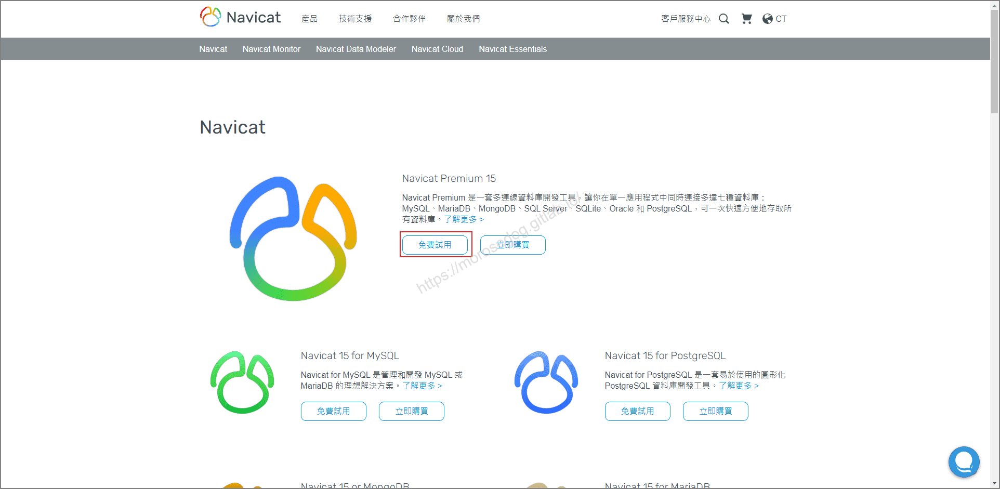

* 選擇你的作業系統的任一下載點，這裡我以 Windows x64 示範
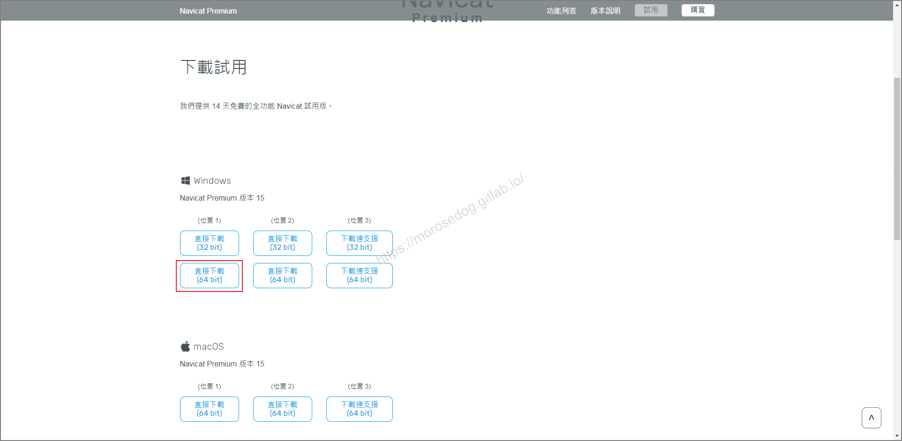

* 選擇後，便會開始下載。
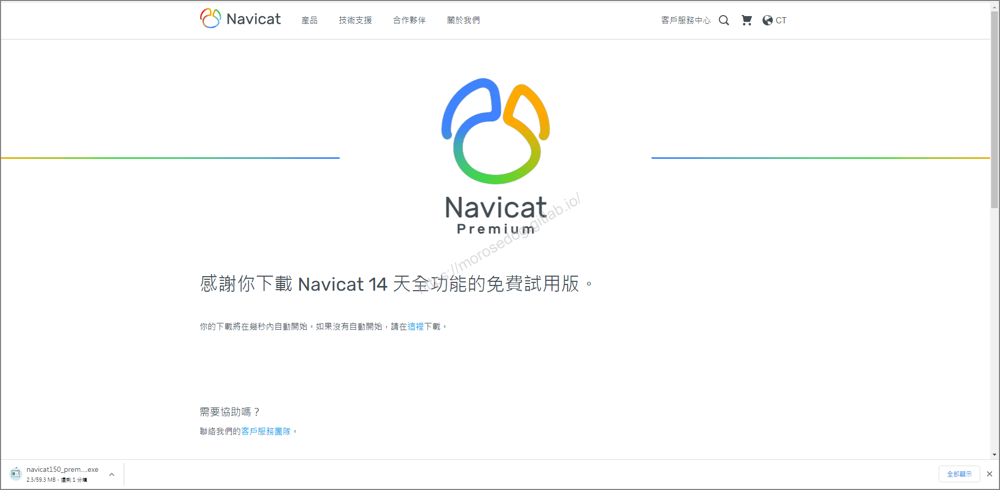

> 註：不要問我有沒有破解版，請自行上網搜尋。

## 安裝 Navicat Premium

此處安裝的版本為 `Navicat Premium 15.0.25`來做安裝示範。
**<2021-07-20當時下載的最新版>**​‌‌‌​​​​​‌‌‌​​‌​​‌‌​‌​​‌​‌‌‌​‌‌​​‌‌​​​​‌​‌‌‌​‌​​​‌‌​​‌​‌​​‌​‌‌​‌​‌‌​‌‌​​​‌‌​‌​​‌​‌‌​‌‌‌​​‌‌​​‌​‌​‌‌​​​​‌​‌‌​​‌‌‌​‌‌​​‌​‌​​‌​‌‌​‌​​‌‌​​‌​​​‌‌​​​​​​‌‌​​‌​​​‌‌​​​‌​​‌‌​​​​​​‌‌​‌‌‌​​‌‌​​‌​​​‌‌​​​​​​‌​‌‌​‌​‌‌‌​​​​​‌‌‌​​‌​​‌‌​‌​​‌​‌‌‌​‌‌​​‌‌​​​​‌​‌‌‌​‌​​​‌‌​​‌​‌​​‌​‌‌​‌​‌‌​‌‌​​​‌‌​‌​​‌​‌‌​‌‌‌​​‌‌​​‌​‌​‌‌​​​​‌​‌‌​​‌‌‌​‌‌​​‌​‌​​‌​‌‌​‌​​‌‌‌​​​

* 滑鼠左鍵雙擊`navicat150_premium_ct_x64.exe`檔案。

* 跳出安全提示`您是否要允許下列成是變更這部電腦？`請點擊`是`。
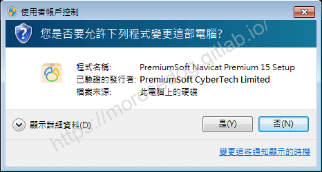

* 請繼續點擊`下一步`。
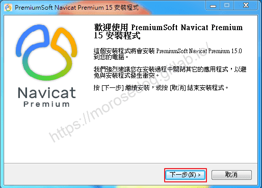

* 授權合約，點擊`我同意`，請繼續點擊`下一步`。
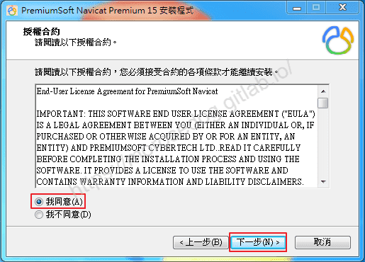

* 此處可以選擇您要安裝的路徑位置，建議就預設安裝即可；請繼續點擊`下一步`。
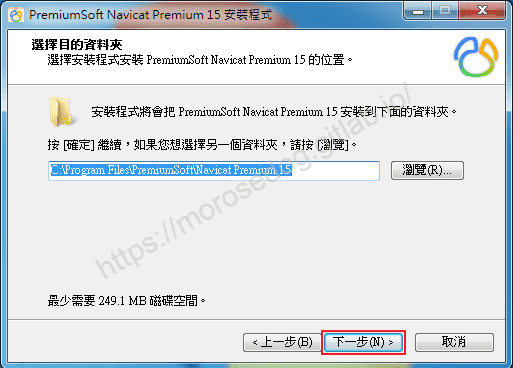

* 建立開始功能表目錄名稱，建議就預設即可，請繼續點擊`下一步`。
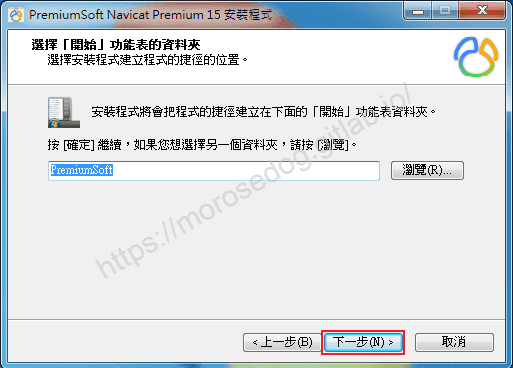

* 是否建立建立桌面捷徑，預設為勾選，請繼續點擊`下一步`。
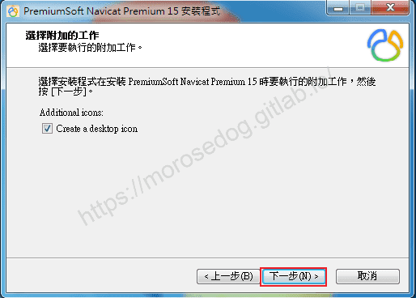

* 最後確認安裝的清單，沒問題的話，請繼續點擊`安裝`。
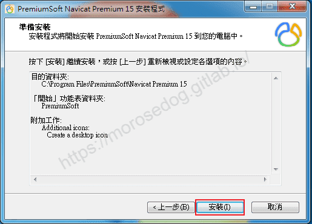

* 安裝進度條…請等待安裝完畢至下一流程。
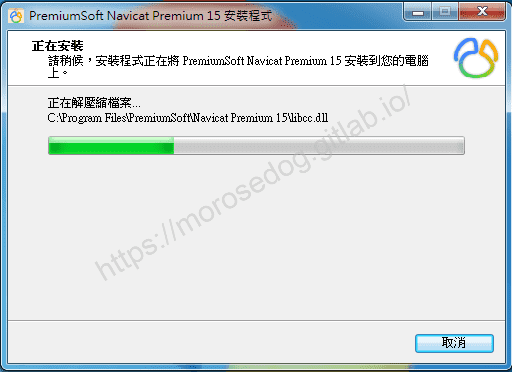

* 恭喜您已經安裝完畢，請點擊`完成`結束安裝程序。
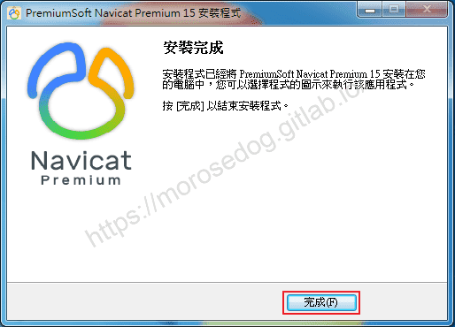

## 開啟 Navicat Premium

* 點擊`Navicat Premium 15`開啟。

* 試用提醒，點擊`試用`進入軟體。
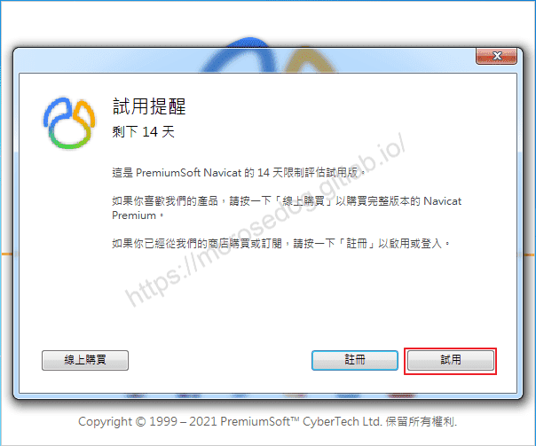

* Navicat Premium的簡單介紹，請繼續點擊`下一步`。
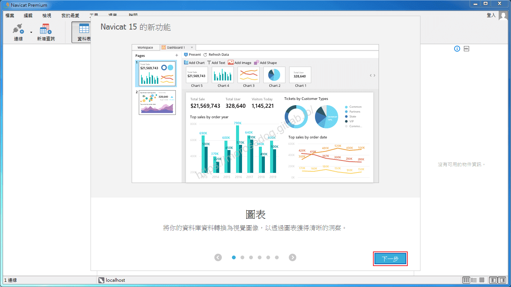

* 選擇`界面佈景主題`，預設為`視窗`亮色，請繼續點擊`下一步`。
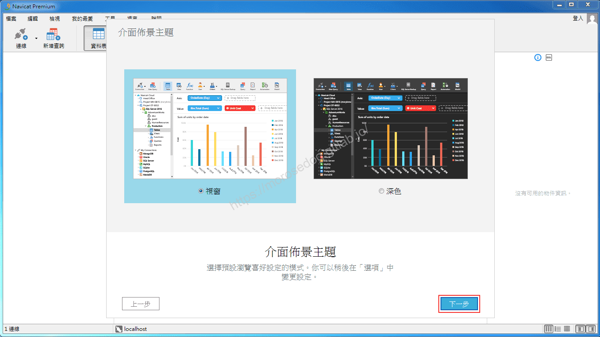

* `Navicat Cloud`，請繼續點擊`下一步`。
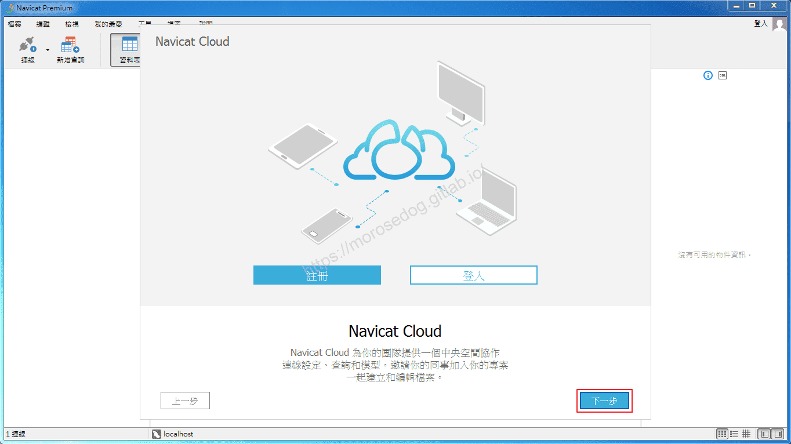

* `改善Navicat`，倒數秒數後，請繼續點擊`不要分享`。
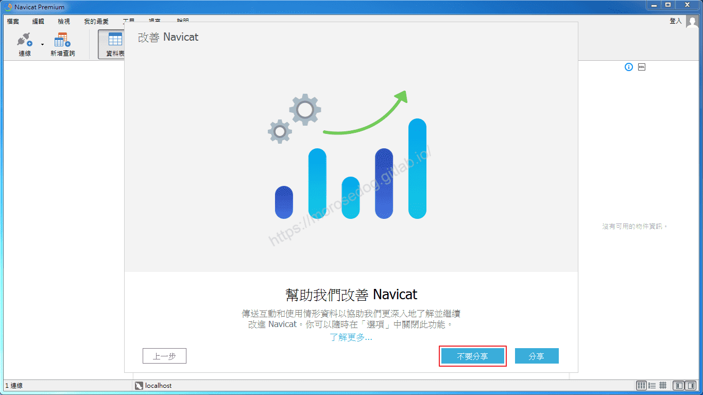

* 請繼續點擊`開始`，進入主畫面。
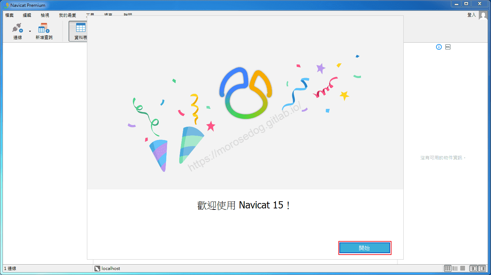

## Navicat Premium 新增資料庫連線

* 點擊`連線`，選擇 MySQL 後會彈出設定視窗。
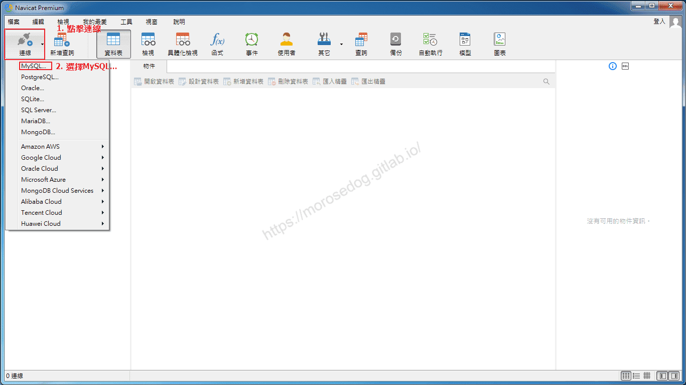

* 輸入`連線名稱`(自定義即可，此處取)。

* 輸入資料庫`密碼`。

* 點擊`測試連線`。
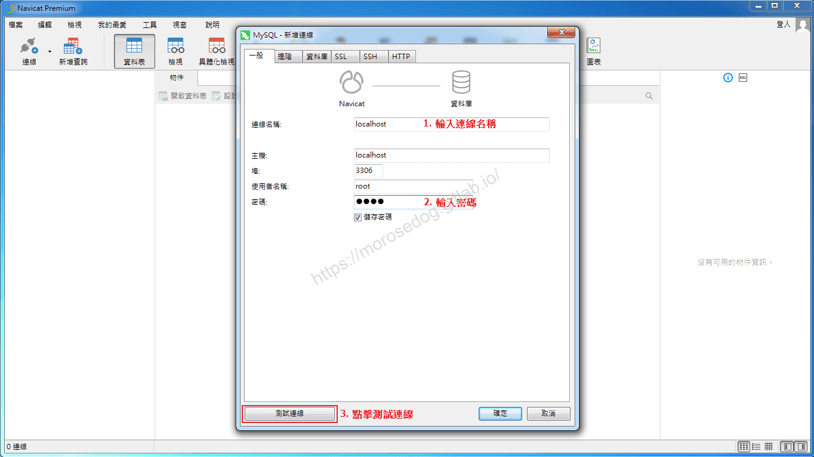

* 見連線成功，請繼續點擊`確定`。
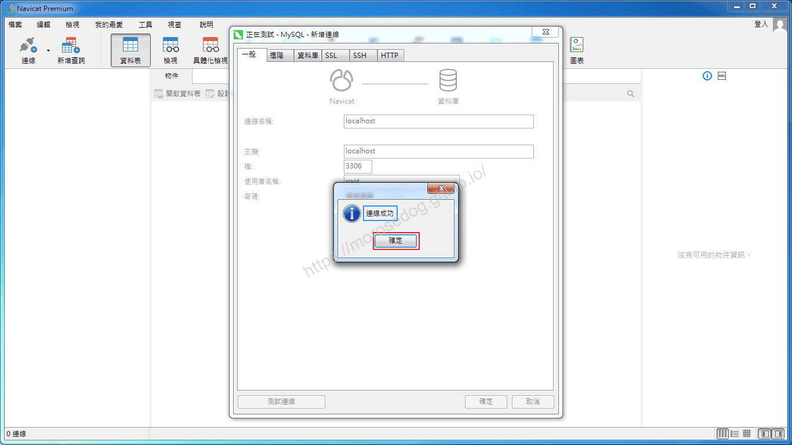

* 請點擊`確定`後。
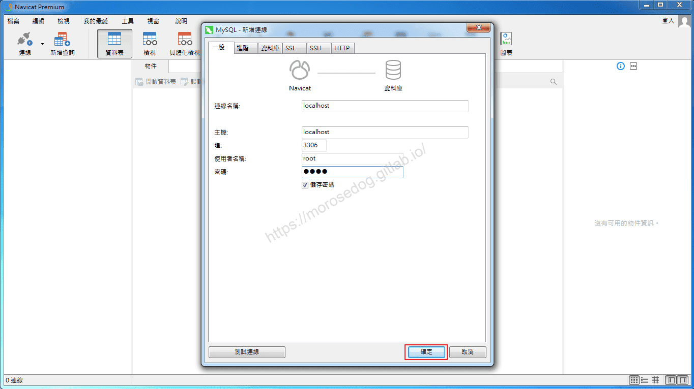

* 在連線列表看見剛剛新增的連線。
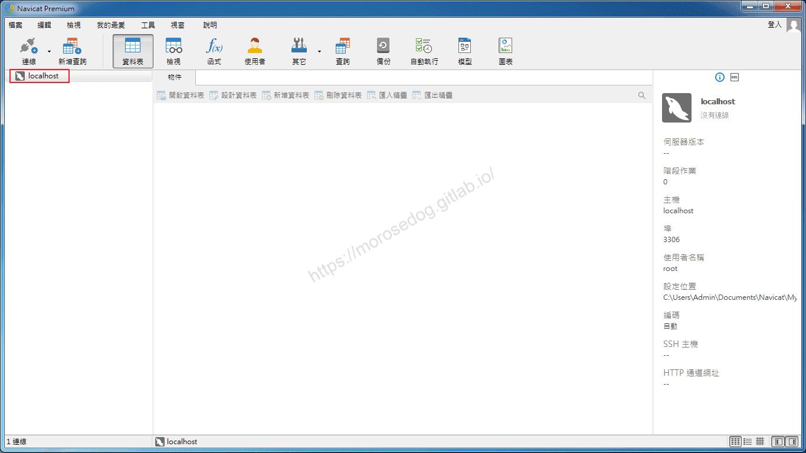

## Navicat Premium 執行 SQL

* 點擊，會開啟連線內的資料庫清單。
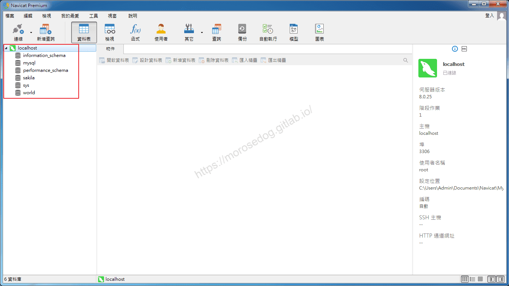

* 嘗試執行 SQL 語法：

* 點擊`新增查詢`，會開啟一個`未命名 - 查詢`的視窗。

* 於視窗內輸入 SQL 語法`show databases;`

* 點擊`執行`，執行 SQL 語法。

* 下方可見 SQL 執行查詢後的結果。
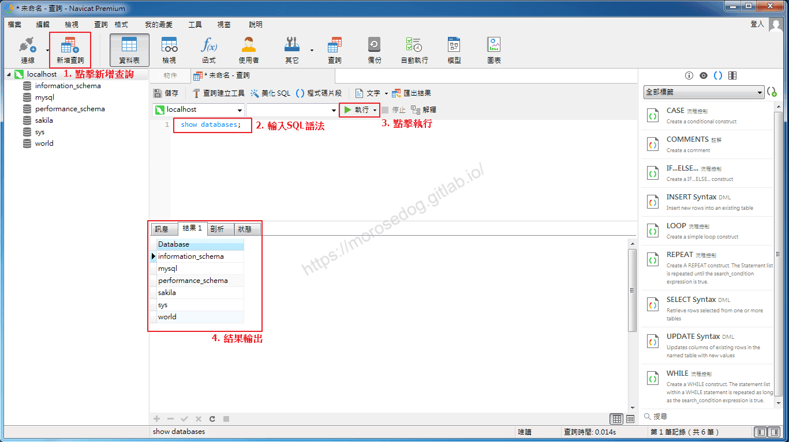

## 結語

資料庫的工具百百種，選擇一套自己上手好用的都可以。以上只是簡單的安裝和使用，更深入的功能介紹和使用，建議直接到官方提供的文件查看學習 [Navicat 支援中心](https://help.navicat.com/hc/zh-tw)。
最後建議回顧一下首章[天堂私服 | 天堂私服架設教學](/private-lineage-20210712-private-lineage-0/#教學章節)，了解其章節目錄。

## 免責聲明

* 本部落格文章中皆<u>**不提供**</u>任何所謂的遊戲「主程式」、「模擬器」、「登入器」…等等相關程式的下載點。

* 本部落格文章中所見之遊戲主程式和服務器端程序均來自網路發佈，<u>版本歸**原作者**</u>所有。

* 本部落格文章為研究SQL資料庫與修改JAVA語法使用，並<u>**非商業用途**</u>，亦<u>**無做營運事實等任何一切商業行為**</u>。

* 本部落格文章內容是為研究學習設計思想和原理為目的，<u>**絕沒有故意侵權或惡意抄襲、篡改其他遊戲內容**</u>！

> 註：以上參考了
> [維基百科 - Navicat](https://zh.wikipedia.org/wiki/Navicat)
> [Navicat](https://www.navicat.com/cht)
> [Navicat 支援中心](https://help.navicat.com/hc/zh-tw)

---

- **原文連結**：[J.J.'s Blogs - 資料庫 開發管理系統 的安裝](https://morosedog.gitlab.io/private-lineage-20210720-private-lineage-8/)
