# 匯入模擬器的資料庫

# 天堂私服 | 匯入模擬器的資料庫

    
    
      📑 目錄
      

1. [環境說明](#環境說明)
2. [準備](#準備)
5. [L1J 資料庫 打包](#L1J-資料庫-打包)

  1. [說明](#說明)
  2. [打包](#打包)
6. [匯入天堂模擬器 資料庫](#匯入天堂模擬器-資料庫)
7. [注意](#注意)
8. [結語](#結語)
9. [免責聲明](#免責聲明)

    
    
    

## 環境說明

此處使用`Oracle VM VirtualBox`虛擬機軟體，下載安裝了一個純淨的`Windows 7 x64 旗艦版`。

如果需要安裝虛擬機，可以參考此篇文章[VirtualBox Windows 7 安裝](./003_VirtualBox_Windows_7_安裝.md)。

## 準備

2. 在開始前需要準備「天堂模擬器」，通常資料庫所需的`Table_schema`和`Initialization_data`都會一同放在裡面，這些檔案都是`.sql`的副檔名。
此處所使用的是「[L1J-3.80c](/images/private-lineage/download_not_available.png)」由`日本開發團隊`研發的版本做示範。

  * 無法提供下載點，請根據關鍵字自行上網搜尋。

> 註：`Table_schema`和`Initialization_data`，暫時不詳細解說；簡單來說就是啟動模擬器的時候需要的基本資料表、基本資料；像是帳號儲存的表，怪物清單和資訊…等等。

模擬器內目錄檔案如下圖：
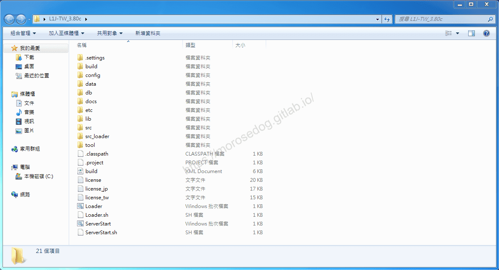​‌‌‌​​​​​‌‌‌​​‌​​‌‌​‌​​‌​‌‌‌​‌‌​​‌‌​​​​‌​‌‌‌​‌​​​‌‌​​‌​‌​​‌​‌‌​‌​‌‌​‌‌​​​‌‌​‌​​‌​‌‌​‌‌‌​​‌‌​​‌​‌​‌‌​​​​‌​‌‌​​‌‌‌​‌‌​​‌​‌​​‌​‌‌​‌​​‌‌​​‌​​​‌‌​​​​​​‌‌​​‌​​​‌‌​​​‌​​‌‌​​​​​​‌‌​‌‌‌​​‌‌​​‌​​​‌‌​​​‌​​‌​‌‌​‌​‌‌‌​​​​​‌‌‌​​‌​​‌‌​‌​​‌​‌‌‌​‌‌​​‌‌​​​​‌​‌‌‌​‌​​​‌‌​​‌​‌​​‌​‌‌​‌​‌‌​‌‌​​​‌‌​‌​​‌​‌‌​‌‌‌​​‌‌​​‌​‌​‌‌​​​​‌​‌‌​​‌‌‌​‌‌​​‌​‌​​‌​‌‌​‌​​‌‌‌​​‌

> 註：目前每個目錄與檔案的用途此處也不會特別解說，此篇文章只會針對會要用的的部分做說明，未來將會在後面的教學中慢慢補充。

1. 需要用到文字編輯器，此處推薦的是[Notepad++](https://notepad-plus-plus.org/downloads/)，請直接下載安裝即可。

## L1J 資料庫 打包

### 說明

首先進入模擬器的`db`資料夾，會看見三個資料夾和一個檔案 -

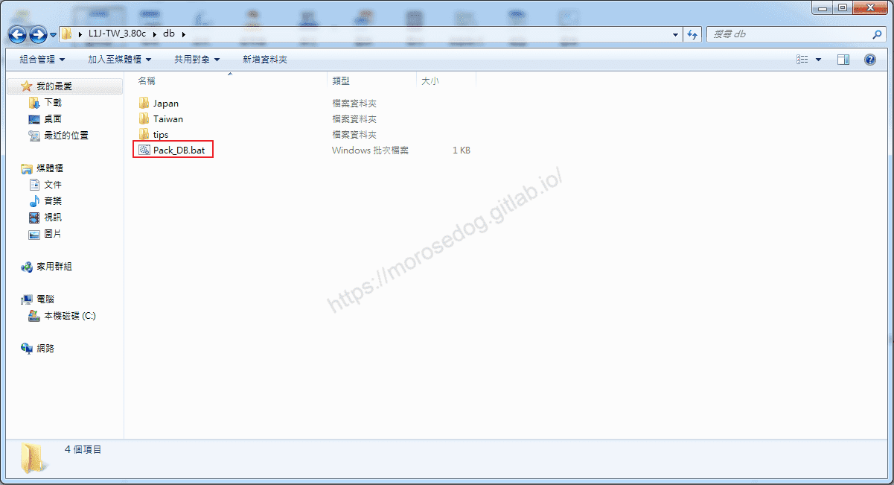​‌‌‌​​​​​‌‌‌​​‌​​‌‌​‌​​‌​‌‌‌​‌‌​​‌‌​​​​‌​‌‌‌​‌​​​‌‌​​‌​‌​​‌​‌‌​‌​‌‌​‌‌​​​‌‌​‌​​‌​‌‌​‌‌‌​​‌‌​​‌​‌​‌‌​​​​‌​‌‌​​‌‌‌​‌‌​​‌​‌​​‌​‌‌​‌​​‌‌​​‌​​​‌‌​​​​​​‌‌​​‌​​​‌‌​​​‌​​‌‌​​​​​​‌‌​‌‌‌​​‌‌​​‌​​​‌‌​​​‌​​‌​‌‌​‌​‌‌‌​​​​​‌‌‌​​‌​​‌‌​‌​​‌​‌‌‌​‌‌​​‌‌​​​​‌​‌‌‌​‌​​​‌‌​​‌​‌​​‌​‌‌​‌​‌‌​‌‌​​​‌‌​‌​​‌​‌‌​‌‌‌​​‌‌​​‌​‌​‌‌​​​​‌​‌‌​​‌‌‌​‌‌​​‌​‌​​‌​‌‌​‌​​‌‌‌​​‌

* Japan

  * 這裡面存放了`Table_schema`和`Initialization_data`，只是`.sql`內容是日文的部分。

* Taiwan

  * 這裡面存放`Table_schema`和`Initialization_data`，`.sql`內的內容已經翻譯為中文的。

* tips

  * 這裡面放的是一些開發團隊對於資料庫操作的一些小筆記。

* Pack_DB.bat

  * 這個就是用來將所有的`*.sql`檔匯整成一個`l1jdb_Taiwan.sql`檔。

```plain
echo off
:: ─────────────
:: L1J 資料庫 打包器 
:: ─────────────
copy .\Taiwan\*.sql l1jdb_Taiwan.sql
```

> 註：`db` = `database`的縮寫。
> 註：如果不使用`Pack_DB.bat`來做匯整，就會需要一個一個去做匯入，是比較麻煩但不是不行。

### 打包

* 首先進入模擬器的`db`資料夾，執行`Pack_DB.bat`。

* 在該目錄下會產生出`l1jdb_Taiwan.sql`檔。
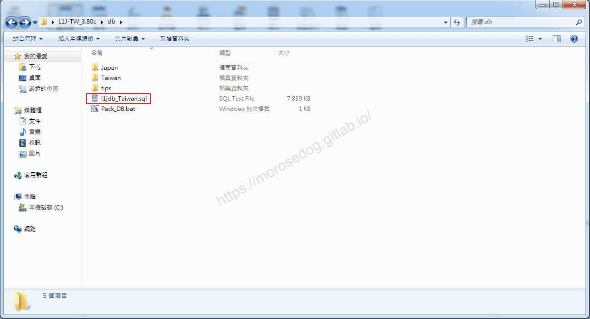

* 使用`Notepad++`開啟`l1jdb_Taiwan.sql`檔，並到最末行。
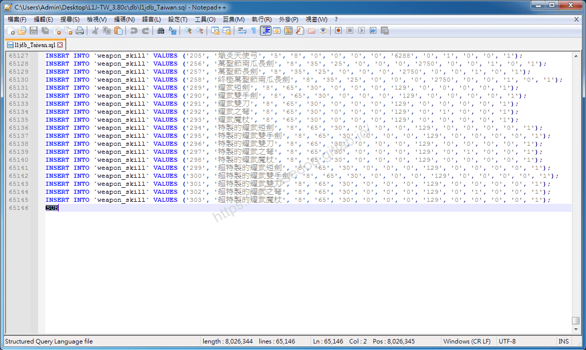

* 刪除`SUB`字樣，在儲存檔案。


* 恭喜，資料庫打包完成。

> 註：為何要刪除`SUB`，如果不做這樣的處理，在匯入的時候會有以下的 SQL 錯誤。

```plain
1064 - You have an error in your SQL syntax; check the manual that corresponds to your MySQL server version for the right syntax to use near '?' at line 1
```

## 匯入天堂模擬器 資料庫

* 開啟`Navicat Premium 15`

* 左鍵點擊連線，會變為綠色並顯示資料庫清單。
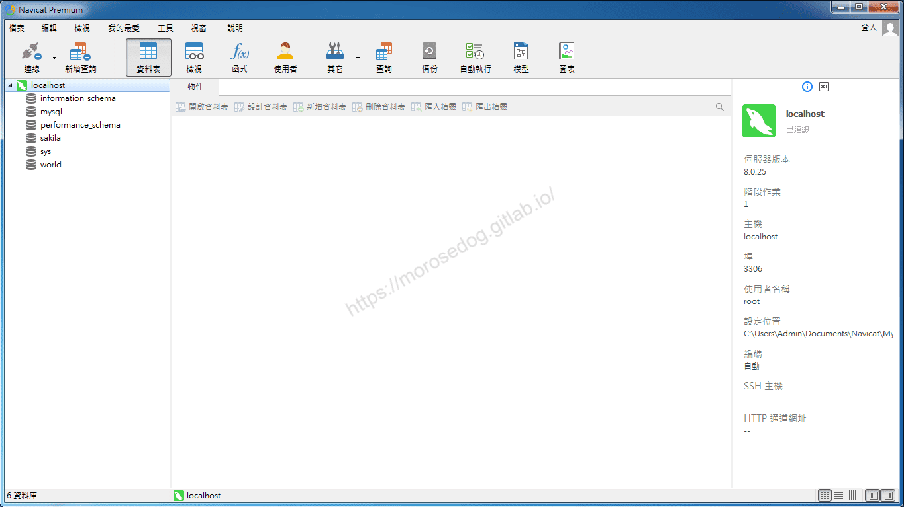

* 右鍵點擊，選擇`新增資料庫`。
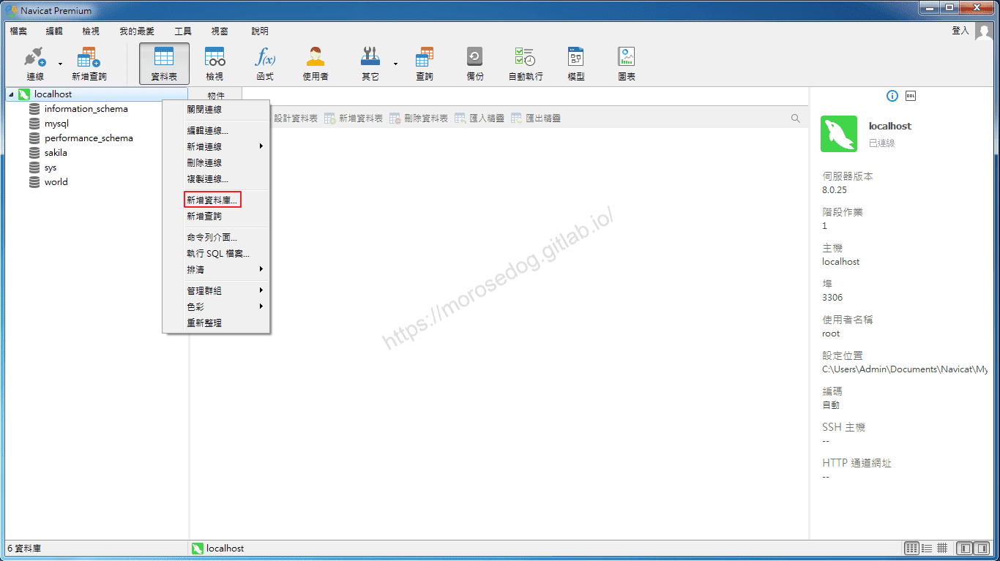

* 輸入資料庫名稱`380c`，建議名稱語模擬器版本是相呼應，請點擊`確定`。
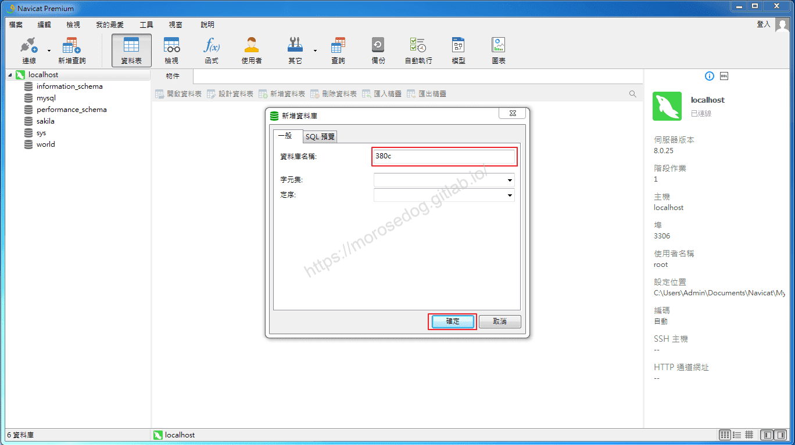

* 左鍵點擊連線<380c>資料庫，會變為綠色並顯示資料庫功能內容。
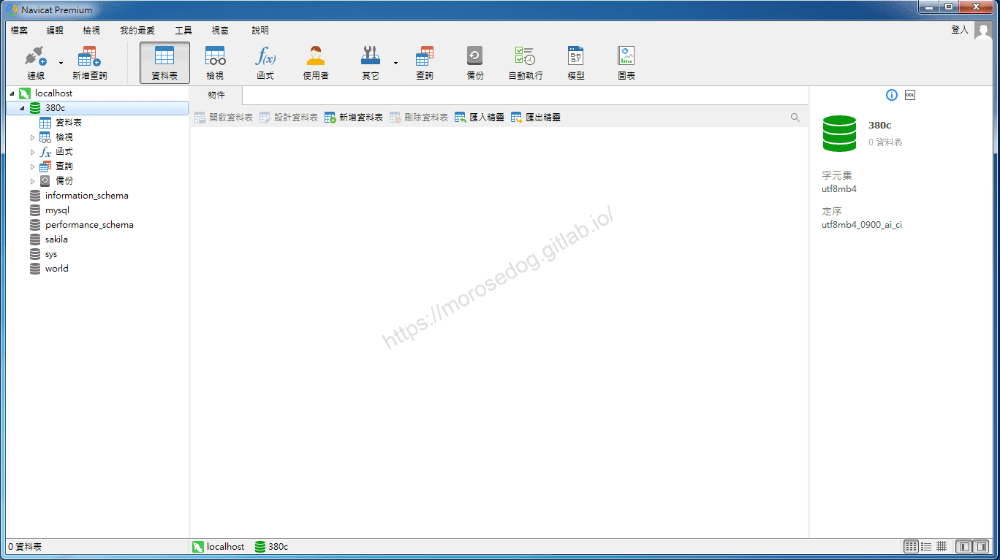

* 右鍵點擊<380c>，選擇`執行 SQL 檔案...`。
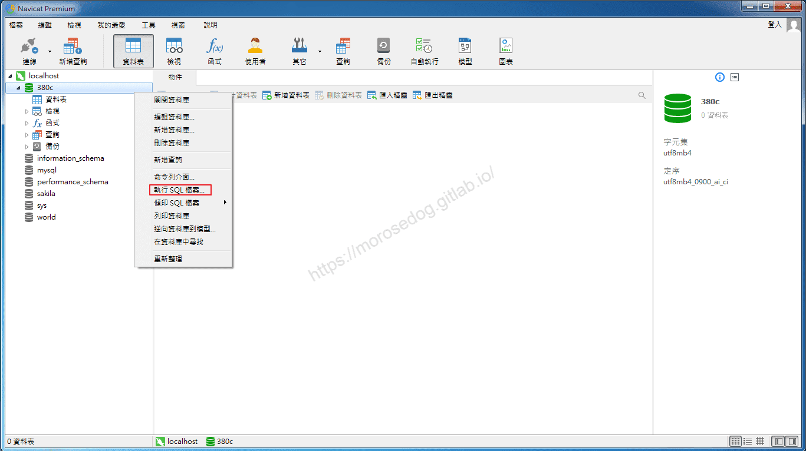

* 檔案選擇剛剛打包的`l1jdb_Taiwan.sql`檔，請點擊`開始`。
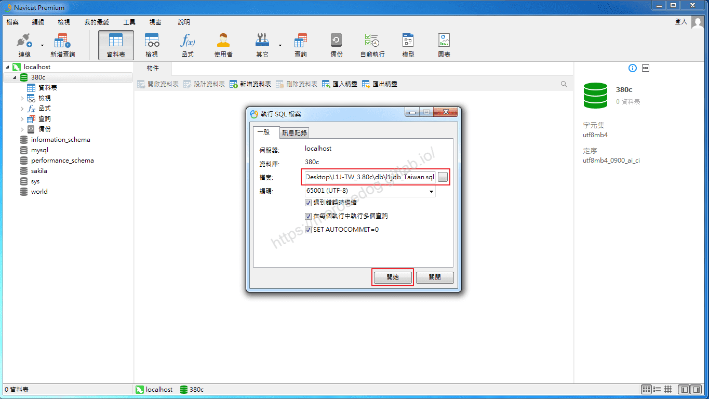

* 執行進度條…請等待執行完畢。
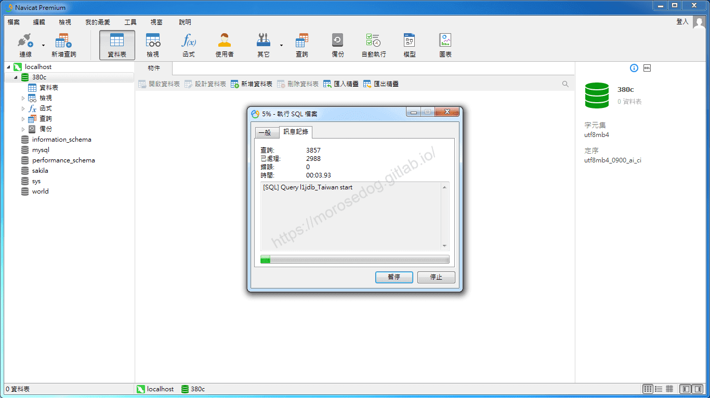

* 執行完畢，應該無錯誤，請點擊`關閉`。
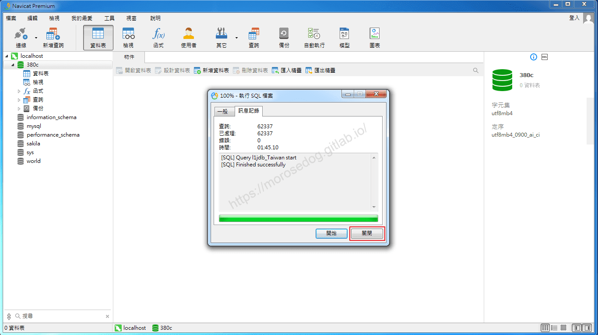

* 右鍵選擇`重新整理`。
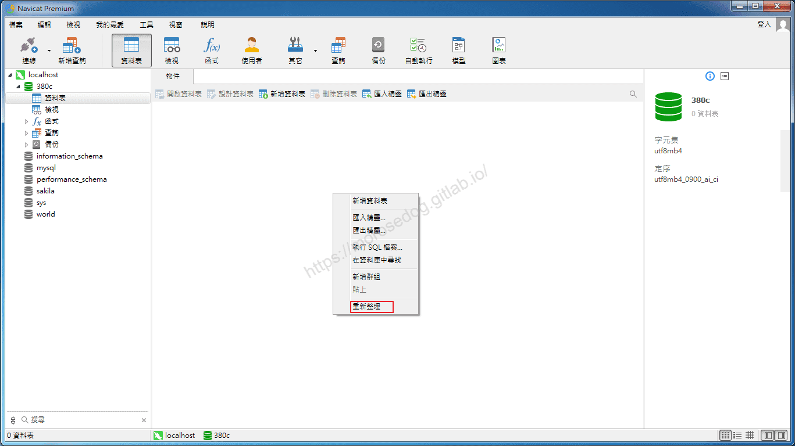

* 會看到剛剛匯入進去的資料表。

* 至此恭喜天堂模擬器資料庫匯入完畢。
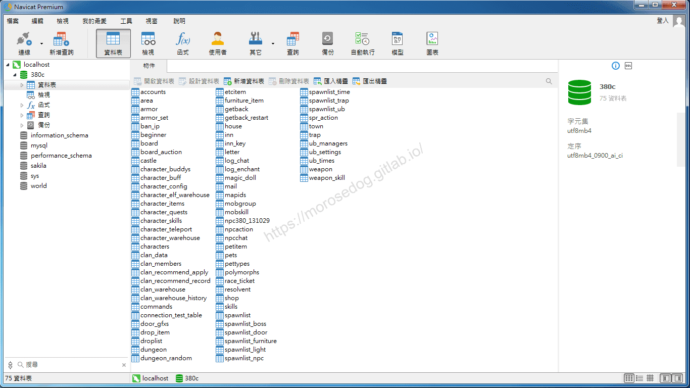

> 註：請接續後面的`注意`，這將會關係到模擬器啟動的成敗。​‌‌‌​​​​​‌‌‌​​‌​​‌‌​‌​​‌​‌‌‌​‌‌​​‌‌​​​​‌​‌‌‌​‌​​​‌‌​​‌​‌​​‌​‌‌​‌​‌‌​‌‌​​​‌‌​‌​​‌​‌‌​‌‌‌​​‌‌​​‌​‌​‌‌​​​​‌​‌‌​​‌‌‌​‌‌​​‌​‌​​‌​‌‌​‌​​‌‌​​‌​​​‌‌​​​​​​‌‌​​‌​​​‌‌​​​‌​​‌‌​​​​​​‌‌​‌‌‌​​‌‌​​‌​​​‌‌​​​‌​​‌​‌‌​‌​‌‌‌​​​​​‌‌‌​​‌​​‌‌​‌​​‌​‌‌‌​‌‌​​‌‌​​​​‌​‌‌‌​‌​​​‌‌​​‌​‌​​‌​‌‌​‌​‌‌​‌‌​​​‌‌​‌​​‌​‌‌​‌‌‌​​‌‌​​‌​‌​‌‌​​​​‌​‌‌​​‌‌‌​‌‌​​‌​‌​​‌​‌‌​‌​​‌‌‌​​‌

## 注意

有些模擬器提供的`Table_schema`和`Initialization_data`也都未必是正確的，因為可能正在開發過程中，會有一些落差。
而在此處示範的版本在後面使用時會發生一些問題，這邊提前做修復。

* 可以看到資料表名為`npc380_131029`。
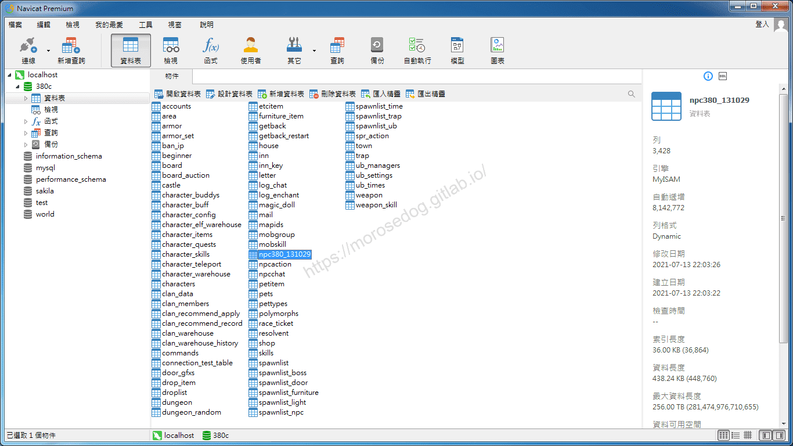

* 將其名稱改為`npc`
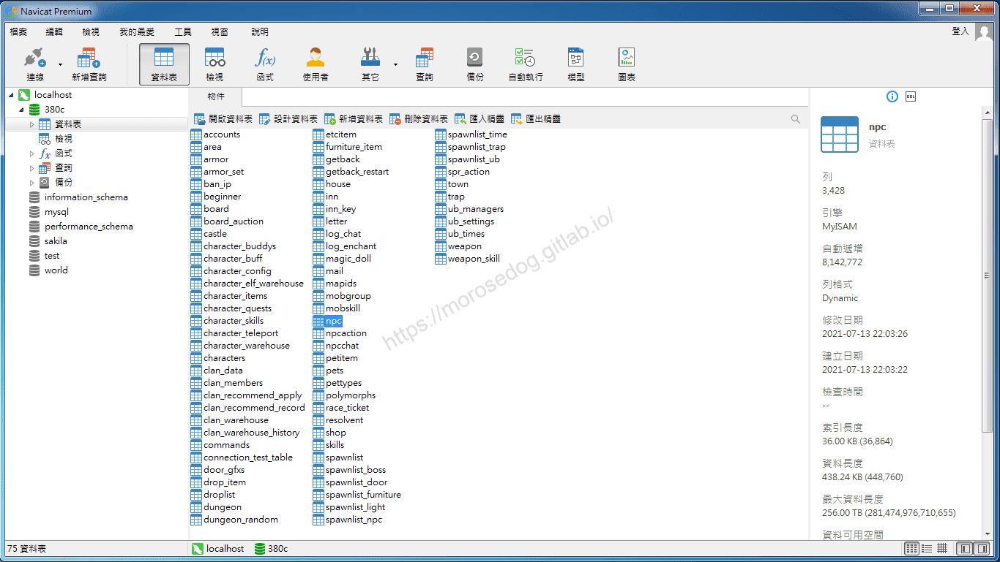

> 註：如果不修改，後面模擬器啟動時，會有 Exception `警告: mob data for id:45005 missing in npc table`的問題唷。

## 結語

此處透過工具去做 SQL 的執行，非常的簡單，如果在沒有工具的幫助下，就必需要透過指令來做這些匯入或是互動模式執行 SQL 語法；
如果有興趣可以上網查看看相關資料。
最後建議回顧一下首章[天堂私服 | 天堂私服架設教學](/private-lineage-20210712-private-lineage-0/#教學章節)，了解其章節目錄。​‌‌‌​​​​​‌‌‌​​‌​​‌‌​‌​​‌​‌‌‌​‌‌​​‌‌​​​​‌​‌‌‌​‌​​​‌‌​​‌​‌​​‌​‌‌​‌​‌‌​‌‌​​​‌‌​‌​​‌​‌‌​‌‌‌​​‌‌​​‌​‌​‌‌​​​​‌​‌‌​​‌‌‌​‌‌​​‌​‌​​‌​‌‌​‌​​‌‌​​‌​​​‌‌​​​​​​‌‌​​‌​​​‌‌​​​‌​​‌‌​​​​​​‌‌​‌‌‌​​‌‌​​‌​​​‌‌​​​‌​​‌​‌‌​‌​‌‌‌​​​​​‌‌‌​​‌​​‌‌​‌​​‌​‌‌‌​‌‌​​‌‌​​​​‌​‌‌‌​‌​​​‌‌​​‌​‌​​‌​‌‌​‌​‌‌​‌‌​​​‌‌​‌​​‌​‌‌​‌‌‌​​‌‌​​‌​‌​‌‌​​​​‌​‌‌​​‌‌‌​‌‌​​‌​‌​​‌​‌‌​‌​​‌‌‌​​‌

## 免責聲明

* 本部落格文章中皆<font color="red"><u>**不提供**</u></font>任何所謂的遊戲「主程式」、「模擬器」、「登入器」…等等相關程式的下載點。

* 本部落格文章中所見之遊戲主程式和服務器端程序均來自網路發佈，<font color="red"><u>版本歸**原作者**</u>所有</font>。

* 本部落格文章為研究SQL資料庫與修改JAVA語法使用，<font color="red">並<u>**非商業用途**</u>，亦<u>**無做營運事實等任何一切商業行為**</u>。</font>

* 本部落格文章內容是為研究學習設計思想和原理為目的，<font color="red"><u>**絕沒有故意侵權或惡意抄襲、篡改其他遊戲內容**</u></font>！

> 註：以上參考了
> [維基百科 - Navicat](https://zh.wikipedia.org/wiki/Navicat)
> [Navicat](https://www.navicat.com/cht)
> [Navicat 支援中心](https://help.navicat.com/hc/zh-tw)

---

- **原文連結**：[J.J.'s Blogs - 匯入模擬器的資料庫](https://morosedog.gitlab.io/private-lineage-20210721-private-lineage-9/)
