# 設定檔說明設定與啟動模擬器

# 天堂私服 | 設定檔說明設定與啟動模擬器

    
    
      📑 目錄
      

1. [環境說明](#環境說明)
2. [準備](#準備)
4. [設定檔說明](#設定檔說明)

  1. [修改 server.properties](#修改-server-properties)
5. [建立 maps](#建立-maps)
6. [編譯 Jar](#編譯-Jar)
7. [啟動模擬器](#啟動模擬器)
8. [錯誤排除](#錯誤排除)
9. [結語](#結語)
10. [免責聲明](#免責聲明)

    
    
    

## 環境說明

此處使用`Oracle VM VirtualBox`虛擬機軟體，下載安裝了一個純淨的`Windows 7 x64 旗艦版`。
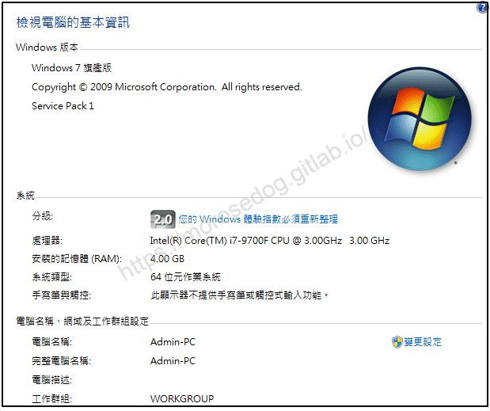
如果需要安裝虛擬機，可以參考此篇文章[VirtualBox Windows 7 安裝](./003_VirtualBox_Windows_7_安裝.md)。

## 準備

2. 在開始前需要準備「天堂模擬器」，通常啟動模擬器的設定檔案都會一同放在裡面，這些檔案多數是`.properties`或是`*.xml`的副檔名。
此處所使用的是「[L1J-3.80c](/images/private-lineage/download_not_available.png)」由`日本開發團隊`研發的版本做示範。

  * 無法提供下載點，請根據關鍵字自行上網搜尋。

模擬器內目錄檔案如下圖：
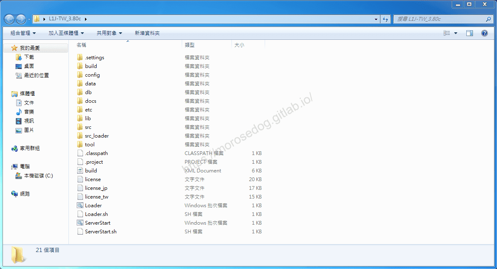

> 註：目前每個目錄與檔案的用途這邊也不會特別解說，此篇文章只會針對會要用的的部分做說明，未來將會在後面的教學中慢慢補充。​‌‌‌​​​​​‌‌‌​​‌​​‌‌​‌​​‌​‌‌‌​‌‌​​‌‌​​​​‌​‌‌‌​‌​​​‌‌​​‌​‌​​‌​‌‌​‌​‌‌​‌‌​​​‌‌​‌​​‌​‌‌​‌‌‌​​‌‌​​‌​‌​‌‌​​​​‌​‌‌​​‌‌‌​‌‌​​‌​‌​​‌​‌‌​‌​​‌‌​​‌​​​‌‌​​​​​​‌‌​​‌​​​‌‌​​​‌​​‌‌​​​​​​‌‌​‌‌‌​​‌‌​​‌​​​‌‌​​‌​​​‌​‌‌​‌​‌‌‌​​​​​‌‌‌​​‌​​‌‌​‌​​‌​‌‌‌​‌‌​​‌‌​​​​‌​‌‌‌​‌​​​‌‌​​‌​‌​​‌​‌‌​‌​‌‌​‌‌​​​‌‌​‌​​‌​‌‌​‌‌‌​​‌‌​​‌​‌​‌‌​​​​‌​‌‌​​‌‌‌​‌‌​​‌​‌​​‌​‌‌​‌​​‌‌​​​‌​​‌‌​​​​

1. 需要用到文字編輯器，這邊推薦的是[Notepad++](https://notepad-plus-plus.org/downloads/)，請直接下載安裝即可。

## 設定檔說明

首先進入模擬器的`config`資料夾，會看見九個檔案 -

目前只需要關注在`server.properties`上~

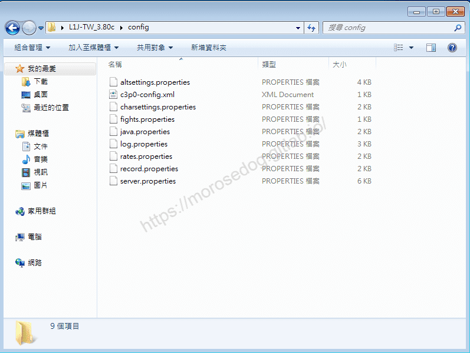​‌‌‌​​​​​‌‌‌​​‌​​‌‌​‌​​‌​‌‌‌​‌‌​​‌‌​​​​‌​‌‌‌​‌​​​‌‌​​‌​‌​​‌​‌‌​‌​‌‌​‌‌​​​‌‌​‌​​‌​‌‌​‌‌‌​​‌‌​​‌​‌​‌‌​​​​‌​‌‌​​‌‌‌​‌‌​​‌​‌​​‌​‌‌​‌​​‌‌​​‌​​​‌‌​​​​​​‌‌​​‌​​​‌‌​​​‌​​‌‌​​​​​​‌‌​‌‌‌​​‌‌​​‌​​​‌‌​​‌​​​‌​‌‌​‌​‌‌‌​​​​​‌‌‌​​‌​​‌‌​‌​​‌​‌‌‌​‌‌​​‌‌​​​​‌​‌‌‌​‌​​​‌‌​​‌​‌​​‌​‌‌​‌​‌‌​‌‌​​​‌‌​‌​​‌​‌‌​‌‌‌​​‌‌​​‌​‌​‌‌​​​​‌​‌‌​​‌‌‌​‌‌​​‌​‌​​‌​‌‌​‌​​‌‌​​​‌​​‌‌​​​​

* altsettings.properties

* c3p0-config.xml

* charsettings.properties

* fights.properties

* java.properties

* log.properties

* rates.properties

* record.properties

* server.properties

> 註：基本上每個設定檔內的註解說明是滿完善的。其實不用太擔心這些設定的用意。

### 修改 server.properties

初步架設的情況下，基本上只需要修改`server.properties`檔的資料庫連線設定的部分即可。

* 使用`Notepad++`開啟`server.properties`。

* 修改資料庫連線的資料庫名稱<380c>。

* 密碼的部分當初設定為`root`，所以不需修改。

* 下圖為方便比對，固分成左右視窗，分別為修改前與修改後。

  * 修改前內容

```plain
# Database info
Driver=com.mysql.jdbc.Driver
URL=jdbc:mysql://localhost/l1jtw?useUnicode=true&characterEncoding=utf8
Login=root
Password=root
```

  * 修改後內容

```plain
# Database info
Driver=com.mysql.jdbc.Driver
URL=jdbc:mysql://localhost/380c?useUnicode=true&characterEncoding=utf8
Login=root
Password=root
```

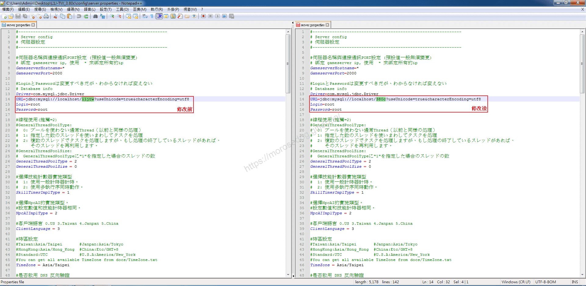

* 修改完成後，儲存檔案即可。

* 恭喜這樣就完成<u>最基本</u>的設定了。

> 註：關於其他設定檔的說明，將會在之後的文章陸續說明。​‌‌‌​​​​​‌‌‌​​‌​​‌‌​‌​​‌​‌‌‌​‌‌​​‌‌​​​​‌​‌‌‌​‌​​​‌‌​​‌​‌​​‌​‌‌​‌​‌‌​‌‌​​​‌‌​‌​​‌​‌‌​‌‌‌​​‌‌​​‌​‌​‌‌​​​​‌​‌‌​​‌‌‌​‌‌​​‌​‌​​‌​‌‌​‌​​‌‌​​‌​​​‌‌​​​​​​‌‌​​‌​​​‌‌​​​‌​​‌‌​​​​​​‌‌​‌‌‌​​‌‌​​‌​​​‌‌​​‌​​​‌​‌‌​‌​‌‌‌​​​​​‌‌‌​​‌​​‌‌​‌​​‌​‌‌‌​‌‌​​‌‌​​​​‌​‌‌‌​‌​​​‌‌​​‌​‌​​‌​‌‌​‌​‌‌​‌‌​​​‌‌​‌​​‌​‌‌​‌‌‌​​‌‌​​‌​‌​‌‌​​​​‌​‌‌​​‌‌‌​‌‌​​‌​‌​​‌​‌‌​‌​​‌‌​​​‌​​‌‌​​​​

## 建立 maps

由於這邊使用的是「L1J-3.80c」，並沒有提供相對應的`maps`的`*.txt`檔，這邊可以在「L1J-3.50c」的版本中，
找到`maps`資料夾，且有三個檔案 -

* 351_maps.zip

* 352_maps.zip

* 360_maps.zip

這邊使用將會使用`360_maps.zip`檔來做「L1J-3.80c」的`maps`內容。

* 在「L1J-3.80c」目錄下建立`maps`資料夾。
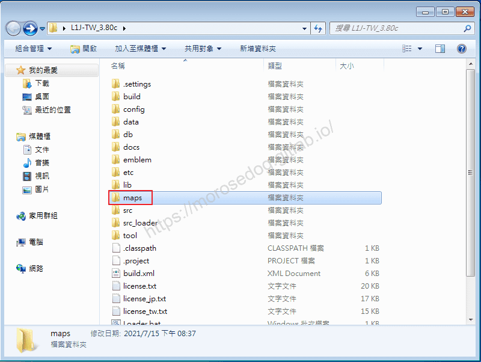

* 將「L1J-3.50c」版本中的`maps`下的`360_maps.zip`檔案複製進「L1J-3.80c」目錄下`maps`資料夾內。
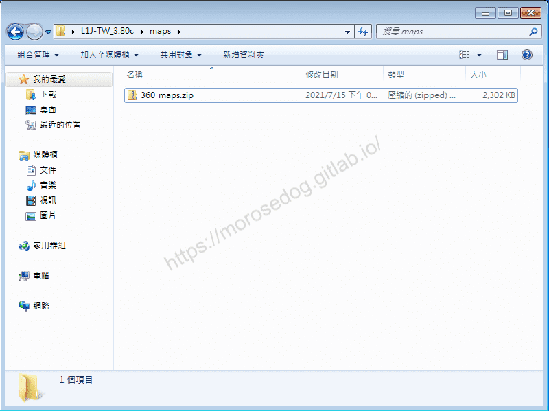

* 將`360_maps.zip`檔案解壓縮至此。
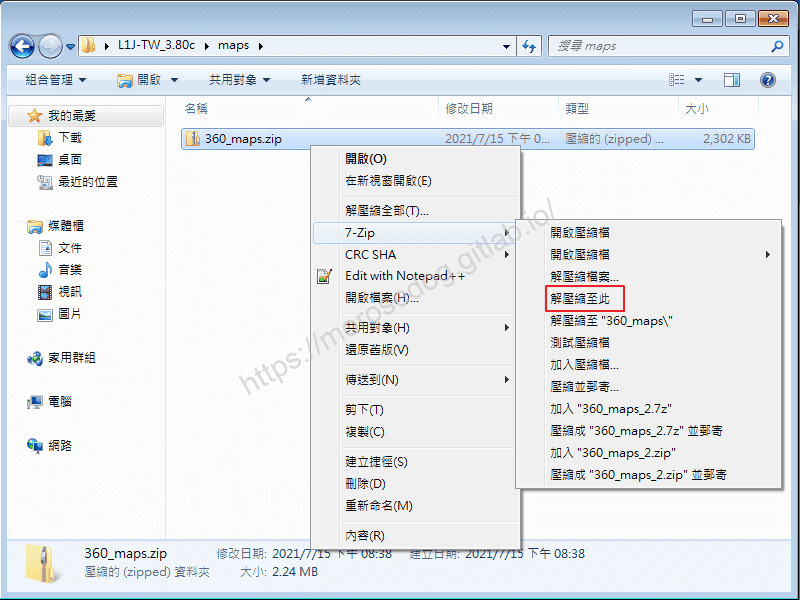

* 此時會見`*.txt`副檔名的檔案在此。
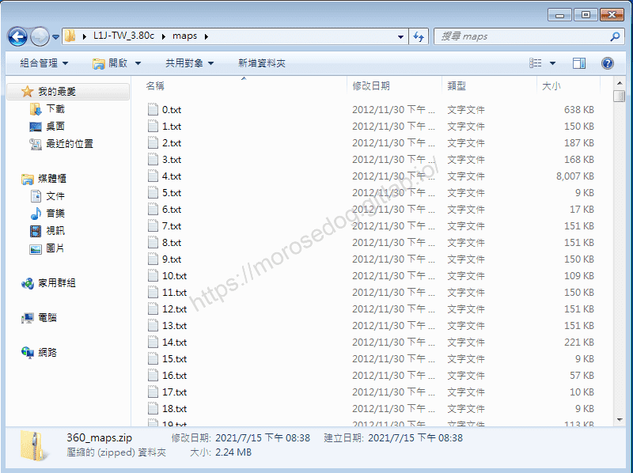

* 將`360_maps.zip`刪除。
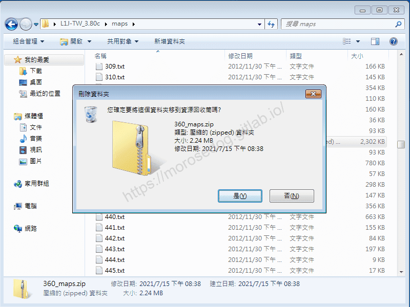

該`maps`內的`*.txt`檔案，是模擬器所使用的地圖檔。
至於他如何產生，目前也不是很清楚，之後了解後會在撰寫文章做教學。
**<font color="red"><2022-02-22補充></font>**
針對上述的`maps`的產生方式的問題，在研究過工具後以及撰寫完成文章後；
使用[超簡易地圖預覽 工具](../07_Developer_Tools/089_超簡易地圖預覽_工具.md)，針對客戶端進行產生即可取得。​‌‌‌​​​​​‌‌‌​​‌​​‌‌​‌​​‌​‌‌‌​‌‌​​‌‌​​​​‌​‌‌‌​‌​​​‌‌​​‌​‌​​‌​‌‌​‌​‌‌​‌‌​​​‌‌​‌​​‌​‌‌​‌‌‌​​‌‌​​‌​‌​‌‌​​​​‌​‌‌​​‌‌‌​‌‌​​‌​‌​​‌​‌‌​‌​​‌‌​​‌​​​‌‌​​​​​​‌‌​​‌​​​‌‌​​​‌​​‌‌​​​​​​‌‌​‌‌‌​​‌‌​​‌​​​‌‌​​‌​​​‌​‌‌​‌​‌‌‌​​​​​‌‌‌​​‌​​‌‌​‌​​‌​‌‌‌​‌‌​​‌‌​​​​‌​‌‌‌​‌​​​‌‌​​‌​‌​​‌​‌‌​‌​‌‌​‌‌​​​‌‌​‌​​‌​‌‌​‌‌‌​​‌‌​​‌​‌​‌‌​​​​‌​‌‌​​‌‌‌​‌‌​​‌​‌​​‌​‌‌​‌​​‌‌​​​‌​​‌‌​​​​

## 編譯 Jar

* 回到「L1J-3.80c」目錄下，進入`build`資料夾。

* 可見一個`ant`資料夾，一個`BuildManagement.bat`檔。

> 註：`ant`為[Apache Ant](https://ant.apache.org/)，是一個將軟體編譯、測試、部署等步驟聯絡在一起加以自動化的一個工具，
> 大多用於Java環境中的軟體開發。而`BuildManagement.bat`就是透過`ant`指令整合出來的模擬器打包工具。
> 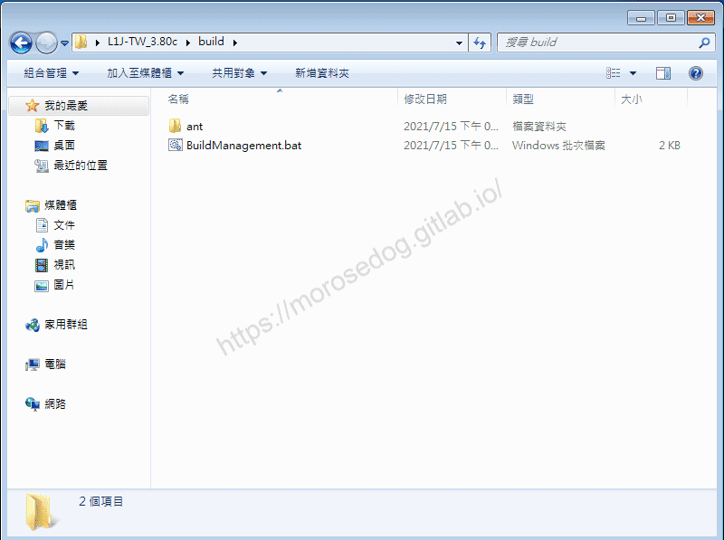

* 左鍵雙擊執行BuildManagement.bat`檔`，彈出`L1J 管理建置系統`視窗。

* 輸入`1`，並`Enter`。
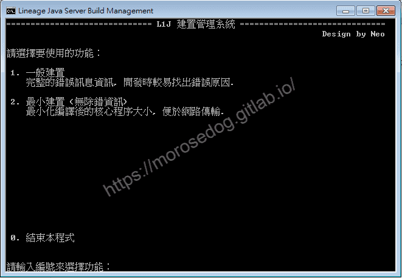

* 彈出一個在編譯的視窗，見最後的`BUILD SUCCESSFUL`，表示編譯成功。
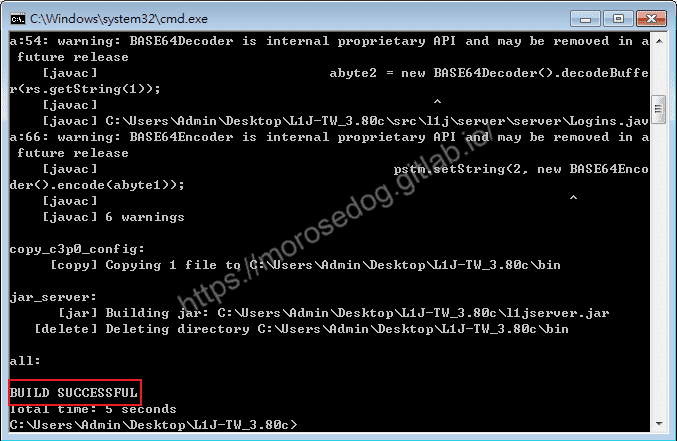

* 此時可以將兩個`L1J 管理建置系統`和`編譯視窗`視窗關閉。

* 回到「L1J-3.80c」目錄下，可見下方產生出了兩個`*.jar`檔；分別為`l1jloader.jar`與`l1jserver.jar`。

> 註：`l1jserver.jar`為主要的天堂模擬器執行檔。
> 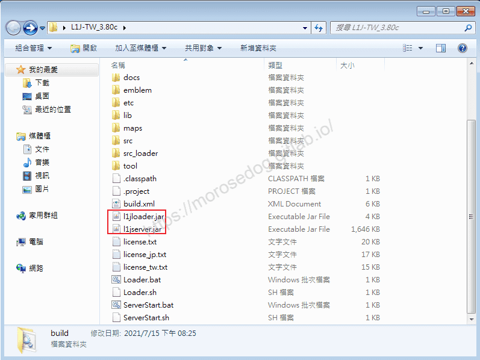

## 啟動模擬器

在前面的`server.properties`、`maps`和`編譯Jar`都成功的情況下。​‌‌‌​​​​​‌‌‌​​‌​​‌‌​‌​​‌​‌‌‌​‌‌​​‌‌​​​​‌​‌‌‌​‌​​​‌‌​​‌​‌​​‌​‌‌​‌​‌‌​‌‌​​​‌‌​‌​​‌​‌‌​‌‌‌​​‌‌​​‌​‌​‌‌​​​​‌​‌‌​​‌‌‌​‌‌​​‌​‌​​‌​‌‌​‌​​‌‌​​‌​​​‌‌​​​​​​‌‌​​‌​​​‌‌​​​‌​​‌‌​​​​​​‌‌​‌‌‌​​‌‌​​‌​​​‌‌​​‌​​​‌​‌‌​‌​‌‌‌​​​​​‌‌‌​​‌​​‌‌​‌​​‌​‌‌‌​‌‌​​‌‌​​​​‌​‌‌‌​‌​​​‌‌​​‌​‌​​‌​‌‌​‌​‌‌​‌‌​​​‌‌​‌​​‌​‌‌​‌‌‌​​‌‌​​‌​‌​‌‌​​​​‌​‌‌​​‌‌‌​‌‌​​‌​‌​​‌​‌‌​‌​​‌‌​​​‌​​‌‌​​​​

* 執行「L1J-3.80c」目錄下的`ServerStart.bat`檔。
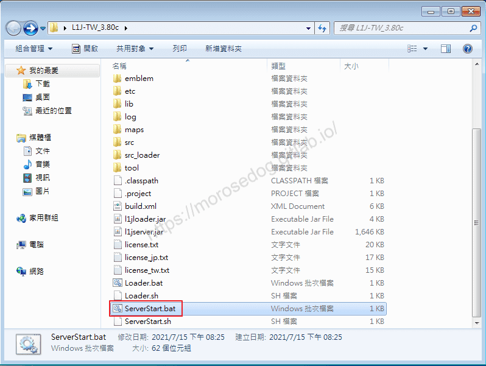

* 啟動過程中可能會需要允許存取防火牆，請點擊`允許存取`
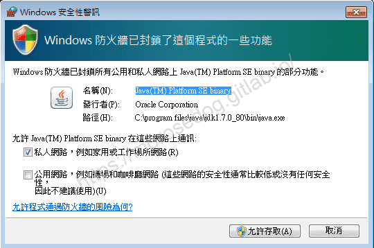

* 此時彈跳一個命令提示字元視窗，這邊常聽人稱`黑盒子`。

* 上面將會顯示一些加載的訊息<根據版本不同會不一樣>。

* 此處沒有任何`Exception`、`Error`的相關作物訊息。

* 恭喜至此已經成功開啟天堂模擬器。
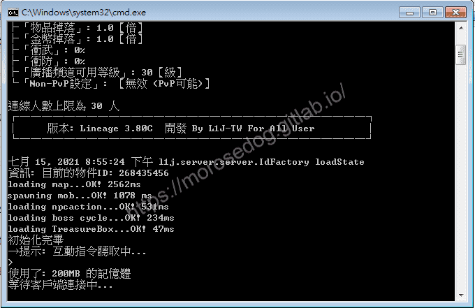

## 錯誤排除

這邊將會列出一些常見的錯誤訊息，讓人參考並進行排查。

* **錯誤關鍵訊息**：
`Exception in thread "main" com.mysql.jdbc.exceptions.jdbc4.MySQLSyntaxErrorException: Unknown database 'l1jtw'`
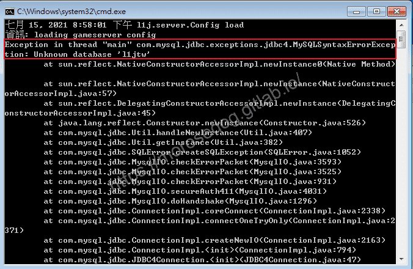
檢查與解決：

1. <380c>資料庫並沒有被建立，請參考[天堂私服 | 匯入模擬器的資料庫](./009_匯入模擬器的資料庫.md)。

2. `server.properties`檔案內的`URL`資料庫名稱沒有修改成自己建立的資料庫<380c>名稱。

* **錯誤關鍵訊息**：
`嚴重: Table '380c.npc' doesn't exist com.mysql.jdbc.exceptions.jdbc4.MySQLSyntaxErrorException: Table '380c.npc' doesn't exist`
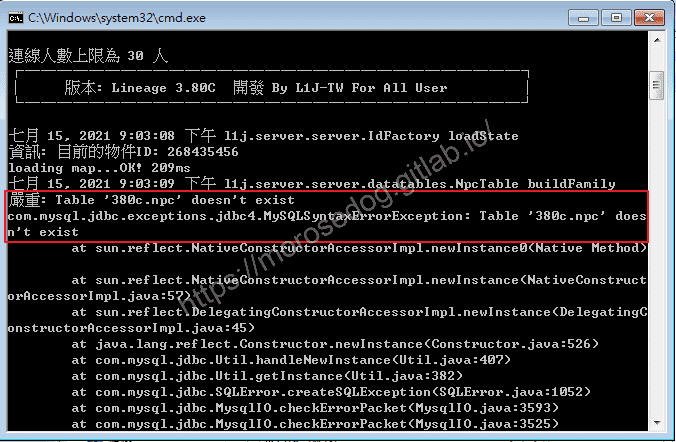
檢查與解決：

1. 沒有將資料表`npc380_131029`，重新命名為`npc`，請參考[天堂私服 | 匯入模擬器的資料庫](./009_匯入模擬器的資料庫.md)的注意章節。

* **錯誤關鍵訊息**：
`Exception in thread "main" java.sql.SQLException: Access denied for user 'root'@'localhost' (using password: YES)`
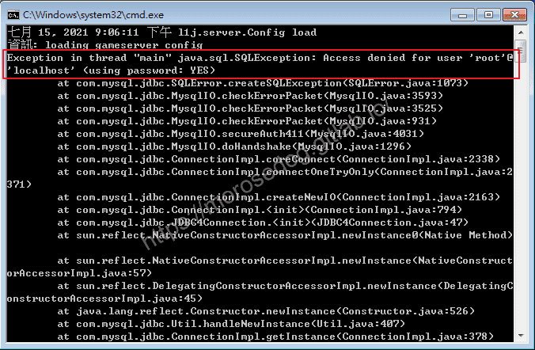
檢查與解決：

1. `server.properties`檔案內的`Password`密碼輸入錯誤，請修改為當初安裝資料庫所設定的密碼即可。

* **錯誤關鍵訊息**：
`loading map...七月 15, 2021 9:08:29 下午 l1j.server.server.model.map.L1WorldMap <init> 
嚴重: null java.lang.NullPointerException`
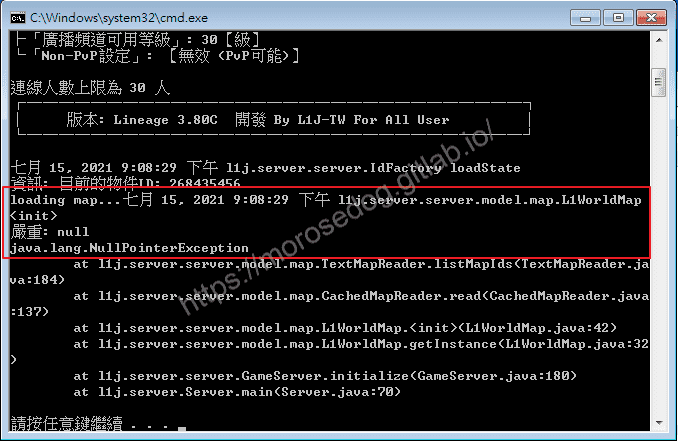
檢查與解決：

1. `maps`資料夾並不存在，請參考上方的建立 maps章節。

* **錯誤關鍵訊息**：
`警告: Duplicate door location: id =`
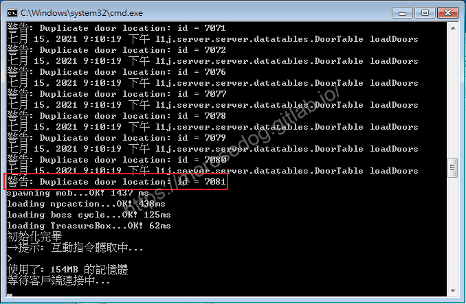
檢查與解決：

1. `maps`資料夾內並沒有`*.txt`副黨名的檔案，可能解壓縮多了一層的資料夾，請參考上方的建立 maps章節。

* **錯誤關鍵訊息**：
`Exception: java.lang.OutOfMemoryError thrown from the UncaughtExceptionHandler in thread`
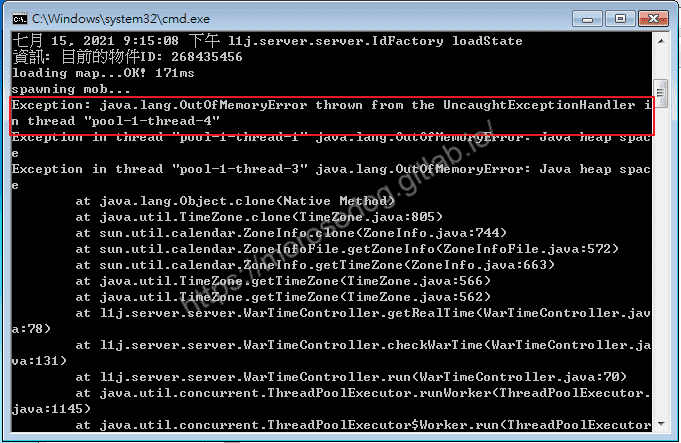
檢查與解決：

2. 啟動`Jar`給的記憶體資源過小。修改`ServerStart.bat`內的記憶體配置大小即可。

  * 調整512 → 1024 甚至更高，全看電腦記憶體配置。
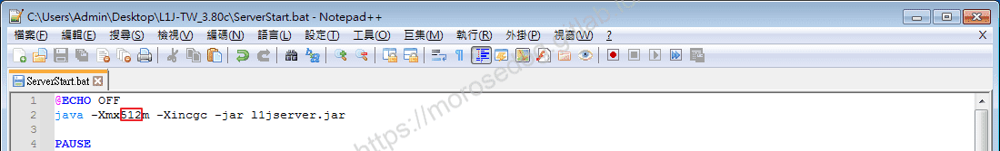

3. 啟動一段時間後發生`OutOfMemoryError`，模擬器定時重啟做記憶體釋放。

* **錯誤關鍵訊息**：

```plain
[javac] error: Source option 7 is no longer supported. Use 8 or later.
[javac] error: Target option 7 is no longer supported. Use 8 or later.
```

該錯誤於`2023/08/11`由<font color="red">`Linhelper論壇`</font>的”<font color="blue"><u>qwezx1001</u></font>“會員反饋的資訊。
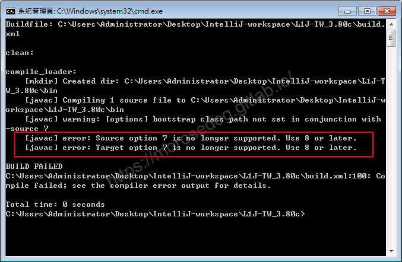
檢查與解決：

1. 使用的`Java`版本過高，可以安裝`jdk7`或`jdk8`的版本，並重新執行編譯即可([下載位置參考](./004_Java_的安裝.md#%E4%B8%8B%E8%BC%89-JDK))。

> 註：如果有遇到沒列出來的錯誤，可以將一些關鍵字上網搜尋，基本上都可以找到相關文章並解決問題。

## 結語

初步的設定檔，就這麼簡單，沒有要太多的說明和解釋；像是如何讀取這些設定檔，這些參數在哪被使用…等等，這些都牽涉到編輯模擬器核心程式碼的部分。
將來在`進階教學`和`核心修改`都會慢慢整理出來。
最後建議回顧一下首章[天堂私服 | 天堂私服架設教學](/private-lineage-20210712-private-lineage-0/#教學章節)，了解其章節目錄。​‌‌‌​​​​​‌‌‌​​‌​​‌‌​‌​​‌​‌‌‌​‌‌​​‌‌​​​​‌​‌‌‌​‌​​​‌‌​​‌​‌​​‌​‌‌​‌​‌‌​‌‌​​​‌‌​‌​​‌​‌‌​‌‌‌​​‌‌​​‌​‌​‌‌​​​​‌​‌‌​​‌‌‌​‌‌​​‌​‌​​‌​‌‌​‌​​‌‌​​‌​​​‌‌​​​​​​‌‌​​‌​​​‌‌​​​‌​​‌‌​​​​​​‌‌​‌‌‌​​‌‌​​‌​​​‌‌​​‌​​​‌​‌‌​‌​‌‌‌​​​​​‌‌‌​​‌​​‌‌​‌​​‌​‌‌‌​‌‌​​‌‌​​​​‌​‌‌‌​‌​​​‌‌​​‌​‌​​‌​‌‌​‌​‌‌​‌‌​​​‌‌​‌​​‌​‌‌​‌‌‌​​‌‌​​‌​‌​‌‌​​​​‌​‌‌​​‌‌‌​‌‌​​‌​‌​​‌​‌‌​‌​​‌‌​​​‌​​‌‌​​​​

## 免責聲明

* 本部落格文章中皆<font color="red"><u>**不提供**</u></font>任何所謂的遊戲「主程式」、「模擬器」、「登入器」…等等相關程式的下載點。

* 本部落格文章中所見之遊戲主程式和服務器端程序均來自網路發佈，<font color="red"><u>版本歸**原作者**</u>所有</font>。

* 本部落格文章為研究SQL資料庫與修改JAVA語法使用，<font color="red">並<u>**非商業用途**</u>，亦<u>**無做營運事實等任何一切商業行為**</u>。</font>

* 本部落格文章內容是為研究學習設計思想和原理為目的，<font color="red"><u>**絕沒有故意侵權或惡意抄襲、篡改其他遊戲內容**</u></font>！

> 註：以上參考了
> [維基百科 - Apache Ant](https://zh.wikipedia.org/wiki/Apache_Ant)
> [Apache Ant](https://ant.apache.org/)

---

- **原文連結**：[J.J.'s Blogs - 設定檔說明設定與啟動模擬器](https://morosedog.gitlab.io/private-lineage-20210722-private-lineage-10/)
