# 主程式安裝及登入器設定與登入

# 天堂私服 | 主程式安裝及登入器設定與登入

    
    
      📑 目錄
      

1. [環境說明](#環境說明)
2. [準備](#準備)
3. [啟動模擬器](#啟動模擬器)
4. [主程式安裝](#主程式安裝)
5. [登入器設置](#登入器設置)
6. [匯入登入器](#匯入登入器)
7. [登入前設置](#登入前設置)
8. [登入](#登入)
9. [結語](#結語)
10. [免責聲明](#免責聲明)

    
    
    

## 環境說明

此處使用`Oracle VM VirtualBox`虛擬機軟體，下載安裝了一個純淨的`Windows 7 x64 旗艦版`。

如果需要安裝虛擬機，可以參考此篇文章[VirtualBox Windows 7 安裝](./003_VirtualBox_Windows_7_安裝.md)。

## 準備

2. 在開始前需要準備「天堂模擬器」，此處所使用的是「[L1J-3.80c](/images/private-lineage/download_not_available.png)」由`日本開發團隊`研發的版本做示範。且已經是設置完畢可以開啟狀態。可以參考[天堂私服 | 前言](/private-lineage-20210712-private-lineage-0)的完整教學。

  * 無法提供下載點，請根據關鍵字自行上網搜尋。

4. 天堂(Lineage 3.81C)主程式，安裝版或是免安裝版本都可以。

  * 無法提供下載點，請根據關鍵字自行上網搜尋。

6. 天堂「Login_v380a.rar」登入器。

  * 無法提供下載點，請根據關鍵字自行上網搜尋。

## 啟動模擬器

在前一篇中已經有完整教學，這邊只需要將模擬器啟動即可。

## 主程式安裝

此處不介紹主程式的安裝過程，基本上都是預設安裝即可。​‌‌‌​​​​​‌‌‌​​‌​​‌‌​‌​​‌​‌‌‌​‌‌​​‌‌​​​​‌​‌‌‌​‌​​​‌‌​​‌​‌​​‌​‌‌​‌​‌‌​‌‌​​​‌‌​‌​​‌​‌‌​‌‌‌​​‌‌​​‌​‌​‌‌​​​​‌​‌‌​​‌‌‌​‌‌​​‌​‌​​‌​‌‌​‌​​‌‌​​‌​​​‌‌​​​​​​‌‌​​‌​​​‌‌​​​‌​​‌‌​​​​​​‌‌​‌‌‌​​‌‌​​‌​​​‌‌​​‌‌​​‌​‌‌​‌​‌‌‌​​​​​‌‌‌​​‌​​‌‌​‌​​‌​‌‌‌​‌‌​​‌‌​​​​‌​‌‌‌​‌​​​‌‌​​‌​‌​​‌​‌‌​‌​‌‌​‌‌​​​‌‌​‌​​‌​‌‌​‌‌‌​​‌‌​​‌​‌​‌‌​​​​‌​‌‌​​‌‌‌​‌‌​​‌​‌​​‌​‌‌​‌​​‌‌​​​‌​​‌‌​​​‌

* 免安裝版

  * 基本上免安裝版本只需要解壓縮後就可以進行使用；有一些缺點就是免安裝版檔通常都是比安裝檔來的大的多，會夾帶一些私服廣告檔案，甚至有可能被值入惡意程式，但是就是省去安裝過程所需花費的時間。

* 安裝版

  * 安裝版本的安裝過程基本上都預設即可。

天堂主程式的目錄 -
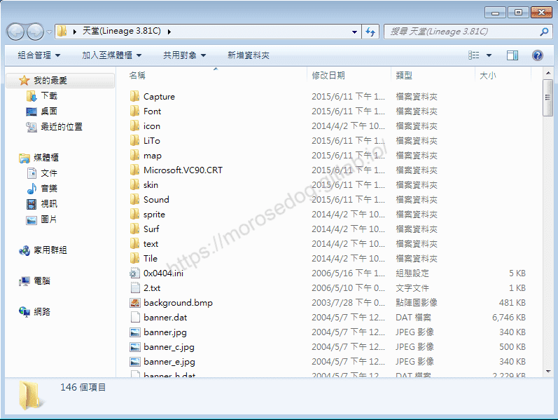

> 註：此處使用的是免安裝檔，解壓縮後目錄內容可以會不一樣，請做為參考就好。

## 登入器設置

此處登入器解壓縮後目錄內容 -
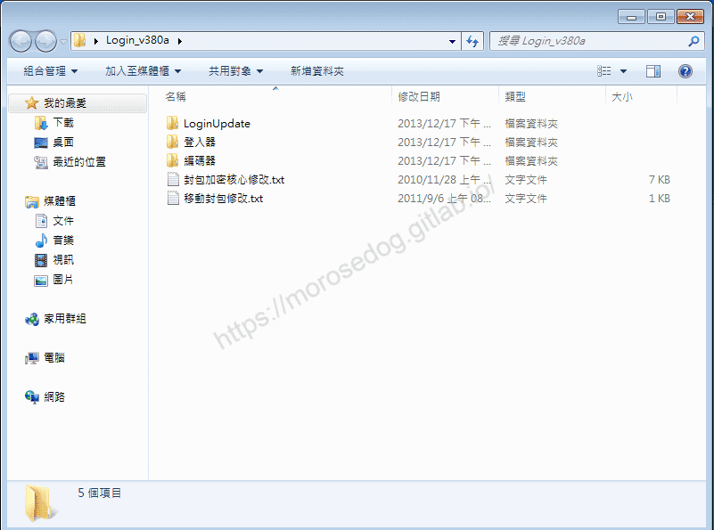​‌‌‌​​​​​‌‌‌​​‌​​‌‌​‌​​‌​‌‌‌​‌‌​​‌‌​​​​‌​‌‌‌​‌​​​‌‌​​‌​‌​​‌​‌‌​‌​‌‌​‌‌​​​‌‌​‌​​‌​‌‌​‌‌‌​​‌‌​​‌​‌​‌‌​​​​‌​‌‌​​‌‌‌​‌‌​​‌​‌​​‌​‌‌​‌​​‌‌​​‌​​​‌‌​​​​​​‌‌​​‌​​​‌‌​​​‌​​‌‌​​​​​​‌‌​‌‌‌​​‌‌​​‌​​​‌‌​​‌‌​​‌​‌‌​‌​‌‌‌​​​​​‌‌‌​​‌​​‌‌​‌​​‌​‌‌‌​‌‌​​‌‌​​​​‌​‌‌‌​‌​​​‌‌​​‌​‌​​‌​‌‌​‌​‌‌​‌‌​​​‌‌​‌​​‌​‌‌​‌‌‌​​‌‌​​‌​‌​‌‌​​​​‌​‌‌​​‌‌‌​‌‌​​‌​‌​​‌​‌‌​‌​​‌‌​​​‌​​‌‌​​​‌

* LoginUpdate

* 登入器

* 編碼器

* 封包加密核心修改.txt

* 移動封包修改.txt

此處將只需要關注「登入器」與「編碼器」即可，其他的部分，將會在之後特別另外說明。

* 進入`編碼器`目錄，並且點擊`Encode.exe`
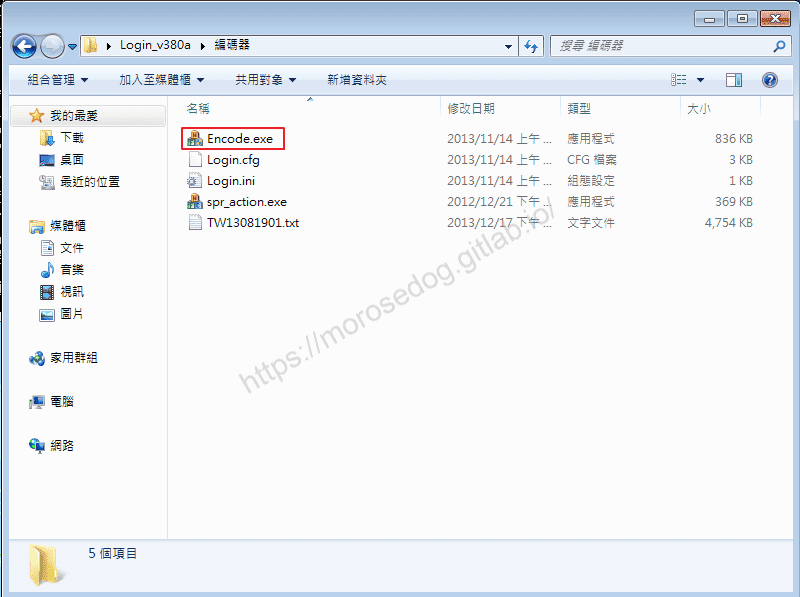

* 跳出安全提示`您是否允許下列來自不明發行者的程式變更這部電腦？`請點擊`是`。
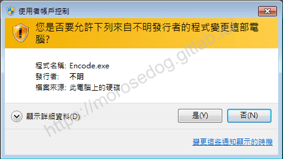

* 開啟`Encode v3.80`程式視窗後，設定後並點擊`編碼`。

  * 名稱：快樂天堂 <可自行定義名稱>。

  * IP：127.0.0.1 <此處為單機示範，預設即可>

  * Port：2000 <預設即可>

  * 版本：<預設即可>

  * 其他選項，如圖勾選即可。
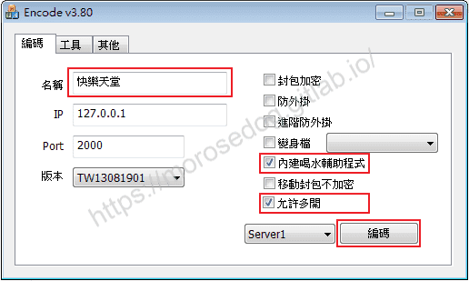

* 彈出提示視窗`編碼完成`，請點擊`確定`
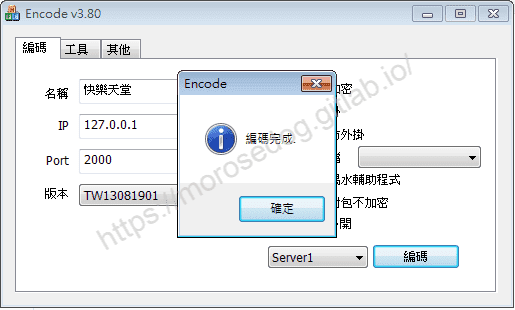

* 關閉`Encode v3.80`程式視窗，可見`Login.ini`檔為新的檔案。
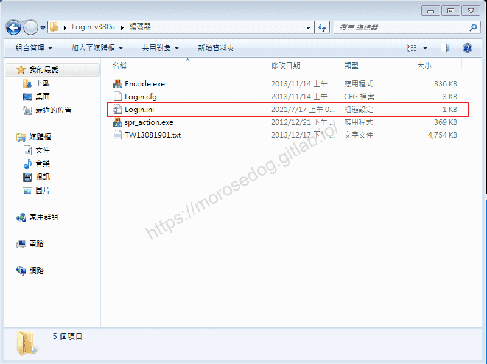

* 複製`Login.ini`檔案，並回到上一層目錄，並進入`登入器`目錄貼上檔案，並點擊`複製並取代`。
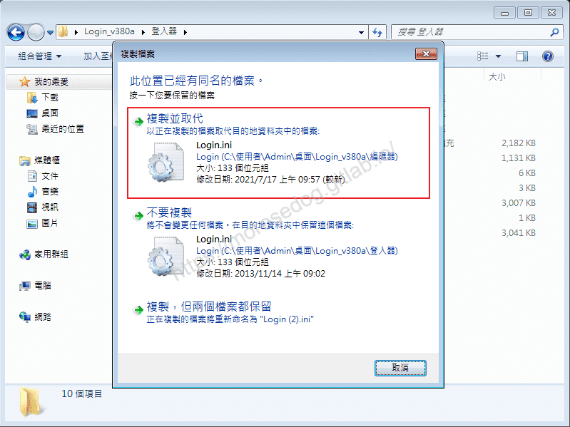

* 此時登入器的設置已經完成了。
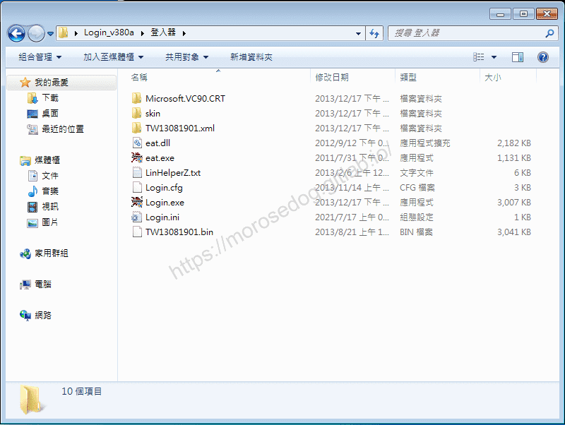

## 匯入登入器

* 將上方完成設置的登入器目錄內的所有資料夾與檔案全部複製。
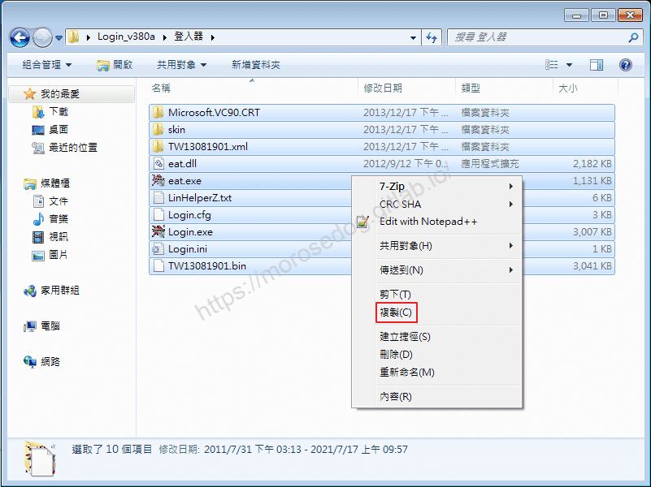

* 進入`天堂(Lineage 3.81C)`目錄下，並貼上檔案並覆蓋。

* 跳出確認資料夾取代視窗，請勾選`套用到所有目前的項目`，並繼續點擊`是`。
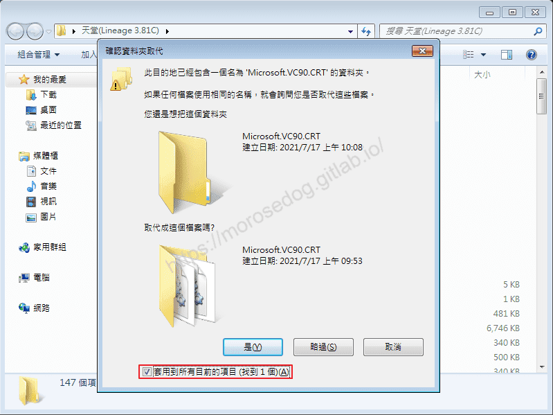

* 跳出複製提示視窗，請勾選`接下來的 xx 個檔案衝突都這樣處理`，並點擊`複製並取代`。
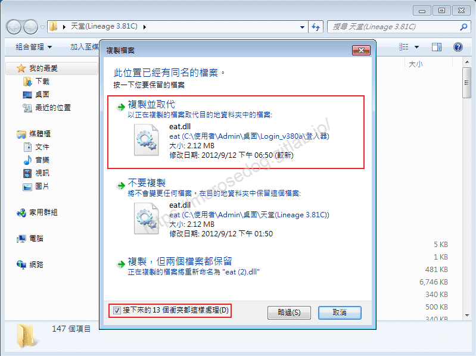

* 此時登入器已經成功匯入至天堂主程式中。

## 登入前設置

在開始登入天堂之前，請記得將顯示卡色彩的設定，改為`全彩 16位元`。

* 進入`控制台\外觀及個人化\顯示\螢幕解析度` → `進階設定`
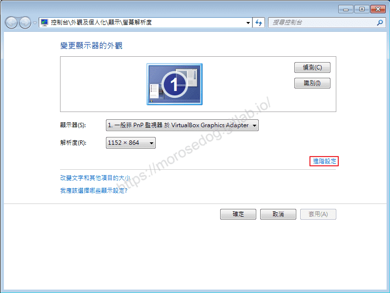

* 點選`監視器`頁籤，色彩的設定，改為`全彩 16位元`，並點擊`確定`。
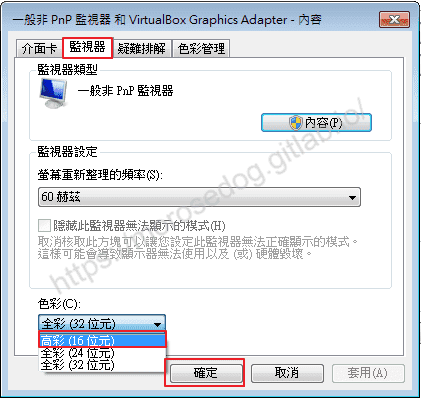

* `您要保留這些顯示設定嗎？`請點擊`是`。

* 此時會發現桌布和畫面好像畫值變差了，這是不影響整個電腦操作，請忽略。
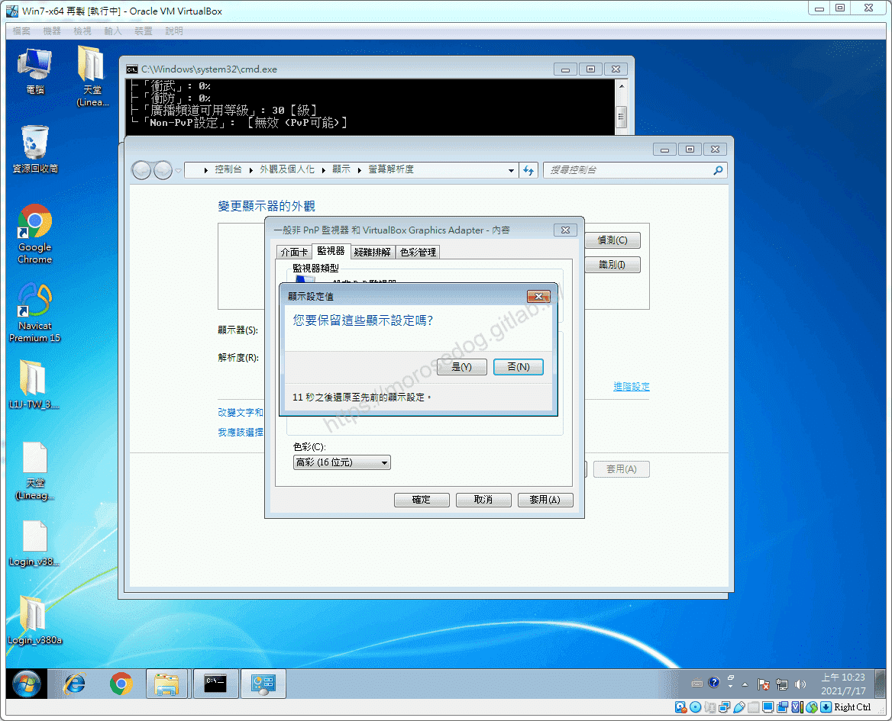

如果沒有調整可能發生以下幾種情況 - ​‌‌‌​​​​​‌‌‌​​‌​​‌‌​‌​​‌​‌‌‌​‌‌​​‌‌​​​​‌​‌‌‌​‌​​​‌‌​​‌​‌​​‌​‌‌​‌​‌‌​‌‌​​​‌‌​‌​​‌​‌‌​‌‌‌​​‌‌​​‌​‌​‌‌​​​​‌​‌‌​​‌‌‌​‌‌​​‌​‌​​‌​‌‌​‌​​‌‌​​‌​​​‌‌​​​​​​‌‌​​‌​​​‌‌​​​‌​​‌‌​​​​​​‌‌​‌‌‌​​‌‌​​‌​​​‌‌​​‌‌​​‌​‌‌​‌​‌‌‌​​​​​‌‌‌​​‌​​‌‌​‌​​‌​‌‌‌​‌‌​​‌‌​​​​‌​‌‌‌​‌​​​‌‌​​‌​‌​​‌​‌‌​‌​‌‌​‌‌​​​‌‌​‌​​‌​‌‌​‌‌‌​​‌‌​​‌​‌​‌‌​​​​‌​‌‌​​‌‌‌​‌‌​​‌​‌​​‌​‌‌​‌​​‌‌​​​‌​​‌‌​​​‌

* 登入天堂時會發生天堂視窗閃退

* 登入天堂時彈出錯誤訊息視窗
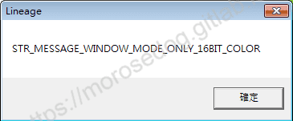

## 登入

* 進入`天堂(Lineage 3.81C)`目錄下，並點擊開啟`Login.exe`。
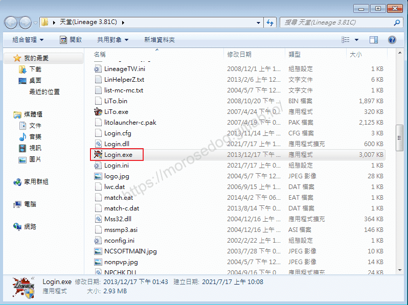

* 跳出安全提示`您是否允許下列來自不明發行者的程式變更這部電腦？`請點擊`是`。
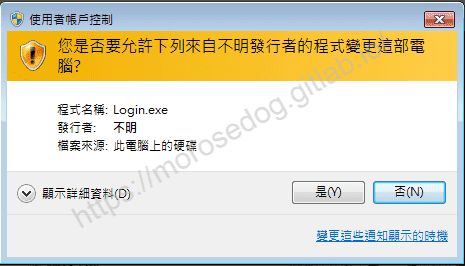

* 點擊`開始`
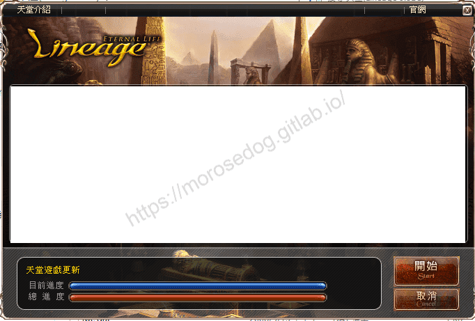

* 綠色燈號表示伺服器連接正常，點擊`快樂天堂`
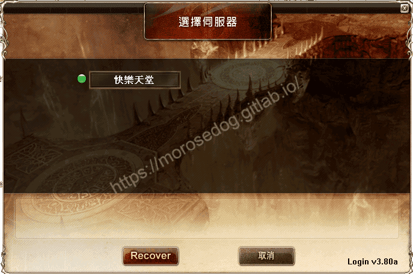

* 輸入帳號/密碼，直接建立帳號。
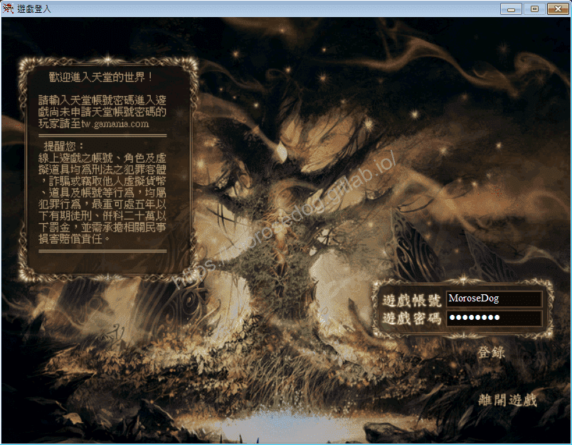

* 進入角色選擇/建立畫面。
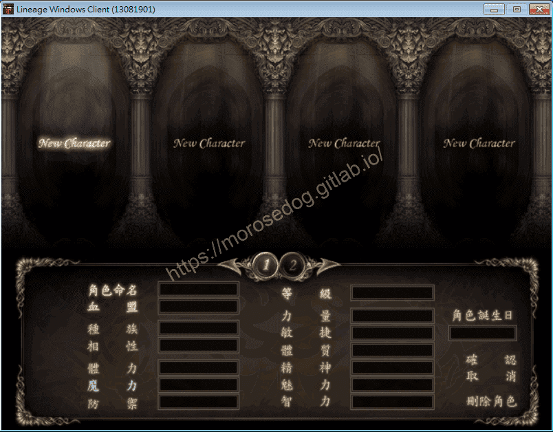

* 建立角色畫面，建立角色。
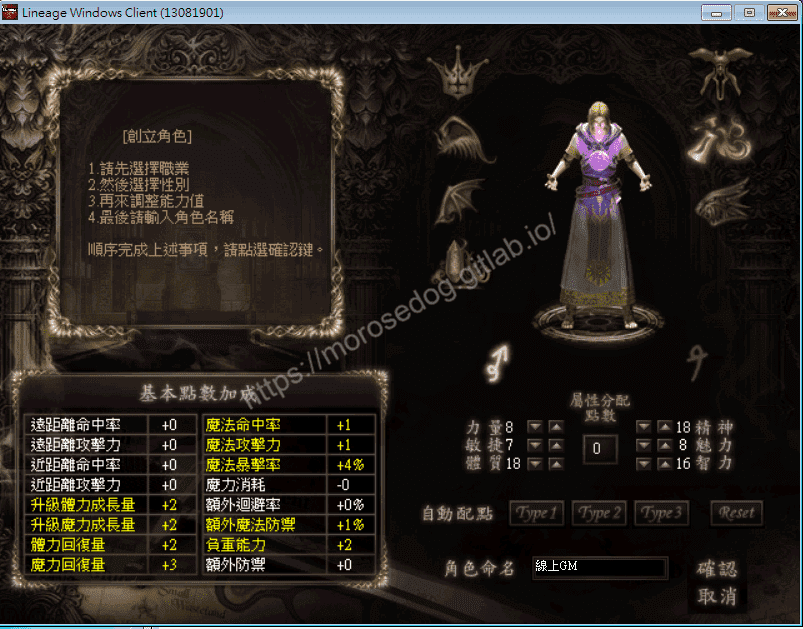

* 進入遊戲畫面。
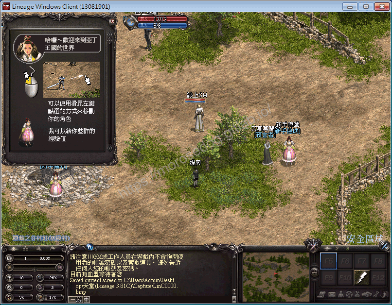

* 恭喜成功架設天堂私服模擬器。

## 結語

此時應該已經迫不及待的想做一些事情一堆問題了吧 -

* 如何將天堂私服開放出來給親朋好友<親友團>進來玩？

* 如何調整經驗值倍率、掉寶倍率？

* 如何變身成為線上GM角色？

* 如何使用線上GM特有的指令創造神裝、創造怪物？

* 太多說不完…

別急！後面會慢慢一步一步提到慢慢教學。
最後建議回顧一下首章[天堂私服 | 天堂私服架設教學](/private-lineage-20210712-private-lineage-0/#教學章節)，了解其章節目錄。

## 免責聲明

* 本部落格文章中皆<u>**不提供**</u>任何所謂的遊戲「主程式」、「模擬器」、「登入器」…等等相關程式的下載點。

* 本部落格文章中所見之遊戲主程式和服務器端程序均來自網路發佈，<u>版本歸**原作者**</u>所有。

* 本部落格文章為研究SQL資料庫與修改JAVA語法使用，並<u>**非商業用途**</u>，亦<u>**無做營運事實等任何一切商業行為**</u>。

* 本部落格文章內容是為研究學習設計思想和原理為目的，<u>**絕沒有故意侵權或惡意抄襲、篡改其他遊戲內容**</u>！

> 註：以上參考了
> [維基百科 - Navicat](https://zh.wikipedia.org/wiki/Navicat)
> [Navicat](https://www.navicat.com/cht)
> [Navicat 支援中心](https://help.navicat.com/hc/zh-tw)​‌‌‌​​​​​‌‌‌​​‌​​‌‌​‌​​‌​‌‌‌​‌‌​​‌‌​​​​‌​‌‌‌​‌​​​‌‌​​‌​‌​​‌​‌‌​‌​‌‌​‌‌​​​‌‌​‌​​‌​‌‌​‌‌‌​​‌‌​​‌​‌​‌‌​​​​‌​‌‌​​‌‌‌​‌‌​​‌​‌​​‌​‌‌​‌​​‌‌​​‌​​​‌‌​​​​​​‌‌​​‌​​​‌‌​​​‌​​‌‌​​​​​​‌‌​‌‌‌​​‌‌​​‌​​​‌‌​​‌‌​​‌​‌‌​‌​‌‌‌​​​​​‌‌‌​​‌​​‌‌​‌​​‌​‌‌‌​‌‌​​‌‌​​​​‌​‌‌‌​‌​​​‌‌​​‌​‌​​‌​‌‌​‌​‌‌​‌‌​​​‌‌​‌​​‌​‌‌​‌‌‌​​‌‌​​‌​‌​‌‌​​​​‌​‌‌​​‌‌‌​‌‌​​‌​‌​​‌​‌‌​‌​​‌‌​​​‌​​‌‌​​​‌

---

- **原文連結**：[J.J.'s Blogs - 主程式安裝及登入器設定與登入](https://morosedog.gitlab.io/private-lineage-20210723-private-lineage-11/)
