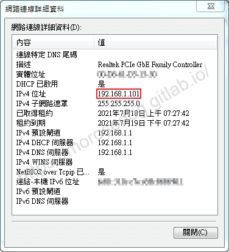

# IP 位址 (IP Address)

# 天堂私服 | IP 位址 (IP Address)

    
    
      📑 目錄
      

1. [章節用意](#章節用意)
2. [IP、IP Address？](#IP、IP-Address？)
3. [IP Address](#IP-Address)
4. [IPv4](#IPv4)
5. [特殊IP位址](#特殊IP位址)
6. [結語](#結語)
7. [免責聲明](#免責聲明)

    
    
    

## 章節用意

今天需要將模擬器的位址，分享出去給親朋好友們一起同遊的時候，勢必是需要將模擬器的位址提供出去，這樣才有辦法讓其他人可以連線進入。
所以必需要對一些**IP 位址**有一點點一些些基本的了解…。

開始前先看看這張圖，有沒有很熟悉 -


## IP、IP Address？

要知道這兩個東西不能說是一樣的東西唷，但是此處不會提到太多，因為會說不完，所以會針對**IP 位址**做主要說明。​‌‌‌​​​​​‌‌‌​​‌​​‌‌​‌​​‌​‌‌‌​‌‌​​‌‌​​​​‌​‌‌‌​‌​​​‌‌​​‌​‌​​‌​‌‌​‌​‌‌​‌‌​​​‌‌​‌​​‌​‌‌​‌‌‌​​‌‌​​‌​‌​‌‌​​​​‌​‌‌​​‌‌‌​‌‌​​‌​‌​​‌​‌‌​‌​​‌‌​​‌​​​‌‌​​​​​​‌‌​​‌​​​‌‌​​​‌​​‌‌​​​​​​‌‌​‌‌‌​​‌‌​​‌​​​‌‌​‌​​​​‌​‌‌​‌​‌‌‌​​​​​‌‌‌​​‌​​‌‌​‌​​‌​‌‌‌​‌‌​​‌‌​​​​‌​‌‌‌​‌​​​‌‌​​‌​‌​​‌​‌‌​‌​‌‌​‌‌​​​‌‌​‌​​‌​‌‌​‌‌‌​​‌‌​​‌​‌​‌‌​​​​‌​‌‌​​‌‌‌​‌‌​​‌​‌​​‌​‌‌​‌​​‌‌​​​‌​​‌‌​​‌​

* 網際網路協定（英語：Internet Protocol，縮寫：IP）是用於封包交換資料網路的協定。

  * 簡單來說就是大家一起定義出來的規矩，然後大家都照這個規矩去做。

* IP位址（英語：IP Address），是網際協定（Internet Protocol）中用於標識傳送或接收資料報的裝置的一串數字。

  * 簡單來說就是兩台設備的地址，類似`192.168.0.1`，大家都通過這個地址來找到對方；當然這個地址，也是大家一起定義的規矩、規格。

> 註：常常聽到人家說 IP 給我，其實就是**IP 位址**。

## IP Address

IP位址（英語：IP Address，全稱Internet Protocol Address），又譯為網際協定位址、網際網路協定位址。
當裝置連接網路，裝置將被分配一個IP位址，用作標識。通過IP位址，裝置間可以互相通訊，如果沒有IP位址，我們將無法知道哪個裝置是傳送方，無法知道哪個是接收方。

IP位址有兩個主要功能：​‌‌‌​​​​​‌‌‌​​‌​​‌‌​‌​​‌​‌‌‌​‌‌​​‌‌​​​​‌​‌‌‌​‌​​​‌‌​​‌​‌​​‌​‌‌​‌​‌‌​‌‌​​​‌‌​‌​​‌​‌‌​‌‌‌​​‌‌​​‌​‌​‌‌​​​​‌​‌‌​​‌‌‌​‌‌​​‌​‌​​‌​‌‌​‌​​‌‌​​‌​​​‌‌​​​​​​‌‌​​‌​​​‌‌​​​‌​​‌‌​​​​​​‌‌​‌‌‌​​‌‌​​‌​​​‌‌​‌​​​​‌​‌‌​‌​‌‌‌​​​​​‌‌‌​​‌​​‌‌​‌​​‌​‌‌‌​‌‌​​‌‌​​​​‌​‌‌‌​‌​​​‌‌​​‌​‌​​‌​‌‌​‌​‌‌​‌‌​​​‌‌​‌​​‌​‌‌​‌‌‌​​‌‌​​‌​‌​‌‌​​​​‌​‌‌​​‌‌‌​‌‌​​‌​‌​​‌​‌‌​‌​​‌‌​​​‌​​‌‌​​‌​

* 標識裝置或網路

* 定址（英語：location addressing）。

常見的IP位址分為兩大類，

* IPv4：

  * IP位址由一串數字組成。`IPv4`由十進位數字組成，並以點分隔，如：`172.16.254.1`。

* IPv6：

  * 由十六進位數字組成，以冒號分割，如：`2001:db8:0:1234:0:567:8:1`。

> 註：此處看不懂沒關係，先知道有`IPv4`就好，為何有`IPv6`是因為目前全世界的裝置太多，原本的`IPv4`已經不夠用了，所以才有了`IPv6`。

## IPv4

IP位址由32位元二進位陣列組成，就是由32個0與1組成的一連串數字。在把32位元的分成四小段，
例如： ​‌‌‌​​​​​‌‌‌​​‌​​‌‌​‌​​‌​‌‌‌​‌‌​​‌‌​​​​‌​‌‌‌​‌​​​‌‌​​‌​‌​​‌​‌‌​‌​‌‌​‌‌​​​‌‌​‌​​‌​‌‌​‌‌‌​​‌‌​​‌​‌​‌‌​​​​‌​‌‌​​‌‌‌​‌‌​​‌​‌​​‌​‌‌​‌​​‌‌​​‌​​​‌‌​​​​​​‌‌​​‌​​​‌‌​​​‌​​‌‌​​​​​​‌‌​‌‌‌​​‌‌​​‌​​​‌‌​‌​​​​‌​‌‌​‌​‌‌‌​​​​​‌‌‌​​‌​​‌‌​‌​​‌​‌‌‌​‌‌​​‌‌​​​​‌​‌‌‌​‌​​​‌‌​​‌​‌​​‌​‌‌​‌​‌‌​‌‌​​​‌‌​‌​​‌​‌‌​‌‌‌​​‌‌​​‌​‌​‌‌​​​​‌​‌‌​​‌‌‌​‌‌​​‌​‌​​‌​‌‌​‌​​‌‌​​​‌​​‌‌​​‌​

```plain
00000000.00000000.00000000.00000000 => 0.0.0.0
11111111.11111111.11111111.11111111 => 255.255.255.255 
11000000.10101000.00101010.00000001 => 192.168.42.1
```

而位址可分為五大類 -

* Class A

* Class B

* Class C

* Class D

* Class E

其中E類屬於特殊保留位址。

> 註：詳細可見：[維基百科 IP位址 - IPv4位址分類](https://zh.wikipedia.org/wiki/IP%E5%9C%B0%E5%9D%80)​‌‌‌​​​​​‌‌‌​​‌​​‌‌​‌​​‌​‌‌‌​‌‌​​‌‌​​​​‌​‌‌‌​‌​​​‌‌​​‌​‌​​‌​‌‌​‌​‌‌​‌‌​​​‌‌​‌​​‌​‌‌​‌‌‌​​‌‌​​‌​‌​‌‌​​​​‌​‌‌​​‌‌‌​‌‌​​‌​‌​​‌​‌‌​‌​​‌‌​​‌​​​‌‌​​​​​​‌‌​​‌​​​‌‌​​​‌​​‌‌​​​​​​‌‌​‌‌‌​​‌‌​​‌​​​‌‌​‌​​​​‌​‌‌​‌​‌‌‌​​​​​‌‌‌​​‌​​‌‌​‌​​‌​‌‌‌​‌‌​​‌‌​​​​‌​‌‌‌​‌​​​‌‌​​‌​‌​​‌​‌‌​‌​‌‌​‌‌​​​‌‌​‌​​‌​‌‌​‌‌‌​​‌‌​​‌​‌​‌‌​​​​‌​‌‌​​‌‌‌​‌‌​​‌​‌​​‌​‌‌​‌​​‌‌​​​‌​​‌‌​​‌​

---

IP位址可分為`Net_ID`(網路編號) 與`Host_ID`(主機編號) 兩部份。

以 192.168.0.0 ~ 192.168.0.255 這個`Class C`的網域說明，前面三組數字`192.168.0`就是網路編號，最後面一組數字則稱為主機編號。

同一個網域的定義是在同一個網段內，主機的 IP 具有相同的網路編號，並且具有唯一的主機編號。
上面例子當中的`192.168.0.0`、`192.168.0.1`、`192.168.0.2`、….、`192.168.0.255` (共`256`個) 這些 IP 都是同一個網域裡，
並且同一個網域內，不能具有相同的主機編號，否則會發生 IP 衝突，會造成兩部主機都沒有辦法使用網路。​‌‌‌​​​​​‌‌‌​​‌​​‌‌​‌​​‌​‌‌‌​‌‌​​‌‌​​​​‌​‌‌‌​‌​​​‌‌​​‌​‌​​‌​‌‌​‌​‌‌​‌‌​​​‌‌​‌​​‌​‌‌​‌‌‌​​‌‌​​‌​‌​‌‌​​​​‌​‌‌​​‌‌‌​‌‌​​‌​‌​​‌​‌‌​‌​​‌‌​​‌​​​‌‌​​​​​​‌‌​​‌​​​‌‌​​​‌​​‌‌​​​​​​‌‌​‌‌‌​​‌‌​​‌​​​‌‌​‌​​​​‌​‌‌​‌​‌‌‌​​​​​‌‌‌​​‌​​‌‌​‌​​‌​‌‌‌​‌‌​​‌‌​​​​‌​‌‌‌​‌​​​‌‌​​‌​‌​​‌​‌‌​‌​‌‌​‌‌​​​‌‌​‌​​‌​‌‌​‌‌‌​​‌‌​​‌​‌​‌‌​​​​‌​‌‌​​‌‌‌​‌‌​​‌​‌​​‌​‌‌​‌​​‌‌​​​‌​​‌‌​​‌​

主機號碼的限制：主機號碼在二進位的表示法當中，不可同時為`0`也不可同時為`1`。
例如在上面的例子當中，`192.168.0.0`(主機號碼全部為`0`) 以及`192.168.0.255`(主機號碼全部為`1`) 不可用來作為網段內主機的 IP 設定，
也就是說，這個網段內可用來設定主機的 IP 是從`192.168.0.1`~`192.168.0.254`。

> 註：至此應該有基本的了解，更深入的說明可能會不好吸收，此處做一些基礎的了解即可。

## 特殊IP位址

網路編號
主機編號
是否可以作為源位址
是否可以作為目的位址
備註/描述

全為0
全為0
允許
禁止
表示本網主機

全為0
Host ID
允許
禁止
表示特定主機

全為1
全為1
禁止
允許
定向廣播位址

127
任意合法的值
允許
允許
迂迴位址，用於本地測試

Network ID
全為1
禁止
允許
直接廣播位址

> 註：此處只要記住`127`這個網路號就好，後面章節將會提到。

## 結語

此處真的不想提及太多，希望用最少的內容來讓其有非常非常的基礎了解；就算還是不了解，至少看過有聽過。
後面慢慢使用後會有自己的見解，其實就會知道了，先不要鑽牛角尖，有時候回頭來看這邊文章又會有不同的理解。
最後建議回顧一下首章[天堂私服 | 天堂私服架設教學](/private-lineage-20210712-private-lineage-0/#教學章節)，了解其章節目錄。​‌‌‌​​​​​‌‌‌​​‌​​‌‌​‌​​‌​‌‌‌​‌‌​​‌‌​​​​‌​‌‌‌​‌​​​‌‌​​‌​‌​​‌​‌‌​‌​‌‌​‌‌​​​‌‌​‌​​‌​‌‌​‌‌‌​​‌‌​​‌​‌​‌‌​​​​‌​‌‌​​‌‌‌​‌‌​​‌​‌​​‌​‌‌​‌​​‌‌​​‌​​​‌‌​​​​​​‌‌​​‌​​​‌‌​​​‌​​‌‌​​​​​​‌‌​‌‌‌​​‌‌​​‌​​​‌‌​‌​​​​‌​‌‌​‌​‌‌‌​​​​​‌‌‌​​‌​​‌‌​‌​​‌​‌‌‌​‌‌​​‌‌​​​​‌​‌‌‌​‌​​​‌‌​​‌​‌​​‌​‌‌​‌​‌‌​‌‌​​​‌‌​‌​​‌​‌‌​‌‌‌​​‌‌​​‌​‌​‌‌​​​​‌​‌‌​​‌‌‌​‌‌​​‌​‌​​‌​‌‌​‌​​‌‌​​​‌​​‌‌​​‌​

## 免責聲明

* 本部落格文章中皆<font color="red"><u>**不提供**</u></font>任何所謂的遊戲「主程式」、「模擬器」、「登入器」…等等相關程式的下載點。

* 本部落格文章中所見之遊戲主程式和服務器端程序均來自網路發佈，<font color="red"><u>版本歸**原作者**</u>所有</font>。

* 本部落格文章為研究SQL資料庫與修改JAVA語法使用，<font color="red">並<u>**非商業用途**</u>，亦<u>**無做營運事實等任何一切商業行為**</u>。</font>

* 本部落格文章內容是為研究學習設計思想和原理為目的，<font color="red"><u>**絕沒有故意侵權或惡意抄襲、篡改其他遊戲內容**</u></font>！

> 註：以上參考了
> [維基百科 - IP位址](https://zh.wikipedia.org/wiki/IP%E5%9C%B0%E5%9D%80)
> [IP 位址的組成](http://kevin.hwai.edu.tw/~kevin/material/EAssistant/IP_Class.htm)

---

- **原文連結**：[J.J.'s Blogs - IP 位址 (IP Address)](https://morosedog.gitlab.io/private-lineage-20210724-private-lineage-12/)
