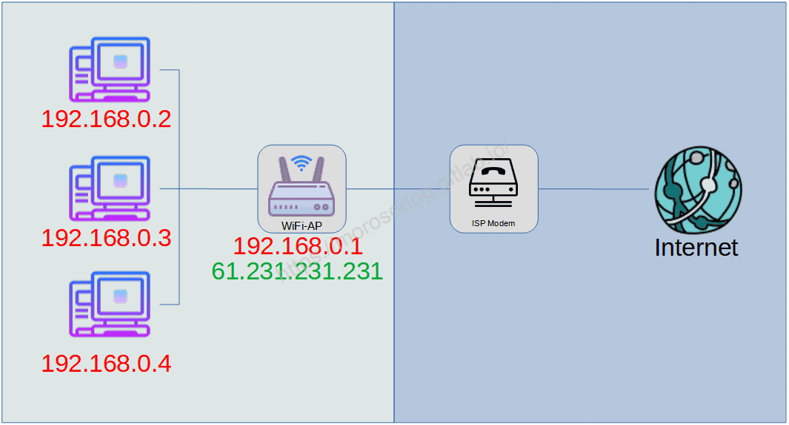
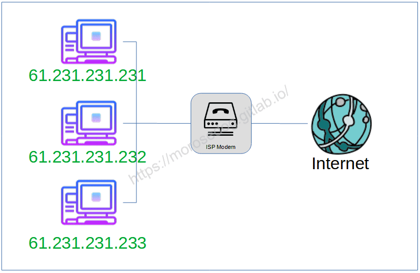
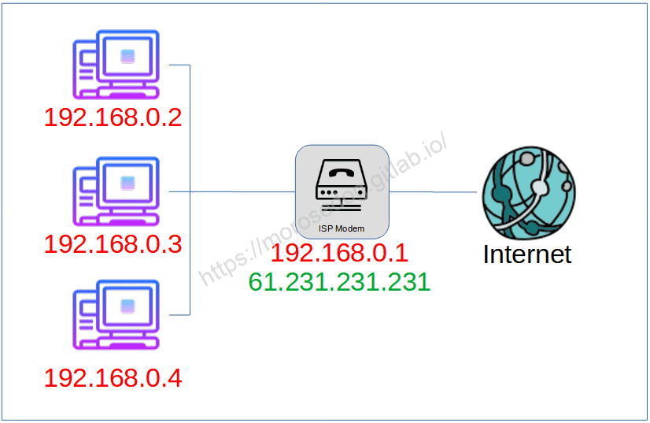
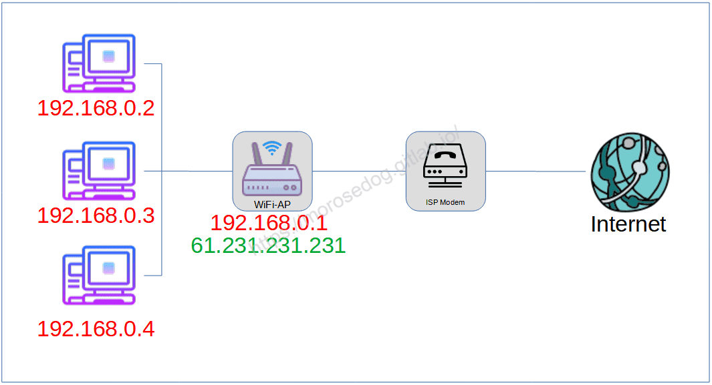
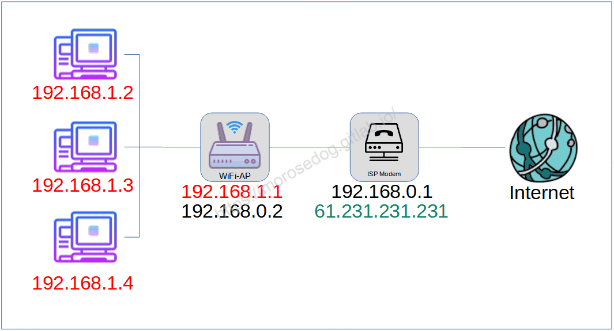

# 內部、外部網路

# 天堂私服 | 內部、外部網路

    
    
      📑 目錄
      

1. [章節用意](#章節用意)
2. [localhost、127.0.0.1、0.0.0.0](#localhost、127-0-0-1、0-0-0-0)
3. [內部、外部、撥接、DHCP？](#內部、外部、撥接、DHCP？)
4. [常見配置](#常見配置)
5. [結語](#結語)
6. [免責聲明](#免責聲明)

    
    
    

## 章節用意

在前一章節中，有稍微提到**[IP位址](./012_IP_位址_(IP_Address).md)**，由於目前多數 ISP 業者的機器都有提供 DHCP 的功能，
而且多數業者為了方便基本上都會設定好，讓電腦街上網路線即連上網；或者一般家庭都會在另外添購所謂的 Wifi 分享器，也是使用 DHCP 配置的。

由於要將模擬器開放對外給親友團們遊玩，需要對所謂

* 「內部網路」

* 「外部網路」

* 「DHCP」

* 「撥接上網」

有一些了解，後面再設定登入器的時候才不會茫然不知。​‌‌‌​​​​​‌‌‌​​‌​​‌‌​‌​​‌​‌‌‌​‌‌​​‌‌​​​​‌​‌‌‌​‌​​​‌‌​​‌​‌​​‌​‌‌​‌​‌‌​‌‌​​​‌‌​‌​​‌​‌‌​‌‌‌​​‌‌​​‌​‌​‌‌​​​​‌​‌‌​​‌‌‌​‌‌​​‌​‌​​‌​‌‌​‌​​‌‌​​‌​​​‌‌​​​​​​‌‌​​‌​​​‌‌​​​‌​​‌‌​​​​​​‌‌​‌‌‌​​‌‌​​‌​​​‌‌​‌​‌​​‌​‌‌​‌​‌‌‌​​​​​‌‌‌​​‌​​‌‌​‌​​‌​‌‌‌​‌‌​​‌‌​​​​‌​‌‌‌​‌​​​‌‌​​‌​‌​​‌​‌‌​‌​‌‌​‌‌​​​‌‌​‌​​‌​‌‌​‌‌‌​​‌‌​​‌​‌​‌‌​​​​‌​‌‌​​‌‌‌​‌‌​​‌​‌​​‌​‌‌​‌​​‌‌​​​‌​​‌‌​​‌‌

這邊會盡量提供圖片或是擬人擬物化的講解方式，幫助更快速了解。

## localhost、127.0.0.1、0.0.0.0

* localhost

  * 是一個在電腦網路中用於表示「此電腦」的主機名。它被用於通過本地環回網路介面，來存取本機執行的服務，並且將會繞過任何物理網路介面硬體。

* 127.0.0.1

  * IPv4 網路標準將整個 127.0.0.0/8 位址塊訂為保留位址，供本地環回使用，整個位址塊內有超過1600萬個IP位址。所以，傳送到這些位址（127.0.0.1 到 127.255.255.255）的所有封包都會返回本機。 位址 127.0.0.1 是 IPv4 環回的常用標準位址，其餘位址並不是所有的作業系統都支援（多數人也不知道有這些位址）。

* 0.0.0.0

  * 在Internet 協議版本 4 中，地址0.0.0.0是不可路由的元地址，用於指定無效、未知或不適用的目標。該地址在許多上下文中具有特定含義，例如在客戶端或服務器上。

本地環迴機制，可在主機上運行網路服務，期間不需安裝實體網路介面卡，也無需將該服務開放予主機所在網路。例如，在設定好本地安裝的網站後，可通過`http://localhost`這一網址，來存取本地網站。
localhost這個主機名稱一般會解析為IPv4本地環回位址127.0.0.1和IPv6本地環回位址[::1]。

> 註：這邊只需要簡單記得多數作業系統，都可使用`localhost`與`127.0.0.1`當做本機的位址；所以同一台電腦開啟模擬器使用登入器登入，登入器IP只需要設定`127.0.0.1`即可。​‌‌‌​​​​​‌‌‌​​‌​​‌‌​‌​​‌​‌‌‌​‌‌​​‌‌​​​​‌​‌‌‌​‌​​​‌‌​​‌​‌​​‌​‌‌​‌​‌‌​‌‌​​​‌‌​‌​​‌​‌‌​‌‌‌​​‌‌​​‌​‌​‌‌​​​​‌​‌‌​​‌‌‌​‌‌​​‌​‌​​‌​‌‌​‌​​‌‌​​‌​​​‌‌​​​​​​‌‌​​‌​​​‌‌​​​‌​​‌‌​​​​​​‌‌​‌‌‌​​‌‌​​‌​​​‌‌​‌​‌​​‌​‌‌​‌​‌‌‌​​​​​‌‌‌​​‌​​‌‌​‌​​‌​‌‌‌​‌‌​​‌‌​​​​‌​‌‌‌​‌​​​‌‌​​‌​‌​​‌​‌‌​‌​‌‌​‌‌​​​‌‌​‌​​‌​‌‌​‌‌‌​​‌‌​​‌​‌​‌‌​​​​‌​‌‌​​‌‌‌​‌‌​​‌​‌​​‌​‌‌​‌​​‌‌​​​‌​​‌‌​​‌‌

## 內部、外部、撥接、DHCP？

該圖僅用於讓新手快速了解，並**不是一個非常完善或絕對正確的圖**；自己畫的圖，有點醜…將就點看。

圖片說明<由左至右>：

* Internet (網際網路)。

* 使用中華電信 ISP 業者。

  * 圖中 ISP Modem，就是中華電信的數據機<小烏龜>。

* WiFi分享器

  * 相信家中90%以上的人都有使用，圖中 WiFi-AP 表示。

> 註：現在很多ISP業者提供的數據機，多數都有提供 WiFi 與 DHCP 功能。​‌‌‌​​​​​‌‌‌​​‌​​‌‌​‌​​‌​‌‌‌​‌‌​​‌‌​​​​‌​‌‌‌​‌​​​‌‌​​‌​‌​​‌​‌‌​‌​‌‌​‌‌​​​‌‌​‌​​‌​‌‌​‌‌‌​​‌‌​​‌​‌​‌‌​​​​‌​‌‌​​‌‌‌​‌‌​​‌​‌​​‌​‌‌​‌​​‌‌​​‌​​​‌‌​​​​​​‌‌​​‌​​​‌‌​​​‌​​‌‌​​​​​​‌‌​‌‌‌​​‌‌​​‌​​​‌‌​‌​‌​​‌​‌‌​‌​‌‌‌​​​​​‌‌‌​​‌​​‌‌​‌​​‌​‌‌‌​‌‌​​‌‌​​​​‌​‌‌‌​‌​​​‌‌​​‌​‌​​‌​‌‌​‌​‌‌​‌‌​​​‌‌​‌​​‌​‌‌​‌‌‌​​‌‌​​‌​‌​‌‌​​​​‌​‌‌​​‌‌‌​‌‌​​‌​‌​​‌​‌‌​‌​​‌‌​​​‌​​‌‌​​‌‌

* 三台電腦

  * 圖中三台電腦都透過 WiFi分享器 進行串接與 DHCP 配置 IP。

連線模式說明：

2. WiFi分享器，連接中華電信數據機進行撥接上網。

  * <對外的實體IP：61.231.231.231>

4. WiFi分享器，設定 DHCP 分配 Class C 的 IP 位置給連接的電腦。

  * <三台電腦的虛擬IP：192.168.0.2、192.168.0.3、192.168.0.4>

---

內部網路：

* 可將圖中左邊綠色區塊的部分，視為內部網路的範圍。其它包含了三台電腦與一台WiFI分享器。

外部網路：​‌‌‌​​​​​‌‌‌​​‌​​‌‌​‌​​‌​‌‌‌​‌‌​​‌‌​​​​‌​‌‌‌​‌​​​‌‌​​‌​‌​​‌​‌‌​‌​‌‌​‌‌​​​‌‌​‌​​‌​‌‌​‌‌‌​​‌‌​​‌​‌​‌‌​​​​‌​‌‌​​‌‌‌​‌‌​​‌​‌​​‌​‌‌​‌​​‌‌​​‌​​​‌‌​​​​​​‌‌​​‌​​​‌‌​​​‌​​‌‌​​​​​​‌‌​‌‌‌​​‌‌​​‌​​​‌‌​‌​‌​​‌​‌‌​‌​‌‌‌​​​​​‌‌‌​​‌​​‌‌​‌​​‌​‌‌‌​‌‌​​‌‌​​​​‌​‌‌‌​‌​​​‌‌​​‌​‌​​‌​‌‌​‌​‌‌​‌‌​​​‌‌​‌​​‌​‌‌​‌‌‌​​‌‌​​‌​‌​‌‌​​​​‌​‌‌​​‌‌‌​‌‌​​‌​‌​​‌​‌‌​‌​​‌‌​​​‌​​‌‌​​‌‌

* 可將圖中右邊藍色區塊的部分，視為外部網路的範圍，主要是從小烏龜出去後到網際網路這段都屬於外部網路。

撥接上網：

* 設備透過IPS業者數據機，輸入ISP業者提供的帳號/密碼，撥接上網，取得實際對外IP上網。

> 註：設備可以是電腦、WiFi分享器…等等。

DHCP：​‌‌‌​​​​​‌‌‌​​‌​​‌‌​‌​​‌​‌‌‌​‌‌​​‌‌​​​​‌​‌‌‌​‌​​​‌‌​​‌​‌​​‌​‌‌​‌​‌‌​‌‌​​​‌‌​‌​​‌​‌‌​‌‌‌​​‌‌​​‌​‌​‌‌​​​​‌​‌‌​​‌‌‌​‌‌​​‌​‌​​‌​‌‌​‌​​‌‌​​‌​​​‌‌​​​​​​‌‌​​‌​​​‌‌​​​‌​​‌‌​​​​​​‌‌​‌‌‌​​‌‌​​‌​​​‌‌​‌​‌​​‌​‌‌​‌​‌‌‌​​​​​‌‌‌​​‌​​‌‌​‌​​‌​‌‌‌​‌‌​​‌‌​​​​‌​‌‌‌​‌​​​‌‌​​‌​‌​​‌​‌‌​‌​‌‌​‌‌​​​‌‌​‌​​‌​‌‌​‌‌‌​​‌‌​​‌​‌​‌‌​​​​‌​‌‌​​‌‌‌​‌‌​​‌​‌​​‌​‌‌​‌​​‌‌​​​‌​​‌‌​​‌‌

* 用於內部網路或網路服務供應商自動分配 IP 位址給使用者。

> 註：DHCP 配發 IP 多數都是使用 Class C 的虛擬IP進行配置。[Class C 是什麼？](./012_IP_位址_(IP_Address).md)

## 常見配置

1.

* 所有電腦連接 IPS 數據機

* 電腦自行進行撥接上網，電腦直接取得實體 IP

> 註：此時三台電腦的對外的真實 IP 都是獨立的不一樣的。
>  ​‌‌‌​​​​​‌‌‌​​‌​​‌‌​‌​​‌​‌‌‌​‌‌​​‌‌​​​​‌​‌‌‌​‌​​​‌‌​​‌​‌​​‌​‌‌​‌​‌‌​‌‌​​​‌‌​‌​​‌​‌‌​‌‌‌​​‌‌​​‌​‌​‌‌​​​​‌​‌‌​​‌‌‌​‌‌​​‌​‌​​‌​‌‌​‌​​‌‌​​‌​​​‌‌​​​​​​‌‌​​‌​​​‌‌​​​‌​​‌‌​​​​​​‌‌​‌‌‌​​‌‌​​‌​​​‌‌​‌​‌​​‌​‌‌​‌​‌‌‌​​​​​‌‌‌​​‌​​‌‌​‌​​‌​‌‌‌​‌‌​​‌‌​​​​‌​‌‌‌​‌​​​‌‌​​‌​‌​​‌​‌‌​‌​‌‌​‌‌​​​‌‌​‌​​‌​‌‌​‌‌‌​​‌‌​​‌​‌​‌‌​​​​‌​‌‌​​‌‌‌​‌‌​​‌​‌​​‌​‌‌​‌​​‌‌​​​‌​​‌‌​​‌‌

2.

* 所有電腦連接 IPS 數據機

* 數據機撥接上網

* 透過數據機 DHCP 配置虛擬 IP 給電腦

> 註：此時三台電腦的對外的真實 IP ，都是同一個`61.231.231.231`。
> 

3.​‌‌‌​​​​​‌‌‌​​‌​​‌‌​‌​​‌​‌‌‌​‌‌​​‌‌​​​​‌​‌‌‌​‌​​​‌‌​​‌​‌​​‌​‌‌​‌​‌‌​‌‌​​​‌‌​‌​​‌​‌‌​‌‌‌​​‌‌​​‌​‌​‌‌​​​​‌​‌‌​​‌‌‌​‌‌​​‌​‌​​‌​‌‌​‌​​‌‌​​‌​​​‌‌​​​​​​‌‌​​‌​​​‌‌​​​‌​​‌‌​​​​​​‌‌​‌‌‌​​‌‌​​‌​​​‌‌​‌​‌​​‌​‌‌​‌​‌‌‌​​​​​‌‌‌​​‌​​‌‌​‌​​‌​‌‌‌​‌‌​​‌‌​​​​‌​‌‌‌​‌​​​‌‌​​‌​‌​​‌​‌‌​‌​‌‌​‌‌​​​‌‌​‌​​‌​‌‌​‌‌‌​​‌‌​​‌​‌​‌‌​​​​‌​‌‌​​‌‌‌​‌‌​​‌​‌​​‌​‌‌​‌​​‌‌​​​‌​​‌‌​​‌‌

* 所有電腦連接 WiFi 分享器

* WiFi 分享器連接數據機並撥接上網

* 透過 WiFi 分享器 DHCP 配置虛擬 IP 給電腦

> 註：此時三台電腦的對外的真實 IP ，都是同一個`61.231.231.231`。
> 

4.

* 所有電腦連接 WiFi 分享器

* WiFi 分享器連接數據機

* 數據機撥接上網

* 透過數據機 DHCP 配置虛擬 IP 給WiFi 分享器

* 透過 WiFi 分享器 DHCP 配置虛擬 IP 給電腦

> 註：此時三台電腦的對外的真實 IP ，都是同一個`61.231.231.231`。
> ​‌‌‌​​​​​‌‌‌​​‌​​‌‌​‌​​‌​‌‌‌​‌‌​​‌‌​​​​‌​‌‌‌​‌​​​‌‌​​‌​‌​​‌​‌‌​‌​‌‌​‌‌​​​‌‌​‌​​‌​‌‌​‌‌‌​​‌‌​​‌​‌​‌‌​​​​‌​‌‌​​‌‌‌​‌‌​​‌​‌​​‌​‌‌​‌​​‌‌​​‌​​​‌‌​​​​​​‌‌​​‌​​​‌‌​​​‌​​‌‌​​​​​​‌‌​‌‌‌​​‌‌​​‌​​​‌‌​‌​‌​​‌​‌‌​‌​‌‌‌​​​​​‌‌‌​​‌​​‌‌​‌​​‌​‌‌‌​‌‌​​‌‌​​​​‌​‌‌‌​‌​​​‌‌​​‌​‌​​‌​‌‌​‌​‌‌​‌‌​​​‌‌​‌​​‌​‌‌​‌‌‌​​‌‌​​‌​‌​‌‌​​​​‌​‌‌​​‌‌‌​‌‌​​‌​‌​​‌​‌‌​‌​​‌‌​​​‌​​‌‌​​‌‌

此時一定會問，所以我的登入器的IP設置到底要填入什麼才可讓親友團們連進來玩呢？

1. 直接填入實體對外 IP 即可。

2. 直接填入實體對外 IP ，但還需 ISP 數據機內的`Virtual server(虛擬伺服器)`或`Port forwarding(通訊埠轉發)`。

3. 直接填入實體對外 IP ，但還需 WiFi 分享器內的`Virtual server(虛擬伺服器)`或`Port forwarding(通訊埠轉發)`。

4. 直接填入實體對外 IP ，但還需 ISP 數據機與 WiFi 分享器這兩台設備的`Virtual server(虛擬伺服器)`或`Port forwarding(通訊埠轉發)`。

> 註：`Virtual server(虛擬伺服器)`與`Port forwarding(通訊埠轉發)`其實是一樣的東西，只是看設備內所提供的是哪個功能名稱。

虛擬服務器和通訊埠轉發是什麼？要實際怎麼設定？
這將會在後面的文章中獨立說明及設定教學。​‌‌‌​​​​​‌‌‌​​‌​​‌‌​‌​​‌​‌‌‌​‌‌​​‌‌​​​​‌​‌‌‌​‌​​​‌‌​​‌​‌​​‌​‌‌​‌​‌‌​‌‌​​​‌‌​‌​​‌​‌‌​‌‌‌​​‌‌​​‌​‌​‌‌​​​​‌​‌‌​​‌‌‌​‌‌​​‌​‌​​‌​‌‌​‌​​‌‌​​‌​​​‌‌​​​​​​‌‌​​‌​​​‌‌​​​‌​​‌‌​​​​​​‌‌​‌‌‌​​‌‌​​‌​​​‌‌​‌​‌​​‌​‌‌​‌​‌‌‌​​​​​‌‌‌​​‌​​‌‌​‌​​‌​‌‌‌​‌‌​​‌‌​​​​‌​‌‌‌​‌​​​‌‌​​‌​‌​​‌​‌‌​‌​‌‌​‌‌​​​‌‌​‌​​‌​‌‌​‌‌‌​​‌‌​​‌​‌​‌‌​​​​‌​‌‌​​‌‌‌​‌‌​​‌​‌​​‌​‌‌​‌​​‌‌​​​‌​​‌‌​​‌‌

* [虛擬服務器和通訊埠轉發](./015_虛擬服務器和通訊埠轉發.md)

* [對外設定(撥接上網)](./016_對外設定(撥接上網).md)

* [對外設定(數據機DHCP)](./017_對外設定(數據機DHCP).md)

* [對外設定(WiFi-DHCP)](./018_對外設定(WiFi-DHCP).md)

* 對外設定(數據機 & WiFi-DHCP) 

  * 此篇暫時沒有教學，因為作者沒有這樣的網路環境配置。

> 註：以上文章的連結會慢慢更新，或是直接到[天堂私服 | 前言](/private-lineage-20210712-private-lineage-0)持續關注。

## 結語

至此會發現原來常見的網路配置就有這麼多種，所以常常在設定登入器後，親友團們都無法正常連入模擬器遊玩，這全是因為沒影將網路設備配置完善造成的。
以上這塊建議務必要了解，了解過後後面的設定才會知道其意義和設備之間的溝通方式。
最後建議回顧一下首章[天堂私服 | 天堂私服架設教學](/private-lineage-20210712-private-lineage-0/#教學章節)，了解其章節目錄。

## 免責聲明

* 本部落格文章中皆<u>**不提供**</u>任何所謂的遊戲「主程式」、「模擬器」、「登入器」…等等相關程式的下載點。

* 本部落格文章中所見之遊戲主程式和服務器端程序均來自網路發佈，<u>版本歸**原作者**</u>所有。

* 本部落格文章為研究SQL資料庫與修改JAVA語法使用，並<u>**非商業用途**</u>，亦<u>**無做營運事實等任何一切商業行為**</u>。

* 本部落格文章內容是為研究學習設計思想和原理為目的，<u>**絕沒有故意侵權或惡意抄襲、篡改其他遊戲內容**</u>！

> 註：以上參考了
> [維基百科 - 內部網路](https://zh.wikipedia.org/wiki/%E5%86%85%E9%83%A8%E7%BD%91)
> [維基百科 - 區域網路](https://zh.wikipedia.org/wiki/%E5%B1%80%E5%9F%9F%E7%BD%91)
> [維基百科 - 網際網路](https://zh.wikipedia.org/wiki/%E4%BA%92%E8%81%94%E7%BD%91)
> [維基百科 - Wi-Fi](https://zh.wikipedia.org/wiki/Wi-Fi)
> [維基百科 - 動態主機設定協定](https://zh.wikipedia.org/wiki/%E5%8A%A8%E6%80%81%E4%B8%BB%E6%9C%BA%E8%AE%BE%E7%BD%AE%E5%8D%8F%E8%AE%AE)
> [FREE ICONS](https://icons8.com/icons/)
> [維基百科 - localhost](https://zh.wikipedia.org/wiki/Localhost)
> [維基百科 - 保留IP位址](https://zh.wikipedia.org/wiki/%E4%BF%9D%E7%95%99IP%E5%9C%B0%E5%9D%80)​‌‌‌​​​​​‌‌‌​​‌​​‌‌​‌​​‌​‌‌‌​‌‌​​‌‌​​​​‌​‌‌‌​‌​​​‌‌​​‌​‌​​‌​‌‌​‌​‌‌​‌‌​​​‌‌​‌​​‌​‌‌​‌‌‌​​‌‌​​‌​‌​‌‌​​​​‌​‌‌​​‌‌‌​‌‌​​‌​‌​​‌​‌‌​‌​​‌‌​​‌​​​‌‌​​​​​​‌‌​​‌​​​‌‌​​​‌​​‌‌​​​​​​‌‌​‌‌‌​​‌‌​​‌​​​‌‌​‌​‌​​‌​‌‌​‌​‌‌‌​​​​​‌‌‌​​‌​​‌‌​‌​​‌​‌‌‌​‌‌​​‌‌​​​​‌​‌‌‌​‌​​​‌‌​​‌​‌​​‌​‌‌​‌​‌‌​‌‌​​​‌‌​‌​​‌​‌‌​‌‌‌​​‌‌​​‌​‌​‌‌​​​​‌​‌‌​​‌‌‌​‌‌​​‌​‌​​‌​‌‌​‌​​‌‌​​​‌​​‌‌​​‌‌

---

- **原文連結**：[J.J.'s Blogs - 內部、外部網路](https://morosedog.gitlab.io/private-lineage-20210725-private-lineage-13/)
