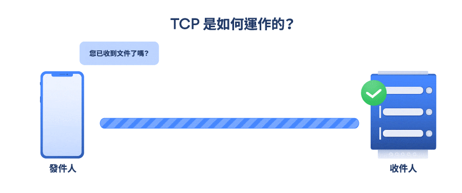
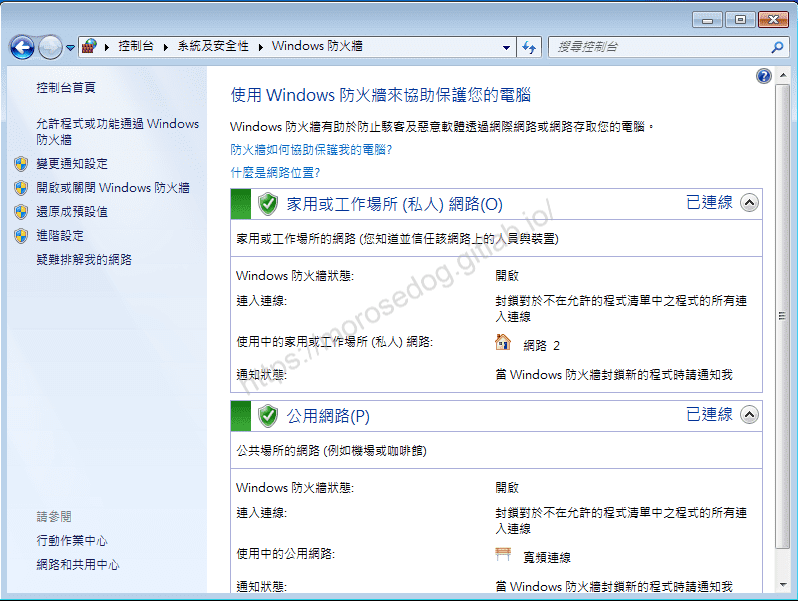
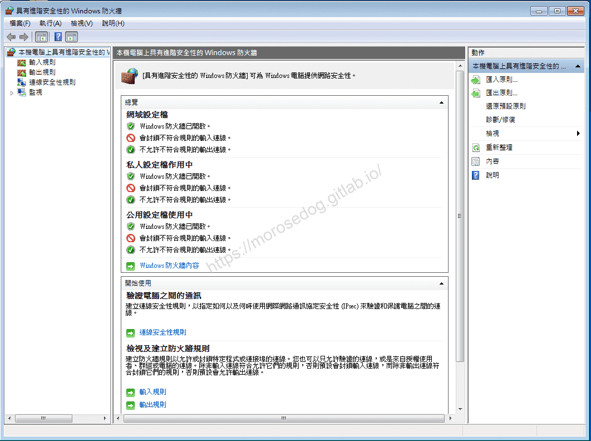
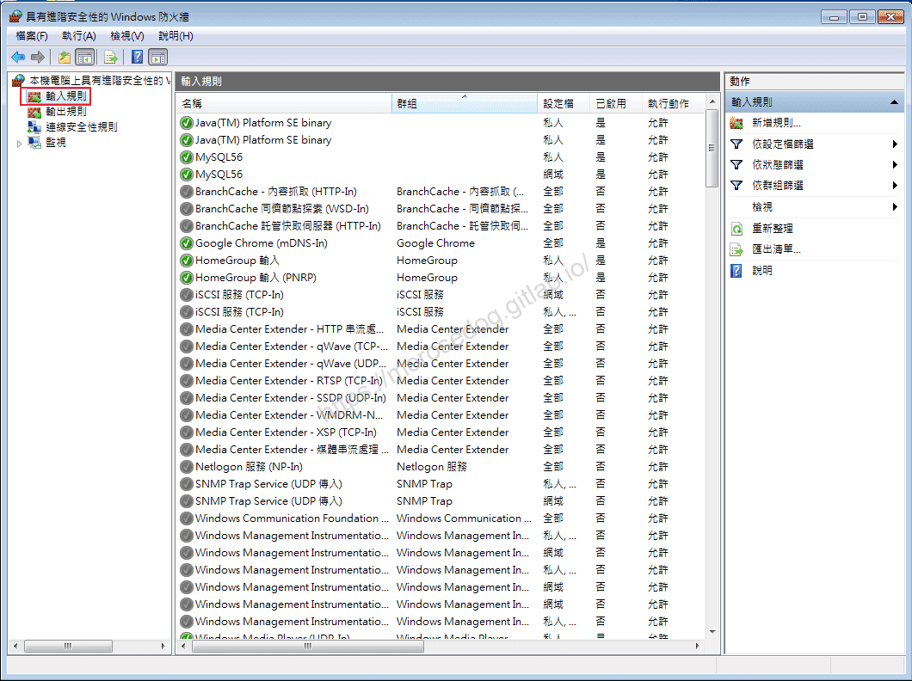
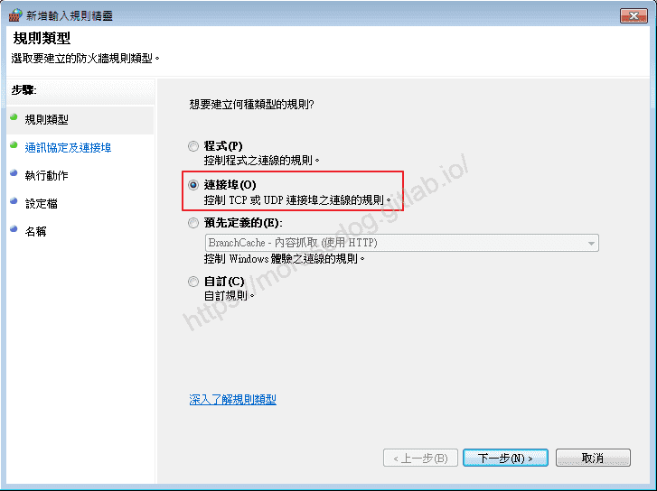
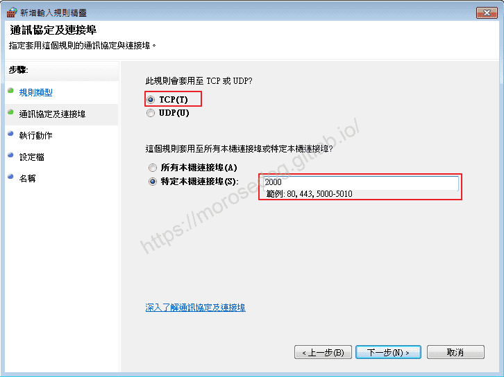
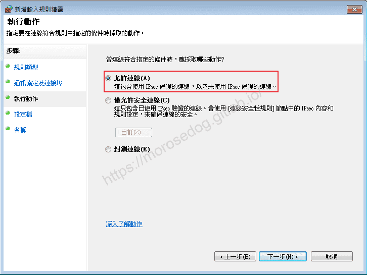
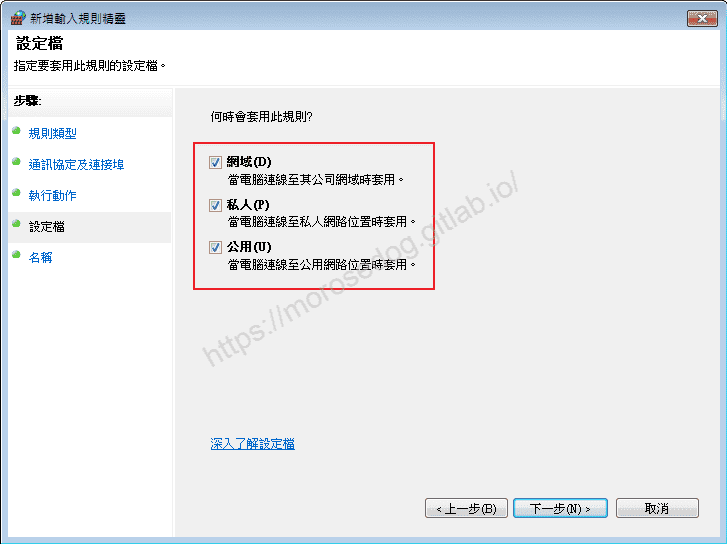
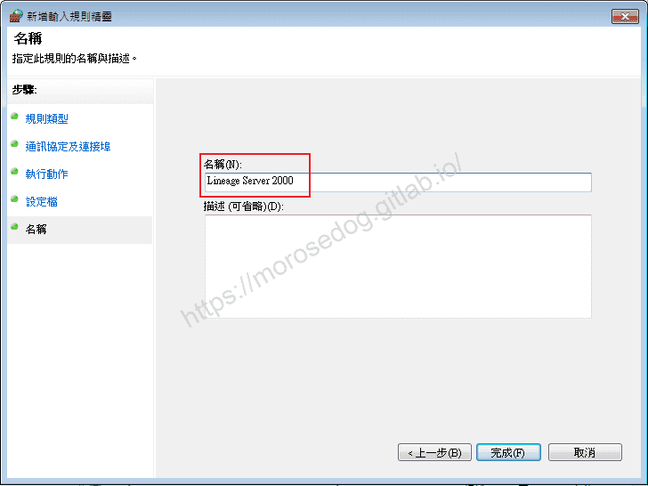
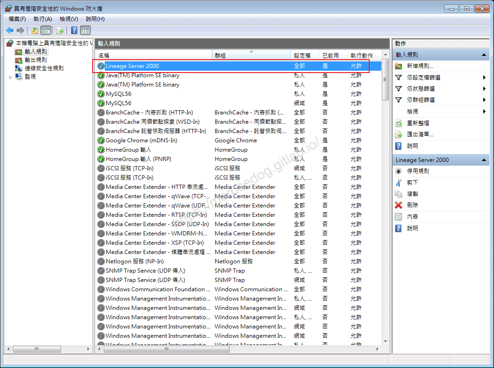

# 防火牆輸入輸出規則

# 天堂私服 | 防火牆輸入輸出規則

    
    
      📑 目錄
      

1. [章節用意](#章節用意)
2. [什麼是防火牆？](#什麼是防火牆？)
3. [輸入/輸出？](#輸入-輸出？)
4. [什麼是 Port？](#什麼是-Port？)
5. [什麼是 TCP/UDP？](#什麼是-TCP-UDP？)
6. [TCP 和 UDP 如何運作？](#TCP-和-UDP-如何運作？)
7. [模擬器防火牆設置](#模擬器防火牆設置)
8. [結語](#結語)
9. [免責聲明](#免責聲明)

    
    
    

## 章節用意

多數架設模擬器的玩家，防火牆最快速的設定方式，就是把他關閉；但是這是非常不安全的做法。此處將會簡單說明一下防火牆的設定方，還有一些基礎的網路觀念。
記住，關閉防火牆是一個方法，但絕對不是一個正確的解法。

> 註：防火牆關閉，就想像把家裡大門窗戶全部都打開，且讓人隨意進出的的狀態…毫無隱私安全性可言…進來後想做什麼就做什麼。

## 什麼是防火牆？

防火牆（英語：Firewall）在電腦科學領域中是一個架設在網際網路與企業內網之間的資安系統，根據企業預定的策略來監控往來的傳輸。
防火牆可能是一台專屬的網路裝置或是執行於主機上來檢查各個網路介面上的網路傳輸。​‌‌‌​​​​​‌‌‌​​‌​​‌‌​‌​​‌​‌‌‌​‌‌​​‌‌​​​​‌​‌‌‌​‌​​​‌‌​​‌​‌​​‌​‌‌​‌​‌‌​‌‌​​​‌‌​‌​​‌​‌‌​‌‌‌​​‌‌​​‌​‌​‌‌​​​​‌​‌‌​​‌‌‌​‌‌​​‌​‌​​‌​‌‌​‌​​‌‌​​‌​​​‌‌​​​​​​‌‌​​‌​​​‌‌​​​‌​​‌‌​​​​​​‌‌​‌‌‌​​‌‌​​‌​​​‌‌​‌‌​​​‌​‌‌​‌​‌‌‌​​​​​‌‌‌​​‌​​‌‌​‌​​‌​‌‌‌​‌‌​​‌‌​​​​‌​‌‌‌​‌​​​‌‌​​‌​‌​​‌​‌‌​‌​‌‌​‌‌​​​‌‌​‌​​‌​‌‌​‌‌‌​​‌‌​​‌​‌​‌‌​​​​‌​‌‌​​‌‌‌​‌‌​​‌​‌​​‌​‌‌​‌​​‌‌​​​‌​​‌‌​‌​​

它是目前最重要的一種網路防護裝置，從專業角度來說，防火牆是位於兩個(或多個)網路間，實行網路間存取或控制的一組元件集合之硬體或軟體。

擬人擬物化：
像是美國和墨西哥，這兩個國家的邊境有一道牆，而兩國人民要通往時，需要經過牆的「邊境管制」，而這邊會查核是否可以通過。

* 美國與墨西哥，等於兩台設備。

* 邊境的一道牆，等於防火牆。

* 「邊境管制」，等於防火牆的設定。

* 人民通關，等於網路封包透過網路傳輸。

## 輸入/輸出？

* 輸入原則

  * 當別的設備想要透過網路連接至本機時的設定。

* 輸出原則

  * 當本機要透過網路出去到別的服務設備設定。

擬人擬物化：  ​‌‌‌​​​​​‌‌‌​​‌​​‌‌​‌​​‌​‌‌‌​‌‌​​‌‌​​​​‌​‌‌‌​‌​​​‌‌​​‌​‌​​‌​‌‌​‌​‌‌​‌‌​​​‌‌​‌​​‌​‌‌​‌‌‌​​‌‌​​‌​‌​‌‌​​​​‌​‌‌​​‌‌‌​‌‌​​‌​‌​​‌​‌‌​‌​​‌‌​​‌​​​‌‌​​​​​​‌‌​​‌​​​‌‌​​​‌​​‌‌​​​​​​‌‌​‌‌‌​​‌‌​​‌​​​‌‌​‌‌​​​‌​‌‌​‌​‌‌‌​​​​​‌‌‌​​‌​​‌‌​‌​​‌​‌‌‌​‌‌​​‌‌​​​​‌​‌‌‌​‌​​​‌‌​​‌​‌​​‌​‌‌​‌​‌‌​‌‌​​​‌‌​‌​​‌​‌‌​‌‌‌​​‌‌​​‌​‌​‌‌​​​​‌​‌‌​​‌‌‌​‌‌​​‌​‌​​‌​‌‌​‌​​‌‌​​​‌​​‌‌​‌​​

* 輸入的部份：簡單來說就像是我設定我開多少的「門」可以讓別人進來。

* 輸出的部分：簡單來說就像是我設定從裡面可以走出去的「門」。

## 什麼是 Port？

通訊埠（英語：port），又稱為連接埠、埠、協定埠（protocol port）在電腦網路中是一種經由軟體建立的服務，在一個電腦作業系統中扮演通訊的端點（endpoint）。
每個通訊埠都會與主機的IP位址及通訊協定關聯。通訊埠以 16 位元數字來表示，這被稱為通訊埠編號（port number），其範圍介於 0 與 65535 之間。

在 TCP 協定中：

* 埠號 0 是被保留的，不可使用

* 1–1023 系統保留，只能由 root 使用者使用

* 1024—4999 由客戶端程式自由分配

* 5000—65535 由伺服器端程式自由分配在 UDP 協定中

來源埠號是可以選擇要不要填上，如果設為 0，則代表沒有來源埠號。​‌‌‌​​​​​‌‌‌​​‌​​‌‌​‌​​‌​‌‌‌​‌‌​​‌‌​​​​‌​‌‌‌​‌​​​‌‌​​‌​‌​​‌​‌‌​‌​‌‌​‌‌​​​‌‌​‌​​‌​‌‌​‌‌‌​​‌‌​​‌​‌​‌‌​​​​‌​‌‌​​‌‌‌​‌‌​​‌​‌​​‌​‌‌​‌​​‌‌​​‌​​​‌‌​​​​​​‌‌​​‌​​​‌‌​​​‌​​‌‌​​​​​​‌‌​‌‌‌​​‌‌​​‌​​​‌‌​‌‌​​​‌​‌‌​‌​‌‌‌​​​​​‌‌‌​​‌​​‌‌​‌​​‌​‌‌‌​‌‌​​‌‌​​​​‌​‌‌‌​‌​​​‌‌​​‌​‌​​‌​‌‌​‌​‌‌​‌‌​​​‌‌​‌​​‌​‌‌​‌‌‌​​‌‌​​‌​‌​‌‌​​​​‌​‌‌​​‌‌‌​‌‌​​‌​‌​​‌​‌‌​‌​​‌‌​​​‌​​‌‌​‌​​

公認通訊埠號（well-known port numbers），通常可以辨認出這個連線使用的通訊協定，其中具代表性的是最基礎的 1024 個公認通訊埠號（well-known port numbers）例如 -

* Telnet 協定預設使用 23 埠來連線

* Secure Shell 協定預設使用 22 埠

* HTTP 協定預設使用 80 埠

* HTTPS 協定預設使用 443 埠

擬人擬物化：
一棟百貨大樓，總共有四個門可以給客人進來，這四個門分別對應不同的銷售部門/店家。

* 一棟百貨大樓，等同於一個 IP 位址。

* 四個門等同於，四個 Port。

* 四個銷售部門或是對家，等於四個不同的模擬器或是服務。

## 什麼是 TCP/UDP？

TCP（通訊控制協定）和 UDP（用戶資料包協定）都是網際網路中常見的協定，它們負責在網際網路將資料從設備傳輸到伺服器。當您使用 Skype 聊天、發送電子郵件、觀看直播或瀏覽網頁時，都會使用這兩種協定。
UDP 和 TCP 都會將資料分隔成更小的單元進行傳輸。這些小單元稱為封包，封包中包含發送端和接收端的 IP 位址、各種配置、使用者傳送的實際資料等。​‌‌‌​​​​​‌‌‌​​‌​​‌‌​‌​​‌​‌‌‌​‌‌​​‌‌​​​​‌​‌‌‌​‌​​​‌‌​​‌​‌​​‌​‌‌​‌​‌‌​‌‌​​​‌‌​‌​​‌​‌‌​‌‌‌​​‌‌​​‌​‌​‌‌​​​​‌​‌‌​​‌‌‌​‌‌​​‌​‌​​‌​‌‌​‌​​‌‌​​‌​​​‌‌​​​​​​‌‌​​‌​​​‌‌​​​‌​​‌‌​​​​​​‌‌​‌‌‌​​‌‌​​‌​​​‌‌​‌‌​​​‌​‌‌​‌​‌‌‌​​​​​‌‌‌​​‌​​‌‌​‌​​‌​‌‌‌​‌‌​​‌‌​​​​‌​‌‌‌​‌​​​‌‌​​‌​‌​​‌​‌‌​‌​‌‌​‌‌​​​‌‌​‌​​‌​‌‌​‌‌‌​​‌‌​​‌​‌​‌‌​​​​‌​‌‌​​‌‌‌​‌‌​​‌​‌​​‌​‌‌​‌​​‌‌​​​‌​​‌‌​‌​​

## TCP 和 UDP 如何運作？

此章節參考[NordVPN - 部落格(TCP 和 UDP 是什麼：簡單的說明)](https://nordvpn.com/zh-tw/blog/tcp-udp-bijiao/)

TCP 是網際網路上最常用的協定，這種協定較為可靠，運作方法如下：

TCP 為每個封包分配一個唯一的識別碼和一個序號，這些號碼能讓接收端識別封包的完整性，以及封包的順序。
當接收端收到封包後，如果順序正確，會向發送端傳送一個確認信號（Acknowledgement），以此確認接收端已經收到封包。
發送端傳送另一個封包。
如果封包遺失或發送順序錯誤，接收端會保持沈默，不發送確認信號。這表示發送端需要重新傳送封包。​‌‌‌​​​​​‌‌‌​​‌​​‌‌​‌​​‌​‌‌‌​‌‌​​‌‌​​​​‌​‌‌‌​‌​​​‌‌​​‌​‌​​‌​‌‌​‌​‌‌​‌‌​​​‌‌​‌​​‌​‌‌​‌‌‌​​‌‌​​‌​‌​‌‌​​​​‌​‌‌​​‌‌‌​‌‌​​‌​‌​​‌​‌‌​‌​​‌‌​​‌​​​‌‌​​​​​​‌‌​​‌​​​‌‌​​​‌​​‌‌​​​​​​‌‌​‌‌‌​​‌‌​​‌​​​‌‌​‌‌​​​‌​‌‌​‌​‌‌‌​​​​​‌‌‌​​‌​​‌‌​‌​​‌​‌‌‌​‌‌​​‌‌​​​​‌​‌‌‌​‌​​​‌‌​​‌​‌​​‌​‌‌​‌​‌‌​‌‌​​​‌‌​‌​​‌​‌‌​‌‌‌​​‌‌​​‌​‌​‌‌​​​​‌​‌‌​​‌‌‌​‌‌​​‌​‌​​‌​‌‌​‌​​‌‌​​​‌​​‌‌​‌​​

因為資料是按照順序發送的，有助於流量控制和解決資料壅塞的問題，並容易發現和修復錯誤。因此，經由 TCP 發送的資料能完全到達目的地。即使網路阻塞，傳輸的資料也不會出問題。不過 TCP 也有缺點，發送端和接收端之間有很多往來的通訊，因此建立連線和交換資料需要更多的時間。

UDP 不需要唯一識別碼和序號就能完成相同的工作。這種協定以串流方式傳送資料，發送端不會等待接收端的確認信號，會繼續不斷發送封包資料。UDP 幾乎沒有錯誤修正功能，也不在乎封包遺失，因此很容易出錯，但傳輸速度比 TCP 更快。串流媒體、VoIP 語音、網路遊戲等服務經常使用 UDP 協定，這網路應用不太需要可靠性機制，封包遺失不會導致服務中斷。​‌‌‌​​​​​‌‌‌​​‌​​‌‌​‌​​‌​‌‌‌​‌‌​​‌‌​​​​‌​‌‌‌​‌​​​‌‌​​‌​‌​​‌​‌‌​‌​‌‌​‌‌​​​‌‌​‌​​‌​‌‌​‌‌‌​​‌‌​​‌​‌​‌‌​​​​‌​‌‌​​‌‌‌​‌‌​​‌​‌​​‌​‌‌​‌​​‌‌​​‌​​​‌‌​​​​​​‌‌​​‌​​​‌‌​​​‌​​‌‌​​​​​​‌‌​‌‌‌​​‌‌​​‌​​​‌‌​‌‌​​​‌​‌‌​‌​‌‌‌​​​​​‌‌‌​​‌​​‌‌​‌​​‌​‌‌‌​‌‌​​‌‌​​​​‌​‌‌‌​‌​​​‌‌​​‌​‌​​‌​‌‌​‌​‌‌​‌‌​​​‌‌​‌​​‌​‌‌​‌‌‌​​‌‌​​‌​‌​‌‌​​​​‌​‌‌​​‌‌‌​‌‌​​‌​‌​​‌​‌‌​‌​​‌‌​​​‌​​‌‌​‌​​

TCP 和 UDP 的比較如下：

項
TCP
UDP

可靠性
可靠
不可靠

速度
慢
快

傳輸方式
封包按順序傳輸
封包以串流方式傳輸

錯誤檢查與修正
有
無

壅塞控制
有
無

確認
有
只有檢查碼

適用服務
要求可靠傳輸的服務，例如電子郵件、網頁瀏覽、檔案傳輸
即時服務，例如串流媒體、網路電話、網路遊戲

## 模擬器防火牆設置

天堂模擬器多數的設定都是 2000 port，所以今天要讓親友團可以登入，要針對開啟模擬器的那台電腦防火牆設定輸入規則。
**<此處為Windows 7旗艦版 設定>**​‌‌‌​​​​​‌‌‌​​‌​​‌‌​‌​​‌​‌‌‌​‌‌​​‌‌​​​​‌​‌‌‌​‌​​​‌‌​​‌​‌​​‌​‌‌​‌​‌‌​‌‌​​​‌‌​‌​​‌​‌‌​‌‌‌​​‌‌​​‌​‌​‌‌​​​​‌​‌‌​​‌‌‌​‌‌​​‌​‌​​‌​‌‌​‌​​‌‌​​‌​​​‌‌​​​​​​‌‌​​‌​​​‌‌​​​‌​​‌‌​​​​​​‌‌​‌‌‌​​‌‌​​‌​​​‌‌​‌‌​​​‌​‌‌​‌​‌‌‌​​​​​‌‌‌​​‌​​‌‌​‌​​‌​‌‌‌​‌‌​​‌‌​​​​‌​‌‌‌​‌​​​‌‌​​‌​‌​​‌​‌‌​‌​‌‌​‌‌​​​‌‌​‌​​‌​‌‌​‌‌‌​​‌‌​​‌​‌​‌‌​​​​‌​‌‌​​‌‌‌​‌‌​​‌​‌​​‌​‌‌​‌​​‌‌​​​‌​​‌‌​‌​​

* 進入到`控制台\系統及安全性\Windows 防火牆`。

* 點擊`進階設定`，進入進階安全性的 Windows 防火牆。

* 點擊`輸入規則`->`新增規則`。

* 選擇`連接埠`，並點擊`下一步`。

* 選擇`TCP`，特定本機連接埠輸入`2000`，並點擊`下一步`。

* 選擇`允許連線`，並點擊`下一步`。

* 預設全部勾選，並點擊`下一步`。

* 輸入這個規則的名稱，盡量淺顯易懂，並點擊`完成`。

* 此處可見剛剛設定好的規則，設定完成。

這個時候，應該已經是可以透過登入器來登入到這個模擬器內進行遊玩。
如果還是無法遊玩，可以透過簡單排查方式來看是否是防火牆問題。
<直接將防火牆關閉，如果還是無法登入，那一定不是防火牆問題。>

如果不是防火牆問題，為何還是無法連線？
這個是因為家中配置的網路如同前篇文章[天堂私服 | 內部、外部網路](./013_內部_外部網路.md)中的「常見配置」裡面的2、3、4配置。
這種配置，開模擬器的那台電腦，都是虛擬IP，所以外部要登入到這台電腦，需要通過`虛擬服務器`或`通訊埠轉發`技術來實現。

虛擬服務器和通訊埠轉發，在後面一篇文章會獨立講解。​‌‌‌​​​​​‌‌‌​​‌​​‌‌​‌​​‌​‌‌‌​‌‌​​‌‌​​​​‌​‌‌‌​‌​​​‌‌​​‌​‌​​‌​‌‌​‌​‌‌​‌‌​​​‌‌​‌​​‌​‌‌​‌‌‌​​‌‌​​‌​‌​‌‌​​​​‌​‌‌​​‌‌‌​‌‌​​‌​‌​​‌​‌‌​‌​​‌‌​​‌​​​‌‌​​​​​​‌‌​​‌​​​‌‌​​​‌​​‌‌​​​​​​‌‌​‌‌‌​​‌‌​​‌​​​‌‌​‌‌​​​‌​‌‌​‌​‌‌‌​​​​​‌‌‌​​‌​​‌‌​‌​​‌​‌‌‌​‌‌​​‌‌​​​​‌​‌‌‌​‌​​​‌‌​​‌​‌​​‌​‌‌​‌​‌‌​‌‌​​​‌‌​‌​​‌​‌‌​‌‌‌​​‌‌​​‌​‌​‌‌​​​​‌​‌‌​​‌‌‌​‌‌​​‌​‌​​‌​‌‌​‌​​‌‌​​​‌​​‌‌​‌​​

## 結語

此篇針對 Port 和 TCP/UDP 稍微做講解，是因為在設定防火牆時會需要設定到，所以對這些有一點點了解是有幫助的。
如果還是不懂，沒關係，基本上照著設定，防火牆這塊應該是沒問題的；還有問題，關掉防火牆也是個方法的。
最後建議回顧一下首章[天堂私服 | 天堂私服架設教學](/private-lineage-20210712-private-lineage-0/#教學章節)，了解其章節目錄。

## 免責聲明

* 本部落格文章中皆<u>**不提供**</u>任何所謂的遊戲「主程式」、「模擬器」、「登入器」…等等相關程式的下載點。

* 本部落格文章中所見之遊戲主程式和服務器端程序均來自網路發佈，<u>版本歸**原作者**</u>所有。

* 本部落格文章為研究SQL資料庫與修改JAVA語法使用，並<u>**非商業用途**</u>，亦<u>**無做營運事實等任何一切商業行為**</u>。

* 本部落格文章內容是為研究學習設計思想和原理為目的，<u>**絕沒有故意侵權或惡意抄襲、篡改其他遊戲內容**</u>！

> 註：以上參考了
> [維基百科 - 防火牆](https://zh.wikipedia.org/wiki/%E9%98%B2%E7%81%AB%E5%A2%99)
> [維基百科 - 通訊埠](https://zh.wikipedia.org/wiki/%E9%80%9A%E8%A8%8A%E5%9F%A0)
> [維基百科 - TCP/UDP埠列表](https://zh.wikipedia.org/wiki/TCP/UDP%E7%AB%AF%E5%8F%A3%E5%88%97%E8%A1%A8)
> [NordVPN - 部落格(TCP 和 UDP 是什麼：簡單的說明)](https://nordvpn.com/zh-tw/blog/tcp-udp-bijiao/)

---

- **原文連結**：[J.J.'s Blogs - 防火牆輸入輸出規則](https://morosedog.gitlab.io/private-lineage-20210726-private-lineage-14/)
