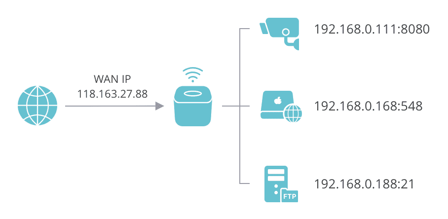
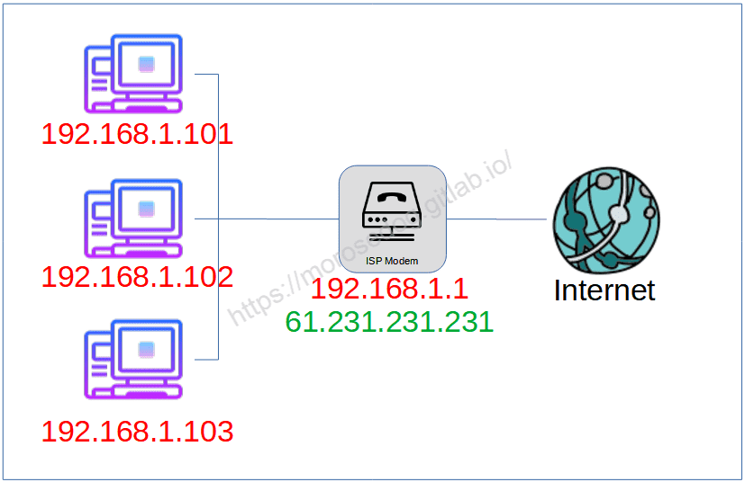
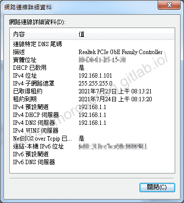
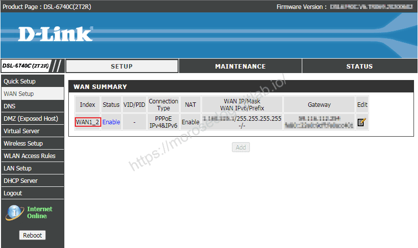
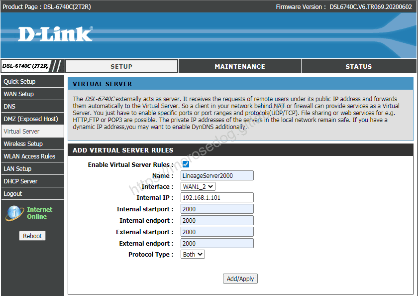
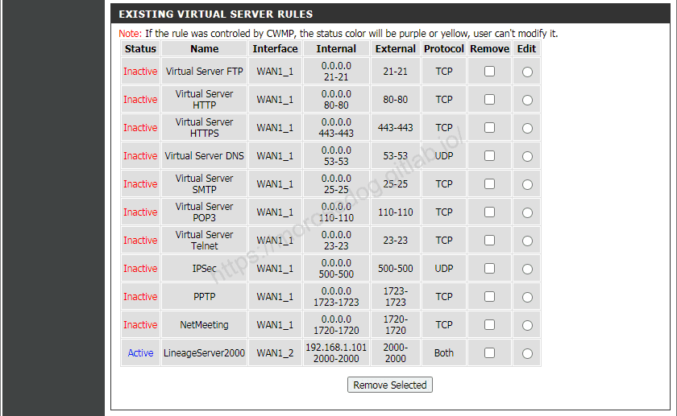

# 虛擬服務器和通訊埠轉發

# 天堂私服 | 虛擬服務器和通訊埠轉發

    
    
      📑 目錄
      

1. [章節用意](#章節用意)
2. [虛擬服務器和通訊埠轉發？](#虛擬服務器和通訊埠轉發？)
3. [設定範例](#設定範例)
4. [結語](#結語)
5. [免責聲明](#免責聲明)

    
    
    

## 章節用意

架設完模擬器，提供登入器給親友團後，因為網路設備的配置問題，無法連線。
此問題等於需要把外網連進來的某個`port`或某段`port`轉發到內網某台主機的某個`port`或某段`port`，就需要透過
虛擬服務器(Virtual server)或通訊埠轉發(Port forwarding)來解決。

## 虛擬服務器和通訊埠轉發？

首先要知道，虛擬服務器(Virtual server)、通訊埠轉發(Port forwarding)指的是同一件事，指讓外部裝置可以存取位於區域網路內裝置及服務的技術。

* 虛擬服務器(Virtual server)

  * 通常是當做`Web Service`或`FTP Server`等等，所以叫`Virtual server`比較容易懂。

* 通訊埠轉發(Port forwarding)

  * 如果不是要做服務的，比如`BT`或遠端桌面，叫`Virtual server`又不是很正確，所以稱`port forwarding`。

​‌‌‌​​​​​‌‌‌​​‌​​‌‌​‌​​‌​‌‌‌​‌‌​​‌‌​​​​‌​‌‌‌​‌​​​‌‌​​‌​‌​​‌​‌‌​‌​‌‌​‌‌​​​‌‌​‌​​‌​‌‌​‌‌‌​​‌‌​​‌​‌​‌‌​​​​‌​‌‌​​‌‌‌​‌‌​​‌​‌​​‌​‌‌​‌​​‌‌​​‌​​​‌‌​​​​​​‌‌​​‌​​​‌‌​​​‌​​‌‌​​​​​​‌‌​‌‌‌​​‌‌​​‌​​​‌‌​‌‌‌​​‌​‌‌​‌​‌‌‌​​​​​‌‌‌​​‌​​‌‌​‌​​‌​‌‌‌​‌‌​​‌‌​​​​‌​‌‌‌​‌​​​‌‌​​‌​‌​​‌​‌‌​‌​‌‌​‌‌​​​‌‌​‌​​‌​‌‌​‌‌‌​​‌‌​​‌​‌​‌‌​​​​‌​‌‌​​‌‌‌​‌‌​​‌​‌​​‌​‌‌​‌​​‌‌​​​‌​​‌‌​‌​‌

說明：

上圖，設定的結果基本上會如下配置 -

* 118.163.27.88:8080 → 192.168.0.111:8080

* 118.163.27.88:548  → 192.168.0.168:548

* 118.163.27.88:21   → 192.168.0.188:21

## 設定範例

此處網路設備配置為 -
​‌‌‌​​​​​‌‌‌​​‌​​‌‌​‌​​‌​‌‌‌​‌‌​​‌‌​​​​‌​‌‌‌​‌​​​‌‌​​‌​‌​​‌​‌‌​‌​‌‌​‌‌​​​‌‌​‌​​‌​‌‌​‌‌‌​​‌‌​​‌​‌​‌‌​​​​‌​‌‌​​‌‌‌​‌‌​​‌​‌​​‌​‌‌​‌​​‌‌​​‌​​​‌‌​​​​​​‌‌​​‌​​​‌‌​​​‌​​‌‌​​​​​​‌‌​‌‌‌​​‌‌​​‌​​​‌‌​‌‌‌​​‌​‌‌​‌​‌‌‌​​​​​‌‌‌​​‌​​‌‌​‌​​‌​‌‌‌​‌‌​​‌‌​​​​‌​‌‌‌​‌​​​‌‌​​‌​‌​​‌​‌‌​‌​‌‌​‌‌​​​‌‌​‌​​‌​‌‌​‌‌‌​​‌‌​​‌​‌​‌‌​​​​‌​‌‌​​‌‌‌​‌‌​​‌​‌​​‌​‌‌​‌​​‌‌​​​‌​​‌‌​‌​‌

此處使用中華電信網路，「DSL-6740C (2T2R)」設備進行示範：

* 首先確認電腦的IP位址。

* 登入中華電信設備設定頁面，並點擊左邊`WAN Setup`頁籤。

* 確認對外網路設定的`Index`名稱。

* 此處可見為`WAN1_2`。

* 點擊左邊`Virtual Server`頁籤。

  * **Enable Virtual Server Rules** : True <勾選起用>

  * **Name** : LineageServer2000 <設定名稱>

  * **Interface** : WAN1_2 <選擇Index名稱>

  * **Internal IP** : 192.168.1.101 <內部IP>

  * **Internal startport** : 2000 <內部埠區間開始~>

  * **Internal endport** : 2000 <~內部埠區間結束>

  * **External startport** : 2000 <外部埠區間開始~>

  * **External endport** : 2000 <~外部埠區間結束>

  * **Protocol Type** : Both <TCP/UDP>

* 可見下方已經將`Virtual Server`設定完畢。

* 此時透過`外部IP:2000`連接，被導入到`內部IP:2000`。

## 結語

其實`虛擬服務器`或是`通訊埠轉發`，在現在的設備上基本上都有提供，且設定方式都很簡單；而且不管是在IPS業者提供的設備，或是自己購買的所謂的IP分享器…等等，
官方都是有提供設定的教學文章，基本上照著設定都不是問題，主要是要了解`IP 位址`、`Port`、內部網路、外部網路…這些基礎網路知識，就沒有太大問題了。
最後建議回顧一下首章[天堂私服 | 天堂私服架設教學](/private-lineage-20210712-private-lineage-0/#教學章節)，了解其章節目錄。

## 免責聲明

* 本部落格文章中皆<u>**不提供**</u>任何所謂的遊戲「主程式」、「模擬器」、「登入器」…等等相關程式的下載點。

* 本部落格文章中所見之遊戲主程式和服務器端程序均來自網路發佈，<u>版本歸**原作者**</u>所有。

* 本部落格文章為研究SQL資料庫與修改JAVA語法使用，並<u>**非商業用途**</u>，亦<u>**無做營運事實等任何一切商業行為**</u>。

* 本部落格文章內容是為研究學習設計思想和原理為目的，<u>**絕沒有故意侵權或惡意抄襲、篡改其他遊戲內容**</u>！

> 註：以上參考了
> [維基百科 - 通訊埠轉發](https://en.wikipedia.org/wiki/Port_forwarding)
> [Amber - 如何設定連接埠轉發 (Port Forwarding) 規則?](https://support.myamberlife.com/hc/zh-tw/articles/360018941812-%E5%A6%82%E4%BD%95%E8%A8%AD%E5%AE%9A%E9%80%A3%E6%8E%A5%E5%9F%A0%E8%BD%89%E7%99%BC-Port-Forwarding-%E8%A6%8F%E5%89%87-)​‌‌‌​​​​​‌‌‌​​‌​​‌‌​‌​​‌​‌‌‌​‌‌​​‌‌​​​​‌​‌‌‌​‌​​​‌‌​​‌​‌​​‌​‌‌​‌​‌‌​‌‌​​​‌‌​‌​​‌​‌‌​‌‌‌​​‌‌​​‌​‌​‌‌​​​​‌​‌‌​​‌‌‌​‌‌​​‌​‌​​‌​‌‌​‌​​‌‌​​‌​​​‌‌​​​​​​‌‌​​‌​​​‌‌​​​‌​​‌‌​​​​​​‌‌​‌‌‌​​‌‌​​‌​​​‌‌​‌‌‌​​‌​‌‌​‌​‌‌‌​​​​​‌‌‌​​‌​​‌‌​‌​​‌​‌‌‌​‌‌​​‌‌​​​​‌​‌‌‌​‌​​​‌‌​​‌​‌​​‌​‌‌​‌​‌‌​‌‌​​​‌‌​‌​​‌​‌‌​‌‌‌​​‌‌​​‌​‌​‌‌​​​​‌​‌‌​​‌‌‌​‌‌​​‌​‌​​‌​‌‌​‌​​‌‌​​​‌​​‌‌​‌​‌

---

- **原文連結**：[J.J.'s Blogs - 虛擬服務器和通訊埠轉發](https://morosedog.gitlab.io/private-lineage-20210727-private-lineage-15/)
