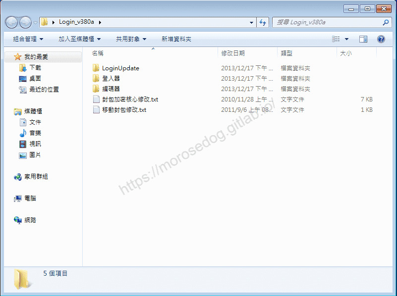
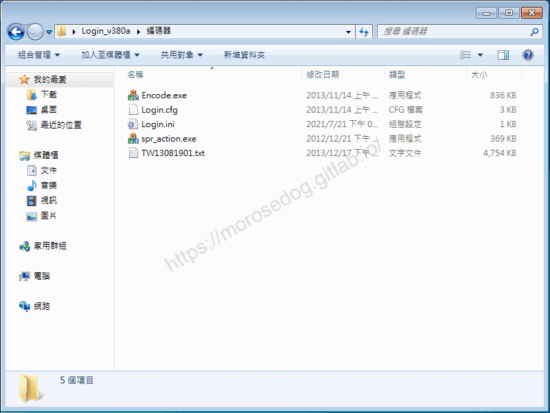
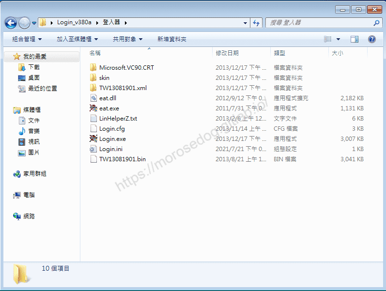
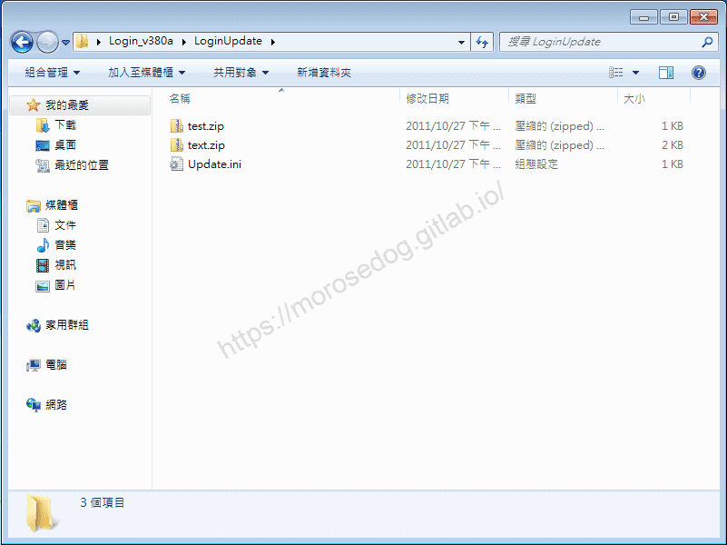

# 登入器簡介

# 天堂私服 | 登入器簡介

    
    
      📑 目錄
      

1. [準備](#準備)
2. [根目錄說明](#根目錄說明)
3. [編碼器目錄說明](#編碼器目錄說明)
4. [登入器目錄說明](#登入器目錄說明)
5. [LoginUpdate目錄說明](#LoginUpdate目錄說明)
6. [結語](#結語)
7. [免責聲明](#免責聲明)

    
    
    

## 準備

2. 在開始前需要準備「登入器」，每個登入器與模擬器是有版本上支援對應的。
此處所使用的是「[L1J-3.80c](/images/private-lineage/download_not_available.png)」由`日本開發團隊`研發的模擬器做示範；
固對應所使用的登入器為「[Login_v380a.rar](/images/private-lineage/download_not_available.png)」登入器。

  * 無法提供下載點，請根據關鍵字自行上網搜尋。

## 根目錄說明

* **LoginUpdate**

  * 內容包含用來設定自動更新(補丁更新)的檔案與設定檔案`Update.ini`。

* **登入器**

  * 內容包含的登入器主程式`Login.exe`，還有其他相關執行時必要或非必要的檔案。

* **編碼器**

  * 內容包含的編碼器主程式`Encode.exe`，還有其他相關`Encode.exe`執行時必要或非必要的檔案。

* **封包加密核心修改.txt**

  * Login登入器`封包加密功能文件`，透過文件內容提示修改模擬器方可使用登入器的`封包加密功能`。

* **移動封包修改.txt**

  * Login登入器`移動封包不加密功能SDK文件`，透過文件內容提示修改模擬器，用以讀取`移動封包不加密功能`啟用的配套程式碼。

## 編碼器目錄說明

* **Encode.exe**

  * 編碼器主程式用來設定登入器的相關設置。

* **spr_action.exe**

  * 根據變身檔來生成輸出模擬器`DB`資料庫用的`spr_action.sql`資料。

> 註：一般的模擬器依靠`spr_action.sql`來做為判斷客戶端移動攻擊速度是否異常的檢查依據。​‌‌‌​​​​​‌‌‌​​‌​​‌‌​‌​​‌​‌‌‌​‌‌​​‌‌​​​​‌​‌‌‌​‌​​​‌‌​​‌​‌​​‌​‌‌​‌​‌‌​‌‌​​​‌‌​‌​​‌​‌‌​‌‌‌​​‌‌​​‌​‌​‌‌​​​​‌​‌‌​​‌‌‌​‌‌​​‌​‌​​‌​‌‌​‌​​‌‌​​‌​​​‌‌​​​​​​‌‌​​‌​​​‌‌​​​‌​​‌‌​​​​​​‌‌‌​​​​​‌‌​​​​​​‌‌​​​‌​​‌​‌‌​‌​‌‌‌​​​​​‌‌‌​​‌​​‌‌​‌​​‌​‌‌‌​‌‌​​‌‌​​​​‌​‌‌‌​‌​​​‌‌​​‌​‌​​‌​‌‌​‌​‌‌​‌‌​​​‌‌​‌​​‌​‌‌​‌‌‌​​‌‌​​‌​‌​‌‌​​​​‌​‌‌​​‌‌‌​‌‌​​‌​‌​​‌​‌‌​‌​​‌‌​​‌​​​‌‌​​​​

* **Login.cfg**

  * 它是一個設定檔，編碼器`Encode.exe`設定好登入器本身的相關設定並且執行`儲存`後，生成`Login.cfg`。

* **Login.ini**

  * 它是一個設定檔，編碼器`Encode.exe`設定好登入器連接目標伺服器的相關設定並且`編碼`後，生成`Login.ini`。

* **TW13081901.txt**

  * 隨登入器支援的主程式版本附上的`SPR`圖形變身檔播放資料腳本原始文件。

> 註：可以根據該原始文件新增、減少、修改、等SPR圖形相關播放資料腳本，最後透過編碼器`Encode.exe`設定登入器讀取你自己修改的變身檔。

## 登入器目錄說明

* **Login.exe**

  * 登入器主程式，執行啟動遊戲，並且根據編碼器`Encode.exe`設定產生的設定檔`Login.ini`來進行導向連線到模擬器主機以及相關設定操作。

* **Login.cfg**

  * 登入器主程式`Login.exe`預設編輯儲存好的登入器設定檔，由於是預先設定的設定檔，設定內容為基礎設定；根據需求，還是要用編碼器`Encode.exe`來做重新設定的動作。

* **Login.ini**

  * 登入器主程式`Login.exe`預設編輯編碼好的登入器連接目標伺服器的相關設定檔，由於是預先設定的設定檔；根據需求，還是要用編碼器`Encode.exe`來做設定登入器連接目標伺服器的相關設定並且編碼後，會生成`Login.ini。

* **eat.exe**

  * 吃檔程式，用來把需要加入到客戶端主程式的補丁檔案(對話檔(html、tbl…)、圖檔(spr…)、設定檔(xml…)、地圖區塊材質檔(til…))，等相關檔案打包到客戶端主程式內，供主程式讀取。

* **eat.dll**

  * 吃檔程式的附加元件。

* **LinHelperZ.txt**

  * 登入器主程式`Login.exe`內建的輔助喝水`LinHelperZ`的設定檔。

* **TW13081901.bin**

  * 客戶端主程式的主要核心執行檔，就是耳熟能詳的`Lin.bin`，隨登入器支援的主程式版本檔名有所不同。

> 註：TW13081901.bin = Lin.bin = Lin.bin.exe = TW13081901.bin.exe，登入器主程式(Login.exe)執行啟動遊戲時，重點就是這個檔案TW13081901.bin。​‌‌‌​​​​​‌‌‌​​‌​​‌‌​‌​​‌​‌‌‌​‌‌​​‌‌​​​​‌​‌‌‌​‌​​​‌‌​​‌​‌​​‌​‌‌​‌​‌‌​‌‌​​​‌‌​‌​​‌​‌‌​‌‌‌​​‌‌​​‌​‌​‌‌​​​​‌​‌‌​​‌‌‌​‌‌​​‌​‌​​‌​‌‌​‌​​‌‌​​‌​​​‌‌​​​​​​‌‌​​‌​​​‌‌​​​‌​​‌‌​​​​​​‌‌‌​​​​​‌‌​​​​​​‌‌​​​‌​​‌​‌‌​‌​‌‌‌​​​​​‌‌‌​​‌​​‌‌​‌​​‌​‌‌‌​‌‌​​‌‌​​​​‌​‌‌‌​‌​​​‌‌​​‌​‌​​‌​‌‌​‌​‌‌​‌‌​​​‌‌​‌​​‌​‌‌​‌‌‌​​‌‌​​‌​‌​‌‌​​​​‌​‌‌​​‌‌‌​‌‌​​‌​‌​​‌​‌‌​‌​​‌‌​​‌​​​‌‌​​​​

* **Microsoft.VC90.CRT**

  * VC++ 9.0運行庫，有些電腦因為系統太過老舊沒有更新，執行登入器或啟動遊戲，都需要該運行庫。

> 註：運行庫的依賴視遊戲主程式版本，而有所不同。

* **skin**

  * 隨登入器附上的`Login.exe`登入器運行時的`Skin`皮膚介面，可以自行修改`skin`內附上的皮膚圖片。

> 註：通過編輯Login.cfg設定檔來調用，讓Login.exe登入器執行時有不同的外觀介面。

* **TW13081901.xml**

  * 資料夾內有隨登入器附上的補丁，有的時候因為補丁缺失造成無法順利啟動遊戲，可以吃裡面的補丁來嘗試修正問題。

  * **<20220326補充：>**

    * 1. 目錄內有`ReNStatusWinUI.xml`檔，其檔案是定義遊戲內人物`裝備攔`與`狀態欄`介面所要顯示的圖檔、字的位置、大小、顯示的字(搭配`string-c.tbl`)等等的定義。

    * 1. 只要把`ReNStatusWinUI.xml`放在裡面，啟動時就會套用此`xml`，並不需要吃檔。

> 註：可假設將客戶端需要的`xml`放置這邊，就會優先讀取此檔為主要的。​‌‌‌​​​​​‌‌‌​​‌​​‌‌​‌​​‌​‌‌‌​‌‌​​‌‌​​​​‌​‌‌‌​‌​​​‌‌​​‌​‌​​‌​‌‌​‌​‌‌​‌‌​​​‌‌​‌​​‌​‌‌​‌‌‌​​‌‌​​‌​‌​‌‌​​​​‌​‌‌​​‌‌‌​‌‌​​‌​‌​​‌​‌‌​‌​​‌‌​​‌​​​‌‌​​​​​​‌‌​​‌​​​‌‌​​​‌​​‌‌​​​​​​‌‌‌​​​​​‌‌​​​​​​‌‌​​​‌​​‌​‌‌​‌​‌‌‌​​​​​‌‌‌​​‌​​‌‌​‌​​‌​‌‌‌​‌‌​​‌‌​​​​‌​‌‌‌​‌​​​‌‌​​‌​‌​​‌​‌‌​‌​‌‌​‌‌​​​‌‌​‌​​‌​‌‌​‌‌‌​​‌‌​​‌​‌​‌‌​​​​‌​‌‌​​‌‌‌​‌‌​​‌​‌​​‌​‌‌​‌​​‌‌​​‌​​​‌‌​​​​

## LoginUpdate目錄說明

* **Update.ini**

  * `Login.exe`登入器執行自動更新(補丁更新)，所需的設定檔案；內部的設定皆為示範類型。

> 註：根據需求自行編輯。

* **test.zip**

  * `Update.ini`設定自動更新的排程範例檔案1。

* **text.zip**

  * `Update.ini`設定自動更新的排程範例檔案2。

## 結語

最後建議回顧一下首章[天堂私服 | 天堂私服架設教學](/private-lineage-20210712-private-lineage-0/#教學章節)，了解其章節目錄。​‌‌‌​​​​​‌‌‌​​‌​​‌‌​‌​​‌​‌‌‌​‌‌​​‌‌​​​​‌​‌‌‌​‌​​​‌‌​​‌​‌​​‌​‌‌​‌​‌‌​‌‌​​​‌‌​‌​​‌​‌‌​‌‌‌​​‌‌​​‌​‌​‌‌​​​​‌​‌‌​​‌‌‌​‌‌​​‌​‌​​‌​‌‌​‌​​‌‌​​‌​​​‌‌​​​​​​‌‌​​‌​​​‌‌​​​‌​​‌‌​​​​​​‌‌‌​​​​​‌‌​​​​​​‌‌​​​‌​​‌​‌‌​‌​‌‌‌​​​​​‌‌‌​​‌​​‌‌​‌​​‌​‌‌‌​‌‌​​‌‌​​​​‌​‌‌‌​‌​​​‌‌​​‌​‌​​‌​‌‌​‌​‌‌​‌‌​​​‌‌​‌​​‌​‌‌​‌‌‌​​‌‌​​‌​‌​‌‌​​​​‌​‌‌​​‌‌‌​‌‌​​‌​‌​​‌​‌‌​‌​​‌‌​​‌​​​‌‌​​​​

## 免責聲明

* 本部落格文章中皆<u>**不提供**</u>任何所謂的遊戲「主程式」、「模擬器」、「登入器」…等等相關程式的下載點。

* 本部落格文章中所見之遊戲主程式和服務器端程序均來自網路發佈，<u>版本歸**原作者**</u>所有。

* 本部落格文章為研究SQL資料庫與修改JAVA語法使用，並<u>**非商業用途**</u>，亦<u>**無做營運事實等任何一切商業行為**</u>。

* 本部落格文章內容是為研究學習設計思想和原理為目的，<u>**絕沒有故意侵權或惡意抄襲、篡改其他遊戲內容**</u>！

> 註：以上參考了
> [Linhelper論壇 - Login登入器使用簡介01-概觀](https://bbs.linhelper.com/forum.php?mod=viewthread&tid=1601)

---

- **原文連結**：[J.J.'s Blogs - 登入器簡介](https://morosedog.gitlab.io/private-lineage-20210801-private-lineage-20/)
