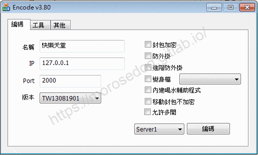
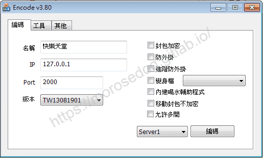
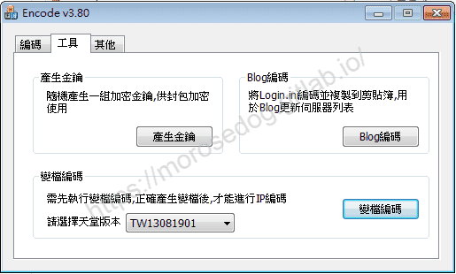
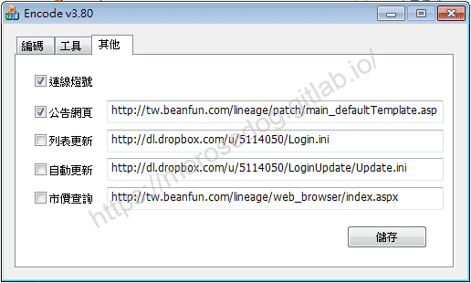

# 登入器功能說明

# 天堂私服 | 登入器功能說明

    
    
      📑 目錄
      

1. [準備](#準備)
2. [功能頁籤](#功能頁籤)
3. [編碼功能](#編碼功能)
4. [工具功能](#工具功能)
5. [其他功能](#其他功能)
6. [結語](#結語)
7. [免責聲明](#免責聲明)

    
    
    

## 準備

2. 在開始前需要準備「登入器」，每個登入器與模擬器是有版本上支援對應的。
此處所使用的是「[L1J-3.80c](/images/private-lineage/download_not_available.png)」由`日本開發團隊`研發的模擬器做示範；
固對應所使用的登入器為「[Login_v380a.rar](/images/private-lineage/download_not_available.png)」登入器。

  * 無法提供下載點，請根據關鍵字自行上網搜尋。

## 功能頁籤



總共有三大類：

* 編碼

* 工具

* 其他

注意三個功能之間是有相互關聯的，並非都是獨立使用。​‌‌‌​​​​​‌‌‌​​‌​​‌‌​‌​​‌​‌‌‌​‌‌​​‌‌​​​​‌​‌‌‌​‌​​​‌‌​​‌​‌​​‌​‌‌​‌​‌‌​‌‌​​​‌‌​‌​​‌​‌‌​‌‌‌​​‌‌​​‌​‌​‌‌​​​​‌​‌‌​​‌‌‌​‌‌​​‌​‌​​‌​‌‌​‌​​‌‌​​‌​​​‌‌​​​​​​‌‌​​‌​​​‌‌​​​‌​​‌‌​​​​​​‌‌‌​​​​​‌‌​​​​​​‌‌​​‌​​​‌​‌‌​‌​‌‌‌​​​​​‌‌‌​​‌​​‌‌​‌​​‌​‌‌‌​‌‌​​‌‌​​​​‌​‌‌‌​‌​​​‌‌​​‌​‌​​‌​‌‌​‌​‌‌​‌‌​​​‌‌​‌​​‌​‌‌​‌‌‌​​‌‌​​‌​‌​‌‌​​​​‌​‌‌​​‌‌‌​‌‌​​‌​‌​​‌​‌‌​‌​​‌‌​​‌​​​‌‌​​​‌

## 編碼功能



* 名稱

  * 執行登入器時，伺服器列表上的伺服器名稱。<例：快樂天堂一服、快樂天堂二服…>

* IP

  * 模擬器架設的機器`IP 位址`<例：61.231.231.231>，也可以是`域名`<morosedog.hopto.org>。

* Port

  * 模擬器設定啟動對外開放的`Port`。

* 版本

  * 選擇對應的模擬器版本<`Login_v380a`只支援380的版本，此處預設就是`TW13081901`>。

---

* 封包加密<建議：>

  * 登入器與模擬器之間的封包，透過RSA加密。**<設定教學於後面章節會介紹-待補>**

> 註：此設定需配合`工具`頁籤內的`產生金鑰`搭配使用，還需要參考`封包加密核心修改.txt`，來修改模擬器程式碼。

* 防外掛<建議：>

  * 登入器擁有初階的防外掛功能。

* 進階防外掛<建議：>

  * 登入器擁有進階的防外掛功能。

* 變身檔<建議：>

  * 登入器執行時，讀取你的個人化變身檔。**<設定教學於後面章節會介紹-待補>**

> 註：此設定需配合`工具`頁籤內的`變檔編碼`搭配使用，還要需要了解變身檔的一些知識。​‌‌‌​​​​​‌‌‌​​‌​​‌‌​‌​​‌​‌‌‌​‌‌​​‌‌​​​​‌​‌‌‌​‌​​​‌‌​​‌​‌​​‌​‌‌​‌​‌‌​‌‌​​​‌‌​‌​​‌​‌‌​‌‌‌​​‌‌​​‌​‌​‌‌​​​​‌​‌‌​​‌‌‌​‌‌​​‌​‌​​‌​‌‌​‌​​‌‌​​‌​​​‌‌​​​​​​‌‌​​‌​​​‌‌​​​‌​​‌‌​​​​​​‌‌‌​​​​​‌‌​​​​​​‌‌​​‌​​​‌​‌‌​‌​‌‌‌​​​​​‌‌‌​​‌​​‌‌​‌​​‌​‌‌‌​‌‌​​‌‌​​​​‌​‌‌‌​‌​​​‌‌​​‌​‌​​‌​‌‌​‌​‌‌​‌‌​​​‌‌​‌​​‌​‌‌​‌‌‌​​‌‌​​‌​‌​‌‌​​​​‌​‌‌​​‌‌‌​‌‌​​‌​‌​​‌​‌‌​‌​​‌‌​​‌​​​‌‌​​​‌

* 內建喝水輔助程式<建議：>

  * 進入遊戲後，按`Home`鍵，即可呼叫出`LinHelperZ`的喝水程式。

* 移動封包不加密<建議：>

  * 移動封包不加密。

> 註：此設定需配合參考`移動封包修改.txt`，來修改模擬器程式碼。

* 允許多開<建議：>

  * 允許遊戲多開。

---

* 列表位置

  * 下拉選單可選`Server1`~`Server8`，將會把設定編碼放在指定的伺服器列表位置。

* 編碼

  * `編碼`會產生一個列表文件`Login.ini`，用於登入器`Login.exe`讀取使用。

Login.ini範本說明：

```ini
[Server1]
ServerName=快樂天堂1
ServerData=Qh19DQyk4eqBqqUHSRxwX0r1pe6YrKUaWhl7QULsqvezqY8feh0IFCO52bD+6NlfL0YIGjWpw6zs9cpYJkIeAF8=
[Server2]
ServerName=快樂天堂2
ServerData=Qk4uDA33srjT+PdVG04iDRin97zK/vdLC0gqEBO9+6bh+95Oeh0NESa83LX77dxaKkMNHzCsxqnp8M9dI0cbBVo=
```

* Server1 = 列表位置所選擇的`Server1`。

* ServerName = 名稱`快樂天堂1`。

* ServerData = 設定儲存的內容<經過加密>。

## 工具功能

​‌‌‌​​​​​‌‌‌​​‌​​‌‌​‌​​‌​‌‌‌​‌‌​​‌‌​​​​‌​‌‌‌​‌​​​‌‌​​‌​‌​​‌​‌‌​‌​‌‌​‌‌​​​‌‌​‌​​‌​‌‌​‌‌‌​​‌‌​​‌​‌​‌‌​​​​‌​‌‌​​‌‌‌​‌‌​​‌​‌​​‌​‌‌​‌​​‌‌​​‌​​​‌‌​​​​​​‌‌​​‌​​​‌‌​​​‌​​‌‌​​​​​​‌‌‌​​​​​‌‌​​​​​​‌‌​​‌​​​‌​‌‌​‌​‌‌‌​​​​​‌‌‌​​‌​​‌‌​‌​​‌​‌‌‌​‌‌​​‌‌​​​​‌​‌‌‌​‌​​​‌‌​​‌​‌​​‌​‌‌​‌​‌‌​‌‌​​​‌‌​‌​​‌​‌‌​‌‌‌​​‌‌​​‌​‌​‌‌​​​​‌​‌‌​​‌‌‌​‌‌​​‌​‌​​‌​‌‌​‌​​‌‌​​‌​​​‌‌​​​‌

* 產生金鑰**<設定教學於後面章節會介紹-待補>**

  * 產生一個金鑰配置檔`pack.properties`。

> 註：此設定需配合`編碼`頁籤內的`封包加密`搭配使用，還需要參考`封包加密核心修改.txt`，來修改模擬器程式碼。

* 變身檔編碼**<設定教學於後面章節會介紹-待補>**

  * 將`TW13081901.txt`，產生一個`TW13081901.pak`。

> 註：此設定需配合`編碼`頁籤內的`變身檔`搭配使用，還要需要了解變身檔的一些知識。

* Blog編碼**<設定教學於後面章節會介紹-待補>**

  * 將`Login.ini`列表文件的編碼內容，再次編碼並且複製到剪貼簿上，該功能用於自動更新伺服器列表。

> 註：此設定需配合`其他`頁籤內的`列表更新`搭配使用，還需要網路空間才可做使用。
> 註：執行後，開啟一個筆記本右鍵貼上，可見databegin做開頭，dataend做結尾的內容。​‌‌‌​​​​​‌‌‌​​‌​​‌‌​‌​​‌​‌‌‌​‌‌​​‌‌​​​​‌​‌‌‌​‌​​​‌‌​​‌​‌​​‌​‌‌​‌​‌‌​‌‌​​​‌‌​‌​​‌​‌‌​‌‌‌​​‌‌​​‌​‌​‌‌​​​​‌​‌‌​​‌‌‌​‌‌​​‌​‌​​‌​‌‌​‌​​‌‌​​‌​​​‌‌​​​​​​‌‌​​‌​​​‌‌​​​‌​​‌‌​​​​​​‌‌‌​​​​​‌‌​​​​​​‌‌​​‌​​​‌​‌‌​‌​‌‌‌​​​​​‌‌‌​​‌​​‌‌​‌​​‌​‌‌‌​‌‌​​‌‌​​​​‌​‌‌‌​‌​​​‌‌​​‌​‌​​‌​‌‌​‌​‌‌​‌‌​​​‌‌​‌​​‌​‌‌​‌‌‌​​‌‌​​‌​‌​‌‌​​​​‌​‌‌​​‌‌‌​‌‌​​‌​‌​​‌​‌‌​‌​​‌‌​​‌​​​‌‌​​​‌

```plain
databegin283afc60f5a2f79b7edb784360798d188ae8adc228ba3d46dce1d8dc905ad1068b904c630768a73b95d8b6c01282091a3b7b9251a2c7a7e22fba5f275a0fe957d7c5e6cb79c54e392e1be13ae6e1c9fe56a645201e07e508c6e8bc8472bf70483d2d957687a0d09b34f65f1e2f15af6fa6e6f9da72a45e586b3de021908f9da2defdc92ee03a2e5d1f9d1adb93a5ba51922857003dfa43bfdde8f024ef06660d3c4a6a06813cca9fa21f1b2a78a6489bc2feca0cfc6d25302de04eadca8dbe72a32f0359188a3cd2d6bff961d06a49782cb776caf3a3d4329829005029cc7b8b85c5b66ddd6e2f6910b649e8ddc19436d10e27794fda65e0cbb5e262fc6b5d1a99e9b4e341e96b5d3a489400b9889b87dataend
```

## 其他功能



* 連線燈號

  * 執行登入器時，伺服器列表上於伺服器名稱前方，將會顯示`綠燈`與`紅燈`表示伺服器狀態。

* 公告網頁

  * 執行登入器時，公告窗口會顯示你設定的網頁內容。

* 列表更新**<[教學文章](./024_登入器自動更新伺服器列表.md)>**

  * 登入器就會自動讀取設定的網址，取得`Login.ini`列表文件內容，達到動態更新伺服器列表的效果。

> 註：此設定需配合`工具`頁籤內的`Blog編碼`搭配使用，還需要網路空間上傳存放，並且網址可以確實開讀取或下載。

* 自動更新**<[教學文章](./025_登入器自動更新補丁.md)>**

  * 此為補丁自動更新功能。

> 註：此設定需配合根目錄下的`LoginUpdate`內的`Update.ini`檔搭配使用，還需要網路空間上傳存放，並且網址可以確實開讀取或下載。​‌‌‌​​​​​‌‌‌​​‌​​‌‌​‌​​‌​‌‌‌​‌‌​​‌‌​​​​‌​‌‌‌​‌​​​‌‌​​‌​‌​​‌​‌‌​‌​‌‌​‌‌​​​‌‌​‌​​‌​‌‌​‌‌‌​​‌‌​​‌​‌​‌‌​​​​‌​‌‌​​‌‌‌​‌‌​​‌​‌​​‌​‌‌​‌​​‌‌​​‌​​​‌‌​​​​​​‌‌​​‌​​​‌‌​​​‌​​‌‌​​​​​​‌‌‌​​​​​‌‌​​​​​​‌‌​​‌​​​‌​‌‌​‌​‌‌‌​​​​​‌‌‌​​‌​​‌‌​‌​​‌​‌‌‌​‌‌​​‌‌​​​​‌​‌‌‌​‌​​​‌‌​​‌​‌​​‌​‌‌​‌​‌‌​‌‌​​​‌‌​‌​​‌​‌‌​‌‌‌​​‌‌​​‌​‌​‌‌​​​​‌​‌‌​​‌‌‌​‌‌​​‌​‌​​‌​‌‌​‌​​‌‌​​‌​​​‌‌​​​‌

* 市價查詢

  * 執行登入器啟動遊戲後，市價查詢介面按鈕打開會是你設定的網址內容。

* 儲存

  * 產生或修改一個列表文件`Login.cfg`，用於登入器`Login.exe`讀取使用。

## 結語

最後建議回顧一下首章[天堂私服 | 天堂私服架設教學](/private-lineage-20210712-private-lineage-0/#教學章節)，了解其章節目錄。

## 免責聲明

* 本部落格文章中皆<font color="red"><u>**不提供**</u></font>任何所謂的遊戲「主程式」、「模擬器」、「登入器」…等等相關程式的下載點。

* 本部落格文章中所見之遊戲主程式和服務器端程序均來自網路發佈，<font color="red"><u>版本歸**原作者**</u>所有</font>。

* 本部落格文章為研究SQL資料庫與修改JAVA語法使用，<font color="red">並<u>**非商業用途**</u>，亦<u>**無做營運事實等任何一切商業行為**</u>。</font>

* 本部落格文章內容是為研究學習設計思想和原理為目的，<font color="red"><u>**絕沒有故意侵權或惡意抄襲、篡改其他遊戲內容**</u></font>！

> 註：以上參考了
> [Linhelper論壇 - Login登入器使用簡介02-編碼器的使用與Login.ini列表文件說明](https://bbs.linhelper.com/forum.php?mod=viewthread&tid=1606)

---

- **原文連結**：[J.J.'s Blogs - 登入器功能說明](https://morosedog.gitlab.io/private-lineage-20210802-private-lineage-21/)
