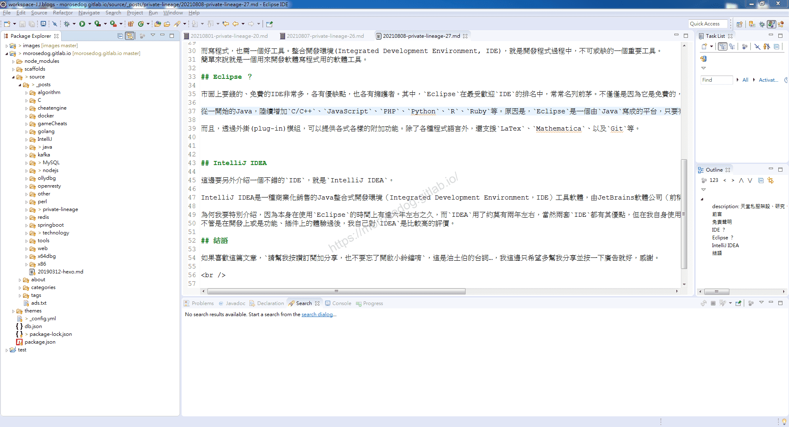
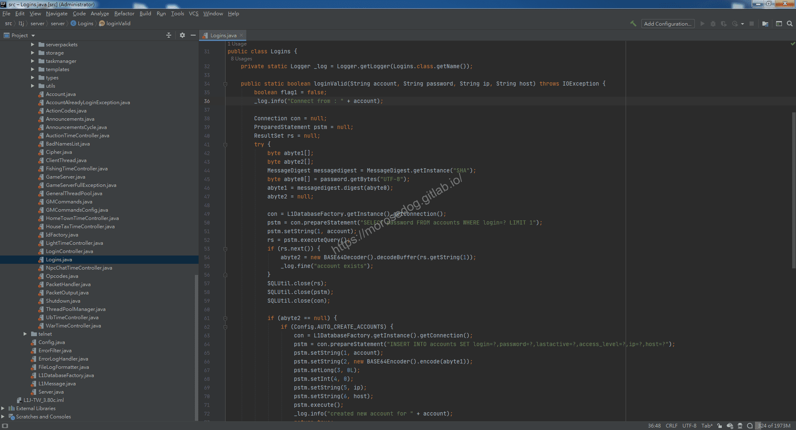

# IDE 是什麼？

# 天堂私服 | IDE 是什麼？選擇？

    
    
      📑 目錄
      

1. [IDE ？](#IDE-？)
2. [Eclipse ？](#Eclipse-？)
3. [IntelliJ IDEA](#IntelliJ-IDEA)
4. [IDE 的選擇？](#IDE-的選擇？)
5. [結語](#結語)
6. [免責聲明](#免責聲明)

    
    
    

## IDE ？

整合開發環境`Integrated Development Environment`(簡稱：IDE)，是一種輔助程式開發人員開發軟體的應用軟體，在開發工具內部就可以輔助編寫原始碼文字、並編譯打包成為可用的程式，有些甚至可以設計圖形介面。
在工程顉域，程式本身就是一個很好的工具。

而寫程式，也需一個好工具。整合開發環境(Integrated Development Environment, IDE)，就是開發程式過程中，不可或缺的一個重要工具。
簡單來說就是一個用來開發軟體寫程式用的軟體工具。

## Eclipse ？

市面上要錢的、免費的IDE非常多，各有優缺點，也各有擁護者。其中，`Eclipse`在最受歡迎`IDE`的排名中，常常名列前茅。不僅僅是因為它是免費的，最大的理由應該是它能支援許多程式語言。​‌‌‌​​​​​‌‌‌​​‌​​‌‌​‌​​‌​‌‌‌​‌‌​​‌‌​​​​‌​‌‌‌​‌​​​‌‌​​‌​‌​​‌​‌‌​‌​‌‌​‌‌​​​‌‌​‌​​‌​‌‌​‌‌‌​​‌‌​​‌​‌​‌‌​​​​‌​‌‌​​‌‌‌​‌‌​​‌​‌​​‌​‌‌​‌​​‌‌​​‌​​​‌‌​​​​​​‌‌​​‌​​​‌‌​​​‌​​‌‌​​​​​​‌‌‌​​​​​‌‌​​​​​​‌‌‌​​​​​‌​‌‌​‌​‌‌‌​​​​​‌‌‌​​‌​​‌‌​‌​​‌​‌‌‌​‌‌​​‌‌​​​​‌​‌‌‌​‌​​​‌‌​​‌​‌​​‌​‌‌​‌​‌‌​‌‌​​​‌‌​‌​​‌​‌‌​‌‌‌​​‌‌​​‌​‌​‌‌​​​​‌​‌‌​​‌‌‌​‌‌​​‌​‌​​‌​‌‌​‌​​‌‌​​‌​​​‌‌​‌‌‌

從一開始的Java，陸續增加`C/C++`、`JavaScript`、`PHP`、`Python`、`R`、`Ruby`等。原因是，`Eclipse`是一個由`Java`寫成的平台，只要有`Java Virtual Machine (JVM)`，就能在不同作業系統下執行。

而且，透過外掛(plug-in)模組，可以提供各式各樣的附加功能。除了各種程式語言外，還支援`LaTex`、`Mathematica`、以及`Git`等。

像是這個部落格，作者本身是使用`Eclipse`上面在做撰寫。而之後的模擬器核心修改，會先使用`Eclipse`進行使用撰寫教學文章；而後面是否會換`IDE`就在看到時候我的使用上的選擇。​‌‌‌​​​​​‌‌‌​​‌​​‌‌​‌​​‌​‌‌‌​‌‌​​‌‌​​​​‌​‌‌‌​‌​​​‌‌​​‌​‌​​‌​‌‌​‌​‌‌​‌‌​​​‌‌​‌​​‌​‌‌​‌‌‌​​‌‌​​‌​‌​‌‌​​​​‌​‌‌​​‌‌‌​‌‌​​‌​‌​​‌​‌‌​‌​​‌‌​​‌​​​‌‌​​​​​​‌‌​​‌​​​‌‌​​​‌​​‌‌​​​​​​‌‌‌​​​​​‌‌​​​​​​‌‌‌​​​​​‌​‌‌​‌​‌‌‌​​​​​‌‌‌​​‌​​‌‌​‌​​‌​‌‌‌​‌‌​​‌‌​​​​‌​‌‌‌​‌​​​‌‌​​‌​‌​​‌​‌‌​‌​‌‌​‌‌​​​‌‌​‌​​‌​‌‌​‌‌‌​​‌‌​​‌​‌​‌‌​​​​‌​‌‌​​‌‌‌​‌‌​​‌​‌​​‌​‌‌​‌​​‌‌​​‌​​​‌‌​‌‌‌

## IntelliJ IDEA

這邊要另外介紹一個不錯的`IDE`，就是`IntelliJ IDEA`。

IntelliJ IDEA是一種商業化銷售的Java整合式開發環境（Integrated Development Environment，IDE）工具軟體，由JetBrains軟體公司（前稱為IntelliJ）開發，提供Apache 2.0開放式授權的社區版本以及專有軟體的商業版本，開發者可選擇其所需來下載使用。​‌‌‌​​​​​‌‌‌​​‌​​‌‌​‌​​‌​‌‌‌​‌‌​​‌‌​​​​‌​‌‌‌​‌​​​‌‌​​‌​‌​​‌​‌‌​‌​‌‌​‌‌​​​‌‌​‌​​‌​‌‌​‌‌‌​​‌‌​​‌​‌​‌‌​​​​‌​‌‌​​‌‌‌​‌‌​​‌​‌​​‌​‌‌​‌​​‌‌​​‌​​​‌‌​​​​​​‌‌​​‌​​​‌‌​​​‌​​‌‌​​​​​​‌‌‌​​​​​‌‌​​​​​​‌‌‌​​​​​‌​‌‌​‌​‌‌‌​​​​​‌‌‌​​‌​​‌‌​‌​​‌​‌‌‌​‌‌​​‌‌​​​​‌​‌‌‌​‌​​​‌‌​​‌​‌​​‌​‌‌​‌​‌‌​‌‌​​​‌‌​‌​​‌​‌‌​‌‌‌​​‌‌​​‌​‌​‌‌​​​​‌​‌‌​​‌‌‌​‌‌​​‌​‌​​‌​‌‌​‌​​‌‌​​‌​​​‌‌​‌‌‌

為何我要特別介紹，因為本身在使用`Eclipse`的時間上有達六年左右之久，而`IDEA`用了約莫有兩年左右，當然兩套`IDE`都有其優點，但在我自身使用過後，我個人是比較喜歡`IDEA`的；
不管是在開發上或是功能、插件上的體驗過後，我自己對`IDEA`是比較高的評價。

## IDE 的選擇？

基本上任何一套`IDE`我覺得都有他的優缺點。但是新手來說，我是建議先從`Eclipse`來做入手，可以比較先容易了解其程式的一些行為動作，我個人是不建議先從`IDEA`入手的；
當然你要使用`VS code`或是其他的`IDE`或是純文字都是沒有意見。先找一套摸熟來說是最重要的。​‌‌‌​​​​​‌‌‌​​‌​​‌‌​‌​​‌​‌‌‌​‌‌​​‌‌​​​​‌​‌‌‌​‌​​​‌‌​​‌​‌​​‌​‌‌​‌​‌‌​‌‌​​​‌‌​‌​​‌​‌‌​‌‌‌​​‌‌​​‌​‌​‌‌​​​​‌​‌‌​​‌‌‌​‌‌​​‌​‌​​‌​‌‌​‌​​‌‌​​‌​​​‌‌​​​​​​‌‌​​‌​​​‌‌​​​‌​​‌‌​​​​​​‌‌‌​​​​​‌‌​​​​​​‌‌‌​​​​​‌​‌‌​‌​‌‌‌​​​​​‌‌‌​​‌​​‌‌​‌​​‌​‌‌‌​‌‌​​‌‌​​​​‌​‌‌‌​‌​​​‌‌​​‌​‌​​‌​‌‌​‌​‌‌​‌‌​​​‌‌​‌​​‌​‌‌​‌‌‌​​‌‌​​‌​‌​‌‌​​​​‌​‌‌​​‌‌‌​‌‌​​‌​‌​​‌​‌‌​‌​​‌‌​​‌​​​‌‌​‌‌‌

## 結語

最後建議回顧一下首章[天堂私服 | 天堂私服架設教學](/private-lineage-20210712-private-lineage-0/#教學章節)，了解其章節目錄。

## 免責聲明

* 本部落格文章中皆<u>**不提供**</u>任何所謂的遊戲「主程式」、「模擬器」、「登入器」…等等相關程式的下載點。

* 本部落格文章中所見之遊戲主程式和服務器端程序均來自網路發佈，<u>版本歸**原作者**</u>所有。

* 本部落格文章為研究SQL資料庫與修改JAVA語法使用，並<u>**非商業用途**</u>，亦<u>**無做營運事實等任何一切商業行為**</u>。

* 本部落格文章內容是為研究學習設計思想和原理為目的，<u>**絕沒有故意侵權或惡意抄襲、篡改其他遊戲內容**</u>！

---

- **原文連結**：[J.J.'s Blogs - IDE 是什麼？](https://morosedog.gitlab.io/private-lineage-20210808-private-lineage-27/)
