# 01. Eclipse IDE 安裝

# 天堂私服 | Eclipse IDE 安裝

    
    
      📑 目錄
      

1. [環境說明](#環境說明)
2. [檢查](#檢查)
3. [下載 Eclipse](#下載-Eclipse)
4. [安裝 Eclipse](#安裝-Eclipse)
5. [開啟 Eclipse](#開啟-Eclipse)
6. [結語](#結語)
7. [免責聲明](#免責聲明)

    
    
    

## 環境說明

此處使用`Oracle VM VirtualBox`虛擬機軟體，下載安裝了一個純淨的`Windows 7 x64 旗艦版`。

如果需要安裝虛擬機，可以參考此篇文章[VirtualBox Windows 7 安裝](../01_Getting_Started/003_VirtualBox_Windows_7_安裝.md)。

因為實體機內已經有安裝`Eclipse`，所以這邊為了做示範，所以在虛擬機內做安裝，基本上這種開發軟體都會裝在實體機上面；
安裝或是開啟過程於虛擬機內遇到的問題在實體機上面可能不會遇到，或是此篇文章沒遇到的問題，可嘗試網路搜尋問題關鍵即可解決。

## 檢查

是否電腦已經有安裝 Java？​‌‌‌​​​​​‌‌‌​​‌​​‌‌​‌​​‌​‌‌‌​‌‌​​‌‌​​​​‌​‌‌‌​‌​​​‌‌​​‌​‌​​‌​‌‌​‌​‌‌​‌‌​​​‌‌​‌​​‌​‌‌​‌‌‌​​‌‌​​‌​‌​‌‌​​​​‌​‌‌​​‌‌‌​‌‌​​‌​‌​​‌​‌‌​‌​​‌‌​​‌​​​‌‌​​​​​​‌‌​​‌​​​‌‌​​​‌​​‌‌​​​​​​‌‌‌​​​​​‌‌​​​​​​‌‌‌​​‌​​‌​‌‌​‌​‌‌‌​​​​​‌‌‌​​‌​​‌‌​‌​​‌​‌‌‌​‌‌​​‌‌​​​​‌​‌‌‌​‌​​​‌‌​​‌​‌​​‌​‌‌​‌​‌‌​‌‌​​​‌‌​‌​​‌​‌‌​‌‌‌​​‌‌​​‌​‌​‌‌​​​​‌​‌‌​​‌‌‌​‌‌​​‌​‌​​‌​‌‌​‌​​‌‌​​‌​​​‌‌‌​​​

1. 可以至`控制台\所有控制台項目\程式和功能`看是否有`Java`這個關鍵字的檢查。
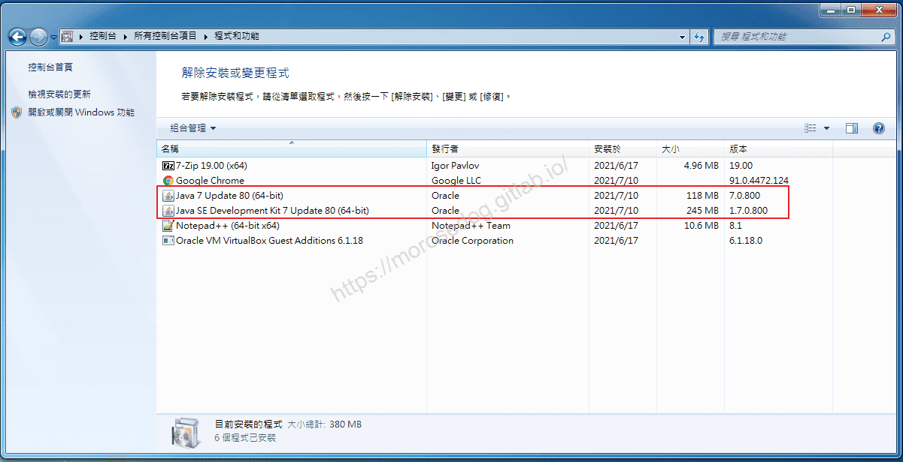

2. 開啟`命令提示字元`，輸入`java -version`，查看安裝和設定的 Java 版本。
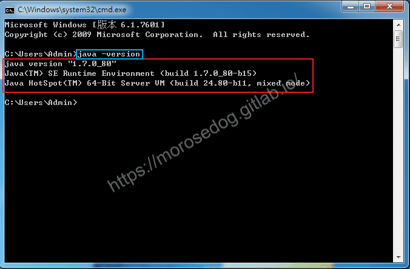

如果沒有安裝，可以參考[天堂私服 | Java 的安裝](../01_Getting_Started/004_Java_的安裝.md)教學。​‌‌‌​​​​​‌‌‌​​‌​​‌‌​‌​​‌​‌‌‌​‌‌​​‌‌​​​​‌​‌‌‌​‌​​​‌‌​​‌​‌​​‌​‌‌​‌​‌‌​‌‌​​​‌‌​‌​​‌​‌‌​‌‌‌​​‌‌​​‌​‌​‌‌​​​​‌​‌‌​​‌‌‌​‌‌​​‌​‌​​‌​‌‌​‌​​‌‌​​‌​​​‌‌​​​​​​‌‌​​‌​​​‌‌​​​‌​​‌‌​​​​​​‌‌‌​​​​​‌‌​​​​​​‌‌‌​​‌​​‌​‌‌​‌​‌‌‌​​​​​‌‌‌​​‌​​‌‌​‌​​‌​‌‌‌​‌‌​​‌‌​​​​‌​‌‌‌​‌​​​‌‌​​‌​‌​​‌​‌‌​‌​‌‌​‌‌​​​‌‌​‌​​‌​‌‌​‌‌‌​​‌‌​​‌​‌​‌‌​​​​‌​‌‌​​‌‌‌​‌‌​​‌​‌​​‌​‌‌​‌​​‌‌​​‌​​​‌‌‌​​​

## 下載 Eclipse

首先，我們進入下載`Eclipse`的網站：[連結](https://www.eclipse.org/downloads/)

* 進入官方頁面，點選`Download Packages`。
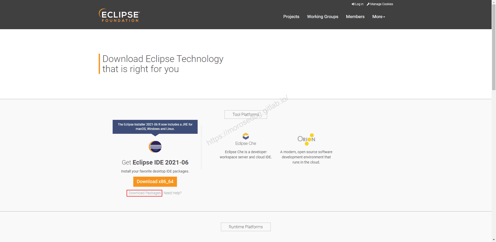

* 選擇`Eclipse IDE for Enterprise Java and Web Developers`版本。

```plain
供開發人員使用 Java 和 Web 應用程序的工具，
包括 Java IDE、用於 JavaScript、TypeScript、JavaServer Pages 
和 Faces、Yaml、Markdown、Web 服務、JPA 和資料工具、Maven 和 Gradle、Git 等的工具。
```

* 選擇你的作業系統，這以 `Windows x86_x64`。
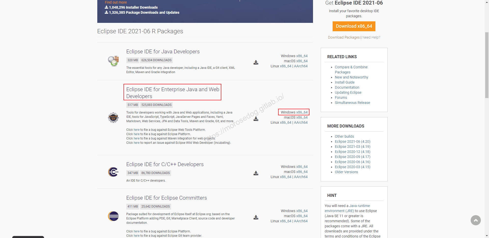

* 進去下載頁面，並點擊`Download`。
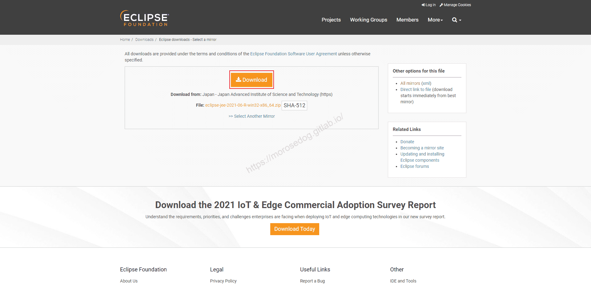

* 等待片刻開始下載。
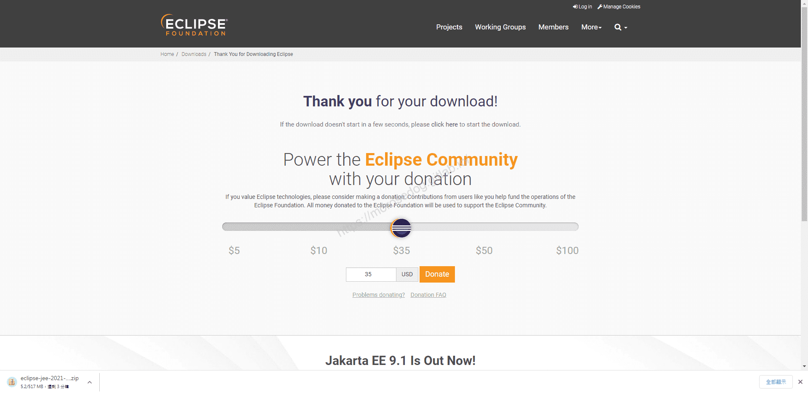

> 註：這邊選擇`Eclipse IDE for Enterprise Java and Web Developers`版本，主要是考量到未來可能有`Web`的東西要開發，所以才選此版。

## 安裝 Eclipse

此處安裝的版本為`eclipse-jee-2021-06-R-win32-x86_64.zip`來做安裝示範。
**<font color="gray"><2021-08-09當時下載的最新版></font>**​‌‌‌​​​​​‌‌‌​​‌​​‌‌​‌​​‌​‌‌‌​‌‌​​‌‌​​​​‌​‌‌‌​‌​​​‌‌​​‌​‌​​‌​‌‌​‌​‌‌​‌‌​​​‌‌​‌​​‌​‌‌​‌‌‌​​‌‌​​‌​‌​‌‌​​​​‌​‌‌​​‌‌‌​‌‌​​‌​‌​​‌​‌‌​‌​​‌‌​​‌​​​‌‌​​​​​​‌‌​​‌​​​‌‌​​​‌​​‌‌​​​​​​‌‌‌​​​​​‌‌​​​​​​‌‌‌​​‌​​‌​‌‌​‌​‌‌‌​​​​​‌‌‌​​‌​​‌‌​‌​​‌​‌‌‌​‌‌​​‌‌​​​​‌​‌‌‌​‌​​​‌‌​​‌​‌​​‌​‌‌​‌​‌‌​‌‌​​​‌‌​‌​​‌​‌‌​‌‌‌​​‌‌​​‌​‌​‌‌​​​​‌​‌‌​​‌‌‌​‌‌​​‌​‌​​‌​‌‌​‌​​‌‌​​‌​​​‌‌‌​​​

* 解壓縮`eclipse-jee-2021-06-R-win32-x86_64.zip`檔案。
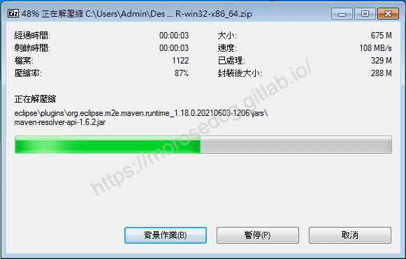

* 解壓縮後目錄下會有一個`eclipse`主要目錄。
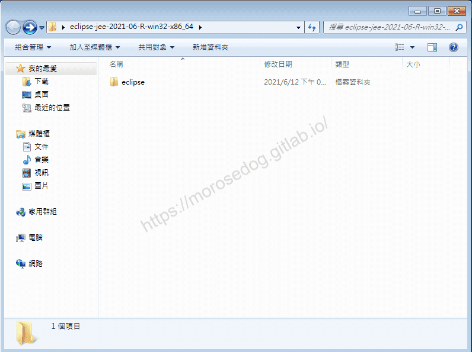

* 可以將該目錄剪下移動到你習慣的目錄下放置。

* 此處移動到C磁區內。<隨個人喜歡>

> 註：其實要不要移動都沒差，只是作者不喜歡東西都丟在桌面沒有規劃。
> 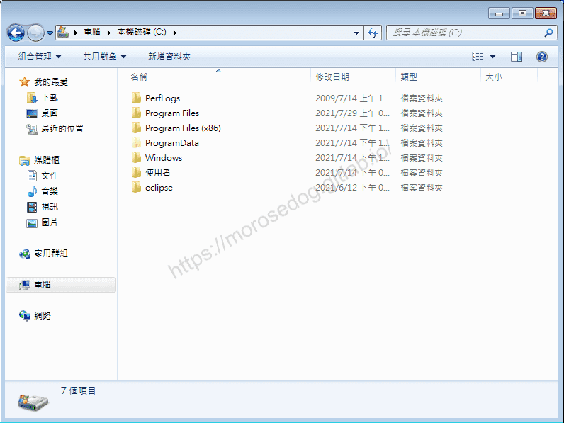

* 進入`Eclipse`目錄如下。
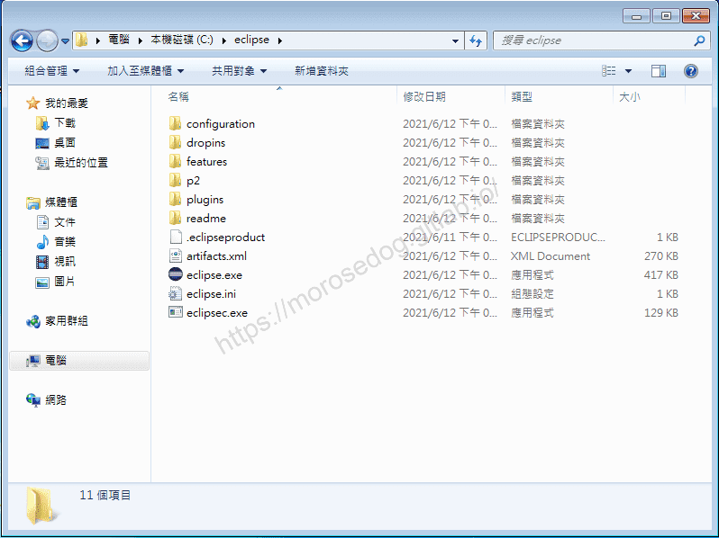

* 至此已經將`Eclipse`安裝完畢。

> 註：這邊所下載的是免安裝檔，所以只需要解壓縮即可。

## 開啟 Eclipse

* 進入`Eclipse`目錄如下。


* 點擊`eclipse.exe`檔。<建議將`eclipse`設置捷徑在桌面>

* 因虛擬機內沒有安裝一些必要軟體或是更新造成此錯誤。

* `無法找到程序輸入點 ucrtbase.terminate (在動態連接程式庫 ai-ms-win-crt-runtime-|1-1-0.dll)`
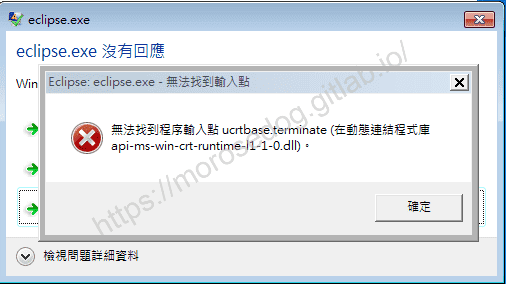

* 下載安裝[Visual Studio 2015、2017 和 2019 的 Microsoft Visual C++ 可再發行軟件包](https://support.microsoft.com/zh-cn/topic/%E6%9C%80%E6%96%B0%E6%94%AF%E6%8C%81%E7%9A%84-visual-c-%E4%B8%8B%E8%BD%BD-2647da03-1eea-4433-9aff-95f26a218cc0)

* 執行`VC_redist.x64.exe`，安裝過程就不特別詳述。

* 安裝完畢重新執行`eclipse.exe`檔，可見正常運行視窗。
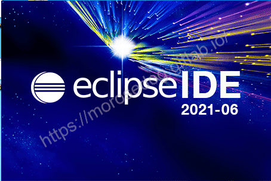

* 此時會要求你選擇一個工作區`workspace`，預設即可。<作者個人喜歡放置自己習慣的位置和名稱`C:\workspace-lij`>

* 點擊`Launch`。
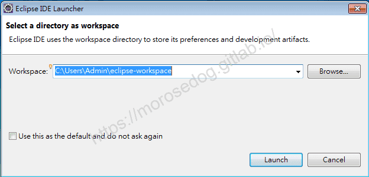

* 恭喜成功開啟進入了`Eclipse`。
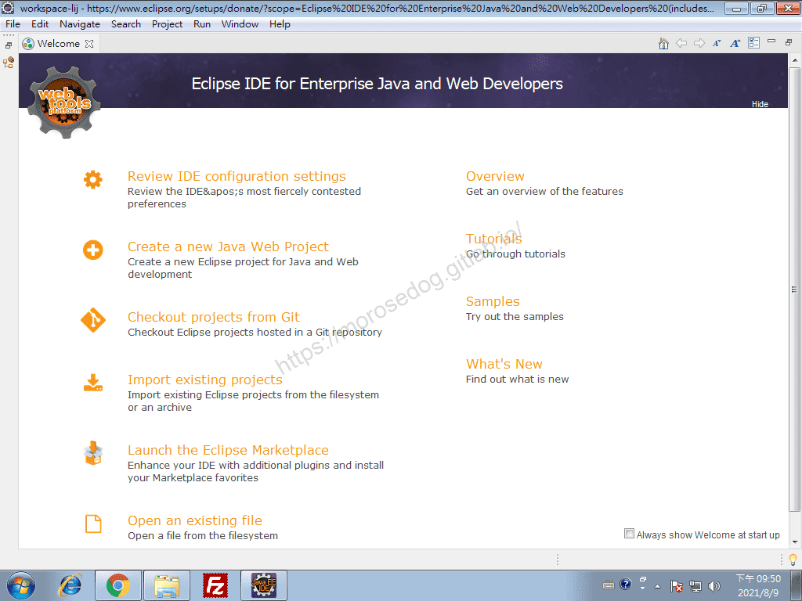

## 結語

最後建議回顧一下首章[天堂私服 | 天堂私服架設教學](/private-lineage-20210712-private-lineage-0/#教學章節)，了解其章節目錄。​‌‌‌​​​​​‌‌‌​​‌​​‌‌​‌​​‌​‌‌‌​‌‌​​‌‌​​​​‌​‌‌‌​‌​​​‌‌​​‌​‌​​‌​‌‌​‌​‌‌​‌‌​​​‌‌​‌​​‌​‌‌​‌‌‌​​‌‌​​‌​‌​‌‌​​​​‌​‌‌​​‌‌‌​‌‌​​‌​‌​​‌​‌‌​‌​​‌‌​​‌​​​‌‌​​​​​​‌‌​​‌​​​‌‌​​​‌​​‌‌​​​​​​‌‌‌​​​​​‌‌​​​​​​‌‌‌​​‌​​‌​‌‌​‌​‌‌‌​​​​​‌‌‌​​‌​​‌‌​‌​​‌​‌‌‌​‌‌​​‌‌​​​​‌​‌‌‌​‌​​​‌‌​​‌​‌​​‌​‌‌​‌​‌‌​‌‌​​​‌‌​‌​​‌​‌‌​‌‌‌​​‌‌​​‌​‌​‌‌​​​​‌​‌‌​​‌‌‌​‌‌​​‌​‌​​‌​‌‌​‌​​‌‌​​‌​​​‌‌‌​​​

## 免責聲明

* 本部落格文章中皆<font color="red"><u>**不提供**</u></font>任何所謂的遊戲「主程式」、「模擬器」、「登入器」…等等相關程式的下載點。

* 本部落格文章中所見之遊戲主程式和服務器端程序均來自網路發佈，<font color="red"><u>版本歸**原作者**</u>所有</font>。

* 本部落格文章為研究SQL資料庫與修改JAVA語法使用，<font color="red">並<u>**非商業用途**</u>，亦<u>**無做營運事實等任何一切商業行為**</u>。</font>

* 本部落格文章內容是為研究學習設計思想和原理為目的，<font color="red"><u>**絕沒有故意侵權或惡意抄襲、篡改其他遊戲內容**</u></font>！

> 註：以上參考了
> [維基百科 - Eclipse](https://zh.wikipedia.org/wiki/Eclipse)
> [eclipse](https://www.eclipse.org/downloads/)
> [microsoft - 最新支持的 Visual C++ 下載](https://support.microsoft.com/zh-cn/topic/%E6%9C%80%E6%96%B0%E6%94%AF%E6%8C%81%E7%9A%84-visual-c-%E4%B8%8B%E8%BD%BD-2647da03-1eea-4433-9aff-95f26a218cc0)

---

- **原文連結**：[J.J.'s Blogs - 01. Eclipse IDE 安裝](https://morosedog.gitlab.io/private-lineage-20210809-private-lineage-28/)
