# 02. Eclipse IDE 簡單介紹

# 天堂私服 | Eclipse IDE 簡單介紹

    
    
      📑 目錄
      

1. [準備](#準備)
2. [啟動/視窗介紹 Eclipse](#啟動-視窗介紹-Eclipse)
3. [新增 Eclipse 使用的 JREs](#新增-Eclipse-使用的-JREs)
4. [第一個簡單的 Java 程式](#第一個簡單的-Java-程式)
5. [Eclipse 基礎文件](#Eclipse-基礎文件)
6. [結語](#結語)
7. [免責聲明](#免責聲明)

    
    
    

## 準備

在開始前需要安裝完畢`Eclipse`。
如果尚未安裝，可以參考此篇文章[Eclipse IDE 安裝](./028_01._Eclipse_IDE_安裝.md)。

## 啟動/視窗介紹 Eclipse

* `Eclipse`執行後，會彈出一個視窗來要你選擇`workspace`目錄的路徑位置，選擇好`Workspace`目錄的儲存位置後，可以勾選`Use this as the default and do not ask again`，這意思是說使用這個為預設與不要再詢問，完成後，點擊`Launch`。

> 註：`Workspace`目錄主要是用來儲存你所撰寫的`Java`專案，你可以選擇更改至其他磁區位置。
> 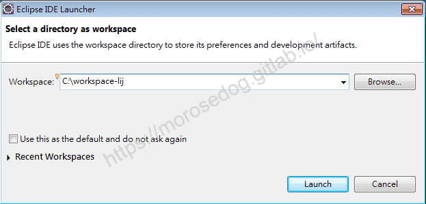

* 開啟後，會看到如下圖所示的`Eclipse`歡迎頁面，可以點選左上角的`X`關閉，如果你不希望下次開啟`Eclipse`時出現歡迎頁面，可以取消勾選`Always show Welcome at start up`。
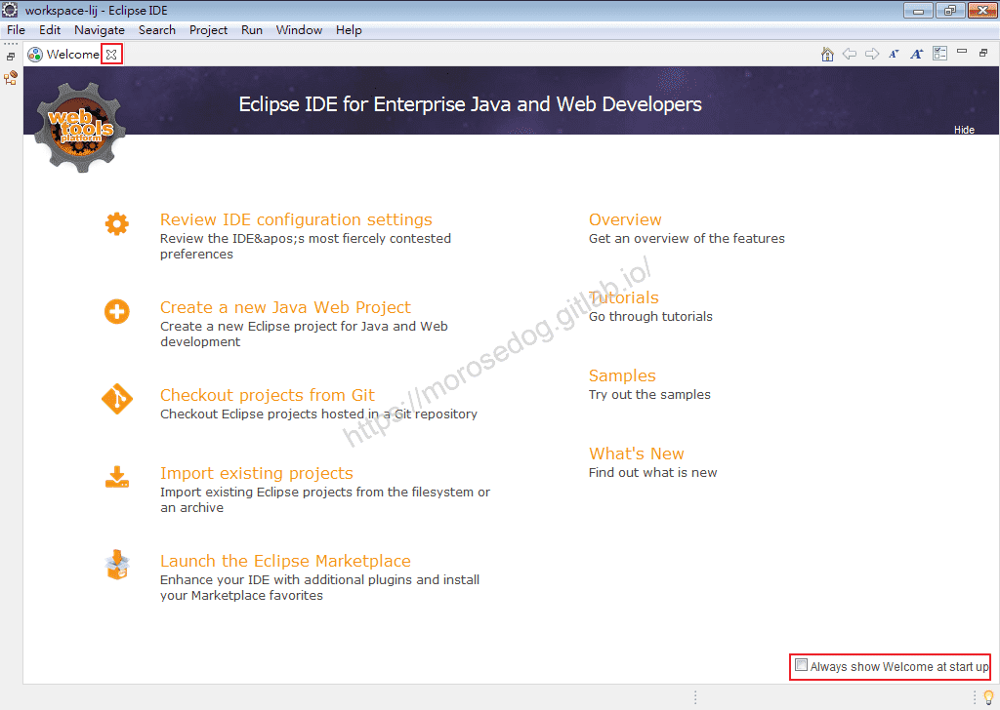

* 開啟後預設的情景(Perspective)是`Java EE`的。
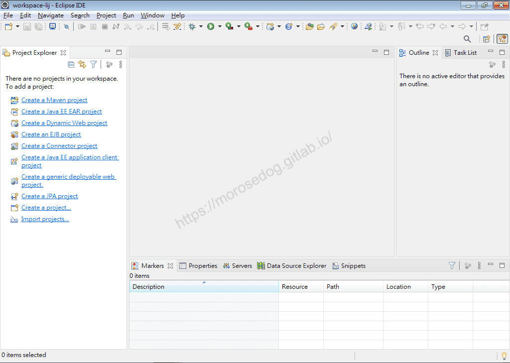

* 這邊建議的情景(Perspective)可以選擇是`Java`

* 點擊左邊的`Open Perspective`按鈕。

* 彈出`Open Perspective`視窗，選擇`Java`，點擊`Open`即可切換。
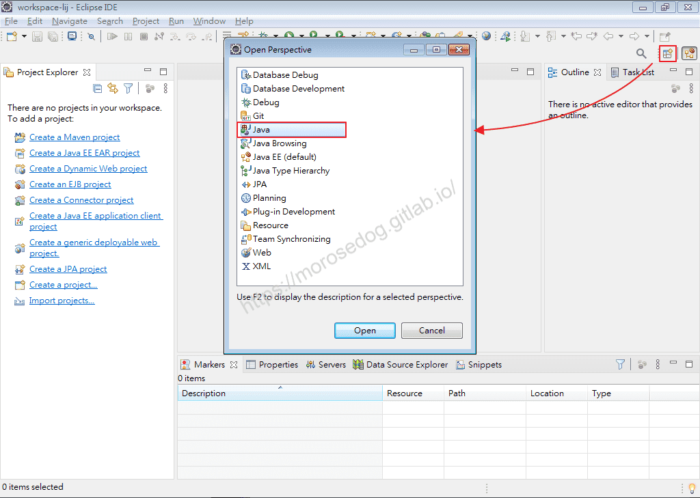

* 如下圖所示是Eclipse IDE的介面介紹，這些視窗位置都可以依使用者的使用習慣去更動位置。
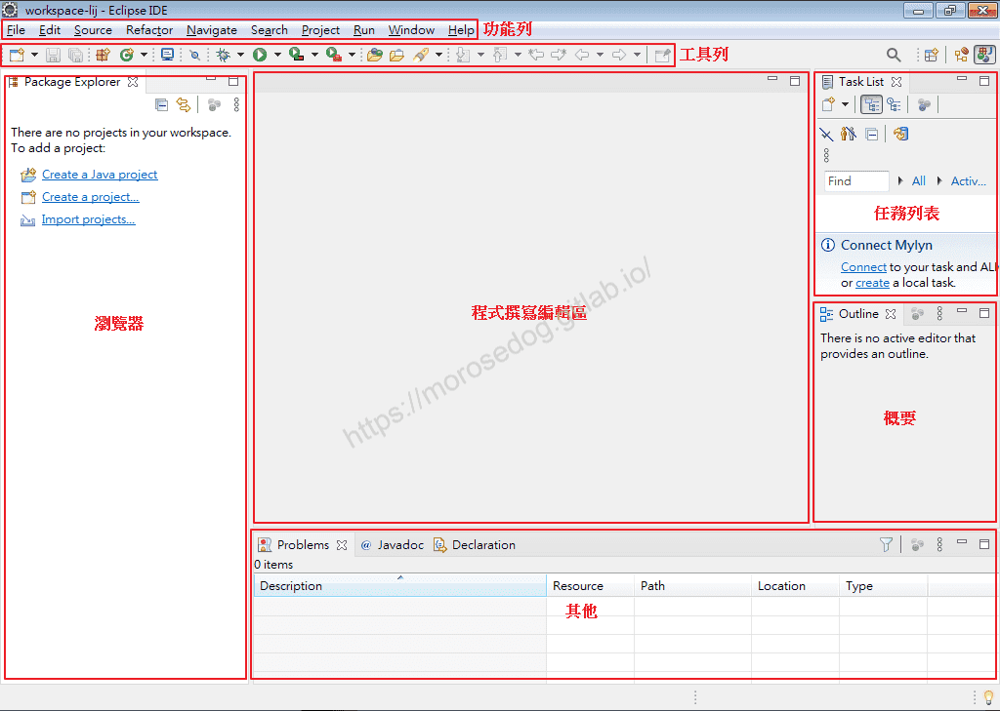

  * 功能列

    * 顧名思義就是`Eclipse`的功能列。

  * 工具列

    * 顧名思義就是`Eclipse`的工具列。

  * 瀏覽器

    * 建立的專案、檔案、都會顯示在此，就像是個檔案總管一樣。

  * 程式撰寫編輯區

    * 主要開啟程式，在此視窗內做開發或是編輯。

  * 任務列表

    * 顯示項目中所有待完成的任務。

  * 概要

    * 來查看某個東西的要點的。對於`Java`來說，要點就是屬性域和方法。

  * 其他

    * `Problems`, `Javadoc`, `Declaration`, `Console`…etc.，用於看錯誤、警告、執行結果等等。

> 註：如不小心關掉某視窗，且不知道要怎麼開回的話，那可以點選功能列的`Window`，並點選`Perspective`及`Reset Perspective...`，就可以恢復`Eclipse`視窗的預設介面了。​‌‌‌​​​​​‌‌‌​​‌​​‌‌​‌​​‌​‌‌‌​‌‌​​‌‌​​​​‌​‌‌‌​‌​​​‌‌​​‌​‌​​‌​‌‌​‌​‌‌​‌‌​​​‌‌​‌​​‌​‌‌​‌‌‌​​‌‌​​‌​‌​‌‌​​​​‌​‌‌​​‌‌‌​‌‌​​‌​‌​​‌​‌‌​‌​​‌‌​​‌​​​‌‌​​​​​​‌‌​​‌​​​‌‌​​​‌​​‌‌​​​​​​‌‌‌​​​​​‌‌​​​‌​​‌‌​​​​​​‌​‌‌​‌​‌‌‌​​​​​‌‌‌​​‌​​‌‌​‌​​‌​‌‌‌​‌‌​​‌‌​​​​‌​‌‌‌​‌​​​‌‌​​‌​‌​​‌​‌‌​‌​‌‌​‌‌​​​‌‌​‌​​‌​‌‌​‌‌‌​​‌‌​​‌​‌​‌‌​​​​‌​‌‌​​‌‌‌​‌‌​​‌​‌​​‌​‌‌​‌​​‌‌​​‌​​​‌‌‌​​‌

## 新增 Eclipse 使用的 JREs

此處所使用的`Eclipse`版本為：

```plain
Version: 2021-06 (4.20.0)
Build id: 20210612-2011
```

* 點擊功能列的`Window`，並點選`Preferences`。

* 於`Preferences`視窗，點選`Java`展開，點選`Installed JREs`

* 可見此版`Eclipse`內預設的`jre`為`openjdk 16`的版本。

```plain
C:\eclipse\plugins\org.eclipse.justj.openjdk.hotspot.jre.full.win32.x86_64_16.0.1.v20210528-1205\jre
```

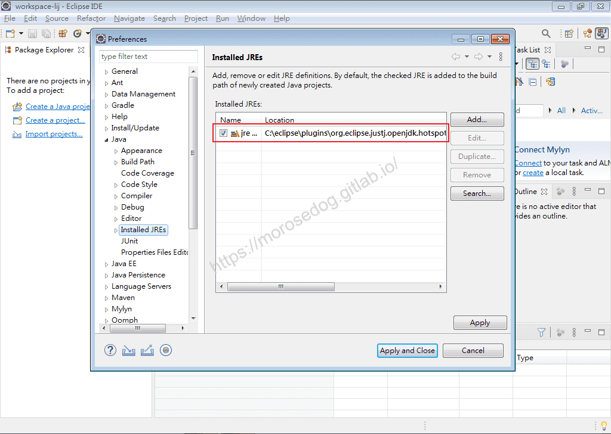

* 作者這邊所安裝的是`JDK 1.7`的版本。

* 點擊`Add`，點選`Standard VM`，在點擊`Next >`
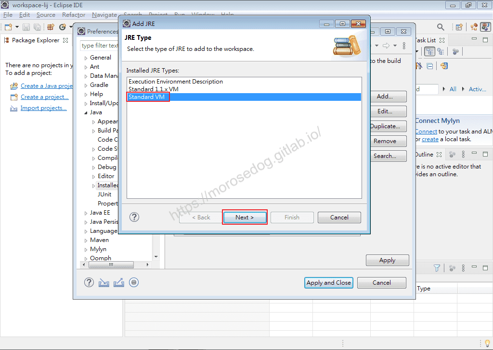

* 點擊`Directory...`選擇`JDK`安裝的目錄。

* 選擇完畢後會自動帶入其他欄位內容和下方的`JRS system libraries`列表..等等。

* 點擊`Finish`
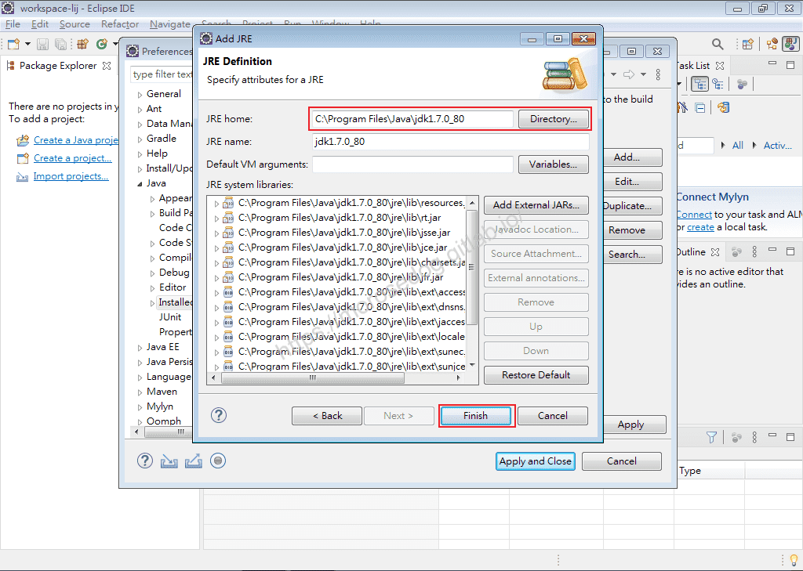

* 勾選剛剛新增的`JDK 1.7`為預設。

* 會看到跳出警告為`The selected JRE dose not supp..ompiler compliance level of 16`

> 註：這是因為預設的`compiler`選為`16`，他才會跳出警告。

* 可以點擊下方的`Complier`的連結去調整。
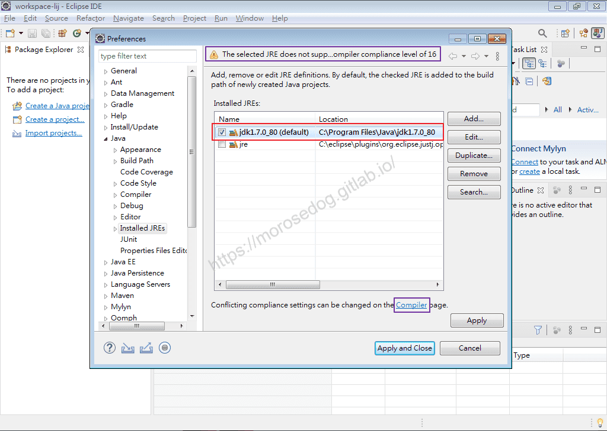

* 點擊下方的`Complier`的連結，彈出是否要儲存當前頁面的修改，點擊`Apply`
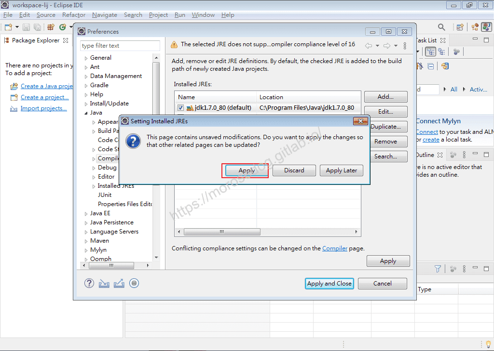

* 可見目前設定為`16`的版本，且下方也有警告，大概內容是說，選擇`16`版本來做`Complier`，但是你設定的`JRE`版本卻是`1.7`版。
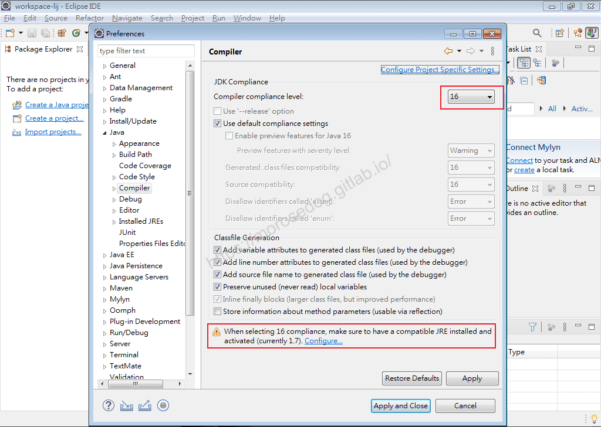

* 將`16`改選為`1.7`版；下方警告消失了。

* 點選`Apply and Close`，儲存設定並關閉此視窗。
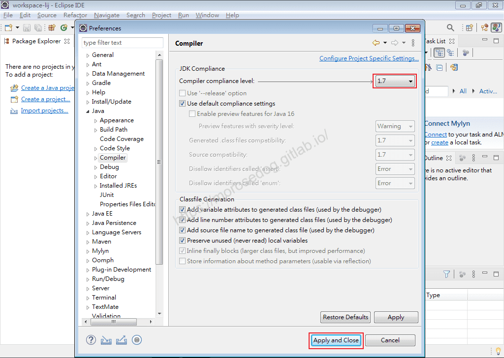

* 至此已經設定完成。

> 註：上方設定為所有專案的預設`Complier`的`JDK`版本，另外是可以針對每個`Project`做個別設定的。​‌‌‌​​​​​‌‌‌​​‌​​‌‌​‌​​‌​‌‌‌​‌‌​​‌‌​​​​‌​‌‌‌​‌​​​‌‌​​‌​‌​​‌​‌‌​‌​‌‌​‌‌​​​‌‌​‌​​‌​‌‌​‌‌‌​​‌‌​​‌​‌​‌‌​​​​‌​‌‌​​‌‌‌​‌‌​​‌​‌​​‌​‌‌​‌​​‌‌​​‌​​​‌‌​​​​​​‌‌​​‌​​​‌‌​​​‌​​‌‌​​​​​​‌‌‌​​​​​‌‌​​​‌​​‌‌​​​​​​‌​‌‌​‌​‌‌‌​​​​​‌‌‌​​‌​​‌‌​‌​​‌​‌‌‌​‌‌​​‌‌​​​​‌​‌‌‌​‌​​​‌‌​​‌​‌​​‌​‌‌​‌​‌‌​‌‌​​​‌‌​‌​​‌​‌‌​‌‌‌​​‌‌​​‌​‌​‌‌​​​​‌​‌‌​​‌‌‌​‌‌​​‌​‌​​‌​‌‌​‌​​‌‌​​‌​​​‌‌‌​​‌

## 第一個簡單的 Java 程式

* 首先新增一個專案，點擊功能列的`File`，並點選`New`，因為是要新增新的`Java`專案，所以這邊選擇`Java Project`。
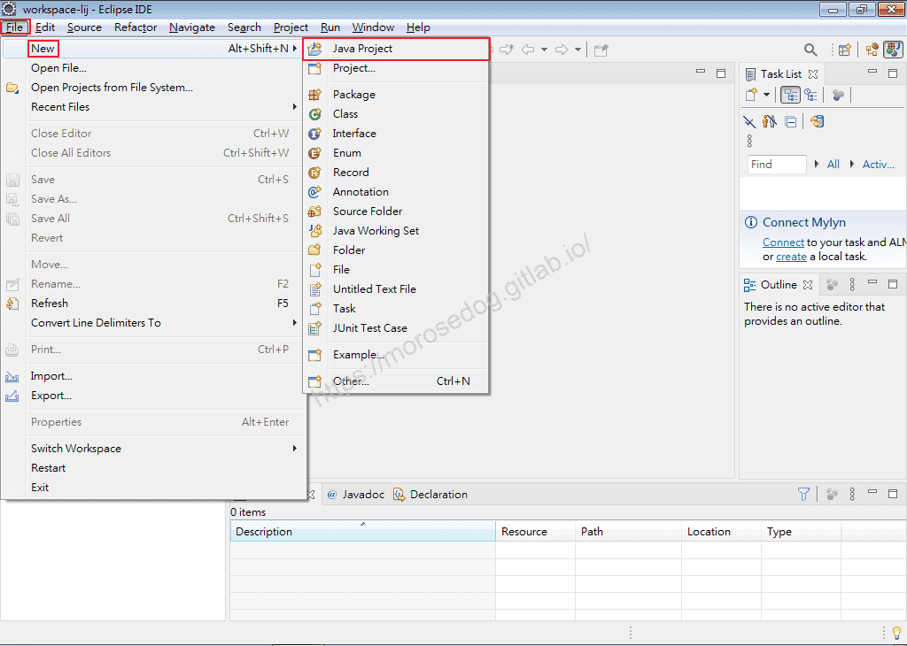

* 在`Project name`輸入一個專案名稱，你可以看到如下圖所示`JRE`的部分，選擇剛剛設定的`JDK 1.7`。專案名稱輸入完成後，點選『Finish』。
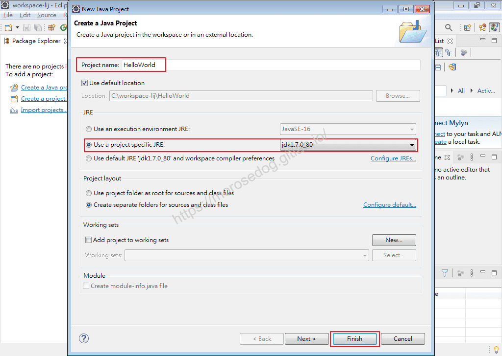

* 新增專案後，你可以點選`HelloWorld`專案展開，如下圖所示你可以看到專案名稱下有很多項引用的`JRE Library`，還有個`src`資料夾，這資料夾就是用來存放`Source File`的位置。
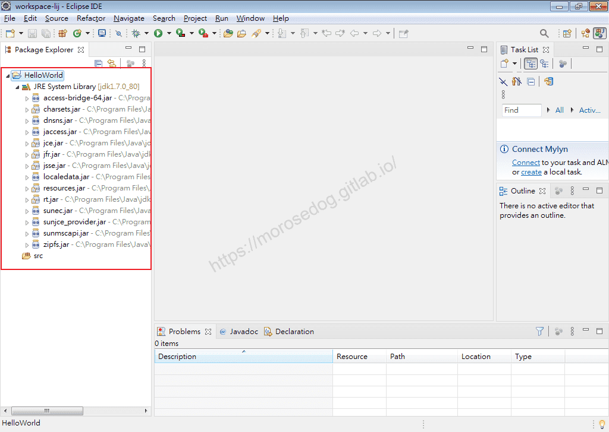

* 新增一個類別，如下圖所示滑鼠右鍵點選剛剛新增好的專案內的`src`，點選`New`，並點選`Class`類別。
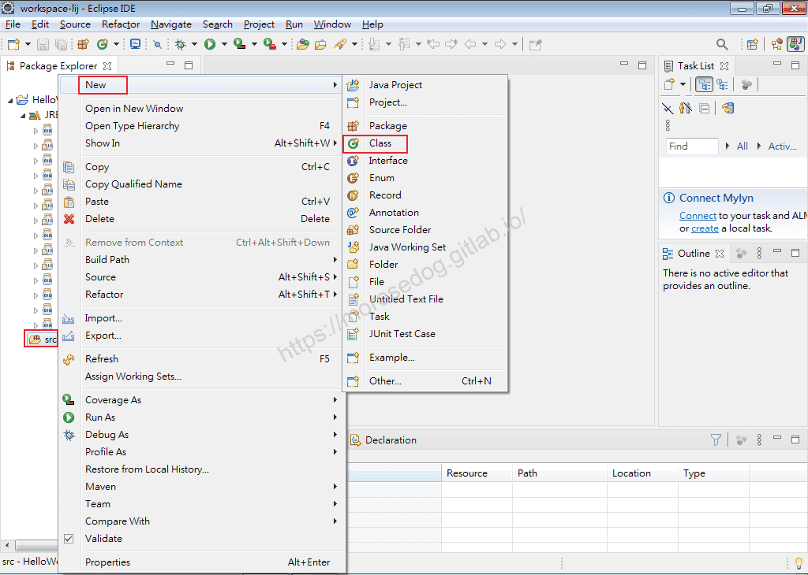

* 在`New Java Class`視窗中

  * 輸入`Package`欄位輸入`com.morosedog.example`

> 註：`package`命名也是有規範的，可以上網搜尋了解一下即可。

  * `Name`是類別的名稱，為必填的欄位

  * `Superclass`即父類別，這邊使用預設就好

  * 勾選`public static void main(String[] args)`產生程式進入點的`main()`方法。

> 註：因為這次撰寫的程式僅需要單獨執行，不是由其他的類別呼叫的。

* 輸入及勾選完成後，點擊`Finish`。

> 註：`Package`欄位可以留空使用預設的，但不建議你這麼做，建議還是養成封裝的習慣。
> 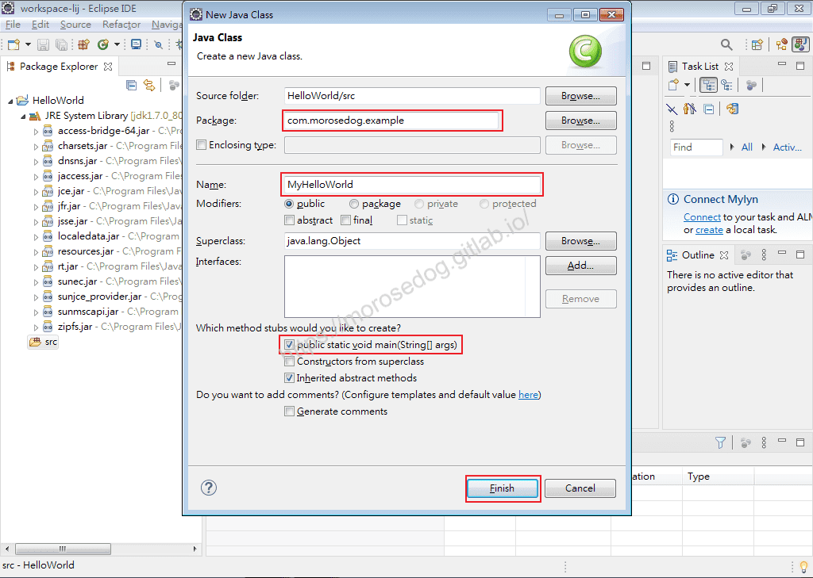​‌‌‌​​​​​‌‌‌​​‌​​‌‌​‌​​‌​‌‌‌​‌‌​​‌‌​​​​‌​‌‌‌​‌​​​‌‌​​‌​‌​​‌​‌‌​‌​‌‌​‌‌​​​‌‌​‌​​‌​‌‌​‌‌‌​​‌‌​​‌​‌​‌‌​​​​‌​‌‌​​‌‌‌​‌‌​​‌​‌​​‌​‌‌​‌​​‌‌​​‌​​​‌‌​​​​​​‌‌​​‌​​​‌‌​​​‌​​‌‌​​​​​​‌‌‌​​​​​‌‌​​​‌​​‌‌​​​​​​‌​‌‌​‌​‌‌‌​​​​​‌‌‌​​‌​​‌‌​‌​​‌​‌‌‌​‌‌​​‌‌​​​​‌​‌‌‌​‌​​​‌‌​​‌​‌​​‌​‌‌​‌​‌‌​‌‌​​​‌‌​‌​​‌​‌‌​‌‌‌​​‌‌​​‌​‌​‌‌​​​​‌​‌‌​​‌‌‌​‌‌​​‌​‌​​‌​‌‌​‌​​‌‌​​‌​​​‌‌‌​​‌

* 新增類別後可見下圖

  * 左邊產生了相對應的`package`目錄，並產生了名為`MyHelloWorld`檔。

  * 中間開啟了`MyHelloWorld`程式，並自動產生了`public static void main(String[] args)`的方法。

  * 右邊可見概要顯示了該程式內的名稱和方法清單。
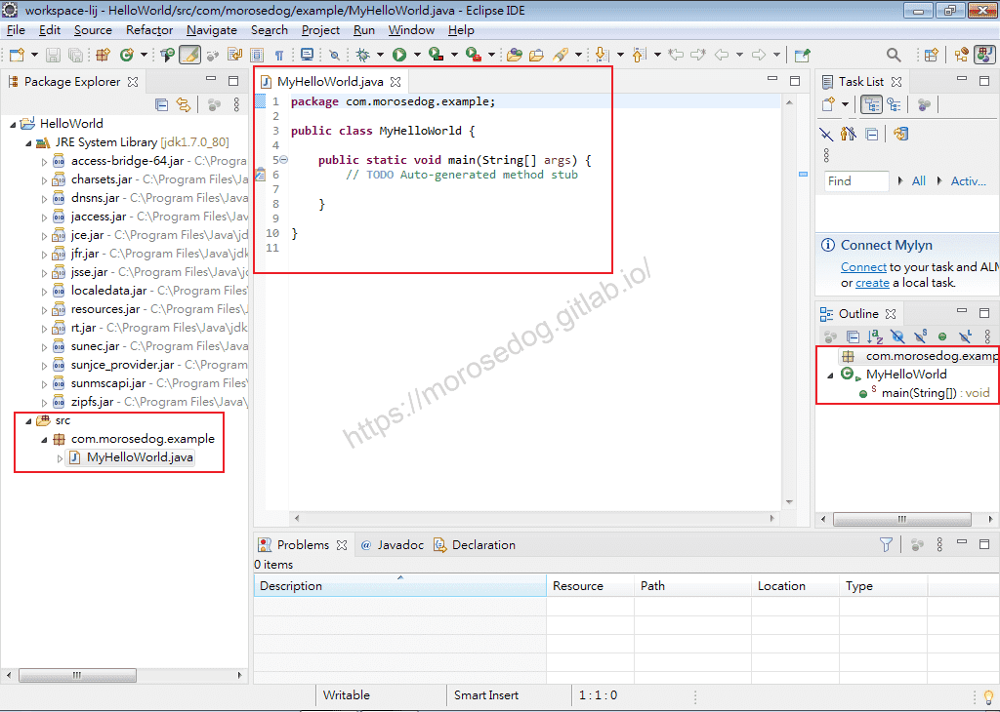

* `Hello World`程式很簡單只需要`print`輸出字串`Hello World!`。

* 只需要在`main()`方法內加入以下程式碼即可。

```plain
System.out.println("Hello World!");
```

* 注意到編輯`Hello World`視窗上方，名稱旁邊有一個`*`符號，表示該程式有被修改過但是尚未儲存。

* 記得儲存修改後的程式，儲存後`*`符號及會消失。
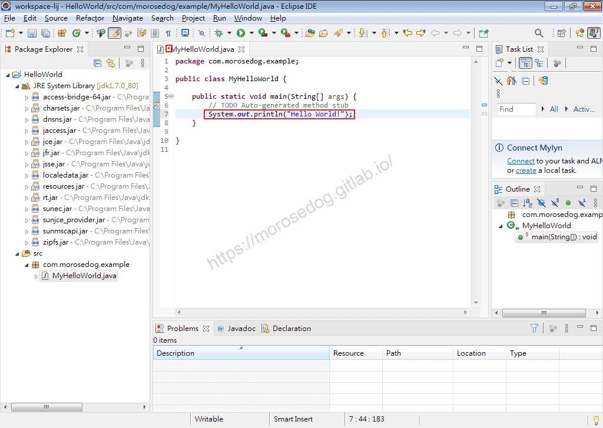

* 執行`Hello World`程式。

* 點選`執行`按鈕(綠色撥放鍵圖)，點選`Run As`，及點選執行`Java Application`。
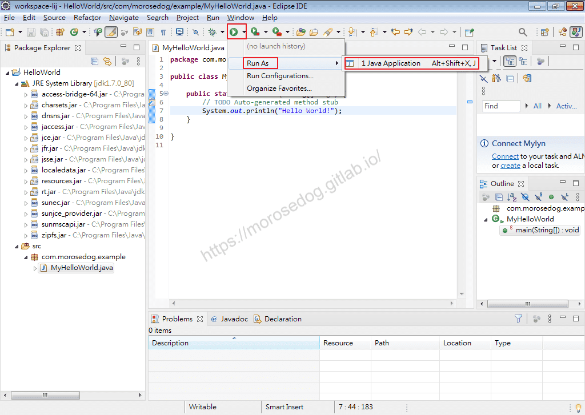

* 執行完畢後，可見下方`Console`視窗內，有印出`Hello World!`字串。

* 恭喜完成了第一個簡單的 Java 程式。
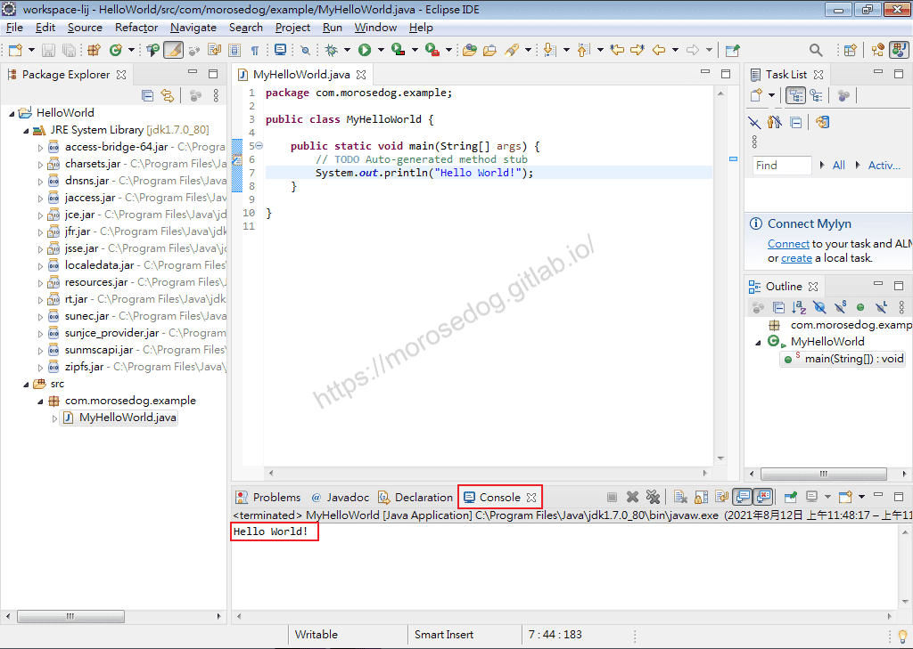

## Eclipse 基礎文件

這邊分享一個在網路上找到對`Eclipse`做一個比較全面的教學文件。
[國立中正大學 - Eclipse – 整合開發工具(基礎篇)](https://www.cs.ccu.edu.tw/~naiwei/cs5812/Eclipse-IDE.pdf)

## 結語

最後建議回顧一下首章[天堂私服 | 天堂私服架設教學](/private-lineage-20210712-private-lineage-0/#教學章節)，了解其章節目錄。

## 免責聲明

* 本部落格文章中皆<font color="red"><u>**不提供**</u></font>任何所謂的遊戲「主程式」、「模擬器」、「登入器」…等等相關程式的下載點。

* 本部落格文章中所見之遊戲主程式和服務器端程序均來自網路發佈，<font color="red"><u>版本歸**原作者**</u>所有</font>。

* 本部落格文章為研究SQL資料庫與修改JAVA語法使用，<font color="red">並<u>**非商業用途**</u>，亦<u>**無做營運事實等任何一切商業行為**</u>。</font>

* 本部落格文章內容是為研究學習設計思想和原理為目的，<font color="red"><u>**絕沒有故意侵權或惡意抄襲、篡改其他遊戲內容**</u></font>！

> 註：以上參考了
> [kjnotes部落格 - Eclipse IDE 下載、設定與使用教學-Java 篇](https://www.kjnotes.com/devtools/80)
> [國立中正大學 - Eclipse – 整合開發工具(基礎篇)](https://www.cs.ccu.edu.tw/~naiwei/cs5812/Eclipse-IDE.pdf)​‌‌‌​​​​​‌‌‌​​‌​​‌‌​‌​​‌​‌‌‌​‌‌​​‌‌​​​​‌​‌‌‌​‌​​​‌‌​​‌​‌​​‌​‌‌​‌​‌‌​‌‌​​​‌‌​‌​​‌​‌‌​‌‌‌​​‌‌​​‌​‌​‌‌​​​​‌​‌‌​​‌‌‌​‌‌​​‌​‌​​‌​‌‌​‌​​‌‌​​‌​​​‌‌​​​​​​‌‌​​‌​​​‌‌​​​‌​​‌‌​​​​​​‌‌‌​​​​​‌‌​​​‌​​‌‌​​​​​​‌​‌‌​‌​‌‌‌​​​​​‌‌‌​​‌​​‌‌​‌​​‌​‌‌‌​‌‌​​‌‌​​​​‌​‌‌‌​‌​​​‌‌​​‌​‌​​‌​‌‌​‌​‌‌​‌‌​​​‌‌​‌​​‌​‌‌​‌‌‌​​‌‌​​‌​‌​‌‌​​​​‌​‌‌​​‌‌‌​‌‌​​‌​‌​​‌​‌‌​‌​​‌‌​​‌​​​‌‌‌​​‌

---

- **原文連結**：[J.J.'s Blogs - 02. Eclipse IDE 簡單介紹](https://morosedog.gitlab.io/private-lineage-20210810-private-lineage-29/)
