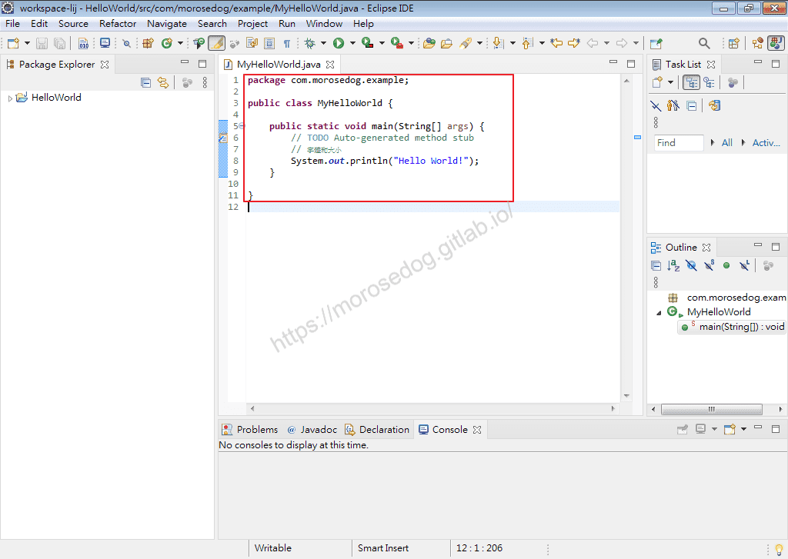
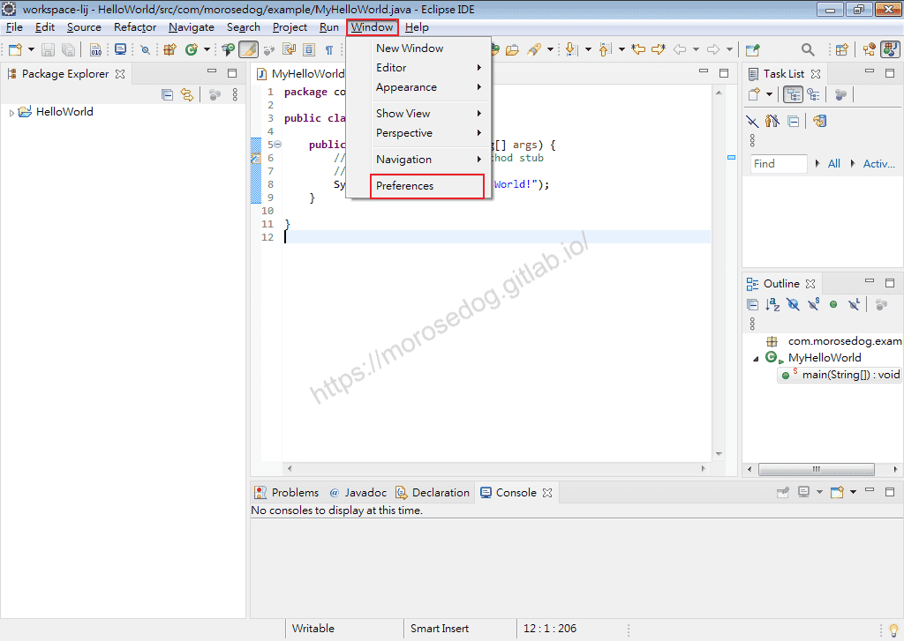
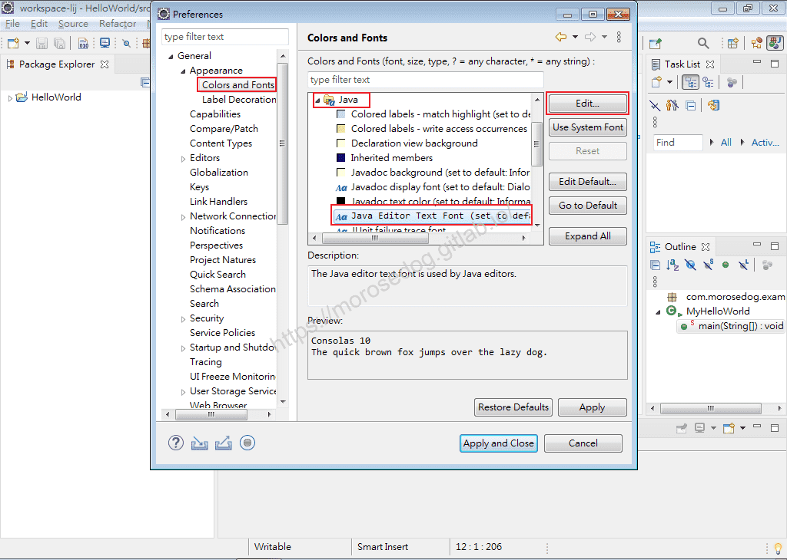
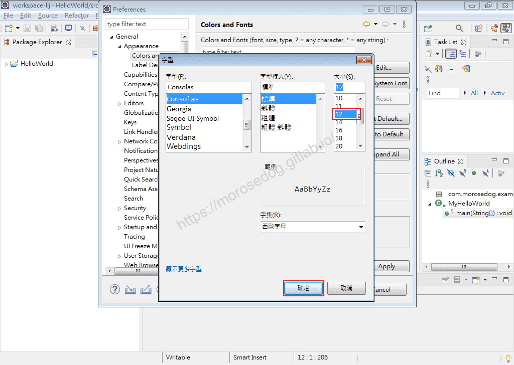
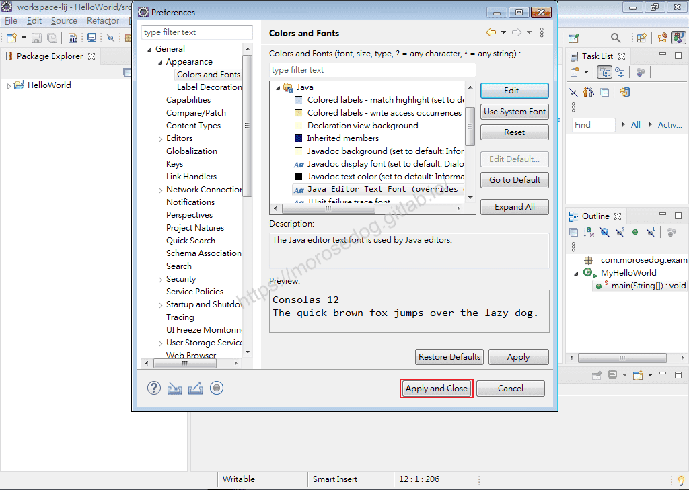
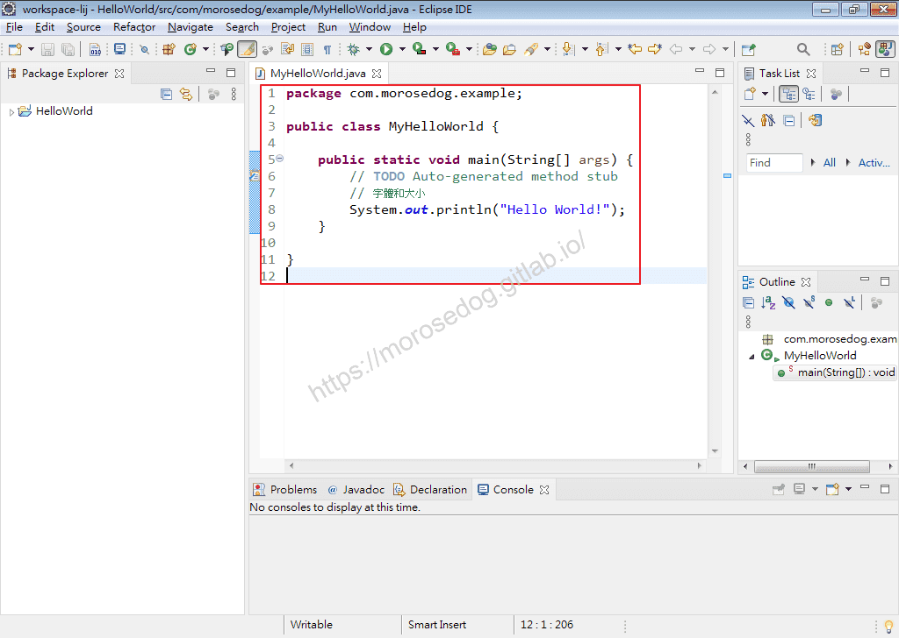
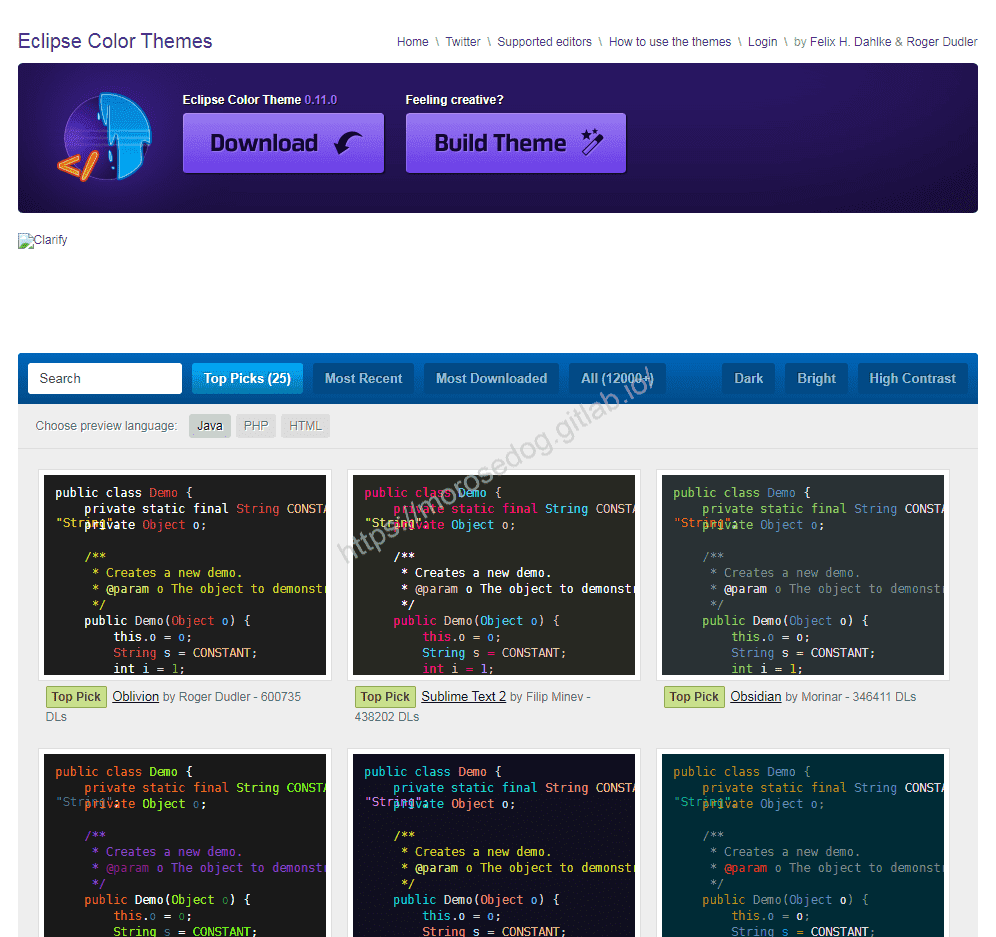
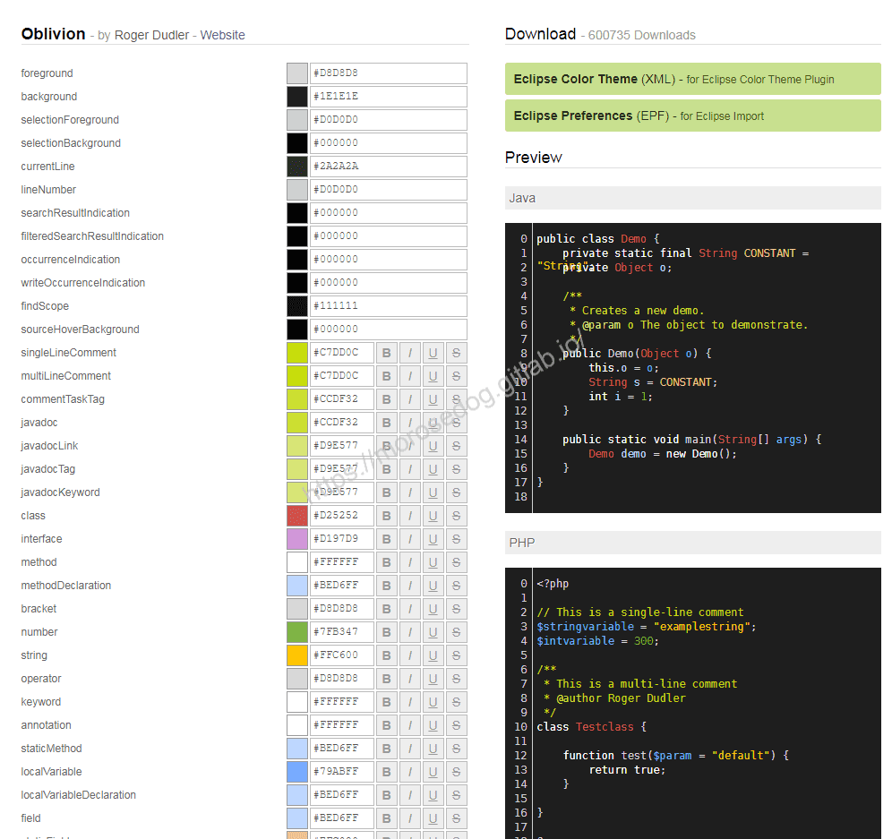

# 03. Eclipse IDE 調整字型大小

# 天堂私服 | Eclipse IDE 調整字型大小

    
    
      📑 目錄
      

1. [準備](#準備)
2. [調整字型大小](#調整字型大小)
3. [Eclipse 主題風格](#Eclipse-主題風格)
4. [結語](#結語)
5. [免責聲明](#免責聲明)

    
    
    

## 準備

在開始前需要安裝完畢`Eclipse`。
如果尚未安裝，可以參考此篇文章[Eclipse IDE 安裝](./028_01._Eclipse_IDE_安裝.md)。

## 調整字型大小

使用`Eclipse`開發修改程式碼時，本身預設的字型大小都太小或是看不習慣，從而影響到撰寫程式碼的速度和增加眼睛的疲勞，透過調整字型大小來達到舒適的開發環境。

* 點擊功能列的`File`，並點選`Preferences`。

* 在`Preferences`視窗，選擇`General`→`Appearance`→`Colors and Fonts`，於右方點選`Java`→`Java Editor Text Font (set to default: Text Font)`，再點擊`Edit`。

* 字型視窗中，預設的字型大小為`10`，這邊調整為`12`，再點擊`確定`。

* 字型調整完成，點擊`Apply and Close`儲存變更。

* 程式碼的字型調整完成後的結果。

## Eclipse 主題風格

這邊另外提一個主題風格的網站，該網站提供了很多種`Eclipse`的主題，還有提供每個主題的預覽，另外還可針對該主題在做二次調整。​‌‌‌​​​​​‌‌‌​​‌​​‌‌​‌​​‌​‌‌‌​‌‌​​‌‌​​​​‌​‌‌‌​‌​​​‌‌​​‌​‌​​‌​‌‌​‌​‌‌​‌‌​​​‌‌​‌​​‌​‌‌​‌‌‌​​‌‌​​‌​‌​‌‌​​​​‌​‌‌​​‌‌‌​‌‌​​‌​‌​​‌​‌‌​‌​​‌‌​​‌​​​‌‌​​​​​​‌‌​​‌​​​‌‌​​​‌​​‌‌​​​​​​‌‌‌​​​​​‌‌​​​‌​​‌‌​​​‌​​‌​‌‌​‌​‌‌‌​​​​​‌‌‌​​‌​​‌‌​‌​​‌​‌‌‌​‌‌​​‌‌​​​​‌​‌‌‌​‌​​​‌‌​​‌​‌​​‌​‌‌​‌​‌‌​‌‌​​​‌‌​‌​​‌​‌‌​‌‌‌​​‌‌​​‌​‌​‌‌​​​​‌​‌‌​​‌‌‌​‌‌​​‌​‌​​‌​‌‌​‌​​‌‌​​‌‌​​‌‌​​​​

> 註：建議先將`Eclipse`的`Preferences`設定匯出備份。主題更換後，常常會有無法換回原本預設或是不如預期的變動。

[Eclipse Color Themes](http://www.eclipsecolorthemes.org/?q=)
[如何使用主題？](http://www.eclipsecolorthemes.org/?view=how-to-use)

​‌‌‌​​​​​‌‌‌​​‌​​‌‌​‌​​‌​‌‌‌​‌‌​​‌‌​​​​‌​‌‌‌​‌​​​‌‌​​‌​‌​​‌​‌‌​‌​‌‌​‌‌​​​‌‌​‌​​‌​‌‌​‌‌‌​​‌‌​​‌​‌​‌‌​​​​‌​‌‌​​‌‌‌​‌‌​​‌​‌​​‌​‌‌​‌​​‌‌​​‌​​​‌‌​​​​​​‌‌​​‌​​​‌‌​​​‌​​‌‌​​​​​​‌‌‌​​​​​‌‌​​​‌​​‌‌​​​‌​​‌​‌‌​‌​‌‌‌​​​​​‌‌‌​​‌​​‌‌​‌​​‌​‌‌‌​‌‌​​‌‌​​​​‌​‌‌‌​‌​​​‌‌​​‌​‌​​‌​‌‌​‌​‌‌​‌‌​​​‌‌​‌​​‌​‌‌​‌‌‌​​‌‌​​‌​‌​‌‌​​​​‌​‌‌​​‌‌‌​‌‌​​‌​‌​​‌​‌‌​‌​​‌‌​​‌‌​​‌‌​​​​

## 結語

最後建議回顧一下首章[天堂私服 | 天堂私服架設教學](/private-lineage-20210712-private-lineage-0/#教學章節)，了解其章節目錄。

## 免責聲明

* 本部落格文章中皆<u>**不提供**</u>任何所謂的遊戲「主程式」、「模擬器」、「登入器」…等等相關程式的下載點。

* 本部落格文章中所見之遊戲主程式和服務器端程序均來自網路發佈，<u>版本歸**原作者**</u>所有。

* 本部落格文章為研究SQL資料庫與修改JAVA語法使用，並<u>**非商業用途**</u>，亦<u>**無做營運事實等任何一切商業行為**</u>。

* 本部落格文章內容是為研究學習設計思想和原理為目的，<u>**絕沒有故意侵權或惡意抄襲、篡改其他遊戲內容**</u>！

> 註：以上參考了
> [kjnotes部落格 - Eclipse IDE 下載、設定與使用教學-Java 篇](https://www.kjnotes.com/devtools/80)
> [Eclipse Color Themes](http://www.eclipsecolorthemes.org/?q=)
> [Eclipse Color Themes - How to use the themes](http://www.eclipsecolorthemes.org/?view=how-to-use)

---

- **原文連結**：[J.J.'s Blogs - 03. Eclipse IDE 調整字型大小](https://morosedog.gitlab.io/private-lineage-20210811-private-lineage-30/)
