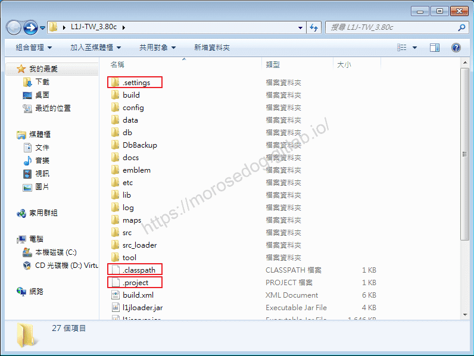
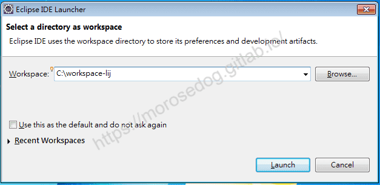
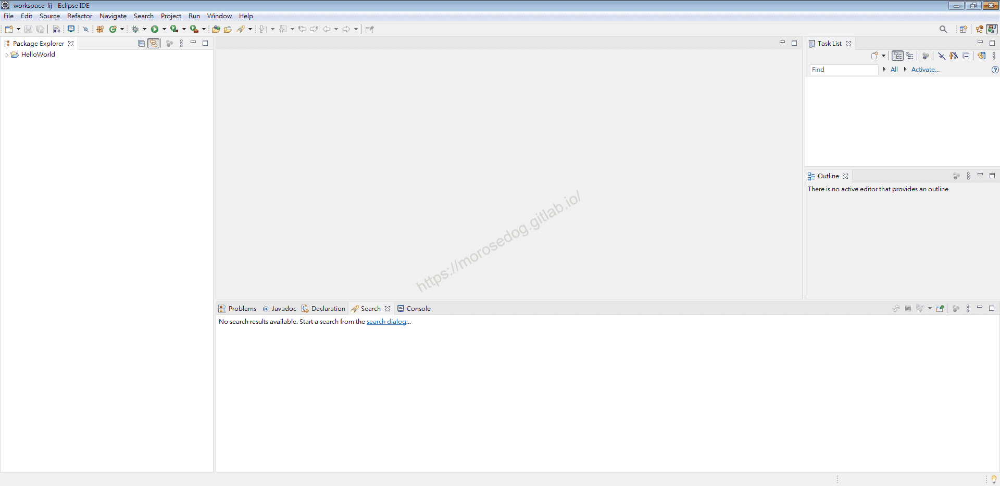
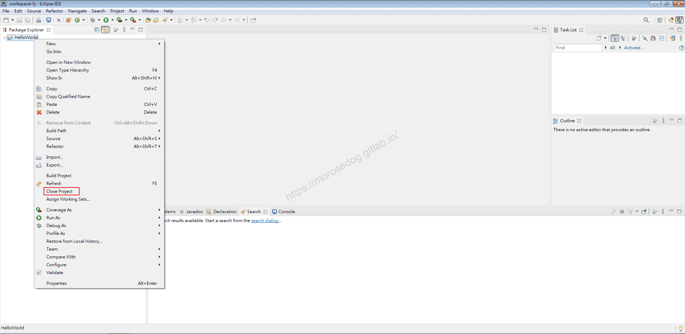
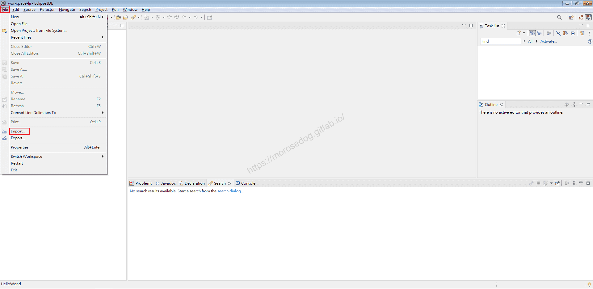
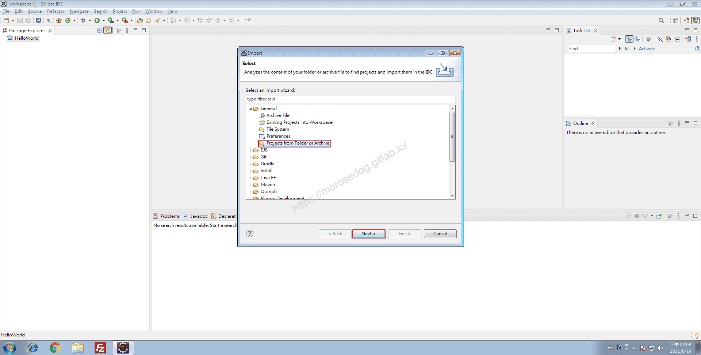
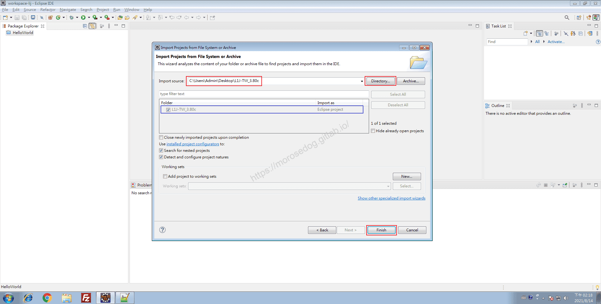
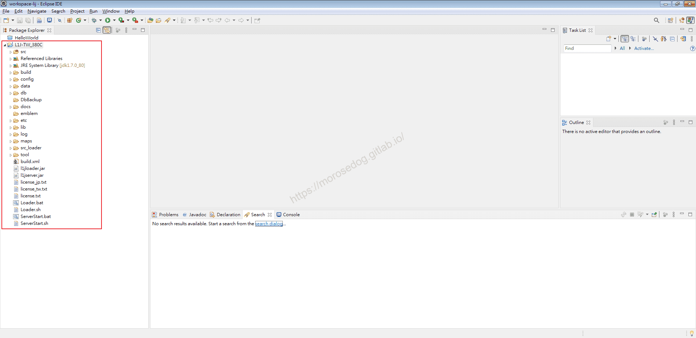

# 04. Eclipse 匯入天堂私服原始碼

# 天堂私服 | Eclipse 匯入天堂私服原始碼

    
    
      📑 目錄
      

1. [環境說明](#環境說明)
2. [準備](#準備)
3. [判斷 Project 所使用的 IDE](#判斷-Project-所使用的-IDE)
4. [關閉不必要專案](#關閉不必要專案)
5. [匯入天堂私服原始碼](#匯入天堂私服原始碼)
6. [結語](#結語)
7. [免責聲明](#免責聲明)

    
    
    

## 環境說明

此處使用`Oracle VM VirtualBox`虛擬機軟體，下載安裝了一個純淨的`Windows 7 x64 旗艦版`。

如果需要安裝虛擬機，可以參考此篇文章[VirtualBox Windows 7 安裝](../01_Getting_Started/003_VirtualBox_Windows_7_安裝.md)。

## 準備

2. 在開始前需要準備「天堂模擬器」。
此處所使用的是「[L1J-3.80c](/images/private-lineage/download_not_available.png)」由`日本開發團隊`研發的版本做示範。

  * 無法提供下載點，請根據關鍵字自行上網搜尋。

3. 在開始前需要安裝完畢`Eclipse`。
如果尚未安裝，可以參考此篇文章[Eclipse IDE 安裝](./028_01._Eclipse_IDE_安裝.md)。​‌‌‌​​​​​‌‌‌​​‌​​‌‌​‌​​‌​‌‌‌​‌‌​​‌‌​​​​‌​‌‌‌​‌​​​‌‌​​‌​‌​​‌​‌‌​‌​‌‌​‌‌​​​‌‌​‌​​‌​‌‌​‌‌‌​​‌‌​​‌​‌​‌‌​​​​‌​‌‌​​‌‌‌​‌‌​​‌​‌​​‌​‌‌​‌​​‌‌​​‌​​​‌‌​​​​​​‌‌​​‌​​​‌‌​​​‌​​‌‌​​​​​​‌‌‌​​​​​‌‌​​​‌​​‌‌​​‌​​​‌​‌‌​‌​‌‌‌​​​​​‌‌‌​​‌​​‌‌​‌​​‌​‌‌‌​‌‌​​‌‌​​​​‌​‌‌‌​‌​​​‌‌​​‌​‌​​‌​‌‌​‌​‌‌​‌‌​​​‌‌​‌​​‌​‌‌​‌‌‌​​‌‌​​‌​‌​‌‌​​​​‌​‌‌​​‌‌‌​‌‌​​‌​‌​​‌​‌‌​‌​​‌‌​​‌‌​​‌‌​​​‌

## 判斷 Project 所使用的 IDE

* 開啟`L1J-3.80c`專案。

* 可以看到 - 

  * `.setting`

  * `.classpath`

  * `.project`

* 看到這三個就可以斷定這個`Project`是使用`Eclipse`開發的專案。

> 註：這幾個資料夾和檔案，這邊就不特別說明，只要知道他是針對這個專案在`Eclipse`裡面的設定即可。
> 

基本上開發久了，常用的幾套`IDE`工具所產生的設定檔都滿好認的。
像是`IntelliJ IDEA`，專案目錄下會有`.idea`。

## 關閉不必要專案

* 開啟`Eclipse`。

* 選擇好`Workspace`，點擊`Launch`。

* 進入`Eclipse`主要視窗後，可以看到之前的`HelloWorld`專案還在。

> 註：如果不知道該專案為何而來，可以參考[Eclipse IDE 簡單介紹](./029_02._Eclipse_IDE_簡單介紹.md)。
> ​‌‌‌​​​​​‌‌‌​​‌​​‌‌​‌​​‌​‌‌‌​‌‌​​‌‌​​​​‌​‌‌‌​‌​​​‌‌​​‌​‌​​‌​‌‌​‌​‌‌​‌‌​​​‌‌​‌​​‌​‌‌​‌‌‌​​‌‌​​‌​‌​‌‌​​​​‌​‌‌​​‌‌‌​‌‌​​‌​‌​​‌​‌‌​‌​​‌‌​​‌​​​‌‌​​​​​​‌‌​​‌​​​‌‌​​​‌​​‌‌​​​​​​‌‌‌​​​​​‌‌​​​‌​​‌‌​​‌​​​‌​‌‌​‌​‌‌‌​​​​​‌‌‌​​‌​​‌‌​‌​​‌​‌‌‌​‌‌​​‌‌​​​​‌​‌‌‌​‌​​​‌‌​​‌​‌​​‌​‌‌​‌​‌‌​‌‌​​​‌‌​‌​​‌​‌‌​‌‌‌​​‌‌​​‌​‌​‌‌​​​​‌​‌‌​​‌‌‌​‌‌​​‌​‌​​‌​‌‌​‌​​‌‌​​‌‌​​‌‌​​​‌

* 首先針對`HelloWorld`按右鍵，選擇`Close project`來關閉專案。

* 主要是不想要其他專案來影響到我們搜尋、程式、檔案等等相關操作。

## 匯入天堂私服原始碼

* 點選`File`→`Import...`

* 開啟`Import`視窗後，選擇`General`→`Projects from Folder or Archive`，並點擊`Next >`。

> 註：在匯入的時候可以選擇要匯入的專案類型或是方式；像這邊就是選擇`文件夾或檔案中的項目`的意思。
> 

* 點擊`Directory...`選擇`L1J-3.80c`目錄，並開啟。

* 可見下方會帶出該專案，再點擊`Finish`完成匯入。

* 左邊可見匯入成功的`L1J-3.80c`專案，將其展開如下圖。

* 至此已經成功匯入天堂私服原始碼。

## 結語

匯入成功後，如何編譯？一堆紅字警告？該如何解決？
為了避免一個章節佔太多的內容，使其複雜化，將會在後續繼續慢慢教學。
最後建議回顧一下首章[天堂私服 | 天堂私服架設教學](/private-lineage-20210712-private-lineage-0/#教學章節)，了解其章節目錄。

## 免責聲明

* 本部落格文章中皆<u>**不提供**</u>任何所謂的遊戲「主程式」、「模擬器」、「登入器」…等等相關程式的下載點。

* 本部落格文章中所見之遊戲主程式和服務器端程序均來自網路發佈，<u>版本歸**原作者**</u>所有。

* 本部落格文章為研究SQL資料庫與修改JAVA語法使用，並<u>**非商業用途**</u>，亦<u>**無做營運事實等任何一切商業行為**</u>。

* 本部落格文章內容是為研究學習設計思想和原理為目的，<u>**絕沒有故意侵權或惡意抄襲、篡改其他遊戲內容**</u>！

---

- **原文連結**：[J.J.'s Blogs - 04. Eclipse 匯入天堂私服原始碼](https://morosedog.gitlab.io/private-lineage-20210812-private-lineage-31/)
