# 01. IntelliJ IDEA 安裝

# 天堂私服 | IntelliJ IDEA 安裝

    
    
      📑 目錄
      

1. [環境說明](#環境說明)
2. [檢查](#檢查)
3. [下載 IntelliJ IDEA](#下載-IntelliJ-IDEA)
4. [安裝 IntelliJ IDEA](#安裝-IntelliJ-IDEA)
5. [開啟 IntelliJ IDEA](#開啟-IntelliJ-IDEA)
6. [結語](#結語)
7. [免責聲明](#免責聲明)

    
    
    

## 環境說明

此處使用`Oracle VM VirtualBox`虛擬機軟體，下載安裝了一個純淨的`Windows 7 x64 旗艦版`。

如果需要安裝虛擬機，可以參考此篇文章[VirtualBox Windows 7 安裝](../01_Getting_Started/003_VirtualBox_Windows_7_安裝.md)。

因為實體機內已經有安裝`IntelliJ IDEA`，所以這邊為了做示範，所以在虛擬機內做安裝，基本上這種開發軟體都會裝在實體機上面；
安裝或是開啟過程於虛擬機內遇到的問題在實體機上面可能不會遇到，或是此篇文章沒遇到的問題，可嘗試網路搜尋問題關鍵即可解決。

## 檢查

是否電腦已經有安裝 Java？​‌‌‌​​​​​‌‌‌​​‌​​‌‌​‌​​‌​‌‌‌​‌‌​​‌‌​​​​‌​‌‌‌​‌​​​‌‌​​‌​‌​​‌​‌‌​‌​‌‌​‌‌​​​‌‌​‌​​‌​‌‌​‌‌‌​​‌‌​​‌​‌​‌‌​​​​‌​‌‌​​‌‌‌​‌‌​​‌​‌​​‌​‌‌​‌​​‌‌​​‌​​​‌‌​​​​​​‌‌​​‌​​​‌‌​​​‌​​‌‌​​​​​​‌‌‌​​‌​​‌‌​​​​​​‌‌​​​‌​​‌​‌‌​‌​‌‌‌​​​​​‌‌‌​​‌​​‌‌​‌​​‌​‌‌‌​‌‌​​‌‌​​​​‌​‌‌‌​‌​​​‌‌​​‌​‌​​‌​‌‌​‌​‌‌​‌‌​​​‌‌​‌​​‌​‌‌​‌‌‌​​‌‌​​‌​‌​‌‌​​​​‌​‌‌​​‌‌‌​‌‌​​‌​‌​​‌​‌‌​‌​​‌‌​​‌‌​​‌‌​‌​​

1. 可以至`控制台\所有控制台項目\程式和功能`看是否有`Java`這個關鍵字的檢查。
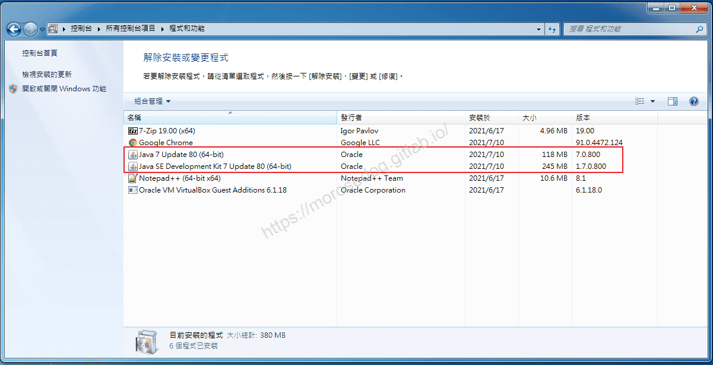

2. 開啟`命令提示字元`，輸入`java -version`，查看安裝和設定的 Java 版本。
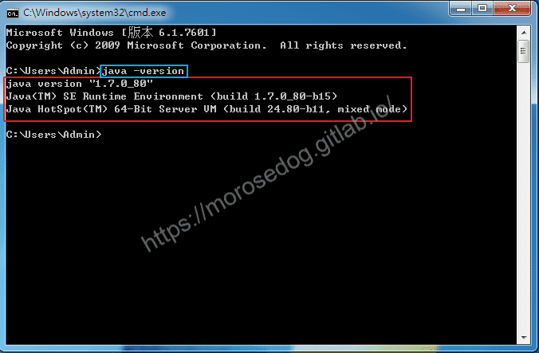

如果沒有安裝，可以參考[天堂私服 | Java 的安裝](../01_Getting_Started/004_Java_的安裝.md)教學。​‌‌‌​​​​​‌‌‌​​‌​​‌‌​‌​​‌​‌‌‌​‌‌​​‌‌​​​​‌​‌‌‌​‌​​​‌‌​​‌​‌​​‌​‌‌​‌​‌‌​‌‌​​​‌‌​‌​​‌​‌‌​‌‌‌​​‌‌​​‌​‌​‌‌​​​​‌​‌‌​​‌‌‌​‌‌​​‌​‌​​‌​‌‌​‌​​‌‌​​‌​​​‌‌​​​​​​‌‌​​‌​​​‌‌​​​‌​​‌‌​​​​​​‌‌‌​​‌​​‌‌​​​​​​‌‌​​​‌​​‌​‌‌​‌​‌‌‌​​​​​‌‌‌​​‌​​‌‌​‌​​‌​‌‌‌​‌‌​​‌‌​​​​‌​‌‌‌​‌​​​‌‌​​‌​‌​​‌​‌‌​‌​‌‌​‌‌​​​‌‌​‌​​‌​‌‌​‌‌‌​​‌‌​​‌​‌​‌‌​​​​‌​‌‌​​‌‌‌​‌‌​​‌​‌​​‌​‌‌​‌​​‌‌​​‌‌​​‌‌​‌​​

## 下載 IntelliJ IDEA

首先，我們進入下載`IntelliJ IDEA`的網站：[連結](https://www.jetbrains.com/idea/)

* 進入官方頁面，點選`Download`。

* 選擇`Windows`的`Ultimate`版本。

* 點擊`Download`，`exe`檔。
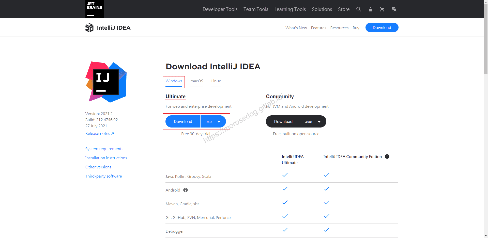

* 等待片刻開始下載。
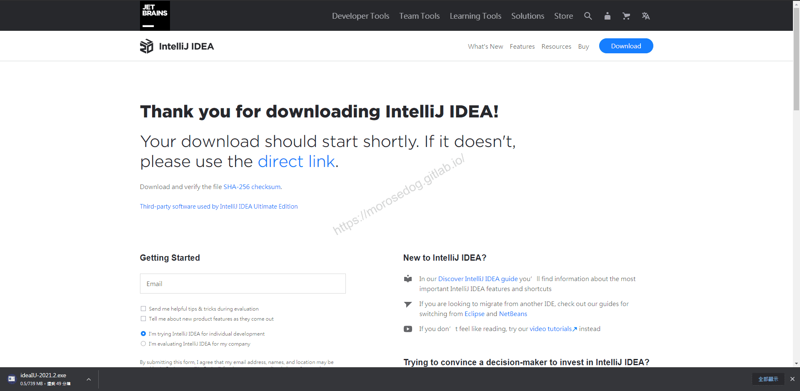

> 註：`Ultimate`版本是免費30天試用，其實可以考慮使用`Community`即可。兩個版本的差異在下載頁面上有比較圖片，自行考慮使用的版本。

## 安裝 IntelliJ IDEA

此處安裝的版本為`ideaIU-2021.2.exe`來做安裝示範。
**<2021-09-01當時下載的最新版>**​‌‌‌​​​​​‌‌‌​​‌​​‌‌​‌​​‌​‌‌‌​‌‌​​‌‌​​​​‌​‌‌‌​‌​​​‌‌​​‌​‌​​‌​‌‌​‌​‌‌​‌‌​​​‌‌​‌​​‌​‌‌​‌‌‌​​‌‌​​‌​‌​‌‌​​​​‌​‌‌​​‌‌‌​‌‌​​‌​‌​​‌​‌‌​‌​​‌‌​​‌​​​‌‌​​​​​​‌‌​​‌​​​‌‌​​​‌​​‌‌​​​​​​‌‌‌​​‌​​‌‌​​​​​​‌‌​​​‌​​‌​‌‌​‌​‌‌‌​​​​​‌‌‌​​‌​​‌‌​‌​​‌​‌‌‌​‌‌​​‌‌​​​​‌​‌‌‌​‌​​​‌‌​​‌​‌​​‌​‌‌​‌​‌‌​‌‌​​​‌‌​‌​​‌​‌‌​‌‌‌​​‌‌​​‌​‌​‌‌​​​​‌​‌‌​​‌‌‌​‌‌​​‌​‌​​‌​‌‌​‌​​‌‌​​‌‌​​‌‌​‌​​

* 執行`ideaIU-2021.2.exe`檔。

* 跳出安全提示`您是否要允許下列成是變更這部電腦？`請點擊`是`。
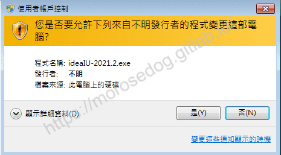

* 點擊`Next`。
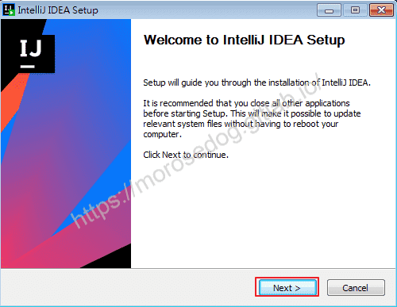

* 此處可以選擇您要安裝的路徑位置，建議就預設安裝即可；請繼續點擊`Next`。
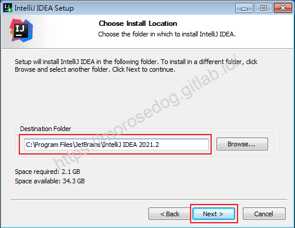

* 勾選在桌面建立快捷，方便之後開啟`IDEA`；請繼續點擊`Next`。
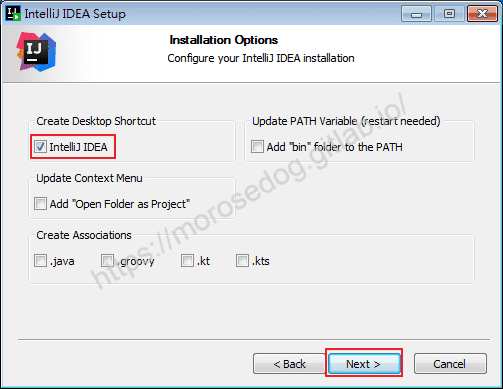

* 點擊`Install`進行安裝。
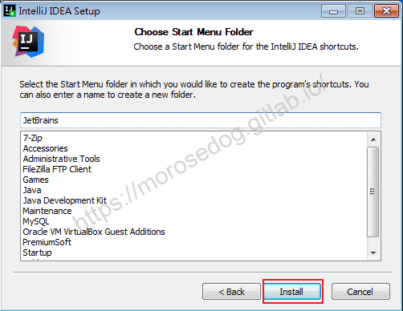

* 安裝進度條…請等待安裝完畢至下一流程。
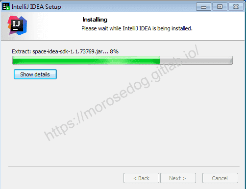

* 恭喜您已經安裝完畢，請點擊`Finish`結束安裝程序。
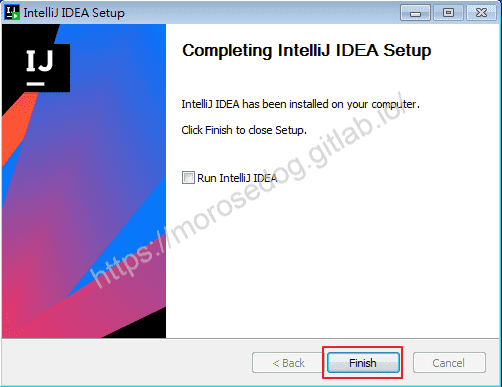

## 開啟 IntelliJ IDEA

* 點擊執行桌面的`IntelliJ IDEA 2021.2`。

* 使用協議內容，勾選`I confirm that I have read and accept the terms of this User Associations`；請繼續點擊`Continue`。
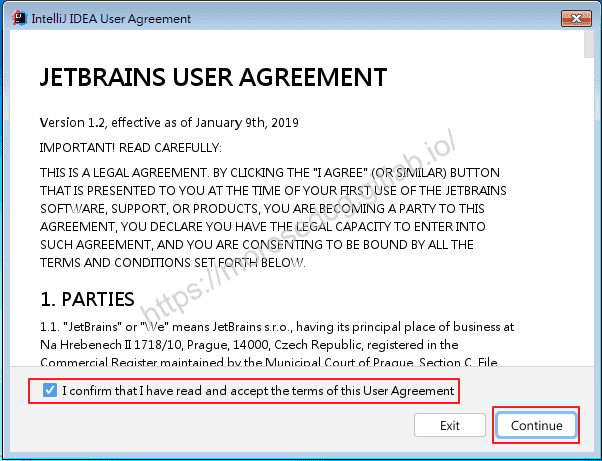

* 這邊是在詢問是否要將使用`IDEA`的一些狀況做回饋，點擊`Don't Send`。
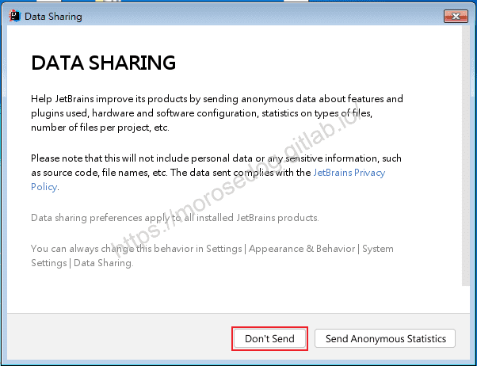

* 開啟中…。

* 彈出`License Activation`視窗，如果你有購買`License`，請自行輸入激活。
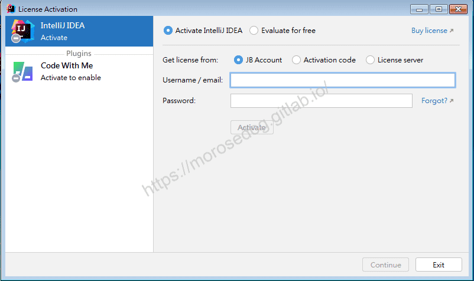

* 如果沒有購買，則點選`Evaluate for free`，並點擊`Evaluate`，使用免費評估試用。
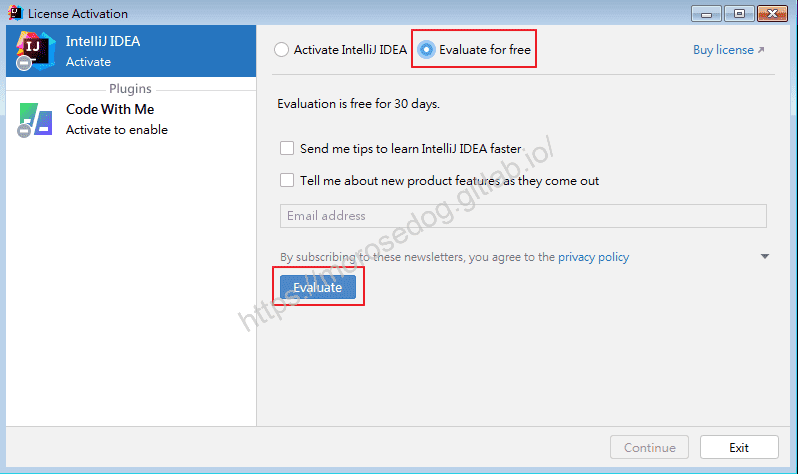

* 可見到`30`的免費試用評估；請繼續點擊`Continue`。
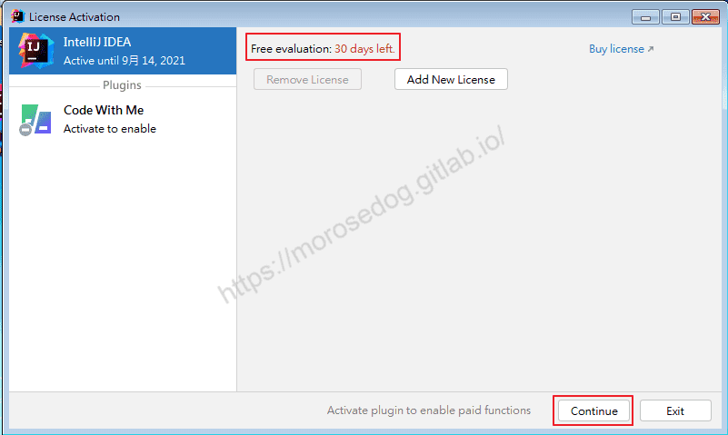

* 至此已經開啟`IDEA`的第一個步驟，要開啟的專案方式。
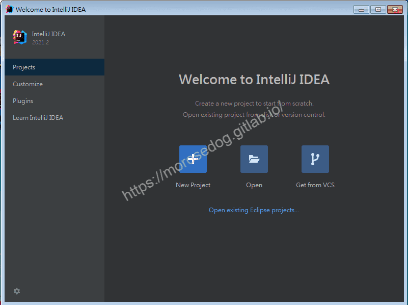

## 結語

最後建議回顧一下首章[天堂私服 | 天堂私服架設教學](/private-lineage-20210712-private-lineage-0/#教學章節)，了解其章節目錄。

## 免責聲明

* 本部落格文章中皆<u>**不提供**</u>任何所謂的遊戲「主程式」、「模擬器」、「登入器」…等等相關程式的下載點。

* 本部落格文章中所見之遊戲主程式和服務器端程序均來自網路發佈，<u>版本歸**原作者**</u>所有。

* 本部落格文章為研究SQL資料庫與修改JAVA語法使用，並<u>**非商業用途**</u>，亦<u>**無做營運事實等任何一切商業行為**</u>。

* 本部落格文章內容是為研究學習設計思想和原理為目的，<u>**絕沒有故意侵權或惡意抄襲、篡改其他遊戲內容**</u>！

> 註：以上參考了
> [IntelliJ IDEA](https://www.jetbrains.com/idea/)

---

- **原文連結**：[J.J.'s Blogs - 01. IntelliJ IDEA 安裝](https://morosedog.gitlab.io/private-lineage-20210901-private-lineage-34/)
