# 02. IntelliJ IDEA 簡單介紹

# 天堂私服 | IntelliJ IDEA 簡單介紹

    
    
      📑 目錄
      

1. [準備](#準備)
2. [啟動/建立專案 IntelliJ IDEA](#啟動-建立專案-IntelliJ-IDEA)
3. [視窗介紹](#視窗介紹)
4. [新增 IntelliJ IDEA 使用的 SDK](#新增-IntelliJ-IDEA-使用的-SDK)
5. [第一個簡單的 Java 程式](#第一個簡單的-Java-程式)
6. [額外介紹](#額外介紹)
7. [結語](#結語)
8. [免責聲明](#免責聲明)

    
    
    

## 準備

在開始前需要安裝完畢`IntelliJ IDEA`。
如果尚未安裝，可以參考此篇文章[IntelliJ IDEA 安裝](./034_01._IntelliJ_IDEA_安裝.md)。

## 啟動/建立專案 IntelliJ IDEA

* 過程中如出現`Evaluation Feedback`視窗，點擊`No Thanks`即可。
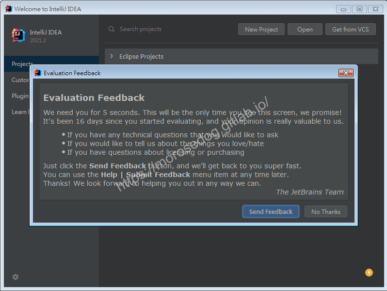

* 首先建立一個`IntelliJ-workspace`目錄。

> 註：這只是作者習慣區分專案放置的位置，名稱和路徑都可自行調整；亦可不建立此目錄。
> 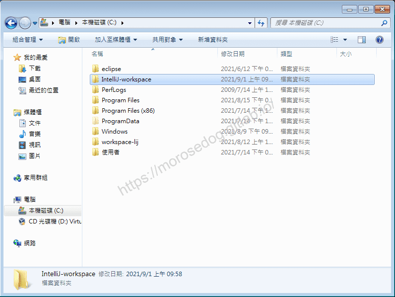

* `IntelliJ IDEA`執行後，會彈出一個`Welcome to Intellij IDEA`視窗。

* 可見左方有功能清單：

  * Project (新增專案或是開啟已存在的專案)

> 註：`IDEA`可以開啟已經存在的`Eclipse`專案。​‌‌‌​​​​​‌‌‌​​‌​​‌‌​‌​​‌​‌‌‌​‌‌​​‌‌​​​​‌​‌‌‌​‌​​​‌‌​​‌​‌​​‌​‌‌​‌​‌‌​‌‌​​​‌‌​‌​​‌​‌‌​‌‌‌​​‌‌​​‌​‌​‌‌​​​​‌​‌‌​​‌‌‌​‌‌​​‌​‌​​‌​‌‌​‌​​‌‌​​‌​​​‌‌​​​​​​‌‌​​‌​​​‌‌​​​‌​​‌‌​​​​​​‌‌‌​​‌​​‌‌​​​​​​‌‌​​‌​​​‌​‌‌​‌​‌‌‌​​​​​‌‌‌​​‌​​‌‌​‌​​‌​‌‌‌​‌‌​​‌‌​​​​‌​‌‌‌​‌​​​‌‌​​‌​‌​​‌​‌‌​‌​‌‌​‌‌​​​‌‌​‌​​‌​‌‌​‌‌‌​​‌‌​​‌​‌​‌‌​​​​‌​‌‌​​‌‌‌​‌‌​​‌​‌​​‌​‌‌​‌​​‌‌​​‌‌​​‌‌​‌​‌

  * Customize (設定主題、字體大小、快捷鍵基準)

  * Plugins (選擇安裝插件)

  * Lean Intellij IDEA (IDEA 的使用教學)

* 選擇`Project`功能。

* 點擊`New Project`。
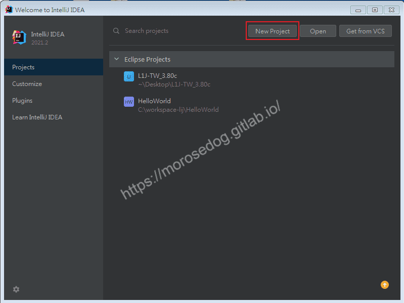

* 彈出`New Project`視窗。

* 選擇`Java`。

* 設定`Project SDK`版本為`1.7`。

* 點擊`Next`。
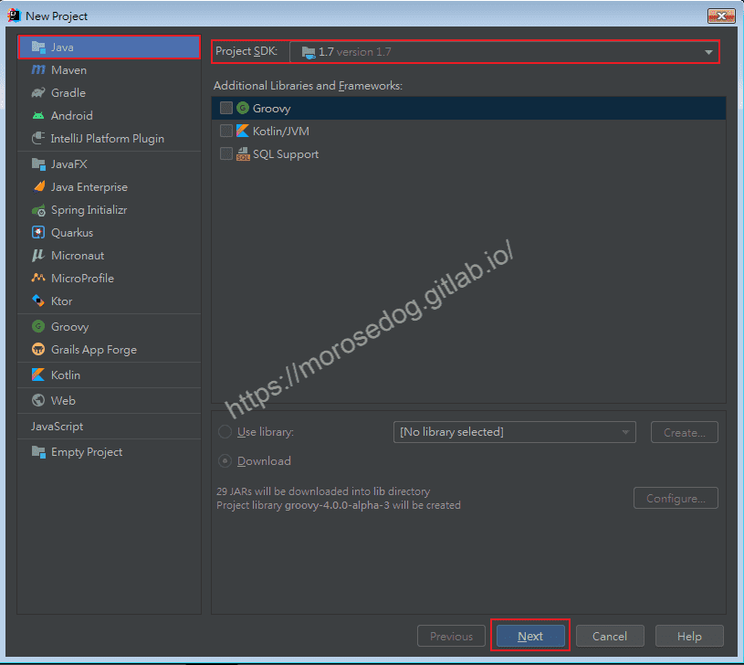

* 點擊`Next`。
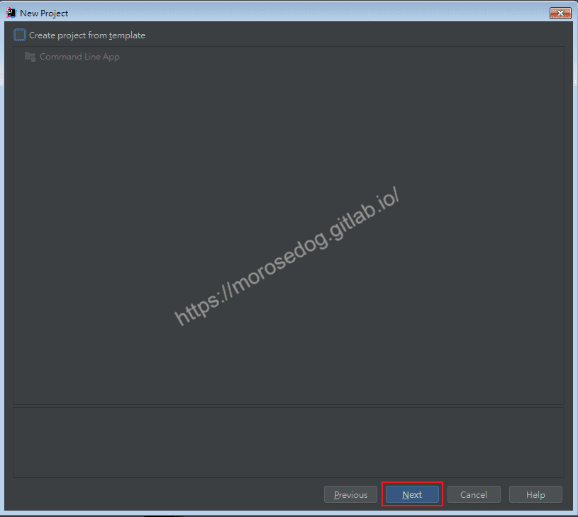

* 設定`Project name`為`HelloWorld`

* 設定`Project location`為一開始建立的`IntelliJ-workspace`目錄下。

* 點擊`Finish`。
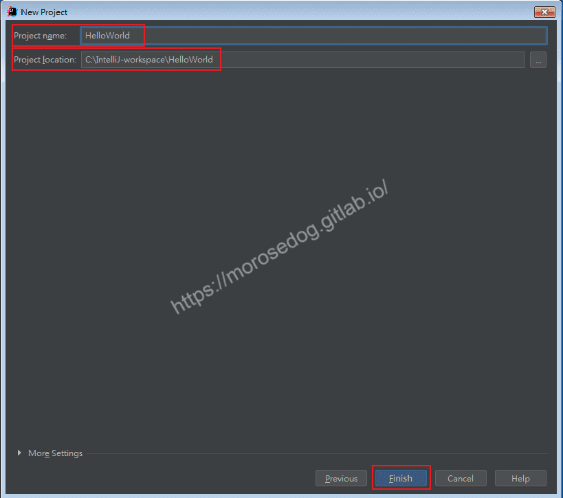

* 彈出警示`Directory Does Not Exist`目錄不存在是否要建立。

* 點擊`Create`。
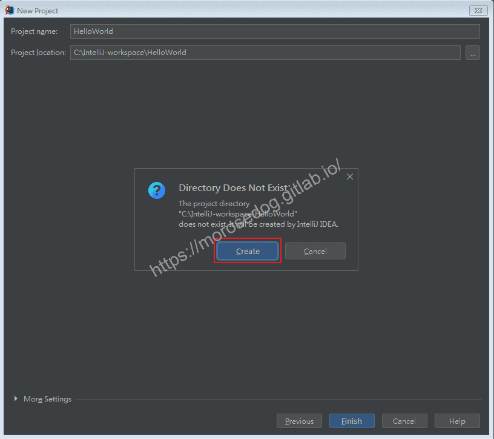

* 片刻後啟動`IntelliJ IDEA`主要工作視窗。

* 每日提示`Tip of the Day`視窗點擊`Close`關閉；如果你不希望每次都彈出這視窗可以勾選`Don't show tips`。
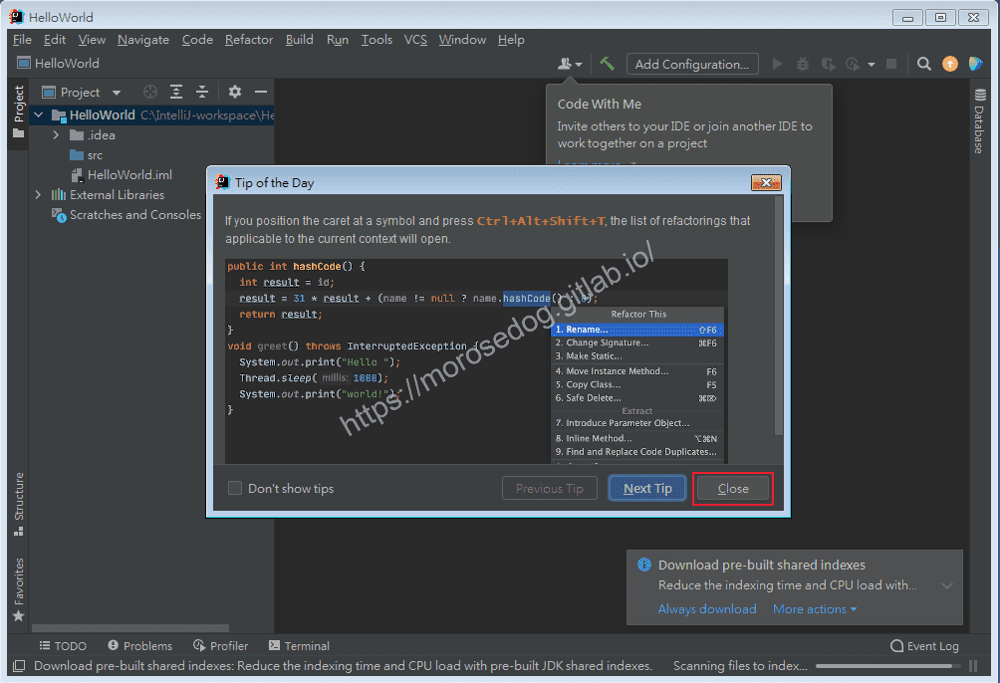

* `Code with Me`提示說可以邀請其他人或是其他`IDEA`使用者，共同編輯此專案；點擊`Got It`了解。

> 註：這是新的功能，作者本身也沒使用過，如果有興趣可以自行搜尋相關資料。
> 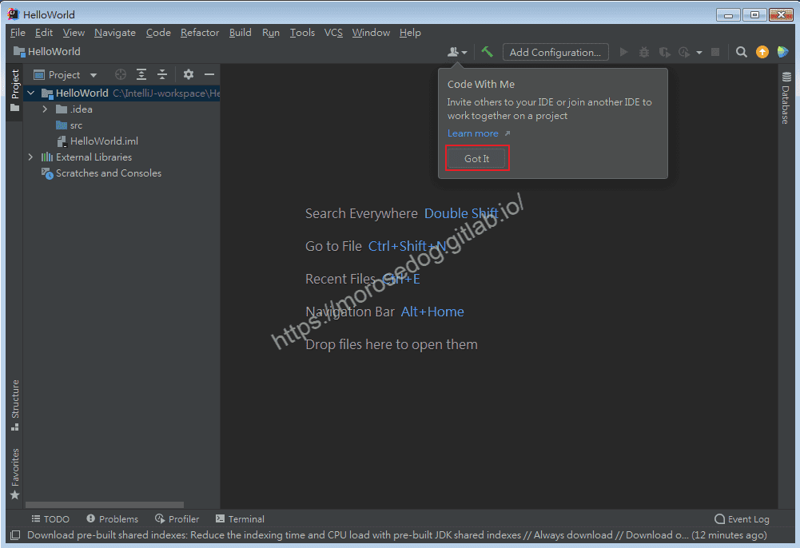

* 以下就是最終開啟後的工作視窗。
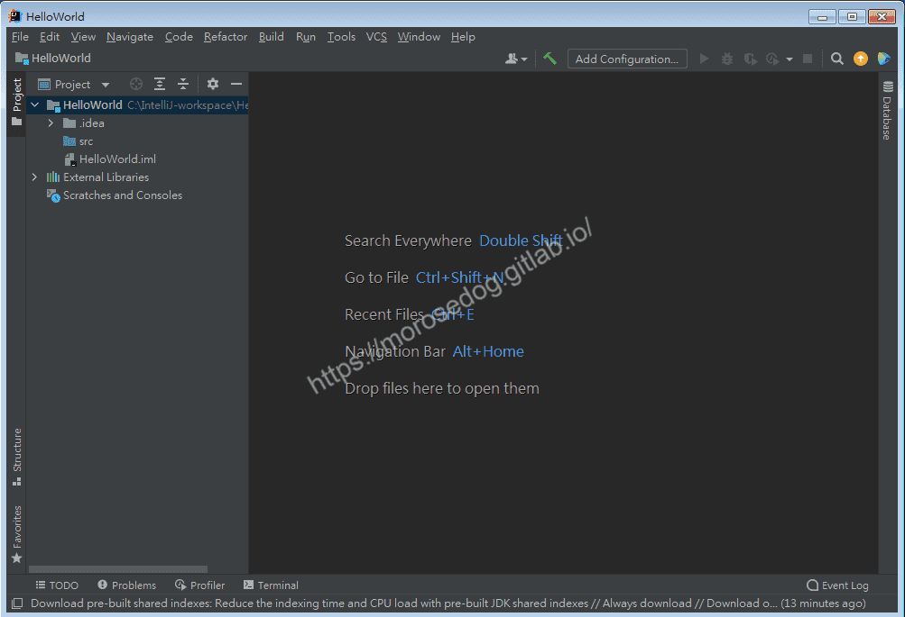

## 視窗介紹

這邊只是大概介紹一些視窗，可能不是這麼正確，建議可以看官方的教學。[Overview of the user interface](https://www.jetbrains.com/help/idea/guided-tour-around-the-user-interface.html)

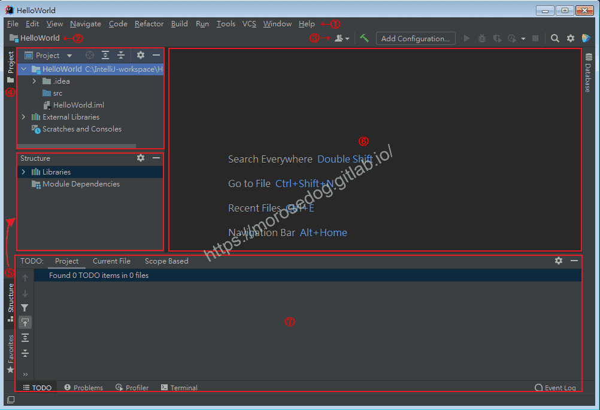​‌‌‌​​​​​‌‌‌​​‌​​‌‌​‌​​‌​‌‌‌​‌‌​​‌‌​​​​‌​‌‌‌​‌​​​‌‌​​‌​‌​​‌​‌‌​‌​‌‌​‌‌​​​‌‌​‌​​‌​‌‌​‌‌‌​​‌‌​​‌​‌​‌‌​​​​‌​‌‌​​‌‌‌​‌‌​​‌​‌​​‌​‌‌​‌​​‌‌​​‌​​​‌‌​​​​​​‌‌​​‌​​​‌‌​​​‌​​‌‌​​​​​​‌‌‌​​‌​​‌‌​​​​​​‌‌​​‌​​​‌​‌‌​‌​‌‌‌​​​​​‌‌‌​​‌​​‌‌​‌​​‌​‌‌‌​‌‌​​‌‌​​​​‌​‌‌‌​‌​​​‌‌​​‌​‌​​‌​‌‌​‌​‌‌​‌‌​​​‌‌​‌​​‌​‌‌​‌‌‌​​‌‌​​‌​‌​‌‌​​​​‌​‌‌​​‌‌‌​‌‌​​‌​‌​​‌​‌‌​‌​​‌‌​​‌‌​​‌‌​‌​‌

* 1. 功能列。

* 1. 工具列。

* 1. 導覽列。

* 1. 專案瀏覽器。

* 1. 結構瀏覽器。

* 1. 程式撰寫編輯區。

* 1. 其他。

  * TODO、Problems、Profiler、Terminal..等等。

## 新增 IntelliJ IDEA 使用的 SDK

示範新增`1.8`版本的`SDK`。

* 點擊`View`→`Open Module Settings`。
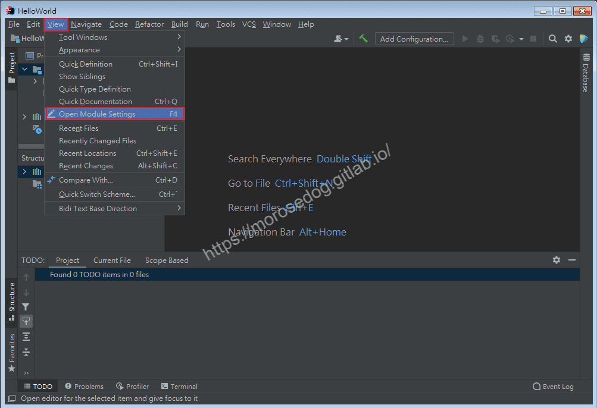

* 開啟`Project Structure`視窗。

> 註：該視窗就是專案的相關設定，比如專案使用的SDK、相依的第三方Lib..等等。
> 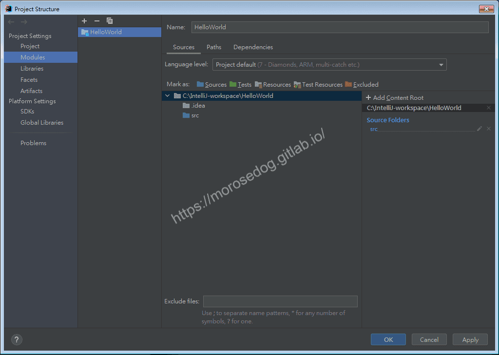

* 點選`SDK`。

* 可見目前已經有`1.7`的版本。
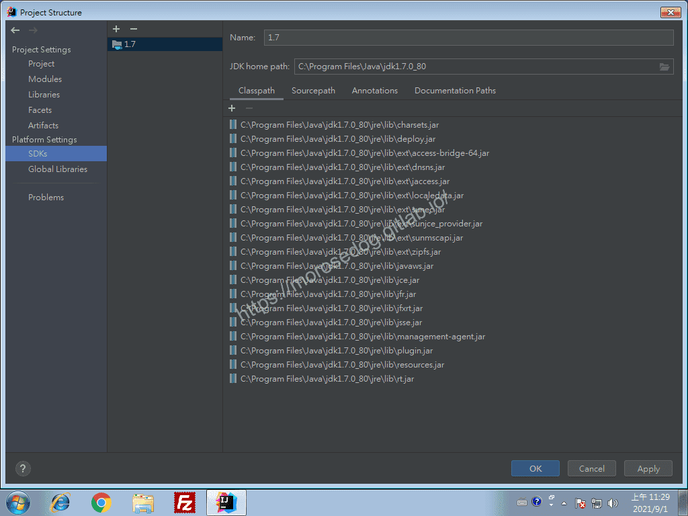

* 點擊「+」符號，選擇`Add JDK...`
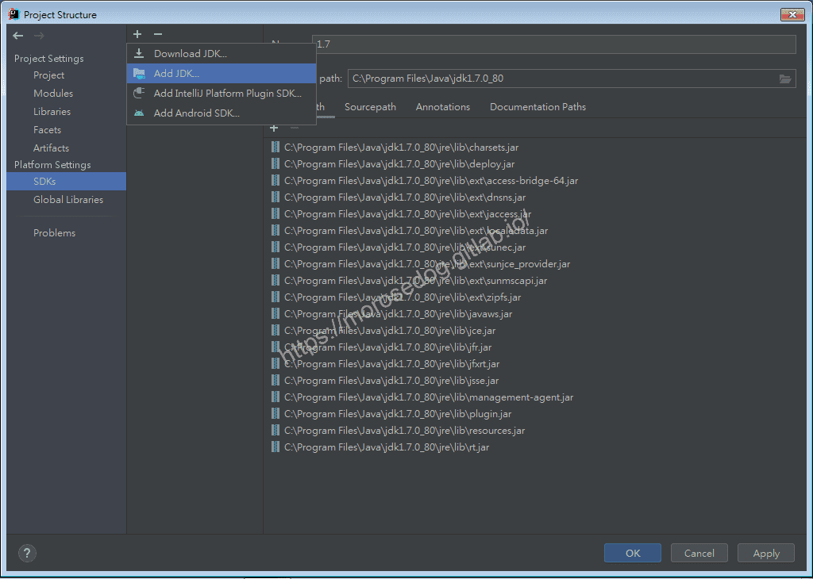

* 瀏覽`JDK 1.8`安裝位置，並點擊`OK`。
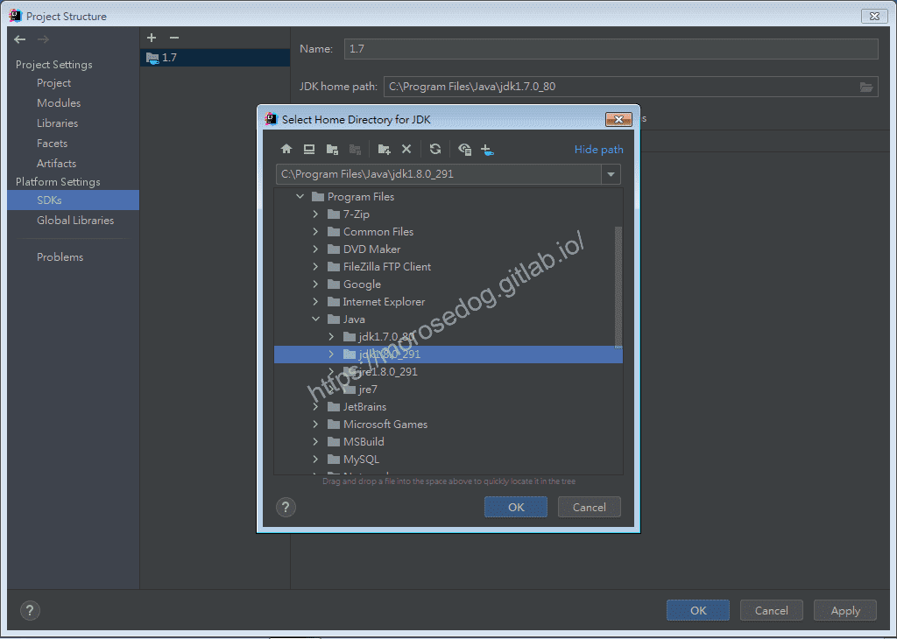

* 可見`1.8`版本已經加入。
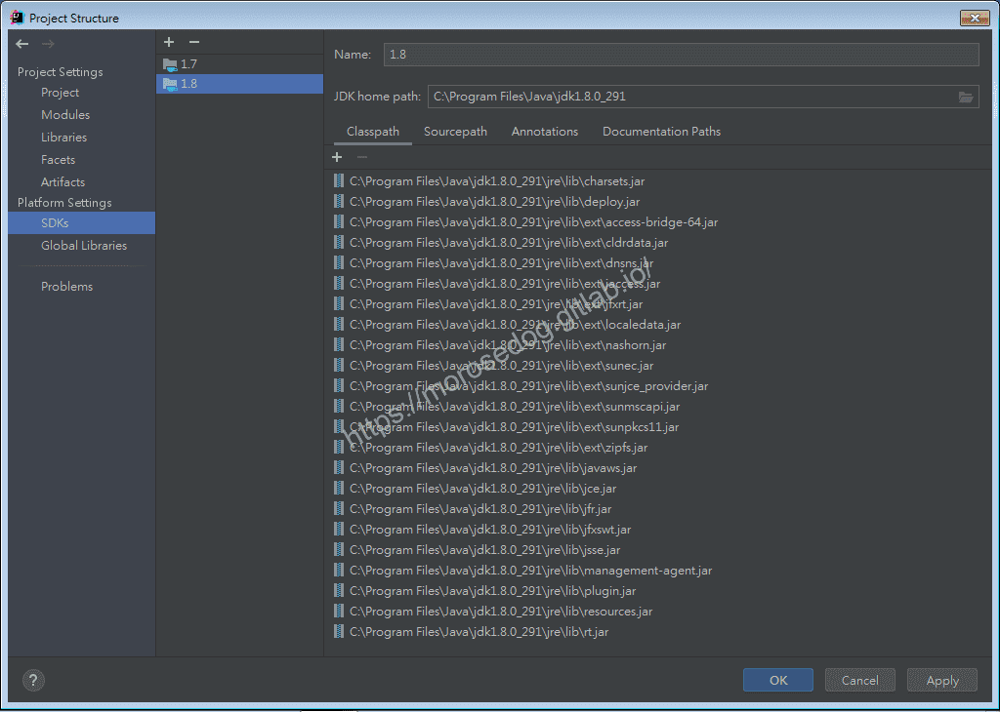

> 註：這邊需要使用的其實是`1.7`版本，`1.8`只是為了做示範。​‌‌‌​​​​​‌‌‌​​‌​​‌‌​‌​​‌​‌‌‌​‌‌​​‌‌​​​​‌​‌‌‌​‌​​​‌‌​​‌​‌​​‌​‌‌​‌​‌‌​‌‌​​​‌‌​‌​​‌​‌‌​‌‌‌​​‌‌​​‌​‌​‌‌​​​​‌​‌‌​​‌‌‌​‌‌​​‌​‌​​‌​‌‌​‌​​‌‌​​‌​​​‌‌​​​​​​‌‌​​‌​​​‌‌​​​‌​​‌‌​​​​​​‌‌‌​​‌​​‌‌​​​​​​‌‌​​‌​​​‌​‌‌​‌​‌‌‌​​​​​‌‌‌​​‌​​‌‌​‌​​‌​‌‌‌​‌‌​​‌‌​​​​‌​‌‌‌​‌​​​‌‌​​‌​‌​​‌​‌‌​‌​‌‌​‌‌​​​‌‌​‌​​‌​‌‌​‌‌‌​​‌‌​​‌​‌​‌‌​​​​‌​‌‌​​‌‌‌​‌‌​​‌​‌​​‌​‌‌​‌​​‌‌​​‌‌​​‌‌​‌​‌

* 設定專案所使用的`SDK`版本。

* 點擊`Modules`→選擇`HelloWorld`專案。

* 點擊`Dependencies`。

* `Modules SDK`選擇`1.7`。

* 點擊`Apply`→`OK`，完成設定。
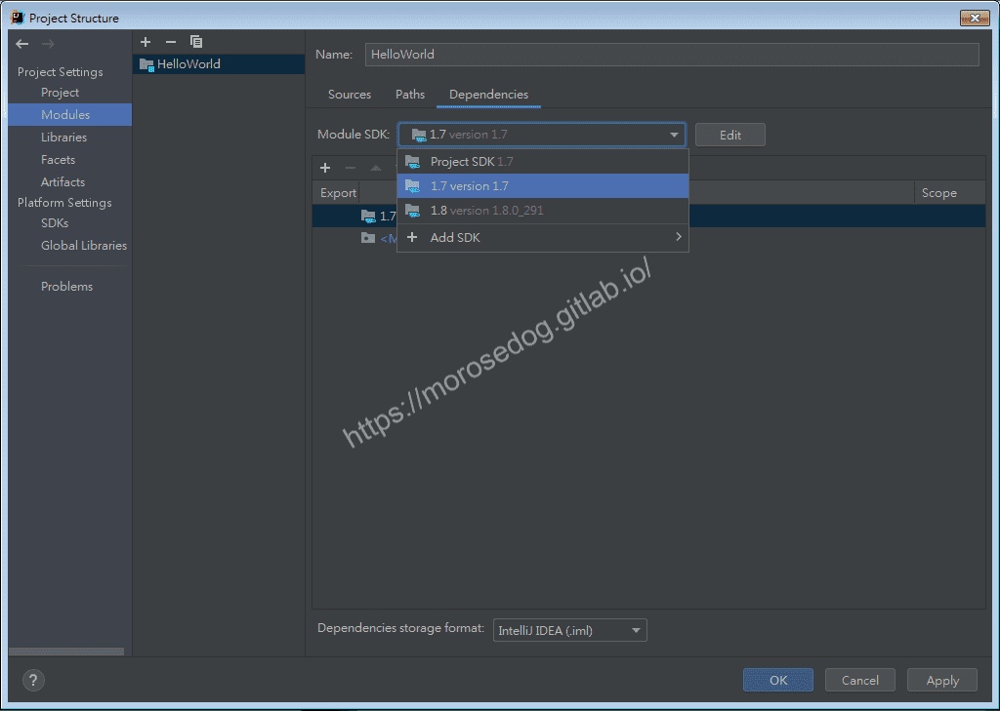

## 第一個簡單的 Java 程式

* 新增一個類別，如下圖所示滑鼠右鍵點選專案內的`src`，點選`New`，並點選`Java Class`類別。
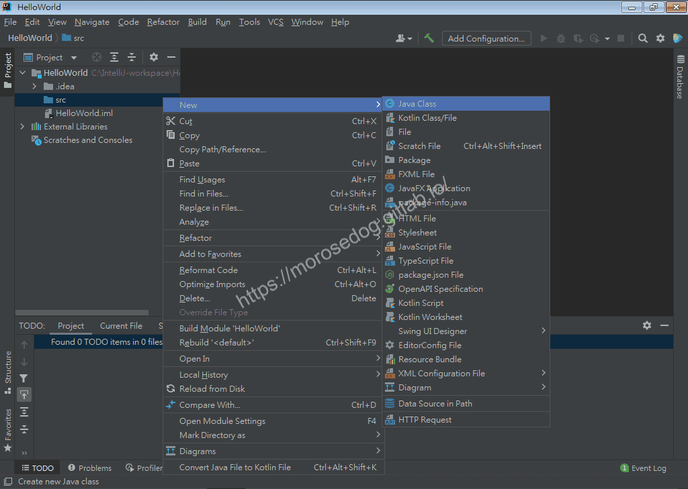

* 輸入包含`package`與`class name`的字串，並按下鍵盤的`Enter`。

```plain
com.morosedog.example.MyHelloWorld
```

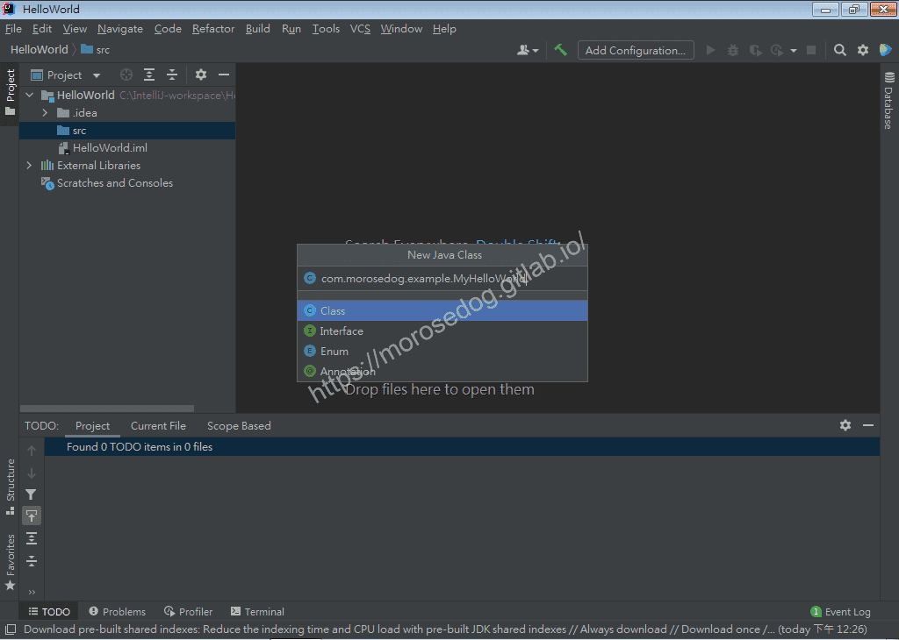

* 新增類別後可見下圖

  * 左邊產生了相對應的`package`目錄，並產生了名為`MyHelloWorld`檔。

  * 中間開啟了`MyHelloWorld`程式。
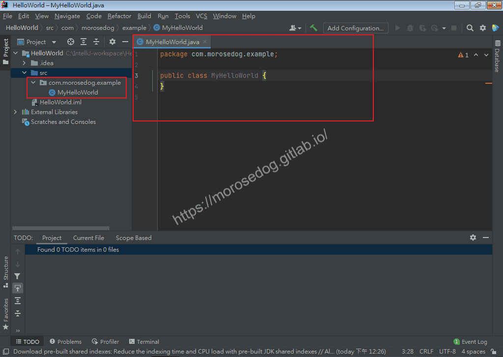

* `Hello World`程式很簡單只需要`print`輸出字串`Hello World!`。

* 新增`main()`方法，加入以下程式碼即可。

```java
public static void main(String[] args) {
    System.out.println("Hello World!");
}
```

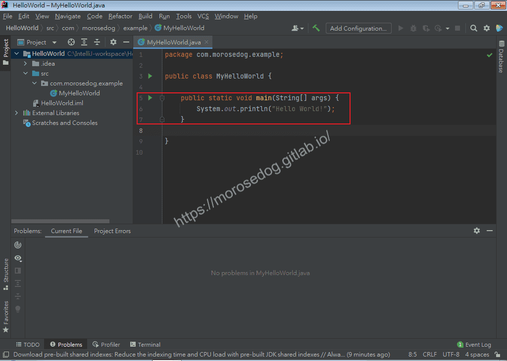

* 執行`Hello World`程式。

* 點選`Class`名稱旁的執行按鈕(綠色撥放鍵圖)，選擇`Run 'MyHelloWorld.main()'`。
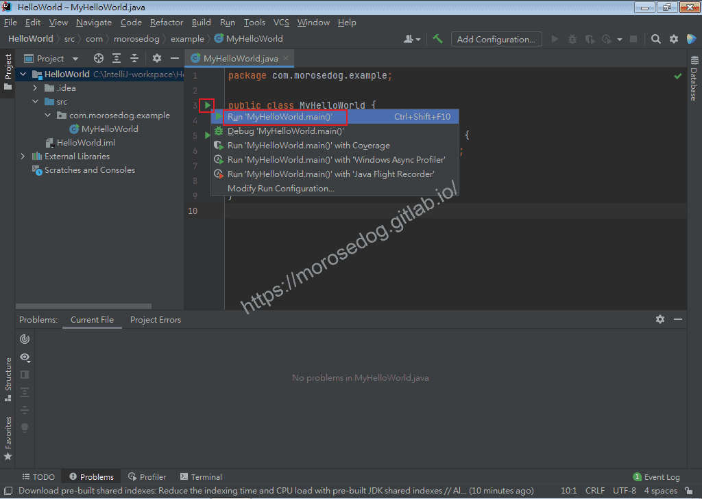

* 跳出`Windwos 安全性警訊`，點選`允許存取`。
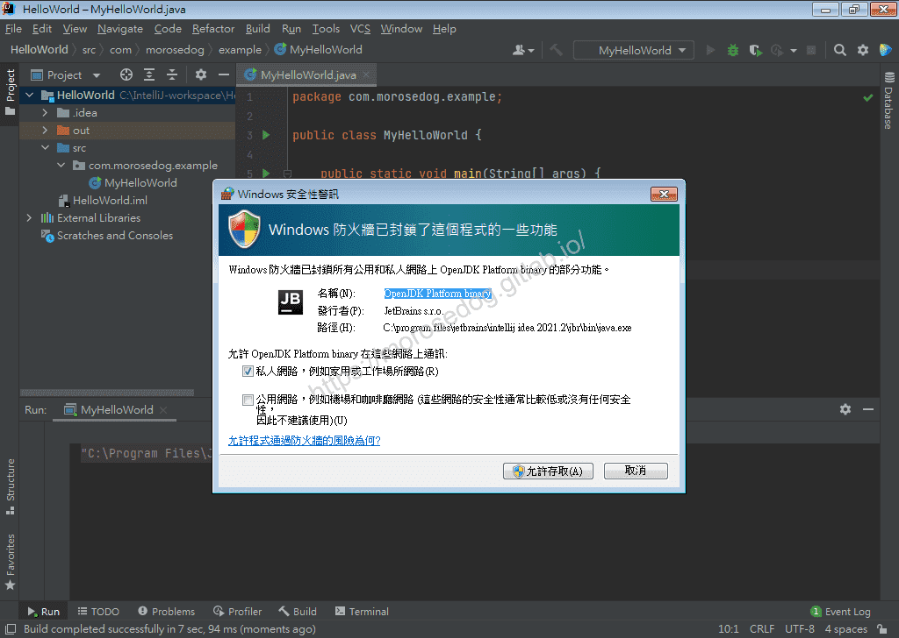

* 執行完畢後，可見下方`Run Console`視窗內，有印出`Hello World!`字串。

* 恭喜完成了第一個簡單的`Java`程式。
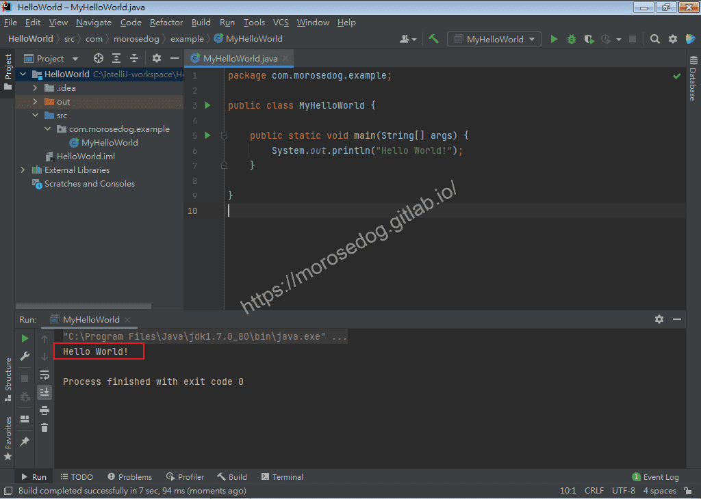

## 額外介紹

在撰寫此篇文章之前，已經有針對`IntelliJ IDEA`做了一些的文章介紹；
主要是因為那時候剛從`Eclipse`轉換使用`IntelliJ IDEA`遇到的一些問題。

所以才有這個類別的文章，有興趣也可以看看。

[J.J.’s Blogs | IntelliJ IDEA 介紹](https://morosedog.gitlab.io/categories/IntelliJ-IDEA/)​‌‌‌​​​​​‌‌‌​​‌​​‌‌​‌​​‌​‌‌‌​‌‌​​‌‌​​​​‌​‌‌‌​‌​​​‌‌​​‌​‌​​‌​‌‌​‌​‌‌​‌‌​​​‌‌​‌​​‌​‌‌​‌‌‌​​‌‌​​‌​‌​‌‌​​​​‌​‌‌​​‌‌‌​‌‌​​‌​‌​​‌​‌‌​‌​​‌‌​​‌​​​‌‌​​​​​​‌‌​​‌​​​‌‌​​​‌​​‌‌​​​​​​‌‌‌​​‌​​‌‌​​​​​​‌‌​​‌​​​‌​‌‌​‌​‌‌‌​​​​​‌‌‌​​‌​​‌‌​‌​​‌​‌‌‌​‌‌​​‌‌​​​​‌​‌‌‌​‌​​​‌‌​​‌​‌​​‌​‌‌​‌​‌‌​‌‌​​​‌‌​‌​​‌​‌‌​‌‌‌​​‌‌​​‌​‌​‌‌​​​​‌​‌‌​​‌‌‌​‌‌​​‌​‌​​‌​‌‌​‌​​‌‌​​‌‌​​‌‌​‌​‌

## 結語

最後建議回顧一下首章[天堂私服 | 天堂私服架設教學](/private-lineage-20210712-private-lineage-0/#教學章節)，了解其章節目錄。

## 免責聲明

* 本部落格文章中皆<font color="red"><u>**不提供**</u></font>任何所謂的遊戲「主程式」、「模擬器」、「登入器」…等等相關程式的下載點。

* 本部落格文章中所見之遊戲主程式和服務器端程序均來自網路發佈，<font color="red"><u>版本歸**原作者**</u>所有</font>。

* 本部落格文章為研究SQL資料庫與修改JAVA語法使用，<font color="red">並<u>**非商業用途**</u>，亦<u>**無做營運事實等任何一切商業行為**</u>。</font>

* 本部落格文章內容是為研究學習設計思想和原理為目的，<font color="red"><u>**絕沒有故意侵權或惡意抄襲、篡改其他遊戲內容**</u></font>！

> 註：以上參考了
> [IntelliJ IDEA](https://www.jetbrains.com/idea/)
> [Overview of the user interface](https://www.jetbrains.com/help/idea/guided-tour-around-the-user-interface.html)

---

- **原文連結**：[J.J.'s Blogs - 02. IntelliJ IDEA 簡單介紹](https://morosedog.gitlab.io/private-lineage-20210902-private-lineage-35/)
