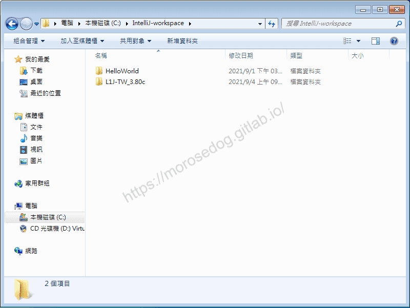
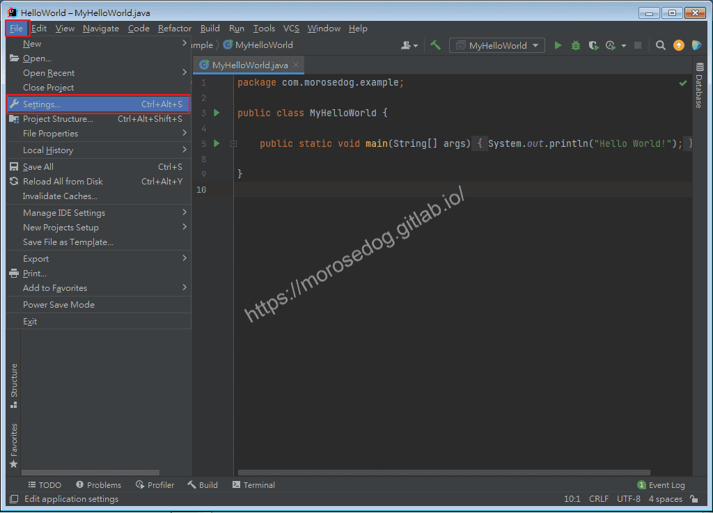
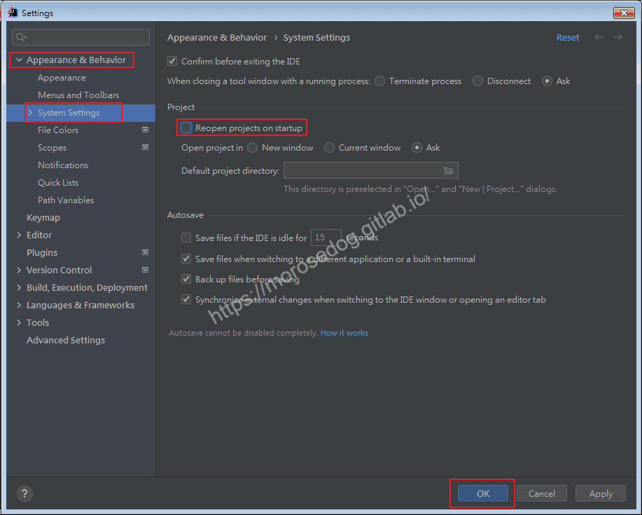
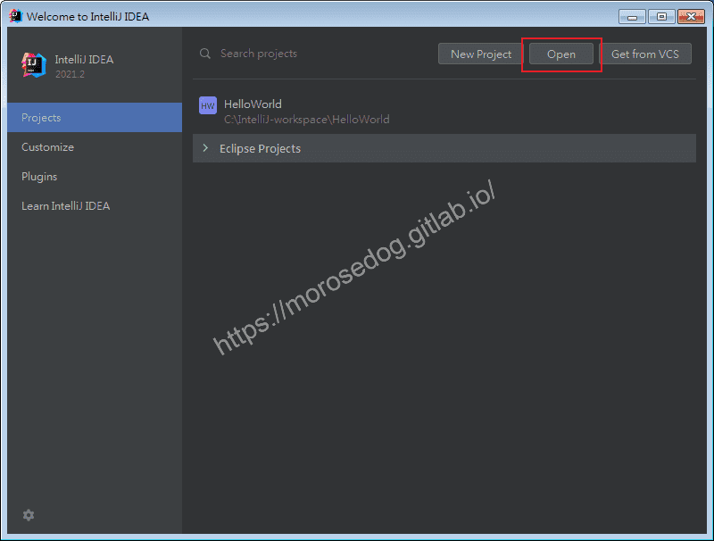
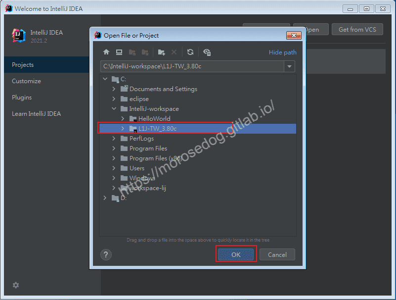
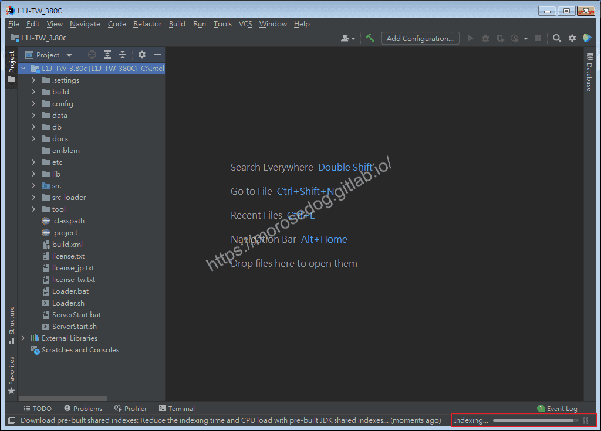

# 04. IntelliJ IDEA 匯入天堂私服原始碼

# 天堂私服 | IntelliJ IDEA 匯入天堂私服原始碼

    
    
      📑 目錄
      

1. [環境說明](#環境說明)
2. [準備](#準備)
3. [專案放置](#專案放置)
4. [雙 IDE 開發](#雙-IDE-開發)
5. [關閉預設開啟上次專案設定](#關閉預設開啟上次專案設定)
6. [匯入天堂私服原始碼](#匯入天堂私服原始碼)
7. [結語](#結語)
8. [免責聲明](#免責聲明)

    
    
    

## 環境說明

此處使用`Oracle VM VirtualBox`虛擬機軟體，下載安裝了一個純淨的`Windows 7 x64 旗艦版`。

如果需要安裝虛擬機，可以參考此篇文章[VirtualBox Windows 7 安裝](../01_Getting_Started/003_VirtualBox_Windows_7_安裝.md)。

## 準備

2. 在開始前需要準備「天堂模擬器」。
此處所使用的是「[L1J-3.80c](/images/private-lineage/download_not_available.png)」由`日本開發團隊`研發的版本做示範。

  * 無法提供下載點，請根據關鍵字自行上網搜尋。

3. 在開始前需要安裝完畢`IntelliJ IDEA`。
如果尚未安裝，可以參考此篇文章[IntelliJ IDEA 安裝](./034_01._IntelliJ_IDEA_安裝.md)。​‌‌‌​​​​​‌‌‌​​‌​​‌‌​‌​​‌​‌‌‌​‌‌​​‌‌​​​​‌​‌‌‌​‌​​​‌‌​​‌​‌​​‌​‌‌​‌​‌‌​‌‌​​​‌‌​‌​​‌​‌‌​‌‌‌​​‌‌​​‌​‌​‌‌​​​​‌​‌‌​​‌‌‌​‌‌​​‌​‌​​‌​‌‌​‌​​‌‌​​‌​​​‌‌​​​​​​‌‌​​‌​​​‌‌​​​‌​​‌‌​​​​​​‌‌‌​​‌​​‌‌​​​​​​‌‌​‌​​​​‌​‌‌​‌​‌‌‌​​​​​‌‌‌​​‌​​‌‌​‌​​‌​‌‌‌​‌‌​​‌‌​​​​‌​‌‌‌​‌​​​‌‌​​‌​‌​​‌​‌‌​‌​‌‌​‌‌​​​‌‌​‌​​‌​‌‌​‌‌‌​​‌‌​​‌​‌​‌‌​​​​‌​‌‌​​‌‌‌​‌‌​​‌​‌​​‌​‌‌​‌​​‌‌​​‌‌​​‌‌​‌‌‌

## 專案放置

作者喜歡把`IntelliJ IDEA`和`Eclipse`都各別有`workspace`去做區分歸類。
所以在[IntelliJ IDEA 簡單介紹](./035_02._IntelliJ_IDEA_簡單介紹.md)篇有提到：

```plain
首先建立一個IntelliJ-workspace目錄。
註：這只是作者習慣區分專案放置的位置，名稱和路徑都可自行調整；亦可不建立此目錄。
```

這邊就是將`L1J-3.80c`複製放到`IntelliJ-workspace`目錄下。


## 雙 IDE 開發

使用`Eclipse`與`IntelliJ IDEA`雙`IDE`開發同一個`Project`是可行的。​‌‌‌​​​​​‌‌‌​​‌​​‌‌​‌​​‌​‌‌‌​‌‌​​‌‌​​​​‌​‌‌‌​‌​​​‌‌​​‌​‌​​‌​‌‌​‌​‌‌​‌‌​​​‌‌​‌​​‌​‌‌​‌‌‌​​‌‌​​‌​‌​‌‌​​​​‌​‌‌​​‌‌‌​‌‌​​‌​‌​​‌​‌‌​‌​​‌‌​​‌​​​‌‌​​​​​​‌‌​​‌​​​‌‌​​​‌​​‌‌​​​​​​‌‌‌​​‌​​‌‌​​​​​​‌‌​‌​​​​‌​‌‌​‌​‌‌‌​​​​​‌‌‌​​‌​​‌‌​‌​​‌​‌‌‌​‌‌​​‌‌​​​​‌​‌‌‌​‌​​​‌‌​​‌​‌​​‌​‌‌​‌​‌‌​‌‌​​​‌‌​‌​​‌​‌‌​‌‌‌​​‌‌​​‌​‌​‌‌​​​​‌​‌‌​​‌‌‌​‌‌​​‌​‌​​‌​‌‌​‌​​‌‌​​‌‌​​‌‌​‌‌‌

## 關閉預設開啟上次專案設定

每次開啟`IDEA`會自動開啟上次所開的專案，這樣會沒辦法再開啟後自己選擇想要編輯的專案，作者是覺得不方便。

* 開啟`IntelliJ IDEA`。

* 點擊`File`→`Settings...`。


* 展開`Appearance & Behavior`。

* 點擊`System Settings`。

* 見右邊`Reopen projects on startup`將其取消勾選。

* 點擊`OK`。


* 最後關閉`IntelliJ IDEA`，下次啟動就會彈出選擇專案的視窗。

## 匯入天堂私服原始碼

* 開啟`IntelliJ IDEA`。

* 點擊`Open`。


* 選擇`L1J-3.80c`專案位置，並點擊`OK`。


* 開啟專案畫面。

* 注意右下方，`IDEA`正在為此專案建立`Indexing...`

* 請稍待片刻讓其建立完成。


* 至此已經成功匯入天堂私服原始碼。

## 結語

匯入成功後，如何編譯？為什麼沒有警告？如果有該如何解決？
為了避免一個章節佔太多的內容，使其複雜化，將會在後續繼續慢慢教學。
最後建議回顧一下首章[天堂私服 | 天堂私服架設教學](/private-lineage-20210712-private-lineage-0/#教學章節)，了解其章節目錄。

## 免責聲明

* 本部落格文章中皆<font color="red"><u>**不提供**</u></font>任何所謂的遊戲「主程式」、「模擬器」、「登入器」…等等相關程式的下載點。

* 本部落格文章中所見之遊戲主程式和服務器端程序均來自網路發佈，<font color="red"><u>版本歸**原作者**</u>所有</font>。

* 本部落格文章為研究SQL資料庫與修改JAVA語法使用，<font color="red">並<u>**非商業用途**</u>，亦<u>**無做營運事實等任何一切商業行為**</u>。</font>

* 本部落格文章內容是為研究學習設計思想和原理為目的，<font color="red"><u>**絕沒有故意侵權或惡意抄襲、篡改其他遊戲內容**</u></font>！

> 註：以上參考了
> [IntelliJ IDEA](https://www.jetbrains.com/idea/)​‌‌‌​​​​​‌‌‌​​‌​​‌‌​‌​​‌​‌‌‌​‌‌​​‌‌​​​​‌​‌‌‌​‌​​​‌‌​​‌​‌​​‌​‌‌​‌​‌‌​‌‌​​​‌‌​‌​​‌​‌‌​‌‌‌​​‌‌​​‌​‌​‌‌​​​​‌​‌‌​​‌‌‌​‌‌​​‌​‌​​‌​‌‌​‌​​‌‌​​‌​​​‌‌​​​​​​‌‌​​‌​​​‌‌​​​‌​​‌‌​​​​​​‌‌‌​​‌​​‌‌​​​​​​‌‌​‌​​​​‌​‌‌​‌​‌‌‌​​​​​‌‌‌​​‌​​‌‌​‌​​‌​‌‌‌​‌‌​​‌‌​​​​‌​‌‌‌​‌​​​‌‌​​‌​‌​​‌​‌‌​‌​‌‌​‌‌​​​‌‌​‌​​‌​‌‌​‌‌‌​​‌‌​​‌​‌​‌‌​​​​‌​‌‌​​‌‌‌​‌‌​​‌​‌​​‌​‌‌​‌​​‌‌​​‌‌​​‌‌​‌‌‌

---

- **原文連結**：[J.J.'s Blogs - 04. IntelliJ IDEA 匯入天堂私服原始碼](https://morosedog.gitlab.io/private-lineage-20210904-private-lineage-37/)
