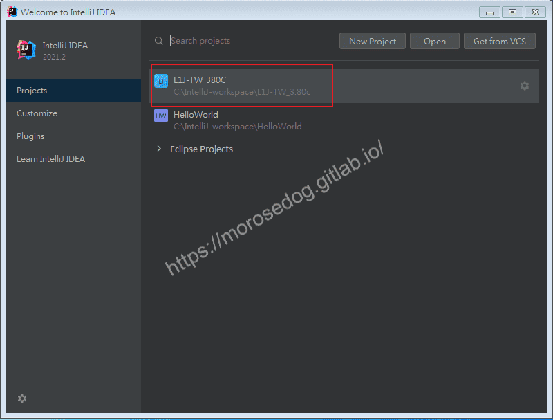
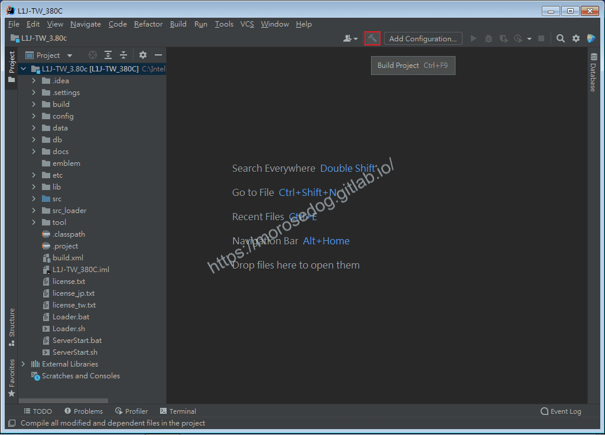
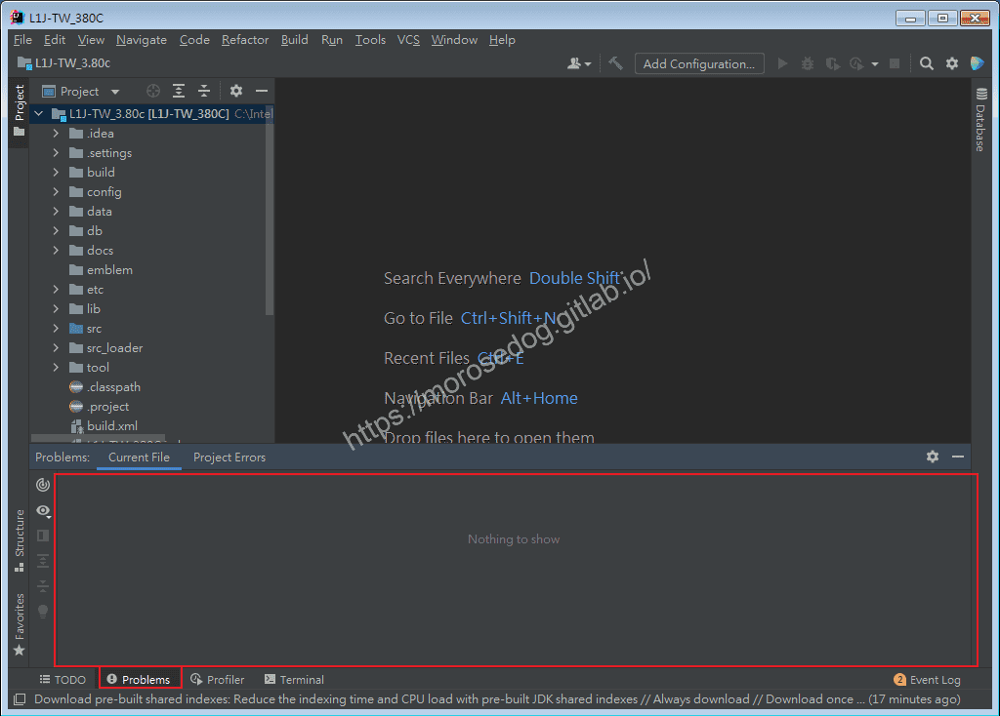
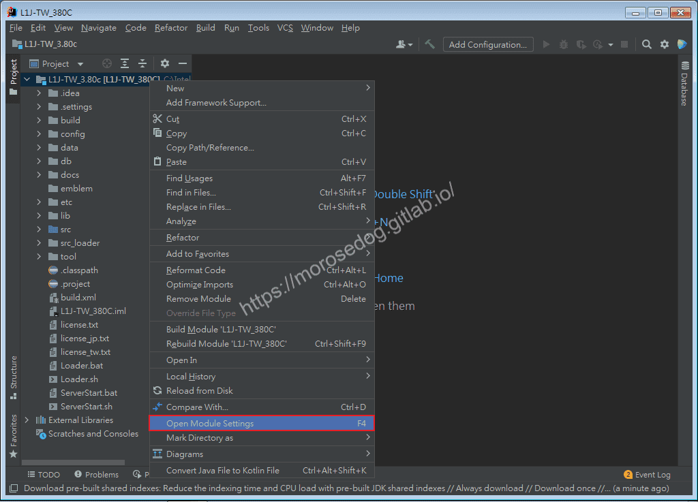
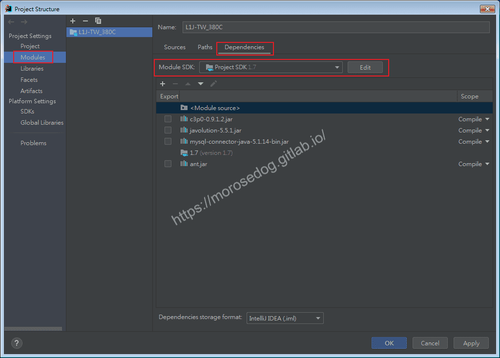
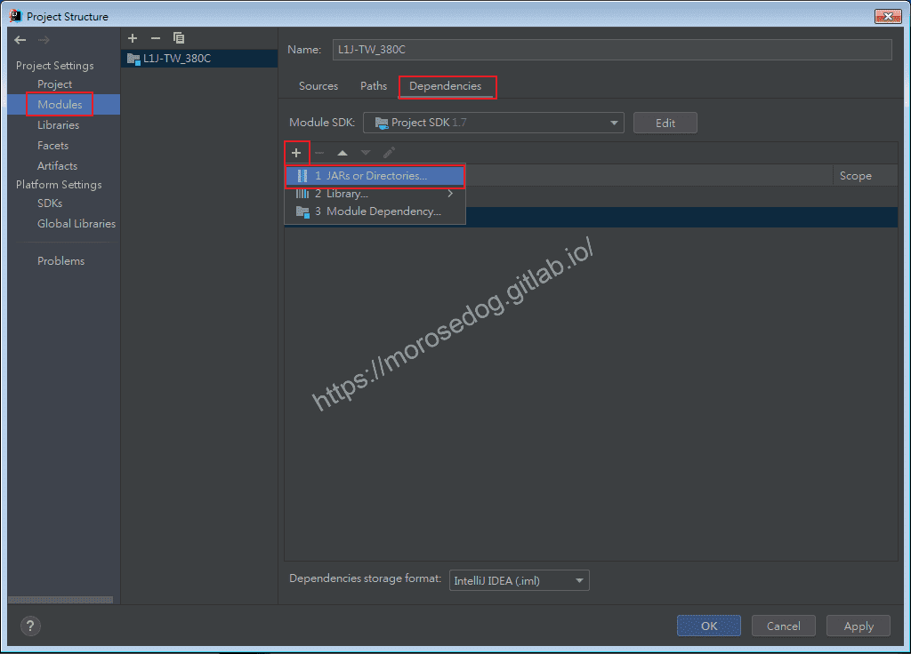
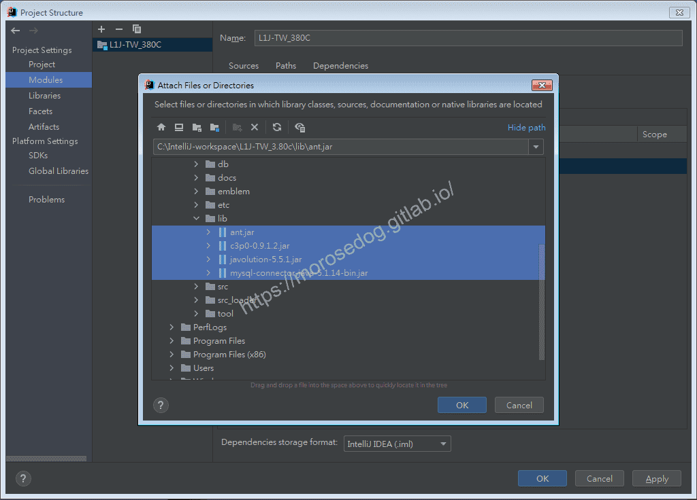

# 05. IntelliJ IDEA 原始碼編譯與錯誤排除

# 天堂私服 | IntelliJ IDEA 原始碼編譯與錯誤排除

    
    
      📑 目錄
      

1. [編譯 ( Compiler || Build )](#編譯-Compiler-Build)
2. [錯誤 ( Error )](#錯誤-Error)
3. [其他常見問題](#其他常見問題)
4. [結語](#結語)
5. [免責聲明](#免責聲明)

    
    
    

## 編譯 ( Compiler || Build )

* 開啟`IntelliJ IDEA`。

* 點擊`L1J-3.80c`專案`。

> 註：如果不知道該專案為何而來，可以參考[天堂私服 | IntelliJ IDEA 匯入天堂私服原始碼](./037_04._IntelliJ_IDEA_匯入天堂私服原始碼.md)。
> 

* 點擊`Build Project`，綠色鐵槌按鈕，且快捷鍵為`Ctrl + F9`。

* 可以注意到`IDE`右下角會出現`Build`(只會出現一下)，可以知道到底有沒有`Build`。

* 請記住這個快捷鍵，後面將會一直用到。

為何要`Build`？ 當你修改完程式儲存後，程式在還沒被編譯的時候，並不會知道是否有語法上或是程式上的錯誤；所以透過`IDE`的`Build`可以立刻知道並提示錯誤，有的還會提示該如何解決。

## 錯誤 ( Error )

在`Build`後，可能會發現`L1J-3.80c`專案紅色波浪底線，這表示程式中有錯誤。
下方的`Problems`也可能看到一堆的錯誤。​‌‌‌​​​​​‌‌‌​​‌​​‌‌​‌​​‌​‌‌‌​‌‌​​‌‌​​​​‌​‌‌‌​‌​​​‌‌​​‌​‌​​‌​‌‌​‌​‌‌​‌‌​​​‌‌​‌​​‌​‌‌​‌‌‌​​‌‌​​‌​‌​‌‌​​​​‌​‌‌​​‌‌‌​‌‌​​‌​‌​​‌​‌‌​‌​​‌‌​​‌​​​‌‌​​​​​​‌‌​​‌​​​‌‌​​​‌​​‌‌​​​​​​‌‌‌​​‌​​‌‌​​​​​​‌‌​‌​‌​​‌​‌‌​‌​‌‌‌​​​​​‌‌‌​​‌​​‌‌​‌​​‌​‌‌‌​‌‌​​‌‌​​​​‌​‌‌‌​‌​​​‌‌​​‌​‌​​‌​‌‌​‌​‌‌​‌‌​​​‌‌​‌​​‌​‌‌​‌‌‌​​‌‌​​‌​‌​‌‌​​​​‌​‌‌​​‌‌‌​‌‌​​‌​‌​​‌​‌‌​‌​​‌‌​​‌‌​​‌‌‌​​​

> 註：至於為何要特別強調`可能`，是因為你匯入的專案不一定都是這樣不順利有錯誤。
> 
> 註：這邊看圖，基本上`IntelliJ IDEA`匯入後，可以避免掉絕大多數的錯誤，他就是這麼聰明。

## 其他常見問題

在上方作者非常幸運將天堂私服模擬器原始碼匯入成功，且編譯完成也無錯誤。
但是有很多人的環境和問題都不一樣，我這邊僅能列出我知道的幾個可能問題和排除方式提供給大家。

* JDK 版本問題​‌‌‌​​​​​‌‌‌​​‌​​‌‌​‌​​‌​‌‌‌​‌‌​​‌‌​​​​‌​‌‌‌​‌​​​‌‌​​‌​‌​​‌​‌‌​‌​‌‌​‌‌​​​‌‌​‌​​‌​‌‌​‌‌‌​​‌‌​​‌​‌​‌‌​​​​‌​‌‌​​‌‌‌​‌‌​​‌​‌​​‌​‌‌​‌​​‌‌​​‌​​​‌‌​​​​​​‌‌​​‌​​​‌‌​​​‌​​‌‌​​​​​​‌‌‌​​‌​​‌‌​​​​​​‌‌​‌​‌​​‌​‌‌​‌​‌‌‌​​​​​‌‌‌​​‌​​‌‌​‌​​‌​‌‌‌​‌‌​​‌‌​​​​‌​‌‌‌​‌​​​‌‌​​‌​‌​​‌​‌‌​‌​‌‌​‌‌​​​‌‌​‌​​‌​‌‌​‌‌‌​​‌‌​​‌​‌​‌‌​​​​‌​‌‌​​‌‌‌​‌‌​​‌​‌​​‌​‌‌​‌​​‌‌​​‌‌​​‌‌‌​​​

  * 問題：使用的`JDK`版本過低或是過高。

  * 說明：對，太高的版本也會有問題，因為有些程式碼在`JDK 1.8`後將會有不支援或是程式碼不一樣的問題。

  * 解決：目前`L1J-3.80c`可以確定的是`JDK 1.7`是沒有問題的。其他版本所支援的版本需要在確認對應的版本。

    * 於`L1J-3.80c`專案上右鍵點擊，點選`Open Module Settings`。

    * 開啟了`Project Structure`視窗。

    * 點選`Modules`→`Dependencies`→`Module SDK`選擇`1.7`→`Apply and Close`。

* import 程式碼報錯，Libraries(Lib) 沒有匯入

  * 問題：部分程式碼在編譯後依舊錯誤情況，最好辨認的為`import`的程式碼報錯。

  * 說明：通常是因為沒有將相依的第三方套件指定給專案做使用。

  * 解決：將相依的`Libraries(Lib)`指定給專案做使用重新`Build`過即可。

    * 於`L1J-3.80c`專案上右鍵點擊，點選`Open Module Settings`。

    * 開啟了`Project Structure`視窗。

    * 點選`Modules`→`Dependencies`→點擊`+`按鈕，選擇`Jars or Dirctories…。

    * 開啟後通常在專案開發目錄下會有一個`lib`，裡面放置專案會使用的第三方套件。

    * 全選這些`.jar`檔，並點擊`OK`。

    * 最後`Apply and Close`，並且重新`Build`。

  * 額外說明：為什麼會有這些`lib`？

    * 舉例來說這個專案需要連線到資料庫，已經有寫好的連線程式，我們可以拿來做設定與使用。

## 結語

相信這篇應該已經解決多數新手問題，希望可以透過這篇讓新手們少採點坑，且多少吸收一點點點點的技術、知識、觀念。
這邊另外要知道注意的點就是`Build`，常常有新手在修正後忘記重新`Build`，就會覺得問題沒有被解決而到處尋求協助和解答。
最後建議回顧一下首章[天堂私服 | 天堂私服架設教學](/private-lineage-20210712-private-lineage-0/#教學章節)，了解其章節目錄。

## 免責聲明

* 本部落格文章中皆<u>**不提供**</u>任何所謂的遊戲「主程式」、「模擬器」、「登入器」…等等相關程式的下載點。

* 本部落格文章中所見之遊戲主程式和服務器端程序均來自網路發佈，<u>版本歸**原作者**</u>所有。

* 本部落格文章為研究SQL資料庫與修改JAVA語法使用，並<u>**非商業用途**</u>，亦<u>**無做營運事實等任何一切商業行為**</u>。

* 本部落格文章內容是為研究學習設計思想和原理為目的，<u>**絕沒有故意侵權或惡意抄襲、篡改其他遊戲內容**</u>！

---

- **原文連結**：[J.J.'s Blogs - 05. IntelliJ IDEA 原始碼編譯與錯誤排除](https://morosedog.gitlab.io/private-lineage-20210905-private-lineage-38/)
