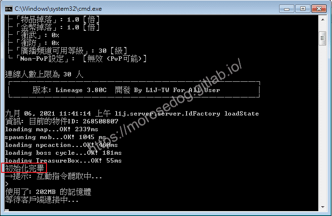
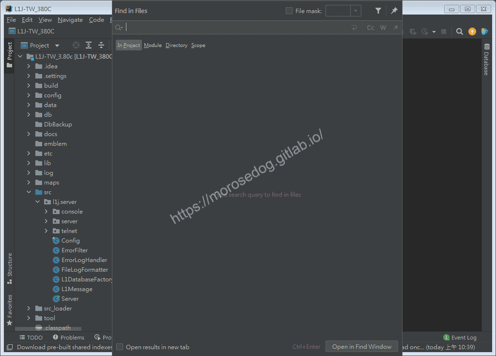
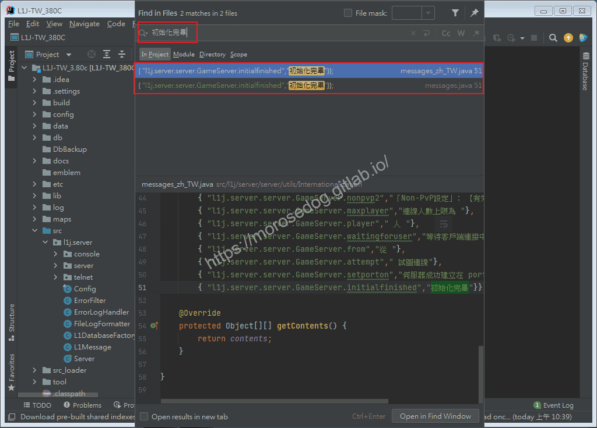
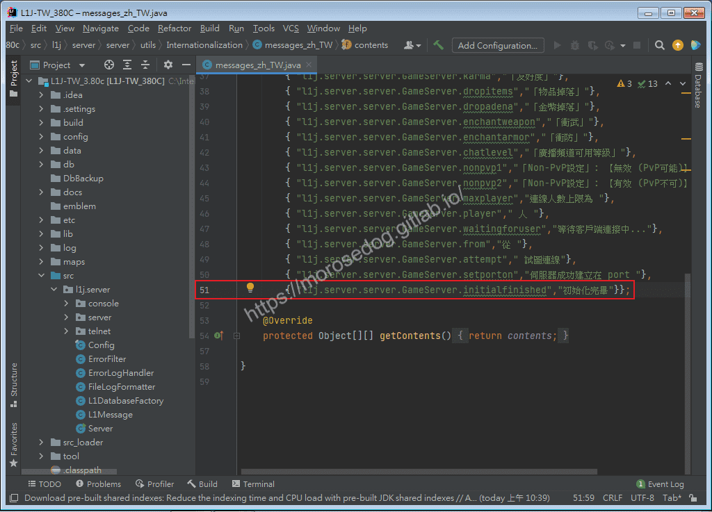
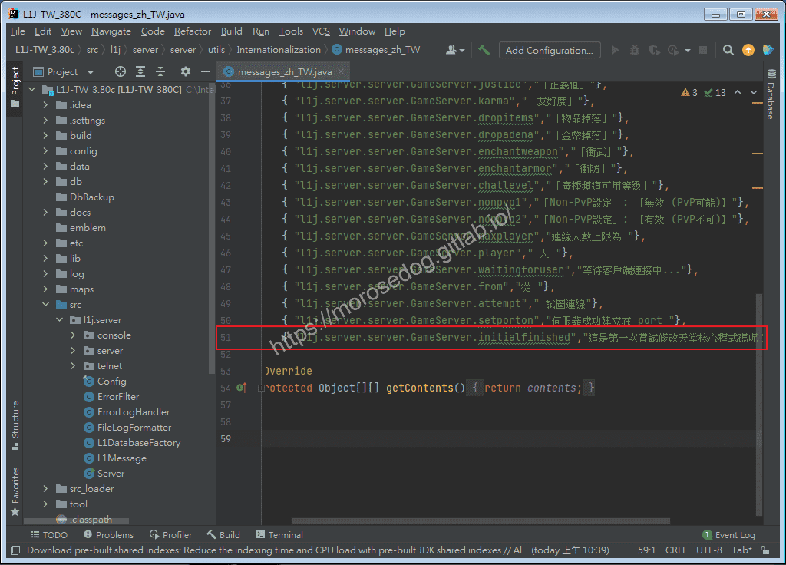
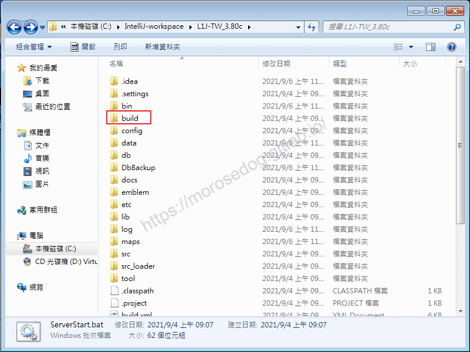
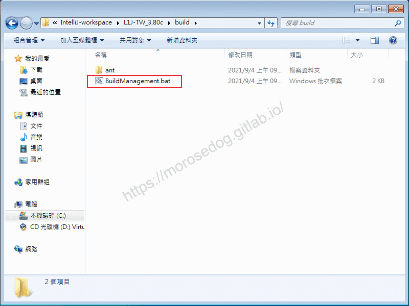
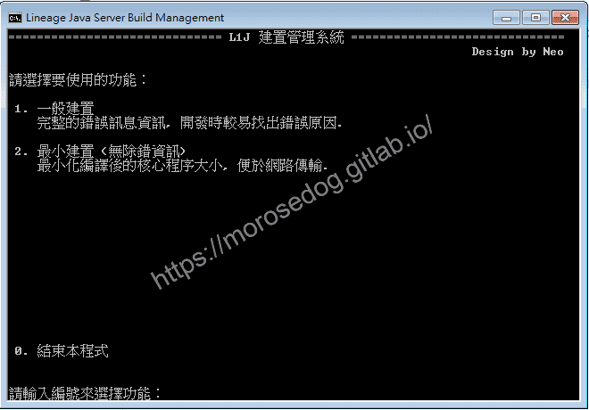
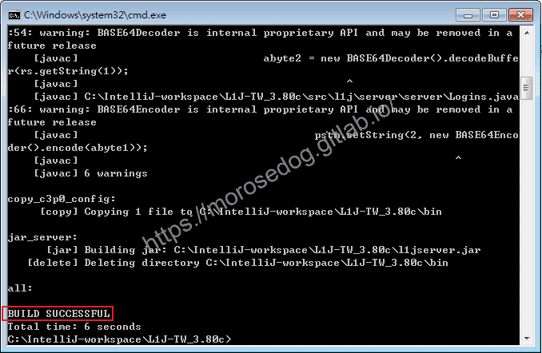
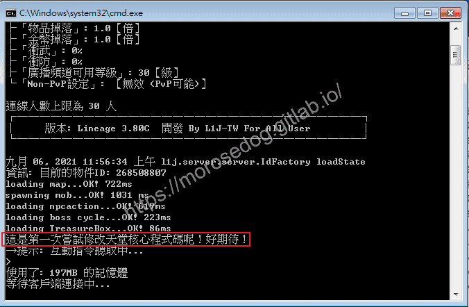

# 06. IntelliJ IDEA 編輯程式碼和編譯Jar並執行

# 天堂私服 | IntelliJ IDEA 編輯程式碼和編譯Jar並執行

    
    
      📑 目錄
      

1. [目標](#目標)
2. [搜尋](#搜尋)
3. [編譯Jar並執行](#編譯Jar並執行)
4. [疑問解答](#疑問解答)
5. [結語](#結語)
6. [免責聲明](#免責聲明)

    
    
    

## 目標

此章節將會找尋一個超級無敵簡單到爆炸的修改，但是可以學習一系列的流程到修改程式碼、編譯`jar`檔、執行`jar`檔、觀看成果。

設置目標：

* 啟動天堂模擬器。

* 注意命令提示字元內的輸出內容。

* 看到`初始化完畢`。

* 這次的目標就是找尋到程式碼位置，並把他修改輸出的內容。


## 搜尋

在`IntelliJ IDEA`中，算是很常使用的一個功能就是`搜尋`，這邊我們要做的就是搜尋關鍵字`初始化完畢`在程式碼的哪個位置，誰在使用他，從而判斷需要修改的地方。
建議參閱這篇文章[IntelliJ IDEA | 搜尋、導航功能介紹](https://morosedog.gitlab.io/IntelliJ-20200328-idea-5/#IntelliJ-IDEA-%E5%BC%B7%E5%A4%A7%E7%9A%84%E5%B0%8E%E8%88%AA%E3%80%81%E6%90%9C%E5%B0%8B%E5%8A%9F%E8%83%BD)`，這邊有介紹多種搜尋的方式和快捷鍵。​‌‌‌​​​​​‌‌‌​​‌​​‌‌​‌​​‌​‌‌‌​‌‌​​‌‌​​​​‌​‌‌‌​‌​​​‌‌​​‌​‌​​‌​‌‌​‌​‌‌​‌‌​​​‌‌​‌​​‌​‌‌​‌‌‌​​‌‌​​‌​‌​‌‌​​​​‌​‌‌​​‌‌‌​‌‌​​‌​‌​​‌​‌‌​‌​​‌‌​​‌​​​‌‌​​​​​​‌‌​​‌​​​‌‌​​​‌​​‌‌​​​​​​‌‌‌​​‌​​‌‌​​​​​​‌‌​‌‌​​​‌​‌‌​‌​‌‌‌​​​​​‌‌‌​​‌​​‌‌​‌​​‌​‌‌‌​‌‌​​‌‌​​​​‌​‌‌‌​‌​​​‌‌​​‌​‌​​‌​‌‌​‌​‌‌​‌‌​​​‌‌​‌​​‌​‌‌​‌‌‌​​‌‌​​‌​‌​‌‌​​​​‌​‌‌​​‌‌‌​‌‌​​‌​‌​​‌​‌‌​‌​​‌‌​​‌‌​​‌‌‌​​‌

* 快捷鍵`Ctrl + Shift + F`。


* 在開啟`Find in Files`視窗中，點選`In Project`頁籤。

* `Search text`輸入要搜尋的內容`初始化完畢`。

* 輸入完畢後會自動搜尋。

* 搜尋結果會在下方的`Search`視窗內。

* 見搜尋到兩個檔案 -

  * `messages_zh_TW`

  * `messages`


* 初步判斷`zh_TW`為繁體中文，所以可以斷定為程式是讀取這個位置的名稱來做輸出。

* 點擊`messages_zh_TW`的搜尋結果，開啟於編輯區。

* 見`51`行的內容。

```java
{ "l1j.server.server.GameServer.initialfinished","初始化完畢"}};
```



* 修改方式有兩種 -

  * 第一種，直接修改該行程式碼後方的”初始化完畢”字串內容。

  * 第二種，修改取得該`Key`對應的程式碼位置。(這種暫時不提及，對新手可能有點難了解其關係)

* 針對第一種修改方法的修改方式  

```java
// 編輯前
{ "l1j.server.server.GameServer.initialfinished","初始化完畢"}};
// 編輯後
{ "l1j.server.server.GameServer.initialfinished","這是第一次嘗試修改天堂核心程式碼呢！好期待！"}};
```

* 編輯後記得儲存，快捷鍵`Ctrl + S`。


* 接著`Build`專案，快捷鍵`Ctrl + F9`，確認是否沒有任何錯誤。

* 到這邊已經成功第一步驟，修改完程式碼了。

## 編譯Jar並執行

此版本的天堂模擬器是使用`Ant`做腳本來編譯出`jar`檔。
編譯過程如有錯誤，請參考[錯誤排除](../01_Getting_Started/010_設定檔說明設定與啟動模擬器.md#錯誤排除)如無法解決請另上網搜尋。

* 開啟`L1J-3.80c`目錄。

> 註：記得要開啟`IntelliJ IDEA`編輯的那個資料夾唷。

* 並進入`Build`的資料夾。


* 點擊執行`BuildManagement.bat`檔。


* 輸入`1`並按下`Enter`進行編譯。


* 可見開始編譯，最後出現`BUILD SUCCESSFUL`，編譯完成。


* 此時回到`L1J-3.80c`目錄內。

* 注意`l1jserver.jar`檔案的修改時間是否已經改變成當前時間，其表示已經是編譯後的新`jar`檔。

* 執行`ServerStart.bat`檔案來開啟天堂模擬器。

* 注意命令提示字元內的輸出內容。

* 看到`這是第一次嘗試修改天堂核心程式碼呢！好期待！`。

* 恭喜第一次的修改和編譯已經成工看到成果了。


## 疑問解答

* 為什麼會確定要修改`messages_zh_TW`檔，而不是另外一個呢？​‌‌‌​​​​​‌‌‌​​‌​​‌‌​‌​​‌​‌‌‌​‌‌​​‌‌​​​​‌​‌‌‌​‌​​​‌‌​​‌​‌​​‌​‌‌​‌​‌‌​‌‌​​​‌‌​‌​​‌​‌‌​‌‌‌​​‌‌​​‌​‌​‌‌​​​​‌​‌‌​​‌‌‌​‌‌​​‌​‌​​‌​‌‌​‌​​‌‌​​‌​​​‌‌​​​​​​‌‌​​‌​​​‌‌​​​‌​​‌‌​​​​​​‌‌‌​​‌​​‌‌​​​​​​‌‌​‌‌​​​‌​‌‌​‌​‌‌‌​​​​​‌‌‌​​‌​​‌‌​‌​​‌​‌‌‌​‌‌​​‌‌​​​​‌​‌‌‌​‌​​​‌‌​​‌​‌​​‌​‌‌​‌​‌‌​‌‌​​​‌‌​‌​​‌​‌‌​‌‌‌​​‌‌​​‌​‌​‌‌​​​​‌​‌‌​​‌‌‌​‌‌​​‌​‌​​‌​‌‌​‌​​‌‌​​‌‌​​‌‌‌​​‌

  * 其實這東西是經驗的累積，當然在沒有經驗的情況下，就是都修改看看，慢慢找尋到正確位置，這方法雖然笨，但是卻是累積經驗的方法。

* 為什麼知道要用`Ant`來編譯`jar`檔？

  * 關於這問題也是經驗…；在開啟專案的時候，我會將大概的整個架構看過，內容也都會稍微觀看一下，所以就可以猜測一些基本的東西，大方向不會錯；有些有經驗的人會說怎麼不猜測`Maven`或是`Gradle`。我只能說先不要讓新手瘋了…有興趣可以搜尋關鍵字了解一下。

* 第二種方法是？

  * 這邊大約提一下，可以看到程式碼，他是一個`key`對應一個`value`，那我把`key`的內容去搜尋不就可以找到使用他的程式碼位置了嗎？記得都找到位置了…想怎麼改就怎麼改。

## 結語

學習程式碼，不外乎就是多看多猜多學習，沒有什麼快捷的辦法；這邊提供的一個小範例，是希望幫助新手可以有一點點的了解，慢慢的學習，不至於一開始受到太大的挫折而放棄。
最後建議回顧一下首章[天堂私服 | 天堂私服架設教學](/private-lineage-20210712-private-lineage-0/#教學章節)，了解其章節目錄。​‌‌‌​​​​​‌‌‌​​‌​​‌‌​‌​​‌​‌‌‌​‌‌​​‌‌​​​​‌​‌‌‌​‌​​​‌‌​​‌​‌​​‌​‌‌​‌​‌‌​‌‌​​​‌‌​‌​​‌​‌‌​‌‌‌​​‌‌​​‌​‌​‌‌​​​​‌​‌‌​​‌‌‌​‌‌​​‌​‌​​‌​‌‌​‌​​‌‌​​‌​​​‌‌​​​​​​‌‌​​‌​​​‌‌​​​‌​​‌‌​​​​​​‌‌‌​​‌​​‌‌​​​​​​‌‌​‌‌​​​‌​‌‌​‌​‌‌‌​​​​​‌‌‌​​‌​​‌‌​‌​​‌​‌‌‌​‌‌​​‌‌​​​​‌​‌‌‌​‌​​​‌‌​​‌​‌​​‌​‌‌​‌​‌‌​‌‌​​​‌‌​‌​​‌​‌‌​‌‌‌​​‌‌​​‌​‌​‌‌​​​​‌​‌‌​​‌‌‌​‌‌​​‌​‌​​‌​‌‌​‌​​‌‌​​‌‌​​‌‌‌​​‌

## 免責聲明

* 本部落格文章中皆<font color="red"><u>**不提供**</u></font>任何所謂的遊戲「主程式」、「模擬器」、「登入器」…等等相關程式的下載點。

* 本部落格文章中所見之遊戲主程式和服務器端程序均來自網路發佈，<font color="red"><u>版本歸**原作者**</u>所有</font>。

* 本部落格文章為研究SQL資料庫與修改JAVA語法使用，<font color="red">並<u>**非商業用途**</u>，亦<u>**無做營運事實等任何一切商業行為**</u>。</font>

* 本部落格文章內容是為研究學習設計思想和原理為目的，<font color="red"><u>**絕沒有故意侵權或惡意抄襲、篡改其他遊戲內容**</u></font>！

---

- **原文連結**：[J.J.'s Blogs - 06. IntelliJ IDEA 編輯程式碼和編譯Jar並執行](https://morosedog.gitlab.io/private-lineage-20210906-private-lineage-39/)
