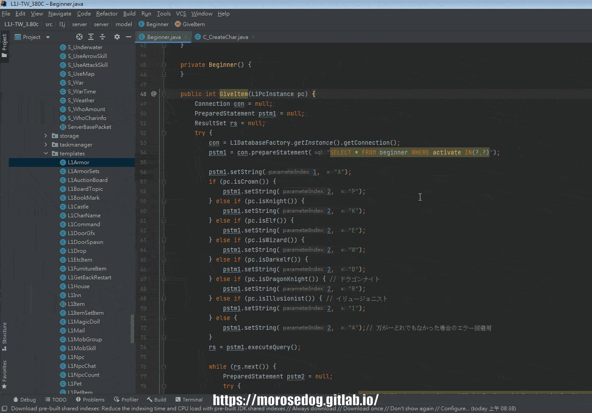
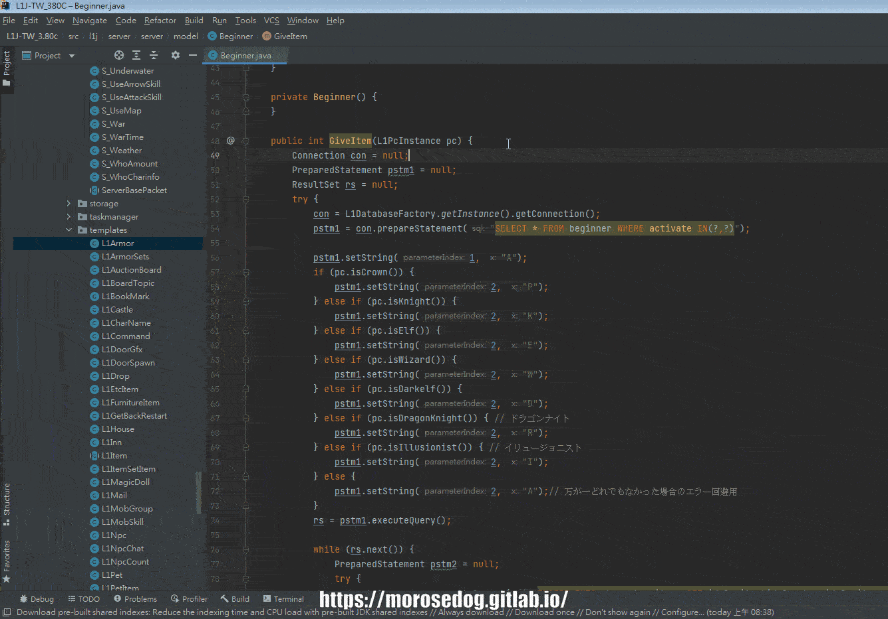
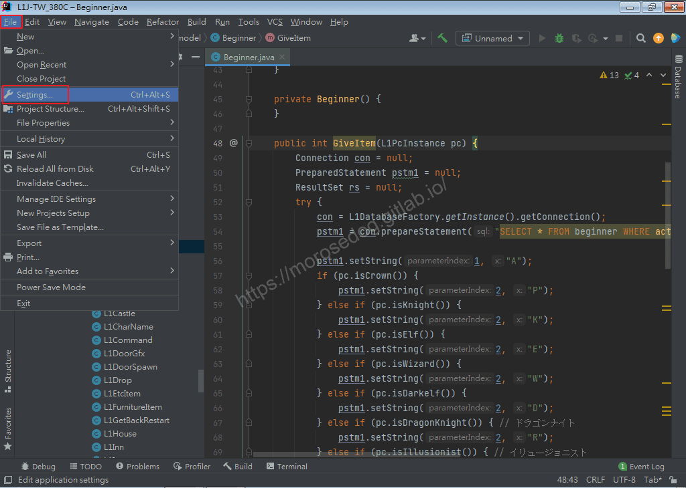
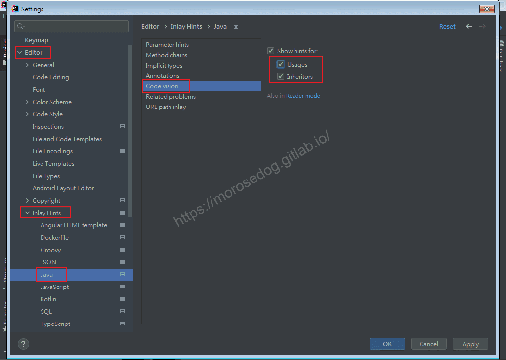
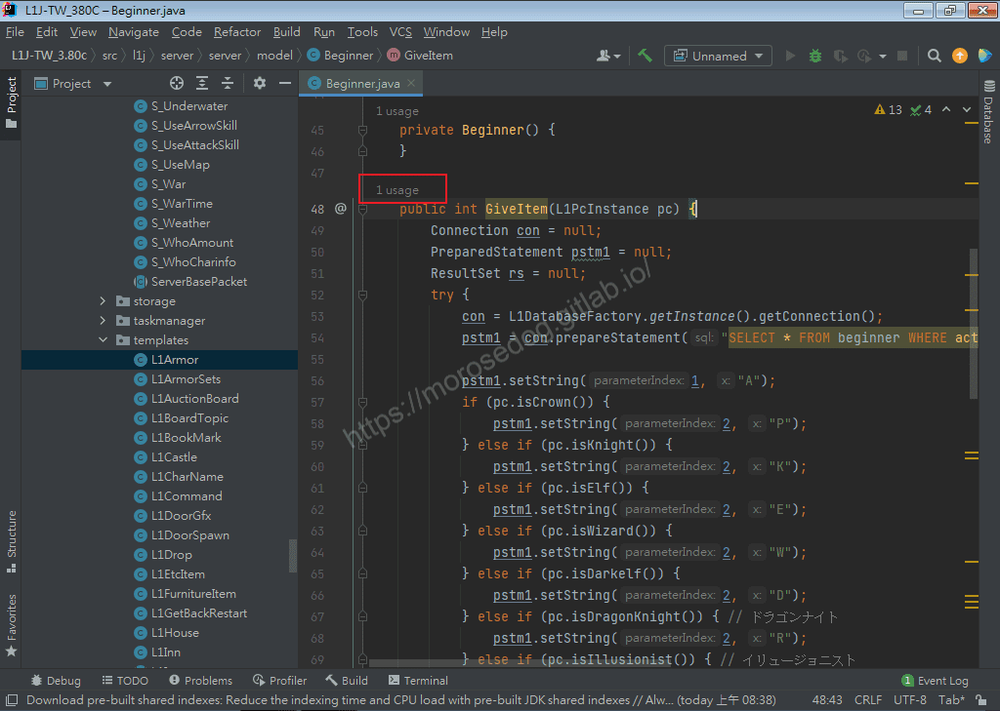
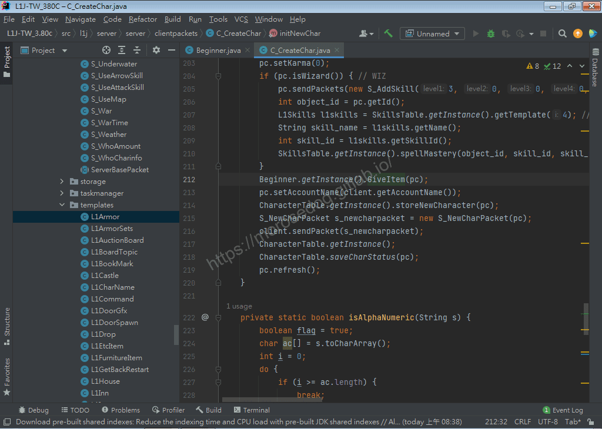

# 07. IntelliJ IDEA 鑲嵌提示 Java 程式碼的使用與繼承

# 天堂私服 | IntelliJ IDEA 鑲嵌提示 Java 程式碼的使用與繼承

    
    
      📑 目錄
      

1. [問題](#問題)
2. [解決](#解決)
3. [結語](#結語)
4. [免責聲明](#免責聲明)

    
    
    

## 問題

在分析模擬器核心的過程中，常常會需要知道此方法，是否有被呼叫；或是某些介面、抽象是否有被繼承、實作。
而要知道的情況下，在`Intellij IDEA`內可以使用以下兩種方法：

* `Ctrl` + 滑鼠左鍵點選該方法名稱， 即會跳轉到呼叫的位置(如有一個以上的呼叫會跳出選單供選擇)。

* 方法名稱上按下右鍵，選擇`Find Usages`。

以上兩種方法雖然沒有說不好，但是在開發講求快速的時代，`IDE`工具一直在進步，提供了更多更好的功能，幫助開發者更加快速更加專注在業務邏輯上。
而這就是此篇要說明的解決方法「**開啟鑲嵌提示 Java 程式碼的使用與繼承**」功能。

## 解決

* 點擊`File`→`Settings...`。

* 展開`Editor & Inlay Hints`。

* 點擊`Java`。

* 見右邊，點擊`Code vision`。

* 見右邊`Usages`、`Inheritors`將其勾選。

* 點擊`OK`。

* 回到程式碼，可見方法上出現鑲嵌的提示`1 Usage`(表示此方法，有一個呼叫)。

* 滑鼠直接點擊`1 Usage`。

* 將會跳轉到呼叫的程式碼位置。

## 結語

這篇主要是要提升分析程式碼的過程中，可以提升速度。省去一個快捷鍵的使用。
因為作者滿喜歡這種類型的功能，所以在此篇特別介紹；而後面的核心分析中，也會常常使用到。
最後建議回顧一下首章[天堂私服 | 天堂私服架設教學](/private-lineage-20210712-private-lineage-0/#教學章節)，了解其章節目錄。​‌‌‌​​​​​‌‌‌​​‌​​‌‌​‌​​‌​‌‌‌​‌‌​​‌‌​​​​‌​‌‌‌​‌​​​‌‌​​‌​‌​​‌​‌‌​‌​‌‌​‌‌​​​‌‌​‌​​‌​‌‌​‌‌‌​​‌‌​​‌​‌​‌‌​​​​‌​‌‌​​‌‌‌​‌‌​​‌​‌​​‌​‌‌​‌​​‌‌​​‌​​​‌‌​​​​​​‌‌​​‌​​​‌‌​​​‌​​‌‌​​​​​​‌‌‌​​‌​​‌‌​​​​​​‌‌‌​​‌​​‌​‌‌​‌​‌‌‌​​​​​‌‌‌​​‌​​‌‌​‌​​‌​‌‌‌​‌‌​​‌‌​​​​‌​‌‌‌​‌​​​‌‌​​‌​‌​​‌​‌‌​‌​‌‌​‌‌​​​‌‌​‌​​‌​‌‌​‌‌‌​​‌‌​​‌​‌​‌‌​​​​‌​‌‌​​‌‌‌​‌‌​​‌​‌​​‌​‌‌​‌​​‌‌​‌​​​​‌‌​​‌​

## 免責聲明

* 本部落格文章中皆<u>**不提供**</u>任何所謂的遊戲「主程式」、「模擬器」、「登入器」…等等相關程式的下載點。

* 本部落格文章中所見之遊戲主程式和服務器端程序均來自網路發佈，<u>版本歸**原作者**</u>所有。

* 本部落格文章為研究SQL資料庫與修改JAVA語法使用，並<u>**非商業用途**</u>，亦<u>**無做營運事實等任何一切商業行為**</u>。

* 本部落格文章內容是為研究學習設計思想和原理為目的，<u>**絕沒有故意侵權或惡意抄襲、篡改其他遊戲內容**</u>！

> 註：以上參考了
> [IntelliJ IDEA 2020.1 Beta 2: Code Vision and Run Configurations as Files](https://blog.jetbrains.com/idea/2020/03/intellij-idea-2020-1-beta2/)

---

- **原文連結**：[J.J.'s Blogs - 07. IntelliJ IDEA 鑲嵌提示 Java 程式碼的使用與繼承](https://morosedog.gitlab.io/private-lineage-20210909-private-lineage-42/)
