# 08. IntelliJ IDEA 逐步除錯(Debug)的步驟與演練

# 天堂私服 | IntelliJ IDEA 逐步除錯(Debug)的步驟與演練

    
    
      📑 目錄
      

1. [問題](#問題)
2. [除錯模式](#除錯模式)
3. [結語](#結語)
4. [免責聲明](#免責聲明)

    
    
    

## 問題

自己寫的程式碼、別人寫的程式碼、運行過程中的狀態、變數的值變化…等等，如果直接運行(Run)程式，是無法在程式中間進行中斷(暫停)。
不懂？沒關係，讓我們看個簡單的例子：
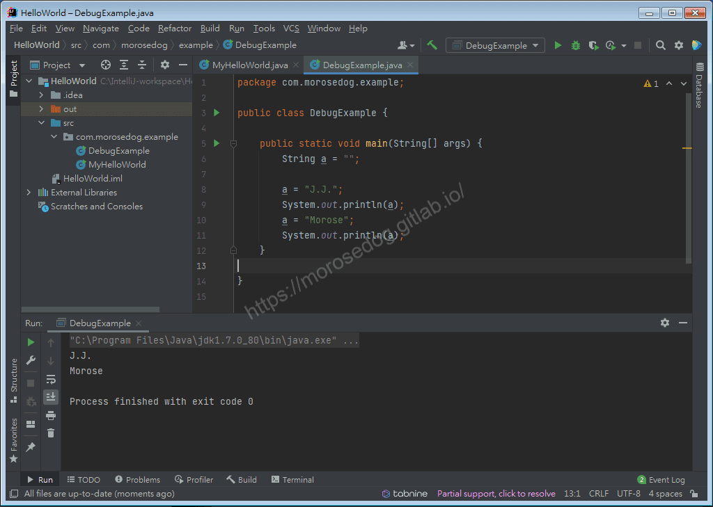
在程式運行後，在`console`會看到輸出

```plain
J.J.
Morose
```

問題：

1. 程式運行過第`6`行的後`a`的值為？

* 答：””;

1. 程式運行過第`8`行的後`a`的值為？

* 答：”J.J”;

1. 程式運行過第`10`行的後`a`的值為？

* 答：”Morose”;

> 註：天才的你一定會說，這些問題也太簡單了吧！​‌‌‌​​​​​‌‌‌​​‌​​‌‌​‌​​‌​‌‌‌​‌‌​​‌‌​​​​‌​‌‌‌​‌​​​‌‌​​‌​‌​​‌​‌‌​‌​‌‌​‌‌​​​‌‌​‌​​‌​‌‌​‌‌‌​​‌‌​​‌​‌​‌‌​​​​‌​‌‌​​‌‌‌​‌‌​​‌​‌​​‌​‌‌​‌​​‌‌​​‌​​​‌‌​​​​​​‌‌​​‌​​​‌‌​​​‌​​‌‌​​​​​​‌‌‌​​‌​​‌‌​​​‌​​‌‌​​​​​​‌​‌‌​‌​‌‌‌​​​​​‌‌‌​​‌​​‌‌​‌​​‌​‌‌‌​‌‌​​‌‌​​​​‌​‌‌‌​‌​​​‌‌​​‌​‌​​‌​‌‌​‌​‌‌​‌‌​​​‌‌​‌​​‌​‌‌​‌‌‌​​‌‌​​‌​‌​‌‌​​​​‌​‌‌​​‌‌‌​‌‌​​‌​‌​​‌​‌‌​‌​​‌‌​‌​​​​‌‌​​‌‌

讓我們在看個複雜一點的<泡沫演算法>。
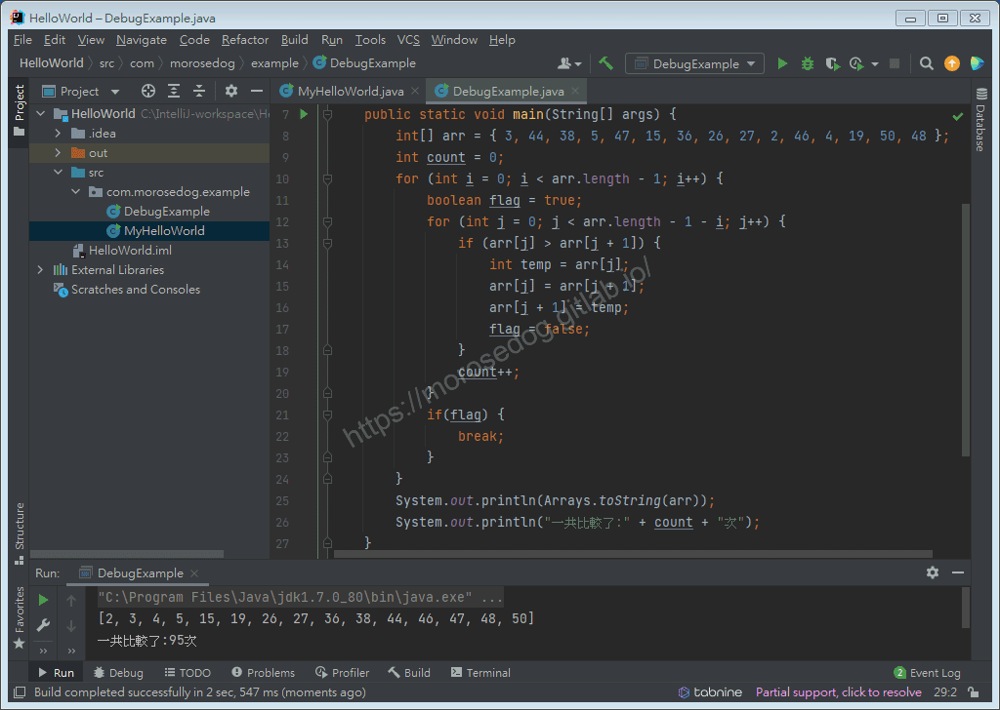
在程式運行後，`console`會看到輸出

```plain
[2, 3, 4, 5, 15, 19, 26, 27, 36, 38, 44, 46, 47, 48, 50]
一共比較了:95次
```

問題：<在不修改程式碼的情況下>

1. 當`count`計算到第`30`次，此時的`arr`裡面的排序結果是？

* 答：`[3, 5, 15, 36, 38, 26, 27, 2, 44, 4, 19, 46, 47, 48, 50]`

> 註：如果你能白紙黑筆一步一步慢慢寫出來…哥給你跪。​‌‌‌​​​​​‌‌‌​​‌​​‌‌​‌​​‌​‌‌‌​‌‌​​‌‌​​​​‌​‌‌‌​‌​​​‌‌​​‌​‌​​‌​‌‌​‌​‌‌​‌‌​​​‌‌​‌​​‌​‌‌​‌‌‌​​‌‌​​‌​‌​‌‌​​​​‌​‌‌​​‌‌‌​‌‌​​‌​‌​​‌​‌‌​‌​​‌‌​​‌​​​‌‌​​​​​​‌‌​​‌​​​‌‌​​​‌​​‌‌​​​​​​‌‌‌​​‌​​‌‌​​​‌​​‌‌​​​​​​‌​‌‌​‌​‌‌‌​​​​​‌‌‌​​‌​​‌‌​‌​​‌​‌‌‌​‌‌​​‌‌​​​​‌​‌‌‌​‌​​​‌‌​​‌​‌​​‌​‌‌​‌​‌‌​‌‌​​​‌‌​‌​​‌​‌‌​‌‌‌​​‌‌​​‌​‌​‌‌​​​​‌​‌‌​​‌‌‌​‌‌​​‌​‌​​‌​‌‌​‌​​‌‌​‌​​​​‌‌​​‌‌

到這邊應該知道在對程式碼做所謂的除錯(debug)，運行中的情況狀態想要知道是有一定困難的。
在沒有所為的除錯模式之前，工程師們基本上都是透過`System.out.print`的方式將希望看見的值去做輸出。
後面會針對以上兩個例子做簡單的「除錯模式」使用的教學。

## 除錯模式

各位大神們，這邊並沒有把所有的功能、視窗、通通都教學出來，所以先別噴；這邊只是教一點簡簡單單的除錯模式，讓新手們有個入門。

除錯模式首先要知道的幾樣：​‌‌‌​​​​​‌‌‌​​‌​​‌‌​‌​​‌​‌‌‌​‌‌​​‌‌​​​​‌​‌‌‌​‌​​​‌‌​​‌​‌​​‌​‌‌​‌​‌‌​‌‌​​​‌‌​‌​​‌​‌‌​‌‌‌​​‌‌​​‌​‌​‌‌​​​​‌​‌‌​​‌‌‌​‌‌​​‌​‌​​‌​‌‌​‌​​‌‌​​‌​​​‌‌​​​​​​‌‌​​‌​​​‌‌​​​‌​​‌‌​​​​​​‌‌‌​​‌​​‌‌​​​‌​​‌‌​​​​​​‌​‌‌​‌​‌‌‌​​​​​‌‌‌​​‌​​‌‌​‌​​‌​‌‌‌​‌‌​​‌‌​​​​‌​‌‌‌​‌​​​‌‌​​‌​‌​​‌​‌‌​‌​‌‌​‌‌​​​‌‌​‌​​‌​‌‌​‌‌‌​​‌‌​​‌​‌​‌‌​​​​‌​‌‌​​‌‌‌​‌‌​​‌​‌​​‌​‌‌​‌​​‌‌​‌​​​​‌‌​​‌‌

* 執行`Run`

  * 執行程式，不理會任何斷點。

  * 在哪邊可以找到這個按鈕？

    * 1. 右上角可以先選擇要執行的程式碼，在按右邊執行按鈕。

    * 1. 在程式內的點擊執行按鈕，選擇`Run`的部分。
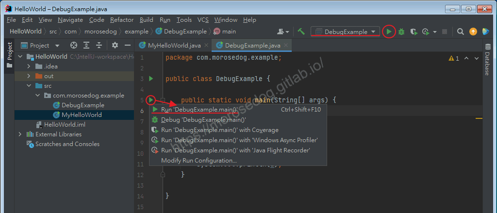

* 除錯`Debug`

  * 執行程式，遇到斷點會停在斷點位置上。

  * 在哪邊可以找到這個按鈕？

    * 1. 右上角可以先選擇要執行的程式碼，在按右邊除錯按鈕。

    * 1. 在程式內的點擊執行按鈕，選擇`Debug`的部分。
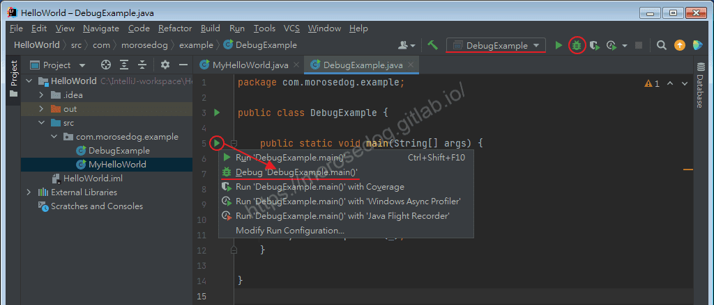

* 斷點`Breakpoint`​‌‌‌​​​​​‌‌‌​​‌​​‌‌​‌​​‌​‌‌‌​‌‌​​‌‌​​​​‌​‌‌‌​‌​​​‌‌​​‌​‌​​‌​‌‌​‌​‌‌​‌‌​​​‌‌​‌​​‌​‌‌​‌‌‌​​‌‌​​‌​‌​‌‌​​​​‌​‌‌​​‌‌‌​‌‌​​‌​‌​​‌​‌‌​‌​​‌‌​​‌​​​‌‌​​​​​​‌‌​​‌​​​‌‌​​​‌​​‌‌​​​​​​‌‌‌​​‌​​‌‌​​​‌​​‌‌​​​​​​‌​‌‌​‌​‌‌‌​​​​​‌‌‌​​‌​​‌‌​‌​​‌​‌‌‌​‌‌​​‌‌​​​​‌​‌‌‌​‌​​​‌‌​​‌​‌​​‌​‌‌​‌​‌‌​‌‌​​​‌‌​‌​​‌​‌‌​‌‌‌​​‌‌​​‌​‌​‌‌​​​​‌​‌‌​​‌‌‌​‌‌​​‌​‌​​‌​‌‌​‌​​‌‌​‌​​​​‌‌​​‌‌

  * 針對程式的特定行做斷點註記，用於除錯模式時使用。

  * 在哪邊可以設定這個斷點？

    * 直接在想要斷點的那一行程式碼左邊行號欄上方左鍵點擊。
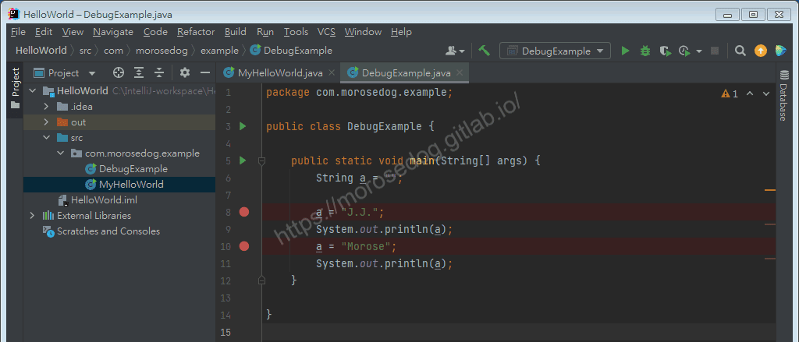

* 除錯模式下的視窗介紹、除錯基本用法：

  * 視窗介紹

    * ①`Breakpoint`：斷點，此時並高亮在此。

    * ②`Debug`視窗：存取請求到達第一個斷點後，會自動啟用`Debug`視窗。

    * ③`Frames`視窗：這裡顯示了該執行緒除錯所經過的方法。

    * ④`Variables`視窗：在變數區可以檢視當前斷點之前的當前方法內的變數。

    * ⑤`除錯按鈕`：除錯的主要功能就對應著這幾個按鈕，滑鼠懸停在按鈕上可以檢視對應的快捷鍵<下面基本用法只介紹五個按鈕>。

    * ⑥`服務按鈕`：可以在這裡關閉/啟動服務，設定斷點等。
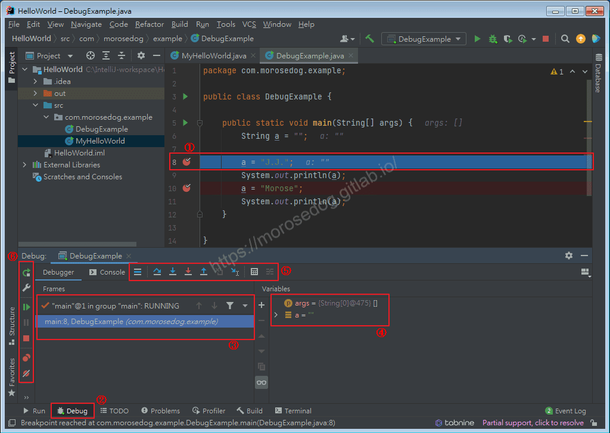

  * 除錯按鈕

    * `Show Execution Point`：如果你的游標在其它行或其它頁面，點選這個按鈕可跳轉到當前程式碼執行的行。

    * `Step Over`：步過，一行一行地往下走，如果這一行上有方法不會進入方法。

    * `Step Into`：步入，如果當前行有方法，可以進入方法內部，一般用於進入自定義方法內，不會進入官方類庫的方法，如第25行的put方法。

    * `Force Step Into`：強制步入，能進入任何方法，檢視底層原始碼的時候可以用這個進入官方類庫的方法。

    * `Step Out`：步出，從步入的方法內退出到方法呼叫處，此時方法已執行完畢，只是還沒有完成賦值。
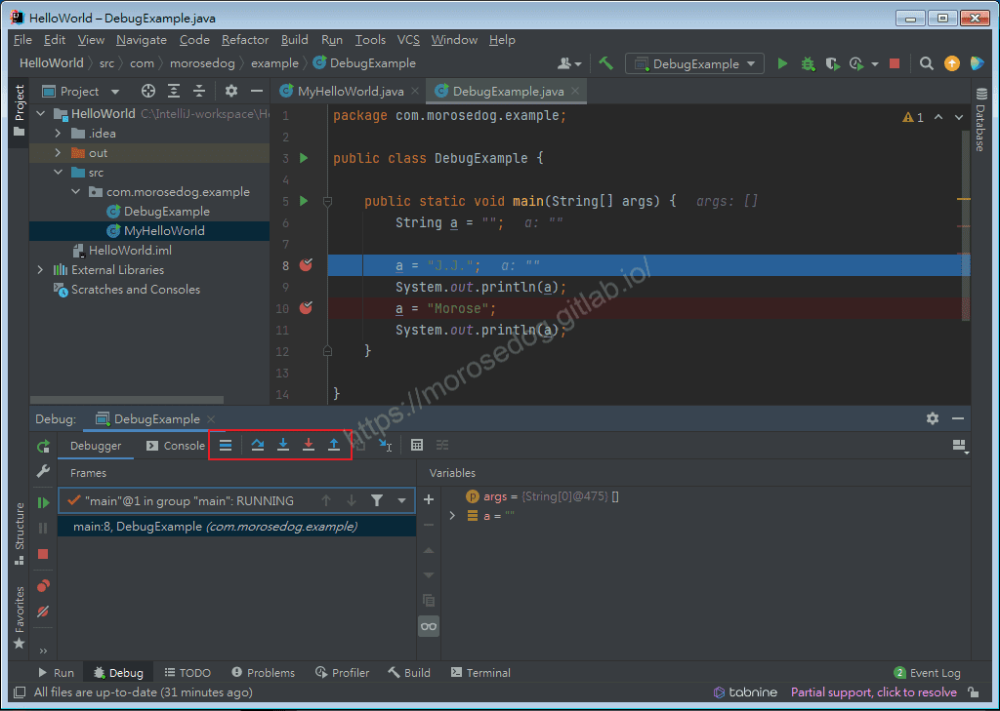

  * 服務按鈕

    * `Resume Program`恢復程式，拿第一個例子說明，你在第`6`行和`8`行有兩個斷點，當前執行至第`6`行，按下該按鈕，則執行到下一個斷點(即第`8`行)，再按下該按鈕，則執行完整個流程，因為後面已經沒有斷點了。

    * 其他按鈕就不特別介紹。


  * 斷點的狀態下

    * 工作區內會鑲嵌提示
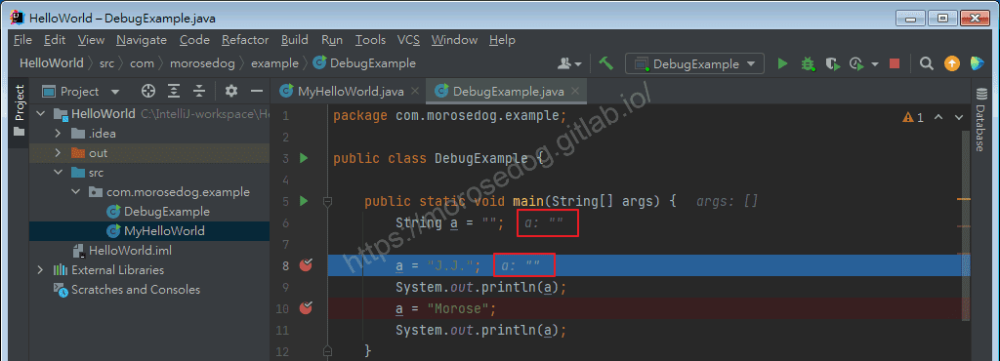

    * 滑鼠停放在變數上亦會顯示其值
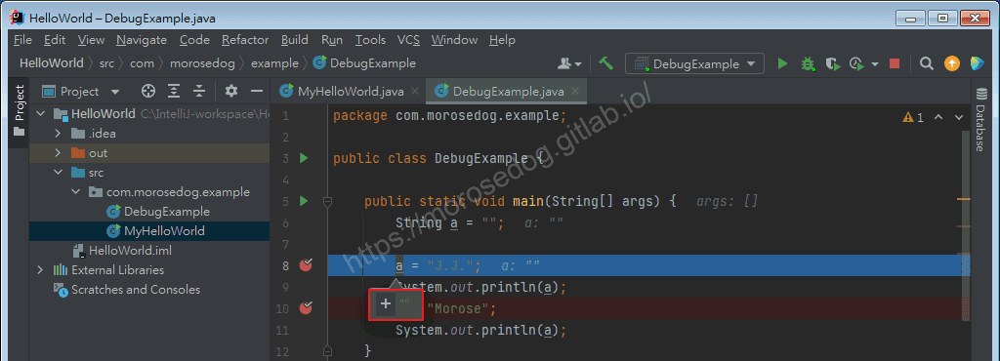

看了文字和圖還是不知道他們幹嘛用的？當然啊！還沒開始用嘛。
下面直接示範：

* 中斷點為第`8`、`10`行。​‌‌‌​​​​​‌‌‌​​‌​​‌‌​‌​​‌​‌‌‌​‌‌​​‌‌​​​​‌​‌‌‌​‌​​​‌‌​​‌​‌​​‌​‌‌​‌​‌‌​‌‌​​​‌‌​‌​​‌​‌‌​‌‌‌​​‌‌​​‌​‌​‌‌​​​​‌​‌‌​​‌‌‌​‌‌​​‌​‌​​‌​‌‌​‌​​‌‌​​‌​​​‌‌​​​​​​‌‌​​‌​​​‌‌​​​‌​​‌‌​​​​​​‌‌‌​​‌​​‌‌​​​‌​​‌‌​​​​​​‌​‌‌​‌​‌‌‌​​​​​‌‌‌​​‌​​‌‌​‌​​‌​‌‌‌​‌‌​​‌‌​​​​‌​‌‌‌​‌​​​‌‌​​‌​‌​​‌​‌‌​‌​‌‌​‌‌​​​‌‌​‌​​‌​‌‌​‌‌‌​​‌‌​​‌​‌​‌‌​​​​‌​‌‌​​‌‌‌​‌‌​​‌​‌​​‌​‌‌​‌​​‌‌​‌​​​​‌‌​​‌‌

* 啟動除錯模式。

* 過程中`Step Over`步過，並觀察其`a`變數的值變化。
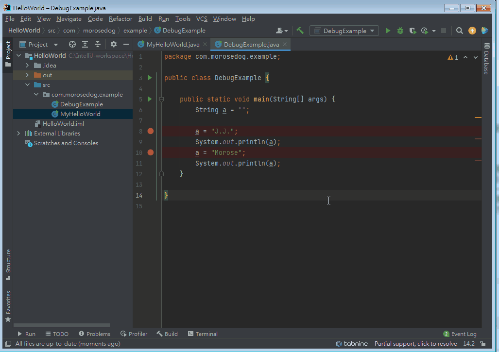

* 過程中`Resume Program`，並觀察`Count`到`30`。​‌‌‌​​​​​‌‌‌​​‌​​‌‌​‌​​‌​‌‌‌​‌‌​​‌‌​​​​‌​‌‌‌​‌​​​‌‌​​‌​‌​​‌​‌‌​‌​‌‌​‌‌​​​‌‌​‌​​‌​‌‌​‌‌‌​​‌‌​​‌​‌​‌‌​​​​‌​‌‌​​‌‌‌​‌‌​​‌​‌​​‌​‌‌​‌​​‌‌​​‌​​​‌‌​​​​​​‌‌​​‌​​​‌‌​​​‌​​‌‌​​​​​​‌‌‌​​‌​​‌‌​​​‌​​‌‌​​​​​​‌​‌‌​‌​‌‌‌​​​​​‌‌‌​​‌​​‌‌​‌​​‌​‌‌‌​‌‌​​‌‌​​​​‌​‌‌‌​‌​​​‌‌​​‌​‌​​‌​‌‌​‌​‌‌​‌‌​​​‌‌​‌​​‌​‌‌​‌‌‌​​‌‌​​‌​‌​‌‌​​​​‌​‌‌​​‌‌‌​‌‌​​‌​‌​​‌​‌‌​‌​​‌‌​‌​​​​‌‌​​‌‌

* 觀察當前的`arr`的參數。
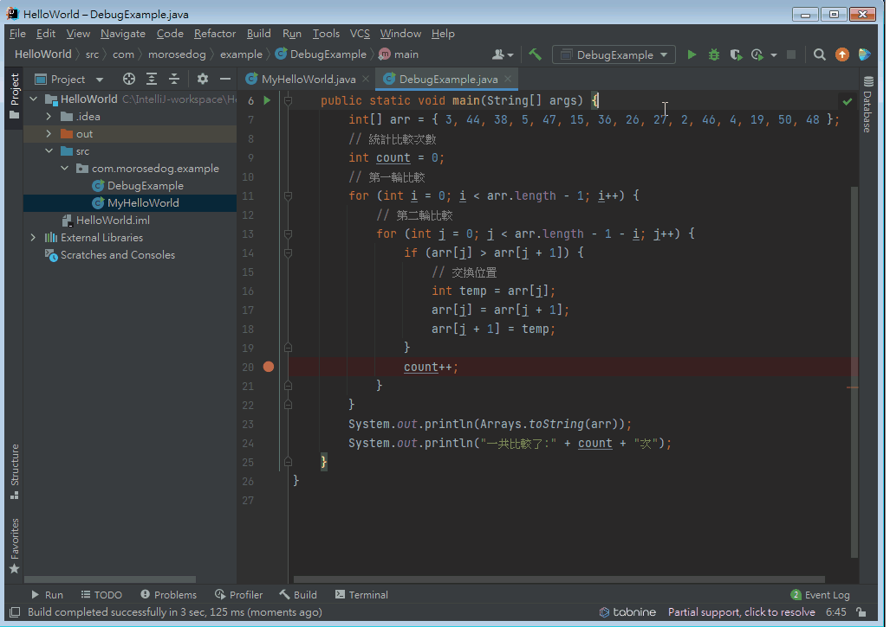

## 結語

對於除錯模式，不是一朝一夕就可以說完全部的功能，也不是說可以快速知道可以運用在哪邊，只有！親手下去試試看，最能有所體會。
希望透過上方的這些例子、說明和實際操作，可以讓新手們對所謂的除錯(Debug)有一定的了解。

如果想要更進一步了解可以上網查查看，有很多的教學文章影片我覺得都講的滿好的，可以多多參閱。
最後建議回顧一下首章[天堂私服 | 天堂私服架設教學](/private-lineage-20210712-private-lineage-0/#教學章節)，了解其章節目錄。​‌‌‌​​​​​‌‌‌​​‌​​‌‌​‌​​‌​‌‌‌​‌‌​​‌‌​​​​‌​‌‌‌​‌​​​‌‌​​‌​‌​​‌​‌‌​‌​‌‌​‌‌​​​‌‌​‌​​‌​‌‌​‌‌‌​​‌‌​​‌​‌​‌‌​​​​‌​‌‌​​‌‌‌​‌‌​​‌​‌​​‌​‌‌​‌​​‌‌​​‌​​​‌‌​​​​​​‌‌​​‌​​​‌‌​​​‌​​‌‌​​​​​​‌‌‌​​‌​​‌‌​​​‌​​‌‌​​​​​​‌​‌‌​‌​‌‌‌​​​​​‌‌‌​​‌​​‌‌​‌​​‌​‌‌‌​‌‌​​‌‌​​​​‌​‌‌‌​‌​​​‌‌​​‌​‌​​‌​‌‌​‌​‌‌​‌‌​​​‌‌​‌​​‌​‌‌​‌‌‌​​‌‌​​‌​‌​‌‌​​​​‌​‌‌​​‌‌‌​‌‌​​‌​‌​​‌​‌‌​‌​​‌‌​‌​​​​‌‌​​‌‌

## 免責聲明

* 本部落格文章中皆<font color="red"><u>**不提供**</u></font>任何所謂的遊戲「主程式」、「模擬器」、「登入器」…等等相關程式的下載點。

* 本部落格文章中所見之遊戲主程式和服務器端程序均來自網路發佈，<font color="red"><u>版本歸**原作者**</u>所有</font>。

* 本部落格文章為研究SQL資料庫與修改JAVA語法使用，<font color="red">並<u>**非商業用途**</u>，亦<u>**無做營運事實等任何一切商業行為**</u>。</font>

* 本部落格文章內容是為研究學習設計思想和原理為目的，<font color="red"><u>**絕沒有故意侵權或惡意抄襲、篡改其他遊戲內容**</u></font>！

> 註：以上參考了
> [Intellij IDEA中使用Debug偵錯詳解](https://www.it145.com/9/13128.html)
> [07.IntelliJ IDEA逐步除錯的步驟](https://hackmd.io/@emisjerry/ryUn0FBEH/%2Fs%2FFIi4wvnTTliz-iGhIeVUew)

---

- **原文連結**：[J.J.'s Blogs - 08. IntelliJ IDEA 逐步除錯(Debug)的步驟與演練](https://morosedog.gitlab.io/private-lineage-20210910-private-lineage-43/)
