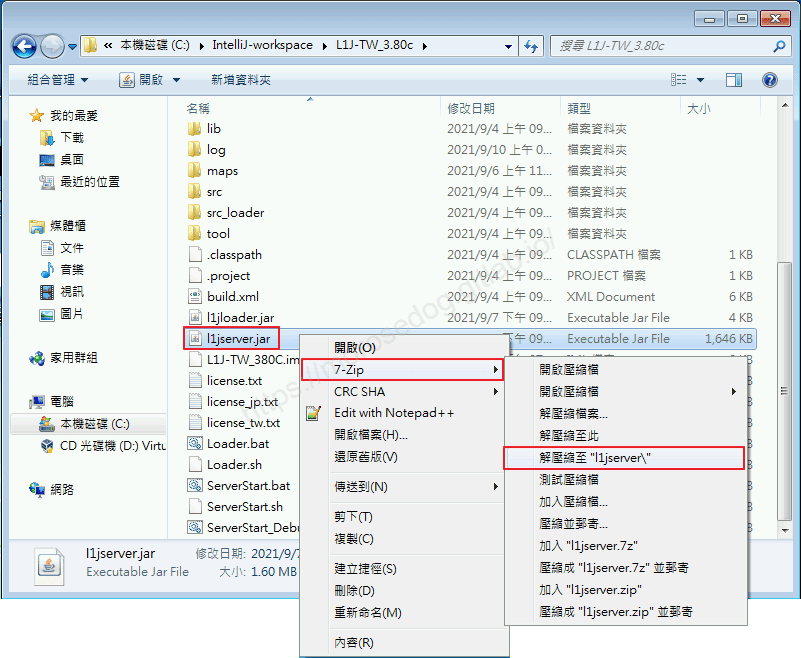
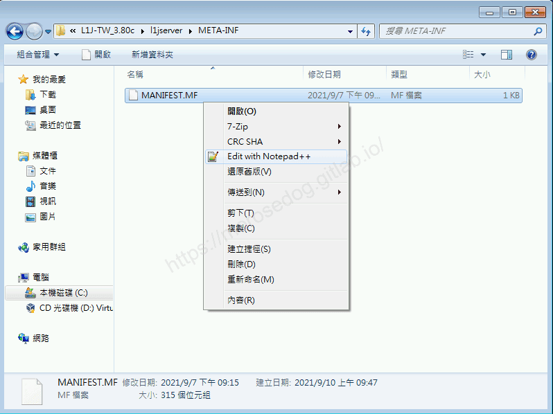
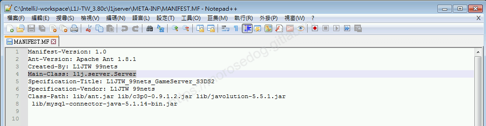
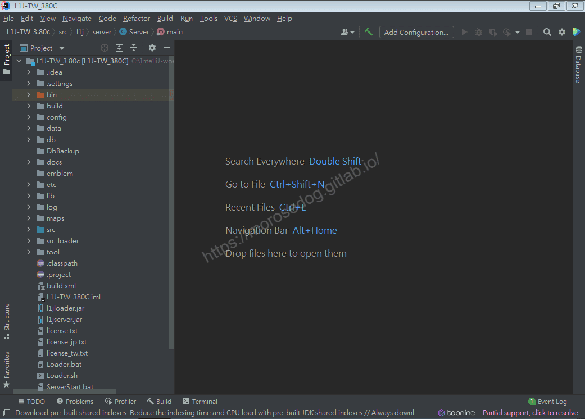
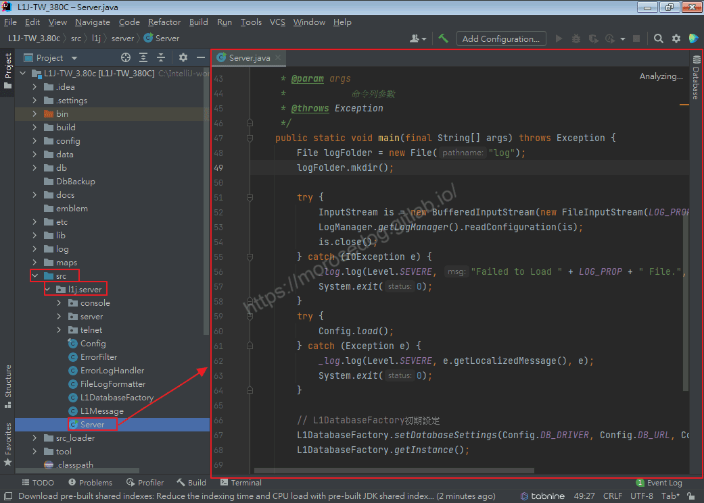
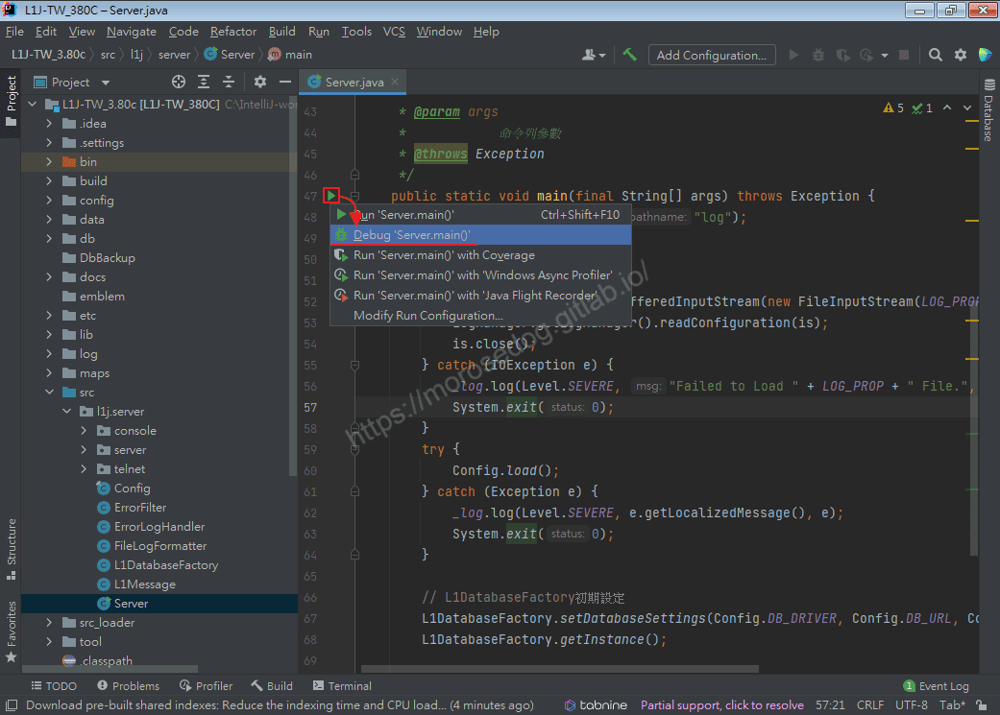
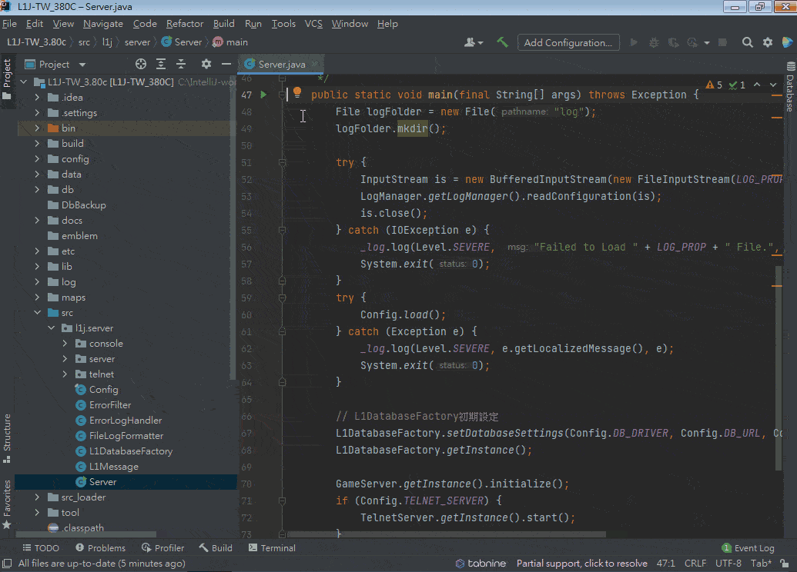
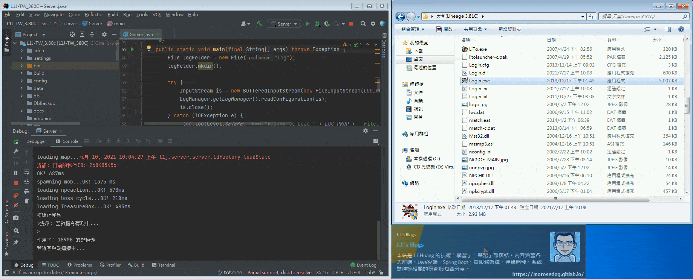
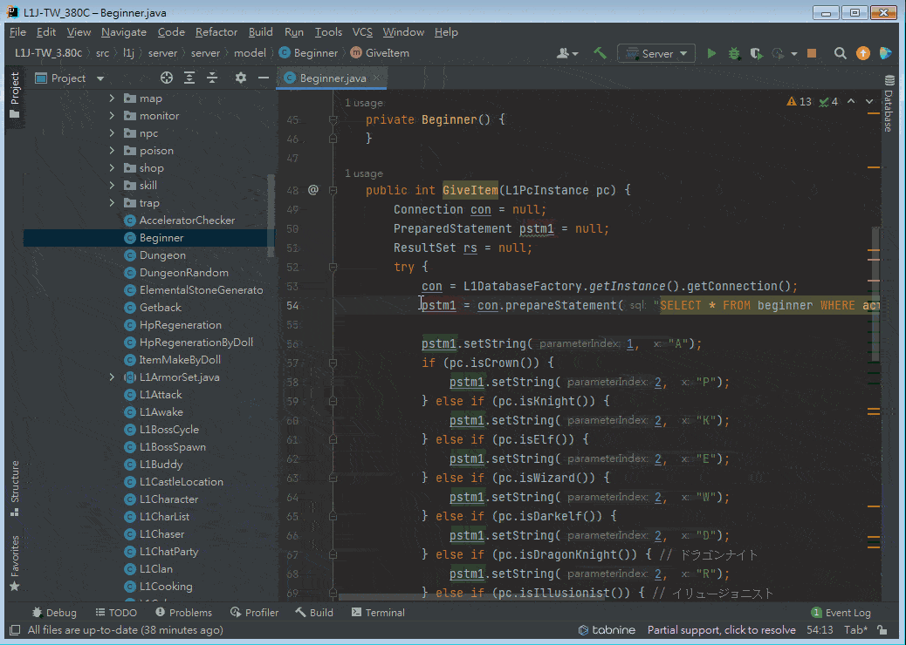

# 09. IntelliJ IDEA 天堂模擬器除錯(Debug)

# 天堂私服 | IntelliJ IDEA 天堂模擬器除錯(Debug)

    
    
      📑 目錄
      

1. [問題](#問題)
2. [分析 main class](#分析-main-class)
3. [模擬器除錯模式](#模擬器除錯模式)
4. [結語](#結語)
5. [免責聲明](#免責聲明)

    
    
    

## 問題

每次核心修改完畢編譯成`Jar`檔，然後啟動模擬器(黑盒子)，登入遊戲後可以看到修改的結果；但是沒辦法做所謂的`Debug`剛剛修改過的程式碼。
這樣在針對核心的修改，無法快速開發、測試、定位問題…等等諸多不方便。

這時候只需要會`IDE`內的除錯模式就可以解決此問題。

> 註：如不清楚除錯模式，請參考[IntelliJ IDEA 逐步除錯(Debug)的步驟與演練](./043_08._IntelliJ_IDEA_逐步除錯(Debug)的步驟與演練.md)​‌‌‌​​​​​‌‌‌​​‌​​‌‌​‌​​‌​‌‌‌​‌‌​​‌‌​​​​‌​‌‌‌​‌​​​‌‌​​‌​‌​​‌​‌‌​‌​‌‌​‌‌​​​‌‌​‌​​‌​‌‌​‌‌‌​​‌‌​​‌​‌​‌‌​​​​‌​‌‌​​‌‌‌​‌‌​​‌​‌​​‌​‌‌​‌​​‌‌​​‌​​​‌‌​​​​​​‌‌​​‌​​​‌‌​​​‌​​‌‌​​​​​​‌‌‌​​‌​​‌‌​​​‌​​‌‌​​​‌​​‌​‌‌​‌​‌‌‌​​​​​‌‌‌​​‌​​‌‌​‌​​‌​‌‌‌​‌‌​​‌‌​​​​‌​‌‌‌​‌​​​‌‌​​‌​‌​​‌​‌‌​‌​‌‌​‌‌​​​‌‌​‌​​‌​‌‌​‌‌‌​​‌‌​​‌​‌​‌‌​​​​‌​‌‌​​‌‌‌​‌‌​​‌​‌​​‌​‌‌​‌​​‌‌​‌​​​​‌‌​‌​​

## 分析 main class

之前教學的啟動模擬器，都是透過執行`Jar`檔來做啟動；而我們在使用原始碼的時候，其實是不容易知道到底哪個是主要程式裡面`main`方法。
而啟動`Jar`檔的時候，他是如何知道哪支程式是主要的`main`方法呢？

* 必需有任何一套解壓縮軟體。

* 針對`l1jserver.jar`做解壓縮的動作。


* 進入解壓縮後的目錄→`l1jserver`→`META-INF`。

* 看到`MANIFEST.MF`檔案，- 並編輯器軟體開啟此檔案。


* 可見內容`Main-Class: l1j.server.Server`，說明了主要的程式是哪支`class`。


* 分析完後，可以把剛剛解壓縮的`l1jserver`目錄做刪除。

> 註：如對此檔有興趣，可以參考[聊一聊JAR文件和MANIFEST.MF](https://codertw.com/%E7%A8%8B%E5%BC%8F%E8%AA%9E%E8%A8%80/728245/)。

## 模擬器除錯模式

分析後的主要`main`的`class`：​‌‌‌​​​​​‌‌‌​​‌​​‌‌​‌​​‌​‌‌‌​‌‌​​‌‌​​​​‌​‌‌‌​‌​​​‌‌​​‌​‌​​‌​‌‌​‌​‌‌​‌‌​​​‌‌​‌​​‌​‌‌​‌‌‌​​‌‌​​‌​‌​‌‌​​​​‌​‌‌​​‌‌‌​‌‌​​‌​‌​​‌​‌‌​‌​​‌‌​​‌​​​‌‌​​​​​​‌‌​​‌​​​‌‌​​​‌​​‌‌​​​​​​‌‌‌​​‌​​‌‌​​​‌​​‌‌​​​‌​​‌​‌‌​‌​‌‌‌​​​​​‌‌‌​​‌​​‌‌​‌​​‌​‌‌‌​‌‌​​‌‌​​​​‌​‌‌‌​‌​​​‌‌​​‌​‌​​‌​‌‌​‌​‌‌​‌‌​​​‌‌​‌​​‌​‌‌​‌‌‌​​‌‌​​‌​‌​‌‌​​​​‌​‌‌​​‌‌‌​‌‌​​‌​‌​​‌​‌‌​‌​​‌‌​‌​​​​‌‌​‌​​

```plain
l1j.server.Server
```

* 開啟`IntelliJ IDEA`，並選擇`L1J-3.80c`專案進入。


* 點即打開主要的`main`程式。

* 點擊`src`→`l1j.server`→`Server`將程式打開於工作區。


* 點擊程式中的`main`方法左邊的啟動按鈕，並選擇除錯(Debug)模式選項。


* 此時下方的除錯視窗是彈出，並且輸出與啟動`Jar`檔黑盒子的內容一樣。


* 此時模擬器已經啟動成功。

* 使用登入器嘗試登入看是否可以正常連線進入。


* 我們嘗試在`Beginner`程式內的，第`54`設定斷點。

```plain
src.l1j.server.server.model.Beginner
```

* 天堂建立新人物。

* 會跳回`Intellia IDEA`視窗，且斷點在剛剛設定的位置。

* 且天堂視窗會卡在人物建立的畫面並不會到人物選擇畫面。

* 此時就可以做除錯的行為了。

  * 觀察一下`con`。

  * 觀察一下`pstm1`。

  * `Step Over`：步過。

  * 再觀察一下`pstm1`。

* 假設都沒問題後，可以按下`Resume Program`恢復程式，讓程式正常執行完畢。

* 回到天堂視窗可見已經建立好人物，且回到人物選擇視窗。


## 結語

針對模擬器核心的`Debug`到這邊教學相信已經非常清楚，希望接處核心開發修改的新手們，不至於不知道如何開始，可以輕鬆簡單的快速上手。
最後建議回顧一下首章[天堂私服 | 天堂私服架設教學](/private-lineage-20210712-private-lineage-0/#教學章節)，了解其章節目錄。

## 免責聲明

* 本部落格文章中皆<font color="red"><u>**不提供**</u></font>任何所謂的遊戲「主程式」、「模擬器」、「登入器」…等等相關程式的下載點。

* 本部落格文章中所見之遊戲主程式和服務器端程序均來自網路發佈，<font color="red"><u>版本歸**原作者**</u>所有</font>。

* 本部落格文章為研究SQL資料庫與修改JAVA語法使用，<font color="red">並<u>**非商業用途**</u>，亦<u>**無做營運事實等任何一切商業行為**</u>。</font>

* 本部落格文章內容是為研究學習設計思想和原理為目的，<font color="red"><u>**絕沒有故意侵權或惡意抄襲、篡改其他遊戲內容**</u></font>！

> 註：以上參考了
> [聊一聊JAR文件和MANIFEST.MF](https://codertw.com/%E7%A8%8B%E5%BC%8F%E8%AA%9E%E8%A8%80/728245/)

---

- **原文連結**：[J.J.'s Blogs - 09. IntelliJ IDEA 天堂模擬器除錯(Debug)](https://morosedog.gitlab.io/private-lineage-20210911-private-lineage-44/)
