# 10. IntelliJ IDEA 遠端除錯(Remote Debug)Jar包

# 天堂私服 | IntelliJ IDEA 遠端除錯(Remote Debug)Jar包

    
    
      📑 目錄
      

1. [思路](#思路)
2. [遠端除錯模式](#遠端除錯模式)
3. [驗證特性](#驗證特性)
4. [結語](#結語)
5. [免責聲明](#免責聲明)

    
    
    

## 思路

網路上充斥著各式各樣的模擬器版本，最常見的屬<font color="red">沒有</font>原始碼的版本，或是提供了反編譯後的原始碼。
這種原始碼會因為反編譯程式，或模擬器本身有混淆過，造成原始碼閱讀困難，甚至在使用`IDE`開啟原始碼後一堆的錯誤..等等狀況。
這樣的原始碼並不能在`IDE`內正常啟動除錯模式，做除錯(Debug)。

> 註：加殼的這邊不考慮，脫殼又是一門技術。

而這邊使用一個遠端除錯`Remote Debug`的思路，來針對我們啟動的`Jar`檔做`Debug`。​‌‌‌​​​​​‌‌‌​​‌​​‌‌​‌​​‌​‌‌‌​‌‌​​‌‌​​​​‌​‌‌‌​‌​​​‌‌​​‌​‌​​‌​‌‌​‌​‌‌​‌‌​​​‌‌​‌​​‌​‌‌​‌‌‌​​‌‌​​‌​‌​‌‌​​​​‌​‌‌​​‌‌‌​‌‌​​‌​‌​​‌​‌‌​‌​​‌‌​​‌​​​‌‌​​​​​​‌‌​​‌​​​‌‌​​​‌​​‌‌​​​​​​‌‌‌​​‌​​‌‌​​​‌​​‌‌​​‌​​​‌​‌‌​‌​‌‌‌​​​​​‌‌‌​​‌​​‌‌​‌​​‌​‌‌‌​‌‌​​‌‌​​​​‌​‌‌‌​‌​​​‌‌​​‌​‌​​‌​‌‌​‌​‌‌​‌‌​​​‌‌​‌​​‌​‌‌​‌‌‌​​‌‌​​‌​‌​‌‌​​​​‌​‌‌​​‌‌‌​‌‌​​‌​‌​​‌​‌‌​‌​​‌‌​‌​​​​‌‌​‌​‌

---

簡單說明：

* 將`Jar`設定成可遠端除錯並啟動。

* 將`IDE`開啟並匯入原始碼。

* 新增`Remote JVM Debug`，並啟動，開始除錯(Debug)。

而使用這種除錯模式有幾種特性。

* 所運行的程式碼邏輯都依照`Jar`為主。

* 原始碼不需要可以正常啟動也可除錯。

> 註：這兩種特性後面會有驗證示範說明。​‌‌‌​​​​​‌‌‌​​‌​​‌‌​‌​​‌​‌‌‌​‌‌​​‌‌​​​​‌​‌‌‌​‌​​​‌‌​​‌​‌​​‌​‌‌​‌​‌‌​‌‌​​​‌‌​‌​​‌​‌‌​‌‌‌​​‌‌​​‌​‌​‌‌​​​​‌​‌‌​​‌‌‌​‌‌​​‌​‌​​‌​‌‌​‌​​‌‌​​‌​​​‌‌​​​​​​‌‌​​‌​​​‌‌​​​‌​​‌‌​​​​​​‌‌‌​​‌​​‌‌​​​‌​​‌‌​​‌​​​‌​‌‌​‌​‌‌‌​​​​​‌‌‌​​‌​​‌‌​‌​​‌​‌‌‌​‌‌​​‌‌​​​​‌​‌‌‌​‌​​​‌‌​​‌​‌​​‌​‌‌​‌​‌‌​‌‌​​​‌‌​‌​​‌​‌‌​‌‌‌​​‌‌​​‌​‌​‌‌​​​​‌​‌‌​​‌‌‌​‌‌​​‌​‌​​‌​‌‌​‌​​‌‌​‌​​​​‌‌​‌​‌

## 遠端除錯模式

* 進入`L1J-3.80c`目錄資料夾。

* 複製一個`ServerStart.bat`，並修改檔案名稱為`ServerStart_Debug.bat`。
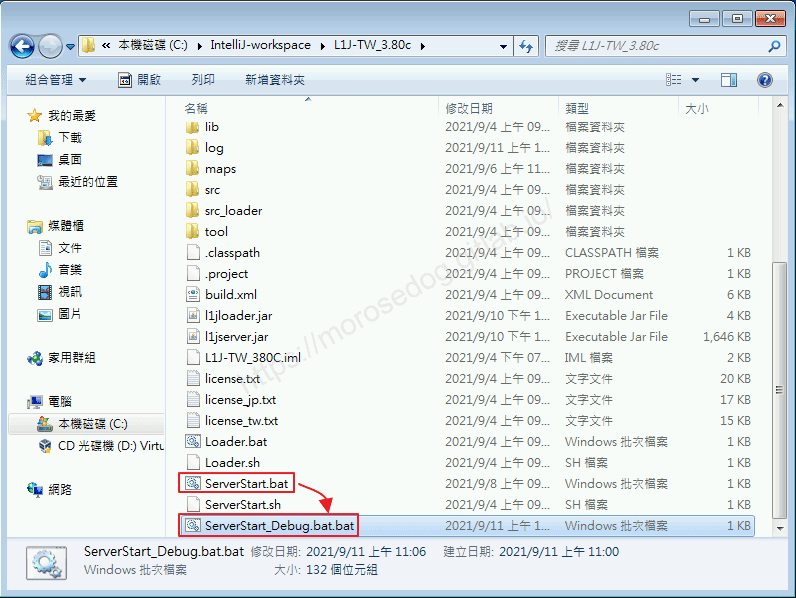

---

* 編輯`ServerStart_Debug.bat`檔，修改如下。

* 修改前：

```bash
@ECHO OFF
java -Xmx512m -Xincgc -jar l1jserver.jar

PAUSE
```

* 修改後：

```bash
@ECHO OFF
java -Xdebug -Xrunjdwp:transport=dt_socket,address=5005,server=y,suspend=y -Xmx512m -Xincgc -jar l1jserver.jar

PAUSE
```

* 參數說明

  * Xdebug：`JVM`在`Debug`模式下工作。

  * Xrunjdwp：`JVM`使用(java debug wire protocol)來運行除錯環境。

  * transport：監聽`Socket`端口連接方式，常用的`dt_socket`表示使用`Socket`連接。

  * address：表示本地監聽的地址和端口。

  * server：`y` = 表示當前是除錯服務端，`n` = 表示當前是除錯客戶端。

  * suspend：是否在調試客戶端建立連接之後啟動。
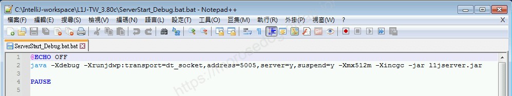

---

* 執行`ServerStart_Debug.bat`檔。

* 彈出黑盒子顯示內容為`Listening for transport dt_socket at address: 5005`

* 此時模擬器是尚未啟動的，他在等待除錯的客戶端建立完連接才會啟動。(黑盒子請不要關閉)

> 註：這是因為suspend = y，如果要他依舊可以值耶啟動，可設定為 suspend = n。
> 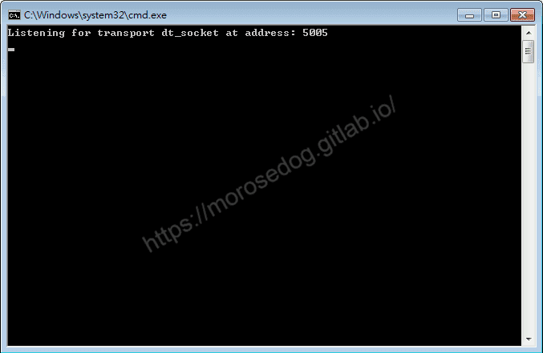

* 開啟`IntelliJ IDEA`，並選擇`L1J-3.80c`專案進入。

* 點擊`Run`→`Edit Configurations...`。
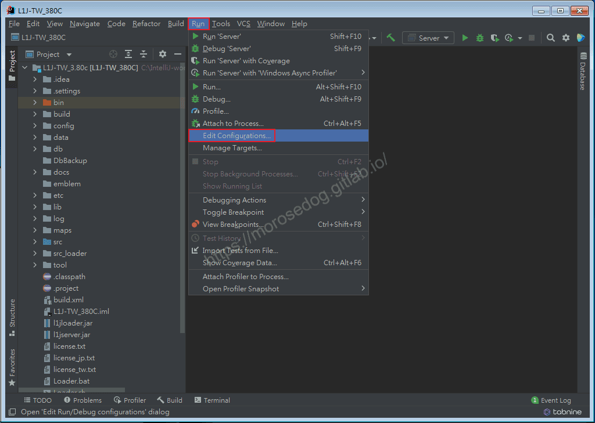

* 開啟`Run/Debug Configurations`視窗。
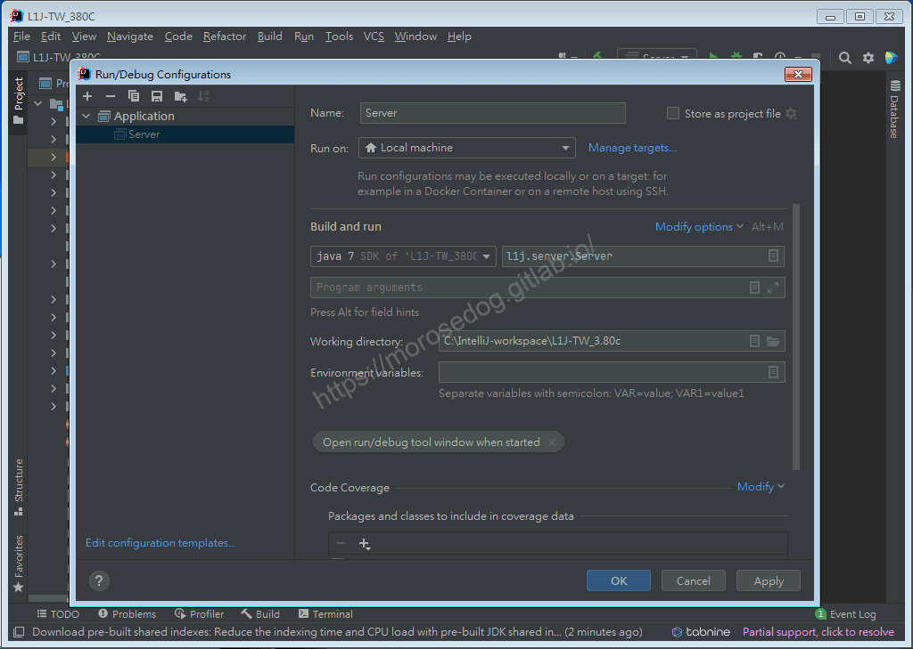

* 點擊左上角的`+`，點擊`Remote JVM Debug`。
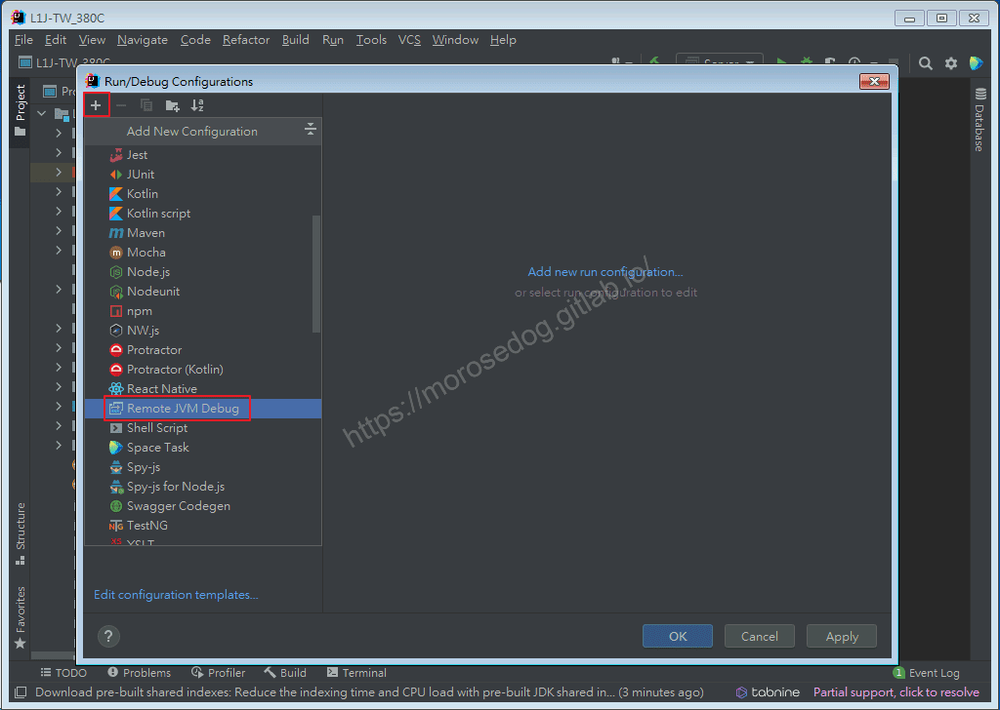

* 右邊視窗設定`Name`。

* 選擇`Use module classpath`。(對應的原始碼專案)

* 最後點擊`Apply`→`OK`。
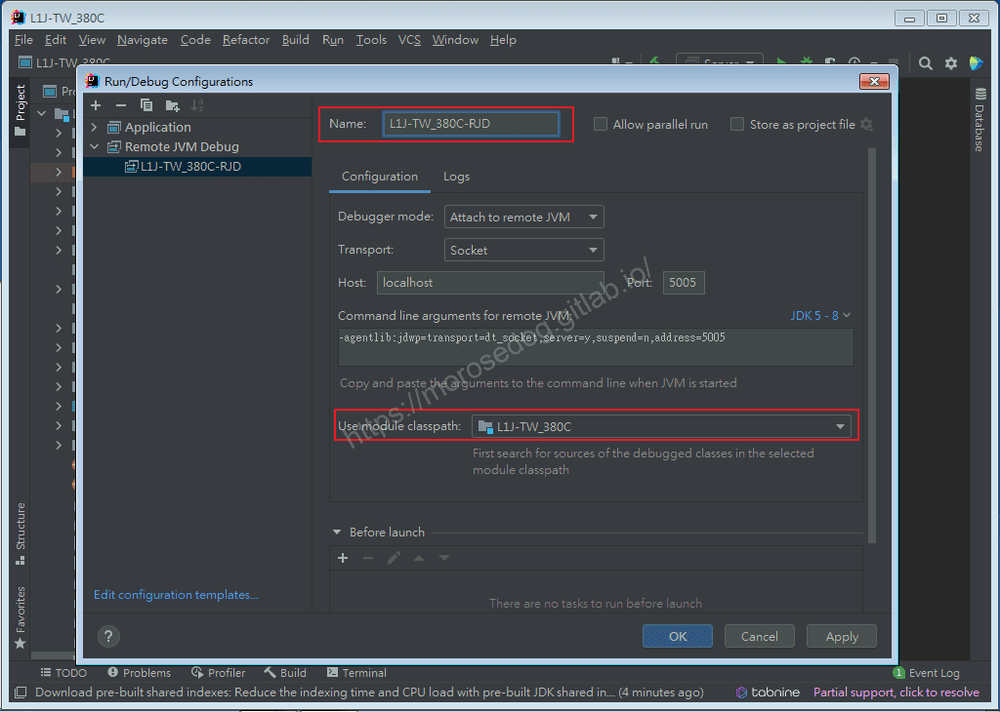

* 此時可見上方已經選擇剛剛設定好的`Remote JVM Debug`的設定`L1J-380C-RJD`。
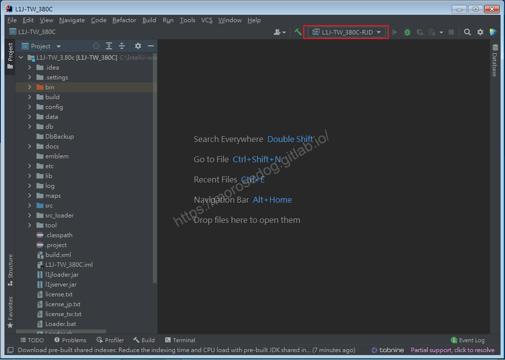

* 點擊`Debug`按鈕。

* 此時再回到剛剛啟動的黑盒子，會發現模擬器正常啟動完畢。
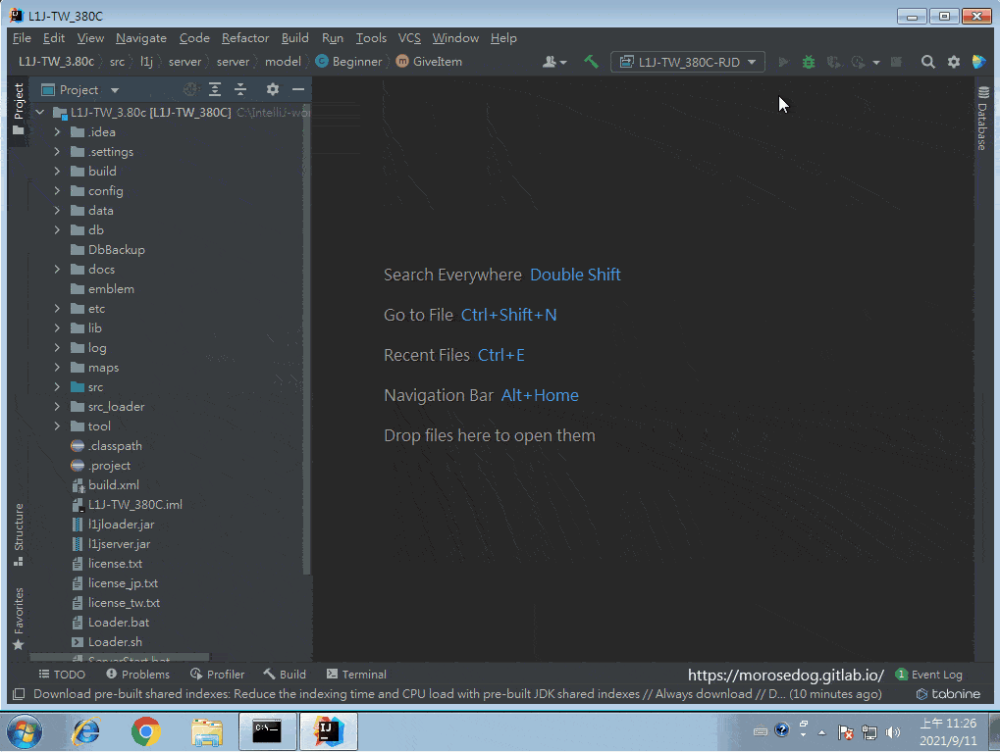

* 這時候除錯模式已經準備完畢了。

---

* 我們驗證一下是否有效果。

* 我們嘗試在`Beginner`程式內的，第`54`設定斷點。

```plain
src.l1j.server.server.model.Beginner
```

* 使用登入器嘗試登入看是否可以正常連線進入。

* 天堂建立新人物。

* 會跳回`Intellia IDEA`視窗，且斷點在剛剛設定的位置。

* 且天堂視窗會卡在人物建立的畫面並不會到人物選擇畫面。

* 假設都沒問題後，可以按下`Resume Program`恢復程式，讓程式正常執行完畢。

* 回到天堂視窗可見已經建立好人物，且回到人物選擇視窗。
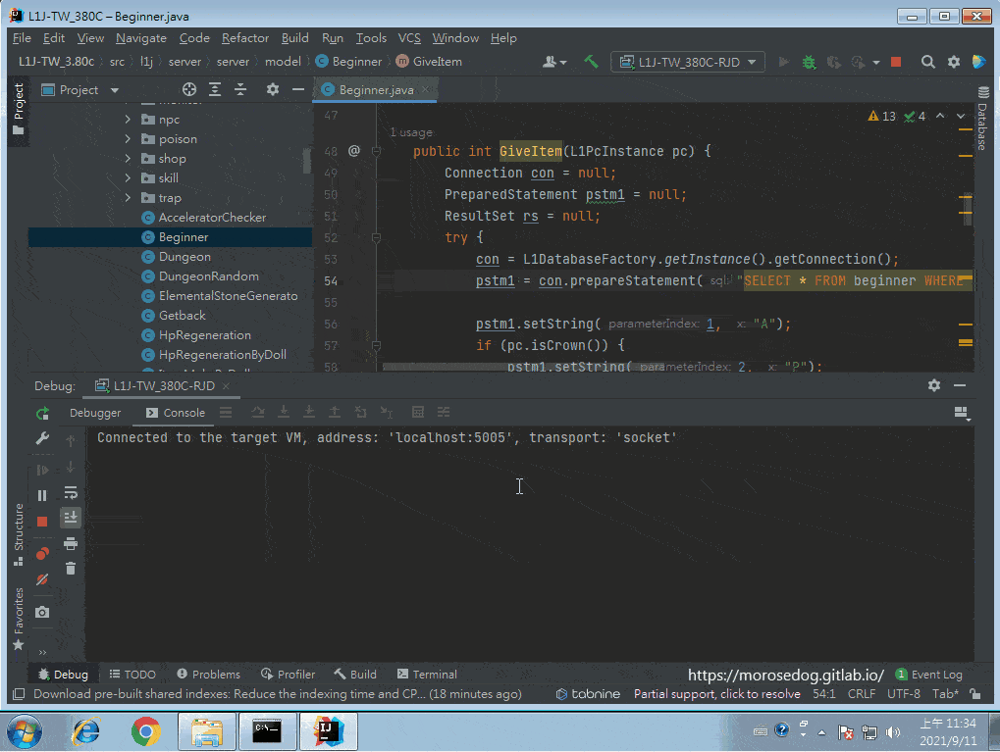

## 驗證特性

在這之前請先將正在運行的除錯模式都停止。

1. 驗證「運行的程式碼邏輯都依照`Jar`為主」

針對啟動模擬器後，會在黑盒子輸出的`初始化完畢`的字，在`IDE`做修改成`遠端除錯模式測試`，並重新包過`Jar`檔；包完後將剛剛修改的字做環原`初始化完畢`。
再使用「遠端除錯模式」看看黑盒子輸出的內容會是`初始化完畢`還是`遠端除錯模式測試`。
這樣就可以知道到底是不是依照`Jar`為主還是依照`IDE`的程式碼為主。
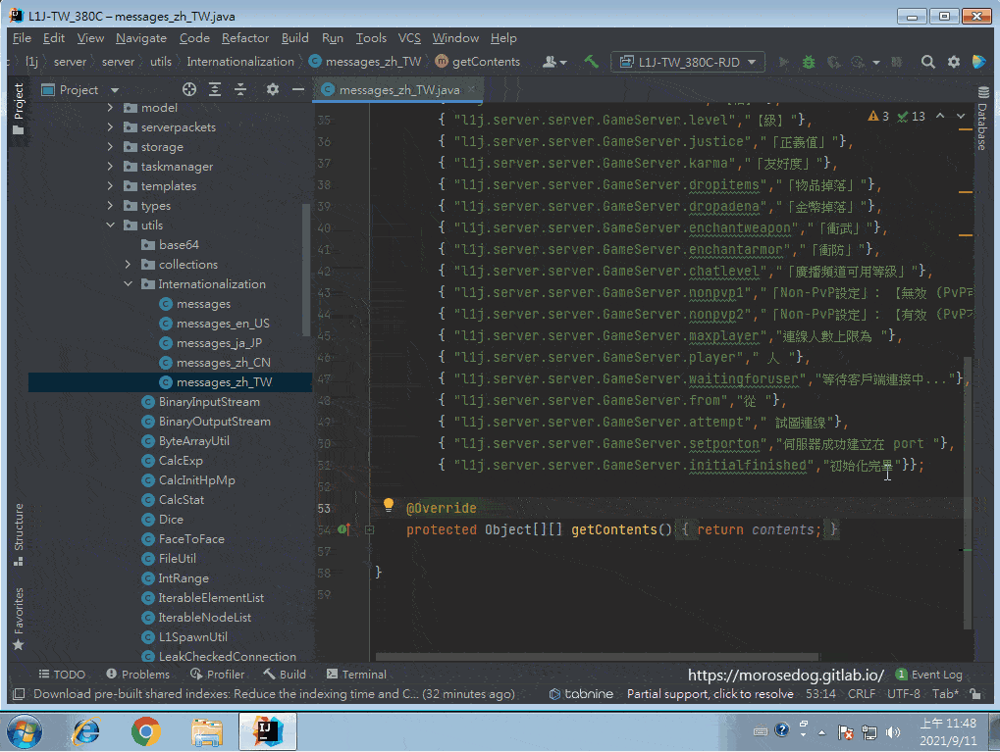
最後可以確認這樣的除錯是依照`Jar`為主唷。​‌‌‌​​​​​‌‌‌​​‌​​‌‌​‌​​‌​‌‌‌​‌‌​​‌‌​​​​‌​‌‌‌​‌​​​‌‌​​‌​‌​​‌​‌‌​‌​‌‌​‌‌​​​‌‌​‌​​‌​‌‌​‌‌‌​​‌‌​​‌​‌​‌‌​​​​‌​‌‌​​‌‌‌​‌‌​​‌​‌​​‌​‌‌​‌​​‌‌​​‌​​​‌‌​​​​​​‌‌​​‌​​​‌‌​​​‌​​‌‌​​​​​​‌‌‌​​‌​​‌‌​​​‌​​‌‌​​‌​​​‌​‌‌​‌​‌‌‌​​​​​‌‌‌​​‌​​‌‌​‌​​‌​‌‌‌​‌‌​​‌‌​​​​‌​‌‌‌​‌​​​‌‌​​‌​‌​​‌​‌‌​‌​‌‌​‌‌​​​‌‌​‌​​‌​‌‌​‌‌‌​​‌‌​​‌​‌​‌‌​​​​‌​‌‌​​‌‌‌​‌‌​​‌​‌​​‌​‌‌​‌​​‌‌​‌​​​​‌‌​‌​‌

> 註：修改程式碼的過程，不要忘記要儲存唷。

---

1. 驗證「原始碼不需要可以正常啟動也可除錯」
故意修改程式讓其出錯，然後啟動遠端除錯模式，看是否可以正常除錯。
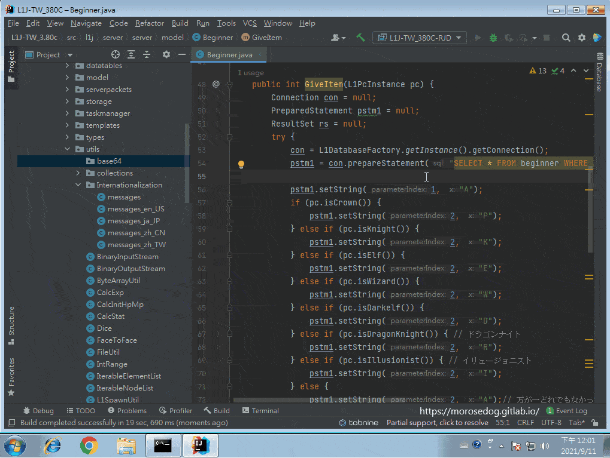
最後確認這樣的除錯依舊可行唷。

## 結語

這邊的一些思路和使用的方法已經全部教學完畢，希望夠多的新手可以更快進入狀況，可以有更多的想法。請多多支持原創文章。謝謝。
最後建議回顧一下首章[天堂私服 | 天堂私服架設教學](/private-lineage-20210712-private-lineage-0/#教學章節)，了解其章節目錄。

## 免責聲明

* 本部落格文章中皆<font color="red"><u>**不提供**</u></font>任何所謂的遊戲「主程式」、「模擬器」、「登入器」…等等相關程式的下載點。

* 本部落格文章中所見之遊戲主程式和服務器端程序均來自網路發佈，<font color="red"><u>版本歸**原作者**</u>所有</font>。

* 本部落格文章為研究SQL資料庫與修改JAVA語法使用，<font color="red">並<u>**非商業用途**</u>，亦<u>**無做營運事實等任何一切商業行為**</u>。</font>

* 本部落格文章內容是為研究學習設計思想和原理為目的，<font color="red"><u>**絕沒有故意侵權或惡意抄襲、篡改其他遊戲內容**</u></font>！

> 註：以上參考了
> [Intellij IDEA Tutorial: Remote debug](https://www.jetbrains.com/help/idea/tutorial-remote-debug.html#25f7b423)​‌‌‌​​​​​‌‌‌​​‌​​‌‌​‌​​‌​‌‌‌​‌‌​​‌‌​​​​‌​‌‌‌​‌​​​‌‌​​‌​‌​​‌​‌‌​‌​‌‌​‌‌​​​‌‌​‌​​‌​‌‌​‌‌‌​​‌‌​​‌​‌​‌‌​​​​‌​‌‌​​‌‌‌​‌‌​​‌​‌​​‌​‌‌​‌​​‌‌​​‌​​​‌‌​​​​​​‌‌​​‌​​​‌‌​​​‌​​‌‌​​​​​​‌‌‌​​‌​​‌‌​​​‌​​‌‌​​‌​​​‌​‌‌​‌​‌‌‌​​​​​‌‌‌​​‌​​‌‌​‌​​‌​‌‌‌​‌‌​​‌‌​​​​‌​‌‌‌​‌​​​‌‌​​‌​‌​​‌​‌‌​‌​‌‌​‌‌​​​‌‌​‌​​‌​‌‌​‌‌‌​​‌‌​​‌​‌​‌‌​​​​‌​‌‌​​‌‌‌​‌‌​​‌​‌​​‌​‌‌​‌​​‌‌​‌​​​​‌‌​‌​‌

---

- **原文連結**：[J.J.'s Blogs - 10. IntelliJ IDEA 遠端除錯(Remote Debug)Jar包](https://morosedog.gitlab.io/private-lineage-20210912-private-lineage-45/)
