# 11. IntelliJ IDEA 反編譯 Jar包

# 天堂私服 | IntelliJ IDEA 反編譯 Jar包

    
    
      📑 目錄
      

1. [源起](#源起)
2. [問題](#問題)
3. [工具](#工具)
4. [JD-GUI 使用教學](#JD-GUI-使用教學)
5. [IntelliJ IDEA 反編譯教學](#IntelliJ-IDEA-反編譯教學)
6. [結語](#結語)
7. [免責聲明](#免責聲明)

    
    
    

## 源起

在技術討論的論壇中，有位網名為「知識領域」的大大提到：

```plain
我在看IDEA的java反編譯插件 反編譯出來的內容會差很多嗎...
最主要是目前有的jar透過jd-gui反編譯也沒辦法用debug模式QQ
有些參數跟調用都被jd反編譯後換掉了...
```

後續與其討論，可以嘗試使用`IDEA`本身的反編譯試試看，所以才有了此篇文章。
另外幫「知識領域」推廣他的`Discord`的頻道：

```plain
熱愛天堂技術宅，有興趣協助測試請加入：
```

**<font color="red"><2022-07-07補充></font>**
針對`Discord`的頻道，「知識領域」表示暫停招收朋友入內，有緣再開放唄，感謝高手們一同共襄盛舉。​‌‌‌​​​​​‌‌‌​​‌​​‌‌​‌​​‌​‌‌‌​‌‌​​‌‌​​​​‌​‌‌‌​‌​​​‌‌​​‌​‌​​‌​‌‌​‌​‌‌​‌‌​​​‌‌​‌​​‌​‌‌​‌‌‌​​‌‌​​‌​‌​‌‌​​​​‌​‌‌​​‌‌‌​‌‌​​‌​‌​​‌​‌‌​‌​​‌‌​​‌​​​‌‌​​​​​​‌‌​​‌​​​‌‌​​​‌​​‌‌​​​​​​‌‌‌​​‌​​‌‌​​​‌​​‌‌​‌‌​​​‌​‌‌​‌​‌‌‌​​​​​‌‌‌​​‌​​‌‌​‌​​‌​‌‌‌​‌‌​​‌‌​​​​‌​‌‌‌​‌​​​‌‌​​‌​‌​​‌​‌‌​‌​‌‌​‌‌​​​‌‌​‌​​‌​‌‌​‌‌‌​​‌‌​​‌​‌​‌‌​​​​‌​‌‌​​‌‌‌​‌‌​​‌​‌​​‌​‌‌​‌​​‌‌​‌​​​​‌‌‌​​‌

## 問題

網路上充斥著多種的模擬器版本，但是多數是沒有提供原始碼僅提供了`Jar`檔，尤其是需要花費購買的版本。
但是遊戲內容常有一些`Bug`或是希望透過修改核心程式碼新增遊戲內容，這樣就無法自行處理。

這時候就需要使用反編譯的工具來將編譯過的`class`檔，反編回`Java`檔。

但是…每一套的反編譯結果並不是都是最好的，可能與真時的原始碼差異很多或是反編譯後的內容是有錯誤的。​‌‌‌​​​​​‌‌‌​​‌​​‌‌​‌​​‌​‌‌‌​‌‌​​‌‌​​​​‌​‌‌‌​‌​​​‌‌​​‌​‌​​‌​‌‌​‌​‌‌​‌‌​​​‌‌​‌​​‌​‌‌​‌‌‌​​‌‌​​‌​‌​‌‌​​​​‌​‌‌​​‌‌‌​‌‌​​‌​‌​​‌​‌‌​‌​​‌‌​​‌​​​‌‌​​​​​​‌‌​​‌​​​‌‌​​​‌​​‌‌​​​​​​‌‌‌​​‌​​‌‌​​​‌​​‌‌​‌‌​​​‌​‌‌​‌​‌‌‌​​​​​‌‌‌​​‌​​‌‌​‌​​‌​‌‌‌​‌‌​​‌‌​​​​‌​‌‌‌​‌​​​‌‌​​‌​‌​​‌​‌‌​‌​‌‌​‌‌​​​‌‌​‌​​‌​‌‌​‌‌‌​​‌‌​​‌​‌​‌‌​​​​‌​‌‌​​‌‌‌​‌‌​​‌​‌​​‌​‌‌​‌​​‌‌​‌​​​​‌‌‌​​‌

## 工具

網路上`Java`的反編譯工具非常的多，這邊僅介紹兩款。

* 1. `Java Decompiler`(簡稱：`JD`)
在這邊使用的軟體為`JD-GUI`工具，只需要簡單的開啟`Jar`或是`Class`即可即時反編譯內容。
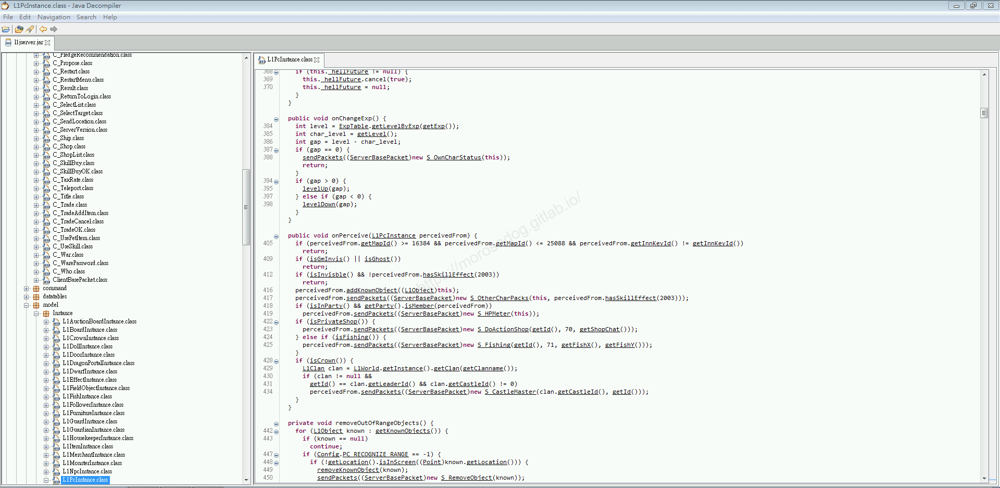

* 1. `Intellij IDEA`。
本身`IDEA`是有反編譯插件，目前已經是預設安裝；只需要將`Class`檔案拖曳進去工作區就會即時反編譯。
而`Jar`檔的反編譯，需要透過指令來做反編譯的處理。
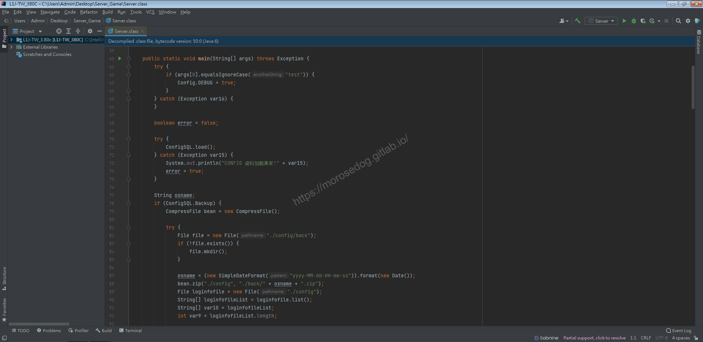

## JD-GUI 使用教學

首先，我們進入下載`Java Decompiler`的官方網站：[連結](http://java-decompiler.github.io/)

* 點擊`JD-GUI`旁的`Download`切換至下載區塊。
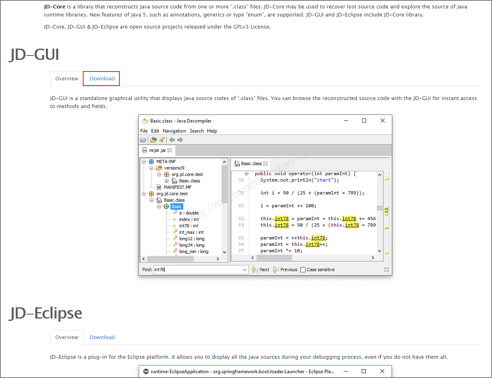

* 選擇你的作業系統的任一下載點，這裡我以 Windows 示範。
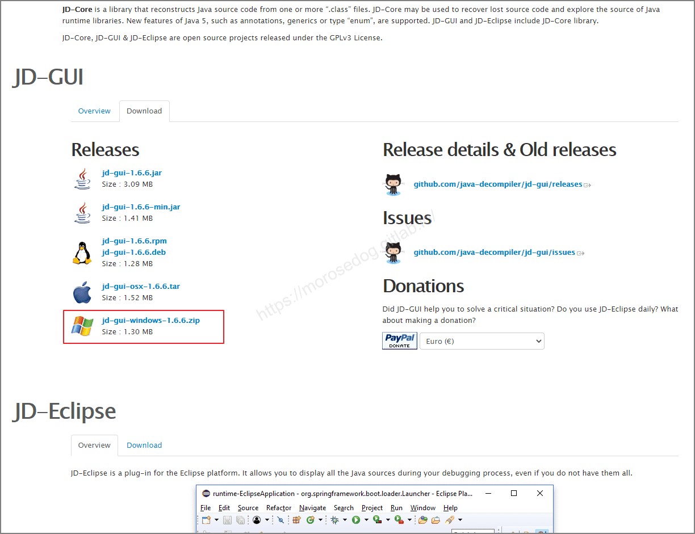

* 選擇後，便會開始下載。

* 下載完畢後，ˋ將其解壓縮，直接執行`jd-gui.exe`使用。

* 如果遇到執行時跳出`A Java Exception has occurred.`錯誤視窗。

* 這是因為電腦的`Java`版本太高問題。
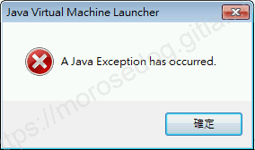

* 可以使用以下指令開啟。

```bash
java -jar jd-gui.exe
```

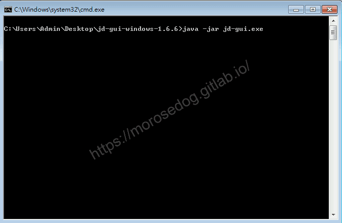

* 正常開啟後，可以直接將`Class`或是`Jar`檔做開啟，即會反編譯。
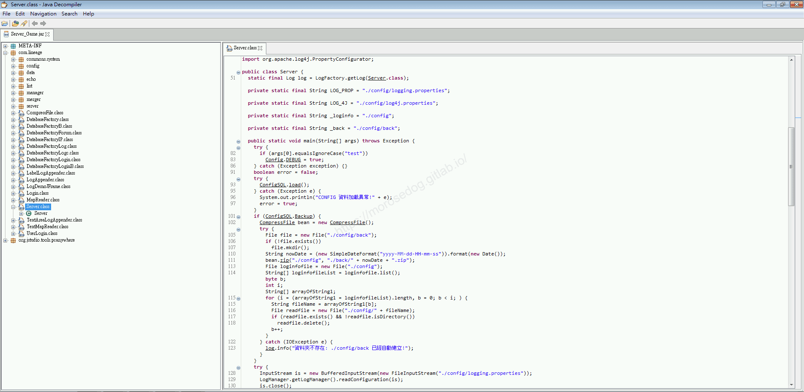

* 如要將`Jar`檔的反編譯的全部另存。

* 點擊`File`→`Save All Sources`，做另存即可。
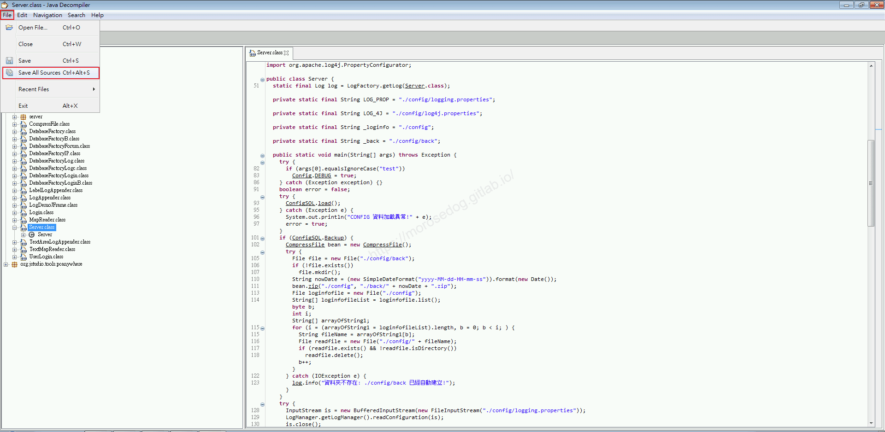

## IntelliJ IDEA 反編譯教學

開啟`IntelliJ IDEA`拖曳`Class`進入反編譯的部分就不在解說。
以下是要針對`Jar`檔的反編譯做教學。​‌‌‌​​​​​‌‌‌​​‌​​‌‌​‌​​‌​‌‌‌​‌‌​​‌‌​​​​‌​‌‌‌​‌​​​‌‌​​‌​‌​​‌​‌‌​‌​‌‌​‌‌​​​‌‌​‌​​‌​‌‌​‌‌‌​​‌‌​​‌​‌​‌‌​​​​‌​‌‌​​‌‌‌​‌‌​​‌​‌​​‌​‌‌​‌​​‌‌​​‌​​​‌‌​​​​​​‌‌​​‌​​​‌‌​​​‌​​‌‌​​​​​​‌‌‌​​‌​​‌‌​​​‌​​‌‌​‌‌​​​‌​‌‌​‌​‌‌‌​​​​​‌‌‌​​‌​​‌‌​‌​​‌​‌‌‌​‌‌​​‌‌​​​​‌​‌‌‌​‌​​​‌‌​​‌​‌​​‌​‌‌​‌​‌‌​‌‌​​​‌‌​‌​​‌​‌‌​‌‌‌​​‌‌​​‌​‌​‌‌​​​​‌​‌‌​​‌‌‌​‌‌​​‌​‌​​‌​‌‌​‌​​‌‌​‌​​​​‌‌‌​​‌

* 首先找到`IntelliJ IDEA`的安裝目錄。
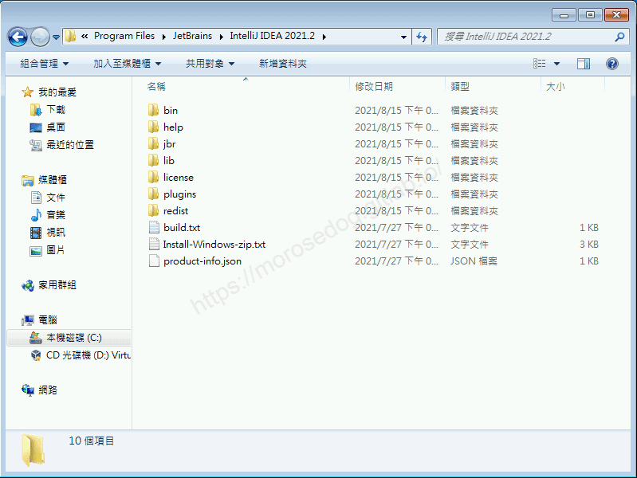

* 進入`\plugins\java-decompiler\lib\`找到`java-decompiler.jar`檔，並複製其檔案路徑。

```bash
"C:\Program Files\JetBrains\IntelliJ IDEA 2021.2\plugins\java-decompiler\lib\java-decompiler.jar"
```

* 針對需要反編譯的模擬器`Jar`檔，也複製其檔案路徑。

```bash
"C:\IntelliJ-workspace\L1J-3.80c\l1jserver.jar"
```

* 新建立一個反編譯後要目的的目錄。

* 這邊建立`DC_Temp`。

```bash
"C:\DC_Temp"
```

* 組合反編譯的指令如下去替換三個參數。

* 替換前

```bash
java -cp ${IDEA plugin decompiler.jar} org.jetbrains.java.decompiler.main.decompiler.ConsoleDecompiler -dgs=true ${模擬器Jar檔} ${目的路徑}
```

* 替換後

```bash
java -cp "C:\Program Files\JetBrains\IntelliJ IDEA 2021.2\plugins\java-decompiler\lib\java-decompiler.jar" org.jetbrains.java.decompiler.main.decompiler.ConsoleDecompiler -dgs=true "C:\IntelliJ-workspace\L1J-3.80c\l1jserver.jar" "C:\DC_Temp"
```

* 開啟`命令提示字元`輸入上方的指令，並執行。

* 如有跳出`Unsupported major.minor version 55.0`錯誤訊息。

* 這是表示使用的`Java`版本太低了，而`version 55.0`表示對應的版本。
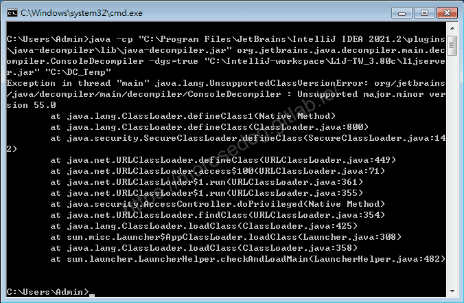

```plain
# https://en.wikipedia.org/wiki/Java_class_file#General_layout
Java SE 17 = 61 (0x3D hex)
Java SE 16 = 60 (0x3C hex)
Java SE 15 = 59 (0x3B hex)
Java SE 14 = 58 (0x3A hex)
Java SE 13 = 57 (0x39 hex)
Java SE 12 = 56 (0x38 hex)
Java SE 11 = 55 (0x37 hex)
Java SE 10 = 54 (0x36 hex)
Java SE 9 = 53 (0x35 hex)
Java SE 8 = 52 (0x34 hex)
Java SE 7 = 51 (0x33 hex)
Java SE 6.0 = 50 (0x32 hex)
Java SE 5.0 = 49 (0x31 hex)
JDK 1.4 = 48 (0x30 hex)
JDK 1.3 = 47 (0x2F hex)
JDK 1.2 = 46 (0x2E hex)
JDK 1.1 = 45 (0x2D hex)
```

* 可見`55` = `Java 11`，安裝`Java 11`後，再次即可正常執行。

* 反編譯過程需要時間，請耐心等候。
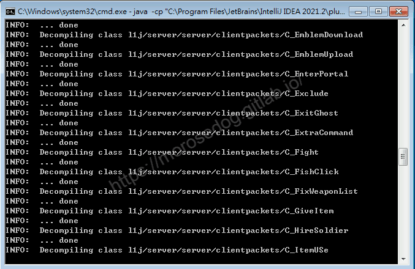

* 以下為反編譯完成後的畫面。
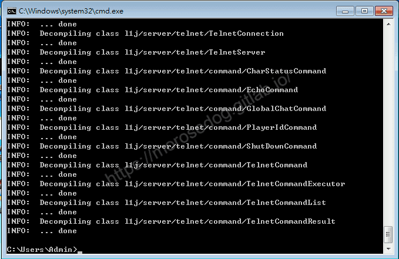

* 進入反編譯後的目的目錄。

* 可見於原來的模擬器核心一樣檔名的`Jar`檔。(請不要著急)
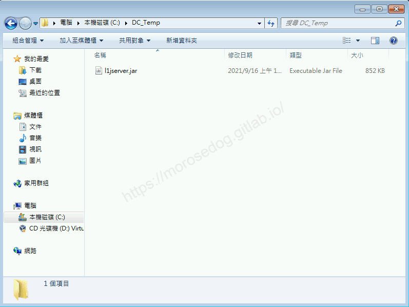

* 反編譯後，他依舊是一個`Jar`檔，但透過解壓縮軟體解壓縮後，內部都已經是`Java`檔了。
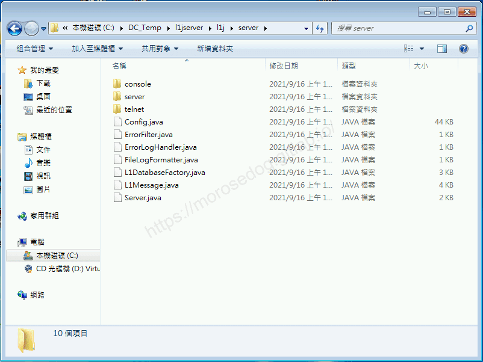

## 結語

反編譯工具很多也不難使用，難在反編譯後的程式碼修正與除錯。
最後建議回顧一下首章[天堂私服 | 天堂私服架設教學](/private-lineage-20210712-private-lineage-0/#教學章節)，了解其章節目錄。

## 免責聲明

* 本部落格文章中皆<font color="red"><u>**不提供**</u></font>任何所謂的遊戲「主程式」、「模擬器」、「登入器」…等等相關程式的下載點。

* 本部落格文章中所見之遊戲主程式和服務器端程序均來自網路發佈，<font color="red"><u>版本歸**原作者**</u>所有</font>。

* 本部落格文章為研究SQL資料庫與修改JAVA語法使用，<font color="red">並<u>**非商業用途**</u>，亦<u>**無做營運事實等任何一切商業行為**</u>。</font>

* 本部落格文章內容是為研究學習設計思想和原理為目的，<font color="red"><u>**絕沒有故意侵權或惡意抄襲、篡改其他遊戲內容**</u></font>！

> 註：以上參考了
> [維基百科 - Java class file](https://en.wikipedia.org/wiki/Java_class_file#General_layout)

---

- **原文連結**：[J.J.'s Blogs - 11. IntelliJ IDEA 反編譯 Jar包](https://morosedog.gitlab.io/private-lineage-20210916-private-lineage-49/)
