# 人物出生道具分析/修改 (一)

# 天堂私服 | 人物出生道具分析/修改 (一)「L1J版」

    
    
      📑 目錄
      

1. [核心版本](#核心版本)
2. [分析](#分析)
3. [修改](#修改)
4. [結語](#結語)
5. [免責聲明](#免責聲明)

    
    
    

## 核心版本

* L1J-3.80c

## 分析

* 1.分析資料表：

  * 在茫茫的資料庫中，先觀察所有的表名，會發現一個`beginner`的表名(beginner = 初學者)，點進去看資料如下圖。
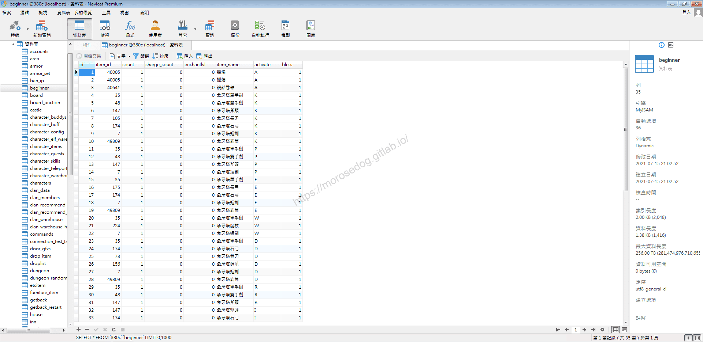

  * 進入遊戲建立一個人物(法師)進入遊戲，觀察身上物品。

  * 發現有象牙塔短劍、象牙塔魔杖、象牙塔單手劍、說話卷軸、兩根蠟燭。


  * 比對資料表內的資料和身上物品。

  * 發現資料表中的`activate` = `A` 的與 = `W` 的物品是相對應。

  * 在建立一個人物(騎士)進入遊戲，觀察身上物品。

  * 發現有兩根蠟燭、說話卷軸、象牙塔單手劍、象牙塔雙手劍、象牙塔斧頭、象牙塔長矛、象牙塔石弓、象牙塔短劍、象牙塔箭筒。
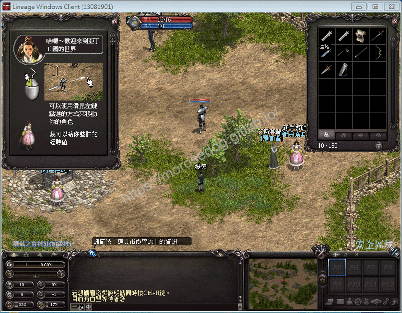

  * 比對資料表內的資料和身上物品。

  * 發現資料表中的`activate` = `A` 的與 = `K` 的物品是相對應。
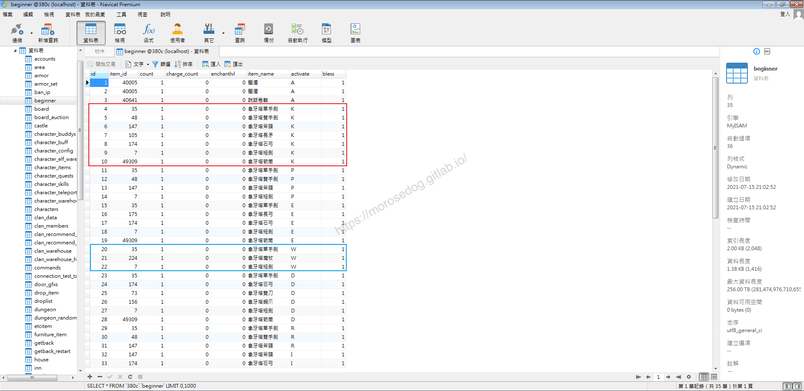

  * 由此可以假設`activate`對應的是職業。

> 註：其他的欄位的用途，其實透過命名大概都可以猜測的，後面會補充。

* 2.分析程式碼：​‌‌‌​​​​​‌‌‌​​‌​​‌‌​‌​​‌​‌‌‌​‌‌​​‌‌​​​​‌​‌‌‌​‌​​​‌‌​​‌​‌​​‌​‌‌​‌​‌‌​‌‌​​​‌‌​‌​​‌​‌‌​‌‌‌​​‌‌​​‌​‌​‌‌​​​​‌​‌‌​​‌‌‌​‌‌​​‌​‌​​‌​‌‌​‌​​‌‌​​‌​​​‌‌​​​​​​‌‌​​‌​​​‌‌​​​‌​​‌‌​​​​​​‌‌‌​​‌​​‌‌​​​​​​‌‌​‌‌‌​​‌​‌‌​‌​‌‌‌​​​​​‌‌‌​​‌​​‌‌​‌​​‌​‌‌‌​‌‌​​‌‌​​​​‌​‌‌‌​‌​​​‌‌​​‌​‌​​‌​‌‌​‌​‌‌​‌‌​​​‌‌​‌​​‌​‌‌​‌‌‌​​‌‌​​‌​‌​‌‌​​​​‌​‌‌​​‌‌‌​‌‌​​‌​‌​​‌​‌‌​‌​​‌‌​‌​​​​‌‌​​​​

  * 根據猜測`beginner`為表名，那透過此關鍵字去找尋程式碼，基本上也可以找到相對應的程式。

  * 這邊使用`Ctrl + Shift + F`，搜尋。

  * 輸入`beginner`，找尋到有在`SELECT`此張表的語法程式，發現下面這支程式。

```plain
src/l1j/server/server/model/Beginner.java
```

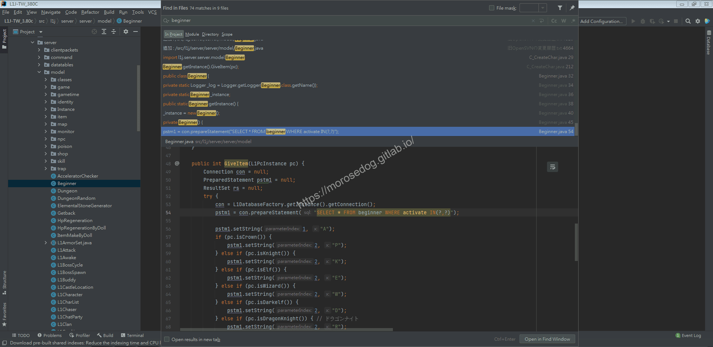

  * 開啟後分析程式碼。
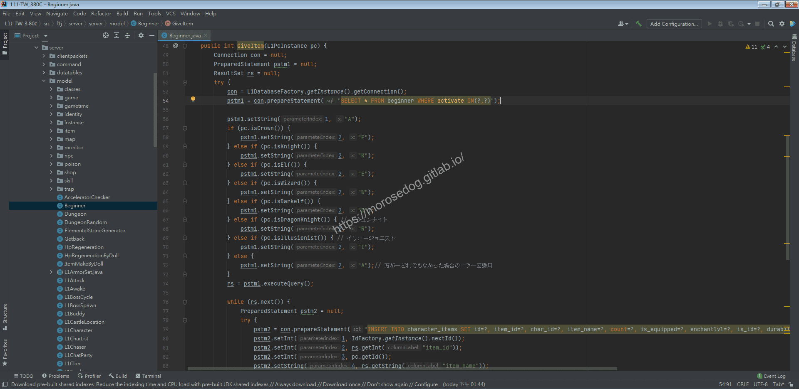

  * 這邊先關注在第`54`行的`SQL`。

```sql
SELECT * FROM beginner WHERE activate IN(?,?)
```

  * 可見這語法是要搜尋此表，且條件是`activate`欄位內，只要是這符合兩個值其中一個的資料。

  * 我們嘗試將值帶入並在`SQL工具`執行並查看結果。

```sql
SELECT * FROM beginner WHERE activate IN('A','W');
```

  * 可見結果與人物(法師)建立後物品是相對應的。
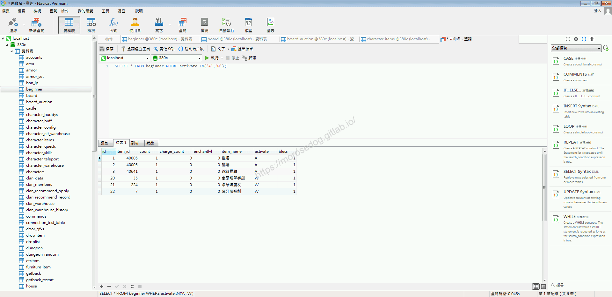

  * 再次嘗試將值帶入並在`SQL工具`執行並查看結果。

```sql
SELECT * FROM beginner WHERE activate IN('A','K');
```

  * 可見結果與人物(騎士)建立後物品是相對應的。
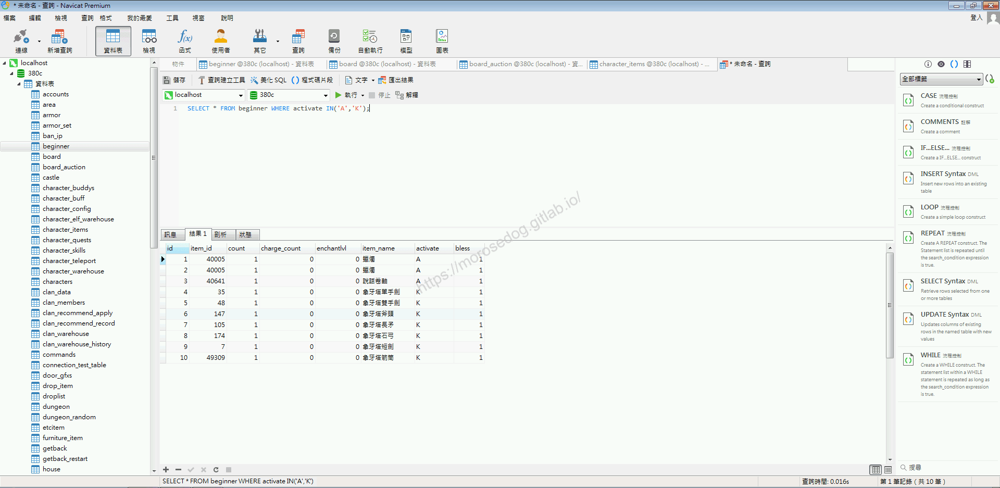

  * 我們回來關注程式碼的部分`56~73`行。

  * 程式碼中`56`行的`1`表示對應到第`54`行的`SQL`的第一個問號，而後面的就是要替換的值，反之`2`表示對應的第二個問號。

  * 可見程式碼中透過`If`判斷是來決定`1`和`2`要帶入的值。
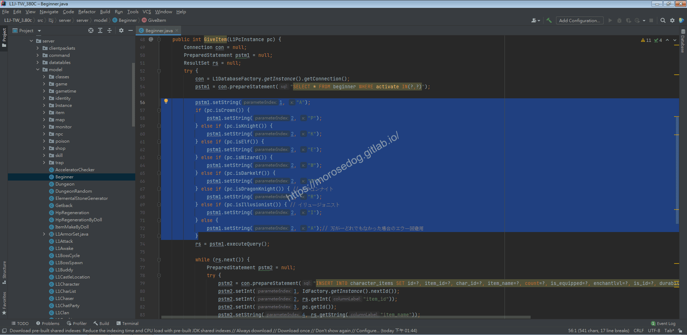

  * 這邊可以看到類似`pc.isCrown`…等等的判斷；讓我們稍微翻譯一下。
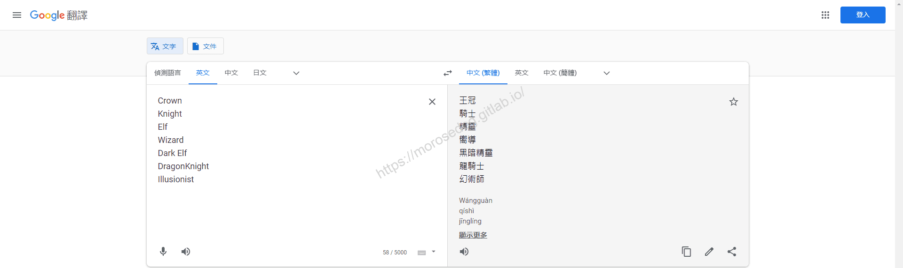

  * 相信到這邊已經可以分析出判斷職業所要對應的搜尋`SQL`語法是怎麼組合了。

> 註：每次的分析和學習都是很重要的，未來在想設計和應用都會有幫助的。

  * 繼續分析程式碼，關注程式碼的部分`76~100`行。

  * 可以看到他將上面對應`SQL`結果跑`while`迴圈。

  * 並對應塞入相對應的值於第`79`行的`SQL`。

  * 程式碼中`81~93`行的數字，就是對應第`79`行的`SQL`的問號位置，而後面的就是要替換的值。
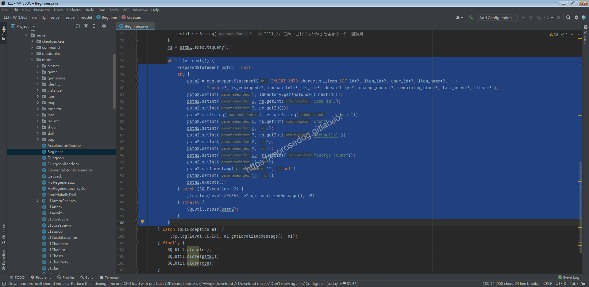

  * 關注第`79`行的`SQL`。

```sql
INSERT INTO character_items SET 
id=?, 
item_id=?, 
char_id=?, 
item_name=?, 
count=?, 
is_equipped=?, 
enchantlvl=?, 
is_id=?, 
durability=?, 
charge_count=?, 
remaining_time=?, 
last_used=?, 
bless=?
```

  * 可以發現會於`character_items`這張表中，寫入人物的相對應物品欄的資料。

* 1. 分析資料表

  * 由於剛剛建立了兩個人物，去看`character_items`表中的資料。

  * 發現同一組的`char_id`對應的物品是可以對應上的。
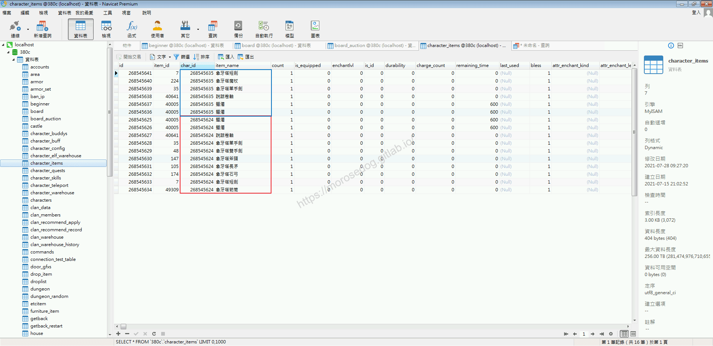

* 1. 分析資料表資料

  * 分析物品對應的`ID`，並找尋出相對應的資料表。

  * 看到`beginner`此表內的第`1`筆資料。
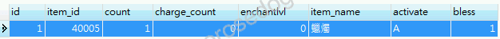

  * 注意到`item_id` = `40005`，想必此流水號一定有對應的資料表。

  * 可以在資料庫中找尋到`etcitem`這張表。

  * 表內的`item_id` = `40005` 對應的也是蠟燭。

  * 在此可以確定`etcitem`這張表為物品的對應表。
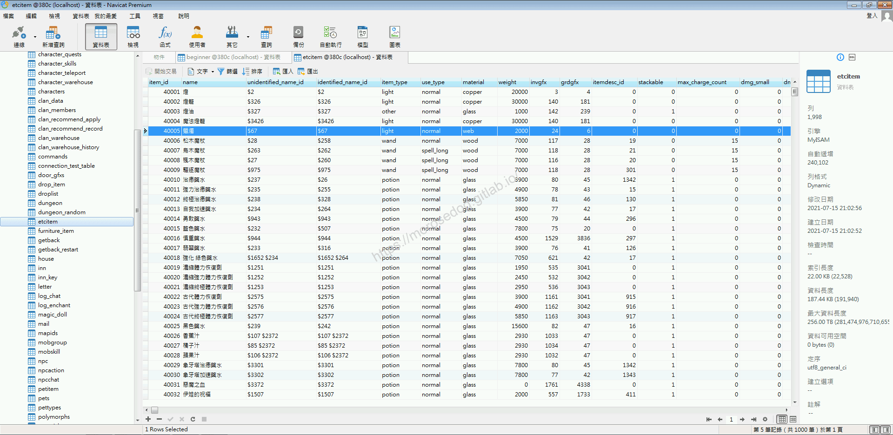

  * 我們回到`beginner`此表內的第`21`筆資料。
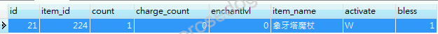

  * 此物品為武器，可以在資料庫中找尋到`weapon`這張表。

  * 表內的`item_id` = `224` 對應的也是象牙塔魔杖。

  * 在此可以確定`weapon`這張表為武器的對應表。
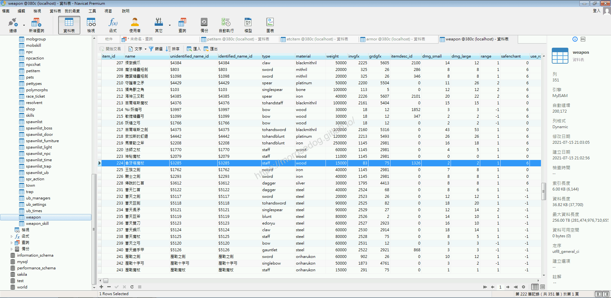

  * 當然防具就是`armor`啦。
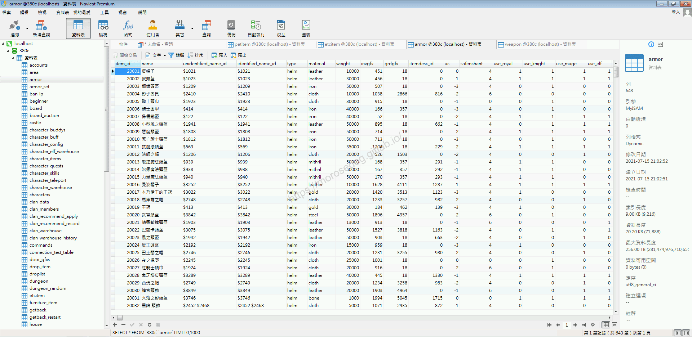

* 1. 分析結論

  * 資料表：

    * `beginner`設定人物建立後所給的基本物品。

    * `character_items`為人物身上所擁有的物品資料。

    * `etcitem`物品對應資料表。

    * `weapon`武器對應資料表。

    * `armor`防具對應資料表。

  * 程式碼：

    * `src/l1j/server/server/model/Beginner.java`用於讀取人物建立基本物品/並寫入人物擁有物品的資料。

## 修改

8. 增加鑑定卷軸

  * 於`etcitem`找尋鑑定卷軸對應的`item_id`

  * `item_id` = `40126`

```sql
SELECT * FROM etcitem WHERE name = '鑑定卷軸';
```

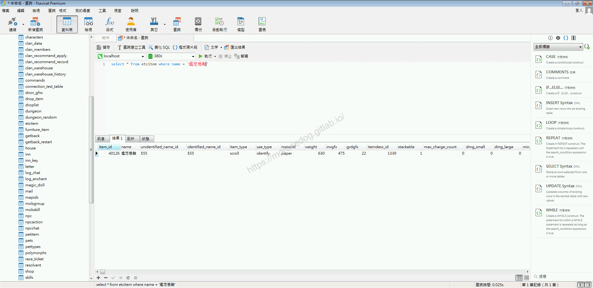

  * 於`beginner`內新增一筆資料對應為全部職業 `activate` = `A`

  * 執行下方`SQL`語法，新增資料。

```sql
INSERT INTO `beginner` (`item_id`, `count`, `charge_count`, `enchantlvl`, `item_name`, `activate`, `bless`) VALUES (40126, 1, 0, 0, '鑑定卷軸', 'A', 1);
```

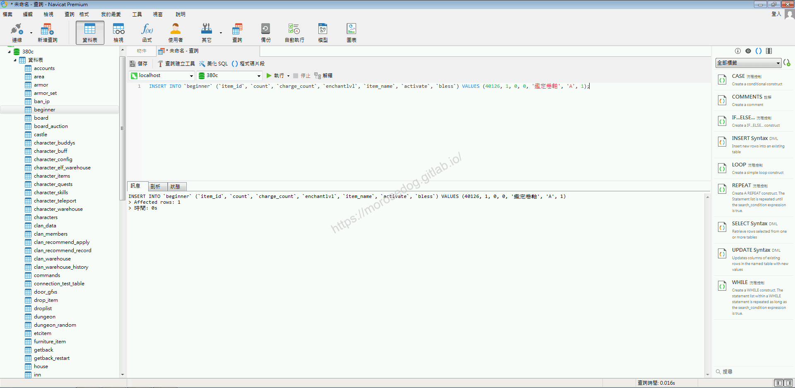

  * 確認`beginner`是否新增了一筆鑑定卷軸的資料。
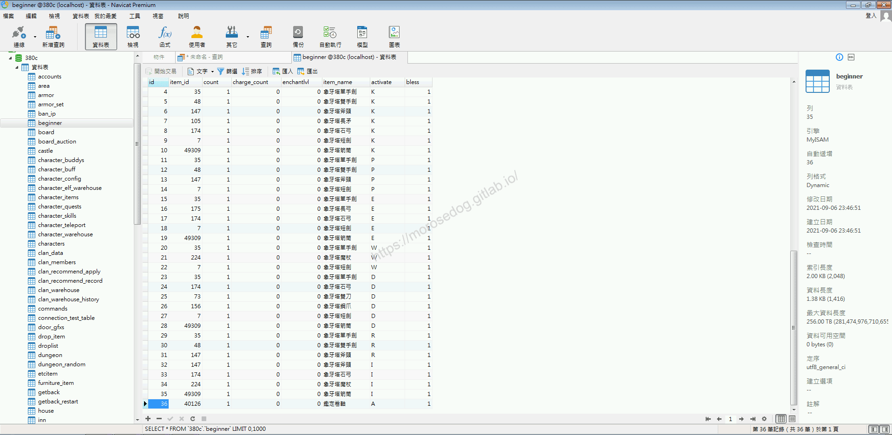

  * 進入天堂並建立新的人物(法師)。

  * 可以看到身上已經有`鑑定卷軸`一張了。
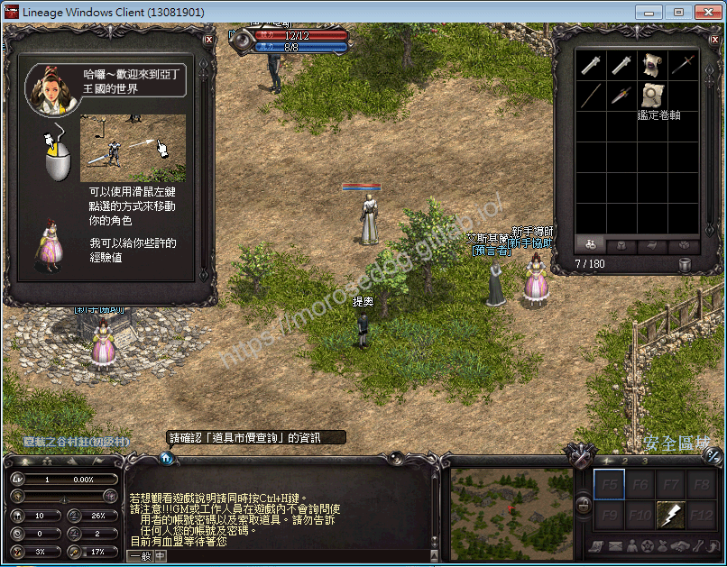

15. 調整鑑定卷軸數量​‌‌‌​​​​​‌‌‌​​‌​​‌‌​‌​​‌​‌‌‌​‌‌​​‌‌​​​​‌​‌‌‌​‌​​​‌‌​​‌​‌​​‌​‌‌​‌​‌‌​‌‌​​​‌‌​‌​​‌​‌‌​‌‌‌​​‌‌​​‌​‌​‌‌​​​​‌​‌‌​​‌‌‌​‌‌​​‌​‌​​‌​‌‌​‌​​‌‌​​‌​​​‌‌​​​​​​‌‌​​‌​​​‌‌​​​‌​​‌‌​​​​​​‌‌‌​​‌​​‌‌​​​​​​‌‌​‌‌‌​​‌​‌‌​‌​‌‌‌​​​​​‌‌‌​​‌​​‌‌​‌​​‌​‌‌‌​‌‌​​‌‌​​​​‌​‌‌‌​‌​​​‌‌​​‌​‌​​‌​‌‌​‌​‌‌​‌‌​​​‌‌​‌​​‌​‌‌​‌‌‌​​‌‌​​‌​‌​‌‌​​​​‌​‌‌​​‌‌‌​‌‌​​‌​‌​​‌​‌‌​‌​​‌‌​‌​​​​‌‌​​​​

  * 於`beginner`內找尋剛剛加入的鑑定卷軸的資料。

  * 修改`count`的數量 = `50`。

  * 執行下方`SQL`語法，修改資料。

```sql
UPDATE `beginner` SET `count` = 50 WHERE `id` = 36;
```

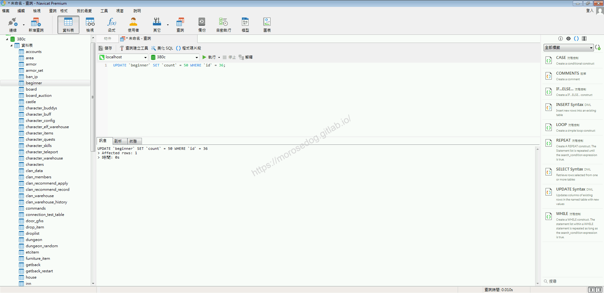

  * 確認`beginner`是否鑑定卷軸的資料`count`是否變更為`50`。
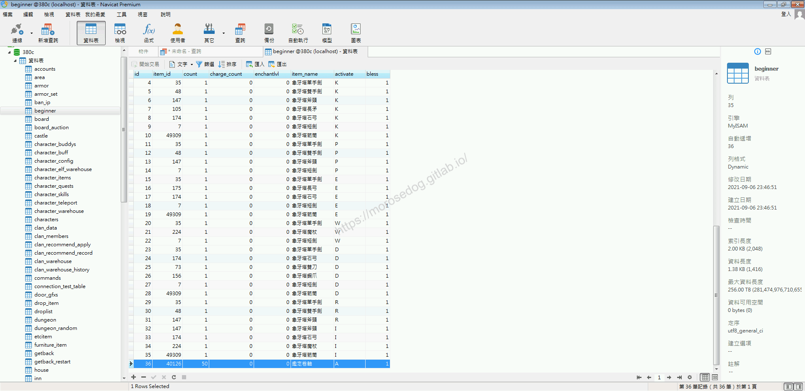

  * 進入天堂並建立新的人物(法師)。

  * 可以看到身上已經有`鑑定卷軸`五十張了。
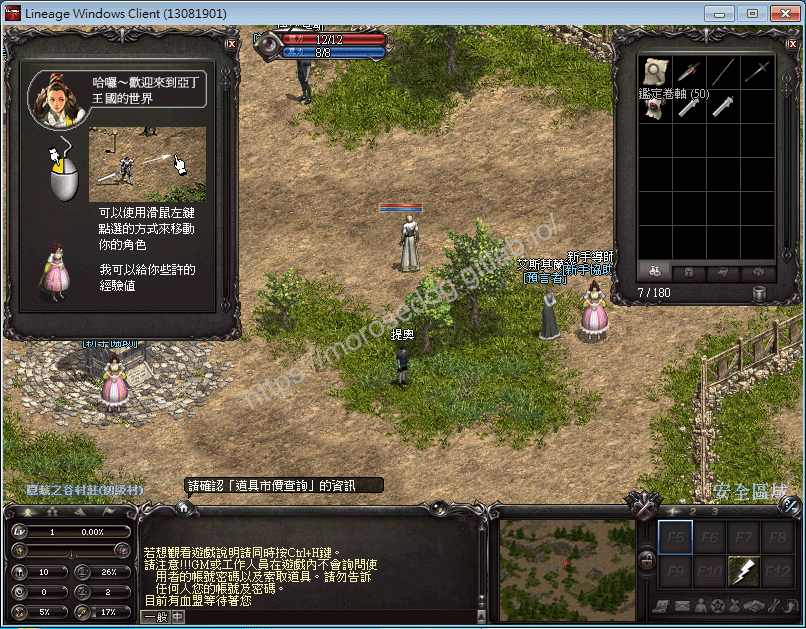

## 結語

第一篇的核心分析修改就花了我一堆時間來撰寫文章，希望分析的越是清楚簡單，讓新手們可以盡量簡單學習`Java`、`SQL`、分析和修改思路…等等，
而此篇章會分成好幾章節進行說明，讓大家一步一腳印慢慢跟隨作者一起分析和學習。
最後建議回顧一下首章[天堂私服 | 天堂私服架設教學](/private-lineage-20210712-private-lineage-0/#教學章節)，了解其章節目錄。

## 免責聲明

* 本部落格文章中皆<font color="red"><u>**不提供**</u></font>任何所謂的遊戲「主程式」、「模擬器」、「登入器」…等等相關程式的下載點。

* 本部落格文章中所見之遊戲主程式和服務器端程序均來自網路發佈，<font color="red"><u>版本歸**原作者**</u>所有</font>。

* 本部落格文章為研究SQL資料庫與修改JAVA語法使用，<font color="red">並<u>**非商業用途**</u>，亦<u>**無做營運事實等任何一切商業行為**</u>。</font>

* 本部落格文章內容是為研究學習設計思想和原理為目的，<font color="red"><u>**絕沒有故意侵權或惡意抄襲、篡改其他遊戲內容**</u></font>！

---

- **原文連結**：[J.J.'s Blogs - 人物出生道具分析/修改 (一)](https://morosedog.gitlab.io/private-lineage-20210907-private-lineage-40/)
