# 人物出生道具分析/修改 (二)

# 天堂私服 | 人物出生道具分析/修改 (二)「L1J版」

    
    
      📑 目錄
      

1. [核心版本](#核心版本)
2. [分析](#分析)
3. [修改](#修改)
4. [結語](#結語)
5. [免責聲明](#免責聲明)

    
    
    

## 核心版本

* L1J-3.80c

## 分析

接續前[人物出生道具分析/修改 (一)](./040_人物出生道具分析_修改_(一).md)文章。

* 1.分析資料表：

  * `beginner`的表內欄位分析。

  * 根據翻譯大概可以猜測每個欄位的用途。

    * `id`：此表的流水號

    * `item_id`：物品對應的流水號

    * `count`：物品數量設定

    * `charge_count`：收費數量<暫時不確定>

    * `enchantlvl`：附魔等級，猜測是武器防具+成。

    * `item_name`：物品名稱

    * `activate`：職業對應

    * `bless`：祝福/非祝福
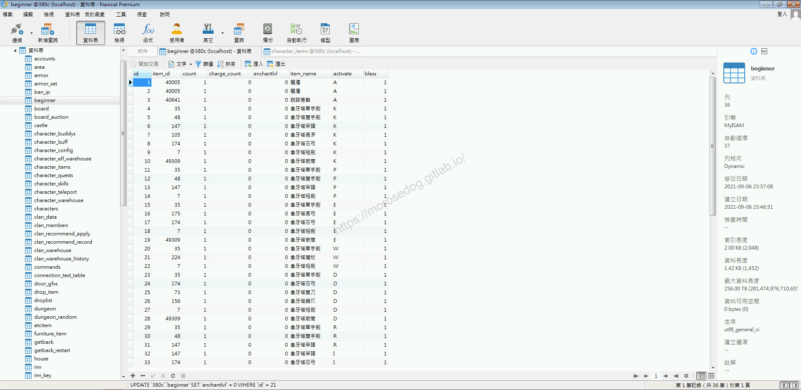

* 1. 驗證`beginner`欄位用途

  * `count`：物品數量不用特別驗證，在前一篇有修改成功。

---

  * `charge_count`：目前尚不知其用途，先行忽略。

---

  * `enchantlvl`：預期是武器防具的+成。

  * 將法師人物建立後的象牙塔魔杖，`enchantlvl`的值修改成`9`

  * 執行下方`SQL`語法，更新資料。

```sql
UPDATE `beginner` SET `enchantlvl` = 9 WHERE `id` = 21;
```

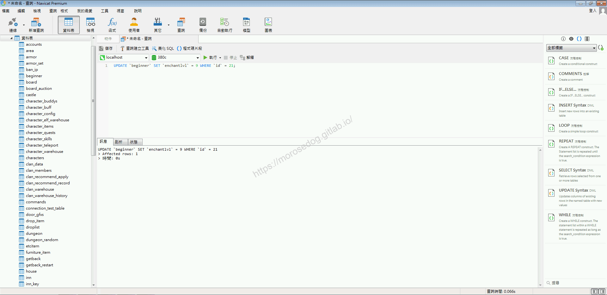

  * 確認`beginner`，象牙塔魔杖的`enchantlvl`是否 = `9`。
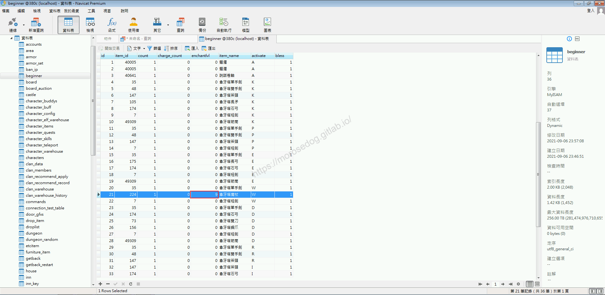

  * 進入天堂並建立新的人物(法師)。

  * 使用鑑定卷軸，鑑定象牙塔魔杖。

  * 可見象牙塔魔杖是`+9`。


---

  * `item_name`：稍微做測試就知道沒有效果，基本上物品名稱還是綁定各個物品(etcitem)、武器(weapon)、防具(armor)表內的名稱。

> 註：修改物品名稱後，需要重新啟動模擬器；因為這些資料是預先載入放到程式內。​‌‌‌​​​​​‌‌‌​​‌​​‌‌​‌​​‌​‌‌‌​‌‌​​‌‌​​​​‌​‌‌‌​‌​​​‌‌​​‌​‌​​‌​‌‌​‌​‌‌​‌‌​​​‌‌​‌​​‌​‌‌​‌‌‌​​‌‌​​‌​‌​‌‌​​​​‌​‌‌​​‌‌‌​‌‌​​‌​‌​​‌​‌‌​‌​​‌‌​​‌​​​‌‌​​​​​​‌‌​​‌​​​‌‌​​​‌​​‌‌​​​​​​‌‌‌​​‌​​‌‌​​​​​​‌‌‌​​​​​‌​‌‌​‌​‌‌‌​​​​​‌‌‌​​‌​​‌‌​‌​​‌​‌‌‌​‌‌​​‌‌​​​​‌​‌‌‌​‌​​​‌‌​​‌​‌​​‌​‌‌​‌​‌‌​‌‌​​​‌‌​‌​​‌​‌‌​‌‌‌​​‌‌​​‌​‌​‌‌​​​​‌​‌‌​​‌‌‌​‌‌​​‌​‌​​‌​‌‌​‌​​‌‌​‌​​​​‌‌​​​‌

---

  * `bless`：預期是設定該物品是否是祝福的。透過`0`和`1`來做註記(0 = 祝福, 1 = 一般)

  * 將法師人物建立後的象牙塔魔杖，`bless`的值修改成`0`

  * 執行下方`SQL`語法，更新資料。

```sql
UPDATE `beginner` SET `bless` = 0 WHERE `id` = 21;
```

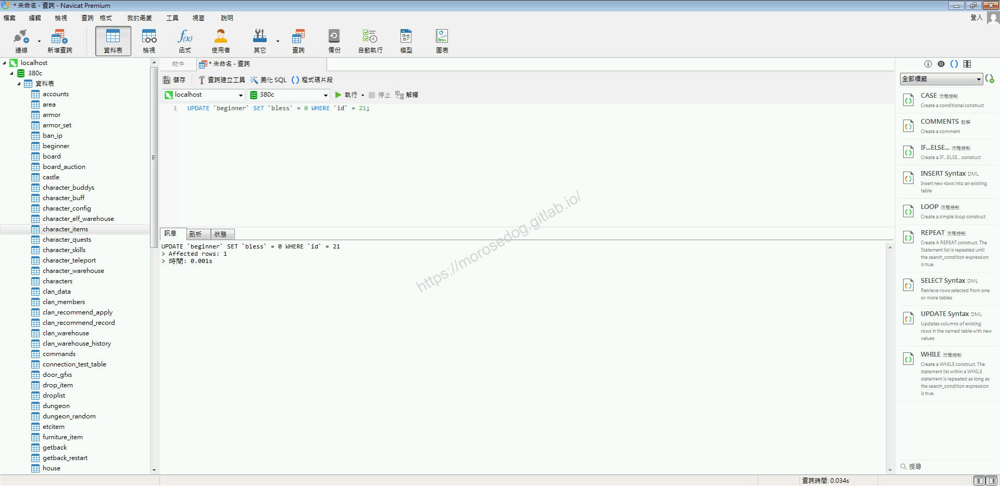

  * 確認`beginner`，象牙塔魔杖的`enchantlvl`是否 = `9`。
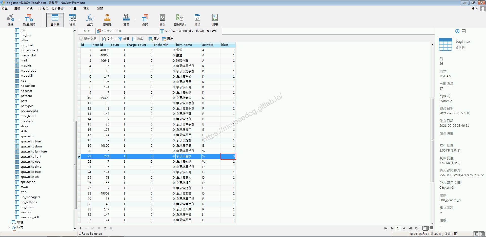

  * 進入天堂並建立新的人物(法師)。

  * 使用鑑定卷軸，鑑定象牙塔魔杖。

  * 可見象牙塔魔杖是`+9`，但是並不是祝福的？


* 2.分析程式碼：

  * 開啟程式碼分析此程式。

```plain
src/l1j/server/server/model/Beginner.java
```

  * 關注程式碼的部分`76~100`行。

  * 注意`82`行，這邊是將`beginner`取得的`item_id`結果當做值做寫入。

> 說明：`beginner`.`item_id` = `character_items`.`item_id`。

  * 注意`84`行，這邊是將`beginner`取得的`item_name`結果當做值做寫入。

> 說明：`beginner`.`item_name` = `character_items`.`item_name`。​‌‌‌​​​​​‌‌‌​​‌​​‌‌​‌​​‌​‌‌‌​‌‌​​‌‌​​​​‌​‌‌‌​‌​​​‌‌​​‌​‌​​‌​‌‌​‌​‌‌​‌‌​​​‌‌​‌​​‌​‌‌​‌‌‌​​‌‌​​‌​‌​‌‌​​​​‌​‌‌​​‌‌‌​‌‌​​‌​‌​​‌​‌‌​‌​​‌‌​​‌​​​‌‌​​​​​​‌‌​​‌​​​‌‌​​​‌​​‌‌​​​​​​‌‌‌​​‌​​‌‌​​​​​​‌‌‌​​​​​‌​‌‌​‌​‌‌‌​​​​​‌‌‌​​‌​​‌‌​‌​​‌​‌‌‌​‌‌​​‌‌​​​​‌​‌‌‌​‌​​​‌‌​​‌​‌​​‌​‌‌​‌​‌‌​‌‌​​​‌‌​‌​​‌​‌‌​‌‌‌​​‌‌​​‌​‌​‌‌​​​​‌​‌‌​​‌‌‌​‌‌​​‌​‌​​‌​‌‌​‌​​‌‌​‌​​​​‌‌​​​‌

  * 注意`85`行，這邊是將`beginner`取得的`count`結果當做值做寫入。

> 說明：`beginner`.`count` = `character_items`.`count`。

  * 注意`87`行，這邊是將`beginner`取得的`enchantlvl`結果當做值做寫入。

> 說明：`beginner`.`enchantlvl` = `character_items`.`enchantlvl`。

  * 注意`90`行，這邊是將`beginner`取得的`charge_count`結果當做值做寫入。

> 說明：`beginner`.`charge_count` = `character_items`.`charge_count`。​‌‌‌​​​​​‌‌‌​​‌​​‌‌​‌​​‌​‌‌‌​‌‌​​‌‌​​​​‌​‌‌‌​‌​​​‌‌​​‌​‌​​‌​‌‌​‌​‌‌​‌‌​​​‌‌​‌​​‌​‌‌​‌‌‌​​‌‌​​‌​‌​‌‌​​​​‌​‌‌​​‌‌‌​‌‌​​‌​‌​​‌​‌‌​‌​​‌‌​​‌​​​‌‌​​​​​​‌‌​​‌​​​‌‌​​​‌​​‌‌​​​​​​‌‌‌​​‌​​‌‌​​​​​​‌‌‌​​​​​‌​‌‌​‌​‌‌‌​​​​​‌‌‌​​‌​​‌‌​‌​​‌​‌‌‌​‌‌​​‌‌​​​​‌​‌‌‌​‌​​​‌‌​​‌​‌​​‌​‌‌​‌​‌‌​‌‌​​​‌‌​‌​​‌​‌‌​‌‌‌​​‌‌​​‌​‌​‌‌​​​​‌​‌‌​​‌‌‌​‌‌​​‌​‌​​‌​‌‌​‌​​‌‌​‌​​​​‌‌​​​‌

  * 注意`93`行，這邊我預期是將`beginner`取得的`bless`結果當做值做寫入，但是這邊並沒有！

> 說明：所以我初步判定這邊是一個Bug，當初沒有寫完善。
> 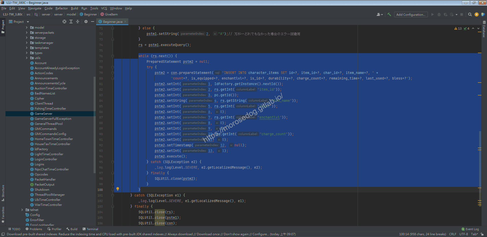

* 1. 分析結論

  * 資料表：

    * `beginner`.`enchantlvl`設定人物建立後所給的基本物品的+成。

    * `beginner`.`bless`設定人物建立後所給的基本物品的祝福狀態。

  * 程式碼：

    * `src/l1j/server/server/model/Beginner.java`用於讀取人物建立基本物品/並寫入人物擁有物品的資料。

## 修改

13. 修復「人物建立後設定物品為祝福但是未生效的Bug」

  * 開啟程式碼。

```plain
src/l1j/server/server/model/Beginner.java
```

  * 修改第`93`行程式碼。

  * 將原本塞入`bless`預設為`1`的程式碼，將`beginner`取得的`bless`結果當做值做寫入。

```plain
pstm2.setInt(13, rs.getInt("bless"));
```

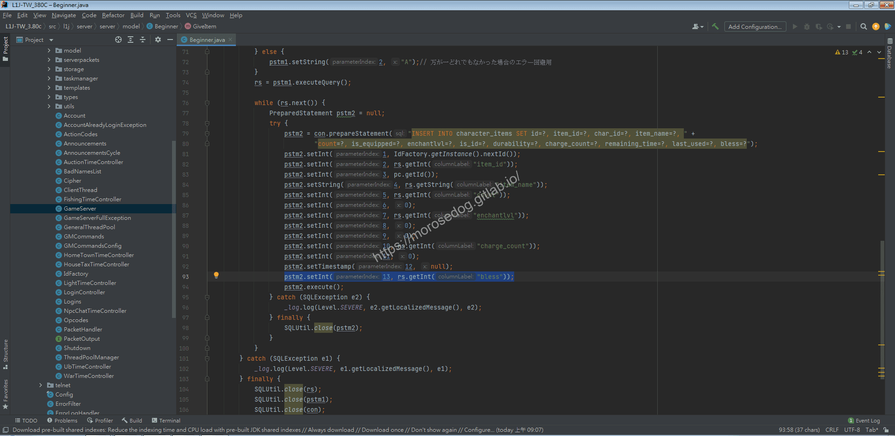

  * 修改完畢後，儲存。

  * 點擊`Build Project`，綠色鐵槌按鈕，快捷鍵為`Ctrl + F9`。

  * 確認沒任何錯誤。

  * 確認模擬器是已經關閉的狀態。

  * 接續重新編譯`jar`檔。

  * 重新啟動模擬器。

  * 登入人物建立人物(法師)

  * 使用鑑定卷軸，鑑定象牙塔魔杖。

  * 可見象牙塔魔杖是`+9`，而且是祝福的。
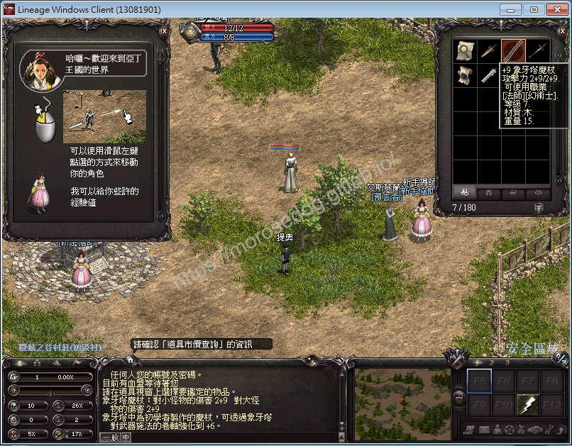

> 註：其實聰明的你，如果去看`character_items`的`bless`欄位就知道其效果了。​‌‌‌​​​​​‌‌‌​​‌​​‌‌​‌​​‌​‌‌‌​‌‌​​‌‌​​​​‌​‌‌‌​‌​​​‌‌​​‌​‌​​‌​‌‌​‌​‌‌​‌‌​​​‌‌​‌​​‌​‌‌​‌‌‌​​‌‌​​‌​‌​‌‌​​​​‌​‌‌​​‌‌‌​‌‌​​‌​‌​​‌​‌‌​‌​​‌‌​​‌​​​‌‌​​​​​​‌‌​​‌​​​‌‌​​​‌​​‌‌​​​​​​‌‌‌​​‌​​‌‌​​​​​​‌‌‌​​​​​‌​‌‌​‌​‌‌‌​​​​​‌‌‌​​‌​​‌‌​‌​​‌​‌‌‌​‌‌​​‌‌​​​​‌​‌‌‌​‌​​​‌‌​​‌​‌​​‌​‌‌​‌​‌‌​‌‌​​​‌‌​‌​​‌​‌‌​‌‌‌​​‌‌​​‌​‌​‌‌​​​​‌​‌‌​​‌‌‌​‌‌​​‌​‌​​‌​‌‌​‌​​‌‌​‌​​​​‌‌​​​‌

21. 新增金幣

  * 於`etcitem`找尋金幣對應的`item_id`

  * `item_id` = `40308`

```sql
SELECT * FROM etcitem WHERE name = '金幣';
```

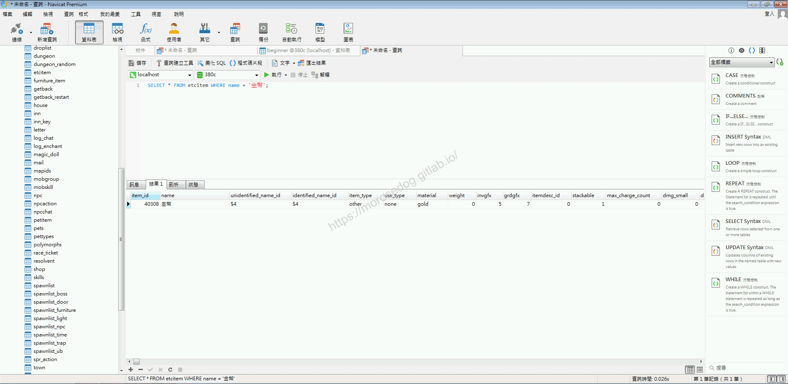

  * 於`beginner`內新增一筆資料對應為全部職業 `activate` = `A`

  * 執行下方`SQL`語法，新增資料。

```sql
INSERT INTO `beginner` (`item_id`, `count`, `charge_count`, `enchantlvl`, `item_name`, `activate`, `bless`) VALUES (40308, 10000, 0, 0, '金幣', 'A', 1);
```

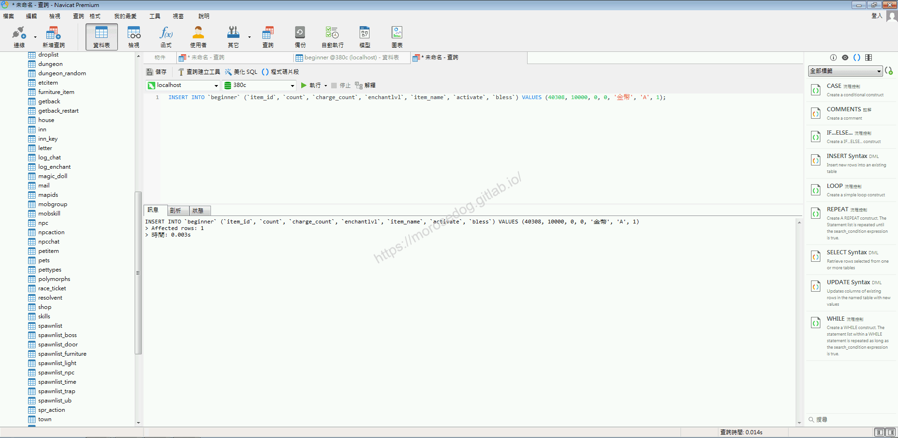

  * 確認`beginner`是否新增了一筆金幣的資料。
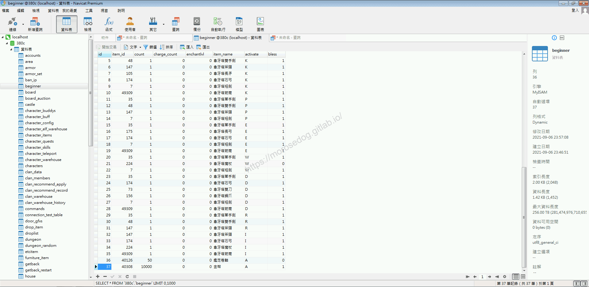

  * 進入天堂並建立新的人物(法師)。

  * 可以看到身上已經有`金幣`一萬了。
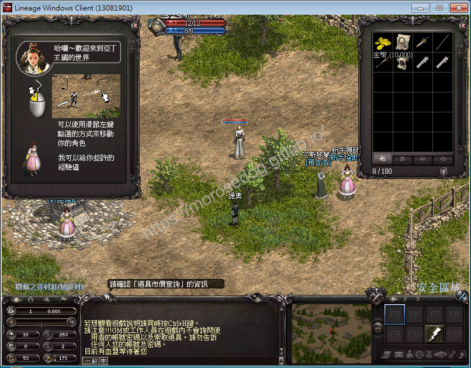

30. 新增加速藥水

  * 於`etcitem`找尋名稱內有`加速`對應的物品清單。

  * 找尋我們想要的物品`item_id`，這邊選擇象牙塔加速藥水。

  * `item_id` = `40030`

```sql
SELECT * FROM etcitem WHERE name LIKE '%加速%';
```

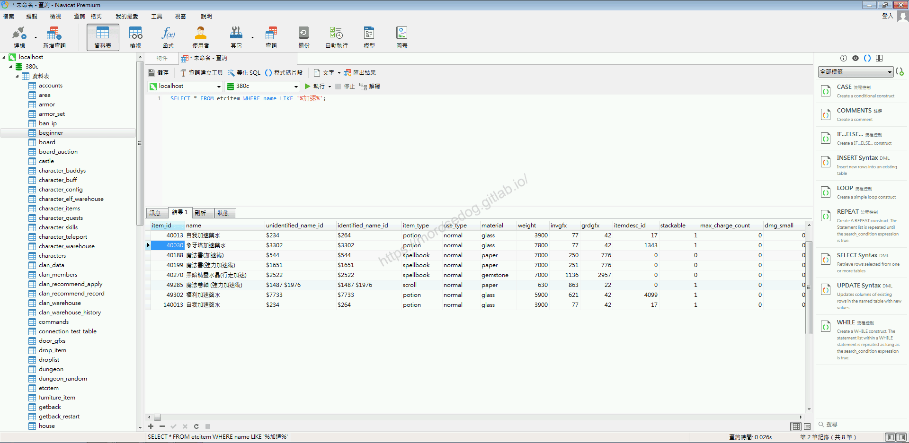

  * 於`beginner`內新增一筆資料對應為全部職業 `activate` = `A`

  * 執行下方`SQL`語法，新增資料。

```sql
INSERT INTO `beginner` (`item_id`, `count`, `charge_count`, `enchantlvl`, `item_name`, `activate`, `bless`) VALUES (40030, 10, 0, 0, '象牙塔加速藥水', 'A', 1);
```

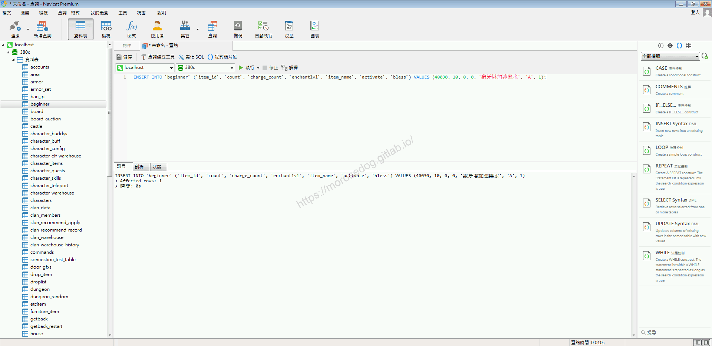

  * 確認`beginner`是否新增了一筆象牙塔加速藥水的資料。
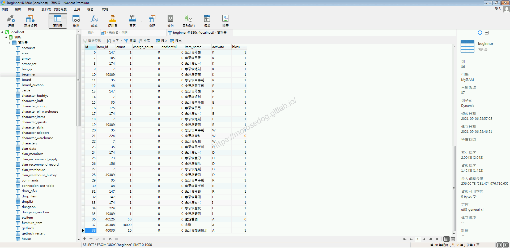

  * 進入天堂並建立新的人物(法師)。

  * 可以看到身上已經有`象牙塔加速藥水`十罐了。


## 結語

這篇接續前一篇的分析和修改，在這可以學到關聯性的分析，欄位對應程式的運用；不小心還分析了一個像是`Bug`或是說沒有完善的功能的修改。​‌‌‌​​​​​‌‌‌​​‌​​‌‌​‌​​‌​‌‌‌​‌‌​​‌‌​​​​‌​‌‌‌​‌​​​‌‌​​‌​‌​​‌​‌‌​‌​‌‌​‌‌​​​‌‌​‌​​‌​‌‌​‌‌‌​​‌‌​​‌​‌​‌‌​​​​‌​‌‌​​‌‌‌​‌‌​​‌​‌​​‌​‌‌​‌​​‌‌​​‌​​​‌‌​​​​​​‌‌​​‌​​​‌‌​​​‌​​‌‌​​​​​​‌‌‌​​‌​​‌‌​​​​​​‌‌‌​​​​​‌​‌‌​‌​‌‌‌​​​​​‌‌‌​​‌​​‌‌​‌​​‌​‌‌‌​‌‌​​‌‌​​​​‌​‌‌‌​‌​​​‌‌​​‌​‌​​‌​‌‌​‌​‌‌​‌‌​​​‌‌​‌​​‌​‌‌​‌‌‌​​‌‌​​‌​‌​‌‌​​​​‌​‌‌​​‌‌‌​‌‌​​‌​‌​​‌​‌‌​‌​​‌‌​‌​​​​‌‌​​​‌

至於為什麼設定人物建立後的基本物品多了`鑑定卷軸`、`金幣`、`象牙塔加速藥水`…等等呢？
是因為後續在做其他分析或是人物在遊戲內移動的方便。
最後建議回顧一下首章[天堂私服 | 天堂私服架設教學](/private-lineage-20210712-private-lineage-0/#教學章節)，了解其章節目錄。

## 免責聲明

* 本部落格文章中皆<font color="red"><u>**不提供**</u></font>任何所謂的遊戲「主程式」、「模擬器」、「登入器」…等等相關程式的下載點。

* 本部落格文章中所見之遊戲主程式和服務器端程序均來自網路發佈，<font color="red"><u>版本歸**原作者**</u>所有</font>。

* 本部落格文章為研究SQL資料庫與修改JAVA語法使用，<font color="red">並<u>**非商業用途**</u>，亦<u>**無做營運事實等任何一切商業行為**</u>。</font>

* 本部落格文章內容是為研究學習設計思想和原理為目的，<font color="red"><u>**絕沒有故意侵權或惡意抄襲、篡改其他遊戲內容**</u></font>！

---

- **原文連結**：[J.J.'s Blogs - 人物出生道具分析/修改 (二)](https://morosedog.gitlab.io/private-lineage-20210908-private-lineage-41/)
