# 遊戲帳號分析/Debug (一)

# 天堂私服 | 遊戲帳號分析/Debug (一)「L1J版」

    
    
      📑 目錄
      

1. [核心版本](#核心版本)
2. [分析](#分析)
3. [Debug](#Debug)
4. [結論](#結論)
5. [結語](#結語)
6. [免責聲明](#免責聲明)

    
    
    

## 核心版本

* L1J-3.80c

## 分析

* 1. 建立遊戲帳號：

  * 啟動模擬器。

  * 啟動登入器，登入遊戲。

  * 輸入一個全新的帳號/密碼，並登入。

```plain
MoroseJJ
12345678
```

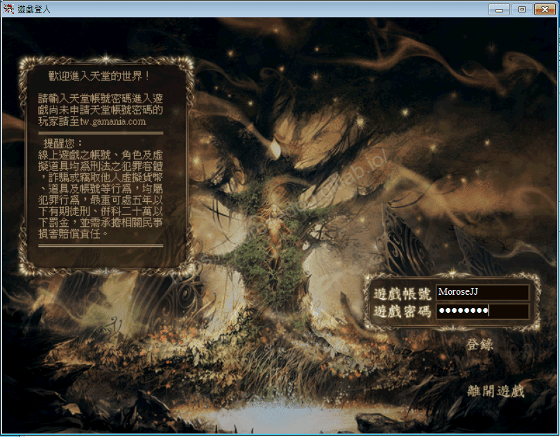

  * 進入到建立人物畫面。(不用建立人物)
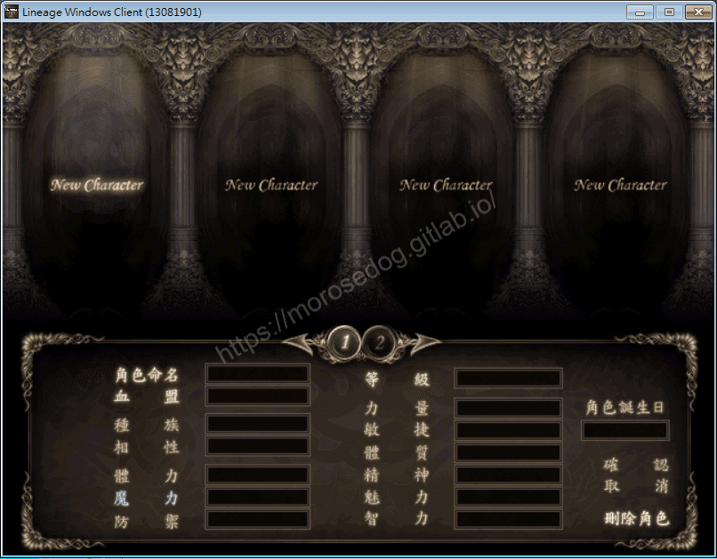

  * 此時就會建立一個遊戲帳號在此資料庫中。

* 2.分析資料表：

  * 在資料庫中，先觀察所有的表名，會發現一個`accounts`的表名(accounts = 帳戶)，點進去看資料如下圖。
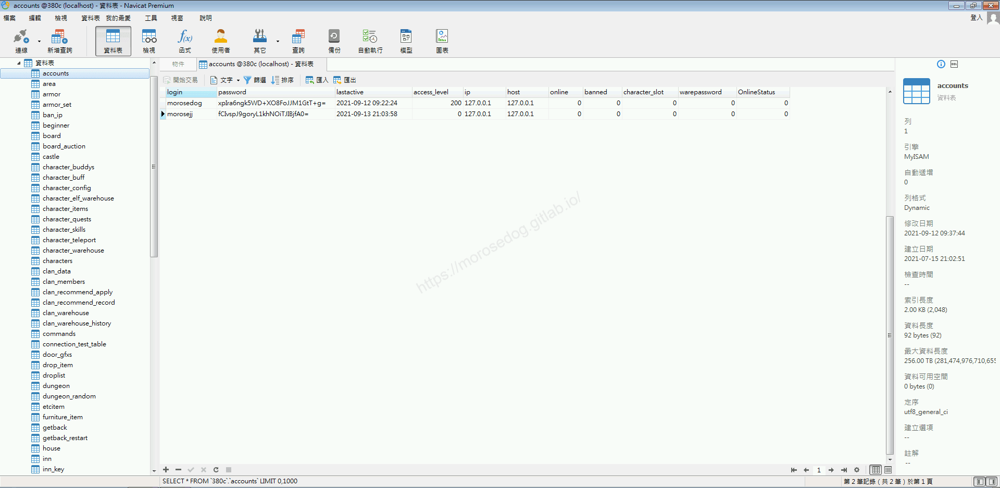

  * 對應一下資料表欄位，稍做分析：

    * `login` = 帳號。

    * `password` = 密碼。

    * `lastactive` = 最後登錄時間。

    * `access_levle` = <font color="red">不清楚。</font>

    * `ip` = 登入的`IP`。

    * `host` = <font color="red">不清楚。</font>

    * `online` = <font color="red">不清楚。</font>

    * `banned` = <font color="red">不清楚。</font>

    * `character_slot` = <font color="red">不清楚。</font>

    * `warepassword` = <font color="red">不清楚。</font>

    * `OnlineStatus` = <font color="red">不清楚。</font>

  * 會發現滿多的欄位不一定可以透過翻譯確切的知道他的功能，就算翻譯過來有時候也不一定正確。

  * 這時候就是在去分析程式碼，看可不可以反向去推出欄位用途。

* 3.分析程式碼：

  * 根據猜測`accounts`為表名，那透過此關鍵字去找尋程式碼，基本上也可以找到相對應的程式。

  * 這邊使用`Ctrl + Shift + F`，搜尋。

  * 輸入`accounts`，找尋到有在`INSERT INTO`此張表的語法程式，發現下面這支程式。

```plain
src/l1j/server/server/Account.java
```

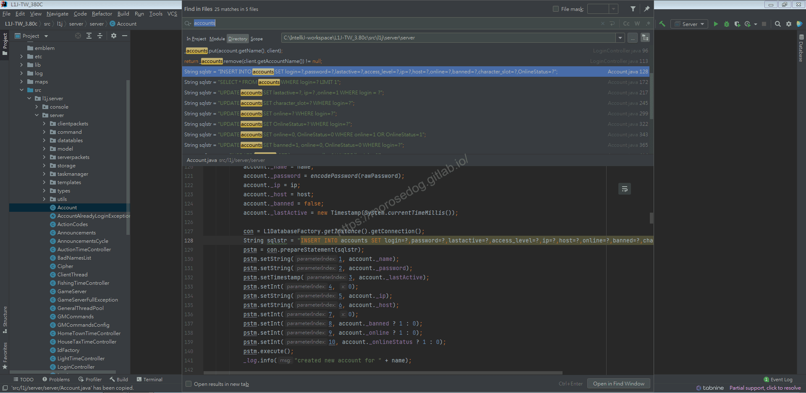

  * 開啟後分析程式碼。

  * 這邊先關注程式碼的部分`130~139`行。

  * 可以注意到帶入到`SQL`裡面的值，都是從`account`這個物件取得的；像是程式碼的`account.name` 對應資料表欄位 `accounts.login`。
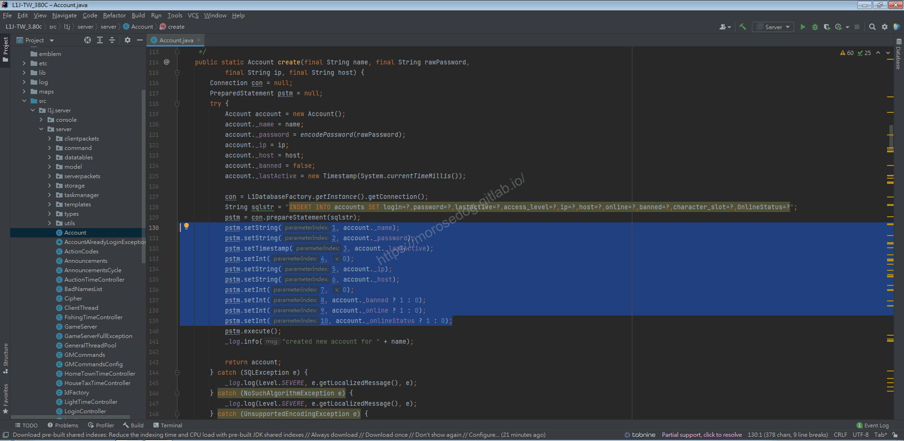

  * 再關注程式碼的部分`119~125`行。

  * 可以看到這邊先建立了一個`Account`的物件，名為`account`。

  * 然後在這物件裡面塞入值，而這些值除了`124`和`125`行以外的，都是透過方法參入傳入的。
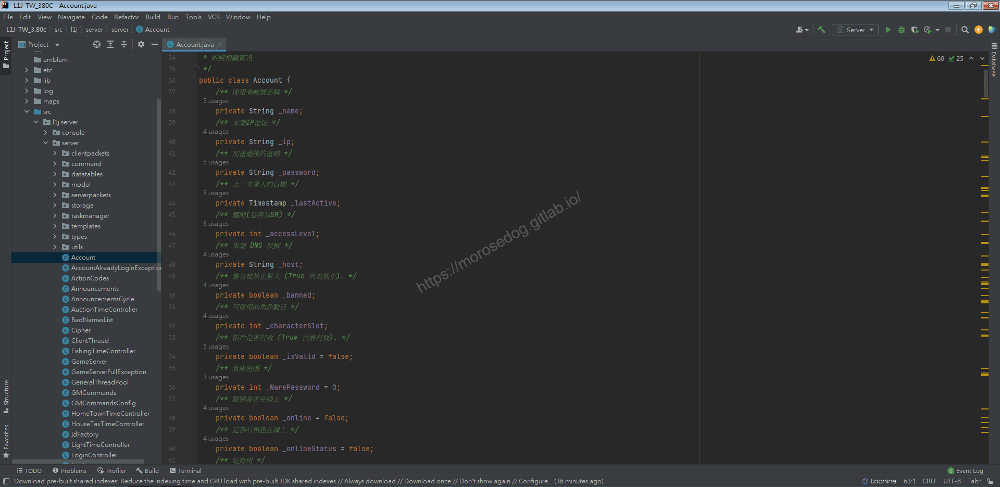

---

  * 這時候其實可以去看一下`Account`物件裡面定義的變數，基本上變數都會對應資料表的欄位，好的工程師是會將註解寫好的…

  * `Ctrl`鍵壓住，再左鍵點擊`Account`即會開啟此物件。

  * 到這邊已經看到所有欄位對應的用途，還需要分析嗎？
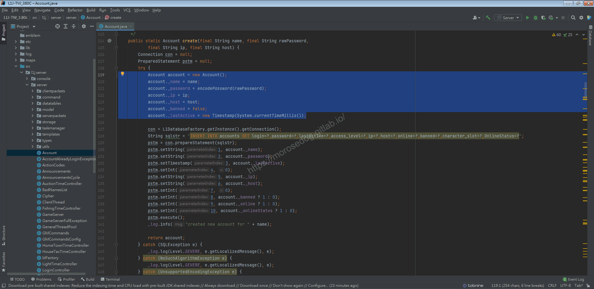

---

  * 再關注程式碼的部分`114`行。

  * 注意到此方法名稱為`create`建立的意思，方法參數為`name`、`rawPassword`、`ip`、`host`。

  * 所以需要支到呼叫此方法的有幾個地方，帶來的參數值又是如何取得？
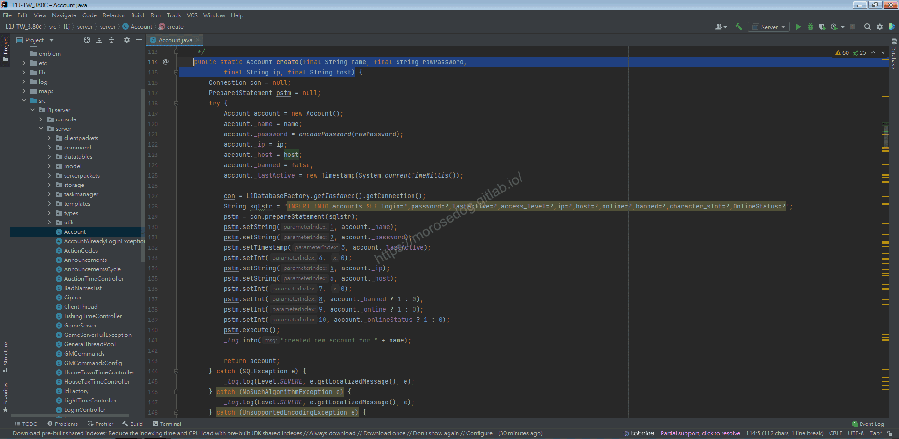

  * 在方法`create`上，按下右鍵並選擇`Find Usages`
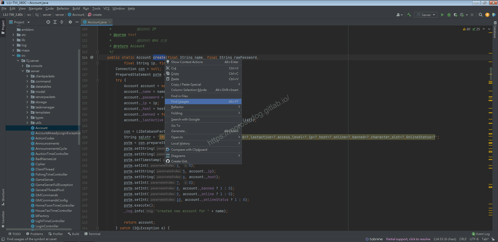

  * 下方會彈出此所有使用此方法的清單

  * 剛好只有一個地方，我們點擊將其開啟在工作區。
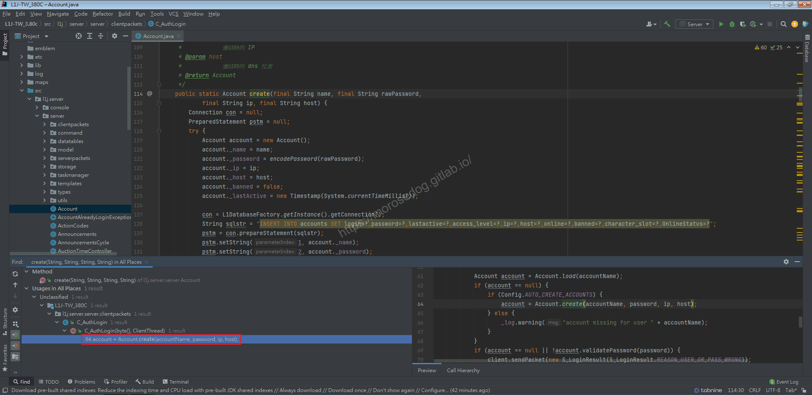

  * 這時候會開啟`C_AuthLogin.java`。

```plain
src/l1j/server/server/clientpackets/C_AuthLogin.java
```

  * 關注程式碼的部分`64`行。

  * 會發現後面帶入的參數，都是由`45~48`行來的。

> 註：這邊就不在追`45`、`46`行的`readS()`這邊的參數由來，怕我繼續深入分析下去；一是講太多，二是怕你在這就放棄了…。
> 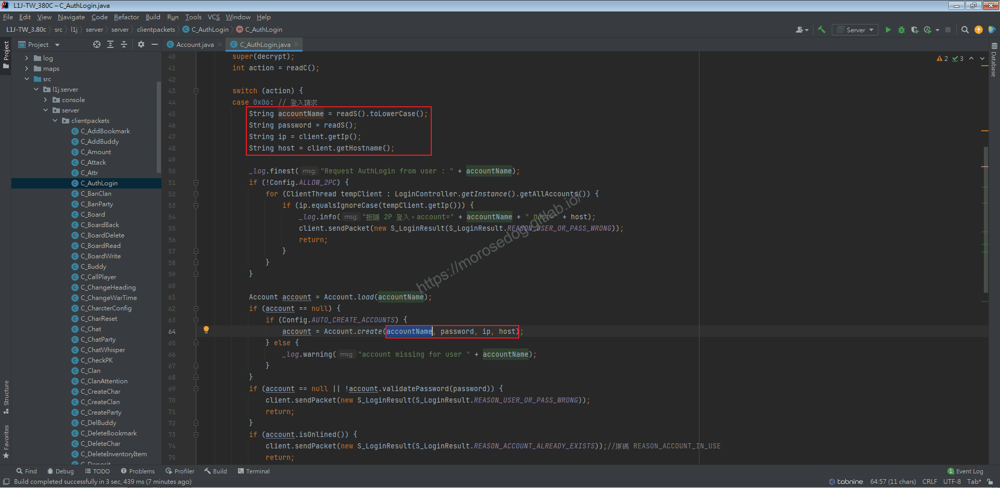​‌‌‌​​​​​‌‌‌​​‌​​‌‌​‌​​‌​‌‌‌​‌‌​​‌‌​​​​‌​‌‌‌​‌​​​‌‌​​‌​‌​​‌​‌‌​‌​‌‌​‌‌​​​‌‌​‌​​‌​‌‌​‌‌‌​​‌‌​​‌​‌​‌‌​​​​‌​‌‌​​‌‌‌​‌‌​​‌​‌​​‌​‌‌​‌​​‌‌​​‌​​​‌‌​​​​​​‌‌​​‌​​​‌‌​​​‌​​‌‌​​​​​​‌‌‌​​‌​​‌‌​​​‌​​‌‌​​‌‌​​‌​‌‌​‌​‌‌‌​​​​​‌‌‌​​‌​​‌‌​‌​​‌​‌‌‌​‌‌​​‌‌​​​​‌​‌‌‌​‌​​​‌‌​​‌​‌​​‌​‌‌​‌​‌‌​‌‌​​​‌‌​‌​​‌​‌‌​‌‌‌​​‌‌​​‌​‌​‌‌​​​​‌​‌‌​​‌‌‌​‌‌​​‌​‌​​‌​‌‌​‌​​‌‌​‌​​​​‌‌​‌‌​

  * 在`C_AuthLogin.java`的`45`行設定斷點。
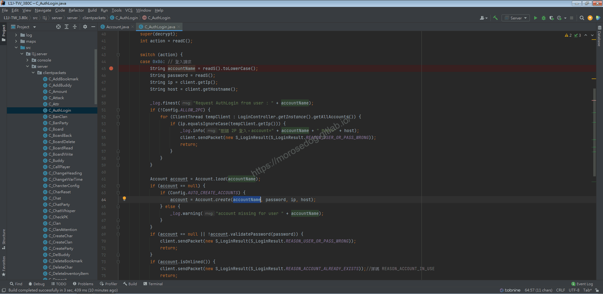

  * 在`Account.java`的`119`行設定斷點。
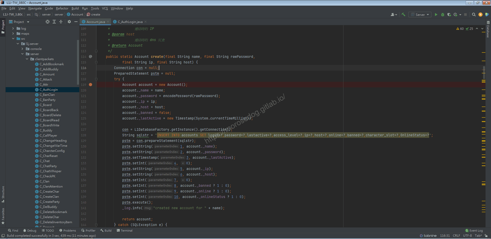

## Debug

* 使用`IDE`除錯模式來啟動模擬器。

* 準備完畢後，啟動登入器，登入遊戲。

* 輸入一個全新的帳號/密碼，並登入。

```plain
Morose
12345678
```

* 接續會跳轉回`IDE`斷點在`C_AuthLogin.java`的`45`行的位置。

* 此時可以觀察`accounts`資料表內是否已經有`Morose`的帳號資料？(是沒有的，因為尚未`INSERT INTO`寫入)

* 回到`IDE`，開始使用`Step Over`：步過，一步一步觀察`45~48`行來的參數值。

  * `accountName` = `morose`

  * `password` = `12345678`

  * `ip` = `127.0.0.1`

  * `host` = `127.0.0.1`
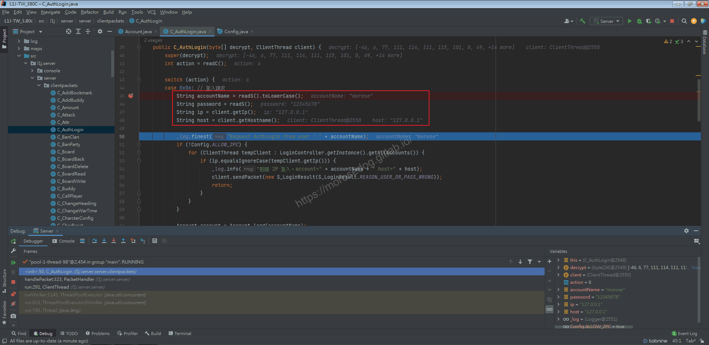

* 到達第`61`行，可以發現是呼叫`Account.load()`的方法，帶入參數為`accountName` = `morose`。
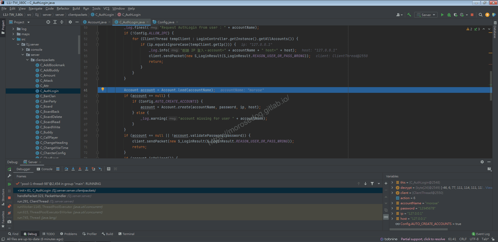

* `Ctrl`鍵壓住，再左鍵點擊`load`方法即會開啟跳轉到物件與方法位置。

* 關注到`172`的`SQL`。

* 該`SQL`語法主要是為了找尋是否有`name`也就是帳號為`morose`的資料。

* 這邊就不做斷點並分析，語法不難。

* 點擊除錯按鈕`Show Execution Point`，回到剛剛的位置。
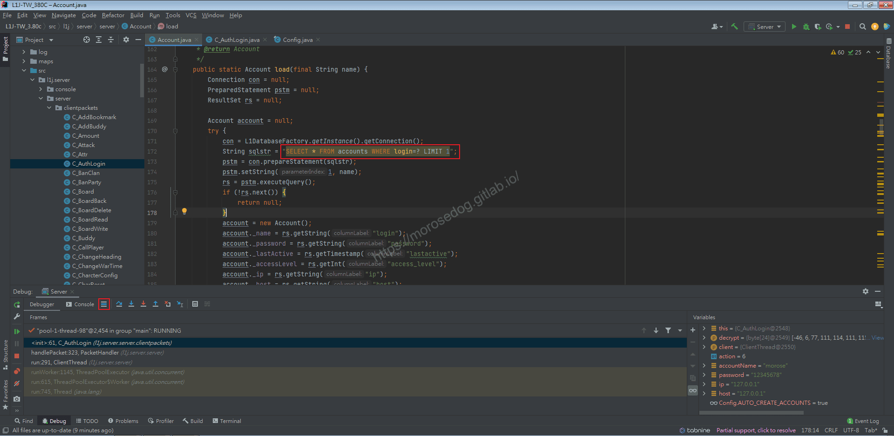

* 因為資料庫確時還沒此帳號資料，所以可以肯定回傳的參數為`null`，即表示`account` = `null`。

* `62`的`if`判斷，這邊的邏輯是在說當沒有這個帳號的時候，要進行的行為，反之有此帳號就不做這些行為。

* `63`是取得`Config`裡面的設定`Config.AUTO_CREATE_ACCOUNTS`是否要自動建立帳號，這邊可以看到值為`True`。

> 註：關於`Config`的部分，後面會再介紹，這邊先知道有這些參數即可。
> 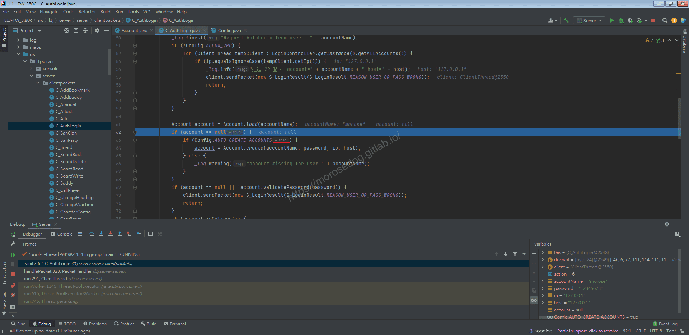

* 一路`Step Over`：步過到`64`後，再次`Step Over`：步過，就會跳轉到`Account.java`的`119`行設定斷點。

* 這邊就不在分析，主要就是在`accounts`表內新增一筆帳號資料。

* `Step Out`：步出，讓這個方法執行完畢，會再跳回剛剛進入的位置。
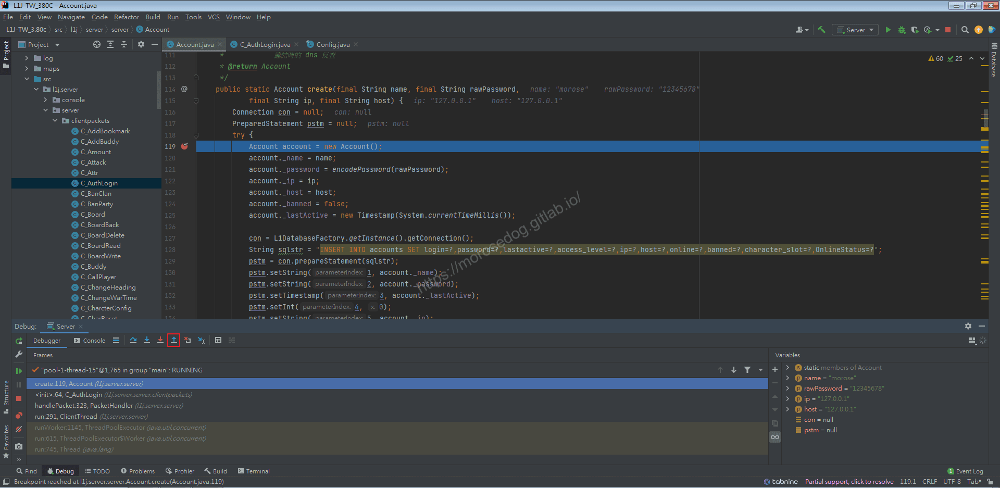

* 跳回`C_AuthLogin.java`的`64`行的位置。

* 此時可以觀察`accounts`資料表內是否已經有`Morose`的帳號資料？(是有的)
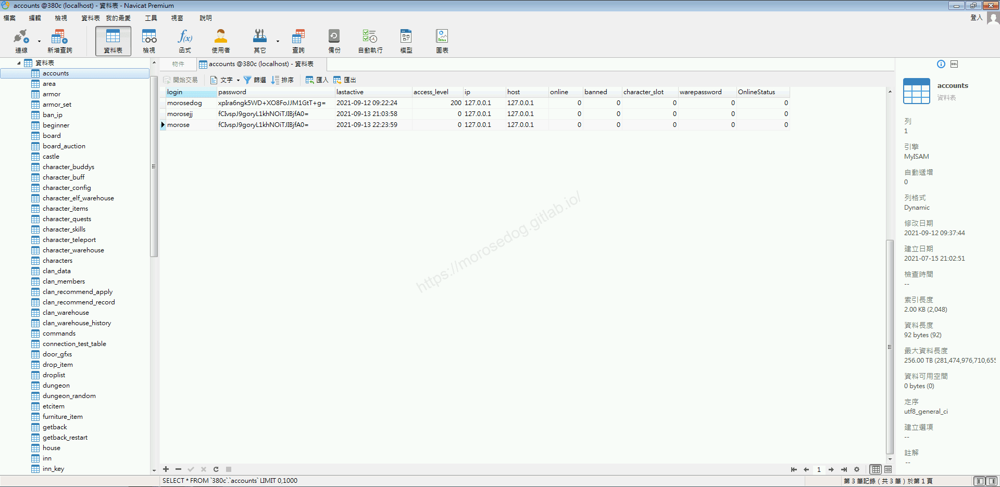

* 到此基本上基礎的東西已經除錯(Duebg)完畢。

* 至於的`C_AuthLogin.java`內的`51~59`行與`69~104`行，這個放到下一章節在做詳細分析。

## 結論

* 資料表：

  * `accounts`建立遊戲帳號後儲存帳號資訊。

  * `accounts`.`name`儲存遊戲帳號資訊的帳號。

  * `accounts`.`password`儲存遊戲密碼的資訊。(加密過)

  * `accounts`.`lastactive`最後登錄時間。

  * `accounts`.`ip`建立帳號時所使用的客戶端`IP`。

  * `accounts`.`host`建立帳號時所使用的客戶端`Host`。

* 程式碼：

  * `src/l1j/server/server/Account.java`用於對應遊戲帳號表的變數與方法。

  * `src/l1j/server/server/clientpackets/C_AuthLogin.java`處理客戶端登入的請求、判斷帳號、建立帳號..等等主要邏輯。

* 設定檔：

  * server.properties

```plain
#是否再登入畫面即可創建帳號 True=是 False=否
#如果需要變更:
# 可使用的選項: "True" - "False", 使用這選項可選擇帳號是否被自動創建
# 自動創建或者手動. 如果要手動(false), 你必須在data資料夾內新增 logins.txt 的文件
AutoCreateAccounts = true
```

## 結語

分析程式碼本就不容易，況且要分析到幾乎是手把手一步一步帶著看，真的是非常花費時間和精神。
希望透過這樣的分析，可以帶給新手們更多的信心慢慢學習程式。

這邊沒有用動態圖來做講解，是因為要說明的很詳細所以動態圖不適合。且動態圖會太長太大，造成網頁讀取過慢，使用者體驗很差。
原創文章真的不易，希望多多支持，感謝。
最後建議回顧一下首章[天堂私服 | 天堂私服架設教學](/private-lineage-20210712-private-lineage-0/#教學章節)，了解其章節目錄。​‌‌‌​​​​​‌‌‌​​‌​​‌‌​‌​​‌​‌‌‌​‌‌​​‌‌​​​​‌​‌‌‌​‌​​​‌‌​​‌​‌​​‌​‌‌​‌​‌‌​‌‌​​​‌‌​‌​​‌​‌‌​‌‌‌​​‌‌​​‌​‌​‌‌​​​​‌​‌‌​​‌‌‌​‌‌​​‌​‌​​‌​‌‌​‌​​‌‌​​‌​​​‌‌​​​​​​‌‌​​‌​​​‌‌​​​‌​​‌‌​​​​​​‌‌‌​​‌​​‌‌​​​‌​​‌‌​​‌‌​​‌​‌‌​‌​‌‌‌​​​​​‌‌‌​​‌​​‌‌​‌​​‌​‌‌‌​‌‌​​‌‌​​​​‌​‌‌‌​‌​​​‌‌​​‌​‌​​‌​‌‌​‌​‌‌​‌‌​​​‌‌​‌​​‌​‌‌​‌‌‌​​‌‌​​‌​‌​‌‌​​​​‌​‌‌​​‌‌‌​‌‌​​‌​‌​​‌​‌‌​‌​​‌‌​‌​​​​‌‌​‌‌​

## 免責聲明

* 本部落格文章中皆<font color="red"><u>**不提供**</u></font>任何所謂的遊戲「主程式」、「模擬器」、「登入器」…等等相關程式的下載點。

* 本部落格文章中所見之遊戲主程式和服務器端程序均來自網路發佈，<font color="red"><u>版本歸**原作者**</u>所有</font>。

* 本部落格文章為研究SQL資料庫與修改JAVA語法使用，<font color="red">並<u>**非商業用途**</u>，亦<u>**無做營運事實等任何一切商業行為**</u>。</font>

* 本部落格文章內容是為研究學習設計思想和原理為目的，<font color="red"><u>**絕沒有故意侵權或惡意抄襲、篡改其他遊戲內容**</u></font>！

---

- **原文連結**：[J.J.'s Blogs - 遊戲帳號分析/Debug (一)](https://morosedog.gitlab.io/private-lineage-20210913-private-lineage-46/)
