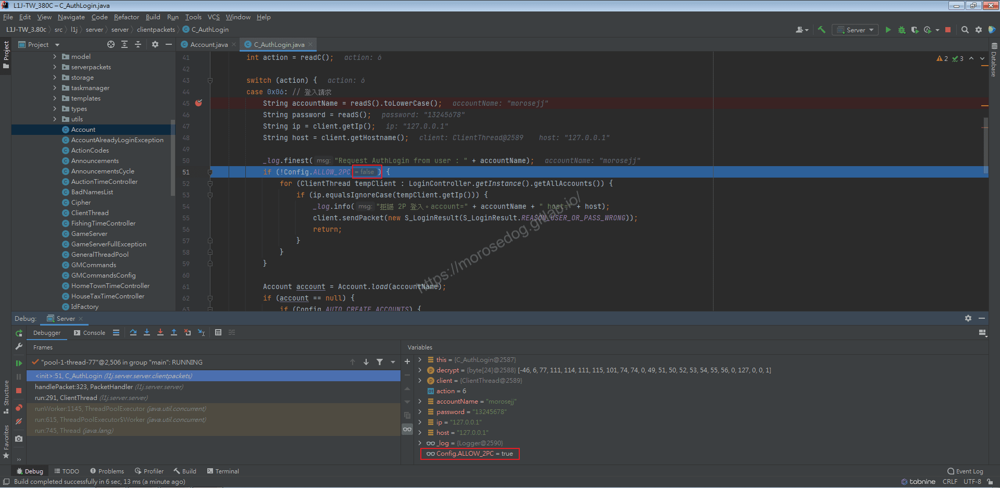
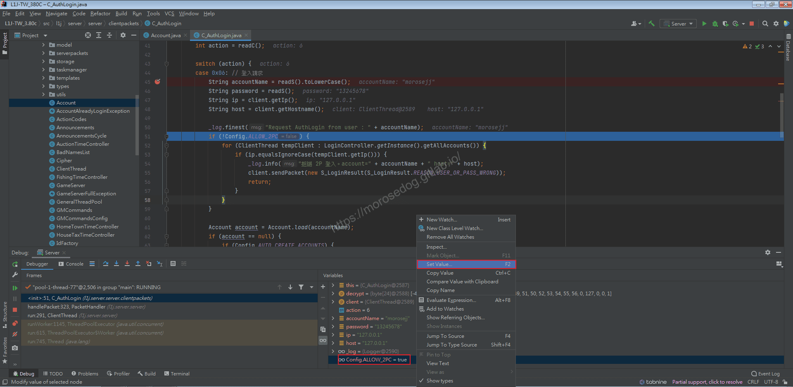
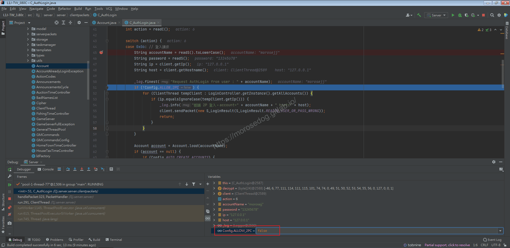
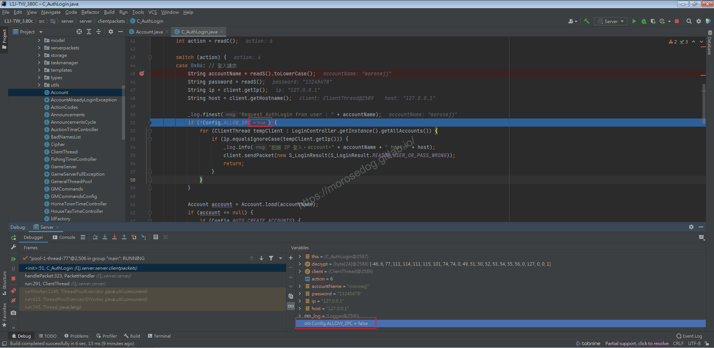
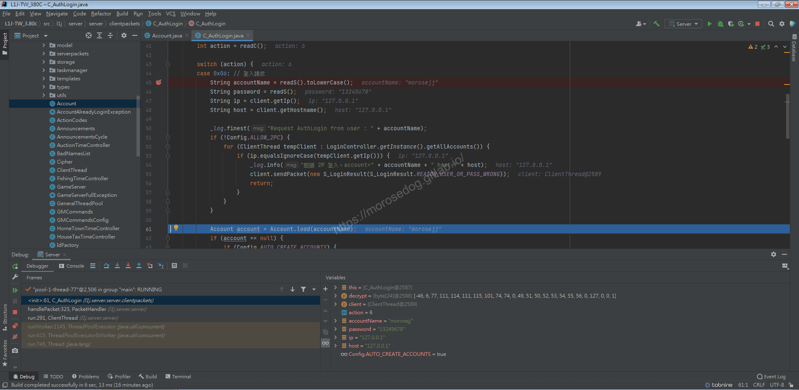
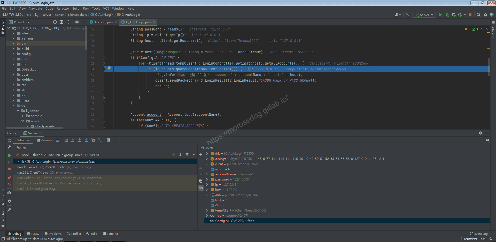
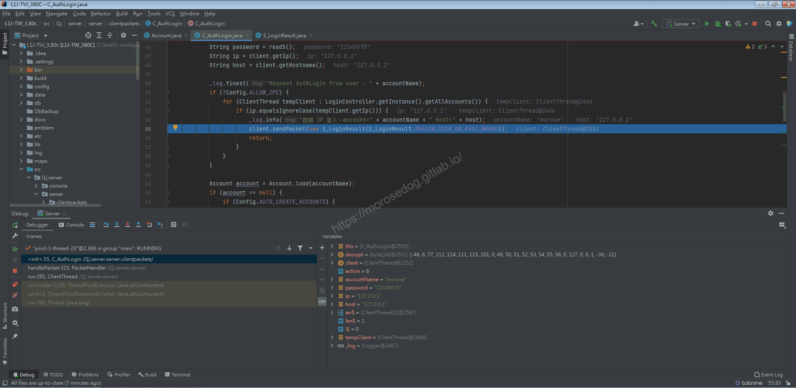
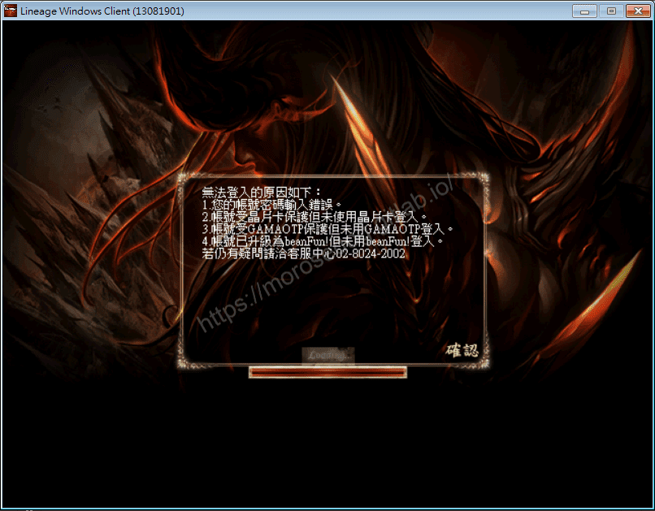

# 遊戲帳號分析/Debug (二)

# 天堂私服 | 遊戲帳號分析/Debug (二)「L1J版」

    
    
      📑 目錄
      

1. [核心版本](#核心版本)
2. [接續](#接續)
3. [Debug](#Debug)
4. [結論](#結論)
5. [結語](#結語)
6. [免責聲明](#免責聲明)

    
    
    

## 核心版本

* L1J-3.80c

## 接續

上一章節[遊戲帳號分析/Debug (一)](./046_遊戲帳號分析_Debug_(一).md)，針對創建帳號的部分做部份分析，尚有以下需要做分析。

* `C_AuthLogin.java`內的`51~59`行與`69~104`行

* 對應一下資料表欄位，稍做分析：

  * `access_levle`

  * `online`

  * `banned`

  * `character_slot`

  * `warepassword`

  * `OnlineStatus`

此章節針對`C_AuthLogin.java`內的`51~59`行做除錯(Debug)。

## Debug

* 首先針對`51~59`行程式碼進行除錯(Duebg)。

* 初步觀看程式碼大概可以猜測：

  * 判斷此登入`IP`是否已經有登入在線的帳號。

---

* 啟動天堂登入，登入第一個帳號。

```plain
MoroseJJ
12345678
```

* 一路`Step Over`：步過到`51`行。

* 此時觀察第`51`行的判斷`!Config.ALLOW_2PC` = `false`，所以`if`判斷式是不會再進入的。

* 在觀察到下方`Variables`視窗內的`Config.ALLOW_2PC` = `true`，是取得`Config`裡面的設定是否允許雙開(同IP同時連線) ，這邊可以看到值為`True`。

> 註：針對Config.ALLOW_2PC 的值為 true 但是在 if 判斷確是 false，是因為在前面加入了一個驚嘆號做相反。
> ​‌‌‌​​​​​‌‌‌​​‌​​‌‌​‌​​‌​‌‌‌​‌‌​​‌‌​​​​‌​‌‌‌​‌​​​‌‌​​‌​‌​​‌​‌‌​‌​‌‌​‌‌​​​‌‌​‌​​‌​‌‌​‌‌‌​​‌‌​​‌​‌​‌‌​​​​‌​‌‌​​‌‌‌​‌‌​​‌​‌​​‌​‌‌​‌​​‌‌​​‌​​​‌‌​​​​​​‌‌​​‌​​​‌‌​​​‌​​‌‌​​​​​​‌‌‌​​‌​​‌‌​​​‌​​‌‌​‌​​​​‌​‌‌​‌​‌‌‌​​​​​‌‌‌​​‌​​‌‌​‌​​‌​‌‌‌​‌‌​​‌‌​​​​‌​‌‌‌​‌​​​‌‌​​‌​‌​​‌​‌‌​‌​‌‌​‌‌​​​‌‌​‌​​‌​‌‌​‌‌‌​​‌‌​​‌​‌​‌‌​​​​‌​‌‌​​‌‌‌​‌‌​​‌​‌​​‌​‌‌​‌​​‌‌​‌​​​​‌‌​‌‌‌

* 此時不想修改設定檔，只想要暫時將`Config.ALLOW_2PC`更改為`false`，讓`if`判斷式變成`true`，我們方便除錯(Duebg)。

* 右建點擊`Variables`視窗內的`Config.ALLOW_2PC`，選擇`Set Value...`


* 可見`Config.ALLOW_2PC`變成可變更其值，這邊將其修改為`false`後，並按下`Enter`鍵完成輸入。


* 觀察第`51`行的判斷已經變更`!Config.ALLOW_2PC` = `true`，所以`if`判斷式是會進入的。


* `Step Over`：步過會到`52`行的`for`迴圈，成功進入`if`判斷式內。

* 但當再次`Step Over`：步過，會發現離開此迴圈了，跳到`61`行。


* 這是因為`52`行的`for`是去取得目前在線上得所有帳號，然而目前確實沒有任何的帳號正常登入在線上。

* 此時使用`Resume Program`恢復程式，讓帳號正常登入到選擇人物畫面。

* 再另外啟動天堂，登入第二個帳號。

```plain
Morose
12345678
```

* 一路`Step Over`：步過到`51`行。

> 註：其實可以在`51`行下斷點，使用`Resume Program`恢復程式，除錯會直接到`51`行這邊。

* 照著剛剛上方的操作，再來一次，使其可以進入`if`判斷式內。

* 然後`Step Over`：步過到`52`行的`for`迴圈，成功進入`if`判斷式內。

* 當再次`Step Over`：步過，會發現進入到`53`行程式碼。

* 此時表示`52`行的`for`是取得目前在線上得所有帳號，已經有取得剛剛第一個帳號登入所使用的`IP` = `127.0.0.1`。


* 第`53`行程式碼，是在判斷當前登入的帳號所使用的`IP`是否與目前在線上的帳號的`IP`是否有相同的？

* 如果有進入`if`判斷式，會在`55`行發送一個登入結果數據包給客戶端。

> 註：登入結果 = 8，這個部分，作者尚未研究分析到那邊，請先大概知道即可，後面有再分析客戶端和封包應該會就知道了。

* 然後到`56`行`Return`就結束。

* 此時使用`Resume Program`恢復程式，讓帳號繼續登入的步驟。


* 可以看到登入畫面如下，已經被拒絕登入了。


## 結論

* 程式碼：

  * `src/l1j/server/server/clientpackets/C_AuthLogin.java`51~59`行

    * 用於判斷是否允許雙開(同IP同時連線) 的邏輯處理。

* 設定檔：

  * server.properties

```plain
#是否允許雙開(同IP同時連線) true or false
Allow2PC = true
```

## 結語

這邊的詳細分析一步一步帶除錯模式解析說明這些程式碼，雖然解析後的內容可能不多，但是對於新手的幫助應該是非常大。
可以學習到除錯模式的一些常用的方法功能和技巧。​‌‌‌​​​​​‌‌‌​​‌​​‌‌​‌​​‌​‌‌‌​‌‌​​‌‌​​​​‌​‌‌‌​‌​​​‌‌​​‌​‌​​‌​‌‌​‌​‌‌​‌‌​​​‌‌​‌​​‌​‌‌​‌‌‌​​‌‌​​‌​‌​‌‌​​​​‌​‌‌​​‌‌‌​‌‌​​‌​‌​​‌​‌‌​‌​​‌‌​​‌​​​‌‌​​​​​​‌‌​​‌​​​‌‌​​​‌​​‌‌​​​​​​‌‌‌​​‌​​‌‌​​​‌​​‌‌​‌​​​​‌​‌‌​‌​‌‌‌​​​​​‌‌‌​​‌​​‌‌​‌​​‌​‌‌‌​‌‌​​‌‌​​​​‌​‌‌‌​‌​​​‌‌​​‌​‌​​‌​‌‌​‌​‌‌​‌‌​​​‌‌​‌​​‌​‌‌​‌‌‌​​‌‌​​‌​‌​‌‌​​​​‌​‌‌​​‌‌‌​‌‌​​‌​‌​​‌​‌‌​‌​​‌‌​‌​​​​‌‌​‌‌‌

原創文章真的不易，希望多多支持，感謝。
最後建議回顧一下首章[天堂私服 | 天堂私服架設教學](/private-lineage-20210712-private-lineage-0/#教學章節)，了解其章節目錄。

## 免責聲明

* 本部落格文章中皆<font color="red"><u>**不提供**</u></font>任何所謂的遊戲「主程式」、「模擬器」、「登入器」…等等相關程式的下載點。

* 本部落格文章中所見之遊戲主程式和服務器端程序均來自網路發佈，<font color="red"><u>版本歸**原作者**</u>所有</font>。

* 本部落格文章為研究SQL資料庫與修改JAVA語法使用，<font color="red">並<u>**非商業用途**</u>，亦<u>**無做營運事實等任何一切商業行為**</u>。</font>

* 本部落格文章內容是為研究學習設計思想和原理為目的，<font color="red"><u>**絕沒有故意侵權或惡意抄襲、篡改其他遊戲內容**</u></font>！

---

- **原文連結**：[J.J.'s Blogs - 遊戲帳號分析/Debug (二)](https://morosedog.gitlab.io/private-lineage-20210914-private-lineage-47/)
