# 遊戲帳號分析/Debug (三)

# 天堂私服 | 遊戲帳號分析/Debug (三)「L1J版」

    
    
      📑 目錄
      

1. [核心版本](#核心版本)
2. [接續](#接續)
3. [Debug](#Debug)
4. [結論](#結論)
5. [結語](#結語)
6. [免責聲明](#免責聲明)

    
    
    

## 核心版本

* L1J-3.80c

## 接續

上一章節[遊戲帳號分析/Debug (二)](./047_遊戲帳號分析_Debug_(二).md)，針對創建帳號的部分做部份分析，尚有以下需要做分析。

* `C_AuthLogin.java`內的`69~104`行

* 對應一下資料表欄位，稍做分析：

  * `access_levle`

  * `online`

  * `banned`

  * `character_slot`

  * `warepassword`

  * `OnlineStatus`

此章節針對`C_AuthLogin.java`內的`69~104`行做除錯(Debug)。

## Debug

* 首先針對`69~104`行程式碼進行除錯(Duebg)。

* 初步觀看程式碼大概可以猜測：

  * 判斷密碼是否正確。

  * 帳號是否已經登入在線。

  * 帳號是否是被禁止使用的。

  * 帳號登入的動作，且會檢查是否有大於伺服器上線人數。

  * 更新帳號相關資訊，且回應客戶端`OK`。

* 以下除錯登入的帳號皆為：

```plain
MoroseJJ
12345678
```

---

* 移除所有斷點。

* 設定新的斷點於`69`、`73`、`77`、`84`。

```plain
src/l1j/server/server/clientpackets/C_AuthLogin.java
```

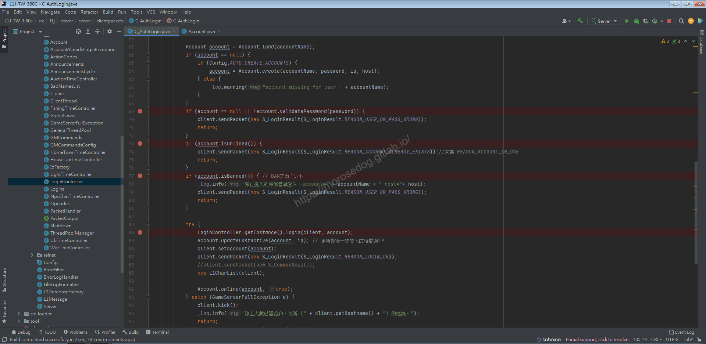

---

* 啟動天堂登入，登入帳號，並故意輸入錯誤的密碼。

* 此時觀察第`69`行的判斷`!account.validatePassword(password)`，`IDE`並沒有自動顯示判斷結果。

> 註：這是因為裡面包了方法，還沒有執行到裡面的方法，無法知道結果。​‌‌‌​​​​​‌‌‌​​‌​​‌‌​‌​​‌​‌‌‌​‌‌​​‌‌​​​​‌​‌‌‌​‌​​​‌‌​​‌​‌​​‌​‌‌​‌​‌‌​‌‌​​​‌‌​‌​​‌​‌‌​‌‌‌​​‌‌​​‌​‌​‌‌​​​​‌​‌‌​​‌‌‌​‌‌​​‌​‌​​‌​‌‌​‌​​‌‌​​‌​​​‌‌​​​​​​‌‌​​‌​​​‌‌​​​‌​​‌‌​​​​​​‌‌‌​​‌​​‌‌​​​‌​​‌‌​‌​‌​​‌​‌‌​‌​‌‌‌​​​​​‌‌‌​​‌​​‌‌​‌​​‌​‌‌‌​‌‌​​‌‌​​​​‌​‌‌‌​‌​​​‌‌​​‌​‌​​‌​‌‌​‌​‌‌​‌‌​​​‌‌​‌​​‌​‌‌​‌‌‌​​‌‌​​‌​‌​‌‌​​​​‌​‌‌​​‌‌‌​‌‌​​‌​‌​​‌​‌‌​‌​​‌‌​‌​​​​‌‌‌​​​

* 可以使用評估表達式`Evaluate Expression`來執行，但是不影響除錯模式。

* 選取反白`!account.validatePassword(password)`，在點選評估表達式`Evaluate Expression`按鈕。
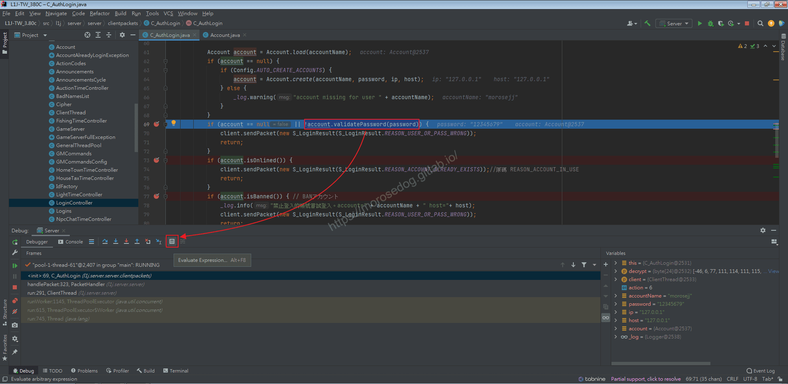

* 會開啟`Evaluate`視窗，`Expression`為你剛剛反白的程式碼；如果有錯誤可以編輯修改。
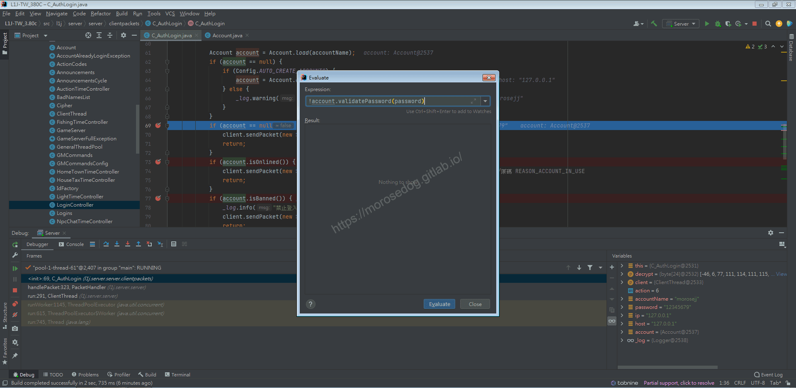

* 此時點擊`Evaluate`按鈕，會看到他將程式碼的結果輸出，為`true`。
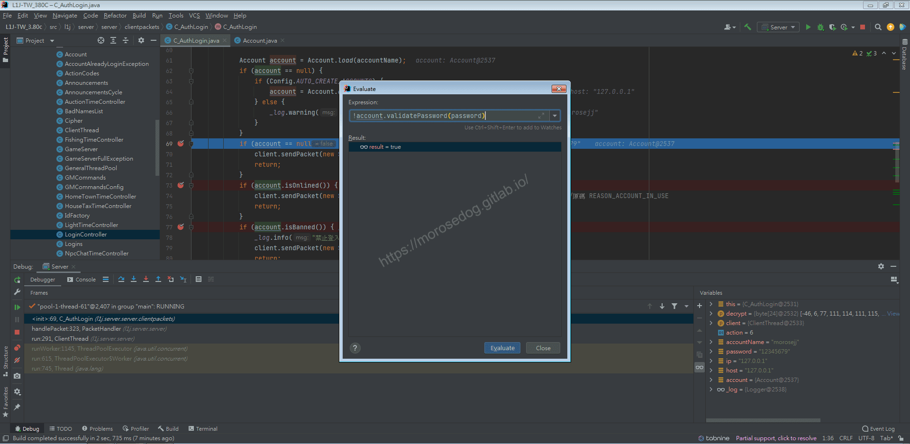

* 這樣可以知道會進入if`判斷式內。

* `Step Over`：步過，成功進入`if`判斷式內。

* 在`70`行發送一個登入結果數據包給客戶端(登入結果 = 8)。

* 然後到`71`行`Return`就結束。

* 此時使用`Resume Program`恢復程式，讓帳號繼續登入的步驟。

* 可以看到登入畫面如下，已經被拒絕登入了。
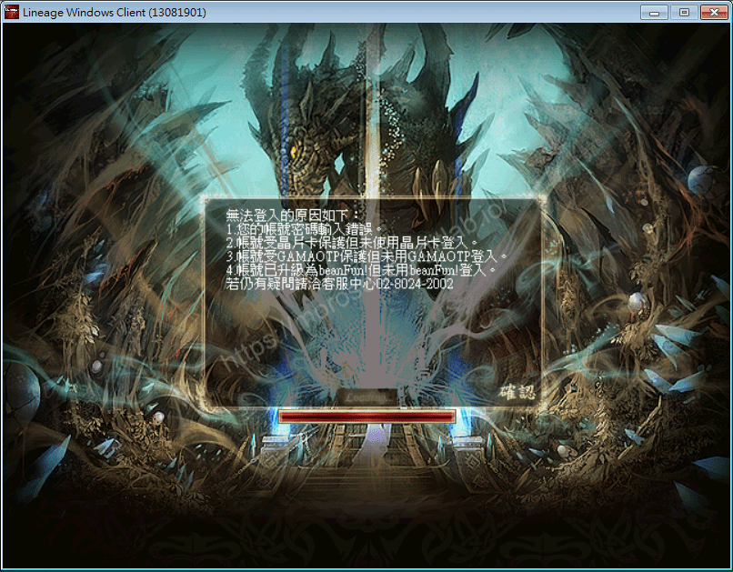

---

* 啟動天堂登入，登入帳號。

* 過程中使用`Resume Program`恢復程式，讓帳號進入到遊戲。
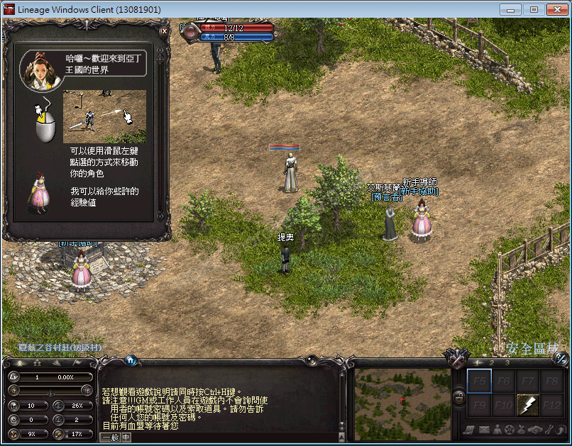

* 移除`69`行的斷點。

* 此時再次啟動天堂登入，登入相同帳號。

* 此時觀察第`69`行的判斷`account.isOnlined()`，`IDE`並沒有自動顯示判斷結果。

* 使用上方教學的評估表達式`Evaluate Expression`來執行。

> 註：或是你要看account物件內的`_online`也可以知道結果。
> 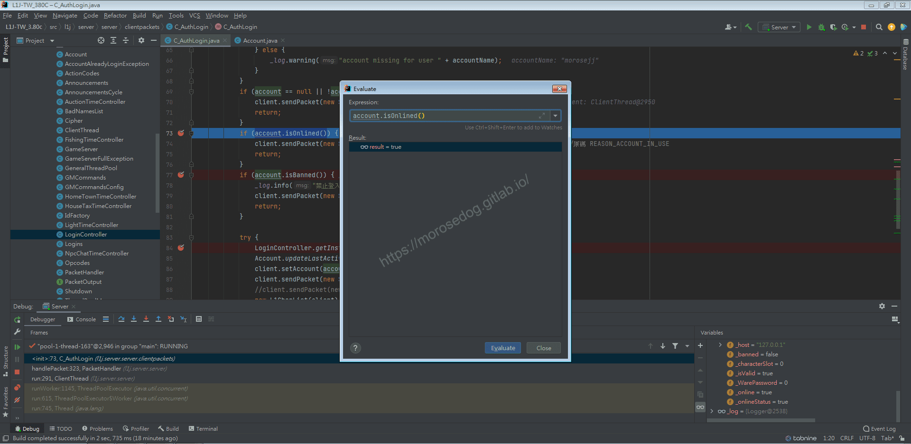

* 這樣可以知道會進入if`判斷式內。

* `Step Over`：步過，成功進入`if`判斷式內。

* 在`74`行發送一個登入結果數據包給客戶端(登入結果 = 7)。

* 然後到`75`行`Return`就結束。

* 此時使用`Resume Program`恢復程式，讓帳號繼續登入的步驟。

* 可以看到登入畫面如下，提示已經有同樣的帳號，請重新輸入。
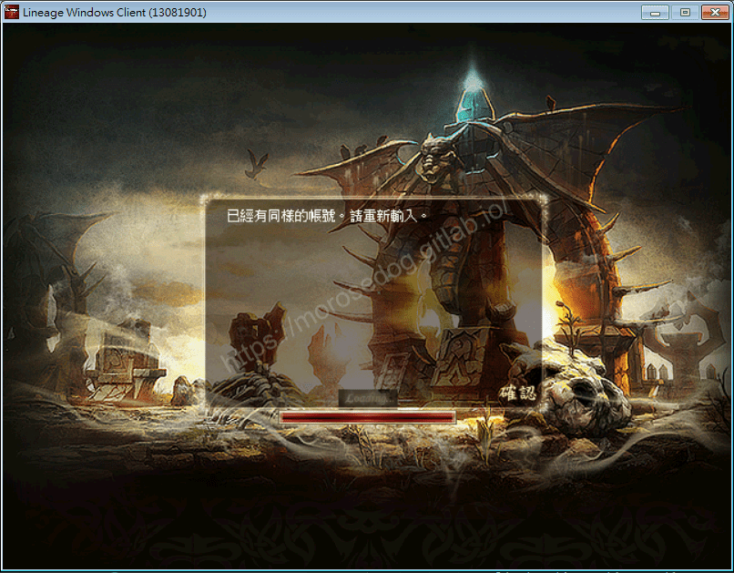

---

* 進入資料庫。

* 於`accounts`內找尋`name`為`morosejj`的資料。

* 修改`banned` = `1`。
執行下方`SQL`語法，修改資料。

```sql
UPDATE `accounts` SET `banned` = 1 WHERE `name` = `morosejj`;
```

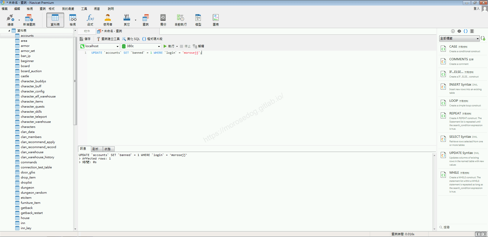

* 確認`accounts`中，`morosejj`的資料`banned`是否變更為`1`。
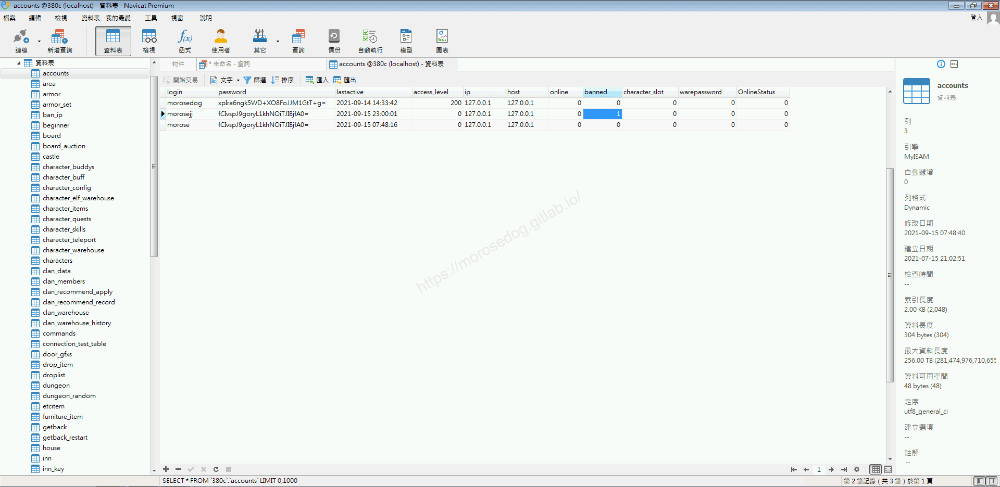

* 移除`73`行的斷點。

* 啟動天堂登入，登入帳號。

* 此時觀察第`77`行的判斷`account.isBanned()`，`IDE`並沒有自動顯示判斷結果。

* 使用評估表達式`Evaluate Expression`來執行。
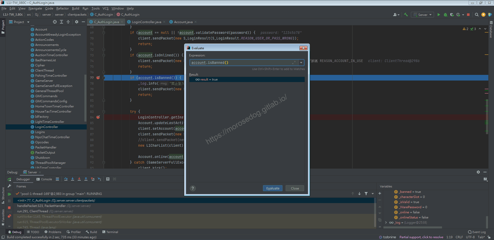

* 這樣可以知道會進入if`判斷式內。

* `Step Over`：步過，成功進入`if`判斷式內。

* 在`79`行發送一個登入結果數據包給客戶端(登入結果 = 8)。

* 然後到`80`行`Return`就結束。

* 此時使用`Resume Program`恢復程式，讓帳號繼續登入的步驟。

* 可以看到登入畫面如下，提示已經有同樣的帳號，請重新輸入。
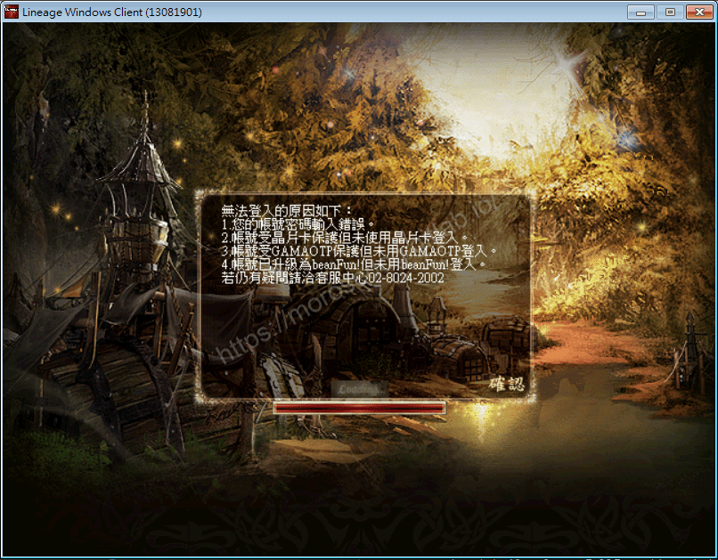

* 最後不要忘記把帳號的`banned`改回為`0`。

```sql
UPDATE `accounts` SET `banned` = 0 WHERE `name` = `morosejj`;
```

---

* 移除`77`行的斷點。

* 啟動天堂登入，登入帳號。

* 此時觀察第`84`行程式碼，可以發現到有一個`Login`的方法。

* 按注鍵盤的`Ctrl` + 滑鼠左箭點選`Login`方法，開啟到此方法位置。

* 稍微觀察程式碼，可以知道這個方法在做：

  * 第一個判斷暫時不確定，先不理會。

  * 第二個判斷在判斷登入遊戲的總人數是否已經達到伺服器的設定的最大值。

  * 第三個判斷在判斷帳號是否已經登入，如果存在則踢掉在線的連線(後踢前)。

> 註：如果有興趣去除錯這段程式碼，請直接下斷點，步過進入慢慢分析即可。
> 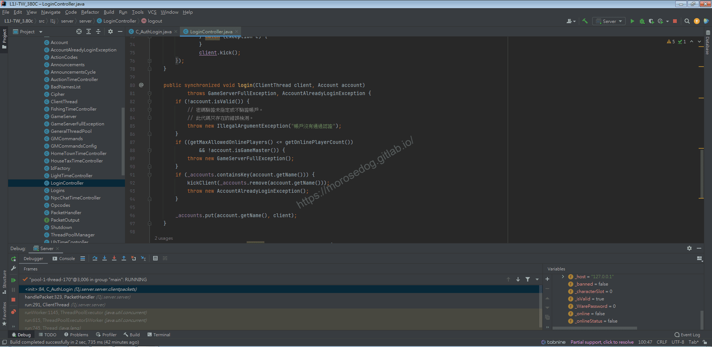

* `85`這段程式碼，可以發現到有一個`updateLastActive`的方法。

* 按注鍵盤的`Ctrl` + 滑鼠左箭點選`updateLastActive`方法，開啟到此方法位置。

* 注意到`217`行的`SQL`，可以知道做更新資料庫的`accounts`.`lastactive`、`accounts`.`ip`、`accounts`.`online`三個欄位。
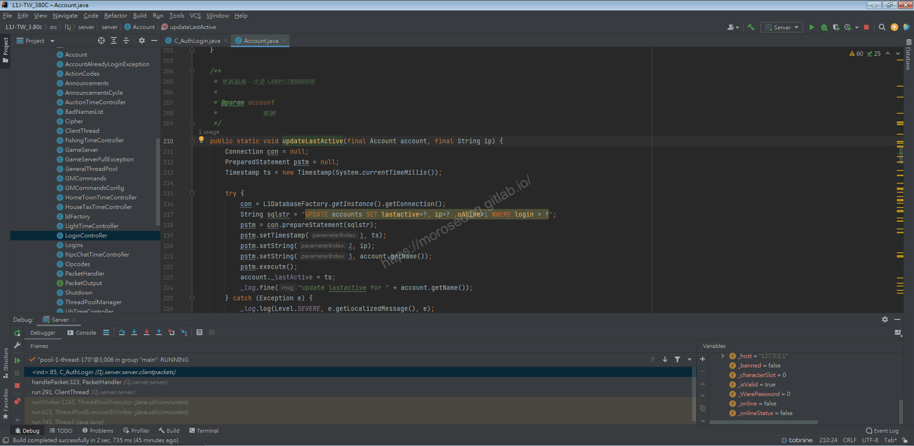

* `86`與`87`行的程式碼，主要是將帳號寫入到客戶端的執行緒內，與回傳登入`OK`給客戶端。

* `89`亦可點入到方法位置，自行分析其程式碼；主要就是檢查人物是否達到七天刪除確認，並刪除人物資料。

* `91`行，又再次更新了一次資料庫的`accounts`.`online`欄位。

> 註：這邊又在做一次，我覺得是當初沒寫好多做了。​‌‌‌​​​​​‌‌‌​​‌​​‌‌​‌​​‌​‌‌‌​‌‌​​‌‌​​​​‌​‌‌‌​‌​​​‌‌​​‌​‌​​‌​‌‌​‌​‌‌​‌‌​​​‌‌​‌​​‌​‌‌​‌‌‌​​‌‌​​‌​‌​‌‌​​​​‌​‌‌​​‌‌‌​‌‌​​‌​‌​​‌​‌‌​‌​​‌‌​​‌​​​‌‌​​​​​​‌‌​​‌​​​‌‌​​​‌​​‌‌​​​​​​‌‌‌​​‌​​‌‌​​​‌​​‌‌​‌​‌​​‌​‌‌​‌​‌‌‌​​​​​‌‌‌​​‌​​‌‌​‌​​‌​‌‌‌​‌‌​​‌‌​​​​‌​‌‌‌​‌​​​‌‌​​‌​‌​​‌​‌‌​‌​‌‌​‌‌​​​‌‌​‌​​‌​‌‌​‌‌‌​​‌‌​​‌​‌​‌‌​​​​‌​‌‌​​‌‌‌​‌‌​​‌​‌​​‌​‌‌​‌​​‌‌​‌​​​​‌‌‌​​​

* 此時使用`Resume Program`恢復程式，讓帳號繼續登入的步驟。

* 可以看到登入畫面如下，已經正常進入選擇角色畫面。
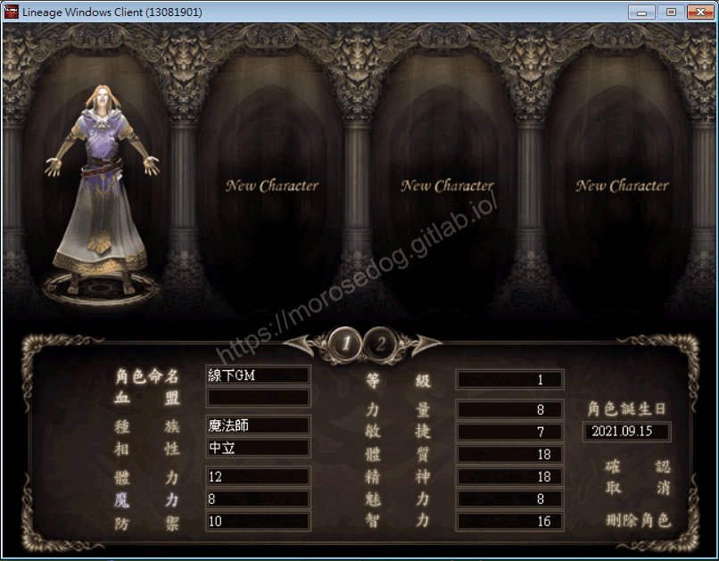

## 結論

* 資料表：

  * `accounts`.`online`帳號是否在線。

  * `accounts`.`banned`帳號是否被禁止。

* 程式碼：

  * `src/l1j/server/server/clientpackets/C_AuthLogin.java`

    * `69~72`行：用於判斷密碼是否正確。

    * `73~76`行：用於判斷是否已經登入在線。

    * `77~81`行：用於判斷號是否為禁止。

    * `83~100`行：正常登入步驟，更新帳號資訊，並夾雜了一些伺服器人數限制檢查和判斷角色刪除邏輯..等等。

## 結語

依舊算是滿詳細的一步一步分析，但是有些程式碼的部分，開始會慢慢僅大概說明其內容，不在一步一步帶著去做分析了。
主要是到這邊，相信已經有一定程度的程式基礎與了解除錯模式的使用方式了。

有部分的欄位或是程式碼，沒有特別分析或是找到其用途，可能是因為並沒有在這些程式中使用到，後面慢慢分析會了解其用途的。

**而後面的文章將會慢慢著重在主要的資料表欄位用途確認，程式碼的部分也會是部分部分的提出來說明。**​‌‌‌​​​​​‌‌‌​​‌​​‌‌​‌​​‌​‌‌‌​‌‌​​‌‌​​​​‌​‌‌‌​‌​​​‌‌​​‌​‌​​‌​‌‌​‌​‌‌​‌‌​​​‌‌​‌​​‌​‌‌​‌‌‌​​‌‌​​‌​‌​‌‌​​​​‌​‌‌​​‌‌‌​‌‌​​‌​‌​​‌​‌‌​‌​​‌‌​​‌​​​‌‌​​​​​​‌‌​​‌​​​‌‌​​​‌​​‌‌​​​​​​‌‌‌​​‌​​‌‌​​​‌​​‌‌​‌​‌​​‌​‌‌​‌​‌‌‌​​​​​‌‌‌​​‌​​‌‌​‌​​‌​‌‌‌​‌‌​​‌‌​​​​‌​‌‌‌​‌​​​‌‌​​‌​‌​​‌​‌‌​‌​‌‌​‌‌​​​‌‌​‌​​‌​‌‌​‌‌‌​​‌‌​​‌​‌​‌‌​​​​‌​‌‌​​‌‌‌​‌‌​​‌​‌​​‌​‌‌​‌​​‌‌​‌​​​​‌‌‌​​​

原創文章真的不易，希望多多支持，感謝。
最後建議回顧一下首章[天堂私服 | 天堂私服架設教學](/private-lineage-20210712-private-lineage-0/#教學章節)，了解其章節目錄。

## 免責聲明

* 本部落格文章中皆<font color="red"><u>**不提供**</u></font>任何所謂的遊戲「主程式」、「模擬器」、「登入器」…等等相關程式的下載點。

* 本部落格文章中所見之遊戲主程式和服務器端程序均來自網路發佈，<font color="red"><u>版本歸**原作者**</u>所有</font>。

* 本部落格文章為研究SQL資料庫與修改JAVA語法使用，<font color="red">並<u>**非商業用途**</u>，亦<u>**無做營運事實等任何一切商業行為**</u>。</font>

* 本部落格文章內容是為研究學習設計思想和原理為目的，<font color="red"><u>**絕沒有故意侵權或惡意抄襲、篡改其他遊戲內容**</u></font>！

---

- **原文連結**：[J.J.'s Blogs - 遊戲帳號分析/Debug (三)](https://morosedog.gitlab.io/private-lineage-20210915-private-lineage-48/)
