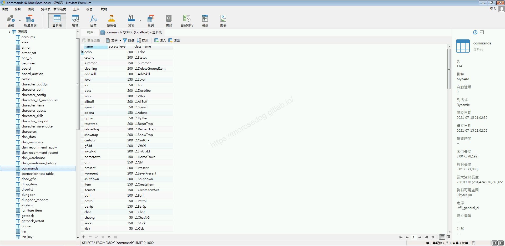
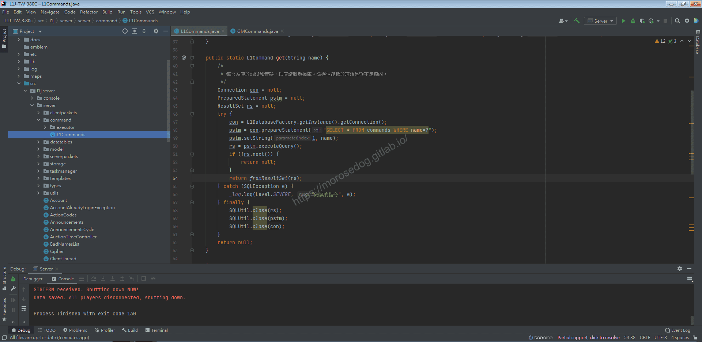
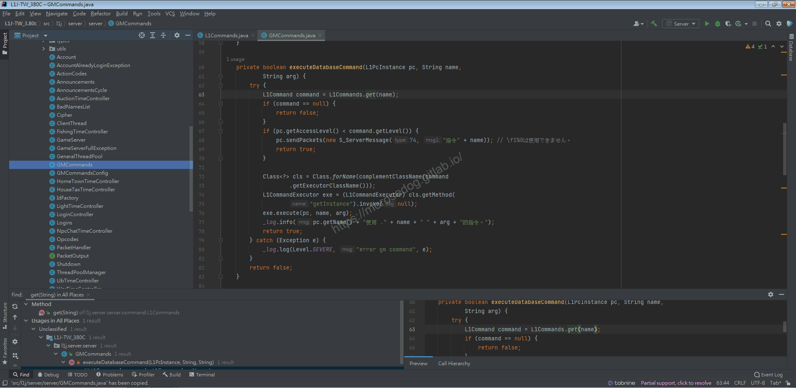
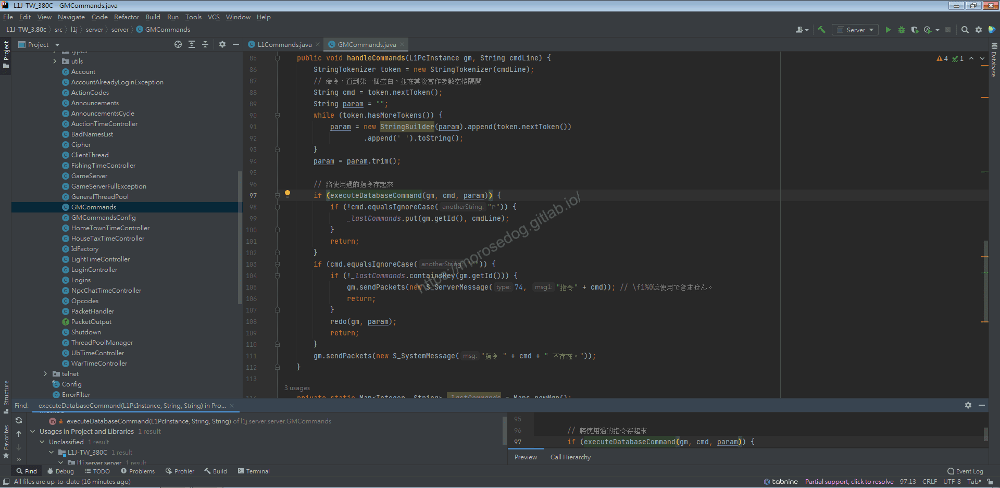
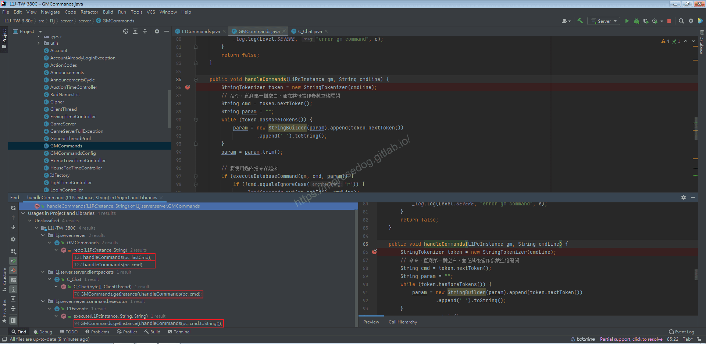
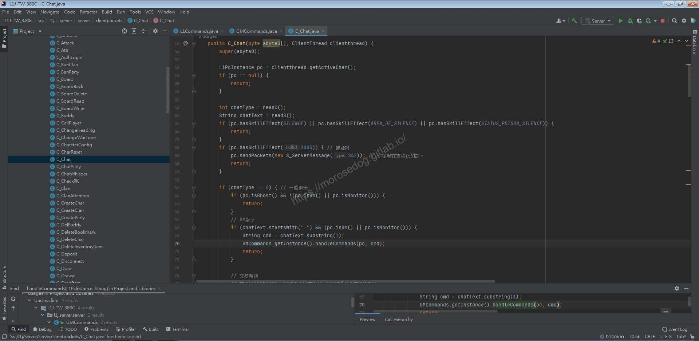

# GM指令的程式碼邏輯分析

# 天堂私服 | GM指令的程式碼邏輯分析「L1J版」

    
    
      📑 目錄
      

1. [章節用意](#章節用意)
2. [核心版本](#核心版本)
3. [分析](#分析)
4. [結論](#結論)
5. [結語](#結語)
6. [免責聲明](#免責聲明)

    
    
    

## 章節用意

因後面的各個分析，過程中可能都需要使用到一些指令來產生怪物、物品、狀態…等等。所以這邊就先分析`GM`指令。
而在分析這些指令中所分析的程式碼，其實就可以將其應用在很多的地方。

例如：全輔助指令 → 全輔助藥水。

## 核心版本

* L1J-3.80c

## 分析

在開始分析前，要知道`GM`指令的指令使用方式，才方便開啟除錯(Debug)進行分析。
以下提供一個全輔助的指令使用`allbuff ${角色名稱}`​‌‌‌​​​​​‌‌‌​​‌​​‌‌​‌​​‌​‌‌‌​‌‌​​‌‌​​​​‌​‌‌‌​‌​​​‌‌​​‌​‌​​‌​‌‌​‌​‌‌​‌‌​​​‌‌​‌​​‌​‌‌​‌‌‌​​‌‌​​‌​‌​‌‌​​​​‌​‌‌​​‌‌‌​‌‌​​‌​‌​​‌​‌‌​‌​​‌‌​​‌​​​‌‌​​​​​​‌‌​​‌​​​‌‌​​​‌​​‌‌​​​​​​‌‌‌​​‌​​‌‌​​​‌​​‌‌​‌‌‌​​‌​‌‌​‌​‌‌‌​​​​​‌‌‌​​‌​​‌‌​‌​​‌​‌‌‌​‌‌​​‌‌​​​​‌​‌‌‌​‌​​​‌‌​​‌​‌​​‌​‌‌​‌​‌‌​‌‌​​​‌‌​‌​​‌​‌‌​‌‌‌​​‌‌​​‌​‌​‌‌​​​​‌​‌‌​​‌‌‌​‌‌​​‌​‌​​‌​‌‌​‌​​‌‌​‌​‌​​‌‌​​​​

```plain
.allbuff 線上GM
```

* 1.分析資料表：

  * 在茫茫的資料庫中，先觀察所有的表名，會發現一個`commands`的表名(commands = 命令/指令)，點進去看資料如下圖。


  * 可見有三個欄位，分別為：

    * `name`：猜應該就是在遊戲內的指令名稱。

    * `access_level`：猜應該是使用指令的權限等級判斷。

    * `class_name`：就是會呼叫處理指令的`Class`的名稱。

  * 相信`access_level`欄位所對應的應該是`accounts`.`access_level`或是`characters`.`access_level`。

  * 嘗試後確認為`characters`.`access_level`為主要的判斷。

* 2.分析程式碼：

  * 根據猜測`commands`為表名，那透過此關鍵字去找尋程式碼，基本上也可以找到相對應的程式。

```plain
src/l1j/server/server/command/L1Commands.java
```



  * 開啟後分析程式碼，可以知道該`SQL`再根據`name`去取得資料庫資料。

  * 反向分析找尋呼叫的位置。

  * 在方法`get`上，按下右鍵並選擇`Find Usages`

  * 下方會彈出此所有使用此方法的清單。

  * 剛好只有一個地方，我們點擊將其開啟在工作區。

  * 這時候會開啟`GMCommands.java`。

```plain
src/l1j/server/server/GMCommands.java
```



  * `63~66`於資料庫取得指令，如`null`則`return`。

  * `67~70`判斷是用指令的角色是否有足夠權限使用此指令。

  * `72~76`使用`className`去取得`Class`並執行方法`execute`。

> 註：`className`會判斷是否是完整路徑，如果不完整會補全`l1j.server.server.command.executor.`，詳細行為可見`complementClassName`方法。​‌‌‌​​​​​‌‌‌​​‌​​‌‌​‌​​‌​‌‌‌​‌‌​​‌‌​​​​‌​‌‌‌​‌​​​‌‌​​‌​‌​​‌​‌‌​‌​‌‌​‌‌​​​‌‌​‌​​‌​‌‌​‌‌‌​​‌‌​​‌​‌​‌‌​​​​‌​‌‌​​‌‌‌​‌‌​​‌​‌​​‌​‌‌​‌​​‌‌​​‌​​​‌‌​​​​​​‌‌​​‌​​​‌‌​​​‌​​‌‌​​​​​​‌‌‌​​‌​​‌‌​​​‌​​‌‌​‌‌‌​​‌​‌‌​‌​‌‌‌​​​​​‌‌‌​​‌​​‌‌​‌​​‌​‌‌‌​‌‌​​‌‌​​​​‌​‌‌‌​‌​​​‌‌​​‌​‌​​‌​‌‌​‌​‌‌​‌‌​​​‌‌​‌​​‌​‌‌​‌‌‌​​‌‌​​‌​‌​‌‌​​​​‌​‌‌​​‌‌‌​‌‌​​‌​‌​​‌​‌‌​‌​​‌‌​‌​‌​​‌‌​​​​

  * 至此可以知道真時取得資料並判斷是否執行的程式碼位置就是在上述這些地方。

  * 繼續反向分析找尋呼叫的位置。

  * 在方法`executeDatabaseCommand`上，按下右鍵並選擇`Find Usages`

  * 剛好只有一個地方，我們點擊將其開啟在工作區。

  * 這時候還是在`GMCommands.java`，跳轉到`97`行程式碼。

  * `86~94`在處理輸入來的指令，拆成指令與參數。

  * `97`就是剛剛分析過的執行指令。

  * `98~100`是將這次執行的指令存起來，也就是紀錄最後一次執行的指令。

  * `103~110`就是判斷指令是否為`r`，如果是就執行最後一次執行的指令。

> 註：如果你在最後一次執行`.allbuff 線上GM`，那下次還想執行一樣的指令，只需要打`.r`即可。
> 

  * 繼續反向分析找尋呼叫的位置。

  * 在方法`handleCommands`上，按下右鍵並選擇`Find Usages`

  * 這次比較尷尬有四個地方，各別快速分析一下：

    * `GMCommands`內的`121`、`127`都是在`redo`的方法內，可以斷定這是在使用`.r`指令的時後呼叫的。

    * `C_chat`分析程式碼和註解，就是在處理`GM`指令的入口點。

    * `L1Favorite`他是對應到`GM`指令的`f`或是`書籤`的這個指令。(該指令用途我沒使用不清楚)


  * 我們點擊`C_chat`將其在工作區。

```plain
src/l1j/server/server/clientpackets/C_Chat.java
```



  * `63`判斷是否為一般聊天。

> 註：該值需要了解客戶端的部分，此不特別說明。

  * `67~72`處理`GM`指令，只要輸入的內容是`.`開頭，而且人物是`GM`或是`終端`的都會進入。

  * 繼續反向分析找尋呼叫的位置。

  * 在方法`C_Chat`上，按下右鍵並選擇`Find Usages`

  * 這次有兩個地方，直接都點過去看。

```plain
src/l1j/server/server/PacketHandler.java
```

  * `PacketHandler`會發現對應的是個`OP_CODE`。

    * `C_OPCODE_CHAT`：請求使用一般聊天頻道

    * `C_OPCODE_CHATGLOBAL`：請求使用廣播聊天頻道

> 註：我為什麼會知道對應的是客戶端的什麼行為？因為有註解有寫得很清楚。​‌‌‌​​​​​‌‌‌​​‌​​‌‌​‌​​‌​‌‌‌​‌‌​​‌‌​​​​‌​‌‌‌​‌​​​‌‌​​‌​‌​​‌​‌‌​‌​‌‌​‌‌​​​‌‌​‌​​‌​‌‌​‌‌‌​​‌‌​​‌​‌​‌‌​​​​‌​‌‌​​‌‌‌​‌‌​​‌​‌​​‌​‌‌​‌​​‌‌​​‌​​​‌‌​​​​​​‌‌​​‌​​​‌‌​​​‌​​‌‌​​​​​​‌‌‌​​‌​​‌‌​​​‌​​‌‌​‌‌‌​​‌​‌‌​‌​‌‌‌​​​​​‌‌‌​​‌​​‌‌​‌​​‌​‌‌‌​‌‌​​‌‌​​​​‌​‌‌‌​‌​​​‌‌​​‌​‌​​‌​‌‌​‌​‌‌​‌‌​​​‌‌​‌​​‌​‌‌​‌‌‌​​‌‌​​‌​‌​‌‌​​​​‌​‌‌​​‌‌‌​‌‌​​‌​‌​​‌​‌‌​‌​​‌‌​‌​‌​​‌‌​​​​

  * 分析至此告一段落。

## 結論

根據不斷的分析，大致上可以理出一些東西。

* 資料表：

  * `commands`.`name`指令名稱。

  * `commands`.`access_level`用於判斷指令權限的值。

  * `commands`.`class_name`對應要執行的`class`名稱。

* 程式碼：

  * `src/l1j/server/server/PacketHandler.java`

    * 處理所有客戶端來的請求。

  * `src/l1j/server/server/clientpackets/C_Chat.java`

    * 處理客戶端發送過來的說話內容。

  * `src/l1j/server/server/GMCommands.java`

    * 處理`GM`指令的一些判斷和邏輯。

  * `src/l1j/server/server/command/L1Commands.java`

    * 對應資料庫`commands`所做的操作。

## 結語

其實在`GM`指令內，已經提供出很多的想法和程式碼範例。
這些只要稍加修改其實就可以達成很多有趣的遊戲內容。

原創文章真的不易，希望多多支持，感謝。
最後建議回顧一下首章[天堂私服 | 天堂私服架設教學](/private-lineage-20210712-private-lineage-0/#教學章節)，了解其章節目錄。​‌‌‌​​​​​‌‌‌​​‌​​‌‌​‌​​‌​‌‌‌​‌‌​​‌‌​​​​‌​‌‌‌​‌​​​‌‌​​‌​‌​​‌​‌‌​‌​‌‌​‌‌​​​‌‌​‌​​‌​‌‌​‌‌‌​​‌‌​​‌​‌​‌‌​​​​‌​‌‌​​‌‌‌​‌‌​​‌​‌​​‌​‌‌​‌​​‌‌​​‌​​​‌‌​​​​​​‌‌​​‌​​​‌‌​​​‌​​‌‌​​​​​​‌‌‌​​‌​​‌‌​​​‌​​‌‌​‌‌‌​​‌​‌‌​‌​‌‌‌​​​​​‌‌‌​​‌​​‌‌​‌​​‌​‌‌‌​‌‌​​‌‌​​​​‌​‌‌‌​‌​​​‌‌​​‌​‌​​‌​‌‌​‌​‌‌​‌‌​​​‌‌​‌​​‌​‌‌​‌‌‌​​‌‌​​‌​‌​‌‌​​​​‌​‌‌​​‌‌‌​‌‌​​‌​‌​​‌​‌‌​‌​​‌‌​‌​‌​​‌‌​​​​

## 免責聲明

* 本部落格文章中皆<font color="red"><u>**不提供**</u></font>任何所謂的遊戲「主程式」、「模擬器」、「登入器」…等等相關程式的下載點。

* 本部落格文章中所見之遊戲主程式和服務器端程序均來自網路發佈，<font color="red"><u>版本歸**原作者**</u>所有</font>。

* 本部落格文章為研究SQL資料庫與修改JAVA語法使用，<font color="red">並<u>**非商業用途**</u>，亦<u>**無做營運事實等任何一切商業行為**</u>。</font>

* 本部落格文章內容是為研究學習設計思想和原理為目的，<font color="red"><u>**絕沒有故意侵權或惡意抄襲、篡改其他遊戲內容**</u></font>！

---

- **原文連結**：[J.J.'s Blogs - GM指令的程式碼邏輯分析](https://morosedog.gitlab.io/private-lineage-20210917-private-lineage-50/)
