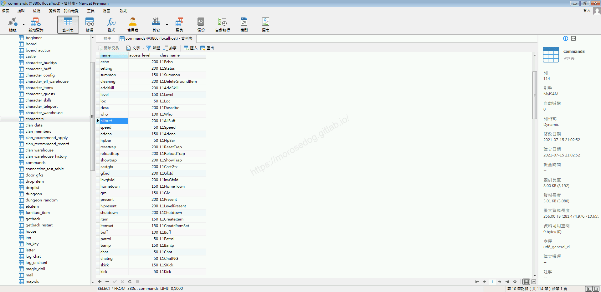
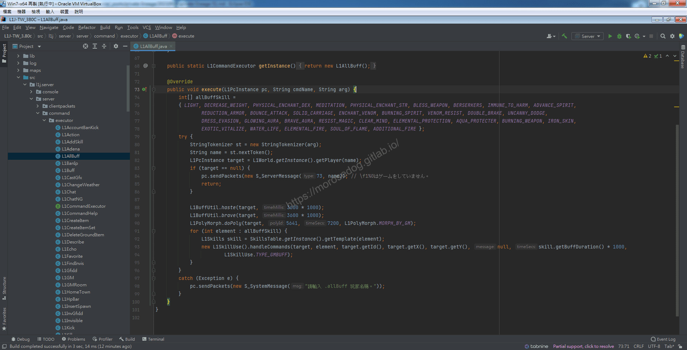
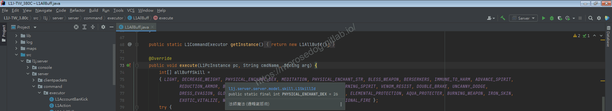
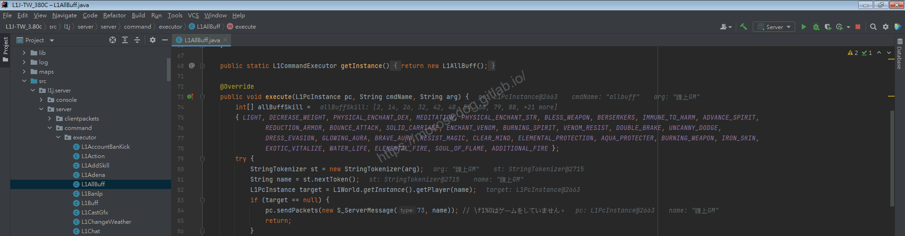
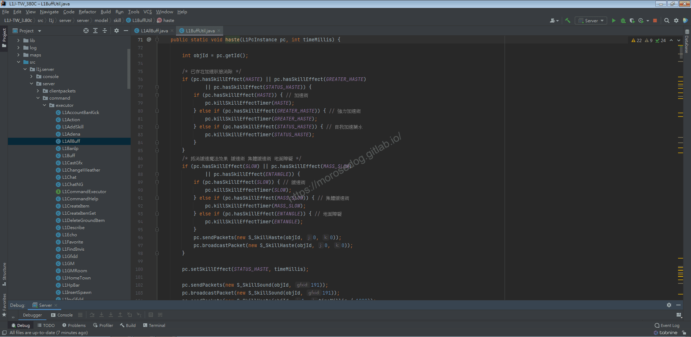
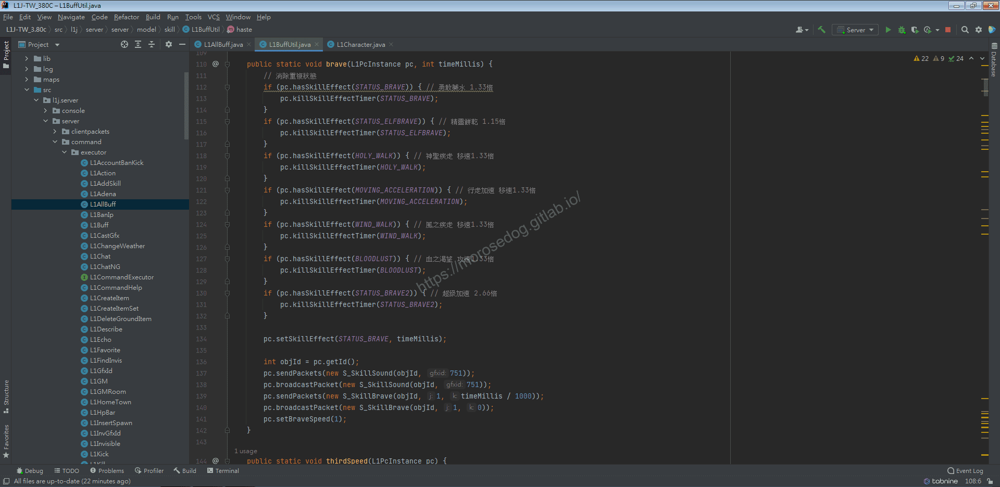
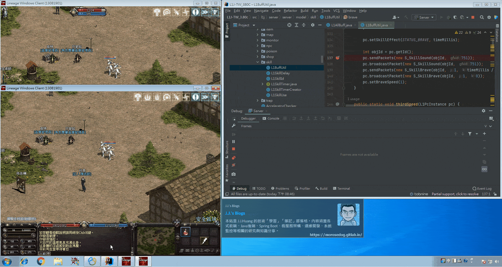

# GM指令分析 (全輔助)

# 天堂私服 | GM指令分析 (全輔助)「L1J版」

    
    
      📑 目錄
      

1. [章節用意](#章節用意)
2. [核心版本](#核心版本)
3. [分析](#分析)
4. [除錯](#除錯)
5. [結論](#結論)
6. [結語](#結語)
7. [免責聲明](#免責聲明)

    
    
    

## 章節用意

透過分析全輔助的指令，來了解程式碼如何實現施放輔助的行為。

## 核心版本

* L1J-3.80c

## 分析

在開始分析前，要知道`GM`指令的指令效果與使用方式，才方便開啟除錯(Debug)進行分析。

效果：指定角色給予所有輔助魔法。
範例：​‌‌‌​​​​​‌‌‌​​‌​​‌‌​‌​​‌​‌‌‌​‌‌​​‌‌​​​​‌​‌‌‌​‌​​​‌‌​​‌​‌​​‌​‌‌​‌​‌‌​‌‌​​​‌‌​‌​​‌​‌‌​‌‌‌​​‌‌​​‌​‌​‌‌​​​​‌​‌‌​​‌‌‌​‌‌​​‌​‌​​‌​‌‌​‌​​‌‌​​‌​​​‌‌​​​​​​‌‌​​‌​​​‌‌​​​‌​​‌‌​​​​​​‌‌‌​​‌​​‌‌​​​‌​​‌‌‌​​​​​‌​‌‌​‌​‌‌‌​​​​​‌‌‌​​‌​​‌‌​‌​​‌​‌‌‌​‌‌​​‌‌​​​​‌​‌‌‌​‌​​​‌‌​​‌​‌​​‌​‌‌​‌​‌‌​‌‌​​​‌‌​‌​​‌​‌‌​‌‌‌​​‌‌​​‌​‌​‌‌​​​​‌​‌‌​​‌‌‌​‌‌​​‌​‌​​‌​‌‌​‌​​‌‌​‌​‌​​‌‌​​​‌

```plain
.allbuff ${角色名稱}
```

* 1.分析資料表：

  * 先進入`commands`表，找到`allbuff`全輔助的資料。

  * `class_name`是`L1AllBuff`。


* 2.分析程式碼：

  * 透過搜尋`L1AllBuff`開啟程式碼。

```plain
src/l1j/server/server/command/executor/L1AllBuff.java
```



  * 開啟後分析程式碼。

  * `74~78`建立一個陣列，存放需要施放的所有輔助魔法`SkillId`。

  * 滑鼠可以放在隨便一個參數上，可以看到有提示註解，就可以知道是什麼輔助魔法。


  * `80~86`取得指令所要施放的角色名稱是否有在線上。


  * `88`這段程式碼，可以發現到有一個`haste`的方法。

  * 按注鍵盤的`Ctrl` + 滑鼠左箭點選`haste`方法，開啟到此方法位置。

  * `76~85`在判斷是否已經有加速的狀態在身上，如果有的話，要先將狀態做刪除。

> 註：可以深入追一下`killSkillEffectTimer`方法，嘗試了解狀態是存放在哪、是如何刪除狀態。​‌‌‌​​​​​‌‌‌​​‌​​‌‌​‌​​‌​‌‌‌​‌‌​​‌‌​​​​‌​‌‌‌​‌​​​‌‌​​‌​‌​​‌​‌‌​‌​‌‌​‌‌​​​‌‌​‌​​‌​‌‌​‌‌‌​​‌‌​​‌​‌​‌‌​​​​‌​‌‌​​‌‌‌​‌‌​​‌​‌​​‌​‌‌​‌​​‌‌​​‌​​​‌‌​​​​​​‌‌​​‌​​​‌‌​​​‌​​‌‌​​​​​​‌‌‌​​‌​​‌‌​​​‌​​‌‌‌​​​​​‌​‌‌​‌​‌‌‌​​​​​‌‌‌​​‌​​‌‌​‌​​‌​‌‌‌​‌‌​​‌‌​​​​‌​‌‌‌​‌​​​‌‌​​‌​‌​​‌​‌‌​‌​‌‌​‌‌​​​‌‌​‌​​‌​‌‌​‌‌‌​​‌‌​​‌​‌​‌‌​​​​‌​‌‌​​‌‌‌​‌‌​​‌​‌​​‌​‌‌​‌​​‌‌​‌​‌​​‌‌​​​‌

  * `87~98`是判斷是否有這些負面狀態的魔法在身上，如果有的話，也要將這些狀態做刪除。

  * `100`施放**加速**技能在身上。

> 註：可以深入追一下`setSkillEffect`，裡面包含了`addSkillEffect`的使用。

  * `102~106`是人物動作的表現。

    * `sendPackets`給客戶端發送數據包。當客戶端收到，你在你的遊戲會面就會看到人物施放法術的動作聲音或是使用道具的動作聲音。

    * `broadcastPacket`給客戶端發送數據包(廣播)，在可視你的人物角色範圍內的其他玩家，都會收到此數據包，會看到你的施法動作聲音或是使用道具的動作聲音。

  * 註：這邊要可以猜測`gfxId`應該就是對應變身檔的編碼了。


  * 回到`L1AllBuff.java`。

  * `89`這段程式碼，可以發現到有一個`brave`的方法。

  * 按注鍵盤的`Ctrl` + 滑鼠左箭點選`brave`方法，開啟到此方法位置。

  * `112~132`在判斷是否已經有二段加速的狀態在身上，如果有的話，要先將狀態做刪除。

  * `134`施放**二段加速**技能(勇敢藥水)在身上。

  * `136~141`是人物動作的表現。


  * 再回到`L1AllBuff.java`。

  * `90`這段程式碼，可以發現到有一個`doPoly`的方法。

  * 這邊不特別分析講解，主要動作是指定施法變形術為變身檔編碼`5641`。

> 註：透過搜尋找到註解，大概可以確認，料庫`polymorphs`變身代碼表`polyid`等於圖檔編號。

  * 回到`L1AllBuff.java`。

  * `91~950`將需要施放的所有輔助魔法的陣列資料，迴圈施放。

  * 關於`L1SkillUse().handleCommands`這個方法，內部有很多的判斷與邏輯，建議可以除錯模式進行深入分析。

## 除錯

這邊針對下方兩個給客戶端發送數據包的行為確認：​‌‌‌​​​​​‌‌‌​​‌​​‌‌​‌​​‌​‌‌‌​‌‌​​‌‌​​​​‌​‌‌‌​‌​​​‌‌​​‌​‌​​‌​‌‌​‌​‌‌​‌‌​​​‌‌​‌​​‌​‌‌​‌‌‌​​‌‌​​‌​‌​‌‌​​​​‌​‌‌​​‌‌‌​‌‌​​‌​‌​​‌​‌‌​‌​​‌‌​​‌​​​‌‌​​​​​​‌‌​​‌​​​‌‌​​​‌​​‌‌​​​​​​‌‌‌​​‌​​‌‌​​​‌​​‌‌‌​​​​​‌​‌‌​‌​‌‌‌​​​​​‌‌‌​​‌​​‌‌​‌​​‌​‌‌‌​‌‌​​‌‌​​​​‌​‌‌‌​‌​​​‌‌​​‌​‌​​‌​‌‌​‌​‌‌​‌‌​​​‌‌​‌​​‌​‌‌​‌‌‌​​‌‌​​‌​‌​‌‌​​​​‌​‌‌​​‌‌‌​‌‌​​‌​‌​​‌​‌‌​‌​​‌‌​‌​‌​​‌‌​​​‌

* 畫面說明：

  * 左上方為`路人甲`。

  * 左下方為`線上GM`。

* 測試行為：

  * 對玩家`線上GM`執行`allbuff`的動作。

* 除錯位置：​‌‌‌​​​​​‌‌‌​​‌​​‌‌​‌​​‌​‌‌‌​‌‌​​‌‌​​​​‌​‌‌‌​‌​​​‌‌​​‌​‌​​‌​‌‌​‌​‌‌​‌‌​​​‌‌​‌​​‌​‌‌​‌‌‌​​‌‌​​‌​‌​‌‌​​​​‌​‌‌​​‌‌‌​‌‌​​‌​‌​​‌​‌‌​‌​​‌‌​​‌​​​‌‌​​​​​​‌‌​​‌​​​‌‌​​​‌​​‌‌​​​​​​‌‌‌​​‌​​‌‌​​​‌​​‌‌‌​​​​​‌​‌‌​‌​‌‌‌​​​​​‌‌‌​​‌​​‌‌​‌​​‌​‌‌‌​‌‌​​‌‌​​​​‌​‌‌‌​‌​​​‌‌​​‌​‌​​‌​‌‌​‌​‌‌​‌‌​​​‌‌​‌​​‌​‌‌​‌‌‌​​‌‌​​‌​‌​‌‌​​​​‌​‌‌​​‌‌‌​‌‌​​‌​‌​​‌​‌‌​‌​​‌‌​‌​‌​​‌‌​​​‌

  * 一段加速。

    * `src/l1j/server/server/model/skill/L1BuffUtil.java(102)`

  * 二段加速。

    * `src/l1j/server/server/model/skill/L1BuffUtil.java(137)`

* `sendPackets`給客戶端發送數據包。當客戶端收到，你在你的遊戲會面就會看到人物施放法術的動作聲音或是使用道具的動作聲音。


* `broadcastPacket`給客戶端發送數據包(廣播)，在可視你的人物角色範圍內的其他玩家，都會收到此數據包，會看到你的施法動作聲音或是使用道具的動作聲音。


## 結論

* 資料表：

  * `polymorphs`應該是變身資料表。

* 程式碼：

  * `src/l1j/server/server/command/executor/L1AllBuff.java`

    * 全輔助指令的處理程式。

  * `src/l1j/server/server/model/skill/L1BuffUtil.java`

    * 處理技能輔助狀態的一些方法。

* 程式方法：

  * `sendPackets`發送數據包到客戶端。

    * 通常對應狀態、訊息、動作、聲音…等等。

  * `broadcastPacket`廣播發送數據包到客戶端。

    * 廣播方式針對主要客戶端其他可視的角色清單做發送數據包。

## 結語

透過分析全輔助的指令，可以了解的技能的處理。還有人物動作伺服器端與客戶端的溝通的方式。​‌‌‌​​​​​‌‌‌​​‌​​‌‌​‌​​‌​‌‌‌​‌‌​​‌‌​​​​‌​‌‌‌​‌​​​‌‌​​‌​‌​​‌​‌‌​‌​‌‌​‌‌​​​‌‌​‌​​‌​‌‌​‌‌‌​​‌‌​​‌​‌​‌‌​​​​‌​‌‌​​‌‌‌​‌‌​​‌​‌​​‌​‌‌​‌​​‌‌​​‌​​​‌‌​​​​​​‌‌​​‌​​​‌‌​​​‌​​‌‌​​​​​​‌‌‌​​‌​​‌‌​​​‌​​‌‌‌​​​​​‌​‌‌​‌​‌‌‌​​​​​‌‌‌​​‌​​‌‌​‌​​‌​‌‌‌​‌‌​​‌‌​​​​‌​‌‌‌​‌​​​‌‌​​‌​‌​​‌​‌‌​‌​‌‌​‌‌​​​‌‌​‌​​‌​‌‌​‌‌‌​​‌‌​​‌​‌​‌‌​​​​‌​‌‌​​‌‌‌​‌‌​​‌​‌​​‌​‌‌​‌​​‌‌​‌​‌​​‌‌​​​‌

原創文章真的不易，希望多多支持，感謝。
最後建議回顧一下首章[天堂私服 | 天堂私服架設教學](/private-lineage-20210712-private-lineage-0/#教學章節)，了解其章節目錄。

## 免責聲明

* 本部落格文章中皆<font color="red"><u>**不提供**</u></font>任何所謂的遊戲「主程式」、「模擬器」、「登入器」…等等相關程式的下載點。

* 本部落格文章中所見之遊戲主程式和服務器端程序均來自網路發佈，<font color="red"><u>版本歸**原作者**</u>所有</font>。

* 本部落格文章為研究SQL資料庫與修改JAVA語法使用，<font color="red">並<u>**非商業用途**</u>，亦<u>**無做營運事實等任何一切商業行為**</u>。</font>

* 本部落格文章內容是為研究學習設計思想和原理為目的，<font color="red"><u>**絕沒有故意侵權或惡意抄襲、篡改其他遊戲內容**</u></font>！

---

- **原文連結**：[J.J.'s Blogs - GM指令分析 (全輔助)](https://morosedog.gitlab.io/private-lineage-20210918-private-lineage-51/)
