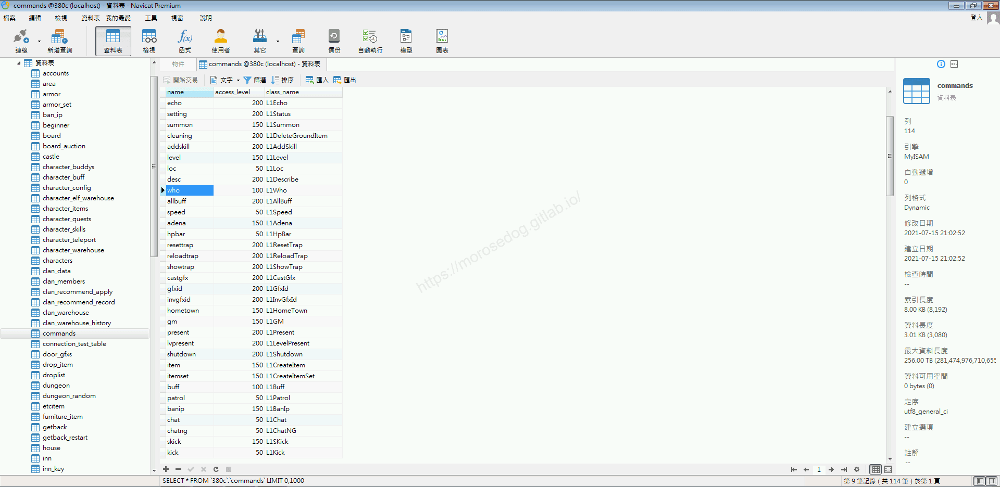
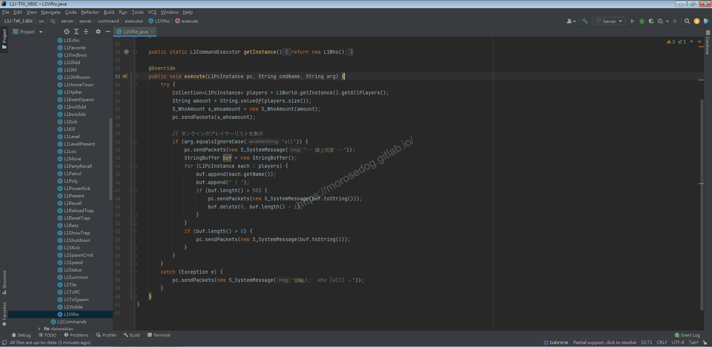
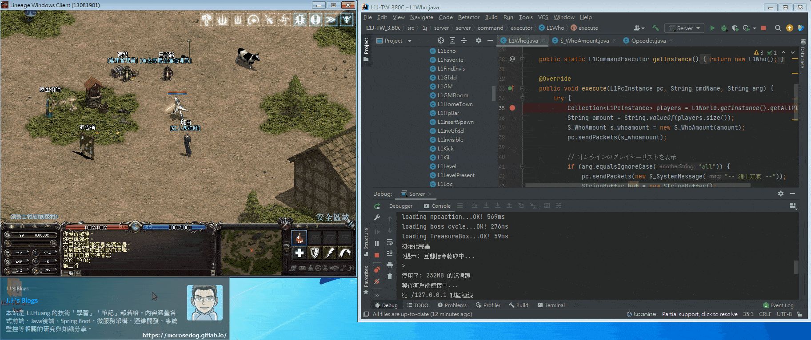
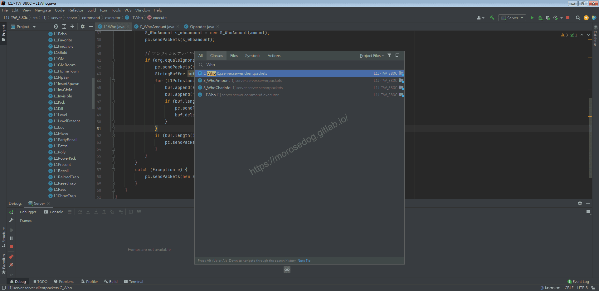
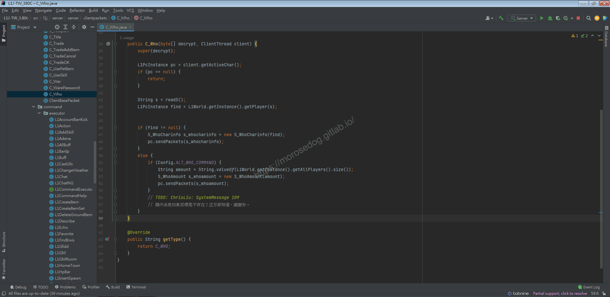

# GM指令/一般指令分析 (Who)

# 天堂私服 | GM指令/一般指令分析 (Who)「L1J版」

    
    
      📑 目錄
      

1. [章節用意](#章節用意)
2. [核心版本](#核心版本)
3. [分析](#分析)
4. [結論](#結論)
5. [結語](#結語)
6. [免責聲明](#免責聲明)

    
    
    

## 章節用意

`who`的指令，但是本身天堂遊戲內也有提供基本的`who`指令。所以透過分析來了解是否有不一樣的行為。

## 核心版本

* L1J-3.80c

## 分析

在開始分析前，要知道`GM`指令的指令效果與使用方式，才方便開啟除錯(Debug)進行分析。

效果：顯示在線用戶數。
範例：​‌‌‌​​​​​‌‌‌​​‌​​‌‌​‌​​‌​‌‌‌​‌‌​​‌‌​​​​‌​‌‌‌​‌​​​‌‌​​‌​‌​​‌​‌‌​‌​‌‌​‌‌​​​‌‌​‌​​‌​‌‌​‌‌‌​​‌‌​​‌​‌​‌‌​​​​‌​‌‌​​‌‌‌​‌‌​​‌​‌​​‌​‌‌​‌​​‌‌​​‌​​​‌‌​​​​​​‌‌​​‌​​​‌‌​​​‌​​‌‌​​​​​​‌‌‌​​‌​​‌‌​​​‌​​‌‌‌​​‌​​‌​‌‌​‌​‌‌‌​​​​​‌‌‌​​‌​​‌‌​‌​​‌​‌‌‌​‌‌​​‌‌​​​​‌​‌‌‌​‌​​​‌‌​​‌​‌​​‌​‌‌​‌​‌‌​‌‌​​​‌‌​‌​​‌​‌‌​‌‌‌​​‌‌​​‌​‌​‌‌​​​​‌​‌‌​​‌‌‌​‌‌​​‌​‌​​‌​‌‌​‌​​‌‌​‌​‌​​‌‌​​‌​

```plain
.who
.who all
```

而一般指令是：

```plain
/who
/who ${角色名稱}
```

* 1.分析資料表：

  * 先進入`commands`表，找到`who`線上人數的指令。

  * `class_name`是`L1Who`。


* 2.分析程式碼：​‌‌‌​​​​​‌‌‌​​‌​​‌‌​‌​​‌​‌‌‌​‌‌​​‌‌​​​​‌​‌‌‌​‌​​​‌‌​​‌​‌​​‌​‌‌​‌​‌‌​‌‌​​​‌‌​‌​​‌​‌‌​‌‌‌​​‌‌​​‌​‌​‌‌​​​​‌​‌‌​​‌‌‌​‌‌​​‌​‌​​‌​‌‌​‌​​‌‌​​‌​​​‌‌​​​​​​‌‌​​‌​​​‌‌​​​‌​​‌‌​​​​​​‌‌‌​​‌​​‌‌​​​‌​​‌‌‌​​‌​​‌​‌‌​‌​‌‌‌​​​​​‌‌‌​​‌​​‌‌​‌​​‌​‌‌‌​‌‌​​‌‌​​​​‌​‌‌‌​‌​​​‌‌​​‌​‌​​‌​‌‌​‌​‌‌​‌‌​​​‌‌​‌​​‌​‌‌​‌‌‌​​‌‌​​‌​‌​‌‌​​​​‌​‌‌​​‌‌‌​‌‌​​‌​‌​​‌​‌‌​‌​​‌‌​‌​‌​​‌‌​​‌​

  * 透過搜尋`L1Who`開啟程式碼。

```plain
src/l1j/server/server/command/executor/L1Who.java
```



  * 開啟後分析程式碼。

  * `35`將現在在線的人資料放入`Collection`。

  * `36`取得目前在線人數的數量。

  * `37~38`建立`S_WhoAmount`將在線人數寫入，並發送數據包給客戶端。

> 註：關於`S_WhoAmount`的部分，目前尚未做太多分析。

  * `41~55`判斷指令後方是否有帶參數為`all`。

  * 如果有帶參數，將會顯示詳細的在線上的角色名稱。

  * 注意一行顯示最多`50`位玩家，超過`50`將會在下一行輸出。

* 3.分析`GM`指令與一般指令

  * 在`L1Who`設定斷點。

  * 啟動除錯模式，開啟天堂遊戲登入。

  * 在對話框輸入，`.who`，確定有進入斷點。

  * 在對話框輸入，`/who`，並沒有進入斷點。

  * 此時可以斷定，兩個指令的處理位置並不是同一支程式。


* 4.分析程式碼：​‌‌‌​​​​​‌‌‌​​‌​​‌‌​‌​​‌​‌‌‌​‌‌​​‌‌​​​​‌​‌‌‌​‌​​​‌‌​​‌​‌​​‌​‌‌​‌​‌‌​‌‌​​​‌‌​‌​​‌​‌‌​‌‌‌​​‌‌​​‌​‌​‌‌​​​​‌​‌‌​​‌‌‌​‌‌​​‌​‌​​‌​‌‌​‌​​‌‌​​‌​​​‌‌​​​​​​‌‌​​‌​​​‌‌​​​‌​​‌‌​​​​​​‌‌‌​​‌​​‌‌​​​‌​​‌‌‌​​‌​​‌​‌‌​‌​‌‌‌​​​​​‌‌‌​​‌​​‌‌​‌​​‌​‌‌‌​‌‌​​‌‌​​​​‌​‌‌‌​‌​​​‌‌​​‌​‌​​‌​‌‌​‌​‌‌​‌‌​​​‌‌​‌​​‌​‌‌​‌‌‌​​‌‌​​‌​‌​‌‌​​​​‌​‌‌​​‌‌‌​‌‌​​‌​‌​​‌​‌‌​‌​​‌‌​‌​‌​​‌‌​​‌​

  * 針對一般指令`who`嘗試做搜尋。

  * 此次使用`Ctrl` + `N`，針對`classes`做名稱的搜。

  * 輸入`Who`。

  * 可以發現有一個`C_Who`的檔，點擊將其打開。


  * 在程式碼內下斷點。

  * 在遊戲對話框輸入，`/who`，確定有進入斷點。

  * 此時可以斷定，一般指令的執行的就是`C_Who`。

```plain
src/l1j/server/server/clientpackets/C_Who.java
```


  * 回到程式碼，開始分析。

  * `37~40`，應該是取得客戶端的資訊。

  * `42`這是個`readS`的方法，解析取得輸入的參數的字串。

> 註：如果有興趣分析`readS`的話，需要具備`byte array`→`ASCII`的一些相關知識。

  * `43`確認輸入的參數名稱是否存在線上。

  * `46~58`確認是否有參數，如有參數則顯示玩家的名稱與狀態(正義(Lawful)/中立(Neutral)/邪惡(Chaotic))，如無則顯示線上人數。


  * 此時做個反向分析找尋呼叫的位置。

  * 在方法`C_Who`上，按下右鍵並選擇`Find Usages`

  * 下方會彈出此所有使用此方法的清單。

  * 剛好只有一個地方，我們點擊將其開啟在工作區。

  * 這時候會開啟`PacketHandler.java`。

```plain
src/l1j/server/server/PacketHandler.java
```

  * 在前面幾次分析中也有提到。

  * `PacketHandler`會發現對應的是個`OP_CODE`。

    * `C_OPCODE_WHO`：請求查詢遊戲人數

> 註：我為什麼會知道對應的是客戶端的什麼行為？因為有註解有寫得很清楚。

  * 分析至此告一段落。

## 結論

指令的處理與客戶端原生的指令處理事會有不一樣。​‌‌‌​​​​​‌‌‌​​‌​​‌‌​‌​​‌​‌‌‌​‌‌​​‌‌​​​​‌​‌‌‌​‌​​​‌‌​​‌​‌​​‌​‌‌​‌​‌‌​‌‌​​​‌‌​‌​​‌​‌‌​‌‌‌​​‌‌​​‌​‌​‌‌​​​​‌​‌‌​​‌‌‌​‌‌​​‌​‌​​‌​‌‌​‌​​‌‌​​‌​​​‌‌​​​​​​‌‌​​‌​​​‌‌​​​‌​​‌‌​​​​​​‌‌‌​​‌​​‌‌​​​‌​​‌‌‌​​‌​​‌​‌‌​‌​‌‌‌​​​​​‌‌‌​​‌​​‌‌​‌​​‌​‌‌‌​‌‌​​‌‌​​​​‌​‌‌‌​‌​​​‌‌​​‌​‌​​‌​‌‌​‌​‌‌​‌‌​​​‌‌​‌​​‌​‌‌​‌‌‌​​‌‌​​‌​‌​‌‌​​​​‌​‌‌​​‌‌‌​‌‌​​‌​‌​​‌​‌‌​‌​​‌‌​‌​‌​​‌‌​​‌​

* 程式碼：

  * `src/l1j/server/server/PacketHandler.java`

    * 處理所有客戶端來的請求。

  * `src/l1j/server/server/clientpackets/C_Who.java`

    * 處理客戶端來的`who`指令。

  * `src/l1j/server/server/command/executor/L1Who.java`

    * 處理客戶端來的`GM`指令`who`的處理。

## 結語

這邊透過分析兩種指令在模擬器內的實現，可以了解到原本的指令處理是在`PacketHandler.java`內直接對應處理。
而`GM`指令，這種非原生的，是透過一般聊天或是公頻聊天使用`C_Chat`來做分析，在跳轉到相對應的`Class`做處理。

原創文章真的不易，希望多多支持，感謝。
最後建議回顧一下首章[天堂私服 | 天堂私服架設教學](/private-lineage-20210712-private-lineage-0/#教學章節)，了解其章節目錄。

## 免責聲明

* 本部落格文章中皆<font color="red"><u>**不提供**</u></font>任何所謂的遊戲「主程式」、「模擬器」、「登入器」…等等相關程式的下載點。

* 本部落格文章中所見之遊戲主程式和服務器端程序均來自網路發佈，<font color="red"><u>版本歸**原作者**</u>所有</font>。

* 本部落格文章為研究SQL資料庫與修改JAVA語法使用，<font color="red">並<u>**非商業用途**</u>，亦<u>**無做營運事實等任何一切商業行為**</u>。</font>

* 本部落格文章內容是為研究學習設計思想和原理為目的，<font color="red"><u>**絕沒有故意侵權或惡意抄襲、篡改其他遊戲內容**</u></font>！

---

- **原文連結**：[J.J.'s Blogs - GM指令/一般指令分析 (Who)](https://morosedog.gitlab.io/private-lineage-20210919-private-lineage-52/)
