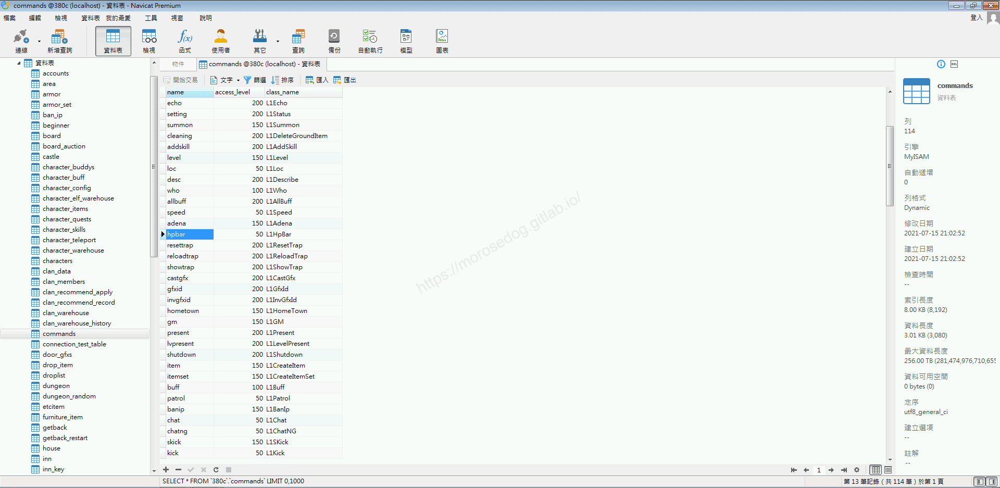
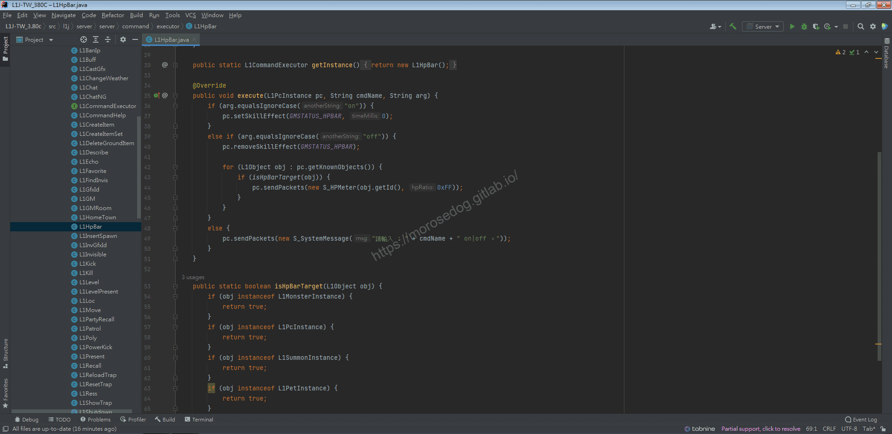
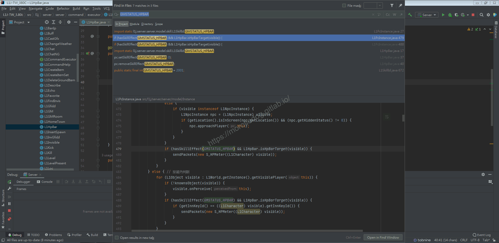
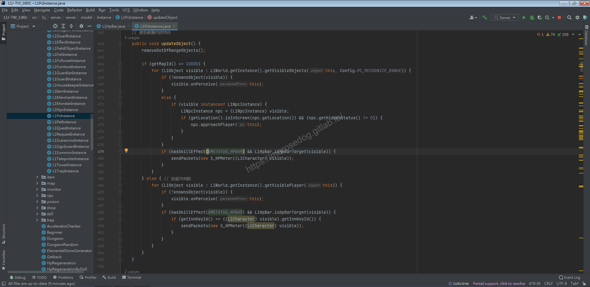
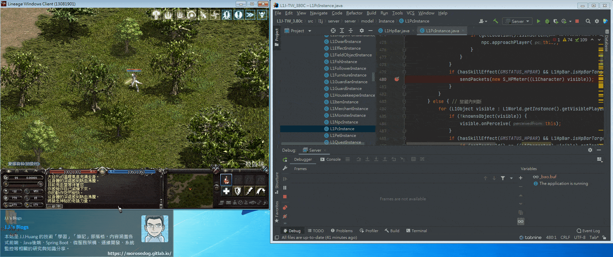
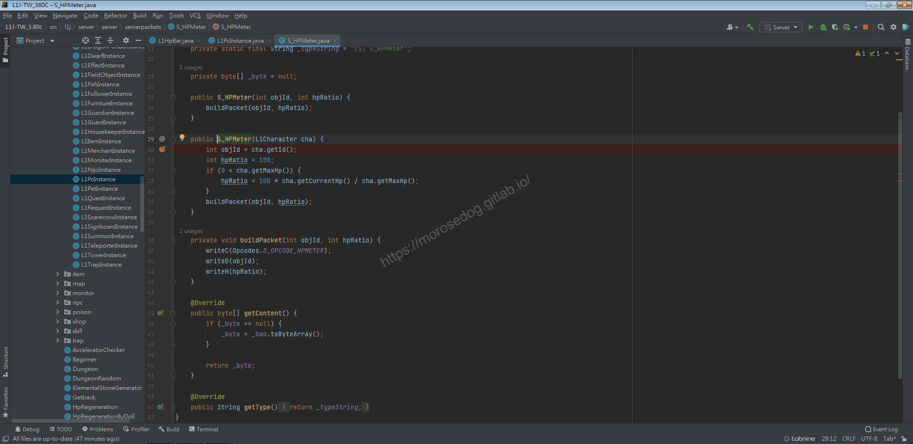
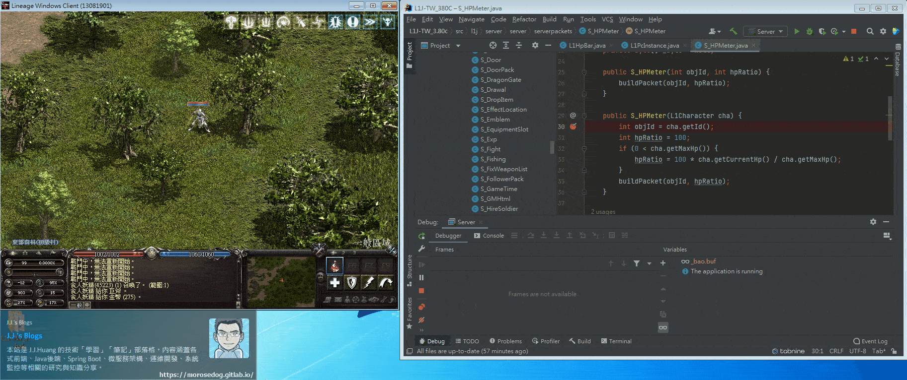
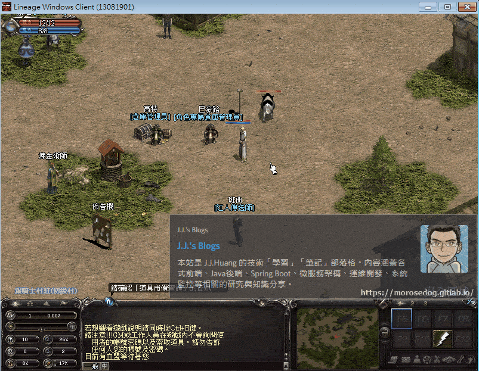

# GM指令分析/修改 (怪物血條)

# 天堂私服 | GM指令分析/修改 (怪物血條)「L1J版」

    
    
      📑 目錄
      

1. [章節用意](#章節用意)
2. [核心版本](#核心版本)
3. [分析](#分析)
4. [修改](#修改)
5. [結論](#結論)
6. [結語](#結語)
7. [免責聲明](#免責聲明)

    
    
    

## 章節用意

`hpbar`的指令，用於顯示怪物血條，此指令是針對給`GM`使用，如果充分分析後，是否可以套用到所有玩家身上呢？

## 核心版本

* L1J-3.80c

## 分析

在開始分析前，要知道`GM`指令的指令效果與使用方式，才方便開啟除錯(Debug)進行分析。

效果：在畫面顯示所有角色(包括`Npc`)的`HP`條(只有你能看到)。
範例：​‌‌‌​​​​​‌‌‌​​‌​​‌‌​‌​​‌​‌‌‌​‌‌​​‌‌​​​​‌​‌‌‌​‌​​​‌‌​​‌​‌​​‌​‌‌​‌​‌‌​‌‌​​​‌‌​‌​​‌​‌‌​‌‌‌​​‌‌​​‌​‌​‌‌​​​​‌​‌‌​​‌‌‌​‌‌​​‌​‌​​‌​‌‌​‌​​‌‌​​‌​​​‌‌​​​​​​‌‌​​‌​​​‌‌​​​‌​​‌‌​​​​​​‌‌‌​​‌​​‌‌​​‌​​​‌‌​​​​​​‌​‌‌​‌​‌‌‌​​​​​‌‌‌​​‌​​‌‌​‌​​‌​‌‌‌​‌‌​​‌‌​​​​‌​‌‌‌​‌​​​‌‌​​‌​‌​​‌​‌‌​‌​‌‌​‌‌​​​‌‌​‌​​‌​‌‌​‌‌‌​​‌‌​​‌​‌​‌‌​​​​‌​‌‌​​‌‌‌​‌‌​​‌​‌​​‌​‌‌​‌​​‌‌​‌​‌​​‌‌​​‌‌

```plain
.hpbar on/off
```

* 1.分析資料表：

  * 先進入`commands`表，找到`hpbar`的指令。

  * `class_name`是`L1HpBar`。


* 2.分析程式碼：

  * 透過搜尋`L1HpBar`開啟程式碼。

```plain
src/l1j/server/server/command/executor/L1HpBar.java
```



  * 開啟後分析程式碼。

  * `36`如果為啟動`on`則進入。

  * `37`設定一個輔助技能為`GMSTATUS_HPBAR`的在身上。

  * `39`如果為啟動`off`則進入。

  * `40`移除身上輔助技能為`GMSTATUS_HPBAR`。

  * `42~46`針對可視的物件進行建立血條的數據包。

> 註：所謂的物件，是在天堂遊戲畫面內的怪物、NPC、門、物品..等等之類的。​‌‌‌​​​​​‌‌‌​​‌​​‌‌​‌​​‌​‌‌‌​‌‌​​‌‌​​​​‌​‌‌‌​‌​​​‌‌​​‌​‌​​‌​‌‌​‌​‌‌​‌‌​​​‌‌​‌​​‌​‌‌​‌‌‌​​‌‌​​‌​‌​‌‌​​​​‌​‌‌​​‌‌‌​‌‌​​‌​‌​​‌​‌‌​‌​​‌‌​​‌​​​‌‌​​​​​​‌‌​​‌​​​‌‌​​​‌​​‌‌​​​​​​‌‌‌​​‌​​‌‌​​‌​​​‌‌​​​​​​‌​‌‌​‌​‌‌‌​​​​​‌‌‌​​‌​​‌‌​‌​​‌​‌‌‌​‌‌​​‌‌​​​​‌​‌‌‌​‌​​​‌‌​​‌​‌​​‌​‌‌​‌​‌‌​‌‌​​​‌‌​‌​​‌​‌‌​‌‌‌​​‌‌​​‌​‌​‌‌​​​​‌​‌‌​​‌‌‌​‌‌​​‌​‌​​‌​‌‌​‌​​‌‌​‌​‌​​‌‌​​‌‌

* 3.分析程式碼

  * 根據關鍵字`GMSTATUS_HPBAR`找尋程式碼。

  * 可以發現有兩個地方做判斷，都在同一支程式內。


  * 開啟該程式位置。

```plain
src/l1j/server/server/model/Instance/L1PcInstance.java
```



  * 開啟後分析程式碼。

  * `479~481`是針對一般地圖做判斷，判斷是否有此輔助狀態在身上和物件是否為可顯示血條的物件。

  * `488~492`是針對旅館內的；這邊不做分析。

> 註：所謂的物件，是在天堂遊戲畫面內的怪物、NPC、門、物品..等等之類的。

  * 斷點於`480`。

  * 啟動模擬器除錯模式，並啟動天堂遊戲登入。

  * 找尋一個完全沒有怪物和物件的地方。

  * 可以發現目前還沒有進入斷點。

  * 使用召喚怪物的`GM`指令，召喚出一支`食人妖精`，並攻擊他，讓怪物持續攻擊你。(為了持續讓怪物保持在畫面內)

```plain
.spawn 45223 1 1
```

  * 使用`.hpbar on`的指令。

  * 可以發現進入斷點，此時使用`Resume Program`恢復程式。

  * 會發現斷點一直重複進入；可以斷定這邊是不斷的一直在判斷和更新畫面上的物件。

  * 點擊`Mute Breakpoints`將所有斷點先關閉，`Resume Program`恢復程式

  * 回到天堂遊戲內，擊殺怪物。

  * 再次點擊`Mute Breakpoints`將所有斷點啟用。

  * 可以發現斷點還是進入了；這是因為怪物屍體尚未消失，這個物件依舊在判斷是否要顯示血條。

  * 最後怪物消失後，就沒再進入斷點。(因為畫面內無任何物件)


  * 此時針對`S_HPMeter`做分析。

  * 將斷點所有斷點先行移除，在`S_HPMeter`的`30`新增斷點。

```plain
src/l1j/server/server/serverpackets/S_HPMeter.java
```



  * 再次召喚怪物。

```plain
.spawn 45223 1 1
```

  * 進入斷點後，開始使用`Step Over`：步過來分析。

  * 可以發現`cha`這個物件內有`name`的變數，寫著`食人妖精`；這邊可以確定該物件就是`食人妖精`的相關資訊物件。

  * 繼續`Step Over`：步過。

  * 取得該物件的最大血量，判斷是否有大於零。

  * 進入判斷後，計算目前物件`100 * 當前的血量 / 最大血量`得出百分比。

  * 最後將物件資訊傳送數據回客戶端。

  * 此處將會不斷循環，一直更新血條。

> 註：至於為什麼會一直循環？這可能是使用`Runnable`或是`ScheduledFuture.ScheduleAtFixedRate`，這邊暫時不深入分析。
> ​‌‌‌​​​​​‌‌‌​​‌​​‌‌​‌​​‌​‌‌‌​‌‌​​‌‌​​​​‌​‌‌‌​‌​​​‌‌​​‌​‌​​‌​‌‌​‌​‌‌​‌‌​​​‌‌​‌​​‌​‌‌​‌‌‌​​‌‌​​‌​‌​‌‌​​​​‌​‌‌​​‌‌‌​‌‌​​‌​‌​​‌​‌‌​‌​​‌‌​​‌​​​‌‌​​​​​​‌‌​​‌​​​‌‌​​​‌​​‌‌​​​​​​‌‌‌​​‌​​‌‌​​‌​​​‌‌​​​​​​‌​‌‌​‌​‌‌‌​​​​​‌‌‌​​‌​​‌‌​‌​​‌​‌‌‌​‌‌​​‌‌​​​​‌​‌‌‌​‌​​​‌‌​​‌​‌​​‌​‌‌​‌​‌‌​‌‌​​​‌‌​‌​​‌​‌‌​‌‌‌​​‌‌​​‌​‌​‌‌​​​​‌​‌‌​​‌‌‌​‌‌​​‌​‌​​‌​‌‌​‌​​‌‌​‌​‌​​‌‌​​‌‌

## 修改

修改成不需要透過`GM`指令才能開啟怪物血條功能，直接進入遊戲內就可以看到怪物血條。
根據上面的程式分析，可以知道主要的判斷邏輯位置為`L1PcInstance.java`的`479`行。
只需要將判斷`GMSTATUS_HPBAR`移除，即可達到啟動怪物血條的效果。

* 修改前

```java
if (hasSkillEffect(GMSTATUS_HPBAR) && L1HpBar.isHpBarTarget(visible)) {
	sendPackets(new S_HPMeter((L1Character) visible));
}
```

* 修改後

```java
if (L1HpBar.isHpBarTarget(visible)) {
	sendPackets(new S_HPMeter((L1Character) visible));
}
```

* 修改後儲存，啟動模擬器。

* 啟動天堂登入遊戲，去找尋怪物，即會看到怪物們都有血條了。


## 結論

指令的處理與客戶端原生的指令處理事會有不一樣。

* 程式碼：

  * `src/l1j/server/server/command/executor/L1HpBar.java`

    * 處理客戶端來的`GM`指令`hpbar`的處理。

## 結語

針對怪物血條的分析，進行修改可以達成啟動怪物血條的功能。當然加以修改可以進行設置設定檔的開關或是資料庫內設定開關。​‌‌‌​​​​​‌‌‌​​‌​​‌‌​‌​​‌​‌‌‌​‌‌​​‌‌​​​​‌​‌‌‌​‌​​​‌‌​​‌​‌​​‌​‌‌​‌​‌‌​‌‌​​​‌‌​‌​​‌​‌‌​‌‌‌​​‌‌​​‌​‌​‌‌​​​​‌​‌‌​​‌‌‌​‌‌​​‌​‌​​‌​‌‌​‌​​‌‌​​‌​​​‌‌​​​​​​‌‌​​‌​​​‌‌​​​‌​​‌‌​​​​​​‌‌‌​​‌​​‌‌​​‌​​​‌‌​​​​​​‌​‌‌​‌​‌‌‌​​​​​‌‌‌​​‌​​‌‌​‌​​‌​‌‌‌​‌‌​​‌‌​​​​‌​‌‌‌​‌​​​‌‌​​‌​‌​​‌​‌‌​‌​‌‌​‌‌​​​‌‌​‌​​‌​‌‌​‌‌‌​​‌‌​​‌​‌​‌‌​​​​‌​‌‌​​‌‌‌​‌‌​​‌​‌​​‌​‌‌​‌​​‌‌​‌​‌​​‌‌​​‌‌

原創文章真的不易，希望多多支持，感謝。
最後建議回顧一下首章[天堂私服 | 天堂私服架設教學](/private-lineage-20210712-private-lineage-0/#教學章節)，了解其章節目錄。

## 免責聲明

* 本部落格文章中皆<font color="red"><u>**不提供**</u></font>任何所謂的遊戲「主程式」、「模擬器」、「登入器」…等等相關程式的下載點。

* 本部落格文章中所見之遊戲主程式和服務器端程序均來自網路發佈，<font color="red"><u>版本歸**原作者**</u>所有</font>。

* 本部落格文章為研究SQL資料庫與修改JAVA語法使用，<font color="red">並<u>**非商業用途**</u>，亦<u>**無做營運事實等任何一切商業行為**</u>。</font>

* 本部落格文章內容是為研究學習設計思想和原理為目的，<font color="red"><u>**絕沒有故意侵權或惡意抄襲、篡改其他遊戲內容**</u></font>！

---

- **原文連結**：[J.J.'s Blogs - GM指令分析/修改 (怪物血條)](https://morosedog.gitlab.io/private-lineage-20210920-private-lineage-53/)
