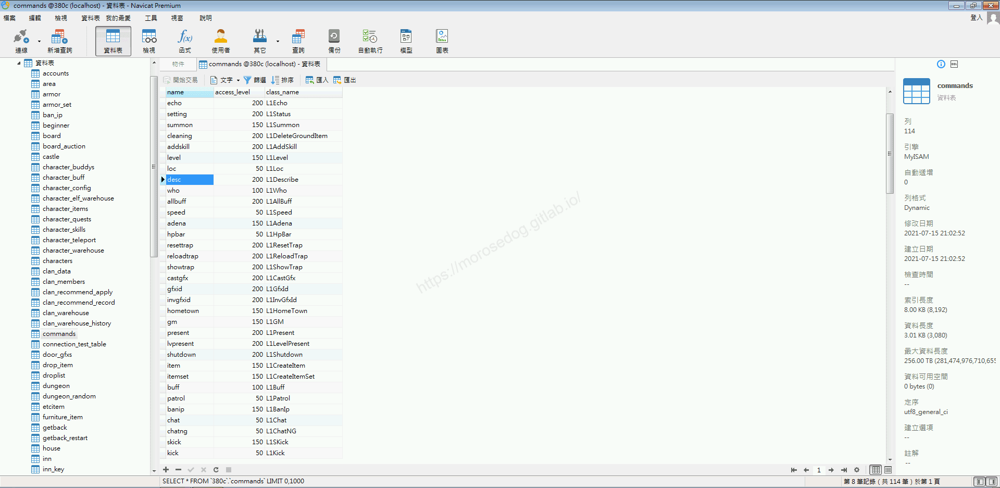
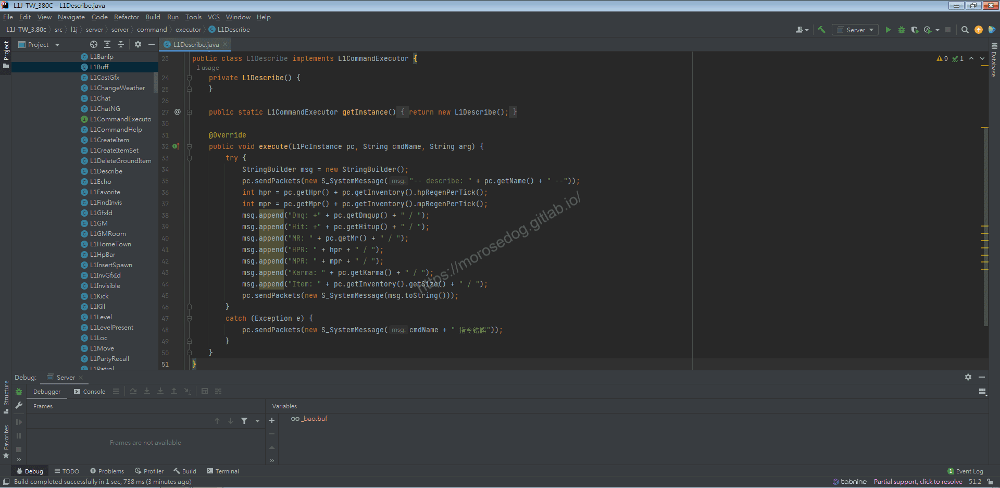
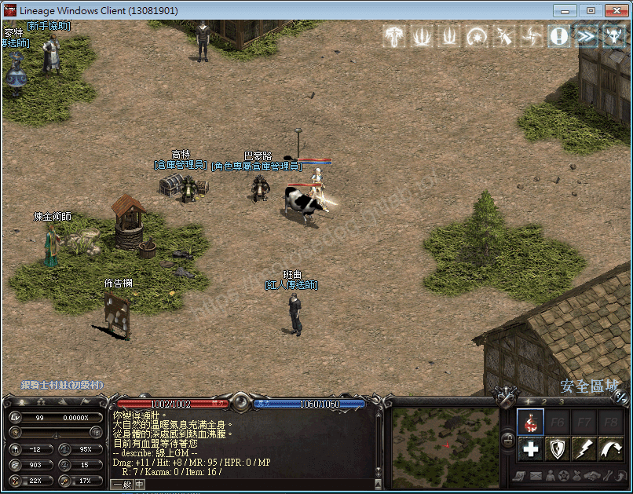
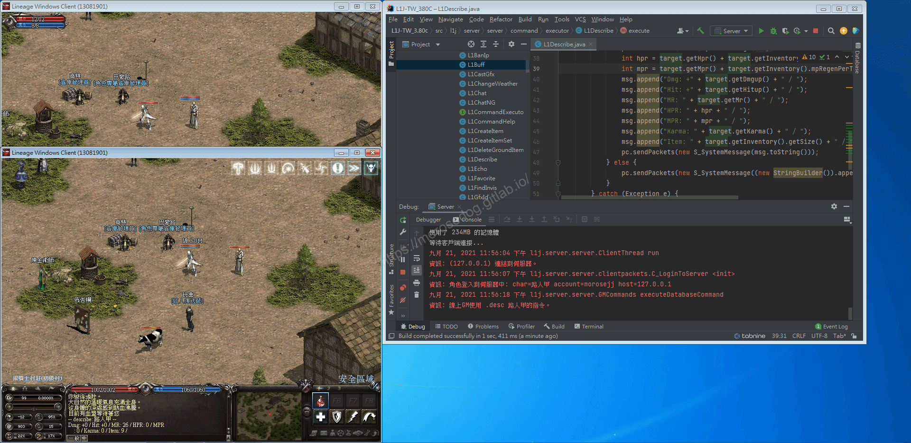

# GM指令分析/修改 (描述)

# 天堂私服 | GM指令分析/修改 (描述)「L1J版」

    
    
      📑 目錄
      

1. [章節用意](#章節用意)
2. [核心版本](#核心版本)
3. [分析](#分析)
4. [修改](#修改)
5. [結論](#結論)
6. [結語](#結語)
7. [免責聲明](#免責聲明)

    
    
    

## 章節用意

`desc`的指令，顯示玩家的資訊，或許可以套用在所謂的防親友道具(查看玩家資訊、裝備…等等)。

## 核心版本

* L1J-3.80c

## 分析

在開始分析前，要知道`GM`指令的指令效果與使用方式，才方便開啟除錯(Debug)進行分析。

效果：指定角色看到的額外資訊。
範例：​‌‌‌​​​​​‌‌‌​​‌​​‌‌​‌​​‌​‌‌‌​‌‌​​‌‌​​​​‌​‌‌‌​‌​​​‌‌​​‌​‌​​‌​‌‌​‌​‌‌​‌‌​​​‌‌​‌​​‌​‌‌​‌‌‌​​‌‌​​‌​‌​‌‌​​​​‌​‌‌​​‌‌‌​‌‌​​‌​‌​​‌​‌‌​‌​​‌‌​​‌​​​‌‌​​​​​​‌‌​​‌​​​‌‌​​​‌​​‌‌​​​​​​‌‌‌​​‌​​‌‌​​‌​​​‌‌​​​‌​​‌​‌‌​‌​‌‌‌​​​​​‌‌‌​​‌​​‌‌​‌​​‌​‌‌‌​‌‌​​‌‌​​​​‌​‌‌‌​‌​​​‌‌​​‌​‌​​‌​‌‌​‌​‌‌​‌‌​​​‌‌​‌​​‌​‌‌​‌‌‌​​‌‌​​‌​‌​‌‌​​​​‌​‌‌​​‌‌‌​‌‌​​‌​‌​​‌​‌‌​‌​​‌‌​‌​‌​​‌‌​‌​​

```plain
.desc ${角色名稱}
```

* 1.分析資料表：

  * 先進入`commands`表，找到`desc`的指令。

  * `class_name`是`L1Describe`。


* 2.分析程式碼：

  * 透過搜尋`L1Describe`開啟程式碼。

```plain
src/l1j/server/server/command/executor/L1Describe.java
```



  * 基本上該指令只有針對下指令的玩家取得自身的資料(`L1PcInstance`)。

  * 注意到`L1PcInstance`繼承了`L1Character`。

  * 這邊不特別分析可以看到多少資訊，因為太多了…自行除錯模式即可。

  * `36~44`行是在取得相關的資訊，並組合成字串。

  * `45`最後將物件資訊傳送數據回客戶端做顯示。

> 註：如果想要顯示更多資訊，可以在`L1PcInstance`裡面查找資料。
> ​‌‌‌​​​​​‌‌‌​​‌​​‌‌​‌​​‌​‌‌‌​‌‌​​‌‌​​​​‌​‌‌‌​‌​​​‌‌​​‌​‌​​‌​‌‌​‌​‌‌​‌‌​​​‌‌​‌​​‌​‌‌​‌‌‌​​‌‌​​‌​‌​‌‌​​​​‌​‌‌​​‌‌‌​‌‌​​‌​‌​​‌​‌‌​‌​​‌‌​​‌​​​‌‌​​​​​​‌‌​​‌​​​‌‌​​​‌​​‌‌​​​​​​‌‌‌​​‌​​‌‌​​‌​​​‌‌​​​‌​​‌​‌‌​‌​‌‌‌​​​​​‌‌‌​​‌​​‌‌​‌​​‌​‌‌‌​‌‌​​‌‌​​​​‌​‌‌‌​‌​​​‌‌​​‌​‌​​‌​‌‌​‌​‌‌​‌‌​​​‌‌​‌​​‌​‌‌​‌‌‌​​‌‌​​‌​‌​‌‌​​​​‌​‌‌​​‌‌‌​‌‌​​‌​‌​​‌​‌‌​‌​​‌‌​‌​‌​​‌‌​‌​​

## 修改

目前指令只有針對自己，希望將此指令修改程可以指定玩家做查詢。
可以發現帶入的參數有`arg`，而`arg`的取得，之前也分析過。

修改的方向是，針對傳入的玩家名稱，嘗試取得玩家資訊，如果玩家在線則將資訊回傳；
如果玩家不在線上，則回傳玩家不在線上。

> 註：這邊只是給一個思路，當然可以套用到很多地方，一般玩家可以使用指令、道具…等等，窺視其他玩家等級、素質、裝備…等等。​‌‌‌​​​​​‌‌‌​​‌​​‌‌​‌​​‌​‌‌‌​‌‌​​‌‌​​​​‌​‌‌‌​‌​​​‌‌​​‌​‌​​‌​‌‌​‌​‌‌​‌‌​​​‌‌​‌​​‌​‌‌​‌‌‌​​‌‌​​‌​‌​‌‌​​​​‌​‌‌​​‌‌‌​‌‌​​‌​‌​​‌​‌‌​‌​​‌‌​​‌​​​‌‌​​​​​​‌‌​​‌​​​‌‌​​​‌​​‌‌​​​​​​‌‌‌​​‌​​‌‌​​‌​​​‌‌​​​‌​​‌​‌‌​‌​‌‌‌​​​​​‌‌‌​​‌​​‌‌​‌​​‌​‌‌‌​‌‌​​‌‌​​​​‌​‌‌‌​‌​​​‌‌​​‌​‌​​‌​‌‌​‌​‌‌​‌‌​​​‌‌​‌​​‌​‌‌​‌‌‌​​‌‌​​‌​‌​‌‌​​​​‌​‌‌​​‌‌‌​‌‌​​‌​‌​​‌​‌‌​‌​​‌‌​‌​‌​​‌‌​‌​​

以下是修改後所使用的指令方式：

```plain
.desc ${玩家名稱}
```

* 修改前

```java
@Override
public void execute(L1PcInstance pc, String cmdName, String arg) {
	try {
		StringBuilder msg = new StringBuilder();
		pc.sendPackets(new S_SystemMessage("-- describe: " + pc.getName() + " --"));
		int hpr = pc.getHpr() + pc.getInventory().hpRegenPerTick();
		int mpr = pc.getMpr() + pc.getInventory().mpRegenPerTick();
		msg.append("Dmg: +" + pc.getDmgup() + " / ");
		msg.append("Hit: +" + pc.getHitup() + " / ");
		msg.append("MR: " + pc.getMr() + " / ");
		msg.append("HPR: " + hpr + " / ");
		msg.append("MPR: " + mpr + " / ");
		msg.append("Karma: " + pc.getKarma() + " / ");
		msg.append("Item: " + pc.getInventory().getSize() + " / ");
		pc.sendPackets(new S_SystemMessage(msg.toString()));
	}
	catch (Exception e) {
		pc.sendPackets(new S_SystemMessage(cmdName + " 指令錯誤"));
	}
}
```

* 修改後

```java
public void execute(L1PcInstance pc, String cmdName, String arg) {
    try {
        StringBuilder msg = new StringBuilder();
        L1PcInstance target = L1World.getInstance().getPlayer(arg);
        if (target != null) {
            pc.sendPackets(new S_SystemMessage("-- describe: " + target.getName() + " --"));
            int hpr = target.getHpr() + target.getInventory().hpRegenPerTick();
            int mpr = target.getMpr() + target.getInventory().mpRegenPerTick();
            msg.append("Dmg: +" + target.getDmgup() + " / ");
            msg.append("Hit: +" + target.getHitup() + " / ");
            msg.append("MR: " + target.getMr() + " / ");
            msg.append("HPR: " + hpr + " / ");
            msg.append("MPR: " + mpr + " / ");
            msg.append("Karma: " + target.getKarma() + " / ");
            msg.append("Item: " + target.getInventory().getSize() + " / ");
            pc.sendPackets(new S_SystemMessage(msg.toString()));
        } else {
            pc.sendPackets(new S_SystemMessage((new StringBuilder()).append(arg).append("不在線上。").toString()));
        }
    } catch (Exception e) {
        pc.sendPackets(new S_SystemMessage(cmdName + " 指令錯誤"));
    }
}
```

* 修改後儲存，啟動模擬器。

* 啟動天堂登入遊戲，登入`GM`帳號與另一個帳號。

* `GM`使用指令查詢另一位玩家，可護得該玩家資訊。


## 結論

* 程式碼：

  * `src/l1j/server/server/command/executor/L1Describe.java`

    * 處理客戶端來的`GM`指令`desc`的處理。

## 結語

其實在多分析原本的程式碼後，可以自己思考該程式碼是否可以應用在別的地方。
學習程式分析程式不外乎就是耐心，加油！

原創文章真的不易，希望多多支持，感謝。
最後建議回顧一下首章[天堂私服 | 天堂私服架設教學](/private-lineage-20210712-private-lineage-0/#教學章節)，了解其章節目錄。​‌‌‌​​​​​‌‌‌​​‌​​‌‌​‌​​‌​‌‌‌​‌‌​​‌‌​​​​‌​‌‌‌​‌​​​‌‌​​‌​‌​​‌​‌‌​‌​‌‌​‌‌​​​‌‌​‌​​‌​‌‌​‌‌‌​​‌‌​​‌​‌​‌‌​​​​‌​‌‌​​‌‌‌​‌‌​​‌​‌​​‌​‌‌​‌​​‌‌​​‌​​​‌‌​​​​​​‌‌​​‌​​​‌‌​​​‌​​‌‌​​​​​​‌‌‌​​‌​​‌‌​​‌​​​‌‌​​​‌​​‌​‌‌​‌​‌‌‌​​​​​‌‌‌​​‌​​‌‌​‌​​‌​‌‌‌​‌‌​​‌‌​​​​‌​‌‌‌​‌​​​‌‌​​‌​‌​​‌​‌‌​‌​‌‌​‌‌​​​‌‌​‌​​‌​‌‌​‌‌‌​​‌‌​​‌​‌​‌‌​​​​‌​‌‌​​‌‌‌​‌‌​​‌​‌​​‌​‌‌​‌​​‌‌​‌​‌​​‌‌​‌​​

## 免責聲明

* 本部落格文章中皆<font color="red"><u>**不提供**</u></font>任何所謂的遊戲「主程式」、「模擬器」、「登入器」…等等相關程式的下載點。

* 本部落格文章中所見之遊戲主程式和服務器端程序均來自網路發佈，<font color="red"><u>版本歸**原作者**</u>所有</font>。

* 本部落格文章為研究SQL資料庫與修改JAVA語法使用，<font color="red">並<u>**非商業用途**</u>，亦<u>**無做營運事實等任何一切商業行為**</u>。</font>

* 本部落格文章內容是為研究學習設計思想和原理為目的，<font color="red"><u>**絕沒有故意侵權或惡意抄襲、篡改其他遊戲內容**</u></font>！

---

- **原文連結**：[J.J.'s Blogs - GM指令分析/修改 (描述)](https://morosedog.gitlab.io/private-lineage-20210921-private-lineage-54/)
