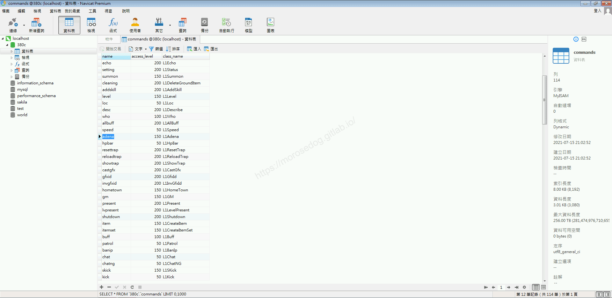
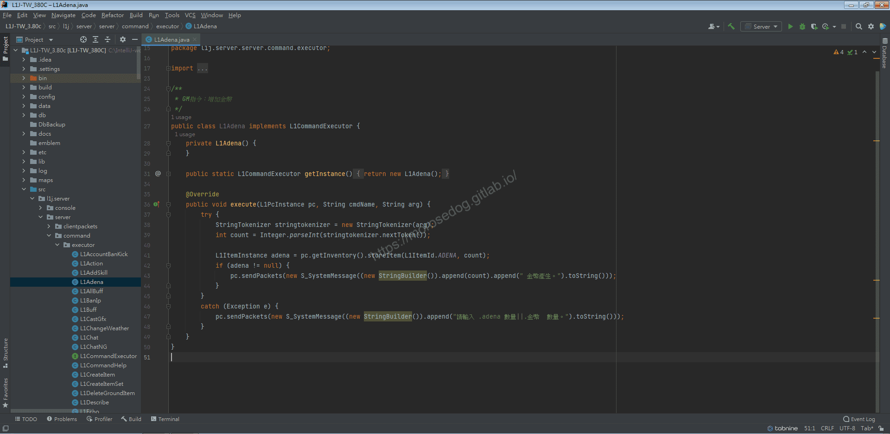
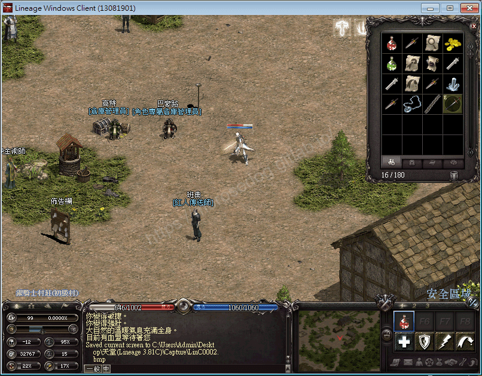
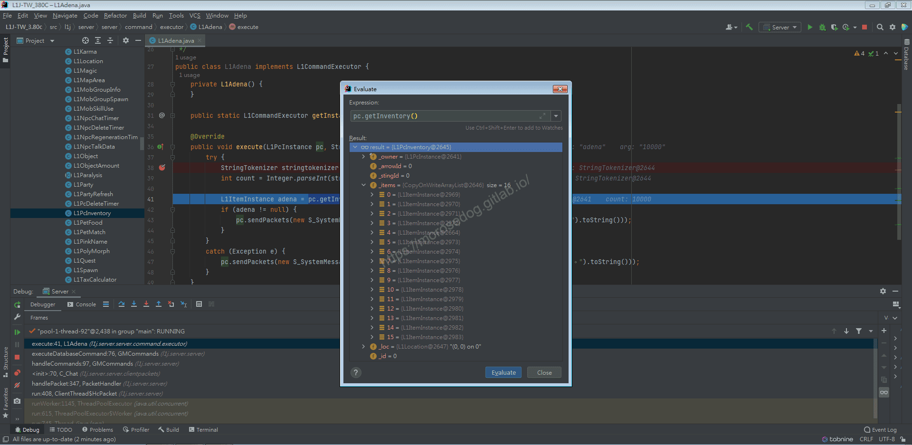
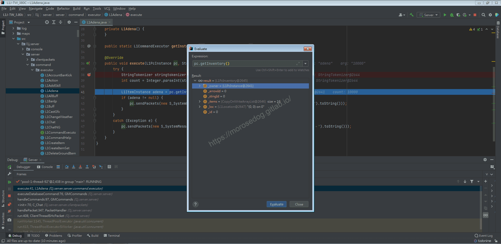
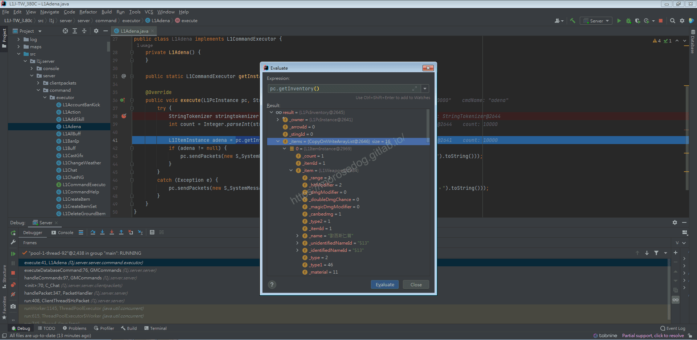
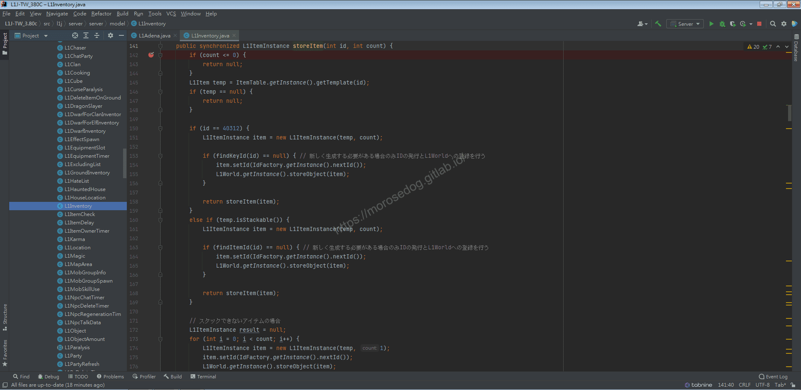
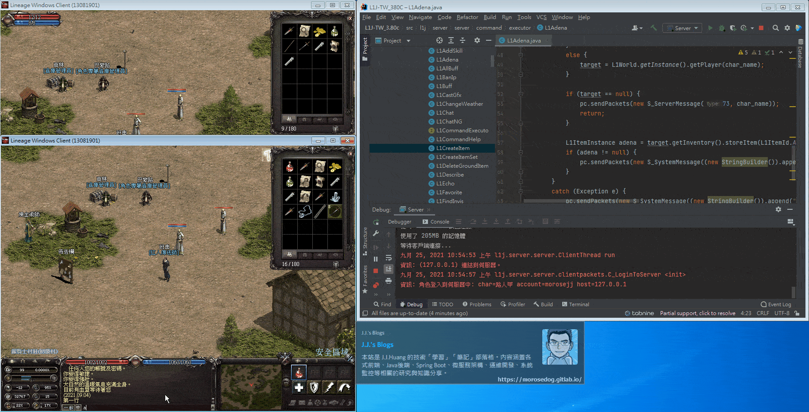

# GM指令分析/修改 (金幣)

# 天堂私服 | GM指令分析/修改 (金幣)「L1J版」

    
    
      📑 目錄
      

1. [章節用意](#章節用意)
2. [核心版本](#核心版本)
3. [分析](#分析)
4. [修改](#修改)
5. [結論](#結論)
6. [結語](#結語)
7. [免責聲明](#免責聲明)

    
    
    

## 章節用意

`adena`的指令，給`GM`使用給予自己增加金幣，或許可以套用物品上，用於節日活動開啟特定物品贈送金幣。

## 核心版本

* L1J-3.80c

## 分析

在開始分析前，要知道`GM`指令的指令效果與使用方式，才方便開啟除錯(Debug)進行分析。

效果：產生金幣。
範例：​‌‌‌​​​​​‌‌‌​​‌​​‌‌​‌​​‌​‌‌‌​‌‌​​‌‌​​​​‌​‌‌‌​‌​​​‌‌​​‌​‌​​‌​‌‌​‌​‌‌​‌‌​​​‌‌​‌​​‌​‌‌​‌‌‌​​‌‌​​‌​‌​‌‌​​​​‌​‌‌​​‌‌‌​‌‌​​‌​‌​​‌​‌‌​‌​​‌‌​​‌​​​‌‌​​​​​​‌‌​​‌​​​‌‌​​​‌​​‌‌​​​‌​​‌‌​​​​​​‌‌​​​‌​​‌‌​‌​‌​​‌​‌‌​‌​‌‌‌​​​​​‌‌‌​​‌​​‌‌​‌​​‌​‌‌‌​‌‌​​‌‌​​​​‌​‌‌‌​‌​​​‌‌​​‌​‌​​‌​‌‌​‌​‌‌​‌‌​​​‌‌​‌​​‌​‌‌​‌‌‌​​‌‌​​‌​‌​‌‌​​​​‌​‌‌​​‌‌‌​‌‌​​‌​‌​​‌​‌‌​‌​​‌‌​‌​‌​​‌‌​‌​‌

```plain
.adena ${金幣數量}
```

* 1.分析資料表：

  * 先進入`commands`表，找到`adena`的指令。

  * `class_name`是`L1Adena`。


* 2.分析程式碼：

  * 透過搜尋`L1Adena`開啟程式碼。

```plain
src/l1j/server/server/command/executor/L1Adena.java
```



  * 登入遊戲稍微確認一下目前物品欄內的物品和數量。


  * 使用除錯模式，斷點在`38`行。

  * `38~39`行單純取得指令所帶的金幣數量參數，放於`count`變數中。

  * `41`行可以特別分析一下`pc.getInventory()`。

  * 使用評估表達式`Evaluate Expression`來分析。

  * 可發現物品欄的物件是`L1PcInventory.class`。


  * 而`_owner`是`L1PcInstance.class`；這個之前就分析過此為客戶端的完整資料。


  * `_items`可以發現數量與人物物品欄內的數量一致，將其展開並點開其中一個的`_item`。

  * 這邊可以發現`_item`是`L1Weapon`，說明是武器的物品，裡面的`_name`是`歐西斯匕首`。


  * 接著在方法`storeItem`上，按下`Ctrl` + 左鍵。

  * 會直接跳轉到該方法位置。

```plain
src/l1j/server/server/model/L1PcInventory.java
```

  * 設定斷點在`142`繼續分析。

  * `142~148`行，是在判斷數量是否大於`0`、物品資料是否合法存在。

  * `150`行，`40312`物品查看資料庫後可以發現是旅館鑰匙；這一段判斷就先不分析。

  * `160`行，是判斷該物品是否是可堆疊的物品。

  * `163~166`行，判斷該物品是否已經在物品欄內存在，如果不存在則直接新增，

  * `168`行，物品已存在的狀態，會將數量相加，並更新物品資訊。

  * 最後`Return`該新增的物品`L1ItemInstance`資訊。

> 註：部分程式碼沒有特別分析到，可自行深入分析。
> ​‌‌‌​​​​​‌‌‌​​‌​​‌‌​‌​​‌​‌‌‌​‌‌​​‌‌​​​​‌​‌‌‌​‌​​​‌‌​​‌​‌​​‌​‌‌​‌​‌‌​‌‌​​​‌‌​‌​​‌​‌‌​‌‌‌​​‌‌​​‌​‌​‌‌​​​​‌​‌‌​​‌‌‌​‌‌​​‌​‌​​‌​‌‌​‌​​‌‌​​‌​​​‌‌​​​​​​‌‌​​‌​​​‌‌​​​‌​​‌‌​​​‌​​‌‌​​​​​​‌‌​​​‌​​‌‌​‌​‌​​‌​‌‌​‌​‌‌‌​​​​​‌‌‌​​‌​​‌‌​‌​​‌​‌‌‌​‌‌​​‌‌​​​​‌​‌‌‌​‌​​​‌‌​​‌​‌​​‌​‌‌​‌​‌‌​‌‌​​​‌‌​‌​​‌​‌‌​‌‌‌​​‌‌​​‌​‌​‌‌​​​​‌​‌‌​​‌‌‌​‌‌​​‌​‌​​‌​‌‌​‌​​‌‌​‌​‌​​‌‌​‌​‌

  * 回到`L1Adena`。

  * `42~44`行，根據`Return`回來的`L1ItemInstance`資訊，可以做一些判斷或是組合回傳回客戶端的數據。

## 修改

目前指令只有針對自己，希望將此指令修改程可以指定玩家做查詢。

以下是修改後所使用的指令方式：

```plain
.desc me|${玩家名稱} ${金幣數量}
```

* 修改前

```java
@Override
public void execute(L1PcInstance pc, String cmdName, String arg) {
	try {
		StringTokenizer stringtokenizer = new StringTokenizer(arg);
		int count = Integer.parseInt(stringtokenizer.nextToken());

		L1ItemInstance adena = pc.getInventory().storeItem(L1ItemId.ADENA, count);
		if (adena != null) {
			pc.sendPackets(new S_SystemMessage((new StringBuilder()).append(count).append(" 金幣產生。").toString()));
		}
	}
	catch (Exception e) {
		pc.sendPackets(new S_SystemMessage((new StringBuilder()).append("請輸入 .adena 數量||.金幣  數量。").toString()));
	}
}
```

* 修改後

```java
@Override
public void execute(L1PcInstance pc, String cmdName, String arg) {
	try {
		StringTokenizer stringtokenizer = new StringTokenizer(arg);
		String char_name = stringtokenizer.nextToken();
		int count = Integer.parseInt(stringtokenizer.nextToken());

		L1PcInstance target = null;
		if (char_name.equalsIgnoreCase("me")) {
			target = pc;
		}
		else {
			target = L1World.getInstance().getPlayer(char_name);
		}

		if (target == null) {
			pc.sendPackets(new S_ServerMessage(73, char_name));
			return;
		}

		L1ItemInstance adena = target.getInventory().storeItem(L1ItemId.ADENA, count);
		if (adena != null) {
			pc.sendPackets(new S_SystemMessage((new StringBuilder()).append("贈與 ").append(target.getName()).append(" ").append(count).append(" 金幣。").toString()));
		}
	}
	catch (Exception e) {
		pc.sendPackets(new S_SystemMessage((new StringBuilder()).append("請輸入 .adena 玩家名稱|me 數量。").toString()));
	}
}
```

* 修改後儲存，啟動模擬器。

* 啟動天堂登入遊戲，登入`GM`帳號與另一個帳號。

* `GM`使用指令贈與另一位玩家金幣，該玩家金幣確實已經增加。


## 結論

* 程式碼：

  * `src/l1j/server/server/command/executor/L1Adena.java`

    * 處理客戶端來的`GM`指令`desc`的處理。

  * `src/l1j/server/server/model/L1PcInventory.java`

    * 物品欄的相關資訊與方法。

## 結語

雖然文章的一些修改，非常簡單，但是建議一定要自己動手做做看。​‌‌‌​​​​​‌‌‌​​‌​​‌‌​‌​​‌​‌‌‌​‌‌​​‌‌​​​​‌​‌‌‌​‌​​​‌‌​​‌​‌​​‌​‌‌​‌​‌‌​‌‌​​​‌‌​‌​​‌​‌‌​‌‌‌​​‌‌​​‌​‌​‌‌​​​​‌​‌‌​​‌‌‌​‌‌​​‌​‌​​‌​‌‌​‌​​‌‌​​‌​​​‌‌​​​​​​‌‌​​‌​​​‌‌​​​‌​​‌‌​​​‌​​‌‌​​​​​​‌‌​​​‌​​‌‌​‌​‌​​‌​‌‌​‌​‌‌‌​​​​​‌‌‌​​‌​​‌‌​‌​​‌​‌‌‌​‌‌​​‌‌​​​​‌​‌‌‌​‌​​​‌‌​​‌​‌​​‌​‌‌​‌​‌‌​‌‌​​​‌‌​‌​​‌​‌‌​‌‌‌​​‌‌​​‌​‌​‌‌​​​​‌​‌‌​​‌‌‌​‌‌​​‌​‌​​‌​‌‌​‌​​‌‌​‌​‌​​‌‌​‌​‌

原創文章真的不易，希望多多支持，感謝。
最後建議回顧一下首章[天堂私服 | 天堂私服架設教學](/private-lineage-20210712-private-lineage-0/#教學章節)，了解其章節目錄。

## 免責聲明

* 本部落格文章中皆<font color="red"><u>**不提供**</u></font>任何所謂的遊戲「主程式」、「模擬器」、「登入器」…等等相關程式的下載點。

* 本部落格文章中所見之遊戲主程式和服務器端程序均來自網路發佈，<font color="red"><u>版本歸**原作者**</u>所有</font>。

* 本部落格文章為研究SQL資料庫與修改JAVA語法使用，<font color="red">並<u>**非商業用途**</u>，亦<u>**無做營運事實等任何一切商業行為**</u>。</font>

* 本部落格文章內容是為研究學習設計思想和原理為目的，<font color="red"><u>**絕沒有故意侵權或惡意抄襲、篡改其他遊戲內容**</u></font>！

---

- **原文連結**：[J.J.'s Blogs - GM指令分析/修改 (金幣)](https://morosedog.gitlab.io/private-lineage-20211015-private-lineage-55/)
