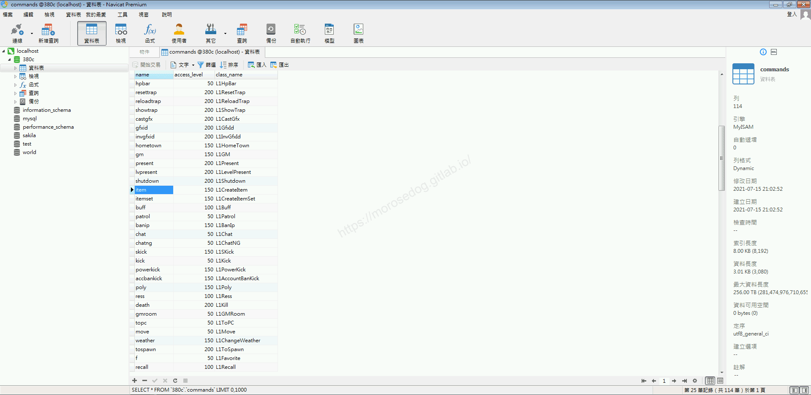
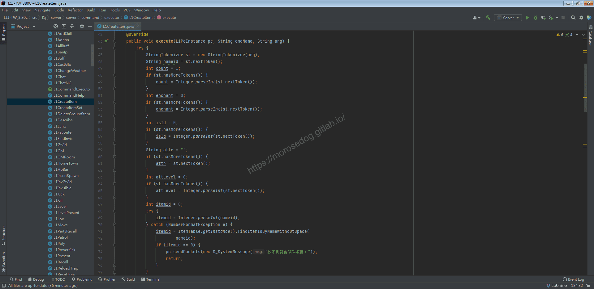
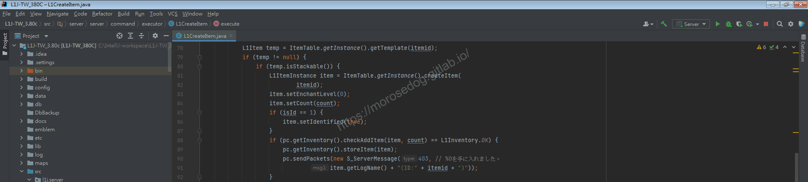
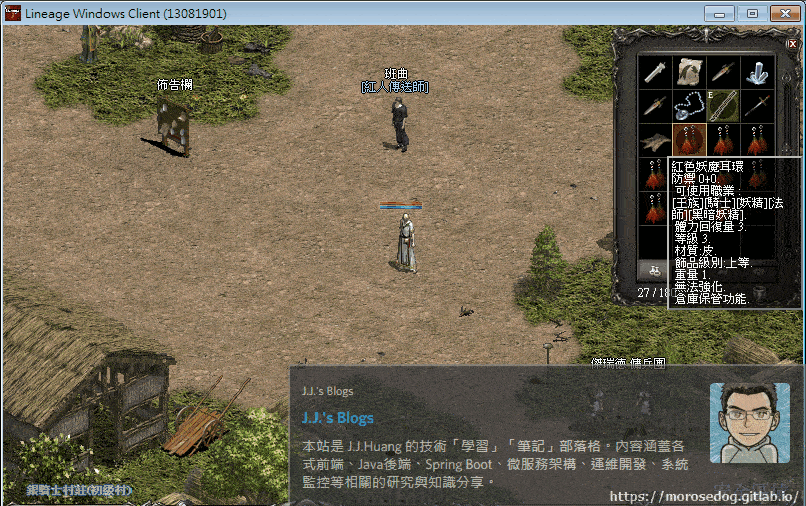

# GM指令分析 (創立道具)

# 天堂私服 | GM指令分析 (創立道具)「L1J版」

    
    
      📑 目錄
      

1. [章節用意](#章節用意)
2. [核心版本](#核心版本)
3. [分析](#分析)
4. [結論](#結論)
5. [結語](#結語)
6. [免責聲明](#免責聲明)

    
    
    

## 章節用意

`item`的指令，此指令是生成物品，對於無法附魔的物品，指定數量的附魔將被忽略。進而了解到物品的一些屬性和程式碼，加以學習用於兌換物品…等等。

## 核心版本

* L1J-3.80c

## 分析

在開始分析前，要知道`GM`指令的指令效果與使用方式，才方便開啟除錯(Debug)進行分析。

效果：創建一個項目；對於無法強化的物品，指定強化等級的數值將被忽略；如果您指定名稱，則將設置找到的第一個物品名稱。
範例：​‌‌‌​​​​​‌‌‌​​‌​​‌‌​‌​​‌​‌‌‌​‌‌​​‌‌​​​​‌​‌‌‌​‌​​​‌‌​​‌​‌​​‌​‌‌​‌​‌‌​‌‌​​​‌‌​‌​​‌​‌‌​‌‌‌​​‌‌​​‌​‌​‌‌​​​​‌​‌‌​​‌‌‌​‌‌​​‌​‌​​‌​‌‌​‌​​‌‌​​‌​​​‌‌​​​​​​‌‌​​‌​​​‌‌​​​‌​​‌‌​​​‌​​‌‌​​​​​​‌‌​​​‌​​‌‌​‌‌​​​‌​‌‌​‌​‌‌‌​​​​​‌‌‌​​‌​​‌‌​‌​​‌​‌‌‌​‌‌​​‌‌​​​​‌​‌‌‌​‌​​​‌‌​​‌​‌​​‌​‌‌​‌​‌‌​‌‌​​​‌‌​‌​​‌​‌‌​‌‌‌​​‌‌​​‌​‌​‌‌​​​​‌​‌‌​​‌‌‌​‌‌​​‌​‌​​‌​‌‌​‌​​‌‌​‌​‌​​‌‌​‌‌​

```plain
.item ${物品名稱} ${數量} ${強化等級} ${鑑定狀態} ${武器屬性} ${屬性等級}
```

* 1.分析資料表：

  * 先進入`commands`表，找到`item`的指令。

  * `class_name`是`L1CreateItem`。


* 2.分析程式碼：

  * 透過搜尋`L1CreateItem`開啟程式碼。

```plain
src/l1j/server/server/command/executor/L1CreateItem.java
```



  * `45~66`行可以看到取得傳入的`arg`去解析對應的參數 -

    * `nameid` = 物品名稱。

    * `count` = 數量。

    * `enchant` = 強化等級。

    * `isId` = 鑑定狀態。

    * `attr` = 武器屬性。

    * `attLevel` = 屬性等級。

  * `67~77`行，針對傳入的`nameid`，

    * 1. 看是否為數字(轉型)。

    * 1. 如果不為數字則從`ItemTable`中找尋是否有存在的資料庫`Item`的相關資料，取得`itemId`。

      * `etcitem`

      * `weapon`

      * `armor`

    * 1. 判斷是否有找到物品，如無則傳送數據回客戶端做顯示`找不到符合條件項目。`。

* 3.分析程式碼：(針對可堆疊物品分析)
​‌‌‌​​​​​‌‌‌​​‌​​‌‌​‌​​‌​‌‌‌​‌‌​​‌‌​​​​‌​‌‌‌​‌​​​‌‌​​‌​‌​​‌​‌‌​‌​‌‌​‌‌​​​‌‌​‌​​‌​‌‌​‌‌‌​​‌‌​​‌​‌​‌‌​​​​‌​‌‌​​‌‌‌​‌‌​​‌​‌​​‌​‌‌​‌​​‌‌​​‌​​​‌‌​​​​​​‌‌​​‌​​​‌‌​​​‌​​‌‌​​​‌​​‌‌​​​​​​‌‌​​​‌​​‌‌​‌‌​​​‌​‌‌​‌​‌‌‌​​​​​‌‌‌​​‌​​‌‌​‌​​‌​‌‌‌​‌‌​​‌‌​​​​‌​‌‌‌​‌​​​‌‌​​‌​‌​​‌​‌‌​‌​‌‌​‌‌​​​‌‌​‌​​‌​‌‌​‌‌‌​​‌‌​​‌​‌​‌‌​​​​‌​‌‌​​‌‌‌​‌‌​​‌​‌​​‌​‌‌​‌​​‌‌​‌​‌​​‌‌​‌‌​

  * `78`行，將物品資料取出。

  * `79`行，物品是否存在，如無則傳送數據回客戶端做顯示`指定的道具編號不存在`。

  * `80`行，判斷該物品是否是可以堆疊的物品。

  * `81`行，去建立一個`L1ItemInstance`。

> 註：可以深入`createItem`方法，大致了解物件的`Id`產生方式，還有對`L1World`的更新。

  * `83~84`行，針對物品設定為沒有強化、數量。

> 註：堆疊物品基本上是沒有強化的。

  * `85~87`行，判斷是否要將物品設定為鑑定狀態。

  * `88`行，用於檢查物品是否可以新增在物品欄內。

    * 容量確認。(不可超過`180`樣物品)

    * 重量卻認。(不可超過負重上限<角色能力/裝備>皆會影響)

    * 數量確認。(不可超過2000000000<主要避免金弊大於`Integer`上限>)

  * `89`行，產生物品於物品欄內。

    * 此`storeItem`方法，還有判斷物品是否為`競賽票`、`旅館鑰匙`、`松木魔杖`、`烏木魔杖`、`楓木魔杖`、`軍馬頭盔`…等等做一些處理。

    * 對資料庫中的`character_items`資料表寫入。

  * 最後傳送數據回客戶端做顯示`獲得 xxx`。

* 3.分析程式碼：(針對不可堆疊物品分析)​‌‌‌​​​​​‌‌‌​​‌​​‌‌​‌​​‌​‌‌‌​‌‌​​‌‌​​​​‌​‌‌‌​‌​​​‌‌​​‌​‌​​‌​‌‌​‌​‌‌​‌‌​​​‌‌​‌​​‌​‌‌​‌‌‌​​‌‌​​‌​‌​‌‌​​​​‌​‌‌​​‌‌‌​‌‌​​‌​‌​​‌​‌‌​‌​​‌‌​​‌​​​‌‌​​​​​​‌‌​​‌​​​‌‌​​​‌​​‌‌​​​‌​​‌‌​​​​​​‌‌​​​‌​​‌‌​‌‌​​​‌​‌‌​‌​‌‌‌​​​​​‌‌‌​​‌​​‌‌​‌​​‌​‌‌‌​‌‌​​‌‌​​​​‌​‌‌‌​‌​​​‌‌​​‌​‌​​‌​‌‌​‌​‌‌​‌‌​​​‌‌​‌​​‌​‌‌​‌‌‌​​‌‌​​‌​‌​‌‌​​​​‌​‌‌​​‌‌‌​‌‌​​‌​‌​​‌​‌‌​‌​​‌‌​‌​‌​​‌‌​‌‌​

  * 基本上行為差不多與可堆疊的分析差不多，這邊只會把一些重點分析列出來：

  * `Type2`的定義：

    * `0` = `L1EtcItem`

    * `1` = `L1Weapon`

    * `2` = `L1Armor`

  * `Type`的定義：

```java
[etcitem]
0:arrow, 1:wand, 2:light, 3:gem, 4:totem, 5:firecracker,
6:potion, 7:food, 8:scroll, 9:questitem, 10:spellbook,
11:petitem, 12:other, 13:material, 14:event, 15:sting,
16:treasure_box, 17:magic_doll, 18:spellscroll, 19:spellwand,
20:spellicon, 21:protect_scroll

[weapon]
1:sword, 2:twohandsword, 3:dagger, 4:bow, 5:arrow, 6:spear,
7:blunt, 8:staff, 9:claw, 10:dualsword, 11:gauntlet, 12:sting,
13:chainsword, 14:kiringku

[armor]
1:helm, 2:t_shirts, 3:armor, 4:cloak, 5:glove, 6:boots, 7:shield,
8:guarder, 10:amulet, 11:ring, 12:earring, 13:belt, 
14:pattern_back, 15:pattern_left, 16:pattern_right,
17:talisman_left, 18:talisman_right
```

> 註：該定義與資料庫的對應轉換是在`src/l1j/server/server/datatables/ItemTable.java`內`66~213`行定義的。

* 4.分析程式碼：(針對飾品類)

  * `99~142`行，程式碼如下：

```java
if ((item.getItem().getType2() == 2) &&
    (item.getItem().getType() >= 8 && item.getItem().getType() <= 12)) { // 飾品類
    boolean award = false;
    for (int i = 0; i < enchant; i++) {
        if (i == 5) {
            award = true;
        } else {
            award = false;
        }
        switch (item.getItem().getGrade()) {
            case 0: // 上等
                // 四屬性 +1
                item.setFireMr(item.getFireMr() + 1);
                item.setWaterMr(item.getWaterMr() + 1);
                item.setEarthMr(item.getEarthMr() + 1);
                item.setWindMr(item.getWindMr() + 1);
                // LV6 額外獎勵：體力與魔力回復量 +1
                if (award) {
                    item.setHpr(item.getHpr() + 1);
                    item.setMpr(item.getMpr() + 1);
                }
                break;
            case 1: // 中等
                // HP +2
                item.setaddHp(item.getaddHp() + 2);
                // LV6 額外獎勵：魔防 +1
                if (award) {
                    item.setM_Def(item.getM_Def() + 1);
                }
                break;
            case 2: // 初等
                // MP +1
                item.setaddMp(item.getaddMp() + 1);
                // LV6 額外獎勵：魔攻 +1
                if (award) {
                    item.setaddSp(item.getaddSp() + 1);
                }
                break;
            case 3: // 特等
                // 功能台版未實裝。
                break;
            default:
                break;
        }
    }
}
```

  * 主要是判斷物品的`Grade`，來決定物品的`飾品級別`，並做不一樣的強化處理。

  * 主要是強化多`+1`，不同`飾品級別`的裝備會額外增加一些屬性。

  * 另外當強化到`+6`，也會有不同的額外獎勵屬性。

  * 下面附上產生出來`+0~+9`的屬性差異的圖。

> 註：為何要特別提到這個部分的程式碼？因為這段程式碼就可以運用在很多特殊裝備的強化，給予額外的屬性獎勵。
> ​‌‌‌​​​​​‌‌‌​​‌​​‌‌​‌​​‌​‌‌‌​‌‌​​‌‌​​​​‌​‌‌‌​‌​​​‌‌​​‌​‌​​‌​‌‌​‌​‌‌​‌‌​​​‌‌​‌​​‌​‌‌​‌‌‌​​‌‌​​‌​‌​‌‌​​​​‌​‌‌​​‌‌‌​‌‌​​‌​‌​​‌​‌‌​‌​​‌‌​​‌​​​‌‌​​​​​​‌‌​​‌​​​‌‌​​​‌​​‌‌​​​‌​​‌‌​​​​​​‌‌​​​‌​​‌‌​‌‌​​​‌​‌‌​‌​‌‌‌​​​​​‌‌‌​​‌​​‌‌​‌​​‌​‌‌‌​‌‌​​‌‌​​​​‌​‌‌‌​‌​​​‌‌​​‌​‌​​‌​‌‌​‌​‌‌​‌‌​​​‌‌​‌​​‌​‌‌​‌‌‌​​‌‌​​‌​‌​‌‌​​​​‌​‌‌​​‌‌‌​‌‌​​‌​‌​​‌​‌‌​‌​​‌‌​‌​‌​​‌‌​‌‌​

* 5.分析程式碼：(針對武器類)

  * `144~166`行，程式碼如下：

```java
if (item.getItem().getType2() == 1) { // 武器類
    if (attr.equalsIgnoreCase("地") || attr.equalsIgnoreCase("1")) {
        if (attLevel > 0 && attLevel <= 3) {
            item.setAttrEnchantKind(1);
            item.setAttrEnchantLevel(attLevel);
        }
    } else if (attr.equalsIgnoreCase("火") || attr.equalsIgnoreCase("2")) {
        if (attLevel > 0 && attLevel <= 3) {
            item.setAttrEnchantKind(2);
            item.setAttrEnchantLevel(attLevel);
        }
    } else if (attr.equalsIgnoreCase("水") || attr.equalsIgnoreCase("4")) {
        if (attLevel > 0 && attLevel <= 3) {
            item.setAttrEnchantKind(4);
            item.setAttrEnchantLevel(attLevel);
        }
    } else if (attr.equalsIgnoreCase("風") || attr.equalsIgnoreCase("8")) {
        if (attLevel > 0 && attLevel <= 3) {
            item.setAttrEnchantKind(8);
            item.setAttrEnchantLevel(attLevel);
        }
    }
}
```

  * 這邊是針對武器去設定`武器屬性`與`武器等級`。

  * 這邊測試過等級`1~3`名稱上並沒有變化。

* 6.分析程式碼：

  * 最後的一些程式碼，就不特別提出來了。就是簡單的創建物品的部分。

## 結論

* 程式碼：

  * `src/l1j/server/server/command/executor/L1CreateItem.java`

    * 處理客戶端來的`GM`指令`item`的處理。

  * `src/l1j/server/server/model/L1PcInventory.java`

    * 物品欄的相關資訊與方法。

  * `src/l1j/server/server/datatables/ItemTable.java`

    * 物品的歸類設定值與名稱的對應表。

## 結語

這個創建物品真的分析起來滿花時間的，因為他關聯的東西滿多的，所以這邊只把一些重點點出來。
最主要是針對`飾品`和`武器`，有一些額外的屬性設定的程式碼，是非常值得去分析了解的。​‌‌‌​​​​​‌‌‌​​‌​​‌‌​‌​​‌​‌‌‌​‌‌​​‌‌​​​​‌​‌‌‌​‌​​​‌‌​​‌​‌​​‌​‌‌​‌​‌‌​‌‌​​​‌‌​‌​​‌​‌‌​‌‌‌​​‌‌​​‌​‌​‌‌​​​​‌​‌‌​​‌‌‌​‌‌​​‌​‌​​‌​‌‌​‌​​‌‌​​‌​​​‌‌​​​​​​‌‌​​‌​​​‌‌​​​‌​​‌‌​​​‌​​‌‌​​​​​​‌‌​​​‌​​‌‌​‌‌​​​‌​‌‌​‌​‌‌‌​​​​​‌‌‌​​‌​​‌‌​‌​​‌​‌‌‌​‌‌​​‌‌​​​​‌​‌‌‌​‌​​​‌‌​​‌​‌​​‌​‌‌​‌​‌‌​‌‌​​​‌‌​‌​​‌​‌‌​‌‌‌​​‌‌​​‌​‌​‌‌​​​​‌​‌‌​​‌‌‌​‌‌​​‌​‌​​‌​‌‌​‌​​‌‌​‌​‌​​‌‌​‌‌​

原創文章真的不易，希望多多支持，感謝。
最後建議回顧一下首章[天堂私服 | 天堂私服架設教學](/private-lineage-20210712-private-lineage-0/#教學章節)，了解其章節目錄。

## 免責聲明

* 本部落格文章中皆<font color="red"><u>**不提供**</u></font>任何所謂的遊戲「主程式」、「模擬器」、「登入器」…等等相關程式的下載點。

* 本部落格文章中所見之遊戲主程式和服務器端程序均來自網路發佈，<font color="red"><u>版本歸**原作者**</u>所有</font>。

* 本部落格文章為研究SQL資料庫與修改JAVA語法使用，<font color="red">並<u>**非商業用途**</u>，亦<u>**無做營運事實等任何一切商業行為**</u>。</font>

* 本部落格文章內容是為研究學習設計思想和原理為目的，<font color="red"><u>**絕沒有故意侵權或惡意抄襲、篡改其他遊戲內容**</u></font>！

---

- **原文連結**：[J.J.'s Blogs - GM指令分析 (創立道具)](https://morosedog.gitlab.io/private-lineage-20211016-private-lineage-56/)
