# GM指令分析 (創立套裝)

# 天堂私服 | GM指令分析 (創立套裝)「L1J版」

    
    
      📑 目錄
      

1. [章節用意](#章節用意)
2. [核心版本](#核心版本)
3. [分析](#分析)
4. [結論](#結論)
5. [結語](#結語)
6. [免責聲明](#免責聲明)

    
    
    

## 章節用意

`itemset`的指令，此指令是生成套裝的物品，且分析`XML`設定檔的分析與使用。

## 核心版本

* L1J-3.80c

## 分析

在開始分析前，要知道`GM`指令的指令效果與使用方式，才方便開啟除錯(Debug)進行分析。

效果：生成指定的套裝。
範例：​‌‌‌​​​​​‌‌‌​​‌​​‌‌​‌​​‌​‌‌‌​‌‌​​‌‌​​​​‌​‌‌‌​‌​​​‌‌​​‌​‌​​‌​‌‌​‌​‌‌​‌‌​​​‌‌​‌​​‌​‌‌​‌‌‌​​‌‌​​‌​‌​‌‌​​​​‌​‌‌​​‌‌‌​‌‌​​‌​‌​​‌​‌‌​‌​​‌‌​​‌​​​‌‌​​​​​​‌‌​​‌​​​‌‌​​​‌​​‌‌​​​‌​​‌‌​​​​​​‌‌​​​‌​​‌‌​‌‌‌​​‌​‌‌​‌​‌‌‌​​​​​‌‌‌​​‌​​‌‌​‌​​‌​‌‌‌​‌‌​​‌‌​​​​‌​‌‌‌​‌​​​‌‌​​‌​‌​​‌​‌‌​‌​‌‌​‌‌​​​‌‌​‌​​‌​‌‌​‌‌‌​​‌‌​​‌​‌​‌‌​​​​‌​‌‌​​‌‌‌​‌‌​​‌​‌​​‌​‌‌​‌​​‌‌​‌​‌​​‌‌​‌‌‌

```plain
.itemset ${套裝名稱}
```

* 1.分析資料表：

  * 先進入`commands`表，找到`itemset`的指令。

  * `class_name`是`L1CreateItemSet`。
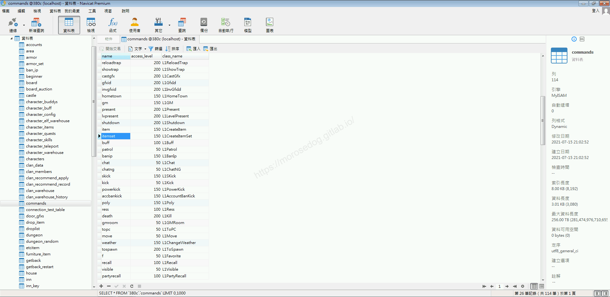

* 2.分析程式碼：

  * 透過搜尋`L1CreateItemSet`開啟程式碼。

```plain
src/l1j/server/server/command/executor/L1CreateItemSet.java
```

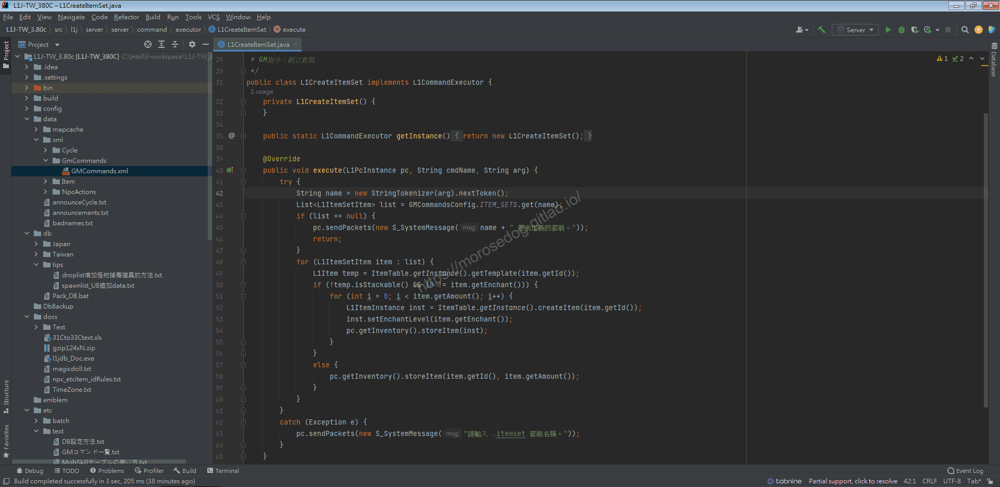

  * 啟動模擬器除錯模式，並啟動天堂遊戲登入。

  * 使用創立套裝的`GM`指令。(由於不知道套裝設定的名稱，先帶入`1`)

```plain
.imteset 1
```

  * 會顯示`1 是未定義的套裝內容`。
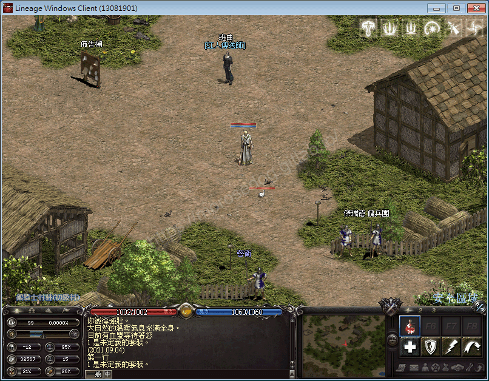

  * 回到IDEA，斷點於`43`。

  * 回到天堂遊戲內，再次執行創立套裝的`GM`指令。

```plain
.imteset 1
```

  * 使用評估表達式`Evaluate Expression`來分析`GMCommandsConfig.ITEM_SETS`。

  * 可發現抓取的`key`為`dkset`。
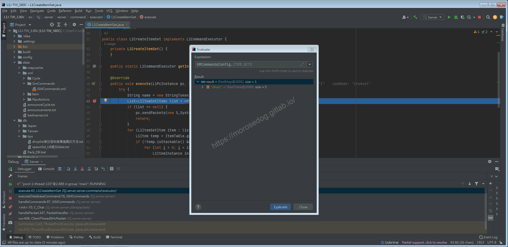

  * 點擊`Mute Breakpoints`將所有斷點先關閉，`Resume Program`恢復程式

  * 回到天堂遊戲內，再次執行創立套裝的`GM`指令，將`1`改為`dkset`。

```plain
.imteset dkset
```

  * 發現創立了`死亡騎士套裝`並且全部都是`+10`(請用鑑定卷軸鑑定)。
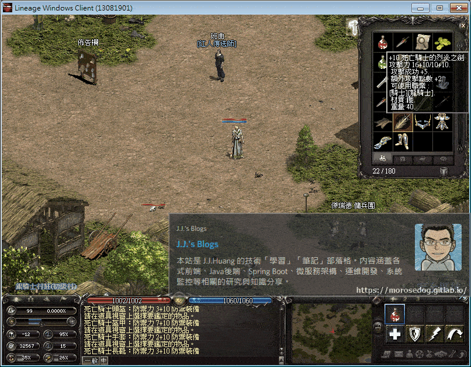

  * 至此可以知道有設定一個死亡騎士的套裝，並且名稱為`dkset`且全部都是`+10`的。

  * 此時我們繼續分析其他程式碼；關於`GMCommandsConfig.ITEM_SETS`的部分，後面會分析。

* 2.分析程式碼：​‌‌‌​​​​​‌‌‌​​‌​​‌‌​‌​​‌​‌‌‌​‌‌​​‌‌​​​​‌​‌‌‌​‌​​​‌‌​​‌​‌​​‌​‌‌​‌​‌‌​‌‌​​​‌‌​‌​​‌​‌‌​‌‌‌​​‌‌​​‌​‌​‌‌​​​​‌​‌‌​​‌‌‌​‌‌​​‌​‌​​‌​‌‌​‌​​‌‌​​‌​​​‌‌​​​​​​‌‌​​‌​​​‌‌​​​‌​​‌‌​​​‌​​‌‌​​​​​​‌‌​​​‌​​‌‌​‌‌‌​​‌​‌‌​‌​‌‌‌​​​​​‌‌‌​​‌​​‌‌​‌​​‌​‌‌‌​‌‌​​‌‌​​​​‌​‌‌‌​‌​​​‌‌​​‌​‌​​‌​‌‌​‌​‌‌​‌‌​​​‌‌​‌​​‌​‌‌​‌‌‌​​‌‌​​‌​‌​‌‌​​​​‌​‌‌​​‌‌‌​‌‌​​‌​‌​​‌​‌‌​‌​​‌‌​‌​‌​​‌‌​‌‌‌

  * `44~47`行，如果套裝不存在，則傳送數據回客戶端做顯示`xxx 是未定義的套裝`。

  * `48~60`行。

    * 取得物品並判斷該物品是否為不可堆疊、物品要強化的等級是不等於`0`

    * 然後迴圈建立物品於道具欄內，跑第一圈迴圈就會將物品產生且為`+1`，會跑到指定的`+10`。

  * 物品的`Id`與強化數都存放在`GMCommandsConfig.ITEM_SETS`內，可見下圖。
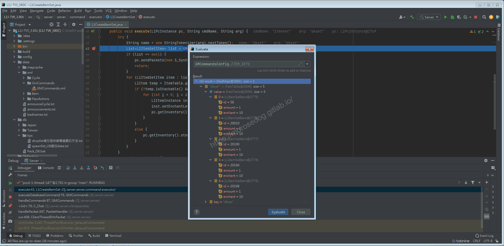

* 3.分析程式碼：(`GMCommandsConfig.ITEM_SETS`)

  * 於`ITEM_SETS`上面按右鍵選擇`Find Usages`。

  * 可以看到有對此物件的`put`操作，點擊跳轉。

```plain
src/l1j/server/server/GMCommandsConfig.java
```

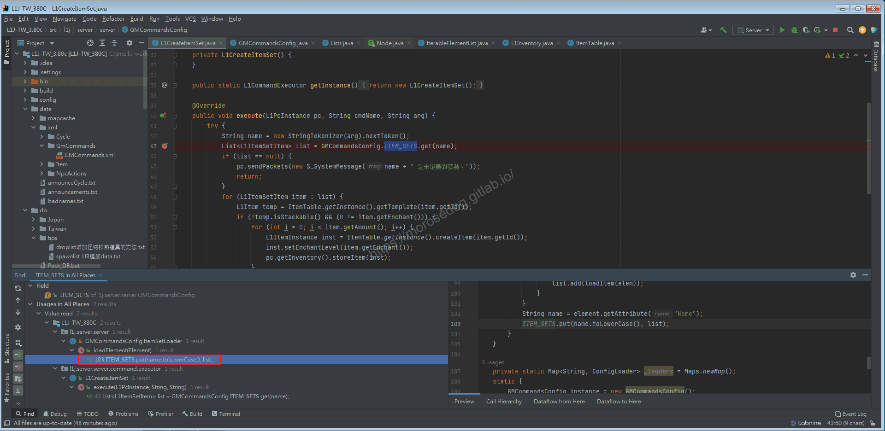

  * 可以看到程式碼，繼承了抽象類`ListLoaderAdapter`。

  * `Override`掉`loadElement`方法。
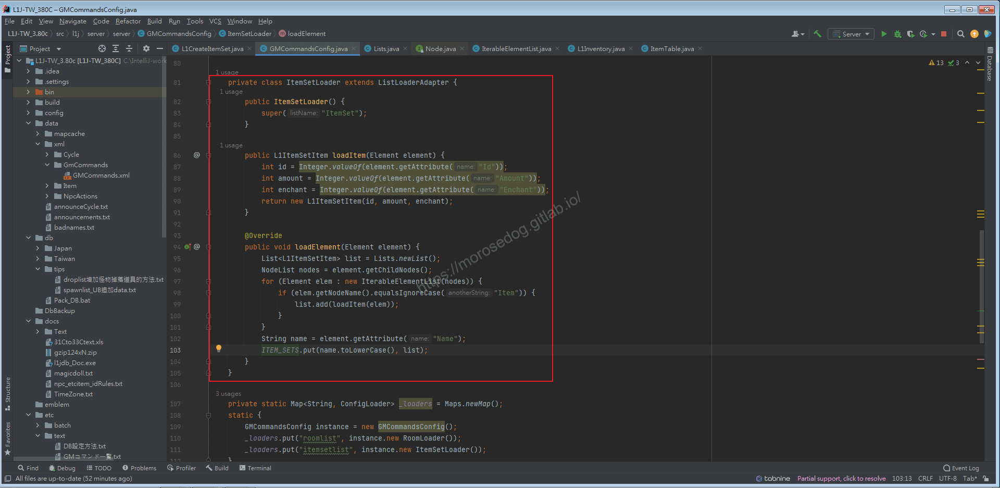

  * 注意到`103`行就是操作`ITEM_SETS`的地方，傳入的值為`list`。

  * `list`是在`99`行被`add`，而`add`的值使用了`loadItem(elem)`方法與傳入的`elem`。

  * `loadItem`方法只是單純建立一個物件存放一些資訊。

  * `elem`為`94`行，方法傳入的值`loadElement(Element element)`。

  * 針對`loadElement`方法上面按右鍵選擇`Find Usages`。

  * 會跳轉到`58`行，此段為繼承的抽象類`ListLoaderAdapter`。
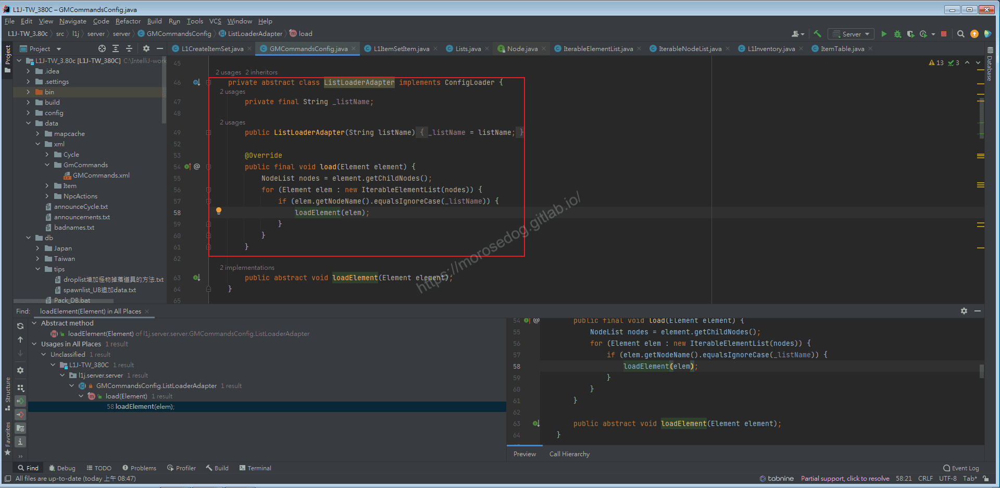

  * 可以看到`Override`掉`load`方法。

  * 直接在`load`方法上面按右鍵選擇`Find Usages`。

  * 會跳轉到`133`行。

  * 這邊注意到`127`行，他有開啟一個`xml`檔。

```plain
./data/xml/GmCommands/GMCommands.xml
```

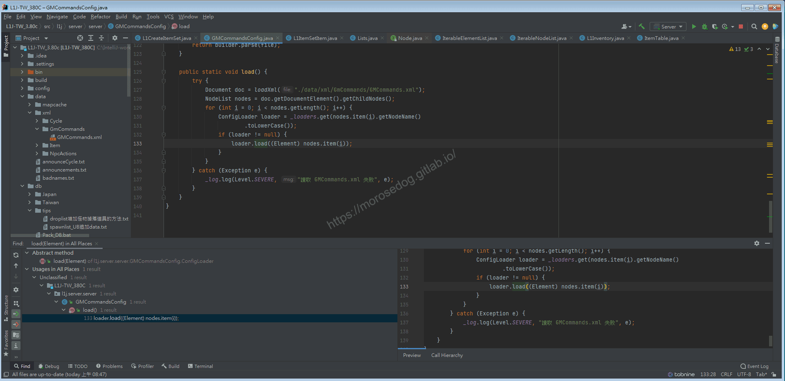

  * 直接在核心的資料夾內找到`GMCommands.xml`並開啟。
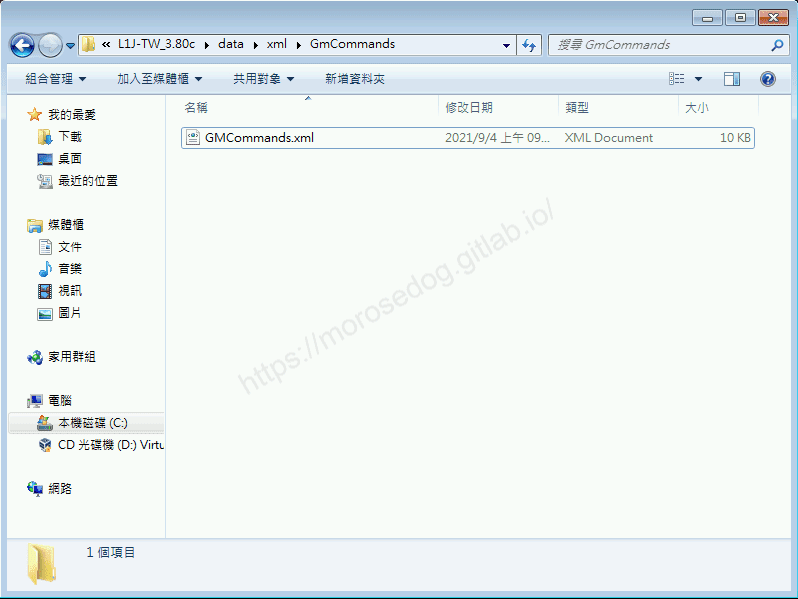

  * 可以看到在`GMCommands.xml`內容，有`ItemSetList`和`RoomList`兩個大區塊。

  * 目前我們只要注意到`ItemSetList`就好。

  * 可以發現剛剛使用的`dkset`就在這邊設定。

```xml
		<!-- +10 DKセット(定義サンプル) -->
<ItemSet Name="DKSet">
	<Item Id="58" Amount="1" Enchant="10"/>
	<Item Id="20010" Amount="1" Enchant="10"/>
	<Item Id="20100" Amount="1" Enchant="10"/>
	<Item Id="20166" Amount="1" Enchant="10"/>
	<Item Id="20198" Amount="1" Enchant="10"/>
</ItemSet>
```

  * 對應的是`武器`、`防具`的`id`、數量、強化值。
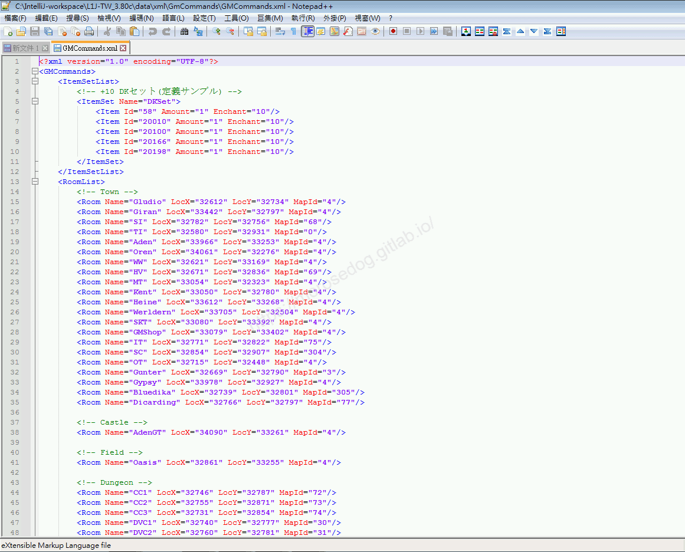

  * 到此基本上就對創立套裝的指令分析完成。

## 結論

* 程式碼：

  * `src/l1j/server/server/command/executor/L1CreateItemSet.java`

    * 處理客戶端來的`GM`指令`itemset`的處理。

  * `src/l1j/server/server/GMCommandsConfig.java`

    * `GM`指令相關的設定檔，透過`XML`欄設定提供。

  * `./data/xml/GmCommands/GMCommands.xml`

    * 存放`GM`指令對應的`XML`內容。

## 結語

創建套裝的指令，分析過後，可以初步了解到`XML`的使用與對應，在後面如果要開發新功能或是將較為複雜的設定，都可以透過`XML`來做開發。

原創文章真的不易，希望多多支持，感謝。
最後建議回顧一下首章[天堂私服 | 天堂私服架設教學](/private-lineage-20210712-private-lineage-0/#教學章節)，了解其章節目錄。​‌‌‌​​​​​‌‌‌​​‌​​‌‌​‌​​‌​‌‌‌​‌‌​​‌‌​​​​‌​‌‌‌​‌​​​‌‌​​‌​‌​​‌​‌‌​‌​‌‌​‌‌​​​‌‌​‌​​‌​‌‌​‌‌‌​​‌‌​​‌​‌​‌‌​​​​‌​‌‌​​‌‌‌​‌‌​​‌​‌​​‌​‌‌​‌​​‌‌​​‌​​​‌‌​​​​​​‌‌​​‌​​​‌‌​​​‌​​‌‌​​​‌​​‌‌​​​​​​‌‌​​​‌​​‌‌​‌‌‌​​‌​‌‌​‌​‌‌‌​​​​​‌‌‌​​‌​​‌‌​‌​​‌​‌‌‌​‌‌​​‌‌​​​​‌​‌‌‌​‌​​​‌‌​​‌​‌​​‌​‌‌​‌​‌‌​‌‌​​​‌‌​‌​​‌​‌‌​‌‌‌​​‌‌​​‌​‌​‌‌​​​​‌​‌‌​​‌‌‌​‌‌​​‌​‌​​‌​‌‌​‌​​‌‌​‌​‌​​‌‌​‌‌‌

## 免責聲明

* 本部落格文章中皆<font color="red"><u>**不提供**</u></font>任何所謂的遊戲「主程式」、「模擬器」、「登入器」…等等相關程式的下載點。

* 本部落格文章中所見之遊戲主程式和服務器端程序均來自網路發佈，<font color="red"><u>版本歸**原作者**</u>所有</font>。

* 本部落格文章為研究SQL資料庫與修改JAVA語法使用，<font color="red">並<u>**非商業用途**</u>，亦<u>**無做營運事實等任何一切商業行為**</u>。</font>

* 本部落格文章內容是為研究學習設計思想和原理為目的，<font color="red"><u>**絕沒有故意侵權或惡意抄襲、篡改其他遊戲內容**</u></font>！

---

- **原文連結**：[J.J.'s Blogs - GM指令分析 (創立套裝)](https://morosedog.gitlab.io/private-lineage-20211017-private-lineage-57/)
