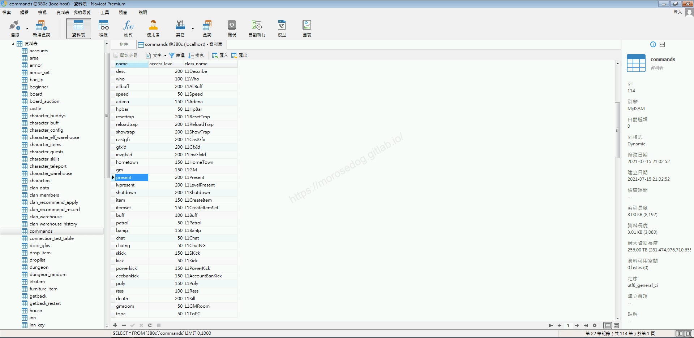
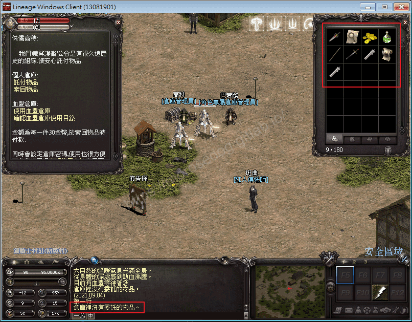
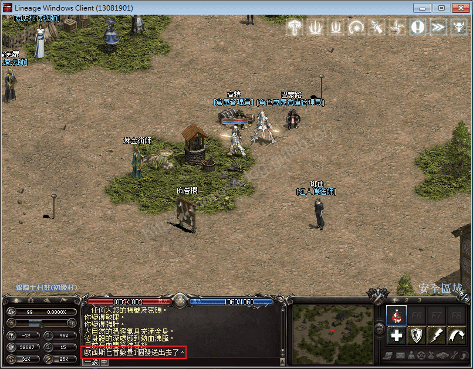
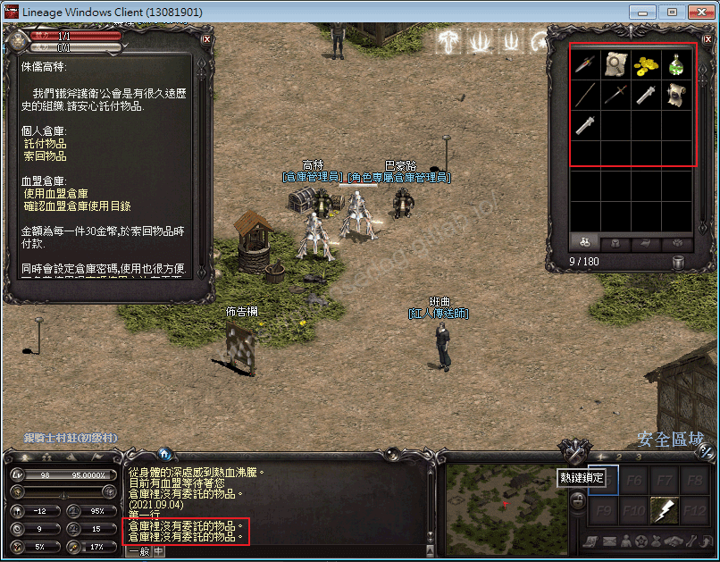
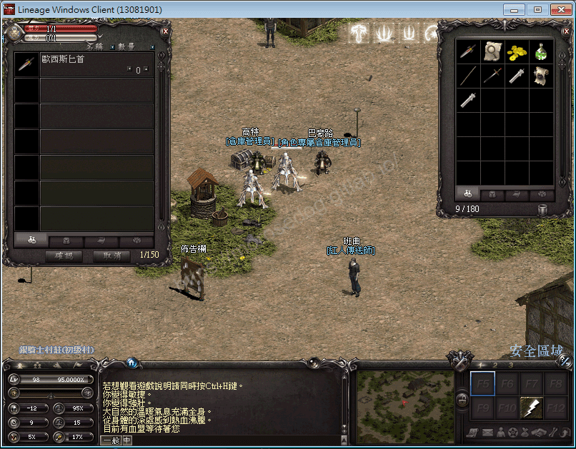
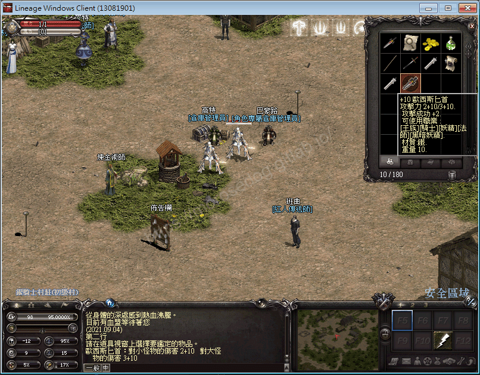
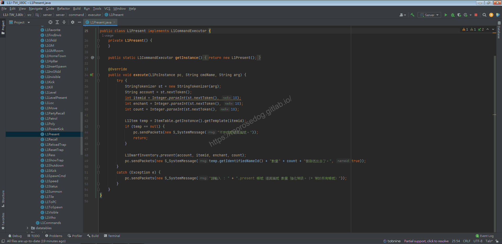
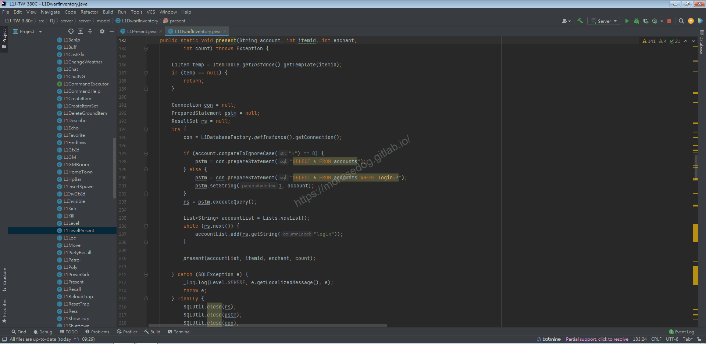
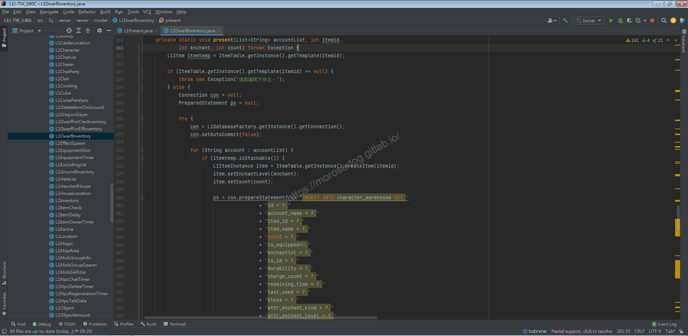

# GM指令分析 (贈送)

# 天堂私服 | GM指令分析 (贈送)「L1J版」

    
    
      📑 目錄
      

1. [章節用意](#章節用意)
2. [核心版本](#核心版本)
3. [分析](#分析)
4. [結論](#結論)
5. [結語](#結語)
6. [免責聲明](#免責聲明)

    
    
    

## 章節用意

`present`的指令，此指令用於贈送指定的物品給指定帳號或是全部的帳號，該操作可以思考套用在推廣、首次加入`Line`..等等，給客服人員操作給予特定玩家帳號獎勵。

## 核心版本

* L1J-3.80c

## 分析

在開始分析前，要知道`GM`指令的指令效果與使用方式，才方便開啟除錯(Debug)進行分析。

效果：創建一個物品並將其放入個人倉庫；對於無法強化的物品，指定強化的數值將被忽略。
範例：​‌‌‌​​​​​‌‌‌​​‌​​‌‌​‌​​‌​‌‌‌​‌‌​​‌‌​​​​‌​‌‌‌​‌​​​‌‌​​‌​‌​​‌​‌‌​‌​‌‌​‌‌​​​‌‌​‌​​‌​‌‌​‌‌‌​​‌‌​​‌​‌​‌‌​​​​‌​‌‌​​‌‌‌​‌‌​​‌​‌​​‌​‌‌​‌​​‌‌​​‌​​​‌‌​​​​​​‌‌​​‌​​​‌‌​​​‌​​‌‌​​​‌​​‌‌​​​​​​‌‌​​​‌​​‌‌‌​​​​​‌​‌‌​‌​‌‌‌​​​​​‌‌‌​​‌​​‌‌​‌​​‌​‌‌‌​‌‌​​‌‌​​​​‌​‌‌‌​‌​​​‌‌​​‌​‌​​‌​‌‌​‌​‌‌​‌‌​​​‌‌​‌​​‌​‌‌​‌‌‌​​‌‌​​‌​‌​‌‌​​​​‌​‌‌​​‌‌‌​‌‌​​‌​‌​​‌​‌‌​‌​​‌‌​‌​‌​​‌‌‌​​​

```plain
.present ${帳號} ${道具編號} ${強化等級} ${數量}
```

> 註：帳號填入`*`等於所有帳號，另外程式碼中提示的參數順序是錯誤的，上方為正確的。

* 1.分析資料表：

  * 先進入`commands`表，找到`present`的指令。

  * `class_name`是`L1Present`。


* 2.指令的分析：​‌‌‌​​​​​‌‌‌​​‌​​‌‌​‌​​‌​‌‌‌​‌‌​​‌‌​​​​‌​‌‌‌​‌​​​‌‌​​‌​‌​​‌​‌‌​‌​‌‌​‌‌​​​‌‌​‌​​‌​‌‌​‌‌‌​​‌‌​​‌​‌​‌‌​​​​‌​‌‌​​‌‌‌​‌‌​​‌​‌​​‌​‌‌​‌​​‌‌​​‌​​​‌‌​​​​​​‌‌​​‌​​​‌‌​​​‌​​‌‌​​​‌​​‌‌​​​​​​‌‌​​​‌​​‌‌‌​​​​​‌​‌‌​‌​‌‌‌​​​​​‌‌‌​​‌​​‌‌​‌​​‌​‌‌‌​‌‌​​‌‌​​​​‌​‌‌‌​‌​​​‌‌​​‌​‌​​‌​‌‌​‌​‌‌​‌‌​​​‌‌​‌​​‌​‌‌​‌‌‌​​‌‌​​‌​‌​‌‌​​​​‌​‌‌​​‌‌‌​‌‌​​‌​‌​​‌​‌‌​‌​​‌‌​‌​‌​​‌‌‌​​​

  * 啟動模擬器除錯模式，並啟動天堂遊戲登入兩個帳號。

```plain
線上GM
路人甲
```

  * 首先確認`路人甲`<u>道具欄</u>、<u>倉庫</u>的內容。

  * 倉庫無任何物品、身上無`歐西斯匕首`。


  * `線上GM`使用贈送的`GM`指令，指定送一把`+10 歐西斯匕首`給`MoroseJJ`的(路人甲)帳號。

```plain
.present MoroseJJ 1 10 1
```



  * 再次確認`路人甲`<u>道具欄</u>、<u>倉庫</u>的內容。

  * 倉庫依舊無任何物品、身上無`歐西斯匕首`。


  * 將`路人甲`重新登入。

  * 再次確認`路人甲`<u>道具欄</u>、<u>倉庫</u>的內容。

  * 倉庫已經有`歐西斯匕首`。


  * 將`歐西斯匕首`領取並鑑定。


  * 至此可以確認`贈送`指令，是將物品放置倉庫內。

* 3.分析程式碼：

  * 透過搜尋`L1Present`開啟程式碼。

```plain
src/l1j/server/server/command/executor/L1Present.java
```



  * `36~46`行，在取得傳入的指令參數，再用`itemId`查找物品是否存在。

> 註：這段程式碼不再特別說明，基本上不難。

  * `48`行，為主要的邏輯操作，可見使用的是`L1DwarfInventory`的`present`方法。

> 註：Dwarf = 侏儒，表示是個人倉庫的物件。​‌‌‌​​​​​‌‌‌​​‌​​‌‌​‌​​‌​‌‌‌​‌‌​​‌‌​​​​‌​‌‌‌​‌​​​‌‌​​‌​‌​​‌​‌‌​‌​‌‌​‌‌​​​‌‌​‌​​‌​‌‌​‌‌‌​​‌‌​​‌​‌​‌‌​​​​‌​‌‌​​‌‌‌​‌‌​​‌​‌​​‌​‌‌​‌​​‌‌​​‌​​​‌‌​​​​​​‌‌​​‌​​​‌‌​​​‌​​‌‌​​​‌​​‌‌​​​​​​‌‌​​​‌​​‌‌‌​​​​​‌​‌‌​‌​‌‌‌​​​​​‌‌‌​​‌​​‌‌​‌​​‌​‌‌‌​‌‌​​‌‌​​​​‌​‌‌‌​‌​​​‌‌​​‌​‌​​‌​‌‌​‌​‌‌​‌‌​​​‌‌​‌​​‌​‌‌​‌‌‌​​‌‌​​‌​‌​‌‌​​​​‌​‌‌​​‌‌‌​‌‌​​‌​‌​​‌​‌‌​‌​​‌‌​‌​‌​​‌‌‌​​​

  * `Ctrl`鍵壓住，再左鍵點擊`present`方法即會開啟跳轉到物件與方法位置。

  * `197~208`行，根據指令參數，判斷是否為`*`做不同的`SQL`語法查詢，最後將取得的`account`存放在一個`accountList`物件內。

  * 注意到`210`行，在呼叫了一個`present`方法。


  * `Ctrl`鍵壓住，再左鍵點擊`present`方法即會開啟跳轉到物件與方法位置。

  * 該段程式碼過長，直接講述內容行為：

    * 判斷`itemId`查找物品是否存在。

    * 判斷物品是否為可堆疊的物品。

    * 寫入資料表`character_warehouse`內。

  * SQL語法：

```sql
INSERT INTO character_warehouse 
  SET id = ?,
  account_name = ?,
  item_id = ?,
  item_name = ?,
  count = ?,
  is_equipped = 0,
  enchantlvl = ?,
  is_id = ?,
  durability = ?,
  charge_count = ?,
  remaining_time = ?,
  last_used = ?,
  bless = ?,
  attr_enchant_kind = ?,
  attr_enchant_level = ?,
  firemr = ?,
  watermr = ?,
  earthmr = ?,
  windmr = ?,
  addsp = ?,
  addhp = ?,
  addmp = ?,
  hpr = ?,
  mpr = ?,
  m_def = ?
```

  * 對於每個欄位的用處：< ? 表示目前不確定用處 >

    * `id` = 流水號

    * `account_name` = 遊戲帳號

    * `item_id` = 物品號

    * `item_name` = 物品名

    * `count` = 數量

    * `is_equipped` = 物品是否已裝備。

    * `enchantlvl` = 強化等級

    * `is_id` = 是否已鑑定

    * `durability` = 耐久度(損壞度)

    * `charge_count` = ?

    * `remaining_time` = 剩餘時間

    * `last_used` = ?

    * `bless` = 祝福

    * `attr_enchant_kind` = 屬性強化種類(`1` = 地, `2` = 火, `4` = 水, `8` = 風)

    * `attr_enchant_level` = 屬性強化等級(`1~3`)

    * `firemr` = ?

    * `watermr` = ?

    * `earthmr` = ?

    * `windmr` = ?

    * `addsp` = ?

    * `addhp` = ?

    * `addmp` = ?

    * `hpr` = ?

    * `mpr` = ?

    * `m_def` = ?

  * 部分欄位尚未確認功能，所以用`?`表示。


  * 到此基本上就對贈送的指令分析完成。

## 結論

* 程式碼：

  * `src/l1j/server/server/command/executor/L1Present.java`

    * 處理客戶端來的`GM`指令`present`的處理。

  * `src/l1j/server/server/model/L1DwarfInventory.java`

    * 提供針對倉庫操作的一些方法。

## 結語

贈送的指令，分析過後，可以初步了解操作玩家倉庫的方法，之後要節日贈送或是客服使用，甚至是自動化每天登入送贈品都可以參考使用。
另外`remaining_time`這個欄位，可以用運在限時使用的物品，就像是`蠟燭`，當被使用時，可使用時間將會慢慢扣除。

原創文章真的不易，希望多多支持，感謝。
最後建議回顧一下首章[天堂私服 | 天堂私服架設教學](/private-lineage-20210712-private-lineage-0/#教學章節)，了解其章節目錄。

## 免責聲明

* 本部落格文章中皆<font color="red"><u>**不提供**</u></font>任何所謂的遊戲「主程式」、「模擬器」、「登入器」…等等相關程式的下載點。

* 本部落格文章中所見之遊戲主程式和服務器端程序均來自網路發佈，<font color="red"><u>版本歸**原作者**</u>所有</font>。

* 本部落格文章為研究SQL資料庫與修改JAVA語法使用，<font color="red">並<u>**非商業用途**</u>，亦<u>**無做營運事實等任何一切商業行為**</u>。</font>

* 本部落格文章內容是為研究學習設計思想和原理為目的，<font color="red"><u>**絕沒有故意侵權或惡意抄襲、篡改其他遊戲內容**</u></font>！

---

- **原文連結**：[J.J.'s Blogs - GM指令分析 (贈送)](https://morosedog.gitlab.io/private-lineage-20211018-private-lineage-58/)
