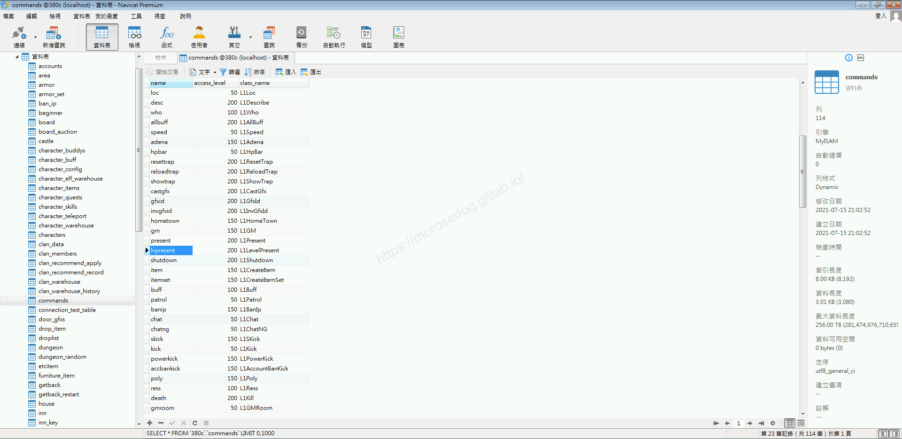
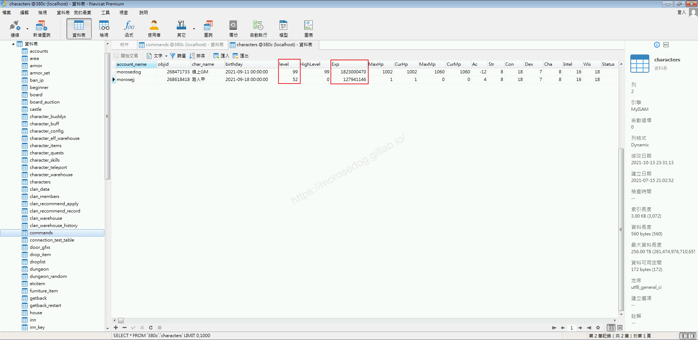
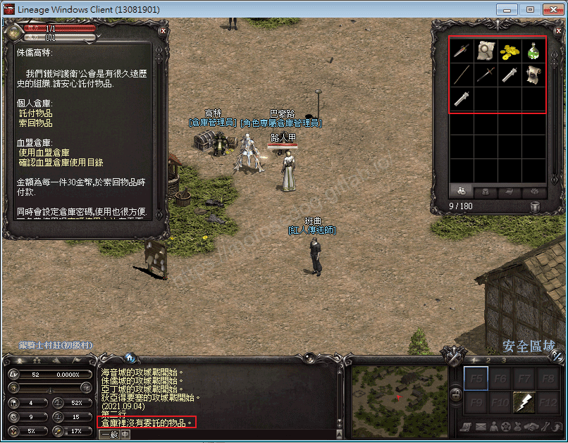
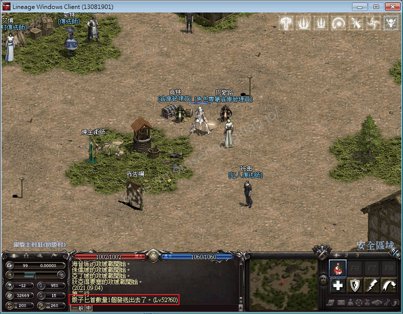
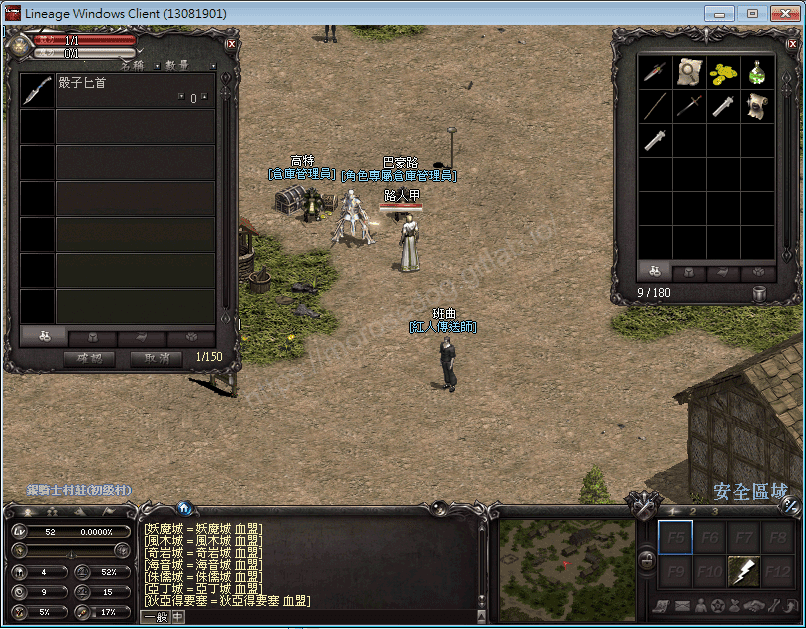
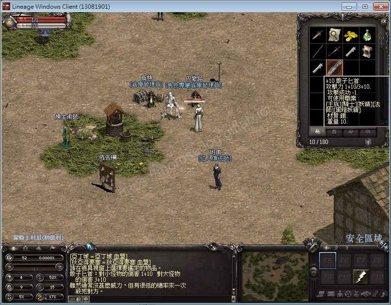
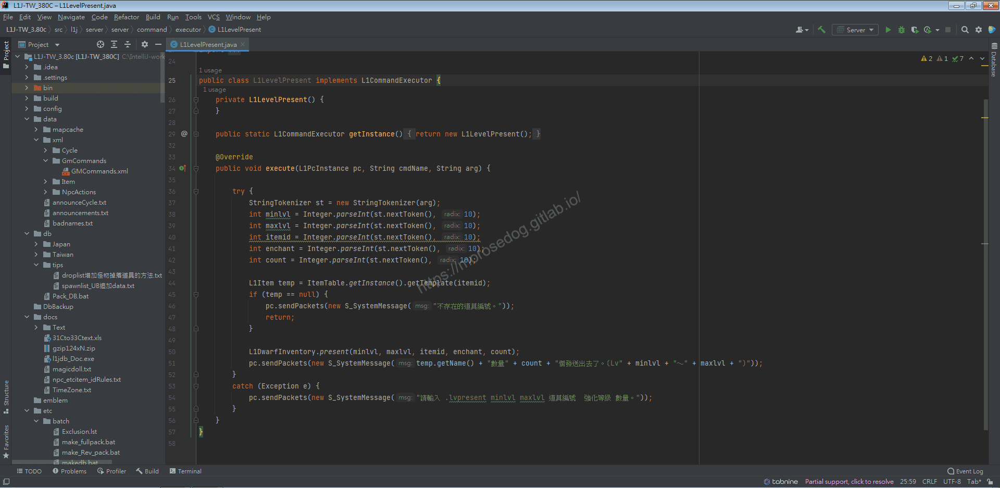
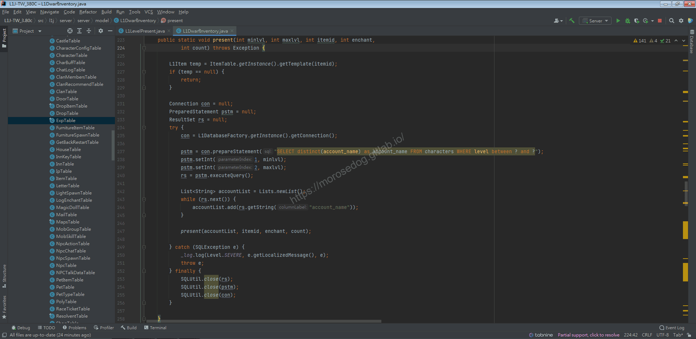

# GM指令分析 (限等贈送)

# 天堂私服 | GM指令分析 (限等贈送)「L1J版」

    
    
      📑 目錄
      

1. [章節用意](#章節用意)
2. [核心版本](#核心版本)
3. [前言](#前言)
4. [分析](#分析)
5. [結論](#結論)
6. [結語](#結語)
7. [免責聲明](#免責聲明)

    
    
    

## 章節用意

`lvpresent`的指令，此指令用於贈送指定的物品給角色人物達到等級範圍內的帳號。

## 核心版本

* L1J-3.80c

## 前言

在開始分析前，請務必先將前一篇[GM指令分析 (贈送)](./058_GM指令分析_(贈送).md)閱讀完畢。

## 分析

效果：創建一個物品並指定等級範圍將其放入個人倉庫；對於無法強化的物品，指定強化的數值將被忽略。
範例：​‌‌‌​​​​​‌‌‌​​‌​​‌‌​‌​​‌​‌‌‌​‌‌​​‌‌​​​​‌​‌‌‌​‌​​​‌‌​​‌​‌​​‌​‌‌​‌​‌‌​‌‌​​​‌‌​‌​​‌​‌‌​‌‌‌​​‌‌​​‌​‌​‌‌​​​​‌​‌‌​​‌‌‌​‌‌​​‌​‌​​‌​‌‌​‌​​‌‌​​‌​​​‌‌​​​​​​‌‌​​‌​​​‌‌​​​‌​​‌‌​​​‌​​‌‌​​​​​​‌‌​​​‌​​‌‌‌​​‌​​‌​‌‌​‌​‌‌‌​​​​​‌‌‌​​‌​​‌‌​‌​​‌​‌‌‌​‌‌​​‌‌​​​​‌​‌‌‌​‌​​​‌‌​​‌​‌​​‌​‌‌​‌​‌‌​‌‌​​​‌‌​‌​​‌​‌‌​‌‌‌​​‌‌​​‌​‌​‌‌​​​​‌​‌‌​​‌‌‌​‌‌​​‌​‌​​‌​‌‌​‌​​‌‌​‌​‌​​‌‌‌​​‌

```plain
.lvpresent ${minlvl} ${maxlvl} ${道具編號} ${強化等級} ${數量}
```

* 1.分析資料表：

  * 先進入`commands`表，找到`lvpresent`的指令。

  * `class_name`是`L1LevelPresent`。


* 2.調整角色資料

  * 修改資料表欄位`characters`.`level`、`characters`.`Exp`調整角色等級與經驗值。

  * 等級對應的`Exp`經驗值，可以查看`src/l1j/server/server/datatables/ExpTable.java`內。

```plain
/**
 * 経験値テーブル(累積値) Lv0-100
 */
private static final int _expTable[] = { 0, 125, 300, 500, 750, 1296, 2401,
		4096, 6581, 10000, 14661, 20756, 28581, 38436, 50645, 0x10014,
		0x14655, 0x19a24, 0x1fd25, 0x27114, 0x2f7c5, 0x39324, 0x44535,
		0x51010, 0x5f5f1, 0x6f920, 0x81c01, 0x96110, 0xacae1, 0xc5c20,
		0xe1791, 0x100010, 0x121891, 0x146420, 0x16e5e1, 0x19a110,
		0x1c9901, 0x1fd120, 0x234cf1, 0x271010, 0x2b1e31, 0x2f7b21,
		0x342ac2, 0x393111, 0x3e9222, 0x49b332, 0x60b772, 0x960cd1,
		0x12d4c4e, 0x3539b92, 0x579ead6, 0x7a03a1a, 0x9c6895e, 0xbecd8a2,
		0xe1327e6, 0x1039772a, 0x125fc66e, 0x148615b2, 0x16ac64f6,
		0x18d2b43a, 0x1af9037e, 0x1d1f52c2, 0x1f45a206, 0x216bf14a,
		0x2392408e, 0x25b88fd2, 0x27dedf16, 0x2a052e5a, 0x2c2b7d9e,
		0x2e51cce2, 0x30781c26, 0x329e6b6a, 0x34c4baae, 0x36eb09f2,
		0x39115936, 0x3b37a87a, 0x3d5df7be, 0x3f844702, 0x41aa9646,
		0x43d0e58a, 0x45f734ce, 0x481d8412, 0x4a43d356, 0x4c6a229a,
		0x4e9071de, 0x50b6c122, 0x52dd1066, 0x55035faa, 0x5729aeee,
		0x594ffe32, 0x5b764d76, 0x5d9c9cba, 0x5fc2ebfe, 0x61e93b42,
		0x640f8a86, 0x6635d9ca, 0x685c290e, 0x6a827852, 0x6ca8c796,
		0x6ecf16da, };
```

> 註：`0x`開頭的表示為`16`進制，例：`0x10014`表示`10014`的十六進制 = `65556`的十進制。提供一個[進制轉換網站](https://www.hexadecimaldictionary.com/hexadecimal/0x10014/)​‌‌‌​​​​​‌‌‌​​‌​​‌‌​‌​​‌​‌‌‌​‌‌​​‌‌​​​​‌​‌‌‌​‌​​​‌‌​​‌​‌​​‌​‌‌​‌​‌‌​‌‌​​​‌‌​‌​​‌​‌‌​‌‌‌​​‌‌​​‌​‌​‌‌​​​​‌​‌‌​​‌‌‌​‌‌​​‌​‌​​‌​‌‌​‌​​‌‌​​‌​​​‌‌​​​​​​‌‌​​‌​​​‌‌​​​‌​​‌‌​​​‌​​‌‌​​​​​​‌‌​​​‌​​‌‌‌​​‌​​‌​‌‌​‌​‌‌‌​​​​​‌‌‌​​‌​​‌‌​‌​​‌​‌‌‌​‌‌​​‌‌​​​​‌​‌‌‌​‌​​​‌‌​​‌​‌​​‌​‌‌​‌​‌‌​‌‌​​​‌‌​‌​​‌​‌‌​‌‌‌​​‌‌​​‌​‌​‌‌​​​​‌​‌‌​​‌‌‌​‌‌​​‌​‌​​‌​‌‌​‌​​‌‌​‌​‌​​‌‌‌​​‌

```plain
線上GM = 99, 1823000470
路人甲  = 52, 127941146
```



* 2.指令的分析：

  * 啟動模擬器除錯模式，並啟動天堂遊戲登入兩個帳號。

```plain
線上GM
路人甲
```

  * 首先確認`路人甲`<u>道具欄</u>、<u>倉庫</u>的內容。

  * 倉庫無任何物品、身上無`骰子匕首`。


  * `線上GM`使用限等贈送的`GM`指令，指定等級範圍為`52~60`的，送一把`+10 骰子匕首`。

```plain
.lvpresent 52 60 2 10 1
```



  * 再次確認`路人甲`<u>道具欄</u>、<u>倉庫</u>的內容。

  * 倉庫依舊無任何物品、身上無`歐西斯匕首`。


  * 將`路人甲`重新登入。

  * 再次確認`路人甲`<u>道具欄</u>、<u>倉庫</u>的內容。

  * 倉庫已經有`骰子匕首`。


  * 將`骰子匕首`領取並鑑定。


  * 確認`線上GM`<u>道具欄</u>、<u>倉庫</u>的內容。

  * 可以發現並沒有`骰子匕首`。

  * 這是因為等級不在這範圍內。

  * 如果將等級範圍修改為`52~99`。

```plain
.lvpresent 52 99 2 10 1
```

  * 將兩個人物重新登入確認倉庫，會發現兩個帳號倉庫都有一把`骰子匕首`。

  * 至此可以確認`限等贈送`指令，是將判斷腳色等級將物品放置倉庫內。

* 3.分析程式碼：

  * 透過搜尋`L1LevelPresent`開啟程式碼。

```plain
src/l1j/server/server/command/executor/L1LevelPresent.java
```



  * 多數的程式碼與前一篇已經分析完成，這邊指特別點出等級飯為判斷的語法。

  * `50`行，為主要的邏輯操作，可見使用的是`L1DwarfInventory`的`present`方法。

  * 並將`minlvl, maxlvl`兩個參數帶入。

  * `Ctrl`鍵壓住，再左鍵點擊`present`方法即會開啟跳轉到物件與方法位置。

  * `237`行，`SQL`語法查詢有帶入等級範圍的條件，最後將取得的`account`存放在一個`accountList`物件內。

```sql
SELECT distinct(account_name) as account_name FROM characters WHERE level between ? and ?
```



  * 後續的行為基本上於前一篇都是一樣的，這邊就不再列出。

## 結論

* 程式碼：

  * `src/l1j/server/server/command/executor/L1LevelPresent.java`

    * 處理客戶端來的`GM`指令`lvpresent`的處理。

## 結語

限等贈送指令可以運用在活動時間內達到多少等級贈送相對應的獎勵，或是將這思維運用在等級達到多少自動贈送獎勵等等。​‌‌‌​​​​​‌‌‌​​‌​​‌‌​‌​​‌​‌‌‌​‌‌​​‌‌​​​​‌​‌‌‌​‌​​​‌‌​​‌​‌​​‌​‌‌​‌​‌‌​‌‌​​​‌‌​‌​​‌​‌‌​‌‌‌​​‌‌​​‌​‌​‌‌​​​​‌​‌‌​​‌‌‌​‌‌​​‌​‌​​‌​‌‌​‌​​‌‌​​‌​​​‌‌​​​​​​‌‌​​‌​​​‌‌​​​‌​​‌‌​​​‌​​‌‌​​​​​​‌‌​​​‌​​‌‌‌​​‌​​‌​‌‌​‌​‌‌‌​​​​​‌‌‌​​‌​​‌‌​‌​​‌​‌‌‌​‌‌​​‌‌​​​​‌​‌‌‌​‌​​​‌‌​​‌​‌​​‌​‌‌​‌​‌‌​‌‌​​​‌‌​‌​​‌​‌‌​‌‌‌​​‌‌​​‌​‌​‌‌​​​​‌​‌‌​​‌‌‌​‌‌​​‌​‌​​‌​‌‌​‌​​‌‌​‌​‌​​‌‌‌​​‌

原創文章真的不易，希望多多支持，感謝。
最後建議回顧一下首章[天堂私服 | 天堂私服架設教學](/private-lineage-20210712-private-lineage-0/#教學章節)，了解其章節目錄。

## 免責聲明

* 本部落格文章中皆<font color="red"><u>**不提供**</u></font>任何所謂的遊戲「主程式」、「模擬器」、「登入器」…等等相關程式的下載點。

* 本部落格文章中所見之遊戲主程式和服務器端程序均來自網路發佈，<font color="red"><u>版本歸**原作者**</u>所有</font>。

* 本部落格文章為研究SQL資料庫與修改JAVA語法使用，<font color="red">並<u>**非商業用途**</u>，亦<u>**無做營運事實等任何一切商業行為**</u>。</font>

* 本部落格文章內容是為研究學習設計思想和原理為目的，<font color="red"><u>**絕沒有故意侵權或惡意抄襲、篡改其他遊戲內容**</u></font>！

---

- **原文連結**：[J.J.'s Blogs - GM指令分析 (限等贈送)](https://morosedog.gitlab.io/private-lineage-20211019-private-lineage-59/)
