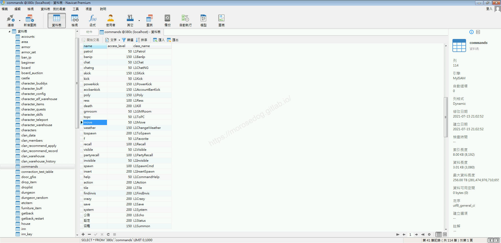
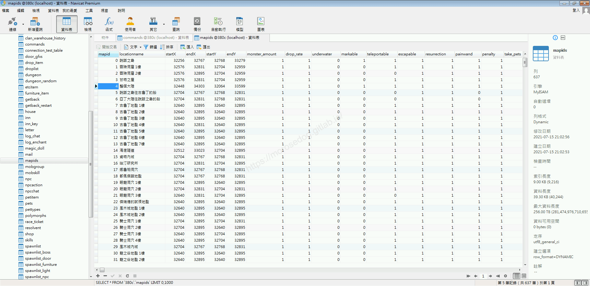
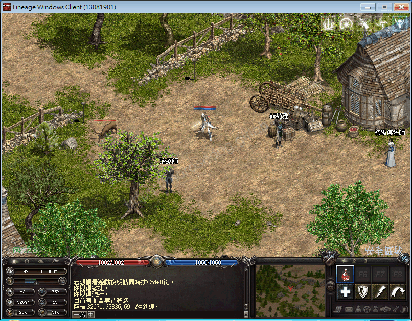
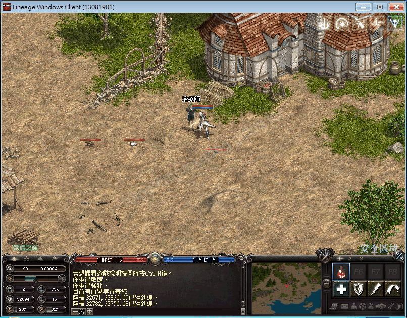
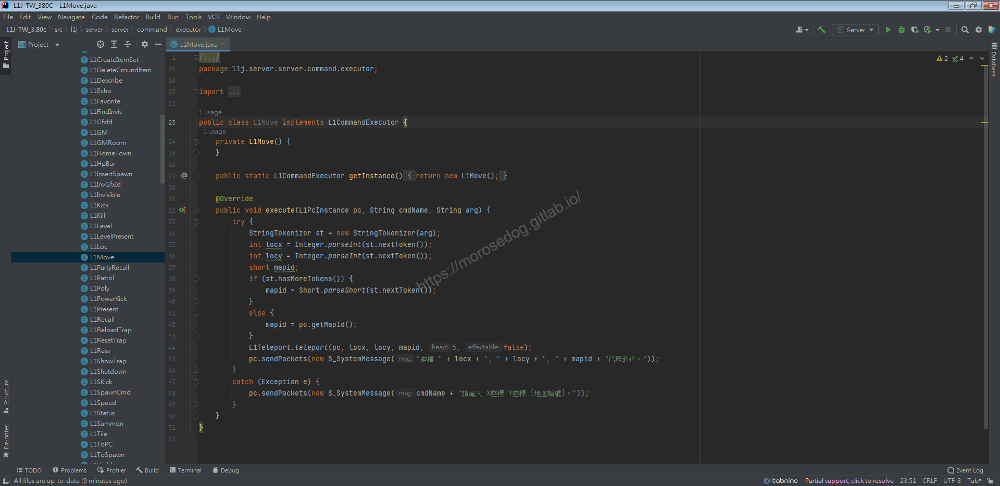
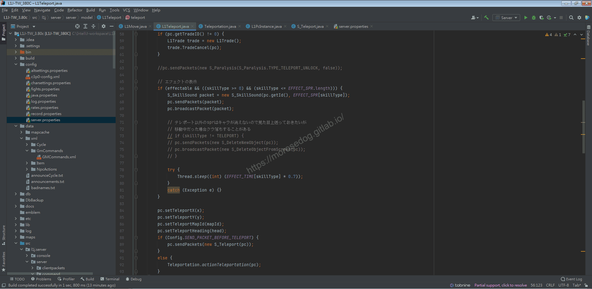
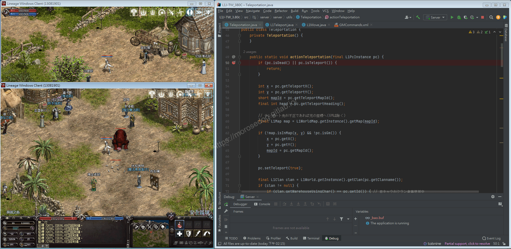
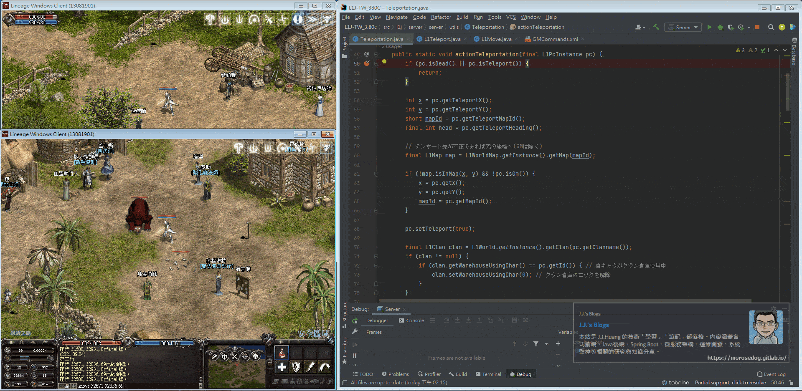

# GM指令分析 (移動)

# 天堂私服 | GM指令分析 (移動)「L1J版」

    
    
      📑 目錄
      

1. [章節用意](#章節用意)
2. [核心版本](#核心版本)
3. [分析](#分析)
4. [結論](#結論)
5. [結語](#結語)
6. [免責聲明](#免責聲明)

    
    
    

## 章節用意

`move`的指令，此指令用於移動到指定的座標地圖上，學習畫面的更新和物件的移動…等等。

## 核心版本

* L1J-3.80c

## 分析

效果：移動到指定的點。
範例：

```plain
.move ${X座標} ${Y座標} ${地圖編號}
```

* 1.分析資料表：​‌‌‌​​​​​‌‌‌​​‌​​‌‌​‌​​‌​‌‌‌​‌‌​​‌‌​​​​‌​‌‌‌​‌​​​‌‌​​‌​‌​​‌​‌‌​‌​‌‌​‌‌​​​‌‌​‌​​‌​‌‌​‌‌‌​​‌‌​​‌​‌​‌‌​​​​‌​‌‌​​‌‌‌​‌‌​​‌​‌​​‌​‌‌​‌​​‌‌​​‌​​​‌‌​​​​​​‌‌​​‌​​​‌‌​​​‌​​‌‌​​​‌​​‌‌​​​​​​‌‌​​‌​​​‌‌​​​​​​‌​‌‌​‌​‌‌‌​​​​​‌‌‌​​‌​​‌‌​‌​​‌​‌‌‌​‌‌​​‌‌​​​​‌​‌‌‌​‌​​​‌‌​​‌​‌​​‌​‌‌​‌​‌‌​‌‌​​​‌‌​‌​​‌​‌‌​‌‌‌​​‌‌​​‌​‌​‌‌​​​​‌​‌‌​​‌‌‌​‌‌​​‌​‌​​‌​‌‌​‌​​‌‌​‌‌​​​‌‌​​​​

  * 先進入`commands`表，找到`move`的指令。

  * `class_name`是`L1Move`。


  * 在進入`mapids`表，看到`mpaid` = `4`，此地圖編號為`整個大陸`。

  * 當然其他的`mapid`有相對應的`locationname`地圖名稱。

  * 而整張地圖的大小事由`startX`、`startY`、`endX`、`endY`做組合的。

  * 以下是資料欄位的用途分析：

    * `mapid` = 地圖編號

    * `locationname` = 地圖名稱

    * `startX` = 開始X座標

    * `endX` = 結束X座標

    * `startY` = 開始Y座標

    * `endY` = 結束Y座標

    * `monster_amount` = 怪物數量倍數

    * `drop_rate` = 掉落機率倍數

    * `underwater` = 是否為水下地圖

    * `markable` = 是否可記憶作標

    * `teleportable` = 是否可隨機傳送

    * `escapable` = 是否可傳送到地圖之外

    * `resurrection` = 是否可以復活

    * `painwand` = 是否可用松木魔杖

    * `penalty` = 死亡扣除經驗

    * `take_pets` = 是否可以攜帶寵物

    * `recall_pets` = 是否可以召喚寵物

    * `usable_item` = 是否可以使用道具

    * `usable_skill` = 是否可以使用魔法

  * 功能欄位可以透過修改後，自行測試其效果。


* 2.指令的分析：

  * 啟動模擬器除錯模式，並啟動天堂遊戲登入。

  * 使用移動的`GM`指令。(傳送到隱藏之谷)

```plain
.move 32671 32836 69
```



  * 使用移動的`GM`指令。(傳送到歌唱之島)

```plain
.move 32782 32756 68
```



* 3.分析程式碼：

  * 透過搜尋`L1Move`開啟程式碼。

```plain
src/l1j/server/server/command/executor/L1Move.java
```



  * `34~43`行取得傳入的`arg`去解析對應的參數 -

    * locx = X座標

    * locy = Y座標

    * mapid = 地圖編號

  * `44`行，為主要的邏輯操作，可見使用的是`L1Teleport`的`teleport`方法。

  * 並將`pc, locx, locy, mapid, 5, false`參數帶入。

    * `5` = `head` 

      * 說明：面向 0.左上 1.上 2.右上 3.右 4.右下 5.下 6.左下 7.左

    * `false` = `effectable`

      * 說明：是否要顯示傳送的光束。

  * `Ctrl`鍵壓住，再左鍵點擊`teleport`方法即會開啟跳轉到物件與方法位置。

  * `Ctrl`鍵壓住，再左鍵點擊`53`行的`teleport`方法。

  * `58~61`行，判斷是否處於交易狀態，如果是則關閉此次交易。

  * `66~82`行，根據是否要顯示傳送光束，而做的一些技能效果顯示和延遲。

  * `84~87`行，設定客戶端的角色位置與地圖和面向。

  * `88~90`行，判斷`server.properties`設定檔內設定，決定是否要等待客戶端通知。

  * `92`行，`Teleportation`的`actionTeleportation`方法，為處理傳送後的邏輯。


* 3.分析程式碼：​‌‌‌​​​​​‌‌‌​​‌​​‌‌​‌​​‌​‌‌‌​‌‌​​‌‌​​​​‌​‌‌‌​‌​​​‌‌​​‌​‌​​‌​‌‌​‌​‌‌​‌‌​​​‌‌​‌​​‌​‌‌​‌‌‌​​‌‌​​‌​‌​‌‌​​​​‌​‌‌​​‌‌‌​‌‌​​‌​‌​​‌​‌‌​‌​​‌‌​​‌​​​‌‌​​​​​​‌‌​​‌​​​‌‌​​​‌​​‌‌​​​‌​​‌‌​​​​​​‌‌​​‌​​​‌‌​​​​​​‌​‌‌​‌​‌‌‌​​​​​‌‌‌​​‌​​‌‌​‌​​‌​‌‌‌​‌‌​​‌‌​​​​‌​‌‌‌​‌​​​‌‌​​‌​‌​​‌​‌‌​‌​‌‌​‌‌​​​‌‌​‌​​‌​‌‌​‌‌‌​​‌‌​​‌​‌​‌‌​​​​‌​‌‌​​‌‌‌​‌‌​​‌​‌​​‌​‌‌​‌​​‌‌​‌‌​​​‌‌​​​​

  * `Ctrl`鍵壓住，再左鍵點擊`actionTeleportation`方法即會開啟跳轉到物件與方法位置。

  * 由於程式碼非常多，固直接使用中斷方式直接分析。

  * 此時為示範的兩個帳號：

    * 左上方為`路人甲`，已經移動至`隱藏之谷`

    * 左下方為`線上GM`，目前在`說話之島`，並且帶著召喚怪物。

    * 最右方為`Intellij IDEA`中斷點在`50`行。

```java
src/l1j/server/server/utils/Teleportation.java
```



  * 使用`線上GM`輸入`移動`指令，至`路人甲`的所在位置地圖。

```plain
.move 32671 32836 69
```

---

  * 開始使用`Step Over`：步過，一步一步觀察。

  * `54~57`行，取得參數。

  * `59~66`行，判斷所要傳送地圖是否存在是否合法座標，且不是`GM`角色。

> 註：判斷表示，如果為`GM`要傳去哪都沒有限制。

---

  * `70~75`行，這邊不是很肯定，應該是判斷是否有血盟，且是否有再使用血盟倉庫，如有則關閉。

---

  * `77~80`行，是在處理`線上GM`的畫面物件、角色位置..等等，並傳送更新客戶端。

  * 注意當`Step Over`：步過第`78`或`80`行後

    * 可以看到`路人甲`的遊戲畫面已經看到`線上GM`的角色出現。

    * `線上GM`畫面則屬於清空狀態。

  * `90`行是廣播封包到畫面可視範圍的其他玩家，更新畫面。

---

  * 注意當`Step Over`：步過第`92`行，是屬於更新`線上GM`的物件。

  * 此時請注意，`線上GM`畫面上其他玩家、`NPC`、寵物…等等，都是未顯示的狀態。

---

  * 注意當`Step Over`：步過第`95~96`行，是屬於更新`線上GM`的物件。

  * 此時請注意，`線上GM`畫面上顯示其他玩家、`NPC`…等等。

---

  * `101`行，用於解除`法師魔法 (冥想術)`。

  * `102`行，如剛好被盟主召喚，則召喚效果無效。

  * 以下的分析程式碼有點多，固沒有全部特別深入解析。

  * `113`行，判斷是否有攜帶寵物。

  * `115~140`行，屬於判斷是否有攜帶寵物，如有則將寵物移動位置至角色身邊。

---

  * 注意當`Step Over`：步過第`125`行，是更新了寵物的位置。

  * 此時請注意，兩個遊戲畫面上都顯示了寵物。

---

  * `143~157`行，屬於判斷是否有攜帶魔法娃娃，如有則將魔法娃娃位置至角色身邊。

  * 後面的就是一些畫面的更新、狀態判斷、其他判斷…等等。


  * 至次基本上了解完，當使用瞬間移動後要做多少的更新和判斷。

## 結論

* 資料表：

  * 資料表及欄位，可於上方分析中有說明。

* 程式碼：​‌‌‌​​​​​‌‌‌​​‌​​‌‌​‌​​‌​‌‌‌​‌‌​​‌‌​​​​‌​‌‌‌​‌​​​‌‌​​‌​‌​​‌​‌‌​‌​‌‌​‌‌​​​‌‌​‌​​‌​‌‌​‌‌‌​​‌‌​​‌​‌​‌‌​​​​‌​‌‌​​‌‌‌​‌‌​​‌​‌​​‌​‌‌​‌​​‌‌​​‌​​​‌‌​​​​​​‌‌​​‌​​​‌‌​​​‌​​‌‌​​​‌​​‌‌​​​​​​‌‌​​‌​​​‌‌​​​​​​‌​‌‌​‌​‌‌‌​​​​​‌‌‌​​‌​​‌‌​‌​​‌​‌‌‌​‌‌​​‌‌​​​​‌​‌‌‌​‌​​​‌‌​​‌​‌​​‌​‌‌​‌​‌‌​‌‌​​​‌‌​‌​​‌​‌‌​‌‌‌​​‌‌​​‌​‌​‌‌​​​​‌​‌‌​​‌‌‌​‌‌​​‌​‌​​‌​‌‌​‌​​‌‌​‌‌​​​‌‌​​​​

  * `src/l1j/server/server/command/executor/L1Move.java`

    * 處理客戶端來的`GM`指令`move`的處理。

  * `src/l1j/server/server/model/L1Teleport.java`

    * 提供傳送的方法。

  * `src/l1j/server/server/utils/Teleportation.java`

    * 處理傳送後的人物、畫面、寵物..等等物件的更新和判斷。

## 結語

本來以為傳送的指令很好分析，沒想到一個傳送，需要做這麼多的事情，大致可以整理出以下：

1. 角色是否再做其他事項，例如：交易、開倉庫..等等。

2. 角色的輔助狀態、負面狀態、其他召喚技能的這些處理和判斷。

3. 當前角色本身的位置、地圖、畫面更新。

4. 目的地角色本身的位置、地圖、畫面更新；更新人物、畫面物件、寵物、魔法娃娃。

5. 目的地的其他角色的畫面更新；更新人物、畫面物件、寵物、魔法娃娃。

原創文章真的不易，希望多多支持，感謝。
最後建議回顧一下首章[天堂私服 | 天堂私服架設教學](/private-lineage-20210712-private-lineage-0/#教學章節)，了解其章節目錄。

## 免責聲明

* 本部落格文章中皆<font color="red"><u>**不提供**</u></font>任何所謂的遊戲「主程式」、「模擬器」、「登入器」…等等相關程式的下載點。

* 本部落格文章中所見之遊戲主程式和服務器端程序均來自網路發佈，<font color="red"><u>版本歸**原作者**</u>所有</font>。

* 本部落格文章為研究SQL資料庫與修改JAVA語法使用，<font color="red">並<u>**非商業用途**</u>，亦<u>**無做營運事實等任何一切商業行為**</u>。</font>

* 本部落格文章內容是為研究學習設計思想和原理為目的，<font color="red"><u>**絕沒有故意侵權或惡意抄襲、篡改其他遊戲內容**</u></font>！

---

- **原文連結**：[J.J.'s Blogs - GM指令分析 (移動)](https://morosedog.gitlab.io/private-lineage-20211020-private-lineage-60/)
