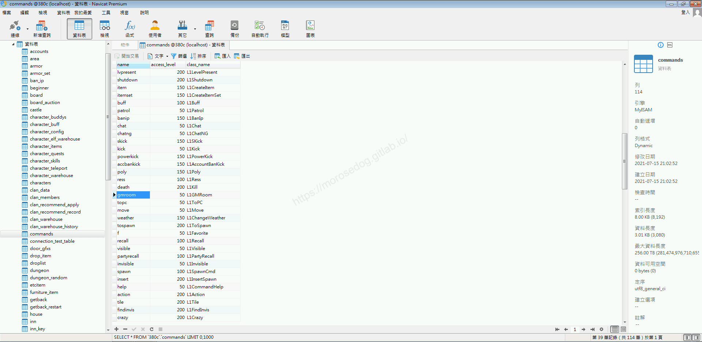
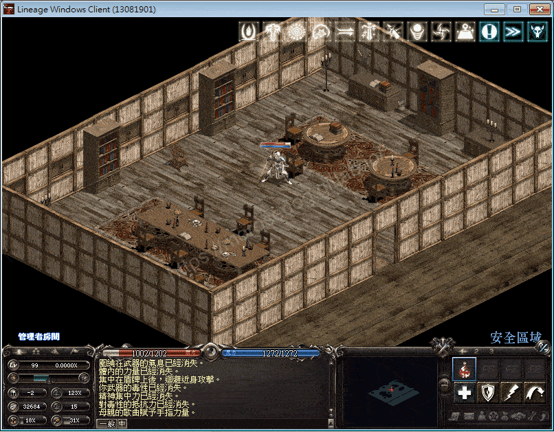
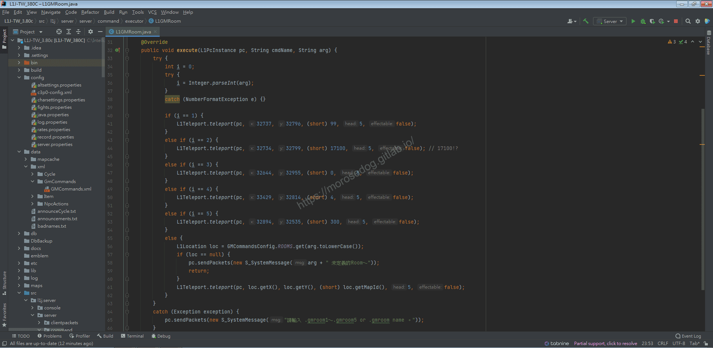
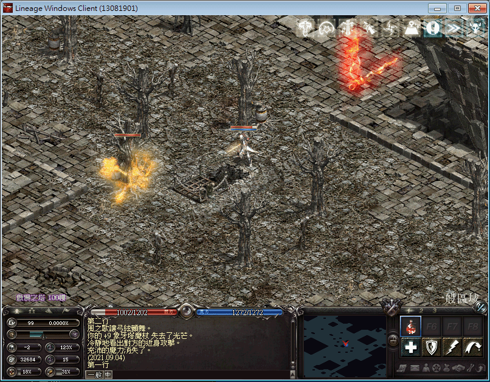

# GM指令分析 (房間)

# 天堂私服 | GM指令分析 (房間)「L1J版」

    
    
      📑 目錄
      

1. [章節用意](#章節用意)
2. [核心版本](#核心版本)
3. [前言](#前言)
4. [分析](#分析)
5. [結論](#結論)
6. [結語](#結語)
7. [免責聲明](#免責聲明)

    
    
    

## 章節用意

`gmroom`的指令，此指令用於移動到指定房間(地圖)位置，且使用`XML`設定檔常使用的位置。

## 核心版本

* L1J-3.80c

## 前言

在開始分析前，請務必先將以下文章閱讀完畢。

* [GM指令分析 (創立套裝)](./057_GM指令分析_(創立套裝).md)

  * 了解`XML`的設定、使用、讀取。

* [GM指令分析 (移動)](./060_GM指令分析_(移動).md)

  * 了解傳送的行為。

## 分析

效果：傳送到指定位置。
範例：​‌‌‌​​​​​‌‌‌​​‌​​‌‌​‌​​‌​‌‌‌​‌‌​​‌‌​​​​‌​‌‌‌​‌​​​‌‌​​‌​‌​​‌​‌‌​‌​‌‌​‌‌​​​‌‌​‌​​‌​‌‌​‌‌‌​​‌‌​​‌​‌​‌‌​​​​‌​‌‌​​‌‌‌​‌‌​​‌​‌​​‌​‌‌​‌​​‌‌​​‌​​​‌‌​​​​​​‌‌​​‌​​​‌‌​​​‌​​‌‌​​​‌​​‌‌​​​​​​‌‌​​‌​​​‌‌​​​‌​​‌​‌‌​‌​‌‌‌​​​​​‌‌‌​​‌​​‌‌​‌​​‌​‌‌‌​‌‌​​‌‌​​​​‌​‌‌‌​‌​​​‌‌​​‌​‌​​‌​‌‌​‌​‌‌​‌‌​​​‌‌​‌​​‌​‌‌​‌‌‌​​‌‌​​‌​‌​‌‌​​​​‌​‌‌​​‌‌‌​‌‌​​‌​‌​​‌​‌‌​‌​​‌‌​‌‌​​​‌‌​​​‌

```plain
.gmroom ${位置名稱}
```

* 1.分析資料表：

  * 先進入`commands`表，找到`gmroom`的指令。

  * `class_name`是`L1GMRoom`。


* 2.指令的分析：

  * 啟動模擬器除錯模式，並啟動天堂遊戲登入。

  * 使用移動的`GM`指令，分別參數帶入`1~5`對應`5`個預設的位置，該位置是寫死於程式中。

```plain
.gmroom 1
```



* 3.分析程式碼：​‌‌‌​​​​​‌‌‌​​‌​​‌‌​‌​​‌​‌‌‌​‌‌​​‌‌​​​​‌​‌‌‌​‌​​​‌‌​​‌​‌​​‌​‌‌​‌​‌‌​‌‌​​​‌‌​‌​​‌​‌‌​‌‌‌​​‌‌​​‌​‌​‌‌​​​​‌​‌‌​​‌‌‌​‌‌​​‌​‌​​‌​‌‌​‌​​‌‌​​‌​​​‌‌​​​​​​‌‌​​‌​​​‌‌​​​‌​​‌‌​​​‌​​‌‌​​​​​​‌‌​​‌​​​‌‌​​​‌​​‌​‌‌​‌​‌‌‌​​​​​‌‌‌​​‌​​‌‌​‌​​‌​‌‌‌​‌‌​​‌‌​​​​‌​‌‌‌​‌​​​‌‌​​‌​‌​​‌​‌‌​‌​‌‌​‌‌​​​‌‌​‌​​‌​‌‌​‌‌‌​​‌‌​​‌​‌​‌‌​​​​‌​‌‌​​‌‌‌​‌‌​​‌​‌​​‌​‌‌​‌​​‌‌​‌‌​​​‌‌​​​‌

  * 透過搜尋`L1GMRoom`開啟程式碼。

```plain
src/l1j/server/server/command/executor/L1GMRoom.java
```



> 註：程式碼內的`L1Teleport`的`teleport`方法，已於[GM指令分析 (移動)](./060_GM指令分析_(移動).md)分析完畢，此處將不再分析。

  * `40~54`行，判斷輸入的參數`1~5`對應輸入不同的預設座標與地圖編號。

  * `56`行，`GMCommandsConfig.ROOMS`的分析，不再特別分析，詳見註記。

> 註：[GM指令分析 (創立套裝)](./057_GM指令分析_(創立套裝).md)此篇內的分析`GMCommandsConfig.ITEM_SETS`是相同行為。

  * `56~60`行，如果房間不存在，則傳送數據回客戶端做顯示`xxx 未定義的Room～`。

  * `61`行，將取得的房間參數帶入`teleport`方法，做傳送。

* 4.分析程式碼：​‌‌‌​​​​​‌‌‌​​‌​​‌‌​‌​​‌​‌‌‌​‌‌​​‌‌​​​​‌​‌‌‌​‌​​​‌‌​​‌​‌​​‌​‌‌​‌​‌‌​‌‌​​​‌‌​‌​​‌​‌‌​‌‌‌​​‌‌​​‌​‌​‌‌​​​​‌​‌‌​​‌‌‌​‌‌​​‌​‌​​‌​‌‌​‌​​‌‌​​‌​​​‌‌​​​​​​‌‌​​‌​​​‌‌​​​‌​​‌‌​​​‌​​‌‌​​​​​​‌‌​​‌​​​‌‌​​​‌​​‌​‌‌​‌​‌‌‌​​​​​‌‌‌​​‌​​‌‌​‌​​‌​‌‌‌​‌‌​​‌‌​​​​‌​‌‌‌​‌​​​‌‌​​‌​‌​​‌​‌‌​‌​‌‌​‌‌​​​‌‌​‌​​‌​‌‌​‌‌‌​​‌‌​​‌​‌​‌‌​​​​‌​‌‌​​‌‌‌​‌‌​​‌​‌​​‌​‌‌​‌​​‌‌​‌‌​​​‌‌​​​‌

  * 提供目前有設定的房間。

```plain
./data/xml/GmCommands/GMCommands.xml
```

  * 直接在核心的資料夾內找到`GMCommands.xml`並開啟。

  * 可以看到在`GMCommands.xml`內容，有`ItemSetList`和`RoomList`兩個大區塊。

  * 目前我們只要注意到`RoomList`就好。

  * 以下參數的使用範例：(傲慢之塔100樓)

```plain
.gmroom ToI100
```



```xml

<RoomList>
	<!-- Town -->
	<Room Name="Gludio" LocX="32612" LocY="32734" MapId="4"/>
	<Room Name="Giran" LocX="33442" LocY="32797" MapId="4"/>
	<Room Name="SI" LocX="32782" LocY="32756" MapId="68"/>
	<Room Name="TI" LocX="32580" LocY="32931" MapId="0"/>
	<Room Name="Aden" LocX="33966" LocY="33253" MapId="4"/>
	<Room Name="Oren" LocX="34061" LocY="32276" MapId="4"/>
	<Room Name="WW" LocX="32621" LocY="33169" MapId="4"/>
	<Room Name="HV" LocX="32671" LocY="32836" MapId="69"/>
	<Room Name="MT" LocX="33054" LocY="32323" MapId="4"/>
	<Room Name="Kent" LocX="33050" LocY="32780" MapId="4"/>
	<Room Name="Heine" LocX="33612" LocY="33268" MapId="4"/>
	<Room Name="Werldern" LocX="33705" LocY="32504" MapId="4"/>
	<Room Name="SKT" LocX="33080" LocY="33392" MapId="4"/>
	<Room Name="GMShop" LocX="33079" LocY="33402" MapId="4"/>
	<Room Name="IT" LocX="32771" LocY="32822" MapId="75"/>
	<Room Name="SC" LocX="32854" LocY="32907" MapId="304"/>
	<Room Name="OT" LocX="32715" LocY="32448" MapId="4"/>
	<Room Name="Gunter" LocX="32669" LocY="32790" MapId="3"/>
	<Room Name="Gypsy" LocX="33978" LocY="32927" MapId="4"/>
	<Room Name="Bluedika" LocX="32739" LocY="32801" MapId="305"/>
	<Room Name="Dicarding" LocX="32766" LocY="32797" MapId="77"/>

	<!-- Castle -->
	<Room Name="AdenGT" LocX="34090" LocY="33261" MapId="4"/>
	
	<!-- Field -->
	<Room Name="Oasis" LocX="32861" LocY="33255" MapId="4"/>
	
	<!-- Dungeon -->
	<Room Name="CC1" LocX="32746" LocY="32787" MapId="72"/>
	<Room Name="CC2" LocX="32755" LocY="32871" MapId="73"/>
	<Room Name="CC3" LocX="32731" LocY="32854" MapId="74"/>
	<Room Name="DVC1" LocX="32740" LocY="32777" MapId="30"/>
	<Room Name="DVC2" LocX="32760" LocY="32781" MapId="31"/>
	<Room Name="DVC3" LocX="32709" LocY="32818" MapId="32"/>
	<Room Name="DVC4" LocX="32669" LocY="32869" MapId="33"/>
	<Room Name="DVC5" LocX="32746" LocY="32802" MapId="35"/>
	<Room Name="DVC6" LocX="32663" LocY="32846" MapId="36"/>
	<Room Name="DVC7" LocX="32668" LocY="32867" MapId="37"/>
	<Room Name="MLC3" LocX="32798" LocY="32754" MapId="9"/>
	<Room Name="MLC4" LocX="32764" LocY="32773" MapId="10"/>
	<Room Name="MLC5" LocX="32729" LocY="32724" MapId="11"/>
	<Room Name="MLC6" LocX="32805" LocY="32725" MapId="12"/>
	<Room Name="MLC7" LocX="32730" LocY="32726" MapId="13"/>
	<Room Name="AC1" LocX="32738" LocY="32799" MapId="49"/>
	<Room Name="AC2" LocX="32740" LocY="32802" MapId="50"/>
	<Room Name="AC3" LocX="32764" LocY="32828" MapId="51"/>
	<Room Name="IT5" LocX="32772" LocY="32805" MapId="79"/>
	<Room Name="IT6" LocX="32748" LocY="32802" MapId="80"/>
	<Room Name="IT7" LocX="32766" LocY="32849" MapId="81"/>
	<Room Name="IT8" LocX="32742" LocY="32798" MapId="82"/>
	<Room Name="GC2" LocX="32809" LocY="32793" MapId="54"/>
	<Room Name="GC3" LocX="32734" LocY="32728" MapId="55"/>
	<Room Name="GC4" LocX="32770" LocY="32730" MapId="56"/>
	<Room Name="SKTC2" LocX="32802" LocY="32815" MapId="26"/>
	<Room Name="SKTC3" LocX="32807" LocY="32812" MapId="27"/>
	<Room Name="SKTC4" LocX="32799" LocY="32798" MapId="28"/>
	<Room Name="KC1" LocX="32720" LocY="33088" MapId="240"/>
	<Room Name="KC2" LocX="32759" LocY="32884" MapId="241"/>
	<Room Name="KC3" LocX="32808" LocY="32918" MapId="242"/>
	<Room Name="KC4" LocX="32742" LocY="32857" MapId="243"/>
	<Room Name="WC1" LocX="32810" LocY="32723" MapId="23"/>
	<Room Name="WC2" LocX="32809" LocY="32812" MapId="24"/>
	<Room Name="DI" LocX="32633" LocY="32817" MapId="303"/>
	<Room Name="FI" LocX="32828" LocY="32848" MapId="70"/>
	
	<!-- ToI -->
	<Room Name="ToI11" LocX="32631" LocY="32935" MapId="111"/>
	<Room Name="ToI21" LocX="32631" LocY="32935" MapId="121"/>
	<Room Name="ToI31" LocX="32631" LocY="32935" MapId="131"/>
	<Room Name="ToI41" LocX="32631" LocY="32935" MapId="141"/>
	<Room Name="ToI51" LocX="32669" LocY="32814" MapId="151"/>
	<Room Name="ToI61" LocX="32669" LocY="32814" MapId="161"/>
	<Room Name="ToI71" LocX="32669" LocY="32814" MapId="171"/>
	<Room Name="ToI81" LocX="32669" LocY="32814" MapId="181"/>
	<Room Name="ToI91" LocX="32669" LocY="32814" MapId="191"/>
	<Room Name="ToI10" LocX="32800" LocY="32800" MapId="110"/>
	<Room Name="ToI20" LocX="32800" LocY="32800" MapId="120"/>
	<Room Name="ToI30" LocX="32800" LocY="32800" MapId="130"/>
	<Room Name="ToI40" LocX="32800" LocY="32800" MapId="140"/>
	<Room Name="ToI50" LocX="32796" LocY="32796" MapId="150"/>
	<Room Name="ToI60" LocX="32720" LocY="32821" MapId="160"/>
	<Room Name="ToI70" LocX="32720" LocY="32821" MapId="170"/>
	<Room Name="ToI80" LocX="32724" LocY="32822" MapId="180"/>
	<Room Name="ToI90" LocX="32722" LocY="32827" MapId="190"/>
	<Room Name="ToI100" LocX="32731" LocY="32856" MapId="200"/>
	
	<!-- Four dragon -->
	<Room Name="Valakas" LocX="32723" LocY="32796" MapId="67"/>
	<Room Name="Fafurion" LocX="32769" LocY="32833" MapId="65"/>
	<Room Name="Lindvior" LocX="34035" LocY="33011" MapId="4"/>
	<Room Name="Antharas" LocX="32668" LocY="32867" MapId="37"/>
	
	<!-- Other -->
	<Room Name="Hell" LocX="32701" LocY="32777" MapId="666"/>
	<Room Name="GMRoom" LocX="32737" LocY="32796" MapId="99"/>
	
</RoomList>
```

## 結論

* 程式碼：

  * `src/l1j/server/server/command/executor/L1GMRoom.java`

    * 處理客戶端來的`GM`指令`gmroom`的處理。

## 結語

其實所謂的`GM`房間指令，就是使用了傳送加上預設參數的方式來處理。
當然預設的參數可以寫死在程式碼中，也可如這邊使用`XML`的方式設定，當然還有很多種方式配置，例如：`DB`、`Config`…等等。

原創文章真的不易，希望多多支持，感謝。
最後建議回顧一下首章[天堂私服 | 天堂私服架設教學](/private-lineage-20210712-private-lineage-0/#教學章節)，了解其章節目錄。

## 免責聲明

* 本部落格文章中皆<font color="red"><u>**不提供**</u></font>任何所謂的遊戲「主程式」、「模擬器」、「登入器」…等等相關程式的下載點。

* 本部落格文章中所見之遊戲主程式和服務器端程序均來自網路發佈，<font color="red"><u>版本歸**原作者**</u>所有</font>。

* 本部落格文章為研究SQL資料庫與修改JAVA語法使用，<font color="red">並<u>**非商業用途**</u>，亦<u>**無做營運事實等任何一切商業行為**</u>。</font>

* 本部落格文章內容是為研究學習設計思想和原理為目的，<font color="red"><u>**絕沒有故意侵權或惡意抄襲、篡改其他遊戲內容**</u></font>！

---

- **原文連結**：[J.J.'s Blogs - GM指令分析 (房間)](https://morosedog.gitlab.io/private-lineage-20211021-private-lineage-61/)
