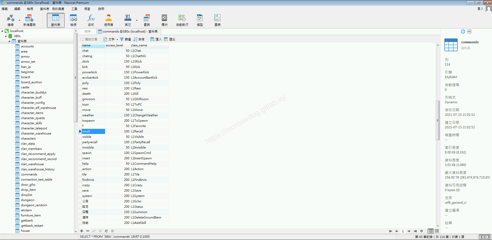
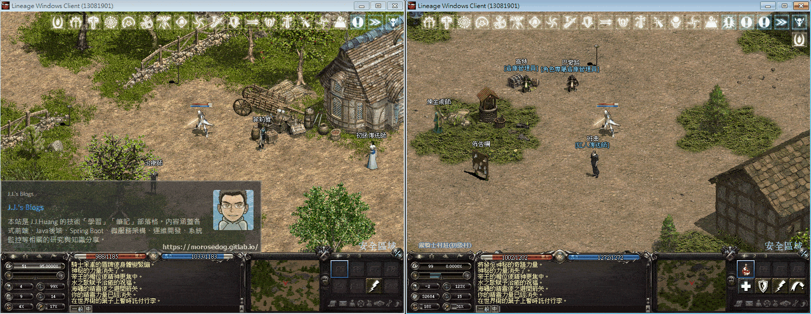
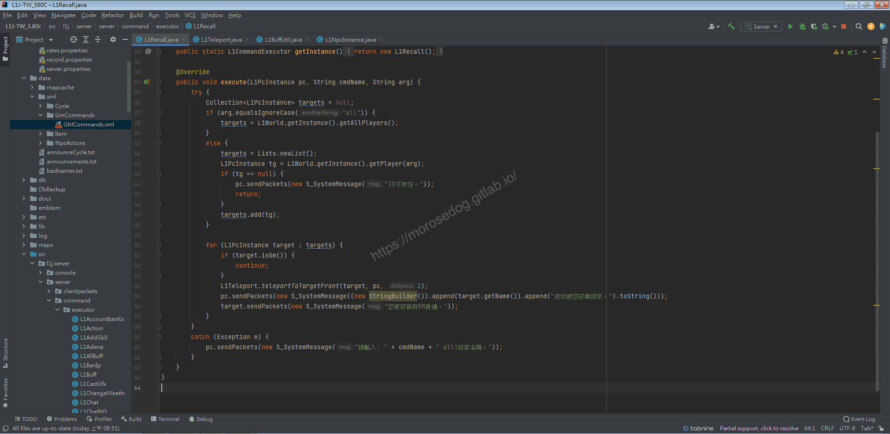
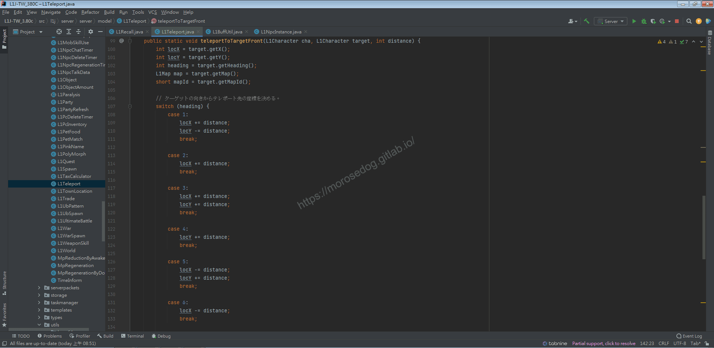
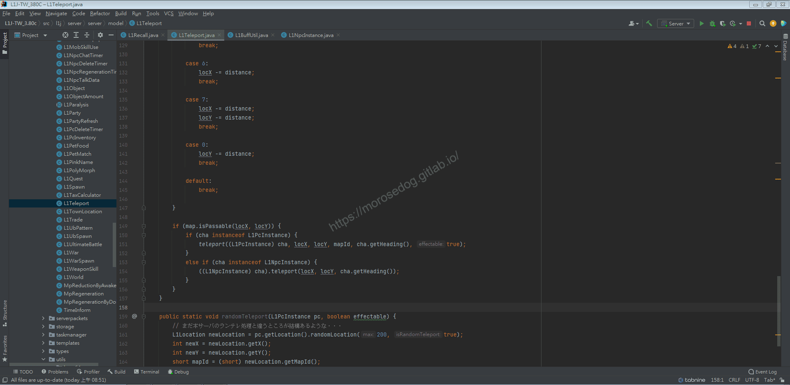

# GM指令分析 (召回玩家)

# 天堂私服 | GM指令分析 (召回玩家)「L1J版」

    
    
      📑 目錄
      

1. [章節用意](#章節用意)
2. [核心版本](#核心版本)
3. [前言](#前言)
4. [分析](#分析)
5. [結論](#結論)
6. [結語](#結語)
7. [免責聲明](#免責聲明)

    
    
    

## 章節用意

`recall`的指令，此指令用於將指定玩家或是全部玩家召回`GM`的位置，常見應用在伺服器維修前將所有玩家召回到主城。

## 核心版本

* L1J-3.80c

## 前言

在開始分析前，請務必先將以下文章閱讀完畢。

* [GM指令分析 (移動)](./060_GM指令分析_(移動).md)

  * 了解傳送的行為。

## 分析

效果：召回玩家。
範例：​‌‌‌​​​​​‌‌‌​​‌​​‌‌​‌​​‌​‌‌‌​‌‌​​‌‌​​​​‌​‌‌‌​‌​​​‌‌​​‌​‌​​‌​‌‌​‌​‌‌​‌‌​​​‌‌​‌​​‌​‌‌​‌‌‌​​‌‌​​‌​‌​‌‌​​​​‌​‌‌​​‌‌‌​‌‌​​‌​‌​​‌​‌‌​‌​​‌‌​​‌​​​‌‌​​​​​​‌‌​​‌​​​‌‌​​​‌​​‌‌​​​‌​​‌‌​​​​​​‌‌​​‌​​​‌‌​​‌‌​​‌​‌‌​‌​‌‌‌​​​​​‌‌‌​​‌​​‌‌​‌​​‌​‌‌‌​‌‌​​‌‌​​​​‌​‌‌‌​‌​​​‌‌​​‌​‌​​‌​‌‌​‌​‌‌​‌‌​​​‌‌​‌​​‌​‌‌​‌‌‌​​‌‌​​‌​‌​‌‌​​​​‌​‌‌​​‌‌‌​‌‌​​‌​‌​​‌​‌‌​‌​​‌‌​‌‌​​​‌‌​​‌‌

```plain
.recall ${角色名稱}
.recall all
```

* 1.分析資料表：

  * 先進入`commands`表，找到`recall`的指令。

  * `class_name`是`L1Recall`。


* 2.指令的分析：

  * 啟動模擬器除錯模式，並啟動天堂遊戲登入兩個帳號。

```plain
線上GM
路人甲
```

  * 並將兩個人物移動至不一樣的地方。(不同畫面即可)

  * 使用召回玩家的`GM`指令。

```plain
.recall all
```



* 3.分析程式碼：​‌‌‌​​​​​‌‌‌​​‌​​‌‌​‌​​‌​‌‌‌​‌‌​​‌‌​​​​‌​‌‌‌​‌​​​‌‌​​‌​‌​​‌​‌‌​‌​‌‌​‌‌​​​‌‌​‌​​‌​‌‌​‌‌‌​​‌‌​​‌​‌​‌‌​​​​‌​‌‌​​‌‌‌​‌‌​​‌​‌​​‌​‌‌​‌​​‌‌​​‌​​​‌‌​​​​​​‌‌​​‌​​​‌‌​​​‌​​‌‌​​​‌​​‌‌​​​​​​‌‌​​‌​​​‌‌​​‌‌​​‌​‌‌​‌​‌‌‌​​​​​‌‌‌​​‌​​‌‌​‌​​‌​‌‌‌​‌‌​​‌‌​​​​‌​‌‌‌​‌​​​‌‌​​‌​‌​​‌​‌‌​‌​‌‌​‌‌​​​‌‌​‌​​‌​‌‌​‌‌‌​​‌‌​​‌​‌​‌‌​​​​‌​‌‌​​‌‌‌​‌‌​​‌​‌​​‌​‌‌​‌​​‌‌​‌‌​​​‌‌​​‌‌

  * 透過搜尋`L1ToPC`開啟程式碼。

```plain
src/l1j/server/server/command/executor/L1ToPC.java
```



> 註：程式碼內的`L1Teleport`的`teleport`方法，已於[GM指令分析 (移動)](./060_GM指令分析_(移動).md)分析完畢，此處將不再分析。

  * `36~48`行，判斷輸入的參數是否為`all`。

    * 如為`all`，則使用`L1World.getInstance().getAllPlayers()`取得所有在線的玩家。

    * 不為，則將輸入的參數`L1World.getInstance().getPlayer(arg);`帶入找尋取得玩家。

  * `50~57`行，主要處理召回的處理。

  * 主要`54`是，`L1Teleport`的`teleportToTargetFront`方法。

  * 輸入的參數為`目標玩家`、`GM`、距離。

  * `Ctrl`鍵壓住，再左鍵點擊`teleportToTargetFront`方法即會開啟跳轉到物件與方法位置。

  * `100~104`行，根據`GM`的參數資訊取得，`X`座標`、`T`座標、面向。

  * `107~147`行，根據面向加減距離參數`X`和`Y`座標為被召回的位置。

> 說明：面向 0.左上 1.上 2.右上 3.右 4.右下 5.下 6.左下 7.左
> 

  * `149~156`行，最後呼叫`L1Teleport`的`teleport`方法。

> 註：程式碼內的`L1Teleport`的`teleport`方法，已於[GM指令分析 (移動)](./060_GM指令分析_(移動).md)分析完畢，此處將不再分析。
> ​‌‌‌​​​​​‌‌‌​​‌​​‌‌​‌​​‌​‌‌‌​‌‌​​‌‌​​​​‌​‌‌‌​‌​​​‌‌​​‌​‌​​‌​‌‌​‌​‌‌​‌‌​​​‌‌​‌​​‌​‌‌​‌‌‌​​‌‌​​‌​‌​‌‌​​​​‌​‌‌​​‌‌‌​‌‌​​‌​‌​​‌​‌‌​‌​​‌‌​​‌​​​‌‌​​​​​​‌‌​​‌​​​‌‌​​​‌​​‌‌​​​‌​​‌‌​​​​​​‌‌​​‌​​​‌‌​​‌‌​​‌​‌‌​‌​‌‌‌​​​​​‌‌‌​​‌​​‌‌​‌​​‌​‌‌‌​‌‌​​‌‌​​​​‌​‌‌‌​‌​​​‌‌​​‌​‌​​‌​‌‌​‌​‌‌​‌‌​​​‌‌​‌​​‌​‌‌​‌‌‌​​‌‌​​‌​‌​‌‌​​​​‌​‌‌​​‌‌‌​‌‌​​‌​‌​​‌​‌‌​‌​​‌‌​‌‌​​​‌‌​​‌‌

  * 或許有注意到兩段判斷的程式碼

```java
cha instanceof L1PcInstance
cha instanceof L1NpcInstance
```

  * 第一個判斷被召回的目標是玩家？

    * 這很明顯就是用在這個指令中使用。

  * 第二個判斷為被召回的目標是`NPC`？

    * 初步分析”可能”是被用在寵物或是召喚的怪物；或是怪物召喚的小怪所使用。

## 結論

* 程式碼：

  * `src/l1j/server/server/command/executor/L1Recall.java`

    * 處理客戶端來的`GM`指令`recall`的處理。

## 結語

傳送的功能套好套滿，只要多想想就可以運用到很多方面。

原創文章真的不易，希望多多支持，感謝。
最後建議回顧一下首章[天堂私服 | 天堂私服架設教學](/private-lineage-20210712-private-lineage-0/#教學章節)，了解其章節目錄。

## 免責聲明

* 本部落格文章中皆<font color="red"><u>**不提供**</u></font>任何所謂的遊戲「主程式」、「模擬器」、「登入器」…等等相關程式的下載點。

* 本部落格文章中所見之遊戲主程式和服務器端程序均來自網路發佈，<font color="red"><u>版本歸**原作者**</u>所有</font>。

* 本部落格文章為研究SQL資料庫與修改JAVA語法使用，<font color="red">並<u>**非商業用途**</u>，亦<u>**無做營運事實等任何一切商業行為**</u>。</font>

* 本部落格文章內容是為研究學習設計思想和原理為目的，<font color="red"><u>**絕沒有故意侵權或惡意抄襲、篡改其他遊戲內容**</u></font>！

---

- **原文連結**：[J.J.'s Blogs - GM指令分析 (召回玩家)](https://morosedog.gitlab.io/private-lineage-20211023-private-lineage-63/)
