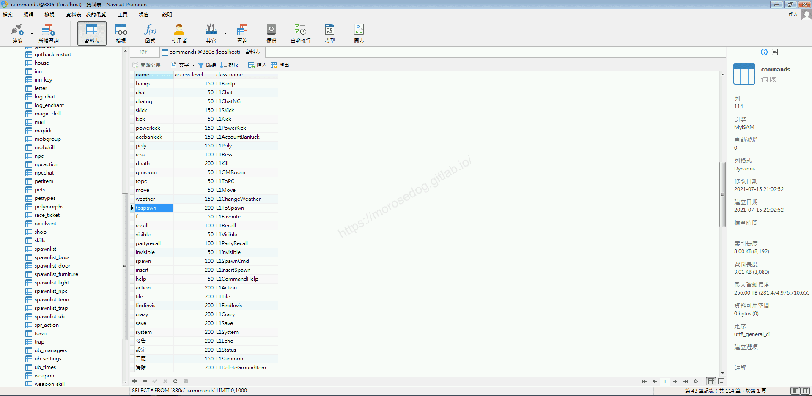
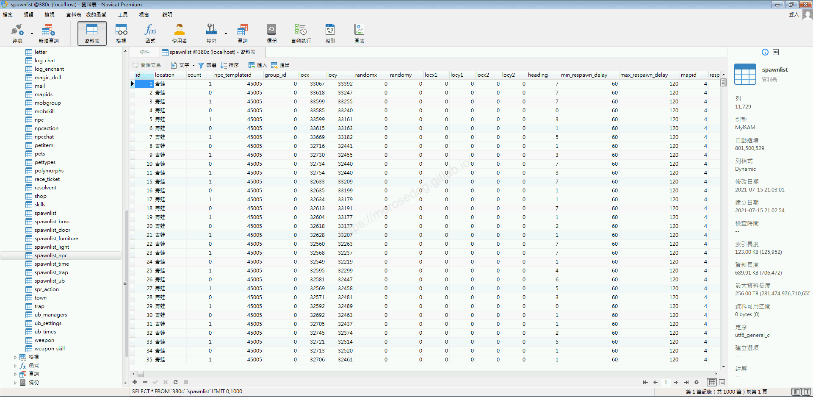
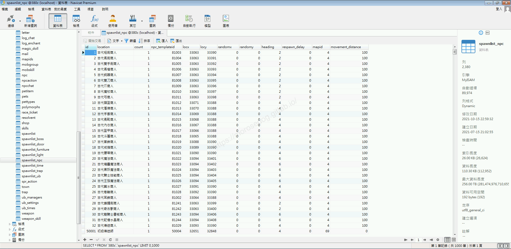
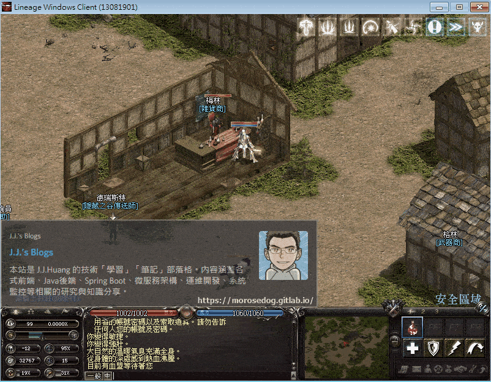
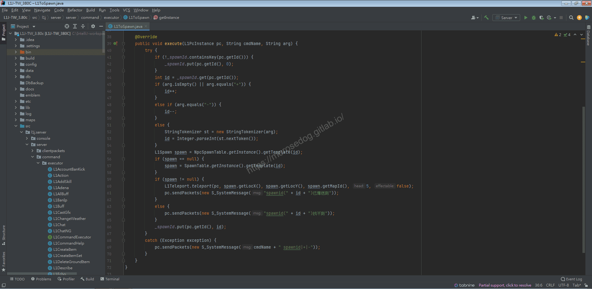
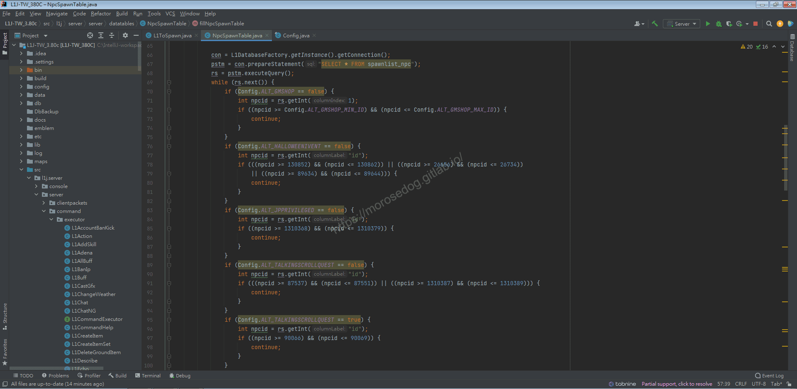
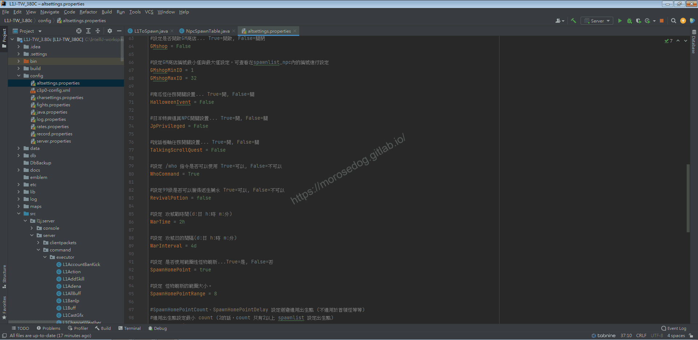
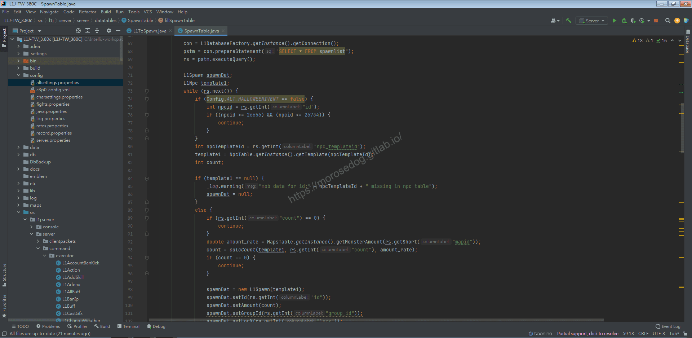

# GM指令分析 (前往怪物)

# 天堂私服 | GM指令分析 (前往怪物)「L1J版」

    
    
      📑 目錄
      

1. [章節用意](#章節用意)
2. [核心版本](#核心版本)
3. [前言](#前言)
4. [分析](#分析)
5. [結論](#結論)
6. [結語](#結語)
7. [免責聲明](#免責聲明)

    
    
    

## 章節用意

`tospawn`的指令，此指令用於傳送到特定的怪物、`NPC`旁，主要用於觀看怪物出生點；或許可以運用在`BOSS`的傳送卷軸。

## 核心版本

* L1J-3.80c

## 前言

在開始分析前，請務必先將以下文章閱讀完畢。

* [GM指令分析 (移動)](./060_GM指令分析_(移動).md)

  * 了解傳送的行為。

## 分析

效果：傳送到指定spawnid的坐標。
範例：​‌‌‌​​​​​‌‌‌​​‌​​‌‌​‌​​‌​‌‌‌​‌‌​​‌‌​​​​‌​‌‌‌​‌​​​‌‌​​‌​‌​​‌​‌‌​‌​‌‌​‌‌​​​‌‌​‌​​‌​‌‌​‌‌‌​​‌‌​​‌​‌​‌‌​​​​‌​‌‌​​‌‌‌​‌‌​​‌​‌​​‌​‌‌​‌​​‌‌​​‌​​​‌‌​​​​​​‌‌​​‌​​​‌‌​​​‌​​‌‌​​​‌​​‌‌​​​​​​‌‌​​‌​​​‌‌​‌​​​​‌​‌‌​‌​‌‌‌​​​​​‌‌‌​​‌​​‌‌​‌​​‌​‌‌‌​‌‌​​‌‌​​​​‌​‌‌‌​‌​​​‌‌​​‌​‌​​‌​‌‌​‌​‌‌​‌‌​​​‌‌​‌​​‌​‌‌​‌‌‌​​‌‌​​‌​‌​‌‌​​​​‌​‌‌​​‌‌‌​‌‌​​‌​‌​​‌​‌‌​‌​​‌‌​‌‌​​​‌‌​‌​​

```plain
.tospawn ${spawnid}
.tospawn +
.tospawn -
```

* 1.分析資料表：

  * 先進入`commands`表，找到`tospawn`的指令。

  * `class_name`是`L1ToSpawn`。


  * 再進入`spawnlist`表，看到`id` = `1`，此編號為`青蛙`。

  * 注意到`count` = `1`，表示怪物量為`1`；如為`0`表示不會生怪。

  * 以下是資料欄位的用途分析：

    * `id` = 編號

    * `location` = 名稱

    * `count` = 數量

    * `npc_templateid` = 對應`npc`的編號

    * `group_id` = 群怪代碼(例：精銳 黑騎士)

    * `locx` = 中心點`X`座標

    * `locy` = 中心點`Y`座標

    * `randomx` = 隨機`X`座標

    * `randomy` = 隨機`Y`座標

    * `locx1` = 誤差座標`X`，請設定地圖的最左上角（↖）的座標(參照`mapids.startX`)

    * `locy1` = 誤差座標`Y`，請設定地圖的最左上角（↖）的座標(參照`mapids.startY`)

    * `locx2` = 誤差座標`X`，請設定地圖的最右下角（↘）的座標(參照`mapids.endX`)

    * `locy2` = 誤差座標`Y`，請設定地圖的最右下角（↘）的座標(參照`mapids.endY`)

    * `heading` = 面向

    * `min_respawn_delay` = 最小出生時間 (單位/秒)

    * `max_respawn_delay` = 最大出生時間 (單位/秒)

    * `mapid` = 地圖編號

    * `respawn_screen` = 人物在畫面內是否生怪 (`0` = 是, `1` = 否)

    * `movement_distance` = 離開出生點多遠會自動順移回原地

    * `rest` = <font color="red">不清楚</font>

    * `near_spawn` = <font color="red">不清楚</font>


  * 這邊我們多注意一張資料表`spawnlist_npc`

  * 這張表為創建的所有一般的`NPC`的清單；例：初級傳送師, 商店..等等。


  * 注意，理論上這兩張表的`id`不應該有重複的。

* 2.指令的分析：

  * 啟動模擬器除錯模式，並啟動天堂遊戲登入。

  * 使用前往怪物的`GM`指令，參數帶入`1` = `青蛙` 的位置。

```plain
.tospawn 1
```



* 3.分析程式碼：​‌‌‌​​​​​‌‌‌​​‌​​‌‌​‌​​‌​‌‌‌​‌‌​​‌‌​​​​‌​‌‌‌​‌​​​‌‌​​‌​‌​​‌​‌‌​‌​‌‌​‌‌​​​‌‌​‌​​‌​‌‌​‌‌‌​​‌‌​​‌​‌​‌‌​​​​‌​‌‌​​‌‌‌​‌‌​​‌​‌​​‌​‌‌​‌​​‌‌​​‌​​​‌‌​​​​​​‌‌​​‌​​​‌‌​​​‌​​‌‌​​​‌​​‌‌​​​​​​‌‌​​‌​​​‌‌​‌​​​​‌​‌‌​‌​‌‌‌​​​​​‌‌‌​​‌​​‌‌​‌​​‌​‌‌‌​‌‌​​‌‌​​​​‌​‌‌‌​‌​​​‌‌​​‌​‌​​‌​‌‌​‌​‌‌​‌‌​​​‌‌​‌​​‌​‌‌​‌‌‌​​‌‌​​‌​‌​‌‌​​​​‌​‌‌​​‌‌‌​‌‌​​‌​‌​​‌​‌‌​‌​​‌‌​‌‌​​​‌‌​‌​​

  * 透過搜尋`L1ToSpawn`開啟程式碼。

```plain
src/l1j/server/server/command/executor/L1ToSpawn.java
```



> 註：程式碼內的`L1Teleport`的`teleport`方法，已於[GM指令分析 (移動)](./060_GM指令分析_(移動).md)分析完畢，此處將不再分析。

  * `41~54`行，用於取得記憶上次所使用的`id`與分析指令的參數。

    * 如參數為 `+` 則將上次的 `id` 加上 `1`。

    * 如參數為 `-` 則將上次的 `id` 減去 `1`。

> 註：這邊可以方便使用`.r`的方式來執行上次的指令並加上參數。例：`.r +`或`.r -`。
> 註：如果忘記`.r`怎麼來的，可以參考此篇[GM指令的程式碼邏輯分析](./050_GM指令的程式碼邏輯分析.md)。

  * `55~58`行，根據取得的`id`取得`spawn`資料。

  * 注意到取得`spawn`資料有一個先後順序，如為`null`，才繼續取。

    * 首先取得`NCP`的資料。

    * 次要取得`怪物`的資料。

> 註：這就是為什麼上面說，理論上兩張表的`id`不該重複。​‌‌‌​​​​​‌‌‌​​‌​​‌‌​‌​​‌​‌‌‌​‌‌​​‌‌​​​​‌​‌‌‌​‌​​​‌‌​​‌​‌​​‌​‌‌​‌​‌‌​‌‌​​​‌‌​‌​​‌​‌‌​‌‌‌​​‌‌​​‌​‌​‌‌​​​​‌​‌‌​​‌‌‌​‌‌​​‌​‌​​‌​‌‌​‌​​‌‌​​‌​​​‌‌​​​​​​‌‌​​‌​​​‌‌​​​‌​​‌‌​​​‌​​‌‌​​​​​​‌‌​​‌​​​‌‌​‌​​​​‌​‌‌​‌​‌‌‌​​​​​‌‌‌​​‌​​‌‌​‌​​‌​‌‌‌​‌‌​​‌‌​​​​‌​‌‌‌​‌​​​‌‌​​‌​‌​​‌​‌‌​‌​‌‌​‌‌​​​‌‌​‌​​‌​‌‌​‌‌‌​​‌‌​​‌​‌​‌‌​​​​‌​‌‌​​‌‌‌​‌‌​​‌​‌​​‌​‌‌​‌​​‌‌​‌‌​​​‌‌​‌​​

  * 後續會繼續分析`NpcSpawnTable`與`SpawnTable`是如何取得的和一些條件判斷。

  * `59~65`行，就是單純的使用`teleport`方法傳送，這邊就不在特別分析。

  * `66`行，記憶所使用的`id`。

* 4.分析程式碼：

  * 首先我們分析`NpcSpawnTable`。


  * 可以知道資料是由資料表`spawnlist_npc`取得的。

  * 下方還有一些條件判斷和使用的參數式由`config`取得

    * `Config.ALT_GMSHOP` = 設定是否開啟`GM`商店… `True`=開啟, `False`=關閉

    * `Config.ALT_GMSHOP_MIN_ID` = 設定GM商店編號最小值設定，可查看在`spawnlist_npc`內的編號進行設定

    * `Config.ALT_GMSHOP_MAX_ID` = 設定GM商店編號最大值設定，可查看在`spawnlist_npc`內的編號進行設定

    * `Config.ALT_HALLOWEENIVENT` = 南瓜怪任務開關設置… `True`=開, `False`=關

    * `Config.ALT_JPPRIVILEGED` = 日本特典道具NPC開關設置… `True`=開, `False`=關

    * `Config.ALT_TALKINGSCROLLQUEST` = 說話卷軸任務開關設置… `True`=開,`False`=關

  * 分析過後可以知道這些參數於`altsettings.properties`做設定。


  * 首先我們分析`SpawnTable`。

  * 可以知道資料是由資料表`spawnlist`取得的。

  * 下方還有一些條件判斷和使用的參數式由`config`取得

  * `Config.ALT_HALLOWEENIVENT` = 南瓜怪任務開關設置… `True`=開, `False`=關


## 結論

* 資料表：

  * 資料表及欄位，可於上方分析中有說明。

* 程式碼：​‌‌‌​​​​​‌‌‌​​‌​​‌‌​‌​​‌​‌‌‌​‌‌​​‌‌​​​​‌​‌‌‌​‌​​​‌‌​​‌​‌​​‌​‌‌​‌​‌‌​‌‌​​​‌‌​‌​​‌​‌‌​‌‌‌​​‌‌​​‌​‌​‌‌​​​​‌​‌‌​​‌‌‌​‌‌​​‌​‌​​‌​‌‌​‌​​‌‌​​‌​​​‌‌​​​​​​‌‌​​‌​​​‌‌​​​‌​​‌‌​​​‌​​‌‌​​​​​​‌‌​​‌​​​‌‌​‌​​​​‌​‌‌​‌​‌‌‌​​​​​‌‌‌​​‌​​‌‌​‌​​‌​‌‌‌​‌‌​​‌‌​​​​‌​‌‌‌​‌​​​‌‌​​‌​‌​​‌​‌‌​‌​‌‌​‌‌​​​‌‌​‌​​‌​‌‌​‌‌‌​​‌‌​​‌​‌​‌‌​​​​‌​‌‌​​‌‌‌​‌‌​​‌​‌​​‌​‌‌​‌​​‌‌​‌‌​​​‌‌​‌​​

  * `src/l1j/server/server/command/executor/L1ToSpawn.java`

    * 處理客戶端來的`GM`指令`tospawn`的處理。

  * `src/l1j/server/server/datatables/NpcSpawnTable.java`

    * 世界的產生`NPC`對應表。

  * `src/l1j/server/server/datatables/SpawnTable.java`

    * 世界的產生怪物對應表。

## 結語

分析後發現，不管是創怪、創`NPC`後，都會需要去觀看位置；但這不是此次分析得到的重點；
我認為重點應該是新增一些活動任務的時候，像是要創什麼怪物或是創什麼`NPC`可以透過設定檔去做設定，方便開關。

例如：節慶任務、限時任務…等等。

原創文章真的不易，希望多多支持，感謝。
最後建議回顧一下首章[天堂私服 | 天堂私服架設教學](/private-lineage-20210712-private-lineage-0/#教學章節)，了解其章節目錄。​‌‌‌​​​​​‌‌‌​​‌​​‌‌​‌​​‌​‌‌‌​‌‌​​‌‌​​​​‌​‌‌‌​‌​​​‌‌​​‌​‌​​‌​‌‌​‌​‌‌​‌‌​​​‌‌​‌​​‌​‌‌​‌‌‌​​‌‌​​‌​‌​‌‌​​​​‌​‌‌​​‌‌‌​‌‌​​‌​‌​​‌​‌‌​‌​​‌‌​​‌​​​‌‌​​​​​​‌‌​​‌​​​‌‌​​​‌​​‌‌​​​‌​​‌‌​​​​​​‌‌​​‌​​​‌‌​‌​​​​‌​‌‌​‌​‌‌‌​​​​​‌‌‌​​‌​​‌‌​‌​​‌​‌‌‌​‌‌​​‌‌​​​​‌​‌‌‌​‌​​​‌‌​​‌​‌​​‌​‌‌​‌​‌‌​‌‌​​​‌‌​‌​​‌​‌‌​‌‌‌​​‌‌​​‌​‌​‌‌​​​​‌​‌‌​​‌‌‌​‌‌​​‌​‌​​‌​‌‌​‌​​‌‌​‌‌​​​‌‌​‌​​

## 免責聲明

* 本部落格文章中皆<font color="red"><u>**不提供**</u></font>任何所謂的遊戲「主程式」、「模擬器」、「登入器」…等等相關程式的下載點。

* 本部落格文章中所見之遊戲主程式和服務器端程序均來自網路發佈，<font color="red"><u>版本歸**原作者**</u>所有</font>。

* 本部落格文章為研究SQL資料庫與修改JAVA語法使用，<font color="red">並<u>**非商業用途**</u>，亦<u>**無做營運事實等任何一切商業行為**</u>。</font>

* 本部落格文章內容是為研究學習設計思想和原理為目的，<font color="red"><u>**絕沒有故意侵權或惡意抄襲、篡改其他遊戲內容**</u></font>！

---

- **原文連結**：[J.J.'s Blogs - GM指令分析 (前往怪物)](https://morosedog.gitlab.io/private-lineage-20211024-private-lineage-64/)
