# GM指令分析 (召喚怪物)

# 天堂私服 | GM指令分析 (召喚怪物)「L1J版」

    
    
      📑 目錄
      

1. [章節用意](#章節用意)
2. [核心版本](#核心版本)
3. [分析](#分析)
4. [結論](#結論)
5. [結語](#結語)
6. [免責聲明](#免責聲明)

    
    
    

## 章節用意

`spawn`的指令，此指令用於召喚怪物。

> 註：該指令只是純粹召喚出野生怪物，並不是設定怪物或是NPC的出生點，在伺服器重啟後就會消失。

## 核心版本

* L1J-3.80c

## 分析

效果：召喚指定數量的`NPC`到現場。 如果指定了隨機範圍，則會在該範圍內隨機召喚。如果您指定名稱，則將設置找到的第一個名稱。
範例：​‌‌‌​​​​​‌‌‌​​‌​​‌‌​‌​​‌​‌‌‌​‌‌​​‌‌​​​​‌​‌‌‌​‌​​​‌‌​​‌​‌​​‌​‌‌​‌​‌‌​‌‌​​​‌‌​‌​​‌​‌‌​‌‌‌​​‌‌​​‌​‌​‌‌​​​​‌​‌‌​​‌‌‌​‌‌​​‌​‌​​‌​‌‌​‌​​‌‌​​‌​​​‌‌​​​​​​‌‌​​‌​​​‌‌​​​‌​​‌‌​​​‌​​‌‌​​​​​​‌‌​​‌​​​‌‌​‌​‌​​‌​‌‌​‌​‌‌‌​​​​​‌‌‌​​‌​​‌‌​‌​​‌​‌‌‌​‌‌​​‌‌​​​​‌​‌‌‌​‌​​​‌‌​​‌​‌​​‌​‌‌​‌​‌‌​‌‌​​​‌‌​‌​​‌​‌‌​‌‌‌​​‌‌​​‌​‌​‌‌​​​​‌​‌‌​​‌‌‌​‌‌​​‌​‌​​‌​‌‌​‌​​‌‌​‌‌​​​‌‌​‌​‌

```plain
.spawn ${怪物編號 或 怪物名稱} ${範圍}
```

* 1.分析資料表：

  * 先進入`commands`表，找到`spawn`的指令。

  * `class_name`是`L1SpawnCmd`。
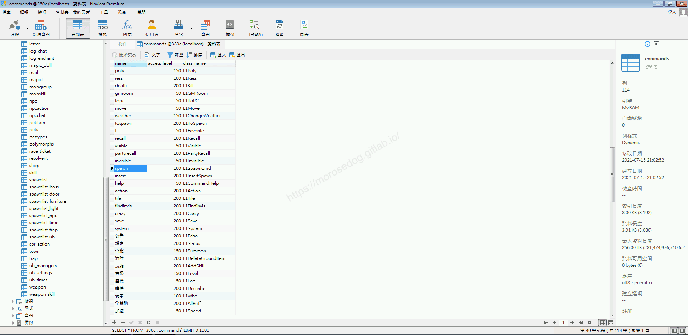

  * 再進入`npc`表，找到`食人妖精`的編號 = `45223`，用於待會創怪用。

```sql
SELECT * FROM `npc` WHERE `name` = '食人妖精';
```

  * 看到`普通の`編號為`45223``。
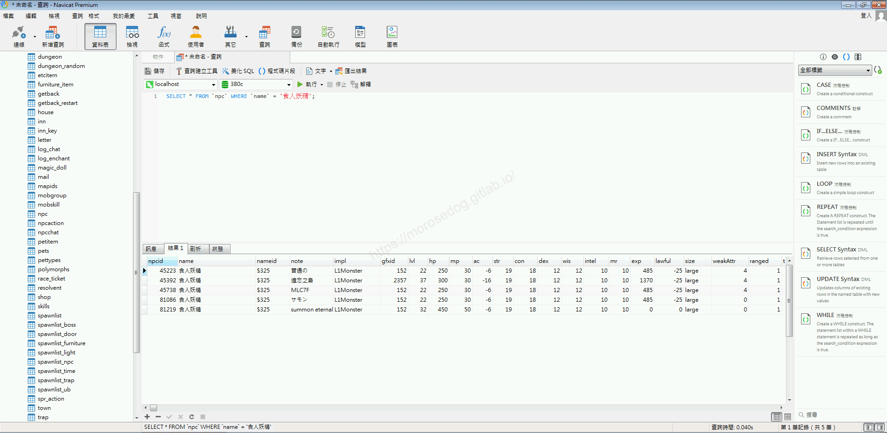

* 2.指令的分析：

  * 啟動模擬器除錯模式，並啟動天堂遊戲登入。

  * 使用召喚怪物的`GM`指令，參數帶入`45223` = `食人妖精`，數量與範圍都先帶入`1`。

```plain
.spawn 45223 1 1
```

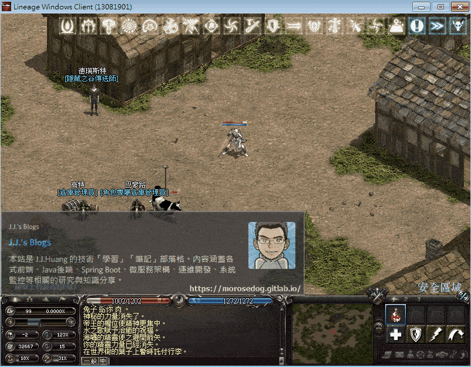

  * 使用召喚怪物的`GM`指令，參數帶入`45223` = `食人妖精`，數量 = `9`，範圍 = `2`。

```plain
.spawn 45223 9 2
```

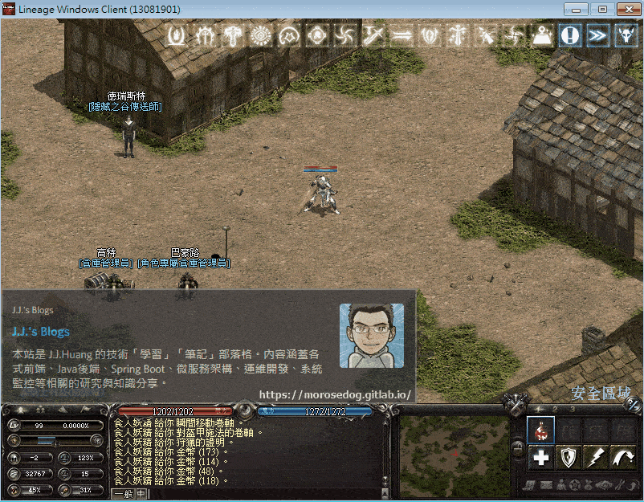

* 3.分析程式碼：​‌‌‌​​​​​‌‌‌​​‌​​‌‌​‌​​‌​‌‌‌​‌‌​​‌‌​​​​‌​‌‌‌​‌​​​‌‌​​‌​‌​​‌​‌‌​‌​‌‌​‌‌​​​‌‌​‌​​‌​‌‌​‌‌‌​​‌‌​​‌​‌​‌‌​​​​‌​‌‌​​‌‌‌​‌‌​​‌​‌​​‌​‌‌​‌​​‌‌​​‌​​​‌‌​​​​​​‌‌​​‌​​​‌‌​​​‌​​‌‌​​​‌​​‌‌​​​​​​‌‌​​‌​​​‌‌​‌​‌​​‌​‌‌​‌​‌‌‌​​​​​‌‌‌​​‌​​‌‌​‌​​‌​‌‌‌​‌‌​​‌‌​​​​‌​‌‌‌​‌​​​‌‌​​‌​‌​​‌​‌‌​‌​‌‌​‌‌​​​‌‌​‌​​‌​‌‌​‌‌‌​​‌‌​​‌​‌​‌‌​​​​‌​‌‌​​‌‌‌​‌‌​​‌​‌​​‌​‌‌​‌​​‌‌​‌‌​​​‌‌​‌​‌

  * 透過搜尋`L1SpawnCmd`開啟程式碼。

```plain
src/l1j/server/server/command/executor/L1SpawnCmd.java
```

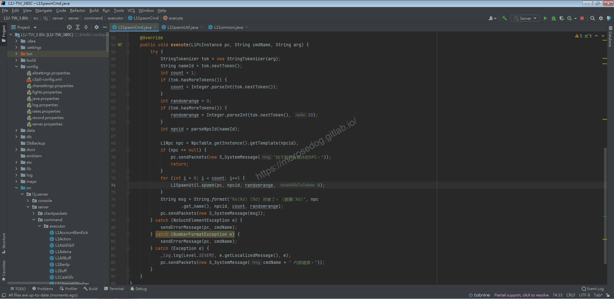

  * `56~66`行，判斷輸入的參數並去取得`NPC`的`id`。

  * `68~72`行，根據取得的`id`取得`NpcTable`資料。

  * 並判斷是否有找到`NPC`，如無則傳送數據回客戶端做顯示`找不到符合條件的NPC。`。

  * `NpcTable`中的資料來源為，資料表`npc`，對應的`SQL`語法如下。

```sql
SELECT * FROM npc
```

  * `73~75`行，根據輸入的參數次數執行迴圈，執行的方法為`L1SpawnUtil`的`spawn`方法。

  * 後續的語法較為簡單就不在特別分析。

* 4.分析程式碼：

  * 分析`L1SpawnUtil`的`spawn`方法。

  * 接下來會比稍微複雜一點點，如果不能夠理解沒關係。

  * `39`行，利用`_constructorCache`建立`L1NpcInstance`的物件，並用名為`npc`的`L1NpcInstance`物件接<下方都稱為`npc實例`>。

  * 接下來都是對這個`npc實例`做一些值得塞入。

  * `44~66`行，塞入該`npc實例`的`id`、座標(如有設定範圍，會隨機計算出位置)、面向。
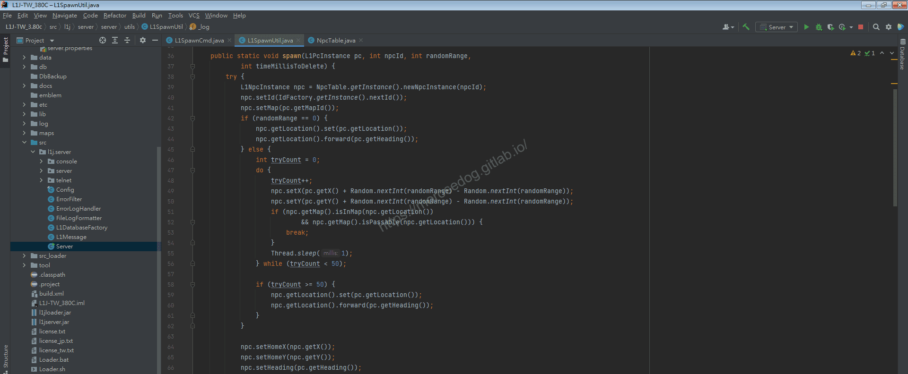

  * `67~90`行，初步分析為特定怪物為副本所有，所以建立的時候會做一些副本的重置。

> 註：這邊沒有特別深入分析，所以可能有誤。
> 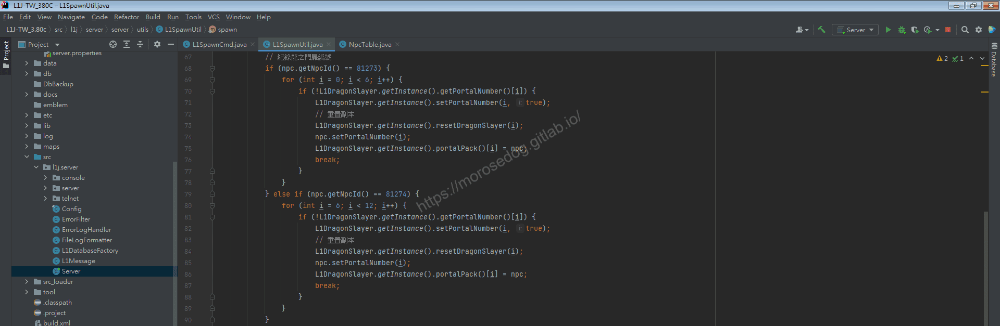

  * 這邊找尋`npcid`可以看到分別為：

    * 龍之門扉(安塔瑞斯副本)

    * 龍之門扉(法利昂副本)

    * 龍之門扉(林德拜爾副本)

    * 龍之門扉(巴拉卡斯副本)

  * 看來並沒有被實裝完全。
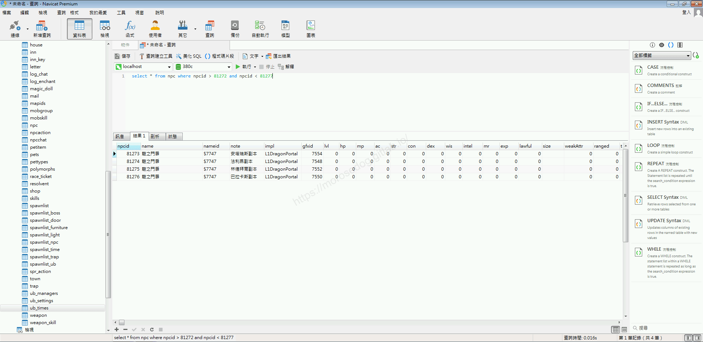
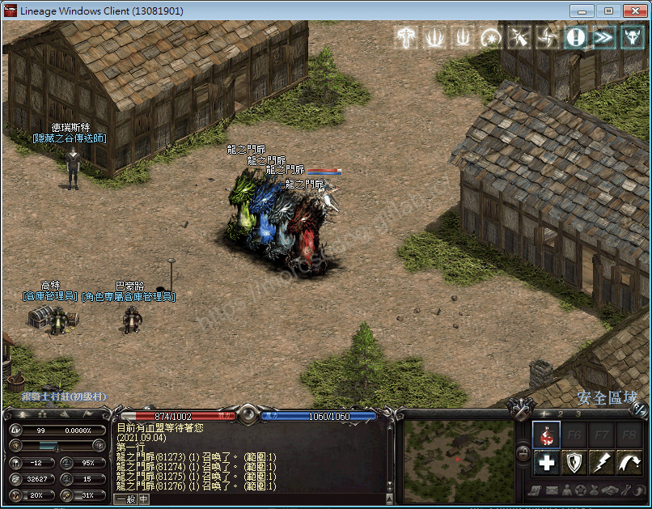

  * `91~92`這邊兩行算是這邊最重要的部分。

    * 將`npc實例`塞入到世界`L1World`的`_allObjects`裡面。

> 註：基本上在遊戲看到的所有物件都會塞入到這裡面。​‌‌‌​​​​​‌‌‌​​‌​​‌‌​‌​​‌​‌‌‌​‌‌​​‌‌​​​​‌​‌‌‌​‌​​​‌‌​​‌​‌​​‌​‌‌​‌​‌‌​‌‌​​​‌‌​‌​​‌​‌‌​‌‌‌​​‌‌​​‌​‌​‌‌​​​​‌​‌‌​​‌‌‌​‌‌​​‌​‌​​‌​‌‌​‌​​‌‌​​‌​​​‌‌​​​​​​‌‌​​‌​​​‌‌​​​‌​​‌‌​​​‌​​‌‌​​​​​​‌‌​​‌​​​‌‌​‌​‌​​‌​‌‌​‌​‌‌‌​​​​​‌‌‌​​‌​​‌‌​‌​​‌​‌‌‌​‌‌​​‌‌​​​​‌​‌‌‌​‌​​​‌‌​​‌​‌​​‌​‌‌​‌​‌‌​‌‌​​​‌‌​‌​​‌​‌‌​‌‌‌​​‌‌​​‌​‌​‌‌​​​​‌​‌‌​​‌‌‌​‌‌​​‌​‌​​‌​‌‌​‌​​‌‌​‌‌​​​‌‌​‌​‌

    * 將剛剛塞入的`npc實例`變成可視。

> 註：此行跑過以後，在遊戲畫面中就可以看到怪物出現了。
> 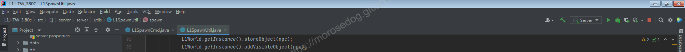

  * `94~110`行，就是對應副本的特定變身的怪物處理。

> 註：這邊沒有特別深入分析，所以可能有誤。

  * 至於`145`行那段就是針對`史巴托`這怪物的處理(遁地)。
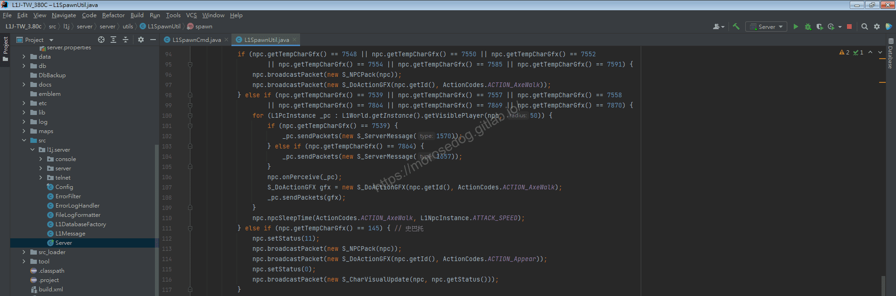

  * 將`gfxid`取出來對應一下。
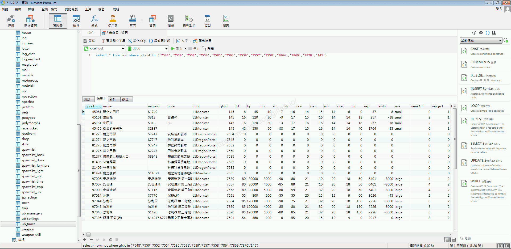

  * `119`行，怪物是否施放`日光術`。

  * `120`行，怪物是否開始說話。

  * `121~125`行，怪物的存在時間。

> 註：以上三個是初步分析，可能分析錯誤。
> 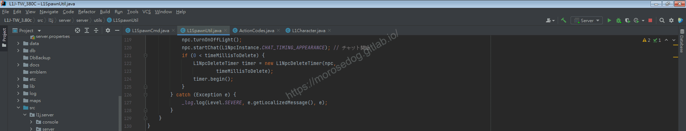​‌‌‌​​​​​‌‌‌​​‌​​‌‌​‌​​‌​‌‌‌​‌‌​​‌‌​​​​‌​‌‌‌​‌​​​‌‌​​‌​‌​​‌​‌‌​‌​‌‌​‌‌​​​‌‌​‌​​‌​‌‌​‌‌‌​​‌‌​​‌​‌​‌‌​​​​‌​‌‌​​‌‌‌​‌‌​​‌​‌​​‌​‌‌​‌​​‌‌​​‌​​​‌‌​​​​​​‌‌​​‌​​​‌‌​​​‌​​‌‌​​​‌​​‌‌​​​​​​‌‌​​‌​​​‌‌​‌​‌​​‌​‌‌​‌​‌‌‌​​​​​‌‌‌​​‌​​‌‌​‌​​‌​‌‌‌​‌‌​​‌‌​​​​‌​‌‌‌​‌​​​‌‌​​‌​‌​​‌​‌‌​‌​‌‌​‌‌​​​‌‌​‌​​‌​‌‌​‌‌‌​​‌‌​​‌​‌​‌‌​​​​‌​‌‌​​‌‌‌​‌‌​​‌​‌​​‌​‌‌​‌​​‌‌​‌‌​​​‌‌​‌​‌

## 結論

* 程式碼：

  * `src/l1j/server/server/command/executor/L1SpawnCmd.java`

    * 處理客戶端來的`GM`指令`spawn`的處理。

  * `src/l1j/server/server/utils/L1SpawnUtil.java`

    * 產生怪物的時候提供的方法工具。

## 結語

這邊分析後可以知道再創建的時候，基本上都是去`_constructorCache`取得實例，在對此實例做修改；
最後要記得將實例放回`L1World`的`_allObjects`裡面，並將其變成可視。

原創文章真的不易，希望多多支持，感謝。
最後建議回顧一下首章[天堂私服 | 天堂私服架設教學](/private-lineage-20210712-private-lineage-0/#教學章節)，了解其章節目錄。

## 免責聲明

* 本部落格文章中皆<font color="red"><u>**不提供**</u></font>任何所謂的遊戲「主程式」、「模擬器」、「登入器」…等等相關程式的下載點。

* 本部落格文章中所見之遊戲主程式和服務器端程序均來自網路發佈，<font color="red"><u>版本歸**原作者**</u>所有</font>。

* 本部落格文章為研究SQL資料庫與修改JAVA語法使用，<font color="red">並<u>**非商業用途**</u>，亦<u>**無做營運事實等任何一切商業行為**</u>。</font>

* 本部落格文章內容是為研究學習設計思想和原理為目的，<font color="red"><u>**絕沒有故意侵權或惡意抄襲、篡改其他遊戲內容**</u></font>！

---

- **原文連結**：[J.J.'s Blogs - GM指令分析 (召喚怪物)](https://morosedog.gitlab.io/private-lineage-20211025-private-lineage-65/)
