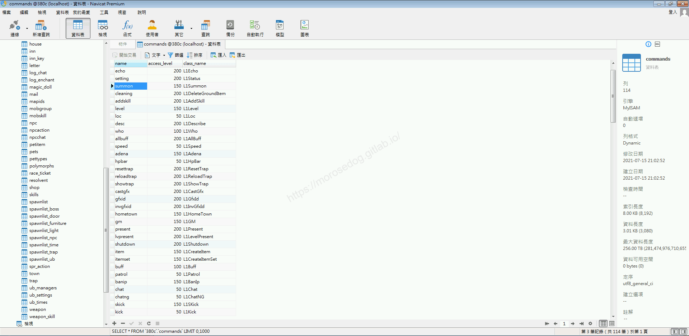
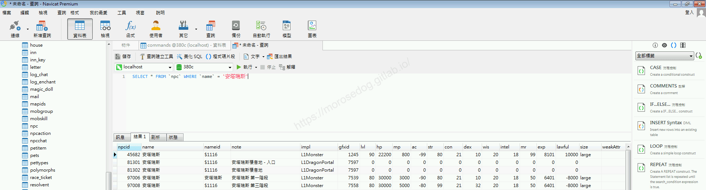
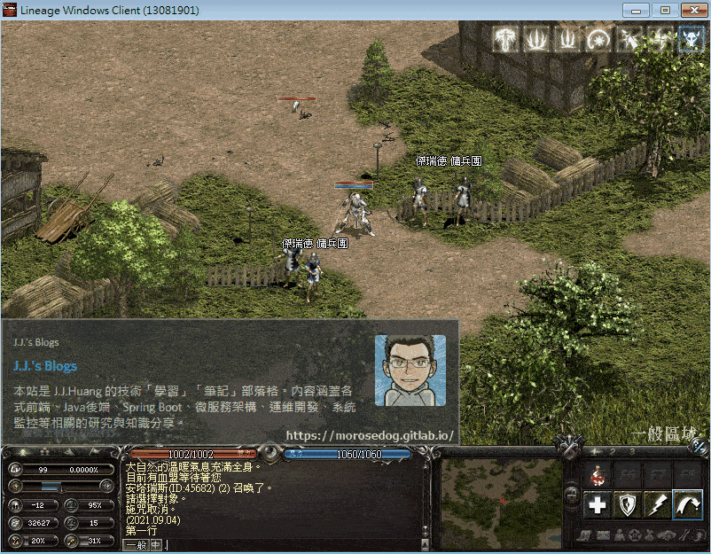
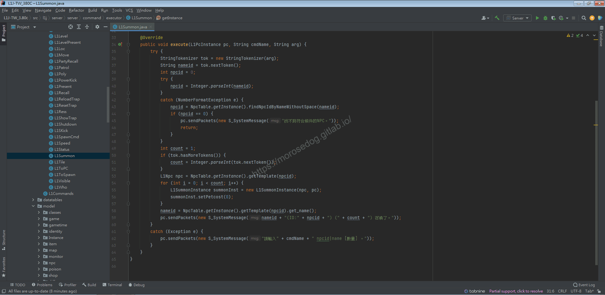
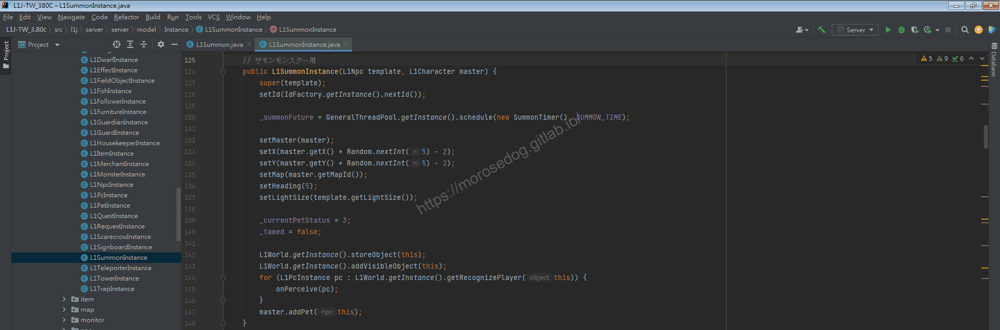
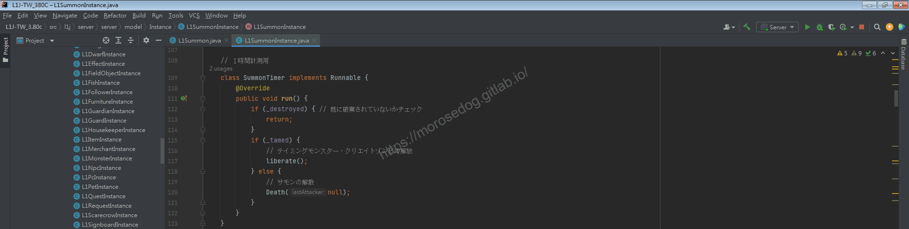
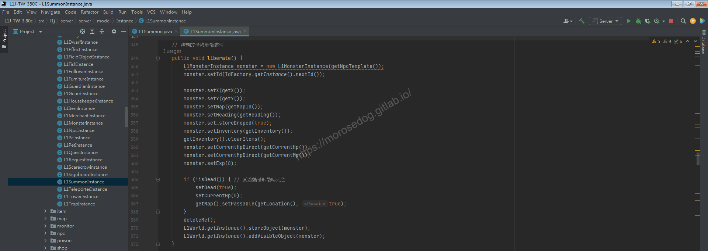
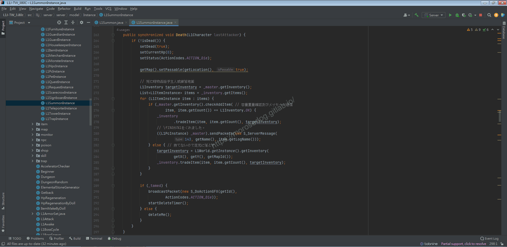
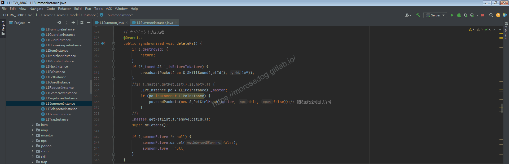

# GM指令分析 (召喚寵物)

# 天堂私服 | GM指令分析 (召喚寵物)「L1J版」

    
    
      📑 目錄
      

1. [章節用意](#章節用意)
2. [核心版本](#核心版本)
3. [前言](#前言)
4. [分析](#分析)
5. [結論](#結論)
6. [結語](#結語)
7. [免責聲明](#免責聲明)

    
    
    

## 章節用意

`summon`的指令，此指令用於召喚寵物，或許可以實裝更多道具召喚特別的`NPC`寵物。

## 核心版本

* L1J-3.80c

## 前言

在開始分析前，請務必先將以下文章閱讀完畢。

* [GM指令分析 (召喚怪物)](./065_GM指令分析_(召喚怪物).md)

  * 了解`L1SpawnUtil`的`spawn`方法行為，有助於了解這邊的分析。

## 分析

效果：召喚一個馴服的`NPC`。如果您指定名稱，則將設置找到的第一個名稱。
範例：​‌‌‌​​​​​‌‌‌​​‌​​‌‌​‌​​‌​‌‌‌​‌‌​​‌‌​​​​‌​‌‌‌​‌​​​‌‌​​‌​‌​​‌​‌‌​‌​‌‌​‌‌​​​‌‌​‌​​‌​‌‌​‌‌‌​​‌‌​​‌​‌​‌‌​​​​‌​‌‌​​‌‌‌​‌‌​​‌​‌​​‌​‌‌​‌​​‌‌​​‌​​​‌‌​​​​​​‌‌​​‌​​​‌‌​​​‌​​‌‌​​​‌​​‌‌​​​​​​‌‌​​‌​​​‌‌​‌‌​​​‌​‌‌​‌​‌‌‌​​​​​‌‌‌​​‌​​‌‌​‌​​‌​‌‌‌​‌‌​​‌‌​​​​‌​‌‌‌​‌​​​‌‌​​‌​‌​​‌​‌‌​‌​‌‌​‌‌​​​‌‌​‌​​‌​‌‌​‌‌‌​​‌‌​​‌​‌​‌‌​​​​‌​‌‌​​‌‌‌​‌‌​​‌​‌​​‌​‌‌​‌​​‌‌​‌‌​​​‌‌​‌‌​

```plain
.summon ${怪物編號 或 怪物名稱} ${數量}
```

* 1.分析資料表：

  * 先進入`commands`表，找到`summon`的指令。

  * `class_name`是`L1Summon`。


  * 再進入`npc`表，找到`安塔瑞斯`的編號 = `45682`，用於待會召喚用。

```sql
SELECT * FROM `npc` WHERE `name` = '安塔瑞斯';
```



* 2.指令的分析：

  * 啟動模擬器除錯模式，並啟動天堂遊戲登入。

  * 使用召喚寵物的`GM`指令，參數帶入`45682` = `安塔瑞斯`，數量 = `5`。

```plain
.summon 45682 5
```



* 3.分析程式碼：​‌‌‌​​​​​‌‌‌​​‌​​‌‌​‌​​‌​‌‌‌​‌‌​​‌‌​​​​‌​‌‌‌​‌​​​‌‌​​‌​‌​​‌​‌‌​‌​‌‌​‌‌​​​‌‌​‌​​‌​‌‌​‌‌‌​​‌‌​​‌​‌​‌‌​​​​‌​‌‌​​‌‌‌​‌‌​​‌​‌​​‌​‌‌​‌​​‌‌​​‌​​​‌‌​​​​​​‌‌​​‌​​​‌‌​​​‌​​‌‌​​​‌​​‌‌​​​​​​‌‌​​‌​​​‌‌​‌‌​​​‌​‌‌​‌​‌‌‌​​​​​‌‌‌​​‌​​‌‌​‌​​‌​‌‌‌​‌‌​​‌‌​​​​‌​‌‌‌​‌​​​‌‌​​‌​‌​​‌​‌‌​‌​‌‌​‌‌​​​‌‌​‌​​‌​‌‌​‌‌‌​​‌‌​​‌​‌​‌‌​​​​‌​‌‌​​‌‌‌​‌‌​​‌​‌​​‌​‌‌​‌​​‌‌​‌‌​​​‌‌​‌‌​

  * 透過搜尋`L1Summon`開啟程式碼。

```plain
src/l1j/server/server/command/executor/L1Summon.java
```



  * `36~52`行，判斷輸入的參數並去取得`NPC`的`id`和數量。

  * 並判斷是否有找到`npcid`，如無則傳送數據回客戶端做顯示`找不到符合條件的NPC。`。

  * `53`行，根據取得的`id`取得`NpcTable`資料。

  * `NpcTable`中的資料來源為，資料表`npc`，對應的`SQL`語法如下。

```sql
SELECT * FROM npc
```

  * `54~57`行，根據輸入的參數次數執行迴圈，主要是`new L1SummonInstance(npc, pc);`。

  * `56`行，這個`summonInst.setPetcost(0);`參數，初步了解應該是寵物所占用的魅力值。

  * 後續的語法較為簡單就不在特別分析。

* 4.分析程式碼：

  * 分析`L1SummonInstance`的`建構子`方法。

  * 首先`L1SummonInstance`繼承了`L1NpcInstance`。

  * 傳入的參數為`L1Npc template`與`L1Character master`。

  * `127~128`行，是父層的建構與設定該物件的`id`。

  * `130`行，建立一個`schedule`計時器`SummonTimer`，並設定為`3600`秒。

> 註：`SummonTimer`下面再另外分析。

  * `132~137`行，設定取得主人的位置，計算並寫入寵物的位置、面向..等等。

  * `139`行，`_currentPetStatus`，設定寵物狀態。

    * `1` = 攻撃狀態

    * `2` = 防禦狀態

    * `3` = 休息狀態

    * `4` = 裝備

    * `5` = 警戒

    * `6` = 解散

    * `7` = 前往主人身邊並休息

> 註：以上分析可能有誤，可能需要再參考自行嘗試。​‌‌‌​​​​​‌‌‌​​‌​​‌‌​‌​​‌​‌‌‌​‌‌​​‌‌​​​​‌​‌‌‌​‌​​​‌‌​​‌​‌​​‌​‌‌​‌​‌‌​‌‌​​​‌‌​‌​​‌​‌‌​‌‌‌​​‌‌​​‌​‌​‌‌​​​​‌​‌‌​​‌‌‌​‌‌​​‌​‌​​‌​‌‌​‌​​‌‌​​‌​​​‌‌​​​​​​‌‌​​‌​​​‌‌​​​‌​​‌‌​​​‌​​‌‌​​​​​​‌‌​​‌​​​‌‌​‌‌​​​‌​‌‌​‌​‌‌‌​​​​​‌‌‌​​‌​​‌‌​‌​​‌​‌‌‌​‌‌​​‌‌​​​​‌​‌‌‌​‌​​​‌‌​​‌​‌​​‌​‌‌​‌​‌‌​‌‌​​​‌‌​‌​​‌​‌‌​‌‌‌​​‌‌​​‌​‌​‌‌​​​​‌​‌‌​​‌‌‌​‌‌​​‌​‌​​‌​‌‌​‌​​‌‌​‌‌​​​‌‌​‌‌​

  * `140`行，`_tamed`，設定該寵物是否為`迷魅術`或`造屍術`產生的。(主要是針對時間到的時候解散會有不一樣的處理。)

  * `142~143`這邊兩行特別在前一篇提到：

    * 將`this`，也就是這個`L1SummonInstance`物件塞入到世界`L1World`的`_allObjects`裡面。

> 註：基本上在遊戲看到的所有物件都會塞入到這裡面。

    * 將剛剛塞入的`this`變成可視。

> 註：此行跑過以後，在遊戲畫面中就可以看到寵物出現了。

  * `144~146`行，依寵物為中心，針對畫面的所有玩家更新寵物感知？(應該就是讓玩家可以識別的物件)

  * `147`行，最後就是把這寵物新增給該角色下，並顯示寵物控制圖形介面。(為您的角色添加新寵物、召喚怪物、馴服怪物或製造殭屍。)


* 5.分析程式碼：​‌‌‌​​​​​‌‌‌​​‌​​‌‌​‌​​‌​‌‌‌​‌‌​​‌‌​​​​‌​‌‌‌​‌​​​‌‌​​‌​‌​​‌​‌‌​‌​‌‌​‌‌​​​‌‌​‌​​‌​‌‌​‌‌‌​​‌‌​​‌​‌​‌‌​​​​‌​‌‌​​‌‌‌​‌‌​​‌​‌​​‌​‌‌​‌​​‌‌​​‌​​​‌‌​​​​​​‌‌​​‌​​​‌‌​​​‌​​‌‌​​​‌​​‌‌​​​​​​‌‌​​‌​​​‌‌​‌‌​​​‌​‌‌​‌​‌‌‌​​​​​‌‌‌​​‌​​‌‌​‌​​‌​‌‌‌​‌‌​​‌‌​​​​‌​‌‌‌​‌​​​‌‌​​‌​‌​​‌​‌‌​‌​‌‌​‌‌​​​‌‌​‌​​‌​‌‌​‌‌‌​​‌‌​​‌​‌​‌‌​​​​‌​‌‌​​‌‌‌​‌‌​​‌​‌​​‌​‌‌​‌​​‌‌​‌‌​​​‌‌​‌‌​

  * 分析`SummonTimer`的`建構子`方法。

  * 主要實作的是`Runnable`，當計時器`3600`秒後觸發。

  * 判斷分為三個：

    * 判斷它是否已經被銷毀。

      * 如已經銷毀則不做事。

    * 釋放馴服怪物並創造殭屍。

      * 如為馴服的怪物則執行`liberate`方法。

    * 解除召喚。

      * 如上述都不是就是召喚的方式，執行`Death`方法。

  * 後續接著分析兩個方法。


  * 分析`liberate`方法。

  * 大致分析就是會將被迷魅的怪物的物件做刪除。

  * 再次重新建立一個這個怪物出現。


  * 分析`Death`方法。

  * 大致分析就是會將召喚出來的怪物物件做刪除。

  * 會判斷召喚的怪物身上是否有物品，如果有的話給主人。(會判斷負重..等等)


  * 上方方法中呼叫的`deleteMe`這方法，滿有趣的，判斷怪物是否是迷魅的還有一個是否要回歸自然的參數。來決定怪物的消失方式。

  * 沒有特別深入去分析，有興趣可以慢慢追。

> 註：測試方式可以迷魅個怪物來解散、召喚寵物來解散就可以看到不同的行為了。
> 

## 結論

* 程式碼：

  * `src/l1j/server/server/command/executor/L1Summon.java`

    * 處理客戶端來的`GM`指令`summon`的處理。

  * `src/l1j/server/server/model/Instance/L1SummonInstance.java`

    * 世界的產生`寵物`的實例。

    * 內部包含很多寵物的一些方法和`Class`。

## 結語

分析過後可以對召喚、寵物，有一些基本的了解。其實跟召喚怪物是差不多的。
主要是多了寵物的一些控制，還有解散的時候的一些處理。

當然其中可以知道寵物死掉或是解散的時候的一些額外判斷和操作，像是寵物身上物品的處理。​‌‌‌​​​​​‌‌‌​​‌​​‌‌​‌​​‌​‌‌‌​‌‌​​‌‌​​​​‌​‌‌‌​‌​​​‌‌​​‌​‌​​‌​‌‌​‌​‌‌​‌‌​​​‌‌​‌​​‌​‌‌​‌‌‌​​‌‌​​‌​‌​‌‌​​​​‌​‌‌​​‌‌‌​‌‌​​‌​‌​​‌​‌‌​‌​​‌‌​​‌​​​‌‌​​​​​​‌‌​​‌​​​‌‌​​​‌​​‌‌​​​‌​​‌‌​​​​​​‌‌​​‌​​​‌‌​‌‌​​​‌​‌‌​‌​‌‌‌​​​​​‌‌‌​​‌​​‌‌​‌​​‌​‌‌‌​‌‌​​‌‌​​​​‌​‌‌‌​‌​​​‌‌​​‌​‌​​‌​‌‌​‌​‌‌​‌‌​​​‌‌​‌​​‌​‌‌​‌‌‌​​‌‌​​‌​‌​‌‌​​​​‌​‌‌​​‌‌‌​‌‌​​‌​‌​​‌​‌‌​‌​​‌‌​‌‌​​​‌‌​‌‌​

原創文章真的不易，希望多多支持，感謝。
最後建議回顧一下首章[天堂私服 | 天堂私服架設教學](/private-lineage-20210712-private-lineage-0/#教學章節)，了解其章節目錄。

## 免責聲明

* 本部落格文章中皆<font color="red"><u>**不提供**</u></font>任何所謂的遊戲「主程式」、「模擬器」、「登入器」…等等相關程式的下載點。

* 本部落格文章中所見之遊戲主程式和服務器端程序均來自網路發佈，<font color="red"><u>版本歸**原作者**</u>所有</font>。

* 本部落格文章為研究SQL資料庫與修改JAVA語法使用，<font color="red">並<u>**非商業用途**</u>，亦<u>**無做營運事實等任何一切商業行為**</u>。</font>

* 本部落格文章內容是為研究學習設計思想和原理為目的，<font color="red"><u>**絕沒有故意侵權或惡意抄襲、篡改其他遊戲內容**</u></font>！

---

- **原文連結**：[J.J.'s Blogs - GM指令分析 (召喚寵物)](https://morosedog.gitlab.io/private-lineage-20211026-private-lineage-66/)
